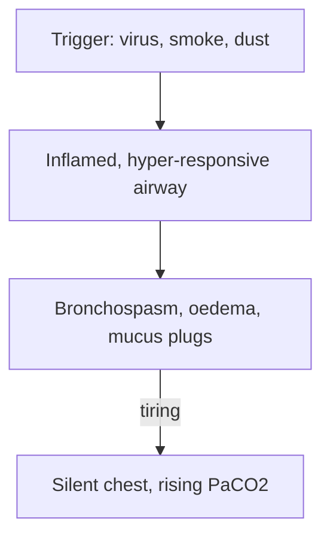

# Content guide: For Edith

Every topic lives in `content/topics/<slug>/` and has exactly two files:

| File | Purpose |
|---|---|
| `notes.md` | The study notes (Markdown + GFM tables, with front-matter) |
| `study.json` | Flashcards, single-best-answer MCQs, clinical cases and references |

Slugs come from `src/content/curriculum.ts`. Run `npm run validate` after writing
anything, and fix every error it reports.

The audience is **Edith**, a Year 3 junior clerk at **Uganda Christian University
School of Medicine** on her 6-week Obs & Gyn rotation (Mengo / Uganda setting). The
goal is to help her **understand concepts** and do well on the **ward, in bedside
presentations, OSCEs and the progressive written test**.

## The two priorities: management and clinical acumen

1. **Management must be excellent.** It should be step by step, in the order you would
   actually do things, and name the **drug, dose, route, frequency and duration**.
   Split it by setting where that helps (e.g. health centre III/IV vs regional or
   national referral hospital; before and after delivery; resuscitation, then
   definitive treatment, then follow-up).
2. **Clinical acumen must be taught explicitly**: how an experienced obstetrician
   *thinks*. Cover the focused history questions and why each one matters, the key
   examination findings, red flags, how to tell apart differentials that look alike,
   "what would you do next and why", common student mistakes, and how to present
   the case on a ward round.

## Source hierarchy (cite them)

1. **Uganda Clinical Guidelines 2023** (MoH) and other Uganda MoH documents (ANC,
   eMTCT/HIV consolidated guidelines, EmONC, MPDSR, cervical cancer).
2. WHO recommendations (ANC 2016, intrapartum care 2018, the Labour Care Guide,
   PPH 2012/2023 and E-MOTIVE, pre-eclampsia 2011/2023, MEC for contraception, HBB).
3. RCOG Green-top Guidelines, NICE, ACOG, FIGO, SOGC.
4. Standard textbooks: *Williams Obstetrics*, *Dewhurst's*, *Obstetrics by Ten
   Teachers*, *Gynaecology by Ten Teachers*, *Jeffcoate*, *Hacker & Moore*; StatPearls
   (NCBI Bookshelf) and review articles in the Lancet, BMJ, Cochrane, etc.

Where Uganda practice differs from WHO/UK guidance, **say so explicitly** (use an
`[!UGANDA]` callout). Double-check every dose against at least one guideline. Don't
invent citations; every URL in `references` must be a real page you found.

## `notes.md` format

Notes are being moved to a **structured format**: front-matter that names the topic's
`format`, and numbered H2 sections that are the same for every topic of that format. The
topic page shows structured notes as **four chapter tabs** (each a group of numbered
sections that fold open and closed), and `npm run validate` checks the exact heading list.
Topics not yet converted (no `format` key) still use the older free headings and are
validated as before; convert them, do not write new ones that way. The gold standard is
`content/topics/acute-asthma/notes.md`.

### Front-matter

```markdown
---
title: "Acute asthma (paediatric)"
summary: One or two sentences, exam-style, that capture the essence of the topic.
highYield:
  - 10–12 one-line must-know facts: numbers, cut-offs, doses, first-line actions (shown as "Must know")
format: disease            # disease | skill | concept
system: Respiratory
specialty: Paediatrics     # Obstetrics | Gynaecology | Paediatrics | Neonatology
level: Core                # Core | Advanced
tags: [asthma, wheeze, salbutamol]
last_reviewed: 2026-11-11  # YYYY-MM-DD
sources:
  - "Ministry of Health Uganda. Uganda Clinical Guidelines 2023 (5.1.1 Asthma)"
  - "Hutchison's Clinical Methods, 24th edition (Glynn & Drake), 2018"
---
```

All keys are required. `highYield` is the "Must know before the ward round" box above the
chapters; `sources` are short source names (full references go in section "References" and
in `study.json`).

### Choosing the format

| `format` | Use it for | Chapters on the topic page (sections) |
|---|---|---|
| `disease` | Most tutorials and lectures about a condition | Overview 1–5 · Diagnosis 6–8 · Management 9–13 · Revision 14–15 |
| `skill` | Bedside, examination and procedure topics | Overview 1–4 · Procedure 5–6 · Acumen & management 7–9 · Revision 10–12 |
| `concept` | Lectures that are not a single disease (professionalism, child rights, child survival, rational use of investigations, growth and development, IYCF, EmONC, anatomy, physiological changes) | Overview 1–3 · In practice 4–5 · Management & policy 6–7 · Revision 8–9 |

### `format: disease`: H2 headings exactly, in this order

1. `## 1. Definition`
2. `## 2. Epidemiology`
3. `## 3. Aetiology and Risk Factors`
4. `## 4. Pathophysiology`: a causal chain; every feature in section 6 traceable as
   "X → Y"; one ` ```mermaid ` flowchart (see below).
5. `## 5. Classification / Staging` (or "Not applicable" and one line why)
6. `## 6. Clinical Features` with ✔ `### History` (each question and *why* it matters),
   ✔ `### Examination` (Hutchison order, below), ✔ `### Red flags`,
   ✔ `### Thinking like a clinician` (patterns, pitfalls, "if X then think Y", common
   student mistakes)
7. `## 7. Differential Diagnoses`: a table, Differential | Distinguishing clinical feature |
   Distinguishing investigation
8. `## 8. Clinical Workup` with `### Bedside`, `### Basic lab`, `### Imaging`,
   `### Specialised / referral-level` (each test: why, expected finding, facility level) and
   ✔ `### Putting it together` (model one-liner, problem list, worked examples)
9. `## 9. Management` with `### Immediate / emergency` (ABCDE), `### Definitive`,
   ✔ `### Drug table` (Drug | Dose (per kg + max for children; adult) | Route | Frequency |
   Duration | Key cautions), `### Referral criteria` (HC III/IV → General Hospital → RRH →
   NRH), `### Monitoring and follow-up`. Extra subsections may follow these (by setting,
   ward care, discharge, prevention of recurrence…).
10. `## 10. Complications` (disease-related vs treatment-related)
11. `## 11. Prognosis`
12. `## 12. Prevention`
13. `## 13. Special Populations` (only those that change management)
14. `## 14. Key Points` with ✔ `### High-yield points`, ✔ `### Numbers & doses` (a table),
    ✔ `### Exam traps`, ✔ `### Questions seniors ask` (with answers), `### Mnemonics`,
    `### OSCE tips`, and `### Presenting this tutorial` where the topic is presented
15. `## 15. References`

### `format: skill`

`## 1. Purpose and Indications` · `## 2. Contraindications and Precautions` ·
`## 3. Relevant Anatomy and Normal Values` · `## 4. Equipment and Preparation` (consent,
positioning, exposure) · `## 5. Procedure Step by Step` (numbered; examinations in
Hutchison order) · `## 6. Findings and Interpretation` (what each sign means; a table) ·
`## 7. Clinical Acumen` (thinking like a clinician, judgement calls, when to stop or
escalate, common mistakes) · `## 8. Complications and Troubleshooting` ·
`## 9. Documentation and Presenting Findings` (a model presentation) ·
`## 10. OSCE Checklist` (a table: Step | Done well when | Critical?) · `## 11. Key Points`
(the same subsections as disease section 14) · `## 12. References`.

### `format: concept`

`## 1. Definitions and Key Concepts` · `## 2. Burden and Uganda Context` ·
`## 3. Principles and Framework` · `## 4. Application in Practice` (stepwise, what to do on
the ward) · `## 5. Clinical Acumen` (thinking like a clinician, pitfalls, scenarios) ·
`## 6. Common Problems and Their Management` · `## 7. Guidelines, Policy and Law in Uganda` ·
`## 8. Key Points` (the same subsections as disease section 14) · `## 9. References`.

### What the validator checks

- Every front-matter key above, with valid values.
- The exact numbered H2 list for the format, in order, and no other H2s.
- The ✔ subsections (disease sections 6, 8, 9 and 14; the Key Points section of skill and
  concept topics: High-yield points, Numbers & doses, Exam traps, Questions seniors ask).
  "Numbers and doses" and "Numbers & doses" are treated alike. A section whose body starts
  with "Not applicable" is not checked for subsections.
- The other subsections named above, the disease flowchart and the 10–12 `highYield`
  facts are warnings.
- Mermaid blocks must be readable flowcharts (below), callout types must be known, and the
  notes must contain no HTML.

### Examination: Hutchison order

Examination content follows **Hutchison's Clinical Methods, 24th edition**:
introduction and consent (parent, and the child's assent), hand hygiene, position and
exposure, general inspection from the end of the bed (well or unwell, distress, colour,
hydration, nutrition, dysmorphism; vital signs; growth plotted), hands → face → neck, then
the system (inspection → palpation → percussion → auscultation), complete the examination,
thank, hand hygiene, summarise. In children observe first, auscultate while the child is
quiet and leave distressing parts (ears, throat) to last. The obstetric abdominal
examination: inspection, fundal height, lie, presentation, engagement (fifths),
auscultation of the fetal heart. Add Hutchison to the references wherever examination is
covered.

### Flowcharts

Draw one Mermaid flowchart where a causal chain or algorithm helps (always in disease
section 4). The site does not run Mermaid: it draws the chart as a vertical chain of steps,
and the PDF prints the same chain. Keep it to a top-down chain, with a decision branch at
most:

````markdown

````

### `[VERIFY]` markers

Mark anything uncertain inline with `[VERIFY]` or `[VERIFY: short reason]`. Never invent a
statistic or a reference to avoid one. The site shows each marker as an amber "Verify" chip
and counts them in the topic header ("12 to verify"), so they are easy to find and clear.

### Callouts

Use GitHub-style alert blockquotes. Supported types:

```markdown
> [!PEARL]
> A high-yield clinical pearl.

> [!REDFLAG]
> Danger signs that need urgent action.

> [!UGANDA]
> Local practice, guideline or context note.

> [!DRUG]
> Critical dosing information.

> [!EXAM]
> Commonly examined point / viva favourite.

> [!NOTE]
> Anything else.
```

### Style

- Plain, warm, clear British English, written for a bright student rather than a
  consultant. Explain jargon the first time you use it.
- A conversion is a reorganisation at **full detail**, not a summary: carry over every
  clinically useful fact, dose, table, callout, worked example and teaching point; remove
  only true duplicates.
- Prefer **tables** and **numbered steps** to walls of text. Bold the key words.
- Use SI units (mmol/L, g/dL as used in Uganda), generic drug names and Ugandan drug
  availability (e.g. misoprostol, oxytocin, MgSO₄, hydralazine, nifedipine, methyldopa, TLD).
- Cite the most recent guideline editions (UCG 2023, the latest WHO, GINA 2025…). Where UCG
  and WHO or international guidance differ, say so in an `[!UGANDA]` callout.
- If a section genuinely does not apply, write "Not applicable" and one line why.
- No HTML, no images and no emojis. Use Markdown only.

## `study.json` format

```json
{
  "slug": "postpartum-haemorrhage",
  "flashcards": [
    { "id": "pph-f01", "front": "Question or cue", "back": "Answer (can use **markdown**)" }
  ],
  "mcqs": [
    {
      "id": "pph-q01",
      "stem": "A 28-year-old P3 ... What is the MOST appropriate next step?",
      "options": ["...", "...", "...", "...", "..."],
      "answer": 2,
      "explanation": "Why C is right AND why each distractor is wrong.",
      "difficulty": "core"
    }
  ],
  "cases": [
    {
      "id": "pph-c01",
      "title": "Short title",
      "presentation": "Realistic Ugandan clinical vignette (Mengo / HC IV / regional referral).",
      "steps": [
        { "prompt": "What are your immediate priorities?", "answer": "Model answer (markdown ok)" }
      ],
      "takeaway": "The key lesson."
    }
  ],
  "references": [
    { "title": "Uganda Clinical Guidelines 2023", "source": "Ministry of Health Uganda", "year": 2023, "url": "https://..." }
  ]
}
```

Rules:
- `id`s must be unique and prefixed with a short topic code.
- `answer` is the **0-based index** into `options`, and there must be exactly 5 options.
  Spread correct answers across positions.
- Minimum per topic: **20 flashcards, 12 MCQs, 2 cases (each with ≥4 steps), 5 references.**
  More is better (target 20 / 15 / 3).
- MCQs should be clinical-vignette, single-best-answer style, like the UCU written
  test. At least half must test **management decisions** or **clinical reasoning**,
  not recall. Use `"difficulty": "core"` or `"advanced"`.
- Cases should unfold step by step: presentation, then history to take, then
  examination findings, then differentials, then investigations, then management,
  then complications or follow-up. That rhythm builds acumen.
- JSON must be valid: escape double quotes inside strings and write no trailing commas.

## Downloadable PDFs

Each topic (and the quick reference) has a PDF in `public/pdf/`: the notes, then the
flashcards, the MCQs with an answer key, the cases and the references. They are
generated, not written by hand. After changing any content, run `npm run pdf` (it
rebuilds only what changed; add `--force` to rebuild everything) and commit
`public/pdf/`. `npm run validate` fails if a PDF is out of date.
