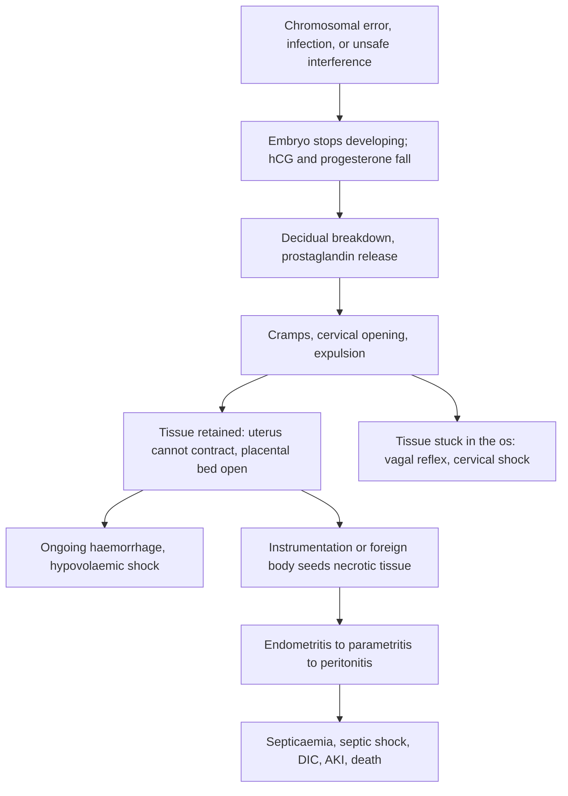

## 1. Definition

**Abortion** is the ending of a pregnancy before the fetus can survive outside the uterus. Ugandan clinical practice uses **before 28 weeks**; WHO uses **before 22 weeks or under 500 g** for international comparison.

| Term | Meaning |
|---|---|
| **Spontaneous abortion (miscarriage)** | Pregnancy loss with no deliberate intervention |
| **Induced abortion** | Pregnancy deliberately ended, by medication or by a procedure |
| **Unsafe abortion** (WHO) | A procedure to end a pregnancy done by someone without the necessary skills, or in an environment that does not meet minimal medical standards, or both. Examples: sticks, herbs, cassava stems, bicycle spokes, overdoses of chloroquine or other drugs, and "washing" with detergents |
| **Recurrent miscarriage** | Classically 3 or more consecutive losses (older RCOG definition, still used in much teaching). ESHRE and the 2023 RCOG update now use 2 or more |
| **Early pregnancy loss / missed miscarriage** (ultrasound terms) | **CRL 7 mm or more with no heartbeat**, or **mean sac diameter (MSD) 25 mm or more with no embryo**. Below these cut-offs, **rescan in 7–14 days** rather than acting |
| **Pregnancy of unknown location (PUL)** | Positive pregnancy test with no pregnancy seen in or outside the uterus. Includes complete miscarriage, very early intrauterine pregnancy (IUP) and ectopic pregnancy |
| **Post-abortion care (PAC)** | A package, not just a procedure: emergency treatment, counselling, **family planning before discharge**, other reproductive health services, and community links |

The clinical types (threatened, inevitable, incomplete, complete, missed, septic) are in section 5.

> [!UGANDA]
> Ugandan clinical teaching and the Uganda Clinical Guidelines define abortion as pregnancy loss **before 28 weeks**. Research and WHO statistics often use 22 weeks. A loss at 24 weeks is therefore still managed on the gynaecology (abortion) pathway in most Ugandan hospitals, while it would be a "late fetal loss" or "stillbirth" elsewhere.

## 2. Epidemiology

- **10–20% of clinically recognised pregnancies miscarry**, and about 80% of these losses happen before 12 weeks. The main cause is **aneuploidy** (an abnormal number of chromosomes), especially autosomal trisomy.
- Most spontaneous abortions happen in the first trimester and are chromosomal. Most **deaths**, however, come from **unsafe induced abortion**, through haemorrhage, sepsis and genital or bowel trauma.
- In Uganda, **abortion complications are a leading cause of gynaecological admission** and a consistent top cause of maternal death in MPDSR (maternal and perinatal death surveillance and response) reviews.
- **Unsafe abortion in Uganda:** national estimates (Prada et al., 2016) put induced abortions at roughly **300,000 a year**, with close to **100,000 women treated for complications** each year. Most of those women are young, poor, rural, unmarried students, or have an unmet need for contraception.
- **Determinants of septic abortion in Ugandan teaching hospitals** include rural residence, no income, induced abortion, evacuation attempted at home or at a lower-level unit, and no use of contraception.

**Facility realities**

- PAC with **misoprostol and MVA** is meant to be available at HC III and HC IV, and Ugandan trials show that **midwives achieve the same results as doctors** with misoprostol.
- In practice, MVA kits may be missing or unprocessed, misoprostol is out of stock, blood is short, and women arrive late because of fear of stigma, police or cost.
- An audit in a rural Ugandan hospital found **missing vital signs, poor fluid resuscitation of shocked women, and delayed evacuation of septic abortion**. These are exactly the gaps you can fix as a clerk.

> [!UGANDA]
> **Legal context (be precise and non-judgemental).** Article 22(2) of the Constitution says no one may terminate the life of an unborn child "except as may be authorised by law". The Penal Code criminalises procuring an abortion but protects a surgical operation done in good faith to preserve the mother's life. The MoH National Policy Guidelines and Service Standards for Sexual and Reproductive Health allow termination in specific situations, for example serious maternal illness, rape, incest or defilement. The 2015 MoH standards on reducing unsafe abortion were withdrawn soon after release, so the policy space is contested.
> **What is not contested:** **post-abortion care is legal, lifesaving and a patient right**. Treat every woman the same, whatever the cause, keep her information confidential, and never delay care to interrogate her.

## 3. Aetiology and Risk Factors

**Causes of spontaneous loss**

- **Chromosomal abnormality** (about half of first-trimester losses): trisomy (commonest is trisomy 16), then 45,X, then triploidy.
- **Maternal infection**: **malaria** (a febrile illness that inflames the placenta), **syphilis** (mainly later losses).
- **Uterine factors**: uterine anomalies, fibroids, **cervical insufficiency** (painless second-trimester loss).
- **Maternal disease**: uncontrolled diabetes or thyroid disease, antiphospholipid syndrome.

**Risk factors for spontaneous loss**

| Non-modifiable | Modifiable |
|---|---|
| Maternal age over 35 | Uncontrolled diabetes or thyroid disease |
| Previous miscarriage | Malaria, syphilis |
| Uterine anomalies | Smoking, alcohol |
| Antiphospholipid syndrome | Fibroids, cervical insufficiency (treatable in some) |

**Risk factors for unsafe induced abortion and its complications (Uganda)**

- Young, poor, rural, unmarried, student, unmet need for contraception.
- Rural residence, no income, evacuation attempted at home or at a lower-level unit, no use of contraception (determinants of **septic** abortion).
- Late presentation because of fear of stigma, police or cost.

## 4. Pathophysiology

**Why do most early pregnancies fail?** About half of first-trimester miscarriages have a chromosomal abnormality. The embryo stops developing and hCG and progesterone fall. The **decidua (the pregnancy-altered endometrium) breaks down**, and prostaglandins are released, causing **cramping and cervical opening**. What you see clinically is the uterus trying to expel its contents.

**Why does incomplete abortion bleed so much?**

- After a pregnancy loss, bleeding normally stops through **myometrial contraction**. The "living ligatures" of the uterine muscle squeeze the spiral arteries shut.
- **Retained tissue keeps the uterus from contracting fully** and holds the placental bed open, so bleeding continues.
- The fix is therefore **mechanical**: empty the uterus with MVA, or chemically make it contract with misoprostol. Blood transfusion alone never solves the problem.

**Cervical shock.** Products stuck in the cervical canal stretch the cervix, which is richly supplied by parasympathetic (vagal) fibres. The result is a **vasovagal reflex**: bradycardia, hypotension and pallor, **out of proportion to the visible blood loss**. Removing the tissue from the os with sponge forceps reverses it within minutes.

**Septic abortion**

- Instruments or foreign bodies carry vaginal, bowel and soil organisms into a **necrotic, blood-filled uterus**, which is a perfect culture medium.
- Organisms are **polymicrobial**: *E. coli* and other Gram-negative rods, anaerobes (*Bacteroides*, *Peptostreptococcus*), streptococci (including group A), and ***Clostridium perfringens*** (gas gangrene, haemolysis, bronze or jaundiced skin, renal failure). *Clostridium tetani* also matters, so give **tetanus prophylaxis**.
- Infection spreads from **endometritis → myometritis → parametritis → pelvic peritonitis / abscess → septicaemia → septic shock and DIC** (disseminated intravascular coagulation).
- Antibiotics cannot penetrate dead tissue well, so **evacuation is source control**. This is why you evacuate promptly after starting antibiotics, rather than "cooling her off" for days.
- Unsafe procedures can **perforate the uterus and injure bowel or bladder**. Suspect this with peritonitis, free gas under the diaphragm, or bowel or fat seen in the vagina or aspirate.

**Feature links**

- Decidual breakdown and prostaglandins → crampy midline pain, cervical opening, vaginal bleeding.
- Open os with tissue still inside → inevitable or incomplete abortion.
- Retained tissue → poor myometrial contraction → heavy, persistent bleeding → tachycardia, hypotension, pallor, raised shock index.
- Tissue in the cervical canal → vagal stimulation → bradycardia and hypotension out of proportion to blood loss (cervical shock).
- Embryonic death without expulsion → closed os, uterus smaller than dates, no symptoms (missed abortion); prolonged retention → coagulopathy.
- Infected necrotic tissue → fever, rigors, offensive discharge, tender bulky uterus.
- Spread beyond the uterus → peritonism, cervical motion tenderness, pelvic abscess.
- *Clostridium perfringens* toxin → haemolysis → jaundice, bronze skin, dark urine, renal failure.
- Sepsis and tissue factor release → DIC → bleeding from drip sites, non-clotting blood.
- Instrument through the uterine wall → perforation → peritonitis, free gas, bowel or omentum in the vagina or aspirate.
- Retained tissue in a dirty wound → *C. tetani* → trismus and spasms days later.

**How the drugs work (and why that explains their side-effects)**

| Drug | Mechanism | Consequences |
|---|---|---|
| **Misoprostol** | **Prostaglandin E1 analogue**: contracts the myometrium and softens (ripens) the cervix. Cheap, heat-stable, active by mouth | Side-effects are prostaglandin effects: **shivering, fever, diarrhoea, nausea and cramps**. **Sublingual** gives the fastest, highest peak; **vaginal** gives a longer effect with fewer side-effects |
| **Mifepristone** | **Progesterone receptor blocker**. Progesterone keeps the decidua alive and the uterus quiet; blocking it causes **decidual necrosis, cervical softening and a uterus much more sensitive to prostaglandins** | The combination (mifepristone first, then misoprostol 24–48 hours later) is more effective than misoprostol alone |
| **Oxytocin** | Acts on myometrial oxytocin receptors | Works poorly in early pregnancy because the uterus has **few oxytocin receptors before about 20 weeks**. Prostaglandins, not oxytocin, are the drugs of choice for early losses |

## 5. Classification / Staging

| Type | Bleeding | Pain | Cervical os | Uterus vs dates | Tissue passed | Ultrasound |
|---|---|---|---|---|---|---|
| **Threatened** | Light to moderate | Mild or none | **Closed** | Equal to dates | None | Viable intrauterine pregnancy (IUP) |
| **Inevitable** | Heavy | Cramping, often strong | **Open** | Equal to or less than dates | None yet (membranes may have ruptured) | Sac low in the uterus or in the cervix |
| **Incomplete** | Heavy, ongoing | Cramping | **Open**; products may sit in the os | **Less than dates** | Partial | Retained products (heterogeneous material) |
| **Complete** | Settling or minimal | Settling | **Closed** | Small, firm | All (sac seen) | Empty uterus, thin endometrium |
| **Missed** (silent miscarriage) | Absent or brownish spotting | None | **Closed** | **Less than dates** | None | Embryo without heartbeat, or empty sac |
| **Septic** | Any, often offensive | Lower abdominal or pelvic pain | Usually open | Tender, bulky | Often incomplete | Retained products, with or without free fluid |

**Management is also staged by uterine size** (WHO 2022): under 14 weeks versus 14 weeks or more (section 9).

## 6. Clinical Features

### History

Take it while the drip is going in if she is bleeding heavily. Each question has a reason.

| Ask | Why it matters (what changes the plan) |
|---|---|
| **LMP, cycle regularity, gestational age; any earlier scan showing an intrauterine pregnancy (IUP)?** | Dates the pregnancy. Uterine size smaller than dates suggests incomplete or missed abortion; size far larger than dates suggests a **molar pregnancy**, twins or fibroids. A previously confirmed IUP makes ectopic much less likely; no previous scan + closed os + empty uterus = PUL, not "complete abortion" |
| **How much bleeding?** (pads soaked per hour, clots, "flooding") | Soaking **1 pad or more in under an hour**, or passing large clots, means heavy bleeding. Look for shock; prepare for MVA and blood |
| **Has any tissue passed?** (what did it look like; did she bring it?) | Passed tissue suggests incomplete or complete abortion. Seeing a complete sac supports complete abortion; **inspect** anything she brought |
| **Pain:** crampy central, or one-sided and constant? Shoulder-tip pain? Fainting? | Crampy midline pain = the uterus is expelling. **Unilateral pain, shoulder-tip pain or collapse = ectopic pregnancy until proven otherwise** |
| **Fever, rigors, offensive discharge; days since the event** | Sepsis: antibiotics first, evacuation within hours. Late presentation (3 days or more) raises sepsis risk |
| **"Did anything happen before the bleeding?"** Asked gently and privately: any medicine, herb, insertion, or visit to anyone to "remove" the pregnancy? | Interference raises the risk of **sepsis, perforation, retained foreign body, tetanus** and drug toxicity: broaden cover, give tetanus prophylaxis, look for injury. Promise confidentiality, and explain it is to treat her safely, not to report her |
| **Was this pregnancy planned? Current contraception? Plans for future pregnancy?** | Opens PAC family-planning counselling and guides the method you offer. Unintended pregnancy is common after abortion |
| **Past obstetric history, previous miscarriages, previous CS or uterine surgery** | Recurrent loss work-up. A **previous CS** needs caution with repeated or high-dose misoprostol at larger uterine sizes (scar rupture), and raises perforation risk at MVA |
| **Rhesus group if known; HIV status; sickle cell; bleeding disorder** | Anti-D; PMTCT/ART linkage; anaemia risk and transfusion planning |
| **Medical illness and allergies** (diabetes, hypertension, epilepsy, asthma, bleeding disorder, penicillin allergy) | Choice of drug and anaesthesia: ergometrine is contraindicated in hypertension; antibiotic choice |
| **Tetanus immunisation status** | Td ± tetanus immunoglobulin after an unsafe procedure |

### Examination

Follow the order of Hutchison's Clinical Methods (24th edition), adapted for an emergency gynaecological examination. In a shocked woman, resuscitation (section 9) comes first and a quick bedside speculum to remove products from the os is part of resuscitation; complete the full sequence once she is stable.

#### Introduction, consent and preparation

- **Introduction and identity**: introduce yourself; confirm her name and age.
- **Explanation and consent**: explain each step, especially the speculum and bimanual examination; gain verbal consent. **Offer a female chaperone** and ensure privacy (screens, door closed).
- **Hand hygiene**: alcohol rub or soap and water; sterile gloves for the speculum if instrumentation is suspected.
- **Position and exposure**: supine with one pillow for the abdomen, exposing from the xiphisternum to the symphysis; then dorsal or lithotomy position for the speculum and bimanual. Lie her flat with legs raised if shocked.

#### General inspection and vital signs

| Sign | Mechanism | What it means |
|---|---|---|
| Pale, sweating, confused, gasping, lying in a pool of blood | Hypovolaemia, hypoperfusion | Shock: shout for help and resuscitate now |
| Pallor | Blood loss, pre-existing anaemia | Check Hb; transfusion if under 7 g/dL or still shocked |
| Jaundice, bronze skin | Haemolysis (*Clostridium perfringens*) | Clostridial sepsis; check bilirubin, renal function |
| Dehydration | Vomiting, sepsis, poor intake | Fluids; watch gentamicin toxicity |
| Altered consciousness (AVPU) | Shock, sepsis, hypoglycaemia | Senior help; check glucose |

**Vital signs**: pulse, BP, respiratory rate, temperature, SpO₂, capillary refill, level of consciousness (AVPU), urine output. Calculate the **shock index** (pulse ÷ systolic BP): **0.9 or more is abnormal, escalate; 1.4 or more is critical** (resuscitate and get blood). Young women keep their BP until late. Tachypnoea may mean sepsis, acidosis or ARDS.

#### Hands, face and neck

- **Hands**: cold, clammy peripheries and slow capillary refill (shock); palmar pallor (anaemia).
- **Face**: conjunctival pallor; scleral jaundice (haemolysis); bleeding gums (DIC).
- **Drip sites and skin**: oozing from cannula sites or bruising (DIC).
- **Neck**: brief check; neck stiffness or trismus days after an unsafe procedure suggests tetanus.

#### Chest and heart (brief)

Tachypnoea and crackles in sepsis or ARDS; flow murmur of anaemia.

#### Abdomen

| Step | Sign | What it means |
|---|---|---|
| Inspection | Distension | Ileus, haemoperitoneum, bowel injury |
| Palpation | Uterus palpable above the symphysis (roughly 12 weeks or more); fundal height in weeks | Size vs dates |
| Palpation | **Guarding, rigidity, rebound tenderness** | Peritonitis: perforation, bowel injury, ruptured ectopic, pelvic abscess |
| Percussion | Shifting dullness | Haemoperitoneum (ruptured ectopic, perforation) |
| Auscultation | Absent bowel sounds | Ileus, peritonitis, bowel injury |

#### Speculum (the single most useful step)

- Is the **os open or closed**? Width of the os.
- Are **products of conception (POC) in the os or vagina**? **Remove them now with sponge forceps** and keep them to inspect.
- Note the **source, amount and smell of the bleeding**, and any **offensive discharge** or pus.
- Look for **lacerations, burns or foreign bodies** (e.g. a stick, catheter or herbs) and **tenaculum marks on the cervix**, which are evidence of instrumentation.
- Other sources of bleeding: cervical polyp, ectropion, growth.

#### Bimanual

- **Uterine size in weeks** (this, not the LMP, decides MVA vs misoprostol), consistency, tenderness.
- **Cervical motion tenderness** (infection or ectopic).
- **Adnexal mass or tenderness** (ectopic, tubo-ovarian abscess).
- A **boggy or full pouch of Douglas** (blood, pus).

#### Completing the examination

- **Inspect any tissue** she passed or you removed (float it in saline: section 8).
- **Bedside tests**: urine hCG, Hb, bedside clotting test, mRDT, glucose (section 8).
- **Thank** her, cover her, **wash hands**.
- **Summarise** with the type of abortion, her stability, and whether there is sepsis or injury (model presentation in section 8).

**Document the key negatives:** "os closed/open, no POC in os, no offensive discharge, no cervical injury, uterus X weeks, non-tender, adnexae free, no peritonism".

### Red flags

> [!REDFLAG]
> - **Shock:** pulse over 110, systolic BP under 90, shock index 1 or more (1.4 or more critical), confusion, cold peripheries. Resuscitate before anything else.
> - **Fever of 38 °C or more, rigors, foul discharge, uterine tenderness.** This is septic abortion: start antibiotics within the hour.
> - **Peritonism, abdominal distension, absent bowel sounds, or bowel or omentum in the vagina or aspirate.** Suspect uterine perforation or bowel injury, which needs laparotomy.
> - **Jaundice, dark urine, bronze skin, oliguria.** Suspect clostridial sepsis, haemolysis or acute kidney injury.
> - **Bleeding from drip sites or gums, non-clotting blood.** Suspect DIC.
> - **Closed os, empty uterus, positive pregnancy test and abdominal pain.** Think ectopic pregnancy; with signs of shock it is a ruptured ectopic until proven otherwise.
> - **Uterus larger than dates with heavy bleeding, hyperemesis or grape-like vesicles.** Think molar pregnancy.
> - **Bradycardia with hypotension and tissue in the os.** Cervical shock: remove the tissue now.
> - **Fever with hypotension or confusion.** Septic shock: senior and anaesthetist now.

Call a senior at once for any of these.

### Thinking like a clinician

- **Start with the os.**
  - **Closed os + uterus equals dates + viable pregnancy:** threatened.
  - **Open os:** the pregnancy cannot be saved (inevitable or incomplete).
  - **Closed os + small uterus:** either complete abortion, missed abortion or ectopic. **Scan before you conclude.**
- **"Complete abortion" is a diagnosis of evidence**, not of hope. Accept it when:
  - you saw a complete sac or products, **or**
  - a previous scan showed an IUP and the uterus is now empty, **or**
  - hCG falls appropriately.

  An **empty uterus without a previously confirmed IUP is a pregnancy of unknown location (PUL)** until proven otherwise.
- **Uterine size, not LMP, decides the method.** WHO bases incomplete-abortion treatment on **uterine size**: under 14 weeks vs 14 weeks or more. A woman at 16 weeks by dates whose uterus is 10-week size after passing most tissue can have MVA.
- **Every febrile woman with a recent pregnancy loss has septic abortion until proven otherwise.** Do not blame malaria alone. Do a malaria test, but still examine the pelvis.
- **Assume interference is possible in every case, without accusing anyone.** Tenaculum marks, cervical tears, foreign bodies, burns, or a woman who is very ill with an apparently "simple" miscarriage should change your plan: broader antibiotics, tetanus cover, a lower threshold for laparotomy.
- **If bradycardic and hypotensive, look in the os before giving more fluid.** Cervical shock reverses within minutes once the tissue is out.
- **Do not forget the second patient: her future.** Before she goes home, ask about her fertility intentions and whether she has a contraceptive method.
- **Common student mistakes:**
  - Doing an MVA on a shocked patient before resuscitation.
  - Missing an ectopic because the pregnancy test was "positive, so it must be an abortion".
  - Giving misoprostol for a threatened abortion with a live fetus.
  - Forgetting anti-D.
  - Discharging without FP.
  - Not examining the removed tissue.

## 7. Differential Diagnoses

| Differential | Distinguishing clinical feature | Distinguishing investigation |
|---|---|---|
| **Ectopic pregnancy** | Unilateral pain (often before the bleeding), shoulder-tip pain, fainting, cervical excitation, adnexal tenderness or mass. The os is closed and the bleeding is scanty and dark | TVUS: empty uterus ± adnexal mass or free fluid; serial hCG |
| **Molar pregnancy** (gestational trophoblastic disease) | Uterus larger than dates, doughy; severe vomiting; early pre-eclampsia; passage of vesicles; theca-lutein cysts | Very high hCG; "snowstorm" appearance on ultrasound; histology of evacuated tissue |
| **Cervical lesions** (ectropion, polyp, cervicitis, cervical cancer) | Bleeding from a visible lesion; os closed; pregnancy normal | Speculum; scan confirms a viable IUP |
| **Implantation bleeding** | Light spotting around the expected period | Scan and dating |
| **Septic abortion vs malaria / UTI / appendicitis** | Uterine tenderness, offensive lochia and an open os point to the uterus | Speculum, pelvic exam, blood slide or mRDT, urinalysis, scan |
| **Anovulatory or dysfunctional bleeding** | Not pregnant | Negative urine or serum hCG |
| **Uterine perforation with bowel injury** (after an unsafe procedure) | Peritonitis, distension, free gas, faeculent aspirate | Erect chest X-ray / abdominal ultrasound; laparotomy |

## 8. Clinical Workup

This is the order in which a senior on the Mulago or Mengo gynae emergency ward works up a woman with **bleeding in early pregnancy**. Resuscitation, bloods and removal of POC from the os happen within the first 15–30 minutes; she should not wait for a scan or a lab result before resuscitation or before POC are removed from the os.

### Bedside

| Test | Why / when | Expected finding | How it changes management | Available at |
|---|---|---|---|---|
| **Urine pregnancy test (hCG)** | Everyone | Positive confirms pregnancy. May stay positive for **2–4 weeks** after complete abortion | A positive test does not mean retained tissue; persisting positivity beyond 3–4 weeks with symptoms suggests retained tissue, ectopic or gestational trophoblastic disease | All levels |
| **HemoCue / bedside Hb** | Everyone | Baseline; **Hb under 7 g/dL** | Transfuse if under 7 g/dL or ongoing shock | HC III and above |
| **Bedside clotting test** | Sepsis, prolonged retention of a dead fetus, bleeding from sites | 2 mL of blood in a plain glass tube held in the hand: **no clot by 7 minutes**, or a clot that breaks down, suggests **DIC** | Blood products, senior and anaesthetist; clotting screen if available | Any HC IV without a laboratory |
| **mRDT for malaria** | Fever plus pregnancy loss | Positive or negative | Treat malaria if positive, **but still examine the pelvis** for sepsis | All levels |
| **Random blood sugar** | Septic or confused women; after quinine | Hypoglycaemia | Dextrose | HC III and above (variable) |
| **Urine dipstick** | Everyone | Nitrites/leucocytes (UTI); blood; ketones (dehydration) | Treat UTI; fluids | All levels |
| **Point-of-care ultrasound** (if you are trained) | Unclear type, shock with closed os | Free fluid in the abdomen or pouch of Douglas (ruptured ectopic or perforation), retained products, fetal heartbeat | Laparotomy; evacuation; ectopic pathway | Where a trained user and machine exist |
| **Inspect the tissue** she passed or you removed | Every case with tissue | Float it in saline: villi look fluffy and fronded; a complete sac supports complete abortion; vesicles suggest mole | Confirms IUP; mole → hCG follow-up; no villi → think ectopic | All levels |

> [!PEARL]
> **Bedside clotting time.** Put 2 mL of venous blood in a plain glass tube and hold it in your hand. If it has **not clotted by 7 minutes** (or clots and then breaks down easily), suspect coagulopathy. This works at any HC IV without a laboratory.

### Basic lab

| Test | When | Expected / abnormal finding | How it changes management | Available at |
|---|---|---|---|---|
| **Hb / full blood count** | Everyone | Low Hb; **WBC raised** in sepsis; **platelets under 100** suggest DIC | Transfusion; supports sepsis; triggers a clotting screen | Hb at HC III+; FBC at HC IV and hospitals |
| **Blood group, Rhesus D, crossmatch** | Everyone | Rh-negative | Anti-D within 72 h after surgical evacuation or loss at 12 weeks or more; blood ready if heavy bleeding | HC IV and above can crossmatch |
| **HIV and syphilis tests** | Everyone | Positive | ART and PMTCT linkage; benzathine penicillin; syphilis explains second-trimester loss | All levels |
| **Urea, creatinine, electrolytes** | Sepsis, shock, oliguria, on gentamicin; repeat after 24 h in septic abortion | Rising creatinine = AKI | Adjust or stop gentamicin; fluid balance; dialysis referral | Some HC IVs and hospitals |
| **Lactate** | Septic abortion, where available | Raised lactate supports septic shock | HDU, fluids, vasopressors where available | Referral hospitals |

In septic abortion, repeat Hb and creatinine after 24 h.

### Imaging

| Test | When | Expected / abnormal finding | How it changes management | Available at |
|---|---|---|---|---|
| **Pelvic ultrasound** (TVUS if available) | Unsure of the type, closed os, suspected missed abortion, ectopic, mole or perforation | Viable IUP (threatened); **CRL 7 mm or more with no heartbeat or MSD 25 mm or more with no embryo** (missed); heterogeneous retained products; **empty uterus** ± adnexal mass/free fluid; snowstorm (mole) | Confirms the type; an empty uterus without a prior IUP → **serial hCG** and ectopic pathway; below the cut-offs → rescan in 7–14 days | Most HC IVs (abdominal); all referral hospitals |
| **Erect chest X-ray / abdominal X-ray** | Peritonism after an unsafe procedure | **Gas under the diaphragm**, foreign body | Laparotomy | General hospitals and above |

### Specialised / referral-level

| Test | When | Expected / abnormal finding | How it changes management | Available at |
|---|---|---|---|---|
| **Serum β-hCG** (quantitative) | PUL, suspected ectopic or mole | Suboptimal rise or plateau (ectopic); very high (mole); falling by at least 50% in 48 h (failing pregnancy) | Decides discharge vs ectopic management | Mainly regional/national referral and private labs |
| **Blood culture, high vaginal swab** | Septic abortion, before antibiotics if it causes no delay | Gram-negatives, anaerobes, *Clostridium* | Narrows antibiotics if she is not improving | Referral hospitals only in most of Uganda |
| **Clotting screen** (PT, APTT, fibrinogen) | Septic shock, bleeding from sites, abnormal bedside test | Prolonged PT/APTT, **fibrinogen under 2 g/L** | Fresh frozen plasma, platelets; senior and anaesthetist involvement | Regional/national referral |
| **Bilirubin, LFTs** | Jaundice, suspected clostridial sepsis or haemolysis | Raised unconjugated bilirubin | Supports haemolysis; consider early hysterectomy if the uterus is necrotic | Hospitals |
| **Histology of tissue** | Tissue looks abnormal (vesicles), no villi seen, or recurrent losses | Chorionic villi (confirms IUP); hydropic villi (mole) | Molar pregnancy → hCG follow-up; no villi → think ectopic | Referral hospitals |

### Putting it together

**Model one-line summary**

> "A 26-year-old P2+1 at 11 weeks by dates with 1 day of heavy bleeding and cramps, **haemodynamically stable** (pulse 100, BP 110/70, shock index 0.9, afebrile), Hb 9.5 g/dL, with an **open os, POC in the os** and a **9-week-size non-tender uterus**. **Working diagnosis: incomplete abortion, not septic, no evidence of interference.**"

**Problem list**

1. Incomplete abortion, uterine size under 14 weeks.
2. Mild-moderate anaemia (Hb 9.5 g/dL).
3. Rhesus status unknown.
4. Needs contraception (PAC).

**Plan:** POC removed from the os; MVA under paracervical block after ibuprofen (or misoprostol 600 µg orally if she prefers and can return); group and Rhesus; HIV/syphilis; iron; FP method before discharge.

**Model case presentation (ward round)**

> "Mrs N, a 24-year-old P1+1 at 10 weeks by dates, presented with 2 days of per vaginal bleeding and lower abdominal cramps, with passage of clots. She is **haemodynamically stable** (pulse 96, BP 112/70, afebrile), Hb 9.8 g/dL. On speculum the **os is open with products in the os**, and the uterus is 8-week size, non-tender. **Impression: incomplete abortion, not septic.** Plan: POC removed from the os; MVA under paracervical block with ibuprofen; group and Rhesus; HIV test; **post-abortion family planning counselling, she has chosen an implant**; review before discharge."

**Worked example 1: using the speculum to classify**

| Speculum and bimanual findings | Classification | Next step |
|---|---|---|
| Os **closed**, small amount of blood from the os, uterus = dates, non-tender | **Threatened** (confirm a viable IUP on scan) | Reassure, paracetamol, return advice. No misoprostol, no MVA |
| Os **open**, membranes bulging or no tissue passed yet, uterus = dates | **Inevitable** | Evacuate (MVA or misoprostol by uterine size) |
| Os **open**, tissue in the os, uterus smaller than dates | **Incomplete** | Remove POC; MVA or misoprostol 600 µg oral |
| Os **closed**, bleeding settled, uterus small and firm, **she saw a sac pass or a previous scan showed an IUP** | **Complete** | No evacuation; PAC package |
| Os **closed**, bleeding settled, uterus empty on scan, **no prior IUP** | **PUL** (not "complete") | Serial hCG 48 h apart; ectopic safety-net |
| Os open, **offensive pus**, tender bulky uterus, fever | **Septic** | Antibiotics within 1 h, evacuate within hours |
| Os open, **tenaculum marks and a cervical tear**, peritonism | **Septic, induced, with possible perforation** | Antibiotics, resuscitation, erect CXR, laparotomy |

**Worked example 2: interpreting a scan report.** A 30-year-old at 10 weeks by dates has spotting. Os closed. Scan: intrauterine sac, **MSD 18 mm, no embryo**.

- This is **below** the 25 mm cut-off, so you **cannot yet diagnose missed miscarriage** (dates may be wrong).
- Plan: **rescan in 7–14 days**. If she then has MSD 25 mm or more with no embryo, or an embryo with **CRL 7 mm or more and no heartbeat**, diagnose missed miscarriage and offer mifepristone + misoprostol, misoprostol alone, or MVA.
- Never give misoprostol "to be safe" on a single borderline scan: you might end a viable pregnancy.

## 9. Management

### Immediate / emergency

**First 5 minutes (any woman with bleeding in early pregnancy)**

1. **Look at her from the door.** Is she pale, sweating, confused, gasping, lying in a pool of blood? If yes, **shout for help** (midwife, intern, anaesthetist) and go straight to resuscitation.
2. **Vitals now** and the **shock index** (0.9 or more = escalate; 1.4 or more = critical).
3. **Two large-bore cannulae (16–18 G)**; draw blood for **Hb, grouping & crossmatch, bedside clotting test, mRDT, HIV and syphilis** at the same time (plus cultures and renal function if septic).
4. **Quick speculum at the bedside** if bleeding is heavy or she is bradycardic: **remove POC from the os with sponge forceps**. This is both diagnostic and treatment (cervical shock).

**ABCDE**

- **A**: airway; call for help.
- **B**: **oxygen** if SpO₂ is low or she is shocked; respiratory rate (tachypnoea in sepsis, acidosis, ARDS).
- **C**: lie her flat, legs raised. **Warmed Ringer's lactate or normal saline, 1 L quickly**, then reassess pulse, BP and urine output. **Transfuse if Hb is under 7 g/dL, or if she is still shocked after 1–2 L of crystalloid.** Remove POC from the os. **Uterotonic** if bleeding is heavy and evacuation is not immediately possible: **misoprostol 400 µg oral/sublingual** or **ergometrine 0.2 mg IM** (not if hypertensive). Catheterise and start a fluid balance chart if shocked or septic.
- **D**: AVPU; glucose (septic, confused, after quinine).
- **E**: temperature; **fever 38 °C or more, rigors or foul discharge** → take cultures if possible but **give the first IV antibiotic doses within the hour**. Look for jaundice and bleeding from drip sites.

**Then**: decide the type (os, size, scan), look for **sepsis or injury**, evacuate by the method that fits the uterine size and her condition, give antibiotics if septic (IV) or after instrumentation, **anti-D, tetanus prophylaxis, analgesia**, and the **PAC package before discharge** (counselling, **contraception**, HIV/STI services, follow-up).

### Definitive

#### Threatened abortion

1. Scan to confirm an **intrauterine pregnancy with a heartbeat**, and check for a subchorionic haematoma.
2. Reassure: most (about 80–90% with a live embryo) continue normally.
3. **Paracetamol** for pain. Avoid NSAIDs in ongoing pregnancy.
4. **No evidence supports strict bed rest** or routine hormones. Advise her to avoid heavy work and intercourse until the bleeding stops, mainly for comfort.
5. **Do not give misoprostol or do MVA.** The fetus is alive.
6. Treat any cause you find: malaria, UTI, syphilis.
7. Tell her to **return** if the bleeding becomes heavy, pain increases, tissue passes or she develops a fever. Continue ANC.

#### Inevitable and incomplete abortion: uterine size under 14 weeks

Offer a choice where she is stable and not septic. All three options are effective.

| Option | Details | Success | Best for |
|---|---|---|---|
| **MVA** (vacuum aspiration) | Paracervical block + NSAID; done in the procedure room | ~98–100% | Heavy bleeding, sepsis (after antibiotics), wants it done now, unreliable follow-up |
| **Misoprostol** | **600 µg orally, single dose**, or **400 µg sublingually, single dose** | ~90–96% within 1–2 weeks | Stable woman, no sepsis, can return; HC III with no MVA provider |
| **Expectant** | Wait for spontaneous expulsion | Lower and slower | Stable, minimal bleeding, strongly prefers to wait |

- Review **7–14 days after misoprostol**. Base the decision on her **symptoms and examination**, not on the scan alone. A thin rim of endometrial tissue or clot does not need MVA if she is well.
- **Do MVA if** bleeding is heavy, she is febrile, or retained products persist and she has symptoms.

> [!EXAM]
> **"Why not D&C?"** WHO recommends that **sharp curettage be replaced by vacuum aspiration**. D&C causes more blood loss, more pain, more perforation and more intrauterine adhesions (Asherman syndrome), and it usually needs general anaesthesia and a theatre.

#### Incomplete abortion: uterine size 14 weeks or more

1. Resuscitate; start **IV antibiotics** if any sign of infection.
2. **Misoprostol 400 µg sublingual, vaginal or buccal every 3 hours** until the fetus and placenta are expelled. WHO sets no fixed maximum, but use clinical judgement and **lower doses or caution with a previous uterine scar**.
3. Alternative when misoprostol is unavailable or the cervix is already open: **oxytocin 20–40 IU in 1 L normal saline or Ringer's lactate**, titrated to contractions (receptors increase as pregnancy advances).
4. **After expulsion:** examine the placenta. If it is incomplete or bleeding continues, remove the retained tissue with sponge forceps or MVA (large cannula). **Dilatation and evacuation (D&E)** should be done only by trained providers.
5. **Oxytocin 10 IU IM** after expulsion helps the uterus contract.

> [!UGANDA]
> Ugandan randomised trials at district hospitals showed that **misoprostol 400 µg sublingually every 3 hours (up to 5 doses)** for second-trimester incomplete abortion achieved complete evacuation within 24 hours in over 90% of women, **with midwives as safe and effective as doctors**. MoH policy lets midwives manage first-trimester PAC. Second-trimester care has traditionally been reserved for physicians, but task sharing is expanding.

#### Missed abortion (early pregnancy loss with closed os)

| Regimen | Details |
|---|---|
| **Preferred (WHO 2022), under 14 weeks** | **Mifepristone 200 mg orally**, then **1–2 days later misoprostol 800 µg** vaginally, sublingually or buccally |
| **Misoprostol alone** (mifepristone not available) | **Misoprostol 800 µg** vaginally, sublingually or buccally; repeat doses may be given if needed (commonly 3-hourly, up to 3 doses) |
| **Surgical** | **MVA** under paracervical block (up to 12–14 weeks' uterine size, depending on the provider and cannula) |
| **14–28 weeks (fetal death)** | See the *Intrauterine fetal death* topic: mifepristone 200 mg, then misoprostol 400 µg every 4–6 hours |

#### Complete abortion

1. Confirm it (section 6, *Thinking like a clinician*). If there was no previous scan showing an IUP, **scan, and consider serial hCG** to exclude ectopic.
2. No evacuation needed. Give anti-D if Rh-negative (below), analgesia, and the **PAC package**.

#### Septic abortion (a medical emergency)

1. **Resuscitate** (as above).
   - Aim for MAP of 65 mmHg or more and urine output over 0.5 mL/kg/h.
   - Catheterise and keep a **fluid balance chart**.
   - Take **blood cultures and a high vaginal swab** if you can, but **do not delay antibiotics**.
2. **IV antibiotics within 1 hour**: **ampicillin 2 g IV 6-hourly + gentamicin 5 mg/kg IV once daily + metronidazole 500 mg IV 8-hourly** (or the common alternative, ceftriaxone 1–2 g IV daily + metronidazole; drug table below).
   - **Continue IV until she has been fever-free for 48 hours**, then switch to oral **amoxicillin 500 mg 8-hourly** (or amoxicillin–clavulanate) **+ metronidazole 400 mg 8-hourly** to complete **7–14 days**.
   - Base the switch and the total duration on her response.
3. **Evacuate the uterus promptly**, within a few hours of starting antibiotics, **by MVA**.
   - Do not wait days for the fever to settle: **the retained tissue is the source**.
   - In large or second-trimester uteri, use misoprostol plus evacuation.
4. **Tetanus prophylaxis** after any unsafe procedure:
   - **Tetanus toxoid (TT/Td) 0.5 mL IM**.
   - Plus **tetanus immunoglobulin 250 IU IM** if she is unimmunised or her status is unknown and the wound is dirty.
5. **Look for injury and act:**
   - **Laparotomy** if there is peritonitis, suspected perforation or bowel injury, a pelvic abscess, or no improvement 24–48 hours after evacuation and antibiotics.
   - **Hysterectomy** may be lifesaving if the uterus is necrotic (e.g. clostridial infection) or there is uncontrollable haemorrhage.
6. **Supportive care:** analgesia, correct anaemia, watch for **DIC**, acute kidney injury and ARDS; involve anaesthesia / HDU.
7. **Refer** from HC IV to a regional or national referral hospital (e.g. Mulago, Kawempe) if she needs ICU, dialysis, or surgery beyond local capacity. **Start antibiotics and fluids before transfer.**

> [!DRUG]
> **Gentamicin 5 mg/kg once daily** (e.g. 300 mg for a 60 kg woman). Reduce or stop it if urine output falls or creatinine rises, because it is nephrotoxic and ototoxic. In sepsis with acute kidney injury, ceftriaxone + metronidazole is a practical alternative.

### Drug table

| Drug | Dose (adult) | Route | Frequency | Duration | Key cautions |
|---|---|---|---|---|---|
| **Misoprostol** (incomplete, uterus under 14 weeks) | 600 µg oral **or** 400 µg sublingual | Oral / SL | Single dose | Review at 7–14 days | Shivering, fever, diarrhoea, cramps; never for threatened abortion with a live fetus |
| **Misoprostol** (incomplete, uterus 14 weeks or more) | 400 µg | SL, vaginal or buccal | Every 3 h | Until expulsion (Ugandan trials: up to 5 doses) | Lower doses or caution with a previous uterine scar |
| **Misoprostol** (missed abortion under 14 weeks) | 800 µg (after mifepristone, or alone) | Vaginal, SL or buccal | Once; if alone, may repeat (commonly 3-hourly, up to 3 doses) | Until expulsion | As above |
| **Misoprostol** (uterotonic while awaiting evacuation) | 400 µg | Oral / SL | Once | Once | Not a substitute for evacuation |
| **Mifepristone** | 200 mg | Oral | Once, 1–2 days before misoprostol | Once | Missed abortion; often unavailable |
| **Oxytocin** (14 weeks or more) | 20–40 IU in 1 L normal saline or Ringer's lactate | IV infusion | Titrated to contractions | Until expulsion | Poor effect before about 20 weeks (few receptors) |
| **Oxytocin** (after expulsion) | 10 IU | IM | Once | Once | Helps the uterus contract |
| **Ergometrine** | 0.2 mg | IM | Once | Once | **Avoid in hypertension** |
| **Ampicillin** | 2 g | IV | 6-hourly | Until fever-free 48 h | Covers streptococci, *Clostridium*, enterococci |
| **Gentamicin** | 5 mg/kg (e.g. 300 mg for 60 kg) | IV | Once daily (24-hourly) | Until fever-free 48 h | Nephrotoxic, ototoxic; check renal function and hydration; reduce or stop if oliguric |
| **Metronidazole** | 500 mg | IV | 8-hourly | Until fever-free 48 h | Anaerobes |
| **Ceftriaxone** (common alternative) | 1–2 g | IV | Once daily | Until fever-free 48 h | Widely used in Ugandan hospitals; **still add metronidazole**; practical if AKI |
| **Amoxicillin** (or amoxicillin–clavulanate) | 500 mg | Oral | 8-hourly | To complete 7–14 days | Step-down after 48 h fever-free |
| **Metronidazole** (oral) | 400 mg | Oral | 8-hourly | To complete 7–14 days | No alcohol |
| **Tetanus toxoid (TT/Td)** | 0.5 mL | IM | Once | Once | After any unsafe procedure |
| **Tetanus immunoglobulin** | 250 IU | IM | Once | Once | If unimmunised or status unknown and the wound is dirty |
| **Anti-D immunoglobulin** | 250 IU before 20 weeks; 500 IU from 20 weeks (UK doses); Ugandan stock vial usually 1,500 IU | IM | Once, within 72 h | Once | Rh-negative after surgical evacuation or loss at 12 weeks or more; not required for medical abortion under 12 weeks (WHO 2022) |
| **Ibuprofen** | 400–800 mg | Oral | 30–60 min before MVA or with misoprostol | Short course | NSAIDs do not reduce misoprostol's effect; avoid in ongoing pregnancy (threatened abortion) |
| **Paracetamol** | 1 g | Oral | 6–8-hourly | As needed | Max 4 g/day |
| **Lidocaine 1%** (paracervical block) | Up to 20 mL (max **4.5 mg/kg** without adrenaline) | Cervical injection | Once before MVA | Once | See *MVA kit* topic |
| **Diclofenac** | 75 mg | IM | Once (repeat as needed) | Short | Moderate to severe pain |
| **Pethidine** | 50–100 mg | IM | As needed | Short | Severe pain; watch for respiratory depression |

WHO recommends **against routine general anaesthesia** for vacuum aspiration. A paracervical block plus an NSAID, with calm verbal support ("vocal local"), is enough for most women.

### Referral criteria

| Level | What you can do | Refer up when |
|---|---|---|
| **HC III** | Diagnose; resuscitate (IV fluids); remove POC from the os; **misoprostol** for incomplete abortion under 14 weeks; MVA by a trained midwife or clinical officer; first-dose antibiotics; FP | Shocked, septic or second-trimester cases → HC IV or hospital |
| **HC IV / General Hospital** | All of the above plus **MVA**, second-trimester misoprostol, **blood transfusion**, **laparotomy** (perforation, ectopic), IV antibiotics | Needs ICU/HDU, dialysis, hysterectomy for a necrotic uterus, bowel surgery or surgery beyond local capacity → RRH |
| **Regional Referral Hospital (RRH)** | ICU / HDU, hysterectomy for necrotic uterus, bowel surgery, D&E, specialist ultrasound, management of complex complications | Dialysis or ICU unavailable, or complex complications beyond capacity → NRH |
| **National Referral Hospital (Mulago, Kawempe)** | Dialysis, ICU, all specialist surgery | n/a |

Level split between RRH and NRH adapted from the source notes [VERIFY: against UCG 2023 levels of care].

**Before any referral:** IV line and fluids running, first antibiotic dose given, uterotonic if bleeding, POC removed from the os, a referral note with **vitals and drugs given**, and a health worker escorting her.

### Monitoring and follow-up

- **In hospital**: pulse, BP, temperature, bleeding and urine output; fluid balance chart if shocked or septic; repeat Hb and creatinine after 24 h in sepsis.
- **Follow-up** **7–14 days** after misoprostol, or 1–2 weeks after MVA.
- Check: bleeding, pain, fever; contraception satisfaction; results (HIV, syphilis); histology.
- **Pregnancy test** at 3–4 weeks only if symptoms persist. Persistent positive hCG suggests retained tissue, ectopic, or gestational trophoblastic disease.

### Rhesus (anti-D) prophylaxis

- **Rh-negative women having surgical evacuation**, and any Rh-negative woman losing a pregnancy **at 12 weeks or more**: give **anti-D immunoglobulin 250 IU IM** before 20 weeks (500 IU from 20 weeks), **within 72 hours**.
- WHO 2022 says **anti-D is not required for medical abortion under 12 weeks**.

> [!UGANDA]
> Anti-D is expensive and often unavailable in public units. Check the Rhesus group anyway, document it, and if anti-D cannot be given, **tell her** so the next pregnancy is monitored for isoimmunisation.

### PAC elements: the complete package

The PAC consortium model has **5 elements**:

1. **Community and service-provider partnerships.** Prevent unwanted pregnancy and unsafe abortion; mobilise women to seek care early.
2. **Counselling.** Address her emotional and physical health needs; explain what happened, the warning signs, and when she will be fertile again.
3. **Treatment** of incomplete and unsafe abortion and its complications: MVA, misoprostol, antibiotics, surgery.
4. **Contraceptive and family-planning services.** **Ovulation can return within 8–10 days**, so start contraception **before she leaves**.
5. **Reproductive and other health services:** HIV testing and linkage, syphilis and STI treatment, cervical cancer screening (VIA), nutrition and iron, screening for gender-based violence, and referral for infertility or recurrent-loss work-up.

### Post-abortion family planning (WHO MEC)

| Method | After 1st-trimester abortion | After 2nd-trimester abortion | After septic abortion |
|---|---|---|---|
| COC, POP, injectable (DMPA), implant | **Start immediately** (MEC 1) | Immediately (MEC 1) | Immediately (MEC 1) |
| **Copper IUD / LNG-IUS** | **Immediately after MVA** (MEC 1) | MEC 2 (higher expulsion) | **Do not insert** (MEC 4). Wait until the infection has resolved |
| Condoms | Immediately; dual protection | Immediately | Immediately |
| Tubal ligation | Can be done at the time, if she chose it freely and was counselled before the emergency | Same | **Delay** until the infection has resolved |
| Fertility-awareness methods | Delay until regular cycles return | Delay | Delay |

> [!PEARL]
> If she gets misoprostol, an **implant or injectable can be given the same day**. An IUD can go in once the abortion is confirmed complete at follow-up. A Ugandan study found that offering an IUD after medical management of incomplete abortion is acceptable to many women. Do not make her come back twice.

## 10. Complications

**Disease-related**

| Complication | Clues | Action |
|---|---|---|
| **Haemorrhage / hypovolaemic shock** | Tachycardia, hypotension, ongoing bleeding | Resuscitate, remove POC, uterotonic, evacuate, transfuse |
| **Cervical shock** | Bradycardia and hypotension out of proportion to blood loss, tissue in the os | Remove POC with sponge forceps; lie flat; fluids |
| **Retained products** | Persistent bleeding, open os, fever | Repeat MVA or misoprostol |
| **Sepsis / septic shock / DIC** | Fever, tachycardia, hypotension, bleeding from sites | Antibiotics, evacuation, supportive care, blood products |
| **Tetanus** | Trismus, spasms, days after an unsafe procedure | Prevent with TT ± TIG; ICU care |
| **Acute kidney injury** | Oliguria, rising creatinine (sepsis, haemolysis, gentamicin) | Fluids, stop nephrotoxins, dialysis referral |
| **Long-term** | Asherman syndrome (adhesions), secondary infertility (tubal damage), chronic pelvic pain, ectopic in future, isoimmunisation, psychological distress | Counselling, FP, fertility referral |

**Treatment- or procedure-related**

| Complication | Clues | Action |
|---|---|---|
| **Uterine perforation** (MVA, D&E, or unsafe procedure) | Instrument passes further than expected; peritonitis | Observe if small and she is stable; laparotomy if bowel injury or bleeding |
| **Bowel or bladder injury** | Faeculent aspirate, peritonitis, haematuria | Laparotomy, surgical team |
| **Asherman syndrome** | Amenorrhoea or infertility later; more after sharp curettage | Use vacuum aspiration, not D&C |
| **Misoprostol side-effects** | Shivering, fever, diarrhoea, nausea, cramps | Reassure; paracetamol; fever after misoprostol is short-lived, but persistent fever needs a sepsis review |
| **Scar rupture** | Previous CS, repeated misoprostol at larger uterine sizes | Lower doses or caution |
| **Gentamicin toxicity** | Oliguria, rising creatinine, hearing loss | Reduce or stop; switch to ceftriaxone + metronidazole |
| **Local anaesthetic toxicity** | Perioral tingling, seizures, arrhythmia | Respect the 4.5 mg/kg lidocaine maximum |

## 11. Prognosis

- **Threatened abortion with a live embryo**: about 80–90% continue normally.
- **Incomplete abortion**: MVA succeeds in ~98–100%; misoprostol in ~90–96% within 1–2 weeks; expectant management is lower and slower.
- **Fertility** returns quickly: **ovulation can return within 8–10 days**, and fertility within 2 weeks.
- Deaths are mostly from **unsafe induced abortion** (haemorrhage, sepsis, trauma) and are largely preventable by early presentation, prompt resuscitation, antibiotics and evacuation.
- Long-term risks after septic or unsafe abortion: Asherman syndrome, tubal infertility, chronic pelvic pain, future ectopic pregnancy, isoimmunisation, psychological distress.

## 12. Prevention

- **Primary**: prevent unintended pregnancy (contraception, community partnerships), and treat malaria, syphilis, diabetes and thyroid disease before and in pregnancy.
- **Secondary**: early presentation and prompt PAC; misoprostol and MVA available at HC III/IV; task sharing to midwives.
- **Tertiary (prevent repeat unsafe abortion and complications)**: **contraception before discharge**, anti-D for Rh-negative women, tetanus prophylaxis, HIV/STI services, and referral for recurrent-loss work-up.
- **System fixes** (from the Ugandan audit): record vital signs, resuscitate shocked women properly, and do not delay evacuation of septic abortion.

## 13. Special Populations

- **Previous caesarean section or uterine surgery**: caution with repeated or high-dose misoprostol at larger uterine sizes (scar rupture); perforation risk at MVA.
- **Rhesus-negative women**: anti-D within 72 h after surgical evacuation or loss at 12 weeks or more; if anti-D is unavailable, tell her so the next pregnancy is monitored.
- **Hypertension**: avoid ergometrine; use misoprostol or oxytocin.
- **Septic abortion and contraception**: no IUD (MEC 4) and delay tubal ligation until the infection has resolved; offer an implant, injectable or pills.
- **HIV-positive women**: ART and PMTCT linkage; all contraceptive methods remain options.
- **Acute kidney injury in sepsis**: avoid or adjust gentamicin; ceftriaxone + metronidazole.
- **Second-trimester loss (14–28 weeks)**: misoprostol regimens differ (section 9); see also the *Intrauterine fetal death* topic.

## 14. Key Points

### High-yield points

- Is she stable? Then what type? Then is there sepsis or injury?
- Classify by the **os** and the **uterus**; the speculum is the key examination.
- Shock index 0.9 or more abnormal, 1.4 or more critical.
- Bradycardia and hypotension with tissue in the os = **cervical shock**: remove it.
- **Uterine size**, not the LMP, decides MVA vs misoprostol (under 14 vs 14 weeks or more).
- Closed os + empty uterus + no prior IUP = **PUL**, not complete abortion.
- Septic abortion: antibiotics within 1 h, **evacuate within hours**.
- MVA replaces D&C.
- Anti-D, tetanus prophylaxis, and **contraception before discharge**.
- PAC is legal, lifesaving and a patient right.

### Numbers & doses

| Item | Value |
|---|---|
| Abortion definition (Uganda / WHO) | Before **28 weeks** / before 22 weeks or under 500 g |
| Shock index | **0.9 or more** abnormal; **1.4 or more** critical |
| Transfusion trigger | Hb **under 7 g/dL**, or still shocked after 1–2 L crystalloid |
| Missed miscarriage on scan | **CRL 7 mm or more** with no heartbeat, or **MSD 25 mm or more** with no embryo |
| Incomplete abortion, uterus under 14 weeks | MVA, or misoprostol **600 µg oral once** or **400 µg SL once** |
| Incomplete abortion, uterus 14 weeks or more | Misoprostol **400 µg SL/vaginal/buccal every 3 h** until expulsion |
| Missed abortion under 14 weeks | **Mifepristone 200 mg** orally, then **misoprostol 800 µg** 1–2 days later (or misoprostol 800 µg alone) |
| Uterotonic while awaiting evacuation | Misoprostol **400 µg** oral/SL or ergometrine **0.2 mg IM** |
| Septic abortion antibiotics | **Ampicillin 2 g IV 6-hourly + gentamicin 5 mg/kg IV daily + metronidazole 500 mg IV 8-hourly** |
| IV antibiotics until | Fever-free **48 h**, then oral to complete 7–14 days |
| Paracervical block | Lidocaine 1% up to **20 mL**; max **4.5 mg/kg** (plain) |
| Tetanus after unsafe abortion | **Td 0.5 mL IM** ± **TIG 250 IU IM** |
| Anti-D (Rh-negative) | Within **72 h**; UK 250 IU before 20 weeks; the Ugandan vial usually stocked is 1,500 IU |
| Bedside clotting test | No clot by **7 minutes** = coagulopathy |
| Follow-up after misoprostol | **7–14 days** |
| Return of ovulation | As early as **8–10 days** |

### Exam traps

- **"Positive hCG + bleeding = miscarriage."** Wrong: closed os + empty uterus with no previous IUP is a **PUL, possibly ectopic**. Do serial hCG.
- **"Bradycardia and hypotension, so give more fluids and wait for theatre."** Wrong: this is **cervical shock**. Remove POC from the os with sponge forceps now.
- **"Septic abortion: give antibiotics for 48 h to cool her off, then evacuate."** Wrong: start antibiotics, then **evacuate within hours**; the retained tissue is the source.
- **"Use the LMP to decide MVA vs misoprostol."** Wrong: **uterine size** on bimanual decides (under 14 vs 14 weeks or more).
- **"Fever after an abortion is malaria."** Wrong until you have **examined the pelvis**: septic abortion first.
- **"Oxytocin is the best drug for a first-trimester incomplete abortion."** Wrong: few oxytocin receptors before about 20 weeks; use **misoprostol**.
- **"Insert an IUD at the time of MVA for septic abortion."** Wrong: **MEC 4**. Offer an implant, injectable or pills instead.
- **"A small retained rim on the day-10 scan needs MVA."** Wrong if she is well: manage by **symptoms and examination**, not the scan alone.
- **"D&C is the standard evacuation."** Wrong: vacuum aspiration has replaced sharp curettage.
- **"Give misoprostol to be safe on a borderline scan."** Wrong: below the cut-offs, rescan in 7–14 days.

### Questions seniors ask

**Viva questions**

1. *What decides MVA vs misoprostol?* Uterine size (under 14 weeks either works), her stability (heavy bleeding or sepsis favours MVA), her preference, and whether she can come back.
2. *What is cervical shock and how do you treat it?* A vagal response to POC stretching the cervix. Bradycardia and hypotension out of proportion to blood loss. Remove the POC with sponge forceps; lie her flat; give fluids.
3. *Name the 5 elements of PAC.* Community partnerships, counselling, treatment, contraception/FP, other reproductive health services.
4. *Why start IV antibiotics before evacuating a septic abortion, but evacuate soon?* Antibiotics reduce bacteraemia during instrumentation. Evacuation removes the infected necrotic tissue that antibiotics cannot sterilise.
5. *When can she start an IUD after abortion?* Immediately after first-trimester MVA (MEC 1), unless there is septic abortion (MEC 4).
6. *What is the WHO misoprostol dose for incomplete abortion under 14 weeks?* 600 µg orally or 400 µg sublingually, single dose.
7. *A woman bleeds in early pregnancy, the os is closed and the uterus is empty on scan. Diagnosis?* Pregnancy of unknown location. It could be a complete miscarriage, a very early IUP or an ectopic. Do serial hCG and do not discharge without a safety net.

**On the ward round**

- **What is the first thing you do for a woman bleeding heavily at 10 weeks?** Assess ABC and vitals, calculate the shock index, two large-bore cannulae with bloods, fluids, and a speculum to remove POC from the os.
- **How do you tell inevitable from incomplete abortion?** Both have an open os; in incomplete, **some tissue has already passed** and the uterus is usually smaller than dates.
- **What makes you suspect an induced (unsafe) abortion?** Tenaculum marks, cervical tears, burns, foreign bodies, a very sick woman after an apparently "simple" miscarriage, or peritonism.
- **When would you do a laparotomy in septic abortion?** Peritonitis, suspected perforation or bowel injury, pelvic abscess, gas under the diaphragm, or no improvement 24–48 h after antibiotics and evacuation.
- **What are the scan criteria for missed miscarriage?** CRL 7 mm or more with no heartbeat, or MSD 25 mm or more with no embryo; below that, rescan in 7–14 days.
- **What must she leave with?** A contraceptive method (if she wants one), HIV/syphilis results or linkage, anti-D if Rh-negative and indicated, danger-sign advice and a follow-up date.
- **When is an empty uterus reassuring?** Only if a previous scan showed an IUP, or she passed a sac you saw, or hCG falls appropriately.

### Mnemonics

**"TIC-MS": the types in the order the os and the uterus decide them**

- **T**hreatened: **T**ight (closed) os, **T**rue-to-dates uterus, heartbeat present
- **I**nevitable / **I**ncomplete: os **I**s open
- **C**omplete: **C**losed, **C**ontracted small uterus, **C**alm (bleeding stopped)
- **M**issed: **M**ute (no symptoms), **M**acerated or dead embryo, closed os
- **S**eptic: **S**mell, **S**hivers, **S**ore uterus

**The septic abortion antibiotic trio: "A-G-M" (like "a German")**: **A**mpicillin 2 g 6-hourly + **G**entamicin 5 mg/kg daily + **M**etronidazole 500 mg 8-hourly, until 48 hours fever-free.

**Misoprostol "6-4 under 14; 4 every 3 over 14"**

- Under 14 weeks: **600** µg oral or **400** µg sublingual, once.
- 14 weeks or more: **400** µg every **3** hours.

**PAC = "C-C-T-F-R"**: **C**ommunity, **C**ounselling, **T**reatment, **F**amily planning, **R**eproductive health services.

### OSCE tips

> [!EXAM]
> **PAC counselling station.** Cover:
> - what happened, and that it was not her fault if spontaneous;
> - danger signs: fever, heavy bleeding, foul discharge, severe pain;
> - fertility returns within 2 weeks;
> - her contraceptive choice (offer all methods with pros and cons);
> - HIV testing;
> - follow-up date.
>
> Keep your tone warm and non-judgemental; examiners mark it.

- **History station**: ask about interference privately and gently, explain confidentiality, and never accuse.
- **Examination station**: state that you would offer a chaperone, calculate the shock index aloud, and describe the speculum findings (os, POC, smell, injury) before the bimanual.
- **Presenting**: give the type, her stability, and whether there is sepsis or injury in one line, then the plan including FP.

## 15. References

1. Ministry of Health Uganda. Uganda Clinical Guidelines 2023: National Guidelines for Management of Common Health Conditions. Kampala: MoH; 2023. https://www.differentiatedservicedelivery.org/wp-content/uploads/UCG-2023-Publication-Final-PDF-Version-1.pdf
2. World Health Organization. Abortion care guideline: Incomplete abortion management, Recommendations 35–38. 2022. https://srhr.org/abortioncare/chapter-3/post-abortion-3-5/incomplete-abortion-management-recommendations-35-38-3-5-2/
3. World Health Organization. Abortion care guideline: Recommendation 31, Medical management of missed abortion <14 weeks. 2022. https://srhr.org/abortioncare/chapter-3/abortion-3-4/clinical-services-recommendation-31-medical-management-of-missed-abortion-at-gestational-ages-14-weeks-3-4-3/
4. World Health Organization. Clinical practice handbook for quality abortion care. 2023. https://cdn.who.int/media/docs/default-source/reproductive-health/clinical-practice-handbook-for-quality-abortion-care.pdf?sfvrsn=e82e253c_7
5. Morris JL et al. FIGO's updated recommendations for misoprostol used alone in gynecology and obstetrics. Int J Gynecol Obstet. 2017. https://obgyn.onlinelibrary.wiley.com/doi/full/10.1002/ijgo.12181
6. Weeks A et al. A randomized trial of misoprostol compared with manual vacuum aspiration for incomplete abortion (Kampala). Obstet Gynecol. 2005. https://pubmed.ncbi.nlm.nih.gov/16135584/
7. Treatment of incomplete second-trimester abortion with misoprostol by midwives and physicians: randomised equivalence trial in Uganda. BMJ Global Health. 2022. https://www.ncbi.nlm.nih.gov/pmc/articles/PMC9605879/
8. Management of abortion complications at a rural hospital in Uganda: a criterion-based audit. BMC Women's Health. 2015. https://link.springer.com/article/10.1186/s12905-015-0233-y
9. Antibiotic susceptibility profiles and determinants of septic abortion among women admitted for abortion care in Ugandan satellite teaching hospitals. Health Science Reports. 2026. https://onlinelibrary.wiley.com/doi/10.1002/hsr2.72062
10. Barriers and facilitators in the provision of post-abortion care at district level in central Uganda. BMC Health Services Research. 2014. https://pmc.ncbi.nlm.nih.gov/articles/PMC3903434/
11. Uptake of intrauterine contraception after medical management of first trimester incomplete abortion in central Uganda. PLOS One. 2025. https://journals.plos.org/plosone/article?id=10.1371%2Fjournal.pone.0310936
12. MSD Manual Professional Edition. Septic abortion. https://www.msdmanuals.com/professional/gynecology-and-obstetrics/early-pregnancy-disorders/septic-abortion
13. Gynuity Health Projects. Misoprostol for Treatment of Incomplete Abortion: An Introductory Guidebook. https://gynuity.org/assets/resources/clinguide_pacguide_en.pdf
14. Glynn M, Drake WM, editors. Hutchison's Clinical Methods: An Integrated Approach to Clinical Practice. 24th edition. Edinburgh: Elsevier; 2018.
