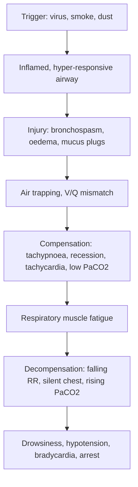

## 1. Definition

**Asthma** is a chronic inflammatory airway disease with **variable** respiratory symptoms (wheeze, cough, breathlessness, chest tightness) and **variable expiratory airflow limitation** (GINA 2025).

**Acute asthma (exacerbation, "asthma attack")** is a sudden or gradual worsening of symptoms and lung function beyond the child's usual day-to-day variation that needs a change in treatment. It is caused by bronchospasm, airway wall oedema and mucus plugging in the small airways.

| Term | Meaning |
|---|---|
| **Wheeze** | Continuous, high-pitched, mainly **expiratory** musical sound from narrowed intrathoracic airways |
| **Stridor** | Inspiratory sound from the larynx or trachea (upper airway); not asthma |
| **Preschool wheeze** | Wheeze under 5 years. **Episodic viral wheeze**: only with colds, well in between. **Multiple-trigger wheeze**: also with exercise, laughing, smoke, at night. Multiple-trigger wheeze is more likely to be asthma |
| **Status asthmaticus** | Older term for a severe attack not responding to repeated standard bronchodilator therapy; now called **acute severe** or **life-threatening asthma** |
| **Near-fatal asthma** | An attack needing ventilation, or with a rising PaCO₂ |

Examinable thresholds:

- **Severe**: SpO₂ <92% in air, or PEF 33–50% of best or predicted.
- **Life-threatening**: PEF <33%, silent chest, cyanosis, exhaustion or altered consciousness.
- **Near-fatal**: needs ventilation, or PaCO₂ is rising.
- **Reversibility (diagnosis, when well, age ≥5–6 years)**: FEV₁ rises ≥12% after salbutamol (UCG 2023).

**Classification of the attack** (UCG 2023, from BTS/SIGN): mild–moderate, severe, life-threatening. Full criteria in section 5.

## 2. Epidemiology

- **Global**: asthma is the commonest chronic disease of childhood. WHO estimates about 363 million people affected and about 442,000 deaths in 2023, mostly in low- and middle-income countries [VERIFY: figures against the current WHO fact sheet].
- **Uganda and sub-Saharan Africa**: reliable national data for Ugandan children are not available. School surveys suggest wheeze in about one in ten children, more in urban Kampala than rural areas [VERIFY: primary source and figure]. Most are **undiagnosed, or use only salbutamol tablets or syrup**.
- **Presentation**: one of the commonest reasons a school-age child is carried into the emergency room at night. Children still die, usually because the attack was **under-graded**, treated with too little salbutamol, given oxygen late, or sent home without a plan.
- **Oral treatment culture**: many children are still treated with oral salbutamol and oral aminophylline. These work slowly, cause tremor and tachycardia, and are no substitute for an inhaler with a spacer.

**Services by level of care** (equipment; tests are in section 8 and drugs in section 9) [VERIFY: compiled from the source notes and local experience, not an MoH equipment list]

| Level | Usually available | Often missing |
|---|---|---|
| **HC III** | Salbutamol inhaler, sometimes a nebuliser, malaria RDT, HIV test | Oxygen, pulse oximeter, spacer, peak flow meter |
| **HC IV / General Hospital** | Oxygen concentrator, pulse oximeter, nebuliser, basic laboratory (FBC), X-ray at some HC IVs and all hospitals | Peak flow meter, commercial spacers, HDU |
| **Regional Referral Hospital (RRH)** | All the above, chest X-ray, HDU, serum electrolytes | Blood gas machine at many RRHs, PICU |
| **National Referral Hospital (NRH, Mulago) and large PNFP hospitals (Mengo, Lubaga, Nsambya)** | Blood gas, HDU, echocardiography, bronchoscopy; PICU and ventilation at Mulago and a few private hospitals | PICU beds are very few |

**Uganda pearl.** Magnesium sulfate is on every labour ward (50% ampoules for eclampsia), so it is usually available even when the paediatric ward has none. Borrow it, but calculate the paediatric dose (40–50 mg/kg, max 2 g) and dilute it: the eclampsia loading dose (4 g IV) would be a dangerous overdose in a child.

## 3. Aetiology and Risk Factors

Inherited susceptibility plus environmental exposure cause allergic (Th2) airway inflammation. An attack needs a trigger on top.

**Triggers (commonest in our setting first)**

- **Viral infections**, especially rhinovirus colds: the commonest trigger.
- **Indoor smoke**: charcoal stoves, firewood, kerosene lamps, cigarette smoke.
- **Dust and cold**: house dust mite, dusty roads in the dry season, cold early mornings.
- **Allergens**: cockroaches, pets, moulds.
- **Exercise, laughing, strong perfumes.**
- **Drugs**: aspirin and NSAIDs (in sensitive children), β-blockers.
- **Food or sting**: think anaphylaxis, not asthma alone (section 7).
- **Poor control**: no inhaled corticosteroid (ICS), no spacer, poor adherence or technique, salbutamol tablets only, cost of inhalers.

**Risk factors for asthma**

| Non-modifiable | Modifiable |
|---|---|
| Family history of asthma or atopy | Tobacco smoke, including in pregnancy |
| Eczema, allergic rhinitis, food allergy | Indoor biomass smoke (charcoal, firewood, kerosene) |
| Male sex in childhood | Damp housing, dust mite, cockroaches |

**Risk factors for a fatal attack** (GINA 2025). Ask about every one; lower your threshold to escalate if any is present.

| Modifiable | Non-modifiable |
|---|---|
| Not on ICS; poor adherence | Previous ICU admission or intubation |
| More than one salbutamol canister a month | ≥2 admissions or ≥3 emergency visits in the last year |
| Poor inhaler technique, no spacer | Recent or current oral steroid courses |
| Psychosocial problems | Food allergy |
| Poor perception of severity (child or family) | |

## 4. Pathophysiology

**Trigger and injury.** Chronic eosinophilic Th2 inflammation (IL-4, IL-5, IL-13, mast cells, IgE) makes the airway hyper-responsive. A trigger, usually a rhinovirus cold, then causes three lesions:

- **Bronchial smooth-muscle spasm**: reverses in minutes with a β₂-agonist; ipratropium blocks the vagal component.
- **Mucosal oedema and inflammatory cell influx**: reverses over hours with corticosteroids, which act from about 3–4 hours.
- **Mucus plugging**: clears slowly. This is why severe attacks respond slowly and can cause atelectasis.

**Compensation.** Narrowing is worst in expiration, when rising intrathoracic pressure compresses the airways. Air is trapped and the chest hyperinflates. Ventilation–perfusion (V/Q) mismatch lowers oxygen. The child breathes faster and harder, so early PaCO₂ is low.

**Why children decompensate quickly.** Resistance is proportional to 1/radius⁴, so a little oedema narrows a child's small airway far more than an adult's. A compliant chest wall is drawn in (recession) instead of lifting, so effort is wasted. Children have fewer collateral channels, and the diaphragm tires early. The rate falls, PaCO₂ rises to normal then high, and hypoxaemia worsens.

**Blood gases through an attack**

| Phase | PaO₂ / SpO₂ | PaCO₂ | Meaning |
|---|---|---|---|
| Early | Normal or slightly low | **Low** (hyperventilation) | Expected |
| Worsening | Falling (V/Q mismatch) | **Normal** | **Danger**: a "normal" PaCO₂ in a breathless child means tiring |
| Life-threatening | Low | **Rising** (>6 kPa / 45 mmHg) | Respiratory failure: HDU or ICU, consider ventilation |

**Feature links**

- Narrowed airways, turbulent flow → wheeze; worse narrowing → wheeze in both phases.
- Near-zero airflow → silent chest.
- Inflammation and mucus → cough, worse at night.
- Expiratory collapse → air trapping → hyperinflation, hyper-resonance.
- Raised resistance → work of breathing → tachypnoea, recession, nasal flaring, accessory muscles, tripod posture, cannot talk or feed.
- V/Q mismatch → hypoxaemia → low SpO₂, agitation, cyanosis.
- Hypoxaemia and sympathetic drive → tachycardia.
- Muscle fatigue → falling RR, poor effort → rising PaCO₂ → drowsiness, confusion.
- Hyperinflation → reduced venous return; plus hypoxic myocardium → hypotension, bradycardia.
- Alveolar rupture → pneumothorax, pneumomediastinum, neck crepitus.
- Mucus plug → collapse → focal reduced air entry.
- Large negative intrathoracic pressure → pulmonary oedema if IV fluid is excessive.
- Salbutamol → tremor, tachycardia, low potassium, high lactate, high glucose.

**Why the drugs work (and their side effects)**

| Drug | Mechanism | Main side effects |
|---|---|---|
| **Salbutamol** | β₂-agonist: raises cAMP, relaxes airway smooth muscle in minutes | Tachycardia, tremor, **hypokalaemia**, raised **lactate**, hyperglycaemia, restlessness |
| **Ipratropium** | Antimuscarinic: blocks vagal bronchoconstriction | Dry mouth; adds to salbutamol in the first hours only |
| **Corticosteroids** | Switch off inflammatory gene transcription, reduce oedema, restore β-receptor response | Effect from **3–4 h**; hyperglycaemia, mood change; short courses are safe |
| **Magnesium sulfate** | Blocks calcium channels in smooth muscle → bronchodilation | Flushing, **hypotension**, weakness, loss of reflexes at high levels |
| **Aminophylline** | Phosphodiesterase inhibitor, adenosine antagonist | **Narrow therapeutic window**: vomiting, tachyarrhythmia, **seizures** |
| **Oxygen** | Corrects V/Q-mismatch hypoxaemia | None in asthma at these doses (unlike COPD) |

## 5. Classification / Staging

**Severity of the acute attack (UCG 2023, adapted from BTS/SIGN and GINA).** Any **one** feature of a higher grade puts the child in that grade; not all features need to be present.

| Feature | Mild–moderate | Severe | Life-threatening |
|---|---|---|---|
| Talking / feeding | Talks in sentences; feeds | **Cannot complete sentences in one breath**; too breathless to talk or feed | Unable to talk; exhausted |
| Behaviour | Alert, may be agitated | Agitated, sits hunched forward | **Drowsy, confused**, floppy |
| SpO₂ in air | **≥92%** | **<92%** | <92%, often much lower; **cyanosis** |
| Respiratory rate | ≤40 (2–5 y); ≤30 (>5 y) | **>40 (2–5 y); >30 (>5 y)** | May be **falling** (exhaustion); poor effort |
| Pulse | ≤140 (2–5 y); ≤125 (>5 y) | **>140 (2–5 y); >125 (>5 y)** | **Bradycardia**, arrhythmia, **hypotension** |
| Accessory muscles | Not used, or mild | **Used**: sternomastoid, subcostal and intercostal recession, nasal flaring | Exhausted; paradoxical breathing |
| Chest sounds | Wheeze | Loud wheeze, both phases | **Silent chest** |
| PEF (≥5–6 y who can do it) | **>50%** of predicted or best | **33–50%** | **<33%** |

**If the parent or child says this is the worst attack ever, believe them.**

**GINA 2025** uses "mild or moderate" and "severe", with slightly different cut-offs for 6–11 years (for example pulse >120/min, SpO₂ <90%, PEF ≤50%) [VERIFY: GINA 2025 thresholds]. Use the UCG table in Ugandan practice and exams.

**Control of the underlying asthma** (GINA 2025; used for the discharge plan)

| Level of control (last 4 weeks) | Criteria |
|---|---|
| **Well controlled** | Daytime symptoms ≤2/week (≤1/week for ≤5 y), no night waking, reliever ≤2/week, no activity limitation |
| **Partly controlled** | 1–2 of these not met |
| **Uncontrolled** | 3–4 not met |

UCG 2023 still uses the older chronic-severity steps: **intermittent, mild persistent, moderate persistent, severe persistent** (section 9, Chronic control). Know both vocabularies.

## 6. Clinical Features

### History

Take it **while the first salbutamol is running**. Each question has a reason.

- **Symptoms**: breathlessness, wheeze, cough, chest tightness; in young children, poor feeding.
- **Age** → under 2 years: bronchiolitis or viral wheeze more likely; a first-ever wheeze in an infant is usually bronchiolitis. ≥5–6 years: can do PEF.
- **Is this asthma?** Previous wheeze, night cough, exercise cough, relief with inhalers, atopy (eczema, allergic rhinitis), family history.
- **Onset and trigger** → sudden choking while eating or playing = foreign body; food, sting or drug with rash or lip swelling = anaphylaxis; cold = viral exacerbation.
- **Treatment already given**: number of puffs, spacer or not, nebuliser, steroid, and the response. A child who had 10 puffs at home and is still severe is a **poor responder**. **Salbutamol tablets do not count**: a child "on treatment" may never have had an inhaled drug.
- **Danger history** (fatal-attack risk factors, section 3): previous ICU or intubation, admissions or emergency visits in the past year, oral steroid courses, salbutamol canisters per month → lower your threshold to escalate.
- **Usual treatment and adherence**: is there an inhaled steroid at home? Is it taken? Who gives it? Is there a spacer? → informs the discharge plan.
- **Fever, chest pain, purulent sputum** → pneumonia. **Fever is not part of asthma**: viral triggers cause low-grade fever, but a high fever with focal signs means look for pneumonia and treat it (UCG 2023 directs you to the pneumonia guideline when fever is present) [VERIFY: UCG wording].
- **TB contact, weight loss, cough >2 weeks** → TB can cause wheeze by lymph-node compression of a bronchus.
- **HIV status, cotrimoxazole, ART** → PCP, lymphoid interstitial pneumonitis (LIP) and TB in the differential; drug interactions (section 13).
- **Immunisation (UNEPI, including PCV and measles–rubella) and nutrition** → measles and pertussis; malnutrition changes fluids and risks.
- **Home environment**: charcoal or firewood indoors, kerosene lamps, smokers, dust, school, cost of inhalers → trigger control and plan.

### Examination

Follow the order of Hutchison's Clinical Methods (24th edition), adapted for children: be **opportunistic** (observe first, auscultate while the child is quiet, leave distressing parts such as the throat and ears to last), use play and distraction, and judge every vital sign against **age-specific normal values**. In an emergency the ETAT and ABCDE assessment (section 9) comes first; complete the full sequence once salbutamol is running.

#### Introduction, consent and preparation

- **Introduction and identity**: introduce yourself; confirm the child's name and age and the parent's or carer's relationship to the child.
- **Explanation and consent**: explain the examination; gain consent from the parent and assent from the child.
- **Hand hygiene**: alcohol rub or soap and water before touching the child.
- **Position and exposure**: the child sits up on the parent's lap (never lie a breathless child flat); expose the chest as needed in a warm room; keep a toy or phone light for distraction.

#### General inspection (end of the bed)

| Sign | Mechanism | What it means |
|---|---|---|
| Well or unwell; cannot complete sentences or feed; tripod posture | High work of breathing leaves no breath for speech or sucking | Severe attack |
| Agitation | Hypoxaemia | Hypoxaemia until proven otherwise: give oxygen, never a sedative |
| Drowsiness, confusion, floppiness | Hypoxaemia and hypercapnia | Life-threatening |
| Central cyanosis | Severe V/Q mismatch | Life-threatening |
| Audible wheeze or stridor | Intrathoracic versus extrathoracic narrowing | Wheeze: asthma; stridor: upper airway, not asthma |
| Sweating, dry mouth, sunken eyes | Work of breathing, poor intake | Dehydration: oral or maintenance fluids |
| Wasting, oedema | Malnutrition | SAM changes fluids and potassium (section 13) |
| Dysmorphism, cerebral palsy | Neuromuscular or syndromic disease | Recurrent aspiration as a mimic |

**Vital signs and growth**: count RR for a **full minute**; HR; SpO₂ in air if safe, then on oxygen; temperature; BP if severe; capillary refill; weight and height. Compare RR and HR with the age cut-offs in section 5 (RR >40 at 2–5 y or >30 over 5 y; HR >140 at 2–5 y or >125 over 5 y = severe). A falling RR without improvement means exhaustion; tachycardia may be salbutamol; bradycardia and hypotension are pre-arrest (hyperinflation reduces venous return; hypoxic myocardium).

#### Hands, face and neck

| Sign | Mechanism | What it means |
|---|---|---|
| Clubbing | Chronic suppurative or interstitial lung disease (asthma does not cause it) | Not asthma: bronchiectasis, cystic fibrosis, TB, HIV lung disease |
| Peripheral cyanosis, cool hands, slow capillary refill | Poor perfusion | Late shock |
| Fine tremor, fast pulse | β₂-agonist effect | Salbutamol effect, not necessarily a worse attack |
| Central cyanosis of the tongue | Hypoxaemia | Life-threatening |
| Allergic shiners, eczema on the face | Atopy | Supports asthma |
| Nasal flaring | Increased work of breathing | Respiratory distress |
| Nasal polyps | Chronic sinonasal disease | Think cystic fibrosis |
| Lip or facial swelling, urticaria | Mast-cell degranulation | Anaphylaxis: IM adrenaline first |
| Parotid swelling | Lymphocytic infiltration in HIV | LIP |
| Tracheal tug, sternomastoid use | Accessory muscles recruited | High work of breathing |
| Neck crepitus (subcutaneous emphysema) | Alveolar rupture, air leak | Pneumomediastinum or pneumothorax |
| Cervical lymph nodes | Reactive or TB | TB in the differential |

#### Respiratory system

| Step | Sign | Mechanism | What it means |
|---|---|---|---|
| Inspection | Hyperinflated (barrel) chest | Expiratory collapse traps air | Air trapping |
| Inspection | Subcostal, intercostal and suprasternal recession; abdominal breathing | Compliant chest wall drawn in against high resistance | High work of breathing |
| Inspection | Harrison sulci | Chronic diaphragmatic pull | Long-standing poorly controlled asthma |
| Inspection | Asymmetrical movement | Pneumothorax, collapse, foreign body | Not asthma alone |
| Palpation | Trachea deviated | Tension pneumothorax (away) or collapse (towards) | Urgent chest X-ray; decompress if tension |
| Palpation | Reduced expansion, one side | Pneumothorax, collapse, consolidation | Focal pathology |
| Percussion | Hyper-resonant both sides | Air trapping | Expected in a severe attack |
| Percussion | Hyper-resonant one side | Pneumothorax | Air leak |
| Percussion | Dull | Consolidation or collapse | Pneumonia or mucus plug |
| Auscultation | Expiratory wheeze | Turbulent flow through narrowed airways | Asthma |
| Auscultation | Wheeze in both phases | Narrowing in inspiration as well | Severe narrowing |
| Auscultation | Silent chest | Almost no airflow | Life-threatening |
| Auscultation | Unequal air entry | Pneumothorax, foreign body, mucus plug | Not asthma alone; chest X-ray |
| Auscultation | Focal crackles or bronchial breathing with fever | Consolidation | Pneumonia |
| Auscultation | Fine crackles with wheeze under 2 years | Bronchiolar inflammation | Bronchiolitis |

Auscultate early if the child is quiet on the parent's lap; then return to the rest of the sequence.

#### Completing the examination

- **Cardiovascular**: murmur or gallop (heart failure mimicking asthma).
- **Abdomen**: liver edge. A liver pushed down by flattened, hyperinflated diaphragms is soft with a normal span; a large, tender liver with a murmur suggests heart failure.
- **Skin**: eczema, urticaria, BCG scar.
- **Ears, nose and throat, last**: nasal discharge, tonsils, ear drums.
- **Bedside tests**: SpO₂ (if not already done), PEF at ≥5–6 years, blood glucose. **Plot growth**: weight-for-age and height-for-age Z-scores (poor growth: uncontrolled asthma, repeated steroids, TB, HIV).
- **Thank** the parent and child, re-dress the child, **wash hands**.
- **Summarise findings** with a severity grade and an immediate plan (model presentation in section 8).

**Document these positives**: talk/feed ability and AVPU; SpO₂ in air and on oxygen; RR and HR; recession and accessory muscle use; response after each salbutamol dose, time-stamped.

**Document these negatives**: "no silent chest; air entry equal"; "no focal crackles, no bronchial breathing"; "no stridor; no urticaria or angioedema"; "trachea central; no surgical emphysema".

### Red flags

- **Life-threatening asthma, act now and call the most senior person**: silent chest, cyanosis, SpO₂ <92% despite oxygen, poor respiratory effort, exhaustion, **drowsiness or confusion**, bradycardia or hypotension, PEF <33%, a normal or rising PaCO₂.
- **No better after one hour** of 20-minutely salbutamol.
- **A quiet chest is not a better chest.** A child who stops wheezing, becomes drowsy and breathes more slowly while SpO₂ falls is about to arrest. Do not be reassured by a falling RR unless the child looks better and SpO₂ is rising.
- **Not asthma, or asthma plus something**: unilateral wheeze or reduced air entry (foreign body, pneumothorax); fever with focal crackles (pneumonia); stridor (upper airway); urticaria, facial swelling and hypotension (**anaphylaxis: IM adrenaline first**, section 9); murmur, hepatomegaly and crackles (heart failure); chronic cough, weight loss and a TB contact. "All that wheezes is not asthma."

### Thinking like a clinician

- **Grade, then treat, then re-grade every 20–30 minutes.** The grade changes, and so must the plan.
- **"All that wheezes is not asthma."** Under 2 years, think bronchiolitis first. Sudden onset with choking = foreign body until proven otherwise. **Unilateral** findings are never asthma alone.
- **Fever is not part of asthma.** UCG 2023: "if fever present, refer to pneumonia" [VERIFY: UCG wording]. Viral triggers cause low-grade fever, but a high fever with focal signs means look for pneumonia and treat it.
- **Don't be reassured by a falling respiratory rate** unless the child also looks better and SpO₂ is rising.
- **Salbutamol tablets at home do not count as treatment.** A child "on treatment" may never have had an inhaled drug.
- **Agitation is hypoxia until proven otherwise**: give oxygen, never diazepam or promethazine.
- **Anaphylaxis can look like asthma.** Wheeze + urticaria/angioedema + hypotension after a food, drug or sting → **IM adrenaline 0.01 mg/kg (0.01 mL/kg of 1:1000), max 0.5 mg**, into the outer thigh, before anything else.
- **Every admission is a failure of prevention.** Ask yourself: why did this child get this bad? (No ICS? No spacer? Charcoal stove? Cost?)

## 7. Differential Diagnoses

| Differential | Distinguishing clinical feature | Distinguishing investigation |
|---|---|---|
| Bronchiolitis | Under 2 years (peak 2–6 months), first episode, coryza then cough, **fine crackles** with wheeze, little response to salbutamol | Clinical; SpO₂ |
| Pneumonia | Fever, fast breathing, chest indrawing, **focal crackles or bronchial breathing**, no response to bronchodilators | Chest X-ray, FBC |
| Foreign body aspiration | Sudden choking while eating or playing (groundnuts, beans, maize), **unilateral** wheeze or reduced air entry, no atopy | Inspiratory and expiratory chest X-ray; bronchoscopy |
| Anaphylaxis | Food, drug or sting; urticaria, angioedema, hypotension, vomiting | Clinical; responds to IM adrenaline |
| Croup / upper airway obstruction | **Inspiratory stridor**, barking cough, hoarse voice | Clinical |
| Heart failure (VSD, rheumatic heart disease, cardiomyopathy) | Murmur, gallop, **hepatomegaly**, basal crackles, poor growth, sweating with feeds | Chest X-ray (cardiomegaly), echocardiography |
| Pulmonary TB, TB lymph nodes | Cough >2 weeks, weight loss, fever, TB contact; wheeze from node compression | GeneXpert, chest X-ray (hilar nodes), tuberculin skin test |
| HIV-related lung disease (LIP, PCP, bronchiectasis) | HIV-positive, clubbing, parotid swelling (LIP), hypoxia out of proportion (PCP) | HIV test, chest X-ray |
| Recurrent aspiration, gastro-oesophageal reflux | Cough with feeds, cerebral palsy, vomiting | Clinical; swallow assessment |
| Bronchiectasis, cystic fibrosis | Chronic wet cough, **clubbing**, failure to thrive, nasal polyps (CF) | Chest X-ray; sweat test (rarely available) |
| Loeffler syndrome (ascaris larval migration), tropical pulmonary eosinophilia | Wheeze with worms | FBC eosinophilia, stool microscopy |

## 8. Clinical Workup

Diagnosis and grade are clinical. Treat first; investigate selectively. "Available at" is the lowest level that usually offers the test [VERIFY: availability compiled from the source notes, not an MoH list].

### Bedside

| Test | When / how | Expected finding | How it changes management | Available at |
|---|---|---|---|---|
| Pulse oximetry | Every child; correct-size probe, warm finger or toe, wait for a good waveform | **<92% in air = severe**; may overestimate SpO₂ in dark skin, so read with the clinical picture | Grades the attack; titrates oxygen to 94–98% | HC IV and above; often missing at HC III |
| Peak expiratory flow | ≥5–6 years; best of 3 blows standing, compare with personal best or predicted for height; repeat 15–30 min after each treatment | <50% severe; <33% life-threatening; >60–80% for discharge | Objective grade and response | Often missing even at HC IV; RRH and NRH |
| Response to salbutamol | Re-grade 15–20 min after each dose | Better talking, lower RR and work of breathing, rising SpO₂ | The most important "test"; a good response supports asthma | All levels |
| Random blood glucose | Poor intake; prolonged treatment | Low if not fed; high after salbutamol or steroid | Treat hypoglycaemia | HC IV and above; variable at HC III |
| Malaria RDT | Fever | Co-existing malaria is common; fever needs a cause | Antimalarial | All levels |
| Weight | Every child | If no scale: (age + 4) × 2 kg for 1–10 years | Every dose is per kg | All levels |

### Basic lab

| Test | When | Expected finding | How it changes management | Available at |
|---|---|---|---|---|
| Serum potassium | Repeated or continuous salbutamol; aminophylline | **Hypokalaemia** (<3.5 mmol/L) | Add potassium to IV fluids | RRH, NRH |
| FBC | Fever, suspected infection | Neutrophilia (pneumonia; but steroids also raise the white cell count); eosinophilia (atopy, worms) | Antibiotics only for clear bacterial infection | HC IV and above |
| HIV test | Status unknown | Positive | ART, cotrimoxazole; widen differential (LIP, PCP, TB) | All levels |

### Imaging

| Test | When | Expected finding | How it changes management | Available at |
|---|---|---|---|---|
| Chest X-ray | **Not routine.** Only if life-threatening, poor response, suspected pneumothorax, focal signs, fever, first episode with doubt about the diagnosis, or foreign body | Hyperinflation and peribronchial thickening (expected in asthma); look for **pneumothorax, pneumomediastinum, collapse or consolidation, foreign body** | Chest drain for tension or large pneumothorax; antibiotics for pneumonia; bronchoscopy for foreign body | Some HC IVs; all hospitals |

### Specialised / referral-level

| Test | When | Expected finding | How it changes management | Available at |
|---|---|---|---|---|
| Blood gas (capillary or arterial) | Life-threatening or not responding; HDU | PaCO₂ **>6 kPa (45 mmHg)** with hypoxaemia = respiratory failure; lactic acidosis from salbutamol | HDU or ICU; consider ventilation | Mulago and private ICUs; many RRHs have no gas machine |
| Theophylline level | On aminophylline with vomiting, arrhythmia or seizures | Toxic level | Stop the infusion | Rarely available: watch clinically |
| GeneXpert (sputum, gastric aspirate or stool) | Cough >2 weeks, weight loss, TB contact | MTB detected | TB treatment (childhood TB topic) | HC IV and hospitals; samples referred from lower levels |
| Spirometry with reversibility | When well, ≥5–6 years, in clinic | FEV₁/FVC <0.8–0.9; **FEV₁ rise ≥12%** after salbutamol confirms asthma (UCG 2023) | Confirms the diagnosis | NRH, some RRHs and private clinics |
| Echocardiography | Murmur, heart failure | Structural heart disease | Cardiac treatment | Some RRHs; NRH |
| Bronchoscopy | Suspected foreign body | Foreign body seen and removed | Definitive treatment | NRH |

### Putting it together

**Model one-line summary**

> "A 7-year-old boy weighing 22 kg (weight-for-age Z-score −0.5), fully immunised, HIV-negative, known asthmatic on a salbutamol inhaler only, with a 1-day history of worsening breathlessness after a cold. On arrival he could speak only in words, SpO₂ 89% in air, RR 38, HR 138, widespread wheeze, PEF 40% of predicted: **acute severe asthma** triggered by a viral upper respiratory tract infection, in a child with poorly controlled asthma on no controller."

**Problem list**

1. Acute severe asthma, on treatment, response being assessed.
2. Hypoxaemia (SpO₂ 89% in air).
3. Poorly controlled chronic asthma: no ICS, no spacer, charcoal stove at home.
4. Viral URTI trigger (no evidence of pneumonia).

**Working diagnosis**: acute severe exacerbation of asthma, viral trigger, uncontrolled background asthma.

**Model case presentation (ward round)**

> "Brian is a 7-year-old boy from Kawempe, weighing 22 kg (weight-for-age Z-score −0.5, height-for-age Z-score 0), fully immunised by UNEPI including PCV and both measles–rubella doses, HIV-negative (tested last year), on a normal family diet. He is a known asthmatic diagnosed at 4 years, using only a salbutamol inhaler without a spacer; no inhaled steroid. He presented at 2 a.m. with one day of cough and worsening breathlessness after a cold; his mother cooks on a charcoal stove indoors. He has had two admissions this year, no ICU stay. On arrival he could say only words, was sitting forward, SpO₂ 89% in air, RR 38, HR 138, temperature 37.6 °C, with intercostal recession and widespread expiratory wheeze, equal air entry, no crackles; PEF 40% of predicted. Assessment: **acute severe asthma**, viral trigger, on a background of uncontrolled asthma. He received oxygen, three back-to-back nebulisers of salbutamol 5 mg with ipratropium 250 µg, and prednisolone 40 mg. At 1 hour he speaks in sentences, SpO₂ 95% on 2 L/min, RR 28, PEF 65%. Plan: salbutamol 2-hourly then 4-hourly by spacer, prednisolone for 3 days, wean oxygen, start beclomethasone 100 µg twice daily via a bottle spacer, teach technique, written action plan, smoke advice, review in clinic in 1 week."

**Worked example 1: re-grading after treatment.** At 0 min: SpO₂ 89%, RR 38, HR 138, speaks in words, PEF 40% → **severe**. Given oxygen, salbutamol 5 mg + ipratropium 250 µg nebulised three times over 1 hour, and prednisolone 40 mg (2 mg/kg would be 44 mg; the maximum is 40 mg). At 60 min: SpO₂ 95% on 2 L/min, RR 28, HR 150, speaks in sentences, PEF 65%, tremor. **Interpretation**: responding well; the higher HR and the tremor are salbutamol effects. **Plan**: space salbutamol to 1–2-hourly, then 4-hourly; wean oxygen; continue prednisolone for 3 days; start ICS before discharge.

**Worked example 2: a "normal" blood gas that is not normal.** A 9-year-old girl after 2 hours of back-to-back nebulisers is drowsy, RR 22, quiet chest, SpO₂ 91% on a mask. Capillary gas: pH 7.30, **PaCO₂ 6.4 kPa (48 mmHg)**, lactate 3.5 mmol/L. **Interpretation**: a breathless asthmatic should be blowing off CO₂ (low PaCO₂). A normal or high PaCO₂ with drowsiness and a falling RR means **exhaustion and respiratory failure**. This is life-threatening asthma: IV magnesium now (if not given), consider aminophylline or IV salbutamol in HDU, and call the anaesthetist for possible intubation.

## 9. Management

### Immediate / emergency

**First 5 minutes**

1. **ETAT triage**: severe respiratory distress and central cyanosis are emergency signs. Move the child to the **resuscitation area** and sit them up on the parent's lap.
2. **Oxygen** by nasal prongs (1–2 L/min) or face mask (5–10 L/min; UCG: at least 5 L/min) to keep **SpO₂ 94–98%**, and the **first salbutamol** (algorithm step 3) at once.
3. **Grade the attack** (section 5) in under 2 minutes; if severe, call for senior help and site IV access.
4. **Weigh the child** (or estimate (age + 4) × 2 kg for 1–10 years) so every later drug is weight-based.

**ABCDE**

- **A**: sit up. Check for stridor (upper airway, not asthma).
- **B**: oxygen and salbutamol as above; if severe, add ipratropium and drive the nebuliser with oxygen.
- **C**: HR, capillary refill, BP if severe (hypotension is late and ominous). IV access if severe. IV fluids at maintenance only if not drinking; no boluses unless shocked.
- **D**: AVPU and glucose. **Never sedate** (diazepam, promethazine, phenobarbital, chloral): restlessness is hypoxia, and sedation removes the drive that is keeping the child alive.
- **E**: temperature; urticaria or angioedema means anaphylaxis: **IM adrenaline 0.01 mg/kg (0.01 mL/kg of 1:1000), max 0.5 mg**, into the outer thigh, before anything else.

**Life-threatening (drowsy, cyanosed or silent chest)**: back-to-back nebulised salbutamol + ipratropium on oxygen, IV access, **IV hydrocortisone**, **IV magnesium** within the first hour, call the most senior clinician and the anaesthetist, and prepare a bag-valve-mask. If the child stops breathing, start paediatric life support.

**Emergency algorithm** (UCG 2023, GINA 2025, BTS/SIGN)

1. **Assess and grade** (2 minutes). Weigh.
2. **All grades**: sit up; oxygen if SpO₂ <94% (target 94–98%).
3. **Salbutamol**:
   - **Mild–moderate**: pMDI 100 µg/puff via spacer, **2–10 puffs** (one puff at a time, 5 tidal breaths per puff), **every 20 minutes for 1 hour**; or nebulised 2.5 mg (<5 y) / 2.5–5 mg (≥5 y).
   - **Severe or life-threatening**: **nebulised salbutamol 2.5–5 mg + ipratropium 250 µg**, oxygen-driven (6–8 L/min), every 20 minutes (back-to-back if life-threatening).
4. **Steroid in the first hour** for any attack needing more than one salbutamol dose: prednisolone 1–2 mg/kg orally (max 20 mg <2 y, 30 mg 2–5 y, 40 mg ≥6 y), or **hydrocortisone 4 mg/kg IV** (max 100 mg) 6-hourly if vomiting, drowsy or life-threatening.
5. **Re-grade at 1 hour**:
   - **Good response** (talking, SpO₂ ≥94% in air, PEF >60–80%): space salbutamol to 1–4-hourly; observe 1–4 hours; plan discharge.
   - **Incomplete response**: admit; salbutamol 1–2-hourly + ipratropium for the first 2 hours (then 4–6-hourly); steroid; oxygen.
   - **Poor response or life-threatening**: **IV magnesium sulfate 40–50 mg/kg (max 2 g) over 20 minutes**; senior review; HDU.
6. **Still not improving**: **aminophylline** 5 mg/kg IV over 20 minutes (omit the load if on oral theophylline), then 1 mg/kg/h with cardiac monitoring; or **IV salbutamol** in HDU (15 µg/kg over 10 minutes, then 1–5 µg/kg/min) where available.
7. **Respiratory failure** (exhaustion, rising PaCO₂, falling consciousness): anaesthetist or ICU; bag-valve-mask; intubation by the most experienced person (ketamine induction).
8. **Throughout**: SpO₂, RR, HR and work of breathing every 15–30 minutes; potassium and glucose if treatment is prolonged.

### Definitive

**Principles**

1. Treat by grade and **re-grade every 20–30 minutes**. The grade changes, and so must the plan.
2. **Inhaled β₂-agonist is the backbone.** A spacer is as good as a nebuliser in mild–moderate and most severe attacks, and it teaches technique.
3. **Give a steroid early** (within the first hour) for any attack needing more than a single salbutamol dose.
4. **Escalate stepwise and quickly** when there is no response: ipratropium → IV magnesium → aminophylline (or IV salbutamol in HDU) → ventilation.
5. **No sedatives, no routine antibiotics, no cough syrups, no mucolytics, no β-blockers, no chest physiotherapy** in the acute attack.
6. **Before discharge**: controller, technique, spacer, action plan, follow-up.

**Non-pharmacological**: upright, calm, parent present; oral fluids; remove smoke exposure; daily spacer teaching.

### Drug table

| Drug | Dose (paediatric per kg, max; adult) | Route | Frequency | Duration | Key cautions |
|---|---|---|---|---|---|
| Oxygen | Nasal prongs 1–2 L/min (infants 0.5–1 L/min); face mask 5–10 L/min | Inhaled | Continuous | Until SpO₂ ≥94% in air | Target 94–98%; drive the nebuliser at 6–8 L/min in severe attacks |
| Salbutamol pMDI (100 µg/puff) | 2–10 puffs (GINA 6–11 y: 4–10 puffs); adult 4–10 puffs | Spacer, plus face mask if <3–4 y | Every 20 min for 1 h, then 1–4-hourly by response | Wean to 4-hourly before discharge | One puff at a time, 5 breaths each; as effective as a nebuliser; tremor, low K⁺ |
| Salbutamol nebulised | 2.5 mg (<5 y); 2.5–5 mg (≥5 y), in 2–4 mL 0.9% saline; adult 5 mg | Nebulised | Every 20 min ×3, then hourly to 4-hourly; back-to-back if life-threatening | Until spacing to 4-hourly | Oxygen-driven if severe |
| Ipratropium bromide | 250 µg (<12 y); 500 µg (≥12 y, adult) | Nebulised with salbutamol | Every 20–30 min for the first 2 h, then 4–6-hourly | Stop after 24–48 h | Severe and life-threatening attacks only (UCG 2023) |
| Prednisolone | 1–2 mg/kg; max 20 mg (<2 y), 30 mg (2–5 y), 40 mg (6–11 y); adult 40–50 mg | Oral | Once daily | 3 days in children (UCG 2023); up to 5 days if slow | No taper for courses ≤14 days; crush and mix with milk or juice |
| Hydrocortisone | 4 mg/kg, max 100 mg/dose; adult 100 mg | IV | 6-hourly | Until oral prednisolone tolerated | Vomiting, drowsy or life-threatening |
| Dexamethasone | 0.3–0.6 mg/kg, max 16 mg | Oral or IV | Once daily | 1–2 days | Alternative used in some units for vomiting children; not in UCG for asthma |
| Magnesium sulfate | 40–50 mg/kg (0.1 mL/kg of 50% = 50 mg/kg), max 2 g; adult 1.2–2 g | IV, diluted in 0.9% saline to ≤20% | Over 20 min | Single dose | Monitor BP and reflexes; 50% is hyperosmolar and irritant; never the eclampsia dose |
| Aminophylline | Load 5 mg/kg (max 500 mg) over 20 min, then 1 mg/kg/h; adult infusion 0.5 mg/kg/h. WHO Pocket Book alternative: 5 mg/kg over 20 min 6-hourly | IV | Infusion | Stop when improving | **Omit the load if on oral theophylline or aminophylline**; cardiac monitor; stop if vomiting, arrhythmia or seizure |
| Salbutamol IV | 15 µg/kg (max 250 µg) over 10 min, then 1–5 µg/kg/min | IV | Infusion | HDU only | Monitor K⁺, lactate, ECG |
| Adrenaline | 0.01 mg/kg (0.01 mL/kg of 1:1000), max 0.5 mg; adult 0.5 mg | IM, outer thigh (SC for wheeze only when no salbutamol, WHO Pocket Book) | Repeat after 5–15 min | As needed | First-line for anaphylaxis, not routine asthma |
| Paracetamol | 15 mg/kg, max 60 mg/kg/day; adult 1 g | Oral | 6-hourly | While febrile | Avoid ibuprofen and aspirin if NSAID-sensitive |

Adult doses are from GINA 2025 and BTS/SIGN [VERIFY: against UCG 2023]. WHO Pocket Book aminophylline maintenance and SC adrenaline maximum [VERIFY: against the 2013 Pocket Book text].

**Divergence from UCG 2023**

- **Prednisolone**: UCG 1 mg/kg; GINA and BTS 1–2 mg/kg with age caps [VERIFY: current UCG dose]. UCG and international guides agree on hydrocortisone 4 mg/kg (max 100 mg) and ipratropium 250 µg under 12 years.
- **Magnesium**: UCG lists no IV magnesium for children [VERIFY]. GINA, BTS/SIGN and RCH give it before aminophylline [VERIFY: GINA 2025 wording]. Kampala referral wards (Mulago, Mengo, Nsambya) are reported to use IV magnesium before aminophylline [VERIFY: current practice]. Borrow 50% ampoules from the labour ward, but calculate and dilute.
- **Aminophylline**: UCG lists it (5 mg/kg slow IV) but discourages it because of poor safety; GINA does not recommend it.
- **Oxygen**: UCG ≥94%; GINA 94–98%.
- **Exams**: quote UCG in the written test, and the international sequence when asked "what else could you give?"
- **EMHSLU**: level-of-care listing for ipratropium, magnesium and ICS-formoterol not checked [VERIFY].

**Drug availability by level** [VERIFY: compiled from the source notes; check against EMHSLU level codes]

| Drug | HC III | HC IV / General Hospital | RRH | NRH |
|---|---|---|---|---|
| Oxygen | Often missing | Concentrator | Yes | Yes |
| Salbutamol pMDI | Yes | Yes | Yes | Yes |
| Salbutamol nebules | Sometimes (if a nebuliser) | Yes | Yes | Yes |
| Salbutamol tablets or syrup | Yes (last resort only) | Yes | Yes | Yes |
| Ipratropium | No | Often missing | Yes | Yes |
| Prednisolone tablets | Yes | Yes | Yes | Yes |
| Hydrocortisone IV | Variable | Yes | Yes | Yes |
| Dexamethasone | Variable | Variable | Yes | Yes |
| Magnesium sulfate | Maternity stock; refer rather than give | Borrow from maternity | Yes | Yes |
| Aminophylline IV | Variable | Yes | Yes | Yes |
| Salbutamol IV | No | No | Some HDUs | Yes |
| Adrenaline | Yes | Yes | Yes | Yes |
| Beclomethasone inhaler | Variable | Yes | Yes | Yes |
| Budesonide-formoterol | No | No | Some clinics | Some clinics; private pharmacies (expensive) |

### Referral criteria

| Level | What to do | Refer up when |
|---|---|---|
| **Home / VHT** | Salbutamol 2–4 puffs via spacer, repeat every 20 min up to 10 puffs (action plan) | Not better within 1 hour, or any danger sign: go to the nearest facility |
| **HC III** (UCG level for mild–moderate) | Salbutamol by spacer or nebuliser every 20–30 min; prednisolone 1 mg/kg; observe 30–60 min | Any severe feature, no improvement in 1 hour, relapse within 3–4 hours → HC IV |
| **HC IV / General Hospital** (UCG level for severe) | Admit; oxygen; salbutamol + ipratropium; prednisolone or hydrocortisone; aminophylline (UCG) or magnesium sulfate (borrowed from maternity) if not responding | Oxygen or IV therapy cannot be sustained; no improvement on salbutamol, ipratropium and steroid; life-threatening asthma after first aid → RRH |
| **RRH** | All the above; magnesium; HDU monitoring; chest X-ray; IV salbutamol where available | Ventilation or PICU needed; bronchoscopy for a foreign body; blood gas unavailable and child tiring → NRH |
| **NRH (Mulago) and a few private hospitals** | Blood gas, PICU, ventilation, bronchoscopy | n/a |

Level split adapted from UCG 2023 levels of care [VERIFY].

**Referral checklist**: oxygen during transfer (cylinder, or concentrator with inverter); a health worker who can give salbutamol on the way; steroid given; referral note with times and doses; phone call ahead.

### Monitoring and follow-up

- **Observations**: RR, HR, SpO₂, work of breathing and ability to talk or feed every 15–30 minutes initially, then 1–4-hourly as the child improves.
- **Re-grade** 15–20 minutes after every bronchodilator dose; record the time and response.
- **Potassium and glucose** if salbutamol has been continuous or aminophylline is running.
- **Follow-up** within **2 days to 1 week** of discharge (UCG: review in 48 hours for mild cases; 1–2 weeks for the chronic plan) [VERIFY: UCG review intervals], then at 1–3 months.

### Ward care

- **Salbutamol** weaned stepwise: 20-minutely → hourly → 2-hourly → 4-hourly. Switch nebuliser to spacer as soon as possible; it trains technique.
- **Oxygen** weaned when SpO₂ ≥94% in air.
- **Fluids**: encourage oral fluids. If IV fluid is needed, **maintenance only** (Holliday–Segar: 100 mL/kg/day for the first 10 kg, 50 mL/kg/day for the next 10 kg, 20 mL/kg/day thereafter). Avoid overload: high negative intrathoracic pressure promotes pulmonary oedema, and SIADH can occur.
- **Antibiotics only** if fever with focal signs, consolidation on chest X-ray, or clear bacterial infection.
- **Steroid**: switch IV hydrocortisone to oral prednisolone as soon as the child can swallow.
- **Teach** inhaler and spacer technique on the ward, every day, to the parent and the child.

### Discharge plan

**Ready for discharge when**

- Stable on salbutamol **3–4-hourly** (not needing it more often);
- **SpO₂ ≥94% in air** (UCG flowchart: >94%);
- PEF **>60–80%** of best or predicted (if able);
- Eating, drinking and talking normally;
- Parent or child has demonstrated **correct inhaler and spacer technique**.

**Send home with (the 7-item pack)**

1. **Prednisolone** to complete **3 days** (UCG 2023 for children; up to 5 days).
2. **Salbutamol pMDI + spacer**: 2–4 puffs 4-hourly for 1–2 days, then as needed.
3. **Start or step up a controller**: for example **beclomethasone 100 µg twice daily** via spacer (UCG Step 2 for children: 100–200 µg 12-hourly), or ICS-formoterol in adolescents.
4. **Written asthma action plan** with green, yellow and red zones: what to do when well, when getting worse, and when to come straight to hospital.
5. **Trigger advice**: move cooking smoke out of the house or improve ventilation, no smoking indoors, damp-dust, treat colds early.
6. **Follow-up** in 2 days to 1 week, and at 1–3 months.
7. **School letter** allowing the inhaler at school and during sports.

**Inhaler and spacer technique** (teach, then watch the parent or child do it)

1. Shake the inhaler and remove the cap.
2. Attach it to the spacer.
3. Seal the lips around the mouthpiece; under 3–4 years, hold a face mask over the nose and mouth.
4. Fire **one puff** only.
5. Take **5 tidal breaths** (older children: one slow deep breath and hold for 10 seconds).
6. Wait 30 seconds, shake, and repeat for each puff.
7. Rinse the mouth after an ICS. Wash the spacer weekly and let it air-dry (reduces static).

**Bottle spacer**: a 500 mL plastic water bottle with a hole cut in the base to fit the inhaler mouthpiece, sealed with tape. It is free and works as well as a commercial spacer.

**Counselling: reliever versus preventer.** "The blue inhaler opens the airway now. The brown or orange inhaler calms the swelling over weeks: take it every day, even when well." Explain that salbutamol tablets are not a substitute.

### Chronic control

**GINA 2025 stepwise treatment** (current international standard)

| Step | Children ≤5 y | Children 6–11 y | Adolescents ≥12 y (Track 1, preferred) |
|---|---|---|---|
| **1** | As-needed SABA (consider a short course of ICS at the start of a viral illness) | Low-dose ICS taken **whenever SABA is taken** | **As-needed low-dose ICS-formoterol** (anti-inflammatory reliever, AIR) |
| **2** | **Daily low-dose ICS** (preferred) | **Daily low-dose ICS** | As-needed low-dose ICS-formoterol |
| **3** | **Double** low-dose ICS | Low-dose ICS-LABA, or medium-dose ICS, or very-low-dose ICS-formoterol maintenance and reliever (**MART**) | **Low-dose MART** |
| **4** | Continue controller and **refer** | Medium-dose ICS-LABA or low-dose MART; refer | Medium-dose MART |
| **5** | n/a | Phenotype; add-on (for example tiotropium, biologics); specialist | Add-on LAMA; phenotype; biologics; specialist |

**Low daily ICS doses (GINA 2025)**: beclomethasone dipropionate (HFA, extrafine) **50–100 µg/day** (6–11 y), 100 µg/day (≤5 y); budesonide DPI 100–200 µg/day; fluticasone propionate 50–100 µg/day. **Always via a spacer in children.**

GINA 2025 no longer recommends **SABA-only** treatment for anyone ≥6 years, because it increases the risk of severe attacks.

**UCG 2023 chronic asthma steps** (older format) [VERIFY: step doses, tablet doses and rescue courses against UCG 2023 5.1.1.2]

| UCG step | Treatment (children) |
|---|---|
| **Step 1: intermittent** | Salbutamol as needed |
| **Step 2: mild persistent** | **Beclomethasone 100–200 µg every 12 hours** + salbutamol as needed |
| **Step 3: moderate persistent** | Beclomethasone 100–400 µg 12-hourly (5–12 y); **children <5 years: refer to a specialist** |
| **Step 4: severe persistent** | **Refer** (especially children <12 years) |
| **No inhaler available** | Salbutamol tablets as a last resort: 2–5 y 1–2 mg per dose; <2 y 100 µg/kg |
| **Rescue prednisolone course** | <1 y 1–2 mg/kg; 1–5 y up to 20 mg; 5–15 y up to 40 mg, daily for 3–5 days |

**Uganda reality**: ICS-formoterol (budesonide-formoterol) is available in Kampala private pharmacies and some referral clinics but is expensive; **beclomethasone + salbutamol inhalers are what most Ugandan families can get.**

**Every review**: check **symptom control, inhaler technique, adherence, triggers and growth** (low-dose ICS has a tiny effect on height, outweighed by the benefit), and step down after 3 months of good control.

## 10. Complications

**Disease-related**

| Complication | Early recognition | Action |
|---|---|---|
| Respiratory failure, arrest | Exhaustion, silent chest, drowsiness, rising PaCO₂ | ICU, ventilation |
| Pneumothorax, pneumomediastinum | Sudden deterioration, unilateral reduced air entry, **subcutaneous emphysema** | Chest X-ray; needle decompression then chest drain if tension |
| Atelectasis, lobar collapse (mucus plug) | Focal reduced breath sounds; collapse on chest X-ray | Usually resolves; physiotherapy after the acute phase |
| Secondary pneumonia | Fever, focal signs | Antibiotics |
| Dehydration | Poor intake, fast breathing | Oral or IV maintenance fluids |
| Long-term | Missed school, poor growth (uncontrolled asthma or repeated oral steroids), fixed airflow limitation, psychosocial stress, death | Controller therapy, education |

**Treatment-related**

| Complication | Cause | Recognition and action |
|---|---|---|
| Tachycardia, tremor, low K⁺, high lactate, high glucose | Salbutamol | Check K⁺; judge the asthma by work of breathing and SpO₂, not by HR |
| Vomiting, arrhythmia, seizures | Aminophylline | Cardiac monitor; stop the infusion |
| Hypotension, loss of reflexes | Magnesium | Monitor BP and reflexes |
| Fluid overload, pulmonary oedema | Excess IV fluid | Maintenance only |
| Respiratory arrest | Sedatives | Never sedate |

**The salbutamol paradox.** A child who has had hourly nebulised salbutamol can be tachycardic, tremulous and anxious, with a high lactate and a low potassium. These are drug effects, not necessarily a worse attack. Look at the work of breathing and SpO₂ to judge the asthma, and check K⁺ if salbutamol has been continuous.

## 11. Prognosis

- Most attacks resolve within days with prompt treatment.
- Deaths are largely preventable: they follow under-grading, too little salbutamol, late oxygen, sedation and discharge without a plan.
- Episodic viral wheeze often settles by school age; atopic, multiple-trigger wheeze is more likely to persist.
- Uncontrolled asthma and repeated oral steroid courses impair growth; low-dose ICS has a very small effect on height, outweighed by benefit.
- Ugandan outcome data are not available.

## 12. Prevention

- **Primary**: no tobacco smoke in pregnancy or childhood; cook outside or ventilate the kitchen.
- **Secondary**: recognise recurrent and multiple-trigger wheeze early; start a controller; teach spacer technique; give a written action plan and a school letter.
- **Tertiary**: **every admission is a failure of prevention.** After every attack, ask why this child got this bad (no ICS, no spacer, charcoal stove, cost, wrong diagnosis) and fix it. Refer children at Step 4, under-5s needing more than Step 2, any life-threatening attack, poor growth, or doubt about the diagnosis.

## 13. Special Populations

- **Infants under 2 years**: a first wheeze is usually bronchiolitis; salbutamol response is often poor. Use a spacer with a face mask (under 3–4 years).
- **Adolescents ≥12 years**: ipratropium 500 µg; GINA prefers as-needed ICS-formoterol (Track 1); adherence and smoking need direct questions.
- **HIV**: think LIP, PCP and TB. Ritonavir raises inhaled fluticasone and budesonide levels (Cushing syndrome risk); beclomethasone is usually preferred [VERIFY]. Antiretrovirals can alter theophylline levels. Continue cotrimoxazole and ART.
- **On rifampicin**: lower prednisolone and theophylline levels; a higher steroid dose may be needed [VERIFY].
- **Severe acute malnutrition**: potassium is often already low, and salbutamol lowers it further. Check glucose. Follow the SAM fluid protocol.

## 14. Key Points

### High-yield points

- Grade in two minutes: talk or feed, SpO₂, RR, pulse, chest sounds, conscious level.
- **A quiet chest is not a better chest.**
- Oxygen to 94–98%, salbutamol every 20 minutes, steroid within the first hour.
- Not responding: IV magnesium 40–50 mg/kg (max 2 g) over 20 minutes.
- Never sedate, never routine antibiotics, never a β-blocker.
- A "normal" PaCO₂ in a breathless child means tiring.
- Salbutamol side effects mimic a worse attack.
- Wheeze with urticaria and hypotension is anaphylaxis: IM adrenaline first.
- A 500 mL bottle spacer works.
- No discharge without a controller, spacer, checked technique, written plan and review date.

### Numbers & doses

| Item | Value |
|---|---|
| Severe: HR | **>140 (2–5 y)**, **>125 (>5 y)** |
| Severe: RR | **>40 (2–5 y)**, **>30 (>5 y)** |
| Severe: SpO₂ / PEF | **<92%** / **33–50%** |
| Life-threatening PEF | **<33%** |
| Oxygen target | **SpO₂ 94–98%** (GINA 2025; UCG ≥94%) |
| Salbutamol pMDI | **2–10 puffs** (100 µg) via spacer every 20 min in the first hour |
| Salbutamol nebulised | **2.5 mg (<5 y)**; 2.5–5 mg (≥5 y) every 20 min |
| Ipratropium | **250 µg** nebulised (<12 y), every 20–30 min for the first 2 h |
| Prednisolone | **1–2 mg/kg** once daily, max **20/30/40 mg** (<2 / 2–5 / ≥6 y), **3 days** |
| Hydrocortisone | **4 mg/kg IV** 6-hourly, max **100 mg** |
| IV magnesium sulfate | **40–50 mg/kg over 20 min, max 2 g** |
| Aminophylline | **5 mg/kg IV over 20 min**, then **1 mg/kg/h**; no load if on theophylline |
| Adrenaline (anaphylaxis) | **0.01 mg/kg IM** (0.01 mL/kg of 1:1000), max 0.5 mg |
| Weight estimate (1–10 y) | **(age + 4) × 2 kg** |
| Discharge | Salbutamol **3–4-hourly**, SpO₂ **≥94% in air**, PEF **>60–80%**, technique checked |
| Reversibility (spirometry) | FEV₁ rise **≥12%** after bronchodilator |
| Low-dose ICS (6–11 y) | Beclomethasone **50–100 µg/day** (GINA 2025); UCG 100–200 µg 12-hourly |

### Exam traps

- **"The wheeze has gone, so he's better."** Not if he is drowsy with a falling RR: silent chest.
- **"Give diazepam because the child is agitated."** Never. Agitation is hypoxia.
- **"Start amoxicillin for every admitted asthmatic."** No: antibiotics only with evidence of bacterial infection.
- **"A nebuliser is always better than a spacer."** No: a spacer is as effective in mild–moderate attacks and teaches technique.
- **"Aminophylline loading dose for everyone."** No: omit the load if the child takes oral theophylline or aminophylline, and magnesium comes first in current guidelines.
- **"Prednisolone must be tapered."** Not after a 3–5-day course.
- **"First wheeze at 6 months = asthma."** Usually bronchiolitis.
- **"A normal PaCO₂ is reassuring."** In a breathless asthmatic it means tiring.
- **"Borrow magnesium from maternity and give the eclampsia dose."** The 4 g loading dose is an overdose in a child: 40–50 mg/kg, max 2 g, diluted.
- **"He's on treatment at home."** Salbutamol tablets are not inhaled treatment.

### Questions seniors ask

**Viva questions**

1. *Define asthma.* A chronic inflammatory airway disease with variable symptoms of wheeze, breathlessness, chest tightness and cough, and variable expiratory airflow limitation (GINA 2025).
2. *Name three features of life-threatening asthma.* Silent chest, cyanosis or SpO₂ <92%, poor respiratory effort, exhaustion, altered consciousness, hypotension, PEF <33%.
3. *Salbutamol dose by spacer and by nebuliser?* 2–10 puffs (100 µg each) via spacer; 2.5 mg (<5 y) or 2.5–5 mg (≥5 y) nebulised; every 20 minutes in the first hour.
4. *When do you give ipratropium?* Severe or life-threatening attacks, 250 µg every 20–30 minutes for the first 2 hours, with salbutamol.
5. *Side effects of salbutamol?* Tachycardia, tremor, hypokalaemia, lactic acidosis, hyperglycaemia.
6. *Why is aminophylline less favoured?* Narrow therapeutic index (arrhythmias, seizures, vomiting), interactions, little added benefit over inhaled therapy plus steroids.
7. *What makes a child at high risk of dying from asthma?* Previous ICU or intubation, frequent admissions, SABA overuse, no ICS, poor adherence, psychosocial problems.

**On the ward round**

- **What is your first action for a child with severe asthma?** Sit them up, oxygen to SpO₂ 94–98%, and start salbutamol (with ipratropium if severe) every 20 minutes while you grade the attack and weigh the child.
- **When would you give magnesium, and how much?** For severe or life-threatening asthma not responding to an hour of inhaled salbutamol + ipratropium and a steroid: 40–50 mg/kg IV over 20 minutes, max 2 g, diluted, with BP monitoring.
- **How do you know your treatment is working?** Re-grade every 20–30 minutes: talks in sentences, falling RR and work of breathing, rising SpO₂ and PEF. Tachycardia alone can be a salbutamol effect.
- **What would you send this child home with?** Prednisolone to complete 3 days, salbutamol with a spacer, an inhaled steroid, a written action plan, trigger advice, a school letter and a review in 2–7 days.
- **Why does this child keep coming back?** Usually no controller, poor technique (no spacer), poor adherence, indoor smoke, or the wrong diagnosis (TB, foreign body, heart disease). Check all five.
- **How would you treat anaphylaxis presenting with wheeze?** IM adrenaline 0.01 mg/kg (max 0.5 mg) into the thigh, repeat in 5 minutes if needed, oxygen, fluids for shock, then salbutamol, steroid and antihistamine as add-ons.
- **Which children with asthma need a specialist?** Under-5s needing more than Step 2 (UCG), any child at Step 4, life-threatening attacks, poor growth, doubt about the diagnosis.

### Mnemonics

- **Life-threatening asthma, "33, 92, CHEST"**: PEF **<33%**, SpO₂ **<92%**, **C**yanosis, **H**ypotension, **E**xhaustion or altered consciousness, **S**ilent chest, **T**ired (poor effort).
- **Treatment ladder, "O SHIMA"**: **O**xygen, **S**albutamol, **H**ydrocortisone or prednisolone, **I**pratropium, **M**agnesium, **A**minophylline (then ICU).
- **Discharge, "S-P-A-C-E-R"**: **S**teroid course, **P**reventer inhaler, **A**ction plan, **C**heck technique, **E**nvironment and triggers, **R**eview date.
- **Salbutamol side effects, "TTT-L"**: **T**achycardia, **T**remor, **T**oo little potassium, **L**actate.

### OSCE tips

- **Inhaler and spacer station**: follow the 7 steps in section 9 (Discharge plan), talking the parent through each. Examiners look for: one puff at a time, 5 tidal breaths (or one deep breath held 10 seconds), a face mask under 3–4 years, rinse after ICS, weekly washing and air-drying, and asking the parent to demonstrate back.
- **PEF station**: stand, reset the needle, deep breath, lips sealed, short sharp blow, best of three, compare with the chart for height.
- **Counselling station**: explain reliever versus preventer ("blue opens the airway now; brown or orange calms the swelling over weeks, take it every day even when well"), the action-plan zones, and smoke avoidance.
- **Examination station**: count RR for a full minute, state SpO₂ thresholds, and present with a severity grade and an immediate plan.

### Presenting this tutorial

**Edith presents: Week 1, Tuesday, 08:00–09:30, Dr Mawanda.**

**Goal**: in about **40 minutes of presenting + 30 minutes of discussion**, leave every classmate able to **grade an attack, treat it for the first hour, and write a discharge plan**. Dr Mawanda will judge clarity, accuracy of doses, and how you handle questions.

**Timed plan**

| Time | Segment | What to say or do |
|---|---|---|
| 0–3 min | **Hook case** | Read a 4-line vignette (Brian, section 8: 2 a.m., speaking in words, SpO₂ 89%). Ask: "What grade is this, and what is your first action?" Take 2 answers. Do not correct yet |
| 3–8 min | **Definition and burden** | GINA 2025 definition (variable symptoms + variable airflow limitation); exacerbation definition; one Uganda slide: triggers (charcoal smoke, viral colds), what is available at HC III versus RRH |
| 8–14 min | **Pathophysiology in one diagram** | Draw the airway cross-section: smooth muscle (→ salbutamol, ipratropium, magnesium), oedema and inflammation (→ steroids), mucus. Show the PaCO₂ phases (low → normal → high) |
| 14–22 min | **Severity grading table** | The single most important slide. Put the UCG 2023 table up and walk the columns. Emphasise **silent chest** and **normal PaCO₂ = danger** |
| 22–32 min | **First-hour management algorithm** | Oxygen 94–98% → salbutamol every 20 min (spacer and nebuliser doses) → steroid in the first hour → ipratropium if severe → IV magnesium 40–50 mg/kg, max 2 g → aminophylline → ICU. Then the **drug table** with mg/kg and maxima. Show UCG versus GINA differences in one Uganda box |
| 32–36 min | **Discharge and chronic control** | Discharge criteria, the 7-item discharge pack, GINA 2025 steps in one simplified table, the bottle spacer (bring one and **demonstrate** it) |
| 36–40 min | **Back to the hook case** | Answer it fully; summarise 5 take-home messages |
| 40–70 min | **Questions and discussion** | Use "Questions seniors ask" as backup; ask the class two MCQs from the study set |

**Tips for presenting well**

- **Open with the case and close with the same case.** It makes the talk feel complete.
- **One idea per slide or board section**; no paragraphs. Tables beat text. If there is no projector, draw the **severity table** and the **algorithm** on the board before 08:00.
- **Say doses out loud with units and maxima** ("prednisolone one to two milligrams per kilogram, maximum forty milligrams in a seven-year-old"). Tutors notice dose errors more than anything else.
- **Name your sources**: "UCG 2023 says… GINA 2025 adds…". Have the UCG page numbers ready (acute asthma pp. 331–336, chronic asthma pp. 337–339) [VERIFY: page numbers in the printed UCG 2023].
- **Demonstrate** the spacer technique (5 breaths per puff, one puff at a time). A 30-second demonstration is remembered better than any slide.
- **Prepare a one-page handout**: the severity table, the first-hour algorithm, and the drug table.
- **If you do not know an answer**, say: "I'm not sure; I'll check the UCG and get back to you after the ward round." Then do it.
- **Rehearse once with a timer** the night before; most first-time presenters overrun by 15 minutes.

**Questions Dr Mawanda is likely to ask**

1. *How do you distinguish asthma from bronchiolitis in a 14-month-old?* Age, first versus recurrent episode, crackles versus wheeze, atopy, response to salbutamol.
2. *Why is a silent chest dangerous?* No airflow; impending respiratory arrest.
3. *What is the dose and route of magnesium, and why dilute it?* 40–50 mg/kg IV over 20 minutes, max 2 g; the 50% solution is hyperosmolar and irritant, so dilute to ≤20%.
4. *Why don't we give antibiotics?* Exacerbations are mostly viral; antibiotics only for clear bacterial infection.
5. *What would you do differently at an HC III?* Spacer salbutamol, oral prednisolone, observe for 1 hour, refer severe cases with oxygen if available.
6. *How does GINA 2025 differ from UCG 2023 for chronic asthma?* GINA: no SABA-only treatment from 6 years; ICS whenever SABA is used (6–11 y, Step 1); ICS-formoterol as reliever from 12 years. UCG still uses SABA-only Step 1 and beclomethasone at Step 2.

## 15. References

1. Ministry of Health Uganda. Uganda Clinical Guidelines 2023: National Guidelines for Management of Common Health Conditions. Kampala: MoH; 2023.
2. Ministry of Health Uganda. Essential Medicines and Health Supplies List for Uganda (EMHSLU). Kampala: MoH [VERIFY: edition and year].
3. Global Initiative for Asthma. Global Strategy for Asthma Management and Prevention, 2025 update.
4. British Thoracic Society, Scottish Intercollegiate Guidelines Network. British guideline on the management of asthma (SIGN 158). 2019.
5. NICE, BTS, SIGN. Asthma: diagnosis, monitoring and chronic asthma management (NG245). 2024.
6. World Health Organization. Pocket Book of Hospital Care for Children, 2nd edition. Geneva: WHO; 2013.
7. Royal Children's Hospital Melbourne. Clinical Practice Guideline: Acute asthma.
8. World Health Organization. Asthma fact sheet.
9. Glynn M, Drake WM, editors. Hutchison's Clinical Methods: An Integrated Approach to Clinical Practice. 24th edition. Edinburgh: Elsevier; 2018.
