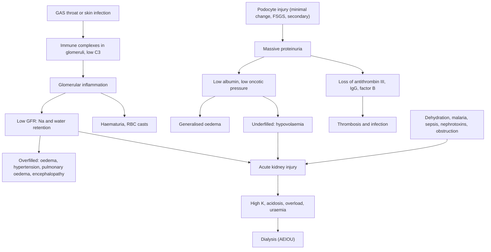

## 1. Definition

The kidney can fail a child in three common ways you will see on the Mengo and Mulago wards:

1. **Acute glomerulonephritis (AGN)**, usually **post-streptococcal (PSGN)**: the glomeruli are **inflamed**. Blood leaks into the urine (**cola-coloured**), salt and water are retained (**puffy eyes, hypertension, heart failure**), and urine output falls. It is the classic **nephritic syndrome**.
2. **Nephrotic syndrome**: the glomerular filter becomes **leaky to protein** without much inflammation. Massive **proteinuria** → **low albumin** → **generalised oedema**. In most children it is **minimal change disease** that melts away with **prednisolone**, but African children have more steroid-resistant and secondary disease.
3. **Acute kidney injury (AKI)**: a sudden fall in kidney function from any cause. In Uganda the commonest causes are **dehydration (diarrhoea)**, **severe malaria**, **sepsis**, **PSGN** and **nephrotoxins** (gentamicin, NSAIDs, herbs).

All three need the same core skills: **measuring urine output and weight, getting fluids right, controlling BP, and spotting dangerous potassium**.

| Term | Definition |
|---|---|
| **Nephritic syndrome** | Haematuria (with RBC casts), hypertension, oliguria, oedema (mainly periorbital), mild proteinuria and raised creatinine |
| **Nephrotic-range proteinuria** | First-morning **UPCR ≥200 mg/mmol (≥2 mg/mg)**, or ≥40 mg/m²/h (≥1 g/m²/day), or **dipstick ≥3+** (IPNA 2023 / KDIGO 2021, 2025) |
| **Nephrotic syndrome** | Nephrotic-range proteinuria + **hypoalbuminaemia (<30 g/L)**, or oedema when albumin is unavailable |
| **AKI** | KDIGO: creatinine rise ≥26.5 µmol/L (0.3 mg/dL) within 48 h, or ≥1.5 × baseline within 7 days, or urine output <0.5 mL/kg/h for 6 h (full staging in section 5) |
| **Oliguria** | <0.5 mL/kg/h in children (<1 mL/kg/h in infants; **UCG 2023 uses <1 mL/kg/h for all children**) |
| **Anuria** | No urine (UCG: <100 mL/24 h) |

> [!PEARL]
> The one thing never to forget: **a puffy child is not always a "kidney child", and an oedematous kidney child is not always fluid-overloaded.** The nephritic child is **overfilled** (hypertensive, needs fluid restriction and furosemide). The nephrotic child may be **underfilled in the vessels** despite huge oedema (cold hands, tachycardia, abdominal pain), and furosemide alone can tip them into shock and AKI.

## 2. Epidemiology

- **PSGN** is common in Uganda because of **impetigo, infected scabies and untreated sore throats**, crowding and poor hygiene. It peaks in school-age children and is more common in boys. Skin-associated PSGN is particularly common in the tropics.
- **Nephrotic syndrome**: in Europe, ~85–90% of children are steroid-sensitive (mostly minimal change). In **sub-Saharan Africa** series, more children are **older at onset, steroid-resistant and have FSGS**, and **secondary causes** matter: **HIV-associated nephropathy, hepatitis B (membranous), quartan malaria (*P. malariae*), schistosomiasis (*S. mansoni*: MPGN), syphilis**. Steroid resistance in East African series is often reported around 20–40% [VERIFY: local Mulago data].
- **AKI**: common causes are **dehydration from diarrhoea**, **severe malaria** (haemoglobinuria/"blackwater", hypovolaemia, sepsis; AKI is frequent in Ugandan children with severe malaria and predicts death), **sepsis**, **PSGN**, **nephrotoxins** (gentamicin, NSAIDs, herbal medicines), **sickle cell disease**, **tumour lysis**, and **obstruction** (posterior urethral valves in infant boys, stones, Burkitt lymphoma).
- **Services**: paediatric nephrology at **Mulago National Referral Hospital** with acute **peritoneal dialysis** (PD) for children; haemodialysis for older children at Mulago and a few other centres [VERIFY: current paediatric capacity]. Most regional hospitals cannot dialyse children, so **early referral** is essential.

> [!UGANDA]
> Most Ugandan children have **no baseline creatinine**. Use the **age-expected normal** (or back-calculate from an assumed eGFR of 100–120) and the **urine output** criterion. UCG 2023 calls AKI "acute renal failure" and defines oliguria as <1 mL/kg/h. Laboratory creatinine is available at most hospitals; potassium and blood gases mainly at RRH/NRH.

## 3. Aetiology and Risk Factors

**Acute glomerulonephritis**

- **PSGN**: nephritogenic **group A streptococcus (GAS)** from the **throat** (latency 1–2 weeks) or **skin** (impetigo, infected scabies; latency 3–6 weeks). Unlike rheumatic fever, PSGN follows **skin** infection too.
- **Risk factors**: school age (UCG: >3 years; typically 5–12 years), male sex, crowding, poor hygiene, untreated scabies and impetigo, untreated sore throats.
- **Other causes of a nephritic picture**: IgA nephropathy, HSP (IgA vasculitis) nephritis, lupus nephritis, MPGN / C3 glomerulopathy, HUS, rapidly progressive GN (section 7).

**Nephrotic syndrome**

| Primary (idiopathic) | Secondary (look hard for these in Uganda) |
|---|---|
| **Minimal change disease** (age 1–6, steroid-sensitive) | **HIV-associated nephropathy** (FSGS-type) |
| **FSGS** (older, often steroid-resistant) | **Hepatitis B** (membranous) |
| MPGN / C3 glomerulopathy | **Quartan malaria** (*P. malariae*) |
| | **Schistosomiasis** (*S. mansoni*: MPGN) |
| | **Syphilis** (congenital or acquired) |
| | Lupus (adolescent girls) |

**Acute kidney injury**

| Type | Ugandan examples |
|---|---|
| **Pre-renal** | Diarrhoea and dehydration, shock, sepsis, hypovolaemic nephrotic, heart failure |
| **Intrinsic renal** | **Acute tubular necrosis** (prolonged pre-renal, sepsis, malaria, haemoglobinuria), **PSGN**, nephrotoxins (gentamicin, NSAIDs, contrast, herbal medicines), HUS, tumour lysis syndrome, sickle cell disease |
| **Post-renal** | Posterior urethral valves (infant boys), stones, bladder outlet obstruction, tumour (Burkitt lymphoma) |

## 4. Pathophysiology

**PSGN (a type III hypersensitivity)**

1. Nephritogenic GAS strains (pharynx or skin) release antigens (for example **nephritis-associated plasmin receptor, streptococcal pyrogenic exotoxin B**) that deposit in glomeruli.
2. Antibodies bind and form **immune complexes** (subepithelial "**humps**" on electron microscopy) → **complement activation (alternative pathway)** → **low C3**.
3. Inflammation and proliferation of glomerular cells → **reduced GFR** → **sodium and water retention** → expanded plasma volume → **oedema, hypertension, circulatory congestion** (pulmonary oedema, heart failure) and **hypertensive encephalopathy**.
4. Damaged capillaries leak red cells → **haematuria with dysmorphic RBCs and RBC casts**.
5. Latency: **1–2 weeks after pharyngitis**, **3–6 weeks after skin infection**.

**Nephrotic syndrome**

1. In minimal change disease, a circulating factor (T-cell/B-cell dysregulation, anti-nephrin antibodies in some) **effaces podocyte foot processes**, so the filter loses its charge and size barrier.
2. Massive **albuminuria** → **hypoalbuminaemia** → low oncotic pressure; plus **primary renal sodium retention** (the "overfill" component, via epithelial sodium channel activation).
3. Fluid moves into tissues → **oedema**. The intravascular volume may be **normal, high or low**: children with very low albumin and rapid onset can be **hypovolaemic** ("underfill").
4. The liver makes more proteins, including **lipoproteins** (→ hypercholesterolaemia) and **clotting factors**, while **antithrombin III** is lost in urine → **hypercoagulability** (renal vein thrombosis, cerebral venous sinus thrombosis).
5. Loss of **immunoglobulins and complement factors (factor B)** in urine, plus steroids → **infection** with encapsulated bacteria (spontaneous bacterial peritonitis, cellulitis).

**AKI**

| Type | Mechanism | Clue |
|---|---|---|
| **Pre-renal** | Low kidney perfusion; kidney intact | Concentrated urine, **urine Na <20 mmol/L**, **FENa <1%**, responds to fluid |
| **Intrinsic renal** | Damage to tubules, glomeruli, interstitium | Urine Na >40, FENa >2%, casts, blood/protein |
| **Post-renal** | Obstruction | Palpable bladder, hydronephrosis on ultrasound |

**Fractional excretion of sodium (FENa)** = (urine Na × plasma creatinine) ÷ (plasma Na × urine creatinine) × 100. It is unreliable after furosemide.

**Feature links**

- Immune-complex inflammation → leaky glomerular capillaries → **cola-coloured urine**, dysmorphic RBCs, RBC casts.
- Low GFR → sodium and water retention → **periorbital oedema, hypertension**, raised JVP, gallop, **pulmonary oedema**.
- Severe hypertension → cerebral hyperperfusion and oedema → **headache, vomiting, blurred vision, seizures** (hypertensive encephalopathy, PRES).
- Complement consumption → **low C3** (normal C4) that recovers by 6–8 weeks.
- Podocyte foot-process effacement → **frothy urine, protein ≥3+**.
- Low albumin → low oncotic pressure → **generalised pitting oedema, ascites, scrotal or labial oedema, pleural effusions**.
- Low albumin and rapid fluid shift → **underfill** → **cold peripheries, tachycardia, abdominal pain, CRT >3 s, rising Hct, urine Na <10–20 mmol/L**.
- Hepatic overproduction → **high cholesterol**; urinary antithrombin III loss → **thrombosis** (sudden headache, seizure, limb swelling, flank pain).
- Urinary loss of IgG and factor B, plus steroids → **peritonitis, cellulitis, sepsis**.
- Falling GFR → **oliguria, rising creatinine and urea** → uraemia → **encephalopathy, pericardial rub, bleeding**.
- Failure to excrete K⁺ and acid → **hyperkalaemia** (peaked T, wide QRS, arrhythmia) and **metabolic acidosis** (deep breathing).
- Free-water retention → **dilutional hyponatraemia** → seizures.
- Failure to excrete phosphate → **high phosphate, low calcium**.
- Obstruction → **palpable bladder, poor stream, hydronephrosis**.

## 5. Classification / Staging

**Nephritic versus nephrotic**

| Feature | **Nephritic (e.g. PSGN)** | **Nephrotic (e.g. minimal change)** |
|---|---|---|
| Typical age | 5–12 years (UCG: >3 years) | 1–6 years (minimal change) |
| Onset | Acute, after strep throat or skin infection | Insidious or after a viral illness |
| Urine | **Haematuria** (cola/tea-coloured), RBC casts, protein 1–2+ | **Protein ≥3+**, frothy, little or no blood |
| Oedema | **Periorbital**, mild | **Generalised**, pitting, ascites, scrotal/labial, pleural effusions |
| BP | **High** | Usually normal (may be low if hypovolaemic) |
| Urine output | **Reduced** | Reduced (sodium retention) |
| Serum albumin | Normal or slightly low | **<30 g/L** (often <20) |
| Cholesterol | Normal | **High** |
| Complement C3 | **Low** (PSGN), normal by 8 weeks | Normal |
| Volume status | **Overloaded** | Often **intravascularly depleted** |

**Nephrotic syndrome definitions (IPNA 2023 / KDIGO 2021, 2025)**

| Term | Definition |
|---|---|
| **Nephrotic-range proteinuria** | First-morning **UPCR ≥200 mg/mmol (≥2 mg/mg)**, or ≥40 mg/m²/h (≥1 g/m²/day), or **dipstick ≥3+** |
| **Nephrotic syndrome** | Nephrotic-range proteinuria + **hypoalbuminaemia (<30 g/L)** or oedema when albumin is unavailable |
| **Complete remission** | UPCR **≤20 mg/mmol** or dipstick **negative/trace** on **3 consecutive days** |
| **Steroid-sensitive (SSNS)** | Complete remission within **4 weeks** of standard-dose prednisolone |
| **Steroid-resistant (SRNS)** | **No complete remission after 4 weeks** of standard prednisolone (IPNA uses a further confirmation period of up to 2 weeks before labelling SRNS) |
| **Relapse** | Dipstick **≥3+** (or UPCR ≥200 mg/mmol) on **3 consecutive days** after remission |
| **Infrequent relapse** | 1 relapse within 6 months of initial response, or 1–3 relapses in any 12 months |
| **Frequently relapsing (FRNS)** | **≥2 relapses in the first 6 months** after initial response, or **≥4 relapses in any 12 months** |
| **Steroid-dependent (SDNS)** | **2 consecutive relapses during** steroid therapy (or alternate-day therapy), or **within 14 days of stopping** |

**Typical versus atypical nephrotic syndrome**: **typical** = age 1–12, normal BP and creatinine, no gross haematuria, normal C3. **Atypical** = age under 1 year or over 12 years, persistent hypertension, gross haematuria, low C3, raised creatinine, or HIV/HBV positive → biopsy and referral before (or instead of) steroids.

**AKI staging (KDIGO 2012, still the current AKI guideline)**

| Stage | Serum creatinine | Urine output |
|---|---|---|
| **1** | **1.5–1.9 × baseline** (within 7 days), or rise **≥26.5 µmol/L (0.3 mg/dL) within 48 h** | **<0.5 mL/kg/h for 6–12 h** |
| **2** | **2.0–2.9 × baseline** | <0.5 mL/kg/h for **≥12 h** |
| **3** | **≥3.0 × baseline**, or creatinine **≥353.6 µmol/L (4 mg/dL)**, or **start of dialysis**, or in under-18s **eGFR <35 mL/min/1.73 m²** | **<0.3 mL/kg/h for ≥24 h**, or **anuria ≥12 h** |

- **pRIFLE** (paediatric RIFLE) uses a fall in estimated creatinine clearance (25% Risk, 50% Injury, 75% Failure) and urine output <0.5 mL/kg/h for 8 h (Risk), 16 h (Injury), or <0.3 for 24 h/anuria for 12 h (Failure).
- **NICE NG148** (AKI, updated 2019/2024) accepts pRIFLE, AKIN or KDIGO and defines a urine output criterion of <0.5 mL/kg/h for more than **8 hours in children and young people**.
- **Bedside Schwartz eGFR** = **36.5 × height (cm) ÷ serum creatinine (µmol/L)** (or 0.413 × height ÷ creatinine in mg/dL).
- **Normal creatinine** rises with muscle mass: roughly 20–35 µmol/L in infants, 25–50 µmol/L at 1–5 years, 35–60 µmol/L at 5–12 years. "Normal for an adult" can mean stage 3 AKI in a toddler.

**Hypertension in children** (AAP 2017): hypertension = BP ≥95th centile for age, sex and height; from 13 years, ≥130/80 mmHg. A **hypertensive emergency** is severe hypertension (far above the 99th centile) with end-organ features (encephalopathy, seizures, visual loss, heart failure).

## 6. Clinical Features

### History

| Ask about | Why it matters |
|---|---|
| **Urine colour** (cola, tea, red), **volume** (nappies, last void), frothiness | Haematuria versus haemoglobinuria (malaria, G6PD); oliguria; proteinuria |
| **Sore throat 1–2 weeks ago, skin sores or scabies 3–6 weeks ago** | PSGN |
| **Swelling**: where it started (eyes in the morning), speed, abdomen, scrotum | Nephrotic versus nephritic; ascites |
| **Headache, vomiting, blurred vision, fits** | **Hypertensive encephalopathy** |
| **Breathlessness, cough, orthopnoea** | Pulmonary oedema, effusions, heart failure |
| **Abdominal pain** in a nephrotic child | **Peritonitis** (SBP) or **hypovolaemia**, thrombosis |
| **Diarrhoea, vomiting, fluid intake, fever, malaria, sepsis** | Pre-renal AKI; malaria AKI |
| **Drugs**: gentamicin, NSAIDs, herbal medicines, ACE inhibitors | Nephrotoxic AKI |
| **Rash, joint pain, abdominal pain, bloody diarrhoea** | HSP (IgA vasculitis), SLE, HUS |
| **Previous episodes, steroids** (dose, response, side effects, relapses) | Relapse versus new; steroid dependence |
| **HIV status (child, mother), hepatitis B, TB contact, schistosomiasis (lake swimming), malaria** | Secondary nephrotic syndrome; TB must be treated before high-dose steroids |
| **Poor urine stream in an infant boy**, dribbling, UTIs | Posterior urethral valves |
| **Growth, feeding, immunisation (PCV, measles, varicella)** | Malnutrition (kwashiorkor oedema mimic); infection risk on steroids; live vaccines to be deferred on steroids |

### Examination

Follow the order of Hutchison's Clinical Methods (24th edition), adapted for children: observe first, measure BP while the child is calm, and leave distressing parts (throat, fundoscopy in a toddler) to last. In an emergency, the ABCDE assessment (section 9) comes first.

#### Introduction, consent and preparation

- Introduce yourself; confirm the child's name, age and the carer's relationship.
- Explain the examination; gain consent from the parent and assent from the child.
- **Hand hygiene** before touching the child.
- Position: sitting on the parent's lap or semi-reclined (orthopnoea); expose in a warm room, preserving dignity when examining the scrotum or labia for oedema.

#### General inspection (end of the bed)

- **Well or unwell**; breathlessness; drowsiness or fitting (encephalopathy).
- **Oedema**: puffy eyes (nephritic or early nephrotic), generalised swelling, distended abdomen, scrotal or labial oedema.
- **Colour**: pallor (HUS, CKD, malaria), jaundice (haemolysis).
- **Hydration**: sunken eyes, dry mouth (pre-renal AKI).
- **Nutrition**: wasting with oedema, skin and hair changes (kwashiorkor); **Cushingoid features** on long-term steroids.
- **Urine** in a pot or nappy: colour and froth.

**Vital signs and growth**

- **BP with the right cuff** (bladder width ~40% of mid-arm circumference, length 80–100%) compared with **age/height centiles** (AAP 2017: hypertension ≥95th centile; from 13 years ≥130/80); a small cuff overestimates BP.
- HR, RR, SpO₂, temperature, **capillary refill time**.
- **Weight (compare with the last known weight)** and height; MUAC (**oedema falsely raises weight and MUAC**). Plot growth.

#### Hands, face and neck

- **Peripheral perfusion**: cold hands + tachycardia + oedema = **underfilled nephrotic**.
- Pallor of palms and conjunctivae; malar rash (SLE).
- Periorbital oedema.
- **JVP** (older child): raised in the overfilled nephritic child.

#### The system

- **Skin**: **impetigo scars, scabies**, purpura on legs and buttocks (HSP), malar rash (SLE), cellulitis (nephrotic infection).
- **Oedema map**: periorbital, sacral, legs, scrotum/labia; pitting.
- **Cardiovascular**: tachycardia, **gallop**, murmur.
- **Respiratory**: basal crackles (pulmonary oedema), **pleural effusions** (stony dullness, reduced breath sounds).
- **Abdomen**: inspection for distension; palpation for **tenderness or guarding (peritonitis)**, liver size, **renal masses**, **palpable bladder** (obstruction); percussion for **ascites with shifting dullness**.
- **Neurological**: conscious level, focal signs (thrombosis, PRES), **fundoscopy** (hypertensive retinopathy).

#### Completing the examination

- Throat (active pharyngitis) last.
- **Urine dipstick** at the bedside; start an input/output chart.
- Thank the child and parent, re-dress, **hand hygiene**.
- **Summarise**: "Periorbital oedema, BP 138/92 (>99th centile for height), no crackles, liver 2 cm, healed impetigo on both legs, urine output 0.4 mL/kg/h over 8 h."

### Red flags

> [!REDFLAG]
> - **Hypertensive emergency**: headache, vomiting, visual loss, seizures, reduced consciousness, BP far above the 99th centile.
> - **Pulmonary oedema**: orthopnoea, crackles, SpO₂ <90%, gallop.
> - **Hyperkalaemia**: K⁺ ≥6.5 mmol/L or ECG changes (peaked T, wide QRS, arrhythmia).
> - **Anuria**, rising creatinine, uraemic encephalopathy, pericardial rub.
> - **Nephrotic child with abdominal pain + fever** (peritonitis), or **cold peripheries, tachycardia, oliguria** (hypovolaemia), or **sudden headache/seizure/limb swelling** (thrombosis).
> - **Rapidly progressive GN**: creatinine doubling over days, persistent oliguria (crescents): urgent nephrology referral.

### Thinking like a clinician

- **Cola urine + puffy eyes + high BP after a skin infection** = PSGN. Check C3 and anti-DNase B. If the C3 is normal, or the child does not improve within 2 weeks, think **IgA nephropathy, HSP, MPGN, lupus, or RPGN**.
- **Massive oedema in a 3-year-old with 4+ protein, no blood, normal BP** = minimal-change-type nephrotic syndrome. If **older (>12 years) or under 1 year, persistent hypertension, gross haematuria, low C3, raised creatinine, or HIV/HBV positive** = **atypical**: think biopsy and referral before (or instead of) steroids.
- **Oedema without proteinuria**: think **kwashiorkor**, heart failure, liver disease, protein-losing enteropathy.
- **Red urine + dipstick blood ++ but no RBCs on microscopy** = **haemoglobinuria** (malaria, G6PD haemolysis, blackwater) or **myoglobinuria**.
- **Nephrotic + furosemide + abdominal pain + rising Hct/creatinine** = **hypovolaemia**. Stop the diuretic; give albumin if available.
- **Oliguria in a dehydrated child**: give fluid first and reassess; "oliguria" that responds to rehydration was pre-renal.
- **"Normal" creatinine for an adult** may be stage 2–3 AKI in a toddler: always compare with the age-expected value.
- **Common student mistakes**: (1) giving maintenance IV fluids to an oliguric PSGN child; (2) giving furosemide to a shocked nephrotic child; (3) prescribing gentamicin at full dose in AKI; (4) forgetting to screen for TB before months of prednisolone.

## 7. Differential Diagnoses

| Differential | Distinguishing clinical feature | Distinguishing investigation |
|---|---|---|
| **PSGN** | After strep throat or skin infection; good prognosis | Low C3 recovering by 8 weeks; ASO / anti-DNase B |
| **IgA nephropathy** | Gross haematuria **during** (1–2 days after) an URTI | Normal C3; biopsy |
| **HSP (IgA vasculitis) nephritis** | Purpura on legs and buttocks, arthritis, abdominal pain | Clinical; urine dipstick and microscopy |
| **Lupus nephritis** | Adolescent girl, rash, arthritis, cytopenias | Low C3 **and** C4; ANA, dsDNA, biopsy |
| **MPGN / C3 glomerulopathy** | Nephritic-nephrotic picture | Persistently low C3; biopsy |
| **Haemolytic uraemic syndrome** | Bloody diarrhoea, pallor, AKI | FBC (low platelets), film (fragmented RBCs) |
| **Minimal change disease** | Age 1–6, pure nephrotic | Response to steroids |
| **FSGS** | Older, haematuria/hypertension, steroid-resistant; HIVAN in HIV | Biopsy, HIV test |
| **Membranous (HBV)** | Nephrotic in an HBsAg-positive child | HBsAg, biopsy |
| **Quartan malaria / schistosomal nephropathy** | Endemic exposure, steroid-resistant | Blood film, stool/urine microscopy, biopsy |
| **Kwashiorkor** | Oedema with malnutrition, skin and hair changes | **No heavy proteinuria** on dipstick; nutrition history |
| **Heart failure, liver disease** | Hepatomegaly, gallop, jaundice | No proteinuria; echocardiography, LFTs |
| **Haemoglobinuria** (malaria, G6PD) | Dark urine, anaemia, jaundice | **No RBCs** on urine microscopy; Hb, malaria RDT |

## 8. Clinical Workup

"Available at" is the lowest level that usually offers the test [VERIFY: availability compiled from the source notes, not an MoH list].

### Bedside

| Test | Why | Expected finding | Available at |
|---|---|---|---|
| **Urine dipstick** | Separates nephritic, nephrotic, haemoglobinuria and UTI | Blood + protein 1–2+ (nephritic); protein 3–4+ with little blood (nephrotic); high SG (pre-renal); leucocytes/nitrites (UTI) | All levels |
| **Urine microscopy** (if a microscope is available) | Glomerular versus other bleeding | **RBC casts** and dysmorphic RBCs = glomerular bleeding; no RBCs with dipstick blood = haemoglobin/myoglobin | HC IV and above |
| **Urine output** (catheter; nappy weights: 1 g = 1 mL) | Oliguria staging | <0.5 mL/kg/h (KDIGO) or <1 mL/kg/h (UCG) | All levels |
| **Weight** (same scale, same time) | Fluid balance; **best single guide to overload** | Rising weight = fluid retention | All levels |
| **BP with correct cuff** | Hypertension | ≥95th centile; emergency if far above 99th with symptoms | All levels (paediatric cuffs often missing) |
| HemoCue Hb, random blood sugar, malaria RDT | Anaemia, hypoglycaemia, malaria | Low Hb (dilution, HUS, malaria); RDT positive | All levels (HemoCue and glucometer variable at HC III) |
| **ECG** (if K⁺ high, or unknown with oliguria) | Cardiac effect of hyperkalaemia | Peaked T waves, wide QRS, arrhythmia | General Hospital and above |
| Point-of-care ultrasound | Bladder, kidneys, fluid | Bladder volume, hydronephrosis, ascites, pleural effusion | Where a trained operator is available |

### Basic lab

| Test | When | Expected / abnormal finding | How it changes management | Available at |
|---|---|---|---|---|
| **Urea, creatinine, Na, K** | All three conditions; daily while unstable (6–12-hourly if K⁺ high) | Raised creatinine (AKI); **K⁺ ≥6.0**; hyponatraemia (dilutional) | AKI staging, fluid plan, hyperkalaemia treatment, dialysis decision | Creatinine at most hospitals; K⁺ at RRH/NRH |
| **Serum albumin, total protein, cholesterol** | Nephrotic | **Albumin <30 g/L**, cholesterol high | Confirms nephrotic syndrome | Hospitals |
| **FBC** | All | Anaemia (dilutional, HUS, malaria), **high Hct** (hypovolaemia), low platelets (HUS, sepsis) | Diagnosis and transfusion | HC IV and above |
| **Malaria RDT / film** | All febrile children; AKI | Positive | Treat malaria (artesunate; no dose change in AKI) | All levels |
| **HIV, hepatitis B surface antigen, VDRL/RPR** | Every nephrotic child | Positive | Secondary nephrotic syndrome; ART; avoid steroids in HBV-related disease without specialist input | HIV and syphilis tests at all levels; HBsAg at HC IV and above |
| **ASO** | Suspected PSGN | ASO raised (throat infection) | Supports PSGN | Hospitals |
| **Throat or skin swab culture** | Active infection | GAS | Antibiotics, contact treatment | RRH and above |
| **Stool and urine microscopy** for parasites | Nephrotic in endemic areas | *Schistosoma*, *Strongyloides* | Praziquantel 40 mg/kg (UCG); albendazole/ivermectin before steroids | HC III and above |
| **Calcium, phosphate** | AKI | Low Ca, high PO₄ | Binders, dialysis | RRH and above |

### Imaging

| Test | When | Expected / abnormal finding | How it changes management | Available at |
|---|---|---|---|---|
| **Renal ultrasound** | AKI, atypical nephrotic, PSGN not resolving | Small kidneys (CKD), hydronephrosis (obstruction), enlarged echogenic kidneys (HIVAN, acute GN), renal vein thrombosis | Changes the diagnosis completely | Most hospitals |
| **Chest X-ray** | Breathless, overload; TB screen before steroids | Pulmonary oedema, cardiomegaly, effusions; TB changes | Fluid and diuretic decisions; TB treatment first | Some HC IVs; all hospitals |

### Specialised / referral-level

| Test | When | Expected / abnormal finding | How it changes management | Available at |
|---|---|---|---|---|
| **Urine protein:creatinine ratio (UPCR)** | Nephrotic at diagnosis and to confirm remission/relapse | **≥200 mg/mmol** nephrotic; ≤20 remission | Definitions | RRH/NRH (dipstick otherwise) |
| **C3 (± C4)** | Haematuria with nephritic features | **Low C3** in PSGN (normal C4); low C3 and C4 in lupus | **C3 still low after 8 weeks** → MPGN / C3 glomerulopathy / lupus → biopsy | NRH, private labs |
| **Anti-DNase B** | Suspected PSGN after skin infection | Raised | Supports skin-associated PSGN | Referral labs |
| **TB screen** (history, CXR, GeneXpert if symptoms; TST where available) | Before long steroid courses | TB | Treat TB first or alongside, per specialist | GeneXpert at HC IV and hospitals |
| **Blood gas / bicarbonate** | AKI stage 2–3 | Metabolic acidosis | Bicarbonate, dialysis | RRH/NRH |
| **Renal biopsy** | **Atypical nephrotic, SRNS, PSGN not resolving** (low C3 >8 weeks, persistent nephrotic proteinuria, rising creatinine), RPGN | FSGS, MPGN, crescents, membranous, lupus | Specific immunosuppression | **Mulago only** |

**Summary of what you are looking for**: dipstick and microscopy (nephritic versus nephrotic versus haemoglobinuria); creatinine and electrolytes (AKI, K⁺, Na⁺); albumin, cholesterol, UPCR (nephrotic definitions, remission, relapse); C3 and ASO/anti-DNase B (PSGN, with follow-up C3 at 8 weeks); FBC and malaria test (causes and complications); HIV, HBsAg, syphilis, TB (secondary causes and steroid safety); ultrasound (size, obstruction, CKD); biopsy (atypical or resistant disease).

### Putting it together

**Model one-liner (PSGN)**: "A 9-year-old boy with **cola-coloured urine, periorbital oedema and oliguria** for 3 days, **3 weeks after infected scabies**, with **BP 140/95 (>99th centile)**, urine blood 3+/protein 1+, creatinine 115 µmol/L (about 2.5× expected), **low C3** and raised anti-DNase B: **acute post-streptococcal glomerulonephritis with stage 2 AKI and stage 2 hypertension**, not yet in heart failure."

**Model one-liner (nephrotic)**: "A 4-year-old girl with **2 weeks of generalised oedema**, urine protein **4+**, no haematuria, normal BP, **albumin 14 g/L**, cholesterol 9.8 mmol/L, normal creatinine and C3, HIV and HBsAg negative: **first presentation of idiopathic nephrotic syndrome, typical features**, warm peripheries, no infection."

**Problem list (PSGN example)**

1. Acute post-streptococcal glomerulonephritis.
2. Stage 2 AKI with oliguria.
3. Stage 2 hypertension (encephalopathy excluded).
4. Fluid overload (not yet in heart failure).
5. Untreated scabies (patient and family).

**Model case presentation (ward round)**

> "**Mukisa is a 4-year-old boy weighing 18.5 kg** today, up from **16 kg** a month ago (oedema; length 101 cm; pre-illness weight-for-height Z 0, MUAC unreliable with oedema). He is **fully immunised per UNEPI** including PCV and measles-rubella, eats family foods, and is **HIV-negative** (mother negative; HBsAg negative). He presented with **10 days of progressive swelling**, starting around the eyes in the morning and now in the abdomen, legs and scrotum, with frothy urine and reduced urine output. There is **no** haematuria, sore throat or skin infection. On examination he has generalised pitting oedema, ascites and scrotal oedema; he is **warm with CRT <2 s**, HR 108, **BP 96/58 (normal for height)**, and the abdomen is non-tender. Urine protein **4+**, blood negative. **Albumin 13 g/L**, cholesterol 10.2 mmol/L, creatinine 28 µmol/L, Na 131, K 4.2. **C3 normal.** This is a **first presentation of typical idiopathic nephrotic syndrome**, probably minimal change disease, without complications. I have screened for TB (no contact, normal CXR) and given albendazole. Plan: **prednisolone 60 mg/m²/day** calculated on his **pre-oedema weight of 16 kg** (BSA ≈ 0.67 m² → **40 mg once daily**; 2 mg/kg would give 32 mg; oedema weight overestimates the dose) for 4 weeks, then 40 mg/m² (≈25–27.5 mg, rounded to tablet size) on alternate days for 4 weeks, no-added-salt diet, daily dipstick, weight and BP, and education for home monitoring."

**Worked example 1: is this AKI and what stage?** A 3-year-old (14 kg, 95 cm) with diarrhoea has creatinine **98 µmol/L**. Expected creatinine at this age is about 30 µmol/L. Schwartz eGFR = 36.5 × 95 ÷ 98 ≈ **35 mL/min/1.73 m²**. Creatinine is **>3 × expected** and eGFR is about 35 → **KDIGO stage 3**. After rehydration, creatinine falls to 45 µmol/L in 24 h: this was mainly **pre-renal** AKI.

**Worked example 2: daily fluid allowance in oliguric PSGN.** Child 25 kg, 125 cm: BSA (Mosteller) = √(125 × 25 ÷ 3600) ≈ **0.93 m²**. Insensible losses ≈ **400 mL/m²/day** ≈ 370 mL/day. Yesterday's urine output = 300 mL. **Today's total intake (oral + IV) ≈ 370 + 300 = 670 mL** (≈28 mL/h), adjusted by daily weight. (UCG 2023 simplifies this as **10 mL/kg/day + measured losses**, which is similar in a school-age child but too little in infants.)

## 9. Management

### Immediate / emergency

**First 5 minutes (ABCDE)**

1. **A and B**: SpO₂, work of breathing. **Pulmonary oedema** → sit up, oxygen, **furosemide 1–2 mg/kg IV**.
2. **C**: shock (dehydration, sepsis, underfilled nephrotic) → **10–20 mL/kg** Ringer's lactate or 0.9% saline bolus and reassess (careful in SAM and severe anaemia, per WHO). In a nephrotic child, **albumin 20% 0.5–1 g/kg** if available. **Do not bolus** an overloaded hypertensive nephritic child.
3. **D**: seizure or encephalopathy → treat the seizure (**diazepam 0.3 mg/kg IV or 0.5 mg/kg rectal**; or midazolam), **check glucose**, **measure BP** (hypertensive encephalopathy) and **sodium** (hyponatraemia).
4. **E and electrolytes**: if **K⁺ ≥6.5 mmol/L or ECG changes**, start hyperkalaemia treatment now (table below).
5. **Urine**: dipstick; catheterise if needed to measure output; start an **input/output chart** and **daily (or twice-daily) weights**.
6. **Bloods**: creatinine/urea, Na, K, glucose, Hb, malaria RDT.

> [!REDFLAG]
> **Hypertensive emergency** (encephalopathy, seizures, visual loss, heart failure): lower BP **by no more than 25% of the planned reduction in the first 8 hours**, then to normal over 24–48 hours, using IV labetalol, IV hydralazine or oral nifedipine, plus **IV furosemide**. Too fast a fall can cause cerebral ischaemia and blindness. Treat seizures with benzodiazepines and correct sodium and glucose.

**Hyperkalaemia and other electrolyte emergencies in AKI**

| Problem | Treatment | Dose |
|---|---|---|
| **Hyperkalaemia** (K⁺ ≥6.0 mmol/L; urgent if ≥6.5 or ECG changes) | Stop all K⁺ (IV fluids, foods, drugs) | n/a |
| | **Calcium gluconate 10%** (stabilises the heart; does not lower K⁺) | **0.5 mL/kg IV over 5–10 min (max 20 mL)** with ECG monitoring; repeat if ECG changes persist |
| | **Salbutamol** (shifts K⁺ into cells) | **Nebulised 2.5 mg (<25 kg) or 5 mg (≥25 kg)**; repeat every 2 h as needed |
| | **Insulin + glucose** | **Soluble insulin 0.1 unit/kg + glucose 0.5 g/kg (5 mL/kg of 10% dextrose)** IV over 30 min; check glucose hourly |
| | **Sodium bicarbonate** (if acidotic) | **1–2 mmol/kg IV** over 30 min (8.4% diluted) |
| | **Calcium resonium / sodium polystyrene** (removes K⁺) | **1 g/kg/day in divided doses** oral or rectal (max 60 g/day) |
| | **Dialysis** | Refractory hyperkalaemia |
| **Hyponatraemia** (usually dilutional) | Fluid restriction | Insensible + output |
| | Seizure or encephalopathy with Na <125 | **3% saline 2 mL/kg (max 100 mL) IV over 10 min**, repeat once if needed; raise Na by no more than 8–10 mmol/L in 24 h |
| **Metabolic acidosis** | Treat the cause; bicarbonate if pH <7.15 or HCO₃⁻ <12 | 1–2 mmol/kg IV; oral bicarbonate in chronic disease |
| **Hyperphosphataemia / hypocalcaemia** | Phosphate binder with meals (calcium carbonate); IV calcium only if symptomatic | Calcium gluconate 10% 0.5 mL/kg slowly |
| **Hypertension** | Fluid and salt restriction, furosemide, amlodipine/nifedipine/hydralazine | As in the drug table |
| **Anaemia** | Transfuse packed cells slowly if Hb <7 g/dL or symptomatic | 5–10 mL/kg over 3–4 h with furosemide (beware K⁺ in old blood; ask for fresh units) |

### Definitive

#### A. Acute post-streptococcal glomerulonephritis

1. **Admit** (UCG: refer oedematous, hypertensive, oliguric children to hospital/RRH). **Daily weight, strict input/output, BP 4–6-hourly** (hourly if severe).
2. **Fluid restriction**: if oliguric or overloaded, **insensible losses (~400 mL/m²/day) + previous day's urine output** (UCG: 10 mL/kg + losses). No maintenance IV fluids. Oral where possible.
3. **Salt restriction**: no added salt (UCG <2 g/day; about half a teaspoon). **Restrict potassium** (bananas, oranges, beans, meat broths) if oliguric; moderate protein, adequate calories.
4. **Furosemide** for oedema, hypertension or congestion.
5. **Control BP** (drug table). **Avoid ACE inhibitors and ARBs in the acute oliguric phase** (hyperkalaemia, worsen GFR).
6. **Treat the streptococcus**: 10 days of penicillin/amoxicillin (or BPG once). This does **not** alter the nephritis, but clears the nephritogenic strain and protects contacts. Treat **scabies** (and family) and impetigo.
7. **Monitor creatinine and K⁺** daily (more often if rising) and treat hyperkalaemia; refer for dialysis if needed.
8. **No steroids** in typical PSGN.
9. **Follow-up** (Monitoring and follow-up below).

#### B. Nephrotic syndrome

**Initial assessment and general care (first presentation: admit)**

1. **Classify** as typical (age 1–12, normal BP and creatinine, no gross haematuria, normal C3) or **atypical** (refer for biopsy before steroids).
2. **Screen**: HIV, HBsAg, syphilis, **TB** (history/CXR), malaria, stool/urine parasites. **Deworm** (albendazole 400 mg; ivermectin if *Strongyloides* risk) and **praziquantel 40 mg/kg** if schistosomiasis endemic (UCG).
3. **Salt restriction** (<2 g/day, UCG). **Fluid**: restrict only if hyponatraemic or very oedematous (RCH: 50–70% of maintenance); otherwise normal intake. Normal protein for age (no high-protein diet).
4. **Oedema**: mild to moderate oedema needs only salt restriction and steroids. Severe or symptomatic oedema (respiratory compromise, scrotal skin breakdown) → **albumin 20% 0.5–1 g/kg (2.5–5 mL/kg) over 4 h with furosemide 0.5–1 mg/kg IV (max 40 mg)** mid-way or at the end (RCH). Use **furosemide alone only if the child is clearly not hypovolaemic** (warm, normal CRT, no tachycardia, normal Hct).
5. **Hypovolaemia** (cold peripheries, tachycardia, abdominal pain, CRT >3 s, rising Hct, urine Na <10 mmol/L): **albumin 20% 1 g/kg** (or 4.5% albumin/crystalloid 10–20 mL/kg) and **stop diuretics**.
6. **Prednisolone** (regimens below).
7. **Infection**: treat promptly (peritonitis: **ceftriaxone 80–100 mg/kg/day**). Routine penicillin prophylaxis is **not** recommended by IPNA/KDIGO, though some African units give it while oedematous (local policy).
8. **Thrombosis prevention**: mobilise, avoid over-diuresis and femoral lines; anticoagulation only for previous thrombosis or very high risk (specialist).
9. **Vaccines**: complete **PCV**; give **PPSV23**; influenza yearly; **avoid live vaccines** (measles, varicella, BCG, OPV, yellow fever) while on high-dose steroids (≥2 mg/kg/day or ≥20 mg/day for ≥14 days) until **1 month after stopping**.
10. **Education**: home urine dipstick (first morning urine daily during relapses and when unwell; weekly otherwise), steroid card, signs of relapse, infection and thrombosis.

**Prednisolone regimens**

| Situation | Dose | Frequency | Duration | Source |
|---|---|---|---|---|
| **First episode** (current international) | **60 mg/m²/day or 2 mg/kg/day (max 60 mg)** | **Once daily** in the morning | **4 weeks** | IPNA 2023; KDIGO 2021/2025; RCH |
| then | **40 mg/m² or 1.5 mg/kg (max 40 mg)** | **Alternate days** | **4 weeks**, then stop (total 8 weeks; KDIGO allows 8–12 weeks, e.g. 6 + 6) | IPNA 2023; KDIGO |
| **First episode (UCG 2023 regimen)** | 2 mg/kg daily (max 60 mg) | Daily | Until proteinuria clears (about 6 weeks); taper from week 4 by 0.5 mg/kg/day each week | UCG 2023 |
| **Relapse** | **60 mg/m² or 2 mg/kg (max 60 mg)** | Daily | **Until remission for 3 consecutive days** (protein negative/trace) | IPNA/KDIGO |
| then | **40 mg/m² or 1.5 mg/kg (max 40 mg)** | Alternate days | **4 weeks**, then stop or taper | IPNA/KDIGO |
| **FRNS / SDNS** | Steroid-sparing agents (specialist): **levamisole 2.5 mg/kg alternate days**, **oral cyclophosphamide 2 mg/kg/day for 12 weeks** (cumulative ≤168 mg/kg), mycophenolate, calcineurin inhibitors, rituximab | n/a | Months to years | KDIGO/IPNA; Mulago |
| **SRNS** | Refer: **biopsy**, genetic testing if available, **ACE inhibitor** (e.g. enalapril) for proteinuria, **calcineurin inhibitor** (ciclosporin/tacrolimus) first line | n/a | n/a | IPNA 2020 SRNS; KDIGO |

> [!UGANDA]
> Many Ugandan units, including some at Mulago, still use a **6 weeks daily + 6 weeks alternate-day** regimen or the UCG taper. **IPNA 2023 and KDIGO 2025** recommend **4 weeks daily + 4 weeks alternate-day** for typical first episodes (longer courses do not reduce later frequent relapses and add toxicity), while KDIGO accepts 8–12 weeks in total. **Follow your unit's protocol and know both for the exam.** In practice, round doses to tablet sizes (5 mg tablets) and give them as **one morning dose** with food. Calculate the dose on the **pre-oedema (dry) weight** or BSA: oedema weight overestimates it.

**Steroid side effects to watch**: hypertension, hyperglycaemia, Cushingoid face, weight gain, mood and behaviour change, gastritis (give with food), infection, growth suppression, cataract/glaucoma (long term), adrenal suppression after prolonged courses (stress dosing when ill).

#### C. Acute kidney injury: step by step

1. **Recognise and stage** (creatinine versus expected for age; urine output).
2. **Find and treat the cause** while protecting the kidney:
   - **Hypovolaemic** (dry, shocked, diarrhoea): **10–20 mL/kg Ringer's lactate or 0.9% saline** over 15–60 min (careful in SAM and severe anaemia, per WHO), reassess, repeat once if needed, then rehydrate. **Urine output should improve** within hours if pre-renal.
   - **Euvolaemic or overloaded**: **restrict** to insensible losses + urine output + other losses. **Furosemide 1–2 mg/kg IV** may convert oliguric to non-oliguric AKI (it does not improve recovery); if no response after 2 doses, stop.
   - **Obstruction**: catheterise (infant boy with PUV: feeding-tube catheter), urgent ultrasound and surgical referral.
   - **Infection or malaria**: ceftriaxone (no adjustment needed) and **IV artesunate** (no adjustment); treat sepsis.
3. **Stop nephrotoxins**: NSAIDs, aminoglycosides (if essential, give **gentamicin with an extended dosing interval and levels**), ACE inhibitors, contrast, herbal medicines.
4. **Adjust drug doses** to eGFR (penicillins, cotrimoxazole, aciclovir, digoxin, morphine).
5. **Monitor**: weight twice daily, strict input/output, BP, **K⁺, Na⁺, creatinine, bicarbonate, Ca, PO₄** daily or more often.
6. **Electrolytes and acid–base** (table under Immediate / emergency).
7. **Nutrition**: adequate calories (carbohydrate and fat), **protein ~1–1.5 g/kg/day** (do not starve), **low K⁺, low phosphate, low salt**.
8. **Refer for dialysis early** (AEIOU) before the child is moribund (UCG 2023: "as soon as possible and before the patient's condition becomes critical").

> [!DRUG]
> **Gentamicin in AKI**: avoid if possible. If essential (e.g. neonatal sepsis), give the normal **first dose** (7.5 mg/kg in children per WHO) and **extend the interval** (e.g. every 36–48 h) guided by trough levels (<1 mg/L) where available. Never repeat a nephrotoxic dose "by the clock" in an anuric child.

### Drug table

| Drug | Dose (paediatric per kg, max; adult) | Route | Frequency | Duration | Key cautions |
|---|---|---|---|---|---|
| **Furosemide** | **1–2 mg/kg** (UCG: 1 mg/kg every 8–12 h; up to 2 mg/kg IV for marked congestion); max **6 mg/kg/day**. Nephrotic with albumin: 0.5–1 mg/kg (max 40 mg) | Oral or IV | 8–12-hourly | While overloaded | Avoid large doses in anuria (ototoxic, ineffective); never alone in a hypovolaemic nephrotic child; stop if no response after 2 doses in AKI |
| **Nifedipine** (short-acting) | **0.25–0.5 mg/kg/dose**; max **10 mg/dose**, 3 mg/kg/day | Oral (swallowed, not sublingual) | 6–8-hourly as needed | Until BP controlled | Widely available in Uganda; UCG: child BP treatment by specialist; avoid big, rapid falls |
| **Amlodipine** | **0.1–0.2 mg/kg/day** (start 0.1); max **10 mg/day** | Oral | Once daily | Persistent hypertension | Good for persistent hypertension |
| **Hydralazine** | **0.1–0.2 mg/kg** (max 20 mg); max 3.5 mg/kg/day | IV/IM | Every 4–6 h | Until oral possible | Severe hypertension when oral not possible |
| **Labetalol** (where available) | Infusion **0.25–3 mg/kg/h** (or 0.2–1 mg/kg bolus); max 3 mg/kg/h | IV | Continuous | Hypertensive emergency | Avoid in pulmonary oedema with poor LV function, and in asthma |
| **Penicillin V** | **10–20 mg/kg/dose** (UCG; 250 mg <30 kg, 500 mg ≥30 kg) | Oral | 6-hourly | **10 days** | Clears GAS; does not alter the nephritis |
| or **Amoxicillin** | **20 mg/kg/dose** (UCG) or 50 mg/kg once daily (max 1 g) | Oral | 8-hourly (or daily) | 10 days | As above |
| or **Benzathine penicillin** | **0.6 MU <30 kg; 1.2 MU ≥30 kg** | Deep IM | Once | Single dose | Good adherence |
| Penicillin allergy: **erythromycin** | **15 mg/kg/dose** (UCG), max 500 mg | Oral | 6-hourly | 10 days | GI upset |
| **Prednisolone** (nephrotic, first episode) | **60 mg/m² or 2 mg/kg (max 60 mg)**, then **40 mg/m² or 1.5 mg/kg (max 40 mg)** | Oral | Once daily, then alternate days | 4 weeks + 4 weeks (regimens above) | Screen TB, HIV, HBV, worms first; dry weight; steroid side effects |
| **Albumin 20%** | **0.5–1 g/kg (2.5–5 mL/kg)**; hypovolaemia 1 g/kg | IV | Over 4 h | Single dose, repeat per response | With furosemide mid-way or at the end for oedema; stop diuretics in hypovolaemia; watch for pulmonary oedema |
| **Ceftriaxone** (peritonitis, sepsis) | **80–100 mg/kg/day** | IV | Once daily | Per infection | No adjustment in AKI |
| **Albendazole** | **400 mg** | Oral | Single dose | Once | Before steroids |
| **Praziquantel** | **40 mg/kg** (UCG) | Oral | Single dose | Once | Schistosomiasis-endemic areas |
| **Calcium gluconate 10%** | **0.5 mL/kg** (max 20 mL) | IV over 5–10 min | Repeat if ECG changes persist | Acute | ECG monitoring; does not lower K⁺; never mix with bicarbonate |
| **Salbutamol** (hyperkalaemia) | **2.5 mg (<25 kg); 5 mg (≥25 kg)** | Nebulised | Every 2 h as needed | Acute | Tachycardia, tremor |
| **Soluble insulin + glucose** | **Insulin 0.1 unit/kg + glucose 0.5 g/kg** (5 mL/kg of 10% dextrose) | IV | Over 30 min | Acute | Hypoglycaemia: check glucose hourly |
| **Sodium bicarbonate 8.4%** | **1–2 mmol/kg** (diluted) | IV | Over 30 min | Acute | Only if acidotic (pH <7.15 or HCO₃⁻ <12) |
| **Calcium resonium / sodium polystyrene** | **1 g/kg/day** in divided doses, max 60 g/day | Oral or rectal | Divided | Until K⁺ controlled | Constipation |
| **3% saline** | **2 mL/kg** (max 100 mL) | IV over 10 min | Repeat once if needed | Acute | Seizure with Na <125; raise Na by no more than 8–10 mmol/L in 24 h |
| **Diazepam** | **0.3 mg/kg IV or 0.5 mg/kg rectal** | IV or rectal | Once, repeat once | Acute | Respiratory depression; check glucose, BP and sodium |
| **Gentamicin** (only if essential) | First dose **7.5 mg/kg** (WHO), then extend the interval (e.g. 36–48-hourly) | IV | By trough level (<1 mg/L) | Shortest possible | Nephrotoxic, ototoxic |
| **Levamisole** (FRNS/SDNS, specialist) | **2.5 mg/kg** | Oral | Alternate days | Months | Neutropenia |
| **Cyclophosphamide** (FRNS/SDNS, specialist) | **2 mg/kg/day** (cumulative ≤168 mg/kg) | Oral | Once daily | 12 weeks | Marrow suppression, gonadal toxicity |

Adult doses are not given: these conditions are managed with paediatric weight-based dosing up to the stated maxima.

**Avoid**: ACE inhibitors and ARBs in the acute oliguric phase (hyperkalaemia, worse GFR); NSAIDs; maintenance IV fluids in oliguric PSGN; routine steroids in PSGN.

### Referral criteria

| Level | What to do | Refer up when |
|---|---|---|
| **HC III** | Dipstick, BP, weight; first dose of penicillin or amoxicillin; treat scabies and impetigo; rehydrate dehydrated children | Any oedema, hypertension, oliguria or cola urine → hospital |
| **HC IV / General Hospital** | Admit PSGN; fluid and salt restriction; furosemide; oral antihypertensives; creatinine; start prednisolone for **typical** nephrotic syndrome after screening; rehydrate pre-renal AKI | Rising creatinine, K⁺ unavailable or ≥6, hypertensive emergency, atypical nephrotic syndrome, oliguria not responding to fluid → RRH |
| **RRH** | K⁺, blood gas, ultrasound, IV antihypertensives, hyperkalaemia treatment | Any dialysis indication (AEIOU); biopsy needed; SRNS, FRNS or SDNS; RPGN → NRH |
| **NRH (Mulago paediatric nephrology)** | Peritoneal dialysis, haemodialysis for older children, biopsy, steroid-sparing agents | n/a |

Level split adapted from UCG 2023 levels of care [VERIFY: UCG level codes for each step].

**Refer for biopsy or nephrology (PSGN)**: C3 low beyond 8 weeks, **nephrotic-range proteinuria** persisting, **creatinine rising** or oliguria beyond 1 week, **hypertension beyond 6 weeks**, gross haematuria beyond 3 weeks, no evidence of streptococcal infection, systemic features (rash, arthritis), or a family history of kidney disease.

**Refer for biopsy (nephrotic)**: atypical features (age <1 or >12, persistent hypertension, gross haematuria, low C3, raised creatinine, secondary cause), steroid resistance, and before calcineurin inhibitors.

**Refer for dialysis early**, before the child is moribund.

### Monitoring and follow-up

- **In hospital (all three)**: weight daily (twice daily in AKI), strict input/output, BP 4–6-hourly (hourly if severe), creatinine and K⁺ daily (6–12-hourly if K⁺ is high).
- **PSGN follow-up**: BP and urine at 2 weeks, 6 weeks, **C3 at 8 weeks**, then 3, 6 and 12 months (Medscape) until urine and BP are normal for a year.
- **Nephrotic syndrome**: home dipstick (first morning urine daily during relapses and when unwell; weekly otherwise), weight and BP; review for relapse, steroid side effects and growth.
- **After any AKI**: follow up BP and urine for progression to CKD.

### Dialysis indications (refer early)

| Indication | Examples |
|---|---|
| **A**cidosis | Refractory metabolic acidosis (pH <7.15 despite treatment) |
| **E**lectrolytes | **K⁺ ≥7 mmol/L** or rising despite medical treatment; severe hyponatraemia or hypernatraemia not correctable |
| **I**ntoxication | Dialysable poisons (e.g. salicylate, lithium, methanol) |
| **O**verload | **Pulmonary oedema** or hypertension not responding to diuretics; **fluid overload >10–20% of body weight** |
| **U**raemia | Encephalopathy, pericarditis, uraemic bleeding; urea very high (e.g. >40 mmol/L, rising) |
| Other | **Anuria >24 h** (or oliguria with rising creatinine), need for "space" for nutrition, drugs or blood, TLS |

**Peritoneal dialysis** is the practical acute modality for children in Uganda (no vascular access needed, gentle fluid removal); it is available at Mulago paediatric nephrology. Haemodialysis is limited for small children.

## 10. Complications

**Disease-related**

| PSGN | Nephrotic syndrome | AKI |
|---|---|---|
| Hypertensive encephalopathy, PRES, seizures | Infection: **SBP** (pneumococcus), cellulitis, sepsis | Hyperkalaemia, arrhythmia |
| Pulmonary oedema, heart failure | **Thrombosis** (renal vein, cerebral venous sinus, PE) | Pulmonary oedema |
| AKI, hyperkalaemia | Hypovolaemia, shock, AKI | Metabolic acidosis |
| Rapidly progressive GN (crescents, rare) | Hyperlipidaemia | Uraemic encephalopathy, bleeding |
| Rare progression to CKD | Malnutrition, growth failure | Drug toxicity |
| | Relapses; SRNS → CKD | Progression to CKD (follow up BP and urine after any AKI) |

**Treatment-related**

| Complication | Cause | Recognition and action |
|---|---|---|
| **Steroid toxicity** | Prolonged or repeated prednisolone | Hypertension, hyperglycaemia, Cushingoid face, mood change, gastritis, infection, growth suppression, cataract/glaucoma, adrenal suppression (stress dosing when ill) |
| Hypovolaemic shock, AKI | Furosemide alone in an underfilled nephrotic child | Cold peripheries, abdominal pain, rising Hct: stop the diuretic, give albumin |
| Cerebral ischaemia, blindness | BP lowered too fast | Lower by ≤25% of the planned reduction in the first 8 h |
| Pulmonary oedema | Maintenance IV fluids or boluses in an overloaded nephritic child | Restrict to insensible + output |
| Nephrotoxicity, ototoxicity | Gentamicin "by the clock" in AKI; high-dose furosemide in anuria | Extend interval, levels; avoid large furosemide doses |
| Hypoglycaemia | Insulin–glucose for hyperkalaemia | Check glucose hourly |
| Osmotic demyelination | Over-rapid sodium correction | ≤8–10 mmol/L in 24 h |
| Hyperkalaemia | Old stored blood; ACE inhibitors in oliguria | Fresh units; avoid ACE inhibitors acutely |
| Live-vaccine infection | Live vaccines on high-dose steroids | Defer until 1 month off |

## 11. Prognosis

- **PSGN**: >95% of children recover fully. **Gross haematuria** clears in 1–3 weeks, **oedema and hypertension** within 1–3 weeks, **C3** normalises by **6–8 weeks**, **microscopic haematuria** may persist for **up to a year** and proteinuria for up to 6 months. Recurrence is rare (type-specific immunity).
- **Nephrotic syndrome**: most typical cases (minimal change) are steroid-sensitive, but **relapses are common (70–80%)**. Steroid resistance is more frequent in East African series (often reported around 20–40%) [VERIFY: local Mulago data], and **SRNS can progress to CKD**.
- **AKI**: pre-renal AKI recovers quickly with fluid. AKI in Ugandan children with severe malaria is frequent and **predicts death**. Any AKI can progress to CKD, so follow up BP and urine.

## 12. Prevention

- **PSGN (primary)**: treat **sore throats, impetigo and scabies** (and the family) promptly; reduce crowding and improve hygiene. Antibiotics clear the nephritogenic strain and protect contacts.
- **Nephrotic syndrome (complications)**: vaccination (PCV and PPSV23, yearly influenza; live vaccines only when off high-dose steroids), early treatment of fever and abdominal pain, mobilisation, avoiding over-diuresis and femoral lines, education and home dipstick monitoring; routine antibiotic prophylaxis is not recommended by IPNA/KDIGO.
- **AKI**: **early rehydration** in diarrhoea, prompt treatment of severe malaria and sepsis, **avoiding nephrotoxins** (NSAIDs, gentamicin by the clock, herbal medicines), and **monitoring urine output** in every sick child.

## 13. Special Populations

- **Infants**: oliguria is <1 mL/kg/h; normal creatinine is low (20–35 µmol/L); the UCG fluid formula (10 mL/kg/day + losses) gives **too little** in infants, so use 400 mL/m²/day + output. Nephrotic syndrome under 1 year is **atypical** (refer). Think **posterior urethral valves** in an infant boy with poor stream (catheterise with a feeding tube).
- **Adolescents (>12 years)**: nephrotic syndrome is **atypical** (refer for biopsy); hypertension threshold ≥130/80 from 13 years; lupus in girls.
- **HIV**: HIVAN (FSGS-type, steroid-resistant); start ART; screen every nephrotic child.
- **Hepatitis B**: membranous nephropathy; avoid steroids without specialist input.
- **Severe acute malnutrition**: kwashiorkor oedema mimics nephrotic syndrome (no heavy proteinuria); be careful with fluid boluses (WHO); oedema falsely raises weight and MUAC.
- **Severe anaemia**: careful boluses; transfuse slowly (5–10 mL/kg over 3–4 h with furosemide) using fresh units.
- **Severe malaria**: AKI and haemoglobinuria are common; IV artesunate needs no dose change.

## 14. Key Points

### High-yield points

- **Nephritic = overfilled**: restrict fluid and salt, furosemide, control BP; no maintenance IV fluids.
- **Nephrotic can be underfilled**: cold, tachycardic, abdominal pain → albumin, stop diuretics.
- PSGN: **1–2 weeks after throat, 3–6 weeks after skin**; low C3 normal by 8 weeks; penicillin does not change the nephritis; **no steroids**.
- Lower BP in a hypertensive emergency by **≤25% in the first 8 hours**.
- Prednisolone **60 then 40 (mg/m²), 4 and 4 (weeks)**; screen TB, HIV, HBV, syphilis and deworm first; dose on dry weight.
- Stage AKI with **age-expected creatinine** and urine output; Schwartz eGFR = 36.5 × height ÷ creatinine.
- **Calcium gluconate protects the heart but does not lower K⁺**.
- Refer for dialysis early (**AEIOU**); peritoneal dialysis at Mulago.
- Dipstick blood without RBCs on microscopy = haemoglobinuria (malaria, G6PD).
- No live vaccines on high-dose steroids until 1 month after stopping.

### Numbers & doses

| Item | Value |
|---|---|
| PSGN latency | 1–2 weeks (throat); 3–6 weeks (skin) |
| C3 normalises | By 6–8 weeks |
| Nephrotic proteinuria | UPCR ≥200 mg/mmol; dipstick ≥3+; ≥40 mg/m²/h |
| Nephrotic albumin | <30 g/L (IPNA/KDIGO; <25 g/L older/RCH) |
| Remission | Negative/trace (UPCR ≤20) × 3 days |
| Relapse | ≥3+ (UPCR ≥200) × 3 days |
| SRNS | No remission after 4 weeks full dose |
| FRNS | ≥2 in 6 months after initial response or ≥4 in 12 months |
| Prednisolone first episode | 60 mg/m² (2 mg/kg, max 60) daily × 4 wk → 40 mg/m² (1.5 mg/kg, max 40) alt days × 4 wk |
| Albumin 20% | 0.5–1 g/kg (2.5–5 mL/kg) over 4 h + furosemide 0.5–1 mg/kg (max 40 mg) |
| Insensible losses | ~400 mL/m²/day (UCG: 10 mL/kg/day) |
| Furosemide | 1–2 mg/kg; max 6 mg/kg/day |
| Nifedipine | 0.25–0.5 mg/kg/dose (max 10 mg) |
| Amlodipine | 0.1–0.2 mg/kg/day (max 10 mg) |
| Hydralazine IV | 0.1–0.2 mg/kg (max 20 mg) |
| BP lowering in emergency | ≤25% of planned reduction in first 8 h |
| KDIGO stage 1 | Cr 1.5–1.9× or +26.5 µmol/L in 48 h; UO <0.5 mL/kg/h 6–12 h |
| KDIGO stage 3 | Cr ≥3× or ≥353.6 µmol/L or dialysis or eGFR <35 (<18 y); UO <0.3 × 24 h or anuria 12 h |
| Schwartz eGFR | 36.5 × height (cm) ÷ creatinine (µmol/L) |
| Calcium gluconate 10% | 0.5 mL/kg IV (max 20 mL) |
| Insulin/glucose | 0.1 U/kg + 0.5 g/kg glucose |
| 3% saline for hyponatraemic seizures | 2 mL/kg (max 100 mL) |
| Dialysis for K⁺ | ≥7 mmol/L or refractory |
| Fluid overload for dialysis | >10–20% of body weight |

### Exam traps

- **Trap**: Maintenance IV fluids for an oliguric PSGN child "to flush the kidneys". **Right**: restrict to insensible losses + output.
- **Trap**: Steroids for PSGN. **Right**: not indicated in typical PSGN.
- **Trap**: Furosemide for a cold, tachycardic nephrotic child with abdominal pain. **Right**: this is hypovolaemia; give albumin and stop diuretics.
- **Trap**: Giving IV calcium gluconate expecting it to lower K⁺. **Right**: it only protects the heart; you must also shift and remove K⁺.
- **Trap**: Using an adult creatinine range for a toddler. **Right**: 70 µmol/L can be stage 2–3 AKI in a 2-year-old.
- **Trap**: Measles vaccine for a child on 2 mg/kg/day prednisolone. **Right**: wait until 1 month off high-dose steroids.
- **Trap**: Starting prednisolone without checking TB, HIV, hepatitis B and worms. **Right**: screen and deworm first.
- **Trap**: Reading dipstick "blood 3+" as haematuria in a child with malaria. **Right**: check microscopy for RBCs; it may be haemoglobinuria.
- **Trap**: Calculating prednisolone on today's oedematous weight. **Right**: use the pre-oedema weight or BSA.

### Questions seniors ask

**Viva questions**

1. **Why is C3 low in PSGN and when should it normalise?** Immune complexes activate the alternative complement pathway; C3 normalises within 6–8 weeks; if not, think MPGN / C3 glomerulopathy / lupus and biopsy.
2. **Why do antibiotics not cure PSGN?** The nephritis is immune-complex mediated after the infection; antibiotics only eradicate the strain and protect contacts.
3. **How do you tell an underfilled from an overfilled nephrotic child?** Underfilled: tachycardia, cold peripheries, CRT >3 s, abdominal pain, postural hypotension, high Hct, urine Na <10–20 mmol/L. Overfilled: hypertension, crackles, raised JVP, no tachycardia.
4. **Define steroid-dependent nephrotic syndrome.** Two consecutive relapses during steroid therapy or within 14 days of stopping.
5. **Give the KDIGO urine output criteria for AKI stage 3.** <0.3 mL/kg/h for ≥24 h or anuria for ≥12 h.
6. **What are the indications for dialysis?** AEIOU: refractory acidosis, electrolytes (K⁺), intoxication, overload, uraemia; plus prolonged anuria.

**On the ward round**

1. **Nephritic or nephrotic, and why?** Name the features (haematuria, hypertension, oliguria versus heavy proteinuria, hypoalbuminaemia, oedema).
2. **What is this child's fluid allowance today?** Insensible (~400 mL/m²/day) + yesterday's urine output + other losses, guided by weight.
3. **When will you biopsy a child with nephrotic syndrome?** Atypical features (age <1 or >12, persistent hypertension, gross haematuria, low C3, raised creatinine, secondary cause), steroid resistance, before calcineurin inhibitors.
4. **How do you prevent infection in a nephrotic child?** Vaccination (PCV/PPSV23, influenza; live vaccines when off high-dose steroids), early treatment of fever or abdominal pain, education; routine antibiotic prophylaxis is not recommended by IPNA/KDIGO.
5. **What is the commonest cause of AKI on our ward and how do you prevent it?** Dehydration from diarrhoea and severe malaria; early rehydration, avoiding nephrotoxins, monitoring urine output.
6. **What do you do first with K⁺ 7.2 and peaked T waves?** Calcium gluconate 10% 0.5 mL/kg IV over 5–10 min with ECG monitoring, then salbutamol and insulin–glucose, stop K⁺, arrange dialysis.
7. **What follow-up does a child need after PSGN?** BP and urine at 2 and 6 weeks, C3 at 8 weeks, then periodically until haematuria, proteinuria and hypertension have gone for a year.

### Mnemonics

- **Nephritic "PHAROH"**: **P**roteinuria (mild), **H**aematuria, **A**zotaemia, **R**BC casts, **O**liguria, **H**ypertension.
- **Nephrotic "PALE"**: **P**roteinuria (massive), **A**lbumin low, **L**ipids high, **E**dema (oedema).
- **PSGN timing "1–2 throat, 3–6 skin"** (weeks).
- **Steroid regimen "60 then 40, 4 and 4"** (mg/m²; weeks) for IPNA/KDIGO first episode.
- **Dialysis "AEIOU"**.
- **Hyperkalaemia "C BIG K Drop"**: **C**alcium, **B**icarbonate/β-agonist (salbutamol), **I**nsulin + **G**lucose, **K**ayexalate/resonium, **D**ialysis.

### OSCE tips

- **Urine dipstick station**: check expiry, fresh specimen, dip briefly, read each pad at the stated time, and interpret: blood + protein (nephritic), protein 3–4+ (nephrotic), blood without RBCs (haemoglobinuria).
- **BP station**: choose the cuff by **bladder width ~40% of mid-arm circumference** and length 80–100%; a small cuff overestimates BP. Compare with centiles for age, sex and height.
- **Counselling for nephrotic syndrome**: relapses are common (70–80%), home dipstick, steroid side effects, when to come back (fever, abdominal pain, swelling, reduced urine), avoid live vaccines on steroids, no added salt.
- **Examination station**: map the oedema (including scrotum or labia), check perfusion (CRT, cold hands) to judge filling, look for impetigo scars and scabies, and present with a volume-status statement.

## 15. References

1. Ministry of Health Uganda. Uganda Clinical Guidelines 2023: sections 7.1.1 Acute Renal Failure, 7.1.4 Glomerulonephritis, 7.1.5 Nephrotic Syndrome. Kampala: MoH; 2023. https://library.health.go.ug/uganda-clinical-guidelines-2023
2. Trautmann A, et al. IPNA clinical practice recommendations for the diagnosis and management of children with steroid-sensitive nephrotic syndrome. Pediatr Nephrol 2023;38:877-919. https://pubmed.ncbi.nlm.nih.gov/36269406/
3. KDIGO 2025 Clinical Practice Guideline for the Management of Nephrotic Syndrome in Children. Kidney International 2025. https://pubmed.ncbi.nlm.nih.gov/40254391/
4. KDIGO Clinical Practice Guideline for Acute Kidney Injury. Kidney International Supplements 2012;2:1-138. https://kdigo.org/guidelines/acute-kidney-injury/
5. NICE. Acute kidney injury: prevention, detection and management (NG148). 2019. https://www.nice.org.uk/guidance/ng148/chapter/Recommendations
6. Medscape (eMedicine). Acute Poststreptococcal Glomerulonephritis Treatment & Management. 2025. https://emedicine.medscape.com/article/980685-treatment
7. Medscape (eMedicine). Pediatric Nephrotic Syndrome Treatment & Management. 2025. https://emedicine.medscape.com/article/982920-treatment
8. The Royal Children's Hospital Melbourne. Clinical Practice Guideline: Nephrotic syndrome. 2024. https://www.rch.org.au/clinicalguide/guideline_index/Nephrotic_syndrome/
9. World Health Organization. Pocket Book of Hospital Care for Children, 2nd edition. Geneva: WHO; 2013.
10. Flynn JT, et al. Clinical Practice Guideline for Screening and Management of High Blood Pressure in Children and Adolescents. Pediatrics 2017;140(3):e20171904.
11. Glynn M, Drake WM, editors. Hutchison's Clinical Methods: An Integrated Approach to Clinical Practice. 24th edition. Edinburgh: Elsevier; 2018.
