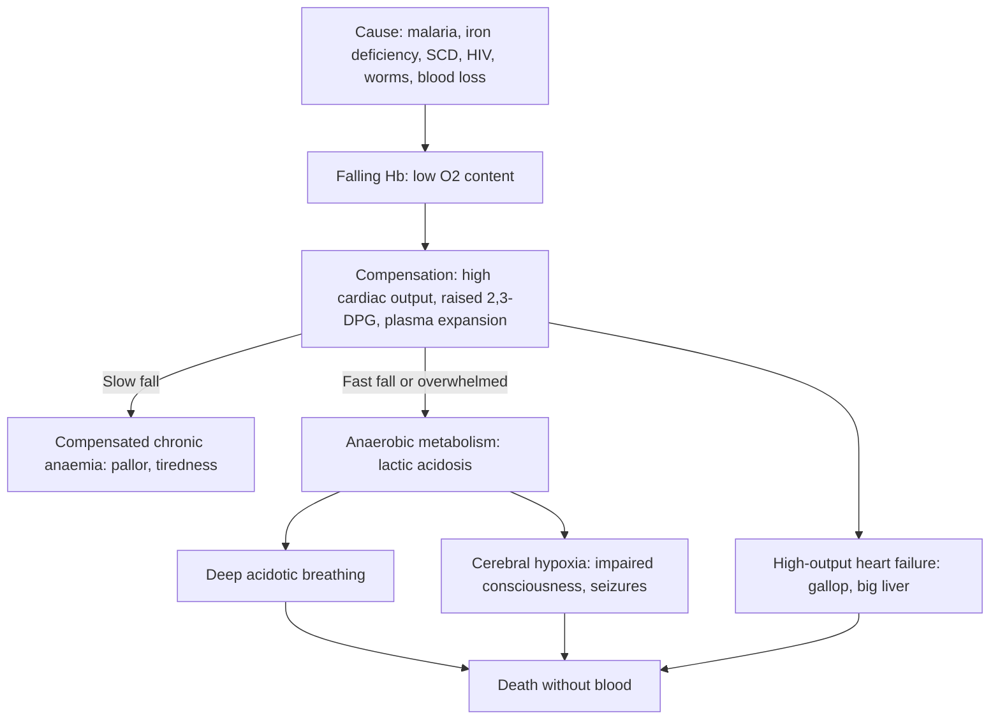

## 1. Definition

**Anaemia** means a haemoglobin (Hb) level below the normal range for the child's age. In Uganda it is one of the commonest reasons a child is admitted, and **severe anaemia** is a leading cause of death in children under 5, mostly from **malaria**. It is rarely a single disease: a pale 2-year-old in Kampala may have malaria, iron deficiency, hookworm, HIV and poor diet all at once. That is why we say **"anaemia is a sign, not a diagnosis."**

Two questions drive everything:

1. **Does this child need blood now?** That depends on the **Hb and the clinical picture**: respiratory distress, shock, impaired consciousness, heart failure. The Hb number alone does not decide it.
2. **Why is this child anaemic?** Classify by **MCV** (small, normal or big cells) and **mechanism** (not made, destroyed or lost), then treat every cause you find.

**Hb thresholds by age.** The WHO revised its anaemia cut-offs in **March 2024** (*Guideline on haemoglobin cutoffs to define anaemia in individuals and populations*). The Uganda Clinical Guidelines (UCG) 2023 still print the older WHO 2011 table, which used one cut-off (11 g/dL) for all children aged 6–59 months.

| Age | Anaemia (WHO 2024) | Mild | Moderate | Severe |
|---|---|---|---|---|
| 6–23 months | **<10.5 g/dL** | 9.5–10.4 | 7.0–9.4 | **<7.0** |
| 24–59 months | **<11.0 g/dL** | 10.0–10.9 | 7.0–9.9 | **<7.0** |
| 5–11 years | **<11.5 g/dL** | 11.0–11.4 | 8.0–10.9 | **<8.0** |
| 12–14 years | **<12.0 g/dL** | 11.0–11.9 | 8.0–10.9 | **<8.0** |

Newborns are different. Hb is high at birth (>13.5 g/dL) and falls to its lowest point around **8–12 weeks** (*physiological nadir*, often 9.5–11 g/dL). Do not label a healthy 2-month-old with Hb 10 g/dL as iron deficient.

> [!UGANDA]
> **UCG 2023** uses Hb <11 g/dL for 6 months–5 years, with severe <7 g/dL. The **WHO Pocket Book (2013)** uses Hb <9.3 g/dL for "non-severe anaemia needing iron" in children under 6 years. For transfusion decisions every guideline uses the same **≤4 and 4–6 g/dL** bands, so those are the numbers that matter on the ward.

**Sickle cell disease (SCD)** is the commonest inherited cause and you will see children in crisis on almost every ward round.

> [!PEARL]
> The one thing never to forget: **a child with severe anaemia and deep, laboured breathing is dying of tissue hypoxia and acidosis, not of pneumonia.** Blood (and oxygen) saves that child. Giving fluid boluses can kill them.

## 2. Epidemiology

- About **half of Ugandan children aged 6–59 months are anaemic** (Uganda Demographic and Health Survey data) [VERIFY: latest UDHS figure]. Prevalence is highest in the second year of life, when iron needs are high and complementary foods are poor in iron.
- **Malaria** is the biggest driver of **severe** anaemia, especially in high-transmission regions (West Nile, Acholi, Lango, Busoga, Karamoja). Severe malarial anaemia peaks between **6 months and 3 years**.
- **Sickle cell disease**: about **1 in 7 Ugandans carries the sickle gene** (higher in the north and east), and an estimated **15,000–20,000 babies are born with SCD each year**. Without care, most die before 5, mainly from pneumococcal sepsis, malaria and acute anaemia.
- **Blood supply**: the **Uganda Blood Transfusion Service (UBTS)** collects, screens (HIV, hepatitis B and C, syphilis) and distributes all blood through regional blood banks. Blood is **available from HC IV level upwards** (UCG 2023), but stock-outs are common, especially during school holidays when student donors are away. Packed cells come in **paediatric bags of 80–150 mL**. Platelets, FFP and cryoprecipitate are mainly found at regional and national referral hospitals.
- Children with severe anaemia who survive often die or are readmitted in the **6 months after discharge** (seen in the TRACT trial). Post-discharge follow-up and malaria chemoprevention matter.

## 3. Aetiology and Risk Factors

**Causes by mechanism**

| Mechanism | Clue | Examples |
|---|---|---|
| **Decreased production** | Low reticulocytes | Iron/folate/B12 deficiency, HIV, TB, malnutrition, leukaemia, aplastic crisis (parvovirus B19), chronic kidney disease, visceral leishmaniasis (kala-azar) |
| **Increased destruction (haemolysis)** | High reticulocytes, jaundice, dark urine, raised bilirubin/LDH | **Malaria**, SCD, **G6PD deficiency** (after primaquine, dapsone, cotrimoxazole, fava beans), autoimmune haemolysis, hypersplenism, blackwater fever |
| **Blood loss** | History, melaena, iron deficiency if chronic | **Hookworm**, schistosomiasis (haematuria, *S. mansoni* GI loss), trauma, epistaxis, bleeding disorders, peptic ulcer, Meckel's diverticulum |

**Risk factors**

| Group | Risk factors |
|---|---|
| **Iron deficiency** | Age 6–24 months; preterm, low birth weight, twins, early cord clamping; poor complementary foods; **cow's or goat's milk** excess; hookworm; adolescent girls (menses) |
| **Severe malarial anaemia** | Age 6 months–3 years; high-transmission region; no ITN; delayed treatment |
| **Sickle cell disease** | Both parents carriers (autosomal recessive; 1 in 4 risk per pregnancy); north and east of Uganda |
| **Other** | HIV and AZT; SAM; TB; drugs (cotrimoxazole, primaquine, dapsone, antiepileptics, herbal medicines); barefoot walking, lake swimming; repeated transfusions |

## 4. Pathophysiology

### Why severe anaemia kills

Oxygen delivery = cardiac output × arterial O₂ content, and O₂ content depends mainly on Hb. When Hb falls slowly (iron deficiency), the body adapts: the heart pumps more, 2,3-DPG rises and oxygen is released more easily, and plasma volume expands. A child can walk into clinic with Hb 4 g/dL.

When Hb falls **fast** (malaria, sequestration) or the compensation is overwhelmed:

1. Tissues switch to anaerobic metabolism, which causes **lactic acidosis**. The child breathes deeply to blow off CO₂. This is the **"respiratory distress" of severe anaemia**, and it is usually not pneumonia.
2. The heart, already working hard, fails (**high-output heart failure**: tachycardia, gallop, big tender liver).
3. The brain gets too little oxygen, which causes **impaired consciousness** and seizures.

This is why WHO uses **clinical severity**, not Hb alone, to decide on transfusion.

### Iron deficiency

Iron stores at birth last about **4–6 months** in a term baby (less in preterm, low-birth-weight and twins, and with early cord clamping). After that, iron must come from food. **Breast milk** iron is well absorbed but small in amount. **Cow's milk** is iron-poor, inhibits iron absorption and can cause occult gut bleeding in infants. **Hookworm** causes chronic loss. Iron deficiency also impairs **neurodevelopment**, so it matters even before the child is very anaemic.

### Sickle cell disease

- A single amino-acid change (**valine for glutamic acid at position 6 of the β-globin chain**) makes **HbS**. Children with **HbSS** (sickle cell anaemia) have the most severe disease. HbSC and HbS-β-thalassaemia vary.
- When deoxygenated, HbS **polymerises**. Red cells become rigid and sickled, which causes **haemolysis** (cells live about 10–20 days instead of 120) and **vaso-occlusion** (cells block small vessels and cause ischaemia and pain).
- **Fetal haemoglobin (HbF)** does not sickle. It protects for the first **3–6 months**, which is why dactylitis is often the first symptom at 6–12 months. **Hydroxyurea works by raising HbF**, and it also lowers the white cell count and reduces red cell stickiness.
- The **spleen** is damaged early by repeated infarction. Functional asplenia begins in infancy, so children are vulnerable to **encapsulated bacteria** (pneumococcus, Hib, Salmonella). Before it auto-infarcts, the spleen can suddenly trap blood (**splenic sequestration**).

> [!EXAM]
> Why does SCD present after 6 months? Because **HbF (α₂γ₂)** protects until the switch to adult **β-chain** production is complete. Hydroxyurea exploits this by switching γ-chain production back on.

**Feature links**

- Low Hb → less oxyhaemoglobin in skin capillaries → pallor (palms, conjunctivae, tongue, nail beds).
- Low O₂ delivery → tiredness, poor feeding, poor school performance.
- Compensatory high cardiac output → tachycardia, flow murmur; overwhelmed → high-output heart failure → gallop, big tender liver, basal crackles, oedema.
- Tissue hypoxia → lactic acidosis → deep acidotic breathing with a clear chest.
- Cerebral hypoxia → impaired consciousness, seizures.
- Haemolysis → raised unconjugated bilirubin → jaundice; haemoglobinuria → dark/cola urine; high retics.
- Malaria and chronic haemolysis → splenomegaly; marrow expansion → frontal bossing, maxillary hypertrophy.
- Sickling and vaso-occlusion → painful crises, dactylitis, ACS, stroke, priapism, leg ulcers, avascular necrosis.
- Splenic infarction → functional asplenia → pneumococcal and *Salmonella* sepsis, osteomyelitis.
- Splenic trapping → sequestration: enlarging spleen, falling Hb, high retics, shock.
- Parvovirus B19 stopping erythropoiesis → aplastic crisis: retics <1%, spleen unchanged.
- Iron deficiency → microcytosis, pica, koilonychia, angular stomatitis, glossitis, reactive thrombocytosis, impaired neurodevelopment.
- Marrow infiltration (leukaemia) → pancytopenia → bleeding (petechiae), infection, bone pain.

## 5. Classification / Staging

**Severity** by Hb for age (WHO 2024 table in section 1): mild, moderate, severe (<7 g/dL under 5 years; <8 g/dL from 5 years).

**Clinical severity for transfusion decisions** (WHO Pocket Book 2013; UCG 2023)

| Category | Criteria | Action |
|---|---|---|
| **Very severe** | Hb **≤4 g/dL** (Hct ≤12%) | Transfuse, whatever the clinical condition |
| **Complicated severe** | Hb **4–6 g/dL** (Hct 13–18%) with respiratory distress/acidotic breathing, shock, impaired consciousness, heart failure, clinical dehydration, very high parasitaemia, cerebral malaria, sepsis or meningitis | Transfuse |
| **Uncomplicated severe** | Hb 4–6 g/dL and none of these | Do not transfuse immediately; treat the cause, recheck Hb within 24 hours (TRACT) |

**Classification by red cell size (MCV).** Normal MCV rises with age. A rough lower limit is **70 + age in years (fL)** up to about 80 fL.

| Type | MCV | Common causes in Uganda |
|---|---|---|
| **Microcytic** | Low | **Iron deficiency** (most common), α- or β-thalassaemia trait, anaemia of chronic disease (late), lead poisoning, sideroblastic (isoniazid) |
| **Normocytic** | Normal | **Malaria**, acute blood loss, **sickle cell disease**, HIV, chronic disease (TB, chronic kidney disease), marrow infiltration (**leukaemia**, Burkitt), aplastic anaemia, mixed deficiency |
| **Macrocytic** | High | **Folate deficiency** (SCD without folic acid, malnutrition, goat's milk), B12 deficiency (exclusively breastfed infants of vegan/B12-deficient mothers), **zidovudine (AZT)**, hydroxyurea (expected), high reticulocytes, hypothyroidism, Down syndrome |

**Classification by mechanism**: decreased production, increased destruction, blood loss (section 3).

**SCD genotypes**: HbSS (most severe), HbS-β⁰-thalassaemia (similar), HbSC and HbS-β⁺-thalassaemia (milder, variable).

## 6. Clinical Features

### History

| Ask about | Why it matters |
|---|---|
| **Fever, recent malaria, treatment taken, ITN use, where they live and travelled** | Malaria is the commonest cause of acute severe anaemia; also sepsis |
| **Speed of onset**: sudden weakness, fast breathing, collapse vs months of tiredness | Acute = haemolysis, sequestration, bleeding (decompensates early); chronic = deficiency (well compensated) |
| **Dark/cola urine, yellow eyes** | Haemolysis: malaria, G6PD, blackwater fever, SCD |
| **Breathing fast, sweating, poor feeding, swelling** | Heart failure, which changes how you transfuse (packed cells, slow, furosemide) |
| **Diet**: breastfeeding, age at complementary foods, **cow's/goat's milk** intake, meat/beans/greens, **pica** (eating soil) | Iron or folate deficiency; pica is a classic iron-deficiency sign |
| **Worms, blood in stool or urine, bare feet, swimming in lakes** | Hookworm; schistosomiasis |
| **Bleeding**: nose, gums, bruising, heavy periods in adolescents | Bleeding disorder, leukaemia, aplastic anaemia |
| **Bone pain, swollen hands/feet, family history of SCD** | SCD; also leukaemia (bone pain) |
| **Known SCD**: previous crises and transfusions, **baseline Hb**, hydroxyurea, penicillin and folic acid adherence, clinic attendance | Baseline defines an "acute fall"; adherence explains infections and crises |
| **Drugs**: cotrimoxazole, AZT, primaquine, dapsone, herbal medicines, antiepileptics | Marrow suppression, G6PD haemolysis, folate antagonism |
| **HIV status of child and mother, TB contact, weight loss, night sweats** | HIV, TB, malignancy |
| **Immunisation (UNEPI), growth, development** | Missed PCV/Hib in SCD; malnutrition; iron deficiency harms development |
| **Previous transfusions** (number, last date, reactions) | Alloantibodies, iron overload, transfusion-transmitted infection |

### Examination

Follow the order of Hutchison's Clinical Methods (24th edition), adapted for children: observe first, auscultate while the child is quiet, and leave distressing parts (throat, ears) to last. A decompensated child gets ETAT first (section 9).

**Introduction and preparation**

- Introduce yourself; confirm the child's name, age and the caregiver's relationship; consent from the caregiver and assent from the child.
- Hand hygiene.
- Position and exposure: on the caregiver's lap or semi-sitting if breathless; expose to see the whole skin and abdomen, in a warm room.

**General inspection from the end of the bed**

- Well or unwell; conscious level (AVPU); **work of breathing** (deep acidotic breathing versus recession).
- Colour: **pallor**, **jaundice** (haemolysis), cyanosis.
- Hydration; **oedema** (heart failure, SAM); nutrition; dysmorphism (Down syndrome: macrocytosis; facial features of chronic haemolysis).
- **Vitals**: HR, RR, SpO₂, temperature, **capillary refill**, BP (normal values: HR 100–160/min infants, 80–130/min at 2–5 years; RR <50/min at 2–12 months, <40/min at 1–5 years).
- **Growth**: weight, height/length, MUAC, weight-for-height Z-score, bilateral pitting oedema. **SAM** changes the transfusion plan.

**Hands, face and neck**

| Sign | What it means |
|---|---|
| **Palmar pallor** (IMCI "severe palmar pallor") | The most practical sign in dark skin |
| Koilonychia | Iron deficiency (late sign) |
| Swollen, tender fingers (dactylitis) | SCD in children under 2 |
| Cold hands, slow capillary refill | Shock or heart failure |
| Conjunctival pallor; scleral **jaundice** | Anaemia; haemolysis |
| Angular stomatitis, glossitis | Iron deficiency (late signs) |
| **Frontal bossing, maxillary hypertrophy** | Chronic haemolysis, SCD |
| Gum bleeding, petechiae | Marrow failure, leukaemia |
| Lymph nodes | Leukaemia, lymphoma, HIV, TB |
| JVP (older children) | Heart failure |

**Systems**

- **Cardiovascular**: apex, heaves; **gallop**, **flow murmur** (soft ejection systolic murmur from anaemia itself).
- **Respiratory**: deep breathing with a clear chest (acidosis) versus crackles (pneumonia, heart failure, ACS).
- **Abdomen**: **liver** size (heart failure), **spleen** (measure in cm below the costal margin and **mark it with a pen** so the next person can see if it grows), masses. Splenomegaly: malaria, SCD sequestration or hypersplenism, leukaemia, kala-azar, HbSC.
- **Musculoskeletal and skin**: bone tenderness, leg ulcers, bruises.
- **Neurology** (SCD): hemiparesis, speech, gait (stroke).

**Complete the examination**: urine dipstick (haemoglobinuria, haematuria), plot growth, check the immunisation card, thank the caregiver and child, wash hands, and summarise.

**Document key negatives**: "no deep breathing, CRT <2 s, no hepatomegaly, alert" for a stable child with low Hb.

### Red flags

> [!REDFLAG]
> - **Hb ≤4 g/dL**, or Hb 4–6 g/dL with **respiratory distress, shock, impaired consciousness, heart failure or dehydration**: transfuse now.
> - **Rapidly enlarging spleen with falling Hb** in a child with SCD: splenic sequestration, which can kill within hours.
> - **SCD + fever ≥38.5 °C**: presumed pneumococcal sepsis until proven otherwise.
> - **SCD + new weakness, facial droop, speech change or seizure**: stroke.
> - **SCD + chest pain, cough, hypoxia, new infiltrate**: acute chest syndrome.
> - **Pancytopenia, blasts, bone pain, big liver/spleen/nodes**: leukaemia. Do not give steroids before diagnosis.
> - **Anaemia + bleeding + low platelets**: marrow failure, DIC, or leukaemia.

### Thinking like a clinician

- **Fast breathing + pallor**: think anaemia-induced acidosis before pneumonia. Look for chest signs; if the chest is clear and the child is breathing deeply, it is metabolic.
- **Pale, jaundiced, dark urine, fever**: malaria-related haemolysis (or G6PD after a drug). If retics are high, the marrow is working.
- **Pale, not jaundiced, microcytic, eats soil, drinks lots of cow's milk**: iron deficiency. Check for hookworm.
- **Pale and macrocytic**: on AZT? folate deficiency? SCD without folate?
- **SCD with a sudden drop in Hb**: check the **spleen** and the **reticulocytes**. Big spleen and high retics means sequestration. Normal spleen and retics below 1% means aplastic crisis (parvovirus). High retics, jaundice and no splenomegaly means hyperhaemolysis or malaria.
- **"Hb 5 g/dL but the child is playing"** = chronic, compensated anaemia. TRACT tells us that immediate transfusion is not needed, but you must **recheck Hb and watch for danger signs**.
- **"The RDT is positive, so the anaemia is from malaria"**: most anaemic Ugandan children have more than one cause; check MCV, diet, worms, HIV, SCD.
- Common student mistake: **giving a fluid bolus to a "shocked" child with severe anaemia.** Cold peripheries and tachycardia here are from anaemia and heart failure. Fluids worsen heart failure. Give **blood**.

## 7. Differential Diagnoses

| Differential | Distinguishing clinical feature | Distinguishing investigation |
|---|---|---|
| **Severe malarial anaemia** | Fever, often <3 years, acute, may have jaundice or dark urine, hepatosplenomegaly | RDT/blood film |
| **Iron deficiency** | Slow onset, pica, cow's milk excess, hookworm, well compensated | Low MCV, low ferritin, high platelets |
| **Sickle cell disease** | From 6 months, dactylitis, recurrent pain, jaundice, family history | Hb electrophoresis |
| **HIV-related anaemia** | Weight loss, recurrent infections, AZT use, oral thrush | HIV test; MCV high on AZT |
| **Leukaemia** | Bone pain, bleeding, fever, nodes, hepatosplenomegaly | FBC/film (blasts), marrow |
| **G6PD deficiency** | Boy, acute haemolysis after drug, fava, infection | G6PD assay after recovery |
| **Visceral leishmaniasis** | Karamoja/North-East, long fever, massive spleen, wasting | rK39 RDT, marrow/splenic aspirate |
| **Hookworm / schistosomiasis** | Rural, barefoot, lake swimming; haematuria | Stool/urine microscopy |
| **Anaemia of chronic disease** | TB, chronic infection, chronic kidney disease | Normal/low MCV, high ferritin, low iron |
| **Aplastic anaemia** | Pancytopenia, no organomegaly | Marrow (hypocellular) |
| **Thalassaemia trait** | Mild microcytosis out of proportion to Hb, normal ferritin | Electrophoresis (HbA2 raised in β-trait) |

## 8. Clinical Workup

Facility levels are compiled from the source notes [VERIFY: against the MoH test menu by level].

### Bedside

| Test | Why / expected finding | Facility level |
|---|---|---|
| **HemoCue Hb** (or Hct) | Severity in 1 minute; repeat after transfusion | HC III and above |
| **Malaria RDT** (± blood film) | Malaria; HRP2 RDTs stay positive for 2–4 weeks after treatment | All levels |
| **Random blood glucose** | Hypoglycaemia in severe malaria or sepsis (<2.5 mmol/L; <3 mmol/L in SAM) | All levels with a glucometer |
| **Sickling test / HbS point-of-care test** (e.g. HemoTypeSC, Sickle SCAN where available) | Screens for SCD; a positive test needs confirmation by electrophoresis or HPLC | Where available |
| **Urine dipstick** | Haemoglobinuria (haemolysis), haematuria (schistosomiasis), protein | All levels |
| **Pulse oximetry** | Hypoxia: ACS, pneumonia, heart failure | HC IV and above |
| **Bedside clotting test** (whole blood in a dry glass tube; no clot by 7 minutes = coagulopathy) | DIC, snakebite, severe sepsis | All levels |

### Basic lab

| Test | When | Expected / abnormal finding | How it changes management | Facility level |
|---|---|---|---|---|
| **Full blood count with indices** | Every anaemic child | Hb, **MCV, MCH**, RDW, WBC, platelets | Classifies the anaemia; pancytopenia means marrow failure or leukaemia | Most HC IVs and hospitals |
| **Peripheral blood film** | Unexplained anaemia, abnormal FBC | Sickle cells and target cells (SCD), pencil cells (iron), blasts (leukaemia), spherocytes, fragmented cells, parasites | Points to the cause | Hospitals with a lab technologist |
| **Reticulocyte count** | Any unclear or acute anaemia, SCD crisis | **High (>2–3%)**: haemolysis or bleeding; **low (<1%)**: production failure (aplastic crisis, deficiency) | Separates sequestration from aplastic crisis | RRH/NRH, some hospitals |
| **Group and cross-match** | Before any transfusion (draw **before** transfusing) | Compatible units | Essential | HC IV and above, depending on the blood fridge and supply |
| **Stool microscopy** | Iron deficiency, abdominal symptoms | Hookworm ova, *S. mansoni* | Deworm, praziquantel | HC III and above |
| **Urine microscopy** | Haematuria, school child in endemic area | *S. haematobium* ova | Praziquantel 40 mg/kg | HC III and above |
| **HIV test** | Every child with unexplained or severe anaemia | Positive | ART, cotrimoxazole, avoid AZT if anaemic | All levels |

### Imaging

| Test | When | Expected finding | How it changes management | Facility level |
|---|---|---|---|---|
| **Chest X-ray** | SCD with chest signs, heart failure | New infiltrate (ACS), cardiomegaly | ACS treatment; heart failure | Hospitals |
| **Transcranial Doppler (TCD)** | Annually in HbSS aged 2–16 years | Time-averaged mean velocity **>200 cm/s abnormal**, 170–199 conditional | Start hydroxyurea or chronic transfusion to prevent stroke | Mulago SCD clinic and a few other centres |
| **Abdominal ultrasound** | Acute abdomen in SCD, gallstones | Gallstones, splenic infarct, organomegaly | Surgical review | Hospitals |

### Specialised / referral-level

| Test | When | Expected / abnormal finding | How it changes management | Facility level |
|---|---|---|---|---|
| **Hb electrophoresis / HPLC** | Suspected SCD or thalassaemia | HbSS, HbSC, HbS-β-thal; HbF %. Do it **before transfusion** or 3 months after | Confirms SCD and enrols the child in an SCD clinic | Regional/national labs (CPHL, Mulago) and via DBS from **EID/newborn screening** |
| **Serum ferritin** | Microcytic anaemia | **<12 µg/L (<5 years) / <15 µg/L (≥5 years)** = iron deficiency. In infection/inflammation use <30 µg/L or <70 µg/L (WHO 2020) | Confirms iron deficiency | Mainly RRH, NRH and private labs |
| **Bilirubin, LDH, DAT (Coombs)** | Suspected haemolysis | Raised unconjugated bilirubin and LDH; DAT positive in autoimmune haemolysis | Steroids for autoimmune haemolysis | RRH/NRH |
| **G6PD screen** | Haemolysis after drug or fava beans | Low activity (test **after** recovery, as retics have higher G6PD) | Avoid oxidant drugs | RRH/NRH |
| **Blood culture** | SCD with fever, very sick child | Pneumococcus, non-typhoidal *Salmonella*, *Staph aureus* | Tailors antibiotics | RRH/NRH |
| **Bone marrow aspirate** | Pancytopenia, blasts, unexplained hepatosplenomegaly | Leukaemia, aplasia, leishmaniasis, infiltration | Referral to Mulago/UCI | NRH |
| **rK39 RDT, marrow/splenic aspirate** | Suspected kala-azar | Positive | Antileishmanial treatment | Endemic-area hospitals, NRH |

**Investigation summary**

| Test | What you are looking for | Why |
|---|---|---|
| Hb / FBC with MCV | Severity and type | Directs transfusion and workup |
| Malaria RDT/film | Parasitaemia | Treat malaria; hyperparasitaemia is an indication to transfuse at Hb 4–6 |
| Reticulocytes | Marrow response | Production vs destruction/loss |
| Film | Cell shapes, blasts, parasites | Clinches many causes |
| Electrophoresis | HbS | Lifelong SCD care |
| Ferritin | Iron stores | Confirms iron deficiency |
| Stool/urine microscopy | Hookworm, schistosomes | Treatable causes |
| HIV test | Infection | ART; AZT-related anaemia |
| Group and cross-match | Compatibility | Safe transfusion |

### Putting it together

**Model one-liner**

> "A 2-year-old boy, 10 kg, from Wakiso, with 3 days of fever, now has **Hb 3.8 g/dL**, a positive malaria RDT, **deep breathing (RR 56)** and a tender liver 4 cm below the costal margin. This is **severe malarial anaemia with respiratory distress and heart failure**. He needs **oxygen, IV artesunate, and packed cells 10 mL/kg (or whole blood 20 mL/kg) over 3–4 hours with furosemide 1 mg/kg at the start**."

**Problem list**

1. Severe anaemia with decompensation.
2. Severe malaria.
3. Possible coexisting iron deficiency (diet: cow's milk 1 L/day).
4. WHZ −1.5.
5. Immunisation up to date.

**Worked example 1: reading an FBC**

| Result | Child A | Child B | Child C |
|---|---|---|---|
| Hb (g/dL) | 6.8 | 5.2 | 4.1 |
| MCV (fL) | 58 | 82 | 84 |
| Retics | 1% | 12% | 0.2% |
| Other | Platelets high 520 | Spleen 6 cm, was 2 cm | Known HbSS, spleen not palpable |
| Interpretation | **Iron deficiency** (microcytic, reactive thrombocytosis) | **Splenic sequestration** (SCD, spleen enlarging, retics high) | **Aplastic crisis** (parvovirus B19) |

A **Mentzer index** (MCV ÷ RBC count in millions) **above 13 suggests iron deficiency** and below 13 suggests thalassaemia trait. It is a screening clue only.

**Worked example 2: calculating the volume.** Volume (mL) = weight (kg) × desired rise in Hb (g/dL) × 4 (packed cells) or × 8 (whole blood). A 10 kg child with Hb 3.8 g/dL: packed cells 10 mL/kg = 100 mL, expected rise about 2.5 g/dL; whole blood 20 mL/kg = 200 mL, expected rise about 2.5 g/dL.

**Model case presentation (ward round)**

> "**Amina is a 3-year-old girl weighing 11.5 kg** (weight-for-age Z −1.6, height-for-age Z −1.0, WHZ −1.4, MUAC 13.6 cm), a known **HbSS** patient attending Mulago SCD clinic. She is fully **immunised for age per UNEPI** including PCV, and on **penicillin V 125 mg twice daily** and folic acid, but she missed her last 2 clinic visits. She eats family foods 3 times daily and still breastfeeds. **HIV status: negative** (mother negative in ANC). She presented with **2 days of fever and progressive weakness**. On examination she is **very pale**, RR 48 with no recession, HR 160, CRT 3 seconds, and her **spleen is 7 cm below the costal margin, up from 2 cm at her last visit**. **Hb is 3.9 g/dL** (baseline 7.5) and retics are 14%. The RDT is negative. My working diagnosis is **acute splenic sequestration crisis**, with possible sepsis. I have taken a blood culture, given ceftriaxone 100 mg/kg, and requested packed cells, which I plan to give as **5–10 mL/kg aliquots aiming for Hb 7–8 g/dL**, with spleen size marked and checked hourly."

## 9. Management

### Immediate / emergency

**First 5 minutes (ABCDE)**

1. **ETAT triage**: Airway, Breathing (RR, SpO₂, recession, **deep breathing**), Circulation (CRT, pulse, cold hands), Coma/Convulsion, Dehydration. Severe palmar pallor is a **priority sign**.
2. **B**: **oxygen** if SpO₂ <90% or respiratory distress (WHO: aim SpO₂ ≥90%, ≥94% if emergency signs).
3. **C**: **IV access** and at once take blood for **Hb (HemoCue), malaria RDT, blood glucose, group and cross-match**. Draw the cross-match sample **before** any transfusion. **Shock with severe anaemia**: do not give repeated crystalloid boluses. Request **blood urgently** (O-negative or uncrossmatched group-specific in a true emergency). In shock from blood loss (e.g. trauma) crystalloid 10–20 mL/kg while blood is coming is acceptable.
4. **D**: **check glucose**. If <2.5 mmol/L (WHO; <3 mmol/L in SAM, and many units treat below 3), give **10% dextrose 5 mL/kg IV**. **Convulsing**: treat (diazepam 0.5 mg/kg rectally or 0.3 mg/kg IV, or midazolam).
5. **E**: temperature; **start treatment of the cause** in parallel: **IV artesunate** if malaria positive with severe features, **ceftriaxone** if septic or SCD with fever.

> [!REDFLAG]
> Never give a fluid bolus to a child with severe anaemia and signs of heart failure. **In SAM, don't bolus at all unless the child is in shock**, and then use the WHO SAM shock protocol (15 mL/kg over 1 hour, and transfuse if no improvement).

**Emergency algorithm: severe anaemia**

1. **Triage and ABC** (ETAT). Oxygen if SpO₂ <90% or distressed. Check glucose. Take blood for Hb, RDT and cross-match before anything else.
2. **Decide on transfusion** (WHO Pocket Book 2013; UCG 2023):
   - **Hb ≤4 g/dL (Hct ≤12%)**: transfuse, whatever the clinical condition.
   - **Hb 4–6 g/dL (Hct 13–18%)** with any of: **respiratory distress/acidotic breathing, shock, impaired consciousness, heart failure, clinical dehydration, very high parasitaemia** (>10% in the Pocket Book; UCG says >20%), cerebral malaria, sepsis or meningitis: transfuse.
   - **Hb 4–6 g/dL and none of these** (uncomplicated): **do not transfuse immediately**. Treat the cause, **recheck Hb within 24 hours and watch closely**. Transfuse if Hb falls below 4 g/dL or danger signs appear (TRACT).
3. **Choose the product and volume** (blood products table below).
4. **Treat the cause at the same time**: artesunate for severe malaria, antibiotics for sepsis, stop oxidant drugs.
5. **Monitor** during and after transfusion (giving the transfusion safely, below).
6. **Recheck Hb after transfusion** (at least 4–6 hours later, usually the next morning). If Hb is still as low and the child is still symptomatic, repeat the transfusion.
7. **Plan for discharge**: iron after the acute illness, deworming, malaria prevention, follow-up in 2 weeks and again at 1–3 months.

### Definitive

#### Blood products and volumes

| Product | Dose | Rate | Notes |
|---|---|---|---|
| **Whole blood** | **20 mL/kg** | Over **3–4 h** | UCG: available from HC IV. Hct ~35%. Avoid in severe chronic anaemia with incipient heart failure (volume overload): use packed cells |
| **Packed red cells** | **10 mL/kg** (UCG: 10–15 mL/kg) | Over **3–4 h** | Hct ~55%. Preferred in heart failure, SCD, chronic anaemia |
| **TRACT higher volume** | Whole blood **30 mL/kg** (or packed cells 15 mL/kg) | Over 3–4 h | In TRACT, 30 mL/kg reduced 28-day mortality in **afebrile** children with complicated severe anaemia, but not in febrile children (possible harm). Not yet in UCG; follow your unit |
| **SAM** | **10 mL/kg** packed cells or whole blood | Over **3 h** | Only if Hb <4, or 4–6 with respiratory distress. No routine furosemide. **Do not repeat within 4 days** |
| **Sequestration crisis (SCD)** | **5–10 mL/kg** packed cells, repeat as needed | Over 2–4 h | Spleen releases trapped cells as it shrinks; aim Hb **7–8 g/dL**, not higher (hyperviscosity) |
| **Platelets** | 10–15 mL/kg (or 1 unit per 10 kg) | Over 30 min | Bleeding with platelets <50 × 10⁹/L, or <10 × 10⁹/L without bleeding (leukaemia). Referral hospitals |
| **Fresh frozen plasma** | 10–15 mL/kg | Over 30–60 min | DIC or coagulopathy with bleeding. Referral hospitals |
| **Cryoprecipitate** | 5 mL/kg (or 1 unit per 5–10 kg) | Over 30 min | Fibrinogen <1–1.5 g/L with bleeding. NRH and a few RRH |

**How much will it raise the Hb?** Roughly **8 mL/kg of whole blood or 4 mL/kg of packed cells raises Hb by 1 g/dL**. Formula: volume (mL) = weight (kg) × desired rise in Hb (g/dL) × 4 (packed cells) or × 8 (whole blood).

> [!DRUG]
> **Furosemide with transfusion**: give **1 mg/kg IV at the start** if the child has signs of heart failure (WHO Pocket Book). Give it into the patient, never into the blood bag. If overload develops during transfusion: slow or stop, sit up, oxygen, furosemide **1–2 mg/kg IV (Pocket Book max 20 mg total)**. Routine furosemide for every transfusion is **not** recommended (UCG 2023).

> [!UGANDA]
> The **WHO Pocket Book (2013) and UCG 2023 are the guidelines Ugandan wards follow**: 20 mL/kg whole blood or 10 mL/kg packed cells over 3–4 hours. TRACT (run in Mbale, Soroti, Mulago and Malawi) showed that **30 mL/kg** saved lives in afebrile children with severe anaemia, and that **not transfusing** uncomplicated Hb 4–6 g/dL is safe if Hb is monitored. Some Ugandan units have adopted the TRACT findings. Ask your firm which volume they use, and always write the volume in **mL**, not "1 unit".

#### Giving the transfusion safely

1. **Indication documented** with Hb and clinical signs; consent from the parent (and explain risks).
2. **Correct patient**: check name, number, group and unit number **at the bedside with two people**.
3. **Inspect the bag**: no leaks, not expired, no pink plasma, no clots, red cells not purple-black.
4. **Timing**: start within **30 minutes of removing from the fridge** (UCG) and complete within **4 hours** of starting. Do not leave blood out of the fridge for more than 2 hours before starting (Pocket Book). Do not warm it on a radiator or in water.
5. **Use a blood giving set with a filter**, a burette or infusion pump for small volumes, and a splinted arm. Do not add drugs to blood.
6. **Baseline observations** (temperature, pulse, RR, BP), then **at 15 minutes**, **every 30 minutes**, and **at the end** (UCG minimum: before, 15 min, end). Stay with the child for the first 15 minutes.
7. **Record**: start and end time, volume, unit number, any reaction.
8. **After**: reassess clinically; recheck Hb; repeat transfusion only if still indicated.

#### Transfusion reactions (UCG 2023, adapted for children)

| Category | Signs | Likely cause | Management |
|---|---|---|---|
| **1. Mild** | Localised urticaria, itch; or mild fever <38.9 °C with no other signs | Minor allergy; febrile non-haemolytic reaction | **Pause** transfusion, check vitals. Antihistamine (**chlorphenamine** 0.1 mg/kg IV/oral, or cetirizine/loratadine; UCG lists promethazine IM, 5 mg at 1–5 years, 6.25–12.5 mg at 5–10 years; avoid promethazine under 2 years). For fever give **paracetamol 15 mg/kg**. If stable, **restart slowly** and observe. If no improvement in 30 min or worsening: treat as category 2 |
| **2. Severe / life-threatening** | Fever ≥39 °C, rigors, hypotension (fall >20% in SBP), tachycardia, dyspnoea, wheeze/stridor, chest/loin/back pain, headache, restlessness, **haemoglobinuria**, unexplained bleeding (DIC), widespread rash, airway oedema | **Acute haemolytic** (ABO mismatch), **bacterial contamination**, **anaphylaxis**, **TACO** (circulatory overload), **TRALI** (lung injury) | **STOP and do not restart.** Keep the IV line with **normal saline**. ABC, high-flow oxygen. **Anaphylaxis**: **adrenaline 0.01 mg/kg IM** (0.01 mL/kg of 1:1000, max 0.5 mg), hydrocortisone 4 mg/kg IV, antihistamine, salbutamol neb 2.5–5 mg. **Hypotension**: NS 20 mL/kg (UCG 20–30 mL/kg) unless the cause is overload. **TACO**: sit up, furosemide 1 mg/kg IV, no fluids. Suspected contamination: blood cultures and broad-spectrum antibiotics (ceftriaxone). Check urine for haemoglobin, start a fluid balance chart. **Send the bag, giving set, fresh urine and new blood samples (clotted and EDTA, from the other arm) to the blood bank** and report |

> [!PEARL]
> A **conscious** child with an ABO-incompatible transfusion may react after only **5–10 mL**. In an **unconscious** child, hypotension, hypoxia or unexplained bleeding may be the only signs. Most fatal haemolytic reactions are due to **clerical errors** at sample collection or at the bedside.

#### Iron deficiency anaemia

- **Oral iron** (drug table): ferrous sulphate per UCG, or iron syrup for infants; plus **deworming** (albendazole), **praziquantel** for schistosomiasis and **folic acid** if folate or mixed deficiency.
- **Expected response**: reticulocytes rise in **5–10 days**; Hb rises about **1–2 g/dL in 2–4 weeks** (UCG: rises in 2–3 weeks, normal by 2 months). **No rise after 4 weeks** means poor adherence, ongoing loss, malabsorption, wrong diagnosis (thalassaemia trait, chronic disease) or an infection.
- **Diet advice**: exclusive breastfeeding to 6 months; iron-rich complementary foods (liver, meat, fish, small fish *mukene*, beans, dark green leaves), **limit cow's milk to about 500 mL/day** after 12 months, no tea with meals.
- **Iron and malaria**: in malaria-endemic areas, give iron **together with malaria prevention** (ITN) and **treatment**. Postpone iron during acute severe illness and in the **stabilisation phase of SAM** (start in rehabilitation).
- **Parenteral iron** is rarely needed in children and is a specialist decision (anaphylaxis risk).

#### Sickle cell disease: long-term care (SCD clinic)

| Intervention | Dose (child) | Route / frequency | Duration | Source |
|---|---|---|---|---|
| **Penicillin V** | **3 months–3 years: 125 mg**; **3–5 years: 250 mg** | Oral, **12-hourly** | Until **5 years** (continue after 5 if previous invasive pneumococcal disease or splenectomy) | UCG 2023. Alternative where adherence is poor: benzathine penicillin IM monthly (specialist choice). Erythromycin 125–250 mg 12-hourly if allergic |
| **Folic acid** | **5 mg** (UCG: for life; some clinics give 1–2.5 mg in infants) | Oral, daily | Life | UCG 2023 |
| **Malaria chemoprevention** | **SP**: ½ tab at 2–5 y, 1 tab at 5–10 y, 2 tabs at 10–15 y, 3 tabs >15 y (1 tab = 500/25 mg) | Oral, **monthly** | Life (with ITN) | UCG 2023. Avoid SP if sulphonamide allergy or on cotrimoxazole prophylaxis. Some Ugandan SCD clinics use monthly dihydroartemisinin-piperaquine instead [VERIFY: local practice] |
| **Vaccines** | Full **UNEPI** schedule (pentavalent incl. Hib, **PCV**, measles-rubella, etc.) plus **PPSV23 at 2 years** (repeat after 3–5 years), meningococcal and influenza if available, hepatitis B check | IM | — | UCG 2023 |
| **Hydroxyurea** | Start **20 mg/kg once daily** (UCG; REACH 15–20 mg/kg); escalate by **5 mg/kg every 8 weeks** to the **maximum tolerated dose, max 35 mg/kg/day** | Oral, once daily (capsules can be opened into water) | Long term; benefit is lost if stopped | UCG 2023; NHLBI 2014; REACH; NOHARM |
| **Transcranial Doppler** | — | Annually, 2–16 years | — | Abnormal (>200 cm/s): hydroxyurea at MTD or chronic transfusion |

**Hydroxyurea in detail**

- **Who** (UCG 2023): children **≥9 months** with **>3 crises a year**, pain interfering with daily life, **abnormal TCD (>200 cm/s)**, recurrent or severe **acute chest syndrome**, or **stroke**. International guidance (NHLBI 2014, ASH) and the African trials support **offering it to every child with HbSS or HbS-β⁰ from 9 months**, whatever the severity. Many Ugandan SCD clinics now follow the broader approach where supply allows.
- **Before starting**: FBC, retics, renal and liver function, HbF if available; counsel the family. A senior clinician makes the decision (UCG).
- **Monitoring**: FBC every **2–4 weeks during escalation**, then every **2–3 months**.
- **Hold if** (toxicity): **ANC <1.0 × 10⁹/L**, **platelets <80 × 10⁹/L**, Hb falling below 5 g/dL or retics <80 × 10⁹/L when Hb is low. Restart at a lower dose (by 2.5–5 mg/kg) once counts recover (usually 1–2 weeks).
- **Expected effects**: MCV rises (good adherence marker), HbF rises, fewer pain crises, ACS, transfusions and deaths. **NOHARM (Uganda, 2017)** showed **no increase in malaria**; **REACH** (Uganda, Kenya, DRC, Angola) showed fewer events and deaths, and **dose escalation to MTD** gave better results than a fixed dose.
- **Side effects**: myelosuppression (dose-related, reversible), nail and skin darkening, GI upset. Advise adolescents on **contraception** (teratogenic in animals; stop 3 months before conception, as in the obs topic).

> [!UGANDA]
> **Hydroxyurea eligibility**: UCG 2023 restricts it to children with frequent crises, abnormal TCD, ACS or stroke; NHLBI/ASH and the African trials (REACH, NOHARM) support offering it to **every** child with HbSS or HbS-β⁰ from 9 months. Follow your SCD clinic's policy and supply.

#### Sickle cell disease: acute complications

| Complication | Recognise | Manage |
|---|---|---|
| **Fever ≥38.5 °C** | Any fever, especially <5 years | Blood culture, RDT, FBC, CXR/urine as indicated; **ceftriaxone 80–100 mg/kg IV once daily (max 4 g)** within 1 hour; add artesunate if malaria. Admit if unwell, <1 year, Hb drop, or temperature ≥39.5 °C |
| **Vaso-occlusive (painful) crisis** | Bone, back, chest or abdominal pain; dactylitis (hand-foot syndrome) in <2 years | **Analgesia within 30 minutes** and reassess every 30–60 min: **paracetamol 15 mg/kg 6-hourly** (max 60 mg/kg/day; UCG 10–15 mg/kg) + **ibuprofen 5–10 mg/kg 8-hourly** (max 30 mg/kg/day; not if dehydrated or kidney disease) → **oral morphine 0.2–0.4 mg/kg 4-hourly** or **IV morphine 0.1 mg/kg** titrated (UCG 0.1–0.2 mg/kg). Avoid pethidine and codeine under 12 years. Hydration at maintenance (oral or IV; do not overload). Warm compresses (not cold). Oxygen only if SpO₂ <95%. Laxative with morphine (bisacodyl 2.5–5 mg) |
| **Acute chest syndrome** | New infiltrate on CXR + fever, cough, chest pain, tachypnoea or hypoxia | Oxygen to SpO₂ ≥95%, analgesia (avoid oversedation), **incentive spirometry** (or blowing balloons) every 2 h awake, **ceftriaxone 80–100 mg/kg** + a macrolide (**azithromycin 10 mg/kg once daily** or erythromycin 10–12.5 mg/kg 6-hourly; UCG lists 5–10 mg/kg) for 7–10 days, salbutamol if wheeze, **restricted IV fluids** (do not overload). **Transfuse** if Hb falls or <9 g/dL (UCG target ~10–11 g/dL, never above 11); **exchange transfusion** if severe or worsening |
| **Splenic sequestration** | Pallor, weakness, **rapidly enlarging spleen**, Hb drop ≥2 g/dL, high retics; can cause shock | **Urgent transfusion** of packed cells **5–10 mL/kg aliquots**; aim Hb 7–8 g/dL; avoid hyperviscosity. Mark the spleen; teach parents to palpate it. After 2 episodes or one life-threatening one, consider **splenectomy** when well (UCG: avoid splenectomy in the acute phase) |
| **Aplastic crisis** | Pallor, tiredness after a febrile illness, **retics <1%**, spleen not bigger | Transfuse if symptomatic or Hb very low (packed cells 10 mL/kg). Usually recovers in 7–10 days. Isolate from pregnant women (parvovirus B19) |
| **Stroke** | Hemiparesis, speech or vision change, seizure, reduced consciousness | ABC, **oxygen** (SpO₂ >94%), check glucose, **urgent transfusion**: **exchange transfusion** is preferred; if not available, simple transfusion to Hb **≤10–11 g/dL** (UCG: transfuse if Hb <9 g/dL). Refer for neuroimaging. Then **chronic transfusion or hydroxyurea at MTD** for secondary prevention |
| **Priapism** | Painful erection >2–4 h | Hydration, analgesia, urinate; urology referral for aspiration if >4 h |
| **Mesenteric crisis / acute abdomen** | Distension, absent bowel sounds, pain | Nil by mouth, NG tube, IV fluids, ceftriaxone + metronidazole 7.5–10 mg/kg 8-hourly, transfusion, surgical review |
| **Osteomyelitis / septic arthritis** | Fever, persistent focal bone pain (vs crisis), swelling | *Salmonella* and *Staph*: **ceftriaxone 50–80 mg/kg** or cloxacillin 50 mg/kg 6-hourly (max 2 g/dose), for at least 21 days (UCG) |

**Transfusion indications in SCD** (UCG 2023): acute fall in Hb ≥2 g/dL below baseline (or Hb <5 g/dL), sequestration (splenic or hepatic), aplastic crisis, hyperhaemolysis, stroke, ACS, multi-organ failure, before surgery or general anaesthesia. **Do not transfuse** a well child at steady state (Hb 6–8 g/dL) or for an uncomplicated painful crisis. Use **packed cells**, not whole blood, where possible, and **never raise Hb above about 11 g/dL** (hyperviscosity, stroke).

### Drug table

| Drug | Dose (per kg + max for children; adult) | Route | Frequency | Duration | Key cautions |
|---|---|---|---|---|---|
| **Furosemide** (transfusion with heart failure) | **1 mg/kg** at start; 1–2 mg/kg for overload (Pocket Book max 20 mg total) | IV | Once; repeat if overload | During transfusion | Into the patient, never the bag; not routine (UCG); not routine in SAM |
| **10% dextrose** | 5 mL/kg | IV | Once, recheck glucose | | Glucose <2.5 mmol/L (<3 in SAM) |
| **Diazepam** | 0.5 mg/kg rectal or 0.3 mg/kg IV | PR/IV | Once; repeat per seizure protocol | | Respiratory depression |
| **Adrenaline** (anaphylaxis) | **0.01 mg/kg** (0.01 mL/kg of 1:1000), max 0.5 mg | IM | Repeat every 5 min if needed | | First line; stop the transfusion |
| **Hydrocortisone** | 4 mg/kg | IV | Once, then as needed | | Adjunct in anaphylaxis |
| **Chlorphenamine** | 0.1 mg/kg | IV/oral | Once | | Mild reaction: pause, then restart slowly |
| **Promethazine** (UCG alternative) | 5 mg (1–5 years); 6.25–12.5 mg (5–10 years) | IM | Once | | Avoid under 2 years |
| **Paracetamol** | **15 mg/kg** (UCG 10–15 mg/kg), max 60 mg/kg/day | Oral | 6-hourly | As needed | Febrile reaction; pain |
| **Ibuprofen** | **5–10 mg/kg**, max 30 mg/kg/day | Oral | 8-hourly | Crisis | Not if dehydrated or kidney disease |
| **Morphine** | Oral **0.2–0.4 mg/kg**; IV **0.1 mg/kg** titrated (UCG 0.1–0.2 mg/kg) | Oral / IV | Oral 4-hourly; IV titrated | Crisis | Avoid oversedation (ACS); give a laxative; avoid pethidine and codeine under 12 years |
| **Bisacodyl** | 2.5–5 mg | Oral/rectal | Daily | With morphine | |
| **Ceftriaxone** | **80–100 mg/kg**, max 4 g (osteomyelitis 50–80 mg/kg) | IV | Once daily | SCD fever per culture; ACS 7–10 days; osteomyelitis ≥21 days | Within 1 hour of SCD fever, after blood culture |
| **Azithromycin** (ACS) | 10 mg/kg (UCG lists 5–10 mg/kg) | Oral | Once daily | With ceftriaxone, 7–10 days total | Or erythromycin 10–12.5 mg/kg 6-hourly |
| **Cloxacillin** | 50 mg/kg, max 2 g/dose | IV | 6-hourly | ≥21 days (osteomyelitis, UCG) | |
| **Metronidazole** | 7.5–10 mg/kg | IV | 8-hourly | Per surgical review | Mesenteric crisis |
| **Salbutamol** | 2.5–5 mg | Nebulised | As needed | | Anaphylaxis wheeze; ACS with wheeze |
| **Ferrous sulphate** | **UCG 2023**: 5 mg/kg of the salt (max 200 mg/dose) ≈ 3–6 mg/kg/day **elemental iron** in total | Oral | **8-hourly** (or the daily dose once a day, which is better tolerated) | Until Hb normal, **then 3 more months** (UCG: 6 months to 1 year if stores very low) | 200 mg tablet = 60–65 mg elemental iron. Between meals, not with milk or tea; vitamin C helps. Black stools expected; constipation, epigastric pain. Postpone in acute severe illness and SAM stabilisation |
| **Iron syrup** (ferrous fumarate/sulphate drops) | 3 mg/kg/day elemental iron (max 200 mg/day in older children; 60 mg in infants) | Oral | Once or twice daily | As above | Overdose is dangerous: keep away from children |
| **Albendazole** | 200 mg (12–23 months); **400 mg** (≥2 years) | Oral | Single dose | Every 6 months | Mebendazole 500 mg single dose is an alternative (≥1 year) |
| **Praziquantel** | **40 mg/kg** | Oral | Single dose | | ≥4 years in mass programmes; clinical use younger with paediatric formulation |
| **Folic acid** | Deficiency: 2.5–5 mg daily for 2–4 months; SCD: **5 mg** daily for life | Oral | Daily | As stated | |
| **Penicillin V** (SCD) | 125 mg (3 months–3 years); 250 mg (3–5 years) | Oral | 12-hourly | Until 5 years | Erythromycin 125–250 mg 12-hourly if allergic |
| **SP** (SCD malaria chemoprevention) | ½ tab (2–5 y), 1 (5–10 y), 2 (10–15 y), 3 (>15 y); 1 tab = 500/25 mg | Oral | Monthly | Life | Not with sulphonamide allergy or cotrimoxazole |
| **Hydroxyurea** | **20 mg/kg** once daily, +5 mg/kg every 8 weeks to MTD, max **35 mg/kg/day** | Oral | Once daily | Long term | Hold if ANC <1.0 or platelets <80 × 10⁹/L; contraception in adolescents |
| **IV artesunate** | Per the severe malaria protocol (see *Malaria in Children*) | IV | Per protocol | | Severe malaria with anaemia |

### Referral criteria

[VERIFY: level split compiled from the source notes; blood is available from HC IV per UCG 2023]

| Level | What to do | Refer up when |
|---|---|---|
| **HC II / HC III** | Recognise severe palmar pallor; Hb (HemoCue), RDT, glucose; first dose of artesunate or ceftriaxone; oral iron, deworming, malaria prevention | Any child needing transfusion (no blood below HC IV), danger signs, SCD with fever or crisis → HC IV with a referral note |
| **HC IV / General Hospital** | Blood transfusion (whole blood, packed cells), IV artesunate, antibiotics, FBC, SCD acute care | Platelets, FFP or cryoprecipitate needed; exchange transfusion; stroke; suspected leukaemia or aplastic anaemia; no blood available → RRH |
| **RRH** | Packed cells, platelets, FFP, retics, film, blood culture, electrophoresis via CPHL, SCD clinic | Bone marrow, TCD, neuroimaging, chronic transfusion and chelation, oncology → NRH |
| **NRH (Mulago SCD clinic, UCI)** | TCD, exchange transfusion, marrow, oncology, chelation (deferasirox) | n/a |

### Monitoring and follow-up

- **During transfusion**: vitals before, at 15 minutes, every 30 minutes and at the end; watch the first 15 minutes most closely; signs of overload (rising RR, crackles, liver size).
- **After transfusion**: recheck Hb at least 4–6 hours later (usually the next morning); spleen size marked and checked (hourly in sequestration).
- **After severe anaemia**: review at **2 weeks** and **1–3 months**: Hb, adherence to iron, growth.
- **Malaria prevention**: ITN; post-discharge malaria chemoprevention is recommended by WHO for children admitted with severe anaemia in high-transmission areas (monthly antimalarial courses for 3 months), and Uganda has piloted it [VERIFY: local rollout].
- **SCD**: clinic follow-up, FBC on hydroxyurea (every 2–4 weeks during escalation, then every 2–3 months), annual TCD from 2 to 16 years, screen siblings for SCD, counsel on genetics.

## 10. Complications

**Disease-related**

| Of anaemia | Of SCD |
|---|---|
| High-output heart failure | Stroke (up to 10% of HbSS children without screening) |
| Lactic acidosis, death | Acute chest syndrome |
| Impaired neurodevelopment (iron deficiency) | Splenic sequestration, aplastic crisis |
| Poor school performance | Invasive pneumococcal/*Salmonella* infection |
| Readmission and post-discharge death | Avascular necrosis of the femoral head, leg ulcers, priapism |
| | Gallstones, nephropathy, growth delay, delayed puberty |

**Treatment-related**

| Of transfusion | Of other treatment |
|---|---|
| Acute haemolytic reaction (ABO) | Hydroxyurea: myelosuppression, nail and skin darkening, GI upset |
| Febrile, allergic, anaphylaxis | Oral iron: constipation, epigastric pain, black stools; overdose in toddlers |
| TACO, TRALI | Fluid boluses: heart failure in severe anaemia and SAM |
| Bacterial contamination, sepsis | Morphine: oversedation, hypoventilation in ACS, constipation |
| HIV, hepatitis B/C, syphilis, malaria transmission | Over-transfusion in SCD (Hb >11 g/dL): hyperviscosity, stroke |
| Delayed haemolytic reaction (5–10 days later, especially in multiply transfused SCD children) | |
| **Iron overload** with repeated transfusions (ferritin >1000 µg/L; chelation with deferasirox at specialist centres), alloimmunisation | |

## 11. Prognosis

- **Severe anaemia** carries a high in-hospital and post-discharge mortality; children who survive often die or are readmitted in the **6 months after discharge** (TRACT). Prompt transfusion of complicated cases and treatment of the cause save lives.
- **Iron deficiency** responds well to iron (retics in 5–10 days, Hb normal by about 2 months), but neurodevelopmental effects may not fully reverse.
- **SCD without care**: most die before 5, mainly from pneumococcal sepsis, malaria and acute anaemia. With newborn screening, penicillin, vaccines, malaria prevention, hydroxyurea and TCD screening, most children survive into adulthood.

## 12. Prevention

- **Primary**: exclusive breastfeeding to 6 months, iron-rich complementary foods, limit cow's milk; ITNs and malaria prevention; deworming every 6 months; shoes; delayed cord clamping; genetic counselling and carrier awareness for SCD.
- **Secondary**: screen pale children (palmar pallor at every IMCI visit); **newborn and EID screening** for SCD; HIV testing; treat malaria promptly.
- **Tertiary**: SCD clinic package (penicillin, folic acid, malaria chemoprevention, vaccines including PCV and PPSV23, hydroxyurea, TCD); post-discharge malaria chemoprevention after severe anaemia; follow-up at 2 weeks and 1–3 months.

## 13. Special Populations

- **Severe acute malnutrition**: transfuse only if Hb <4 or 4–6 with respiratory distress; **10 mL/kg over 3 hours**; no routine furosemide; **do not repeat within 4 days**; no fluid boluses unless shock (SAM shock protocol: 15 mL/kg over 1 hour, transfuse if no improvement); start iron only in rehabilitation.
- **Sickle cell disease**: packed cells, small aliquots in sequestration, **never above Hb ~11 g/dL**; fever = ceftriaxone within 1 hour.
- **Young infants**: physiological nadir at 8–12 weeks (Hb 9.5–11 g/dL is normal); iron stores last 4–6 months (less if preterm, LBW, twins).
- **HIV**: AZT causes macrocytic anaemia; avoid AZT if anaemic; test every child with unexplained or severe anaemia.
- **Adolescents**: heavy periods (iron deficiency, bleeding disorders); hydroxyurea and contraception.
- **G6PD deficiency**: avoid oxidant drugs (primaquine, dapsone, cotrimoxazole) and fava beans.

## 14. Key Points

### High-yield points

- **Anaemia is a sign, not a diagnosis**: look for every cause.
- Transfuse **Hb ≤4 g/dL**, or **4–6 g/dL with danger signs**; uncomplicated Hb 4–6: treat the cause and recheck within 24 hours (TRACT).
- **20 mL/kg whole blood or 10 mL/kg packed cells over 3–4 hours**; 10 mL/kg over 3 hours in SAM.
- **Deep breathing + pallor = acidosis, not pneumonia**; give blood, not fluid boluses.
- Start blood within **30 minutes** of leaving the fridge, finish within **4 hours**; vitals at 0, 15 min, every 30 min, end.
- **Severe reaction: STOP**, saline, check ID, resuscitate, send bag and samples.
- **Iron**: ferrous sulphate until Hb normal plus 3 months; deworm; give with malaria prevention.
- **SCD**: penicillin, folic acid, SP, vaccines, **hydroxyurea from 9 months**, TCD.
- **SCD + fever = ceftriaxone within 1 hour.**
- **Big spleen + high retics = sequestration; retics <1% = aplastic crisis.**

### Numbers & doses

| Item | Value |
|---|---|
| Anaemia cut-off 6–23 mo / 24–59 mo / 5–11 y (WHO 2024) | <10.5 / <11.0 / <11.5 g/dL |
| Severe anaemia (<5 y / ≥5 y) | <7 / <8 g/dL |
| Transfuse regardless of signs | Hb ≤4 g/dL (Hct ≤12%) |
| Transfuse with danger signs | Hb 4–6 g/dL |
| Whole blood / packed cells | 20 mL/kg / 10 mL/kg over 3–4 h |
| SAM | 10 mL/kg over 3 h; no repeat within 4 days |
| Hb rise | 8 mL/kg whole blood or 4 mL/kg packed cells ≈ 1 g/dL |
| Start / finish blood | Within 30 min of leaving fridge / within 4 h |
| Furosemide with transfusion in heart failure | 1 mg/kg IV at start |
| Adrenaline in anaphylaxis | 0.01 mg/kg IM (max 0.5 mg) |
| Ferrous sulphate (UCG) | 5 mg/kg salt 8-hourly (max 200 mg/dose); 3 months after Hb normal |
| Albendazole | 200 mg (1–2 y), 400 mg (≥2 y) |
| Penicillin V in SCD | 125 mg bd (3 mo–3 y); 250 mg bd (3–5 y) |
| Folic acid in SCD | 5 mg daily |
| Hydroxyurea | Start 20 mg/kg/day from 9 months; +5 mg/kg every 8 weeks; max 35 mg/kg/day |
| Hydroxyurea hold | ANC <1.0, platelets <80 × 10⁹/L |
| Ceftriaxone in SCD fever | 80–100 mg/kg IV once daily (max 4 g) |
| Abnormal TCD | >200 cm/s |
| Target Hb after SCD transfusion | Do not exceed ~11 g/dL |

### Exam traps

- **Trap**: "Hb 5 g/dL, so transfuse." **Right**: in an alert child with no distress, TRACT and WHO say monitor, treat the cause, and transfuse only if Hb falls below 4 or danger signs appear.
- **Trap**: Fluid bolus for "shock" in severe anaemia. **Right**: give blood; fluids worsen heart failure.
- **Trap**: Giving 20 mL/kg whole blood quickly to a child with SAM. **Right**: 10 mL/kg over 3 h.
- **Trap**: Transfusing an SCD child up to Hb 13 g/dL "to be safe". **Right**: never above ~11 g/dL (hyperviscosity, stroke).
- **Trap**: Starting iron in a child with severe malaria on day 1. **Right**: treat malaria first; start iron when the acute illness has settled, alongside malaria prevention.
- **Trap**: Reassuring because "the RDT is positive, so the anaemia is from malaria". **Right**: most anaemic Ugandan children have more than one cause; check MCV, diet, worms, HIV, SCD.
- **Trap**: Waiting to see whether a febrile SCD child has malaria before giving antibiotics. **Right**: ceftriaxone within 1 hour after a blood culture.

### Questions seniors ask

**Viva questions**

1. **What are the indications for transfusion in a child?** Hb ≤4 g/dL; Hb 4–6 g/dL with respiratory distress, shock, impaired consciousness, heart failure, dehydration or high parasitaemia; acute blood loss >20–30% of volume; SCD-specific indications.
2. **How much blood do you give?** Whole blood 20 mL/kg or packed cells 10 mL/kg over 3–4 hours; 10 mL/kg over 3 h in SAM.
3. **How do you tell sequestration from aplastic crisis?** Spleen size and reticulocytes: sequestration = enlarging spleen, high retics; aplastic = no splenic change, retics <1%.
4. **Why penicillin in SCD?** Functional asplenia from infancy; pneumococcal sepsis kills; penicillin prophylaxis (with PCV) cuts invasive pneumococcal disease by about 80%.
5. **How does hydroxyurea work and how do you monitor it?** Raises HbF and lowers WBC; FBC every 2–4 weeks during escalation; hold if ANC <1.0 or platelets <80.
6. **A child develops fever and back pain 10 minutes into a transfusion. What do you do?** Stop the transfusion, keep the line open with saline, ABC and vitals, check identity against the bag, treat shock, send the bag and samples to the blood bank, check urine for haemoglobin.

**On the ward round**

1. **Why is this child breathing fast?** Usually metabolic acidosis from anaemia (deep breathing, clear chest), sometimes heart failure or pneumonia. The treatment differs.
2. **Why packed cells rather than whole blood?** Less volume for the same Hb rise, so less risk of overload in heart failure, chronic anaemia and SCD.
3. **What is the most common cause of microcytic anaemia here, and how do you confirm it?** Iron deficiency; low MCV/MCH, high RDW, low ferritin (<12 µg/L under 5 years) and a response to iron.
4. **What did TRACT show?** No benefit of immediate transfusion in uncomplicated Hb 4–6 g/dL; 30 mL/kg reduced mortality in afebrile complicated severe anaemia.
5. **When do you start hydroxyurea and what dose?** From 9 months; 20 mg/kg/day (UCG), escalating to MTD up to 35 mg/kg/day.
6. **What did NOHARM show?** Hydroxyurea at 20 mg/kg/day did not increase malaria in Ugandan children with SCA.
7. **What do you check before you hang the blood?** Patient ID against the bag and form (two people), expiry, bag integrity and appearance, time out of the fridge, baseline vitals, signs of heart failure.

### Mnemonics

- **Transfuse in Hb 4–6 if "RISC-DH"**: **R**espiratory distress, **I**mpaired consciousness, **S**hock, **C**ardiac failure, **D**ehydration, **H**yperparasitaemia.
- **Blood volume "20-10-10"**: **20** mL/kg whole blood, **10** mL/kg packed cells, **10** mL/kg in SAM.
- **"8 and 4"**: 8 mL/kg whole blood or 4 mL/kg packed cells raises Hb by 1 g/dL.
- **SCD clinic package "PFMVH"**: **P**enicillin, **F**olic acid, **M**alaria prevention, **V**accines, **H**ydroxyurea (and TCD).
- **Sequestration vs aplastic: "Big spleen, busy marrow" vs "Small retics, sleeping marrow".**

### OSCE tips

- In a "pale child" station, say **"palmar pallor"**, examine for **spleen and liver**, and **look for signs of heart failure**: these decide how to transfuse.
- In a counselling station on SCD, cover: genetics (autosomal recessive, 1 in 4 risk for each pregnancy of two carriers), fever = hospital, penicillin, folic acid, malaria prevention, fluids, how to feel the spleen, hydroxyurea and clinic follow-up.
- In a transfusion station, state the indication, calculate the volume in mL, do the two-person bedside check, and list the observation times.

## 15. References

1. Ministry of Health Uganda. Uganda Clinical Guidelines 2023: sections 11.1 Anaemia, 11.1.3 Sickle Cell Disease, 11.2 Blood and Blood Products. Kampala: MoH; 2023. https://library.health.go.ug/uganda-clinical-guidelines-2023
2. World Health Organization. Pocket Book of Hospital Care for Children: guidelines for the management of common childhood illnesses, 2nd edition (sections 7.5.2, 10.5–10.6). Geneva: WHO; 2013. https://www.who.int/publications/i/item/978-92-4-154837-3
3. World Health Organization. Guideline on haemoglobin cutoffs to define anaemia in individuals and populations. Geneva: WHO; 2024. https://www.who.int/publications/i/item/9789240088542
4. Maitland K, et al. Immediate Transfusion in African Children with Uncomplicated Severe Anemia (TRACT). N Engl J Med 2019;381:407-419. https://pubmed.ncbi.nlm.nih.gov/31365799/
5. Maitland K, et al. Transfusion Volume for Children with Severe Anemia in Africa (TRACT). N Engl J Med 2019;381:420-431. https://pubmed.ncbi.nlm.nih.gov/31365800/
6. Opoka RO, et al. Novel use Of Hydroxyurea in an African Region with Malaria (NOHARM): a trial for children with sickle cell anemia. Blood 2017. https://pubmed.ncbi.nlm.nih.gov/29051184/
7. Tshilolo L, et al. Hydroxyurea for Children with Sickle Cell Anemia in Sub-Saharan Africa (REACH). N Engl J Med 2019. https://pubmed.ncbi.nlm.nih.gov/30501550/
8. Hydroxyurea dose optimisation for children with sickle cell anaemia in sub-Saharan Africa (REACH): extended follow-up. Lancet Haematology 2024. https://pubmed.ncbi.nlm.nih.gov/38701812/
9. Medscape (eMedicine). Sickle Cell Disease: Practice Essentials and Treatment. 2025. https://emedicine.medscape.com/article/958614-overview
10. Glynn M, Drake WM, editors. Hutchison's Clinical Methods: An Integrated Approach to Clinical Practice. 24th edition. Edinburgh: Elsevier; 2018.
