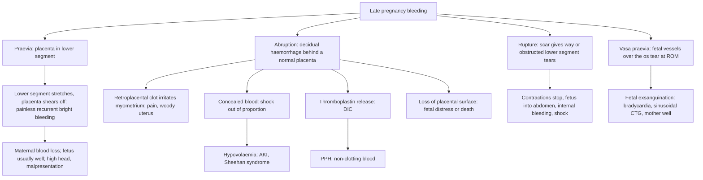

## 1. Definition

**Antepartum haemorrhage (APH)** is bleeding from or into the genital tract **after the period of viability** and before the baby is born. It complicates about **2–5% of pregnancies** and is a major cause of **maternal death, stillbirth and preterm birth**.

| Term | Definition |
|---|---|
| **APH** | Bleeding from or into the genital tract from **28 weeks** (Uganda, where 28 weeks is the local threshold of viability) or **24+0 weeks** (RCOG) until the birth of the baby |
| **Placenta praevia** | The placenta is implanted wholly or partly in the **lower uterine segment**. On modern ultrasound: **praevia** = covers the internal os; **low-lying** = edge **<20 mm** from the os (after 16 weeks) |
| **Placental abruption** (abruptio placentae) | **Premature separation of a normally sited placenta** before the birth of the fetus |
| **Vasa praevia** | Unprotected fetal vessels run in the membranes **over or near the internal os** |
| **Uterine rupture** | Full-thickness tear of the uterine wall (including serosa); **dehiscence** = scar separation with serosa intact |
| **Placenta accreta spectrum (PAS)** | Abnormally adherent placenta: **accreta** (onto the myometrium), **increta** (into it), **percreta** (through the serosa, possibly into the bladder) |

The three life-threatening causes you must identify quickly are **placenta praevia, abruptio placentae and uterine rupture**. Everything else (cervical lesions, infections, vasa praevia, show, trauma) comes after those are excluded.

> [!REDFLAG]
> **No digital vaginal examination (VE) until placenta praevia has been excluded.** A finger through the cervix into a praevia can provoke catastrophic haemorrhage. First: resuscitate, then do an abdominal examination and an **ultrasound**. A gentle **speculum** examination is allowed once praevia is excluded, or cautiously to see the cervix.

> [!PEARL]
> The one thing never to forget: **the amount of blood you see is not the amount she has lost.** In abruption much of the blood is hidden behind the placenta and inside the myometrium.

## 2. Epidemiology

| Cause | Approximate frequency |
|---|---|
| Abruption | ~1% of pregnancies (about 30% of APH) |
| Placenta praevia | ~0.3–0.5% at term (about 1 in 200); about 20% of APH |
| Vasa praevia | 1 in 1,200 – 1 in 5,000 |
| Uterine rupture | 0.2–0.7% of trials of labour after one CS; much higher in **obstructed labour** in unscarred multiparous uteri in low-resource settings |
| "Unexplained" / local causes | Up to 50% of APH episodes |

> [!UGANDA]
> In Uganda APH is managed against a background of **late ANC booking**, **limited ultrasound** (especially at HC III/IV, where the anomaly scan with placental localisation is often never done), **shortage of blood**, and **high rates of hypertension** (the leading risk factor for abruption). **Uterine rupture from neglected obstructed labour**, sometimes with herbal uterotonics (e.g. *kyogero* concoctions) or misused oxytocin/misoprostol, and increasingly from **previous CS scars**, is a real and preventable killer. A study at Mulago found that severe abruption was strongly associated with hypertension, low socio-economic status and poor ANC attendance. The MoH (Safe Mama and Essential Maternal & Newborn Care guidelines) and UCG 2023 emphasise quick identification of the big three and **referral to a CEmONC facility**.

## 3. Aetiology and Risk Factors

**Causes of APH**: placental (praevia, abruption, vasa praevia), uterine (rupture), local (cervical/vaginal lesions, infection, trauma, cancer), and unexplained.

| Placenta praevia | Abruption | Uterine rupture | Vasa praevia |
|---|---|---|---|
| **Previous CS** (and other uterine scars: myomectomy, D&C) | **Hypertension / pre-eclampsia** (most important) | **Previous CS** (especially classical/T-incision), myomectomy | **Velamentous cord insertion** |
| Multiparity, maternal age >35 | **Previous abruption** (recurrence about 10%) | **Obstructed labour** (grand multipara, CPD, malpresentation) | Bilobed or succenturiate placenta |
| Multiple pregnancy (large placenta) | **Trauma** (road accident, assault, falls) | Oxytocin/misoprostol misuse, herbal uterotonics | Low-lying placenta in the 2nd trimester |
| Previous praevia | Sudden uterine decompression (ARM with polyhydramnios, after first twin) | Grand multiparity | IVF pregnancy |
| Smoking, IVF | PPROM, chorioamnionitis | Instrumental/destructive manipulation, internal podalic version | Multiple pregnancy |
| Uterine anomalies, fibroids | Smoking, cocaine, thrombophilia, advanced age, multiparity, short cord | Fundal pressure, trauma | |

## 4. Pathophysiology

**Placenta praevia: why painless and why recurrent**

- The placenta implants low, possibly because a scarred or poorly vascularised upper segment (previous CS, multiparity) or a very large placenta (twins) pushes implantation into the lower segment.
- From about 28 weeks the **lower segment forms and stretches** (and later effaces and dilates). The inelastic placenta can't stretch with it, so **it shears off its attachment, opening maternal sinuses**. That's why bleeding is **painless** (no retroplacental clot irritating myometrium), **"causeless"** (triggered by the normal growth of the lower segment, coitus or VE), and **recurrent** (each stretch shears a little more).
- The **lower segment has few muscle fibres**, so it contracts poorly. This is why praevia also causes **PPH after delivery**, even after a CS.
- The bleeding is **maternal blood**, so the fetus is usually fine unless the mother is in shock.
- A placenta in the lower segment **takes up space** in the pelvis, so the head stays **high and unengaged** and malpresentations (breech, transverse lie) are common.
- **PAS**: where the placenta implants on a **CS scar**, the decidua is deficient and villi invade myometrium. The risk of accreta with praevia rises with each previous CS: roughly **3% with no previous CS, 11% after 1 previous CS, 40% after 2, and over 60% after 3 or more** (Silver 2006: 3%, 11%, 40%, 61% and 67% at the first, second, third, fourth and fifth-or-more CS).

**Placental abruption: why painful, why shock, why DIC**

- The basic lesion is **haemorrhage into the decidua basalis**, often from diseased spiral arteries (**hypertension, pre-eclampsia**, smoking) or from shearing (trauma, sudden decompression). The haematoma dissects and separates more placenta, a **self-propagating** process.
- Blood behind the placenta **irritates the myometrium**, causing **pain, tenderness and increased tone (the "woody-hard" uterus)** with frequent small contractions.
- **Concealed bleeding**: blood trapped behind the placenta or tracking into the myometrium. Visible loss is small but the mother is **shocked**. When blood extravasates through the myometrium to the serosa, the uterus looks bruised purple-blue. This is the **Couvelaire uterus (uteroplacental apoplexy)**. It usually still contracts and is **not an indication for hysterectomy** in itself.
- **Fetus**: loss of placental surface → hypoxia → distress → death. Fetal death usually indicates **more than 50% separation** and substantial maternal blood loss (often more than 1.5 L).
- **DIC**: the damaged decidua and retroplacental clot release **thromboplastin (tissue factor)** into the maternal circulation. This triggers widespread clotting that **consumes fibrinogen, platelets and factors**, followed by fibrinolysis. It happens in about **10–20% of severe abruptions**, especially with fetal death. Hence non-clotting blood, oozing, and PPH.
- **Kidneys**: hypovolaemia plus DIC microthrombi → **acute tubular necrosis** and, in severe cases, **bilateral renal cortical necrosis**.
- **Pituitary**: shock → **Sheehan's syndrome**.

**Vasa praevia: why the baby dies so fast.** The vessels are **fetal**, unprotected by Wharton's jelly or placenta. When the membranes rupture (spontaneously or at ARM), a vessel tears, and the baby, whose **total blood volume is only about 80–100 mL/kg (about 250–300 mL at term)**, can **exsanguinate within minutes**. The mother is well; the **CTG shows bradycardia or a sinusoidal pattern**. Perinatal mortality is **at least 60% when diagnosed in labour**, but survival is **over 95%** with antenatal diagnosis and planned CS.

**Uterine rupture**

- **Scarred uterus**: the previous CS scar gives way, often insidiously, during labour (especially with **induction or augmentation**). Classical or T-shaped scars are far weaker than lower-segment transverse scars.
- **Unscarred uterus (obstructed labour)**: the upper segment keeps contracting and retracting, pulling the lower segment progressively thinner. A visible ridge forms, **Bandl's (pathological retraction) ring**, rising towards the umbilicus. Eventually the thin lower segment tears, often laterally into the broad ligament, and sometimes into the bladder.
- After rupture, the **contractions stop**, the presenting part **recedes**, the fetus is expelled into the abdomen (fetal parts easily felt), and the mother bleeds internally and externally.

**Feature links**

- Lower segment stretching → placental shearing → painless, causeless, recurrent bright-red bleeding (praevia).
- Placenta occupying the lower segment → high, unengaged head, breech or transverse lie (praevia).
- Posterior praevia over the sacral promontory → reduced AP diameter, cord compression → **Stallworthy's sign** (FHR slows when the head is pressed into the pelvis).
- Poorly muscular lower segment → poor contraction after delivery → PPH (praevia).
- Retroplacental clot irritating the myometrium → constant pain, tenderness, tense "woody" uterus, frequent small contractions (abruption).
- Blood trapped behind the placenta → small visible loss with tachycardia, high shock index, rising fundal height (concealed abruption).
- Extravasation into myometrium → bruised purple Couvelaire uterus.
- Loss of >50% of placental surface → fetal death; maternal loss often >1.5 L.
- Thromboplastin entering the circulation → consumption of fibrinogen and platelets → non-clotting blood, oozing, haematuria, PPH.
- Hypovolaemia + microthrombi → oliguria (<30 mL/h), ATN, renal cortical necrosis.
- Shock → pituitary infarction → Sheehan's syndrome.
- Ruptured fetal vessel → fetal exsanguination → acute bradycardia or sinusoidal trace with a well mother (vasa praevia).
- Rupture → contractions cease, presenting part recedes, fetal parts easily felt, haematuria (bladder involvement), absent FHR.

## 5. Classification / Staging

**RCOG severity grading of APH** (by the amount of blood lost)

| Grade | Blood loss |
|---|---|
| Spotting | Staining or streaking on underwear/pad |
| Minor | <50 mL, settled |
| Major | 50–1000 mL, no clinical shock |
| Massive | >1000 mL **and/or signs of shock** |

**Traditional classification of placenta praevia** (still used in Ugandan exams and theatre notes)

| Type | Description | Old term |
|---|---|---|
| I | Encroaches on the lower segment but doesn't reach the os | Lateral / low-lying (minor) |
| II | Reaches the edge of the internal os | Marginal (minor). **Type II posterior is "dangerous"**: it lies over the sacral promontory, reducing the AP diameter and compressing the cord |
| III | Covers the os when closed but not when dilated | Partial / incomplete central (major) |
| IV | Covers the os completely, even when dilated | Complete / central (major) |

**Abruption types:** **revealed** (blood tracks down and out, about 65–80%), **concealed** (blood trapped behind the placenta, about 20–35%, and the most dangerous), **mixed**.

**Clinical grading of abruption** (Page/Sher, simplified)

| Grade | Features |
|---|---|
| 0 | Asymptomatic; retroplacental clot found after delivery |
| 1 (mild) | Vaginal bleeding, mild tenderness, mother and fetus well |
| 2 (moderate) | Tender tense uterus, **fetal distress**, mother not in shock |
| 3 (severe) | **Fetal death**, maternal shock ± **coagulopathy (3b)** |

**Shock index** (HR ÷ SBP): **≥0.9 abnormal, ≥1.4 urgent**.

## 6. Clinical Features

### History

| Question | Why it matters |
|---|---|
| **Gestational age** (LNMP, earliest scan) | Viable? Steroids? Timing of delivery |
| **Amount** of blood (pads soaked, clots), colour (bright vs dark), timing, recurrence | Severity (RCOG grade); praevia bleeds are bright and recurrent; abruption blood is often dark |
| **Pain?** None, constant, colicky, back pain, sudden tearing then relief | **Painless = praevia**; **constant pain plus tense uterus = abruption**; colicky = labour; sudden severe pain then relief = rupture |
| **Fetal movements** | Reduced or absent = fetal compromise or death (abruption, vasa praevia) |
| **Trigger**: coitus, trauma (boda-boda, road accident, assault, domestic violence), rupture of membranes, labour | Postcoital: praevia or cervical lesion; trauma: abruption; bleeding right after ROM: **vasa praevia** |
| **Previous scans**: placental site at the anomaly scan? | Known praevia or low-lying placenta changes everything |
| **Previous CS**, number and type; myomectomy, other uterine surgery | Praevia, **PAS**, rupture |
| **Headache, visual symptoms, known high BP** | Pre-eclampsia behind an abruption |
| **In labour**: duration, oxytocin, misoprostol, **herbal medicine** | Rupture |
| **Previous APH or abruption, parity, twins** | Recurrence and risk factors |
| **Blood group/Rhesus, last Hb, HIV status, sickle cell** | Anti-D, transfusion planning, PMTCT |
| **Symptoms of shock**: dizziness, thirst, fainting | Severity |
| **Vaginal discharge, itch, postcoital bleeding, previous Pap/VIA** | Local causes (cervicitis, polyp, **cervical cancer**) |

### Examination

Follow the order of Hutchison's Clinical Methods (24th edition), with the obstetric abdominal examination. In heavy bleeding, resuscitation (section 9) comes first.

#### Introduction, consent and preparation

- Introduce yourself, confirm identity and gestation, explain, gain consent; chaperone.
- **Hand hygiene**.
- **Position and exposure**: **left lateral tilt** (avoid aortocaval compression); expose the abdomen; look at the pads and clots yourself.
- Say it out loud and write it: **"No digital vaginal examination until praevia is excluded."**

#### General inspection and vital signs

| Sign | Mechanism | What it means |
|---|---|---|
| Pallor, sweating, restlessness | Hypovolaemia | Significant loss |
| Pads: amount, fresh or dark, clots, still flowing | Visible loss | Severity; dark blood suggests abruption |
| Oedema | Capillary leak | Pre-eclampsia → abruption |

**Vital signs**: pulse, BP, RR, SpO₂, temperature, **shock index** (≥0.9 abnormal, ≥1.4 urgent); **urine output** once catheterised. A "normal" BP in a woman with pre-eclampsia may already be low for her. **Check urine for protein.**

#### Hands, face and neck

- Peripheral perfusion: cool hands, capillary refill (shock).
- Conjunctival pallor (anaemia).
- Oozing from cannula sites, bruising (DIC).
- Facial oedema (pre-eclampsia).

#### Obstetric abdominal examination

| Step | Finding | What it means |
|---|---|---|
| **Inspection** | Scars; distension; Bandl's ring rising towards the umbilicus | Previous CS; obstructed labour, impending rupture |
| **Palpation: tone and tenderness** (between contractions) | **Soft, relaxed, non-tender** | Praevia |
| | **Tense, tender, "woody"**; frequent small contractions | Abruption |
| | **Scar tenderness**; contractions stopped | Rupture |
| **Fundal height** | Larger than dates or **rising** against your pen mark | **Concealed haemorrhage**: mark the fundus with a pen and re-measure |
| **Lie and presentation** | **High head / malpresentation** (breech, transverse) | Praevia |
| | **Fetal parts easily palpable**, uterus felt separately | Rupture |
| **Engagement** | Unengaged at term | Praevia |
| **Auscultation of the fetal heart** (Pinard, Doppler, CTG) | Absent | Severe abruption (anticipate DIC) |
| | Bradycardia or sinusoidal pattern | Vasa praevia |
| | Distress | Abruption |

> [!NOTE]
> **Stallworthy's sign:** slowing of the fetal heart when the head is pressed into the pelvis, recovering on release. It suggests a posterior praevia. It's a classic viva sign, though rarely used today.

Also look for a **distended bladder and haematuria** (rupture in obstructed labour).

#### Completing the examination

- **Speculum examination** (only once praevia is excluded, or very gently to see the cervix if no scan is available and bleeding is minor): source of bleeding (cervical os vs a lesion), cervical dilatation, polyp, ectropion, **cervical cancer**, vaginal trauma, liquor.
- **No digital VE** until praevia has been excluded (or as a double set-up in theatre).
- Thank her, hand hygiene, summarise.

| Document these positives | And these negatives |
|---|---|
| Estimated/weighed loss and when it started | "No digital VE performed" |
| Uterine tone, tenderness, fundal height (with time) | "Uterus soft and non-tender" (or not) |
| Lie, presentation, FHR | "No signs of rupture" |
| BP, urine protein | "Clotting test: clot formed at __ min" |

### Red flags

> [!REDFLAG]
> - **Shock** (pulse >100, SBP <90, shock index ≥0.9), especially **out of proportion to the visible bleeding**: concealed abruption or rupture
> - **Tense, tender uterus** or rising fundal height
> - **Absent fetal heart**: severe abruption, anticipate DIC
> - **Non-clotting blood**, oozing from sites, haematuria: DIC
> - **Bleeding at ROM with fetal bradycardia**: vasa praevia
> - **Previous CS + labour + pain + loss of contractions or fetal heart**: rupture
> - **Severe hypertension, headache, proteinuria**: pre-eclampsia with abruption
> - **Oliguria** (<30 mL/h): renal failure

> [!REDFLAG]
> Deliver or refer **now**, not after the workup, if: SI ≥1.4 or SBP <90 despite fluids; ongoing heavy bleeding; tense tender uterus with an abnormal or absent fetal heart; bleeding at membrane rupture with fetal bradycardia (vasa praevia); signs of uterine rupture; blood that does not clot.

### Thinking like a clinician

- **The key question: pain and uterine tone.** Painless + soft = praevia. Pain + hard = abruption. Pain + shock + fetal parts easily felt + stopped contractions = rupture. Painless, sudden bleeding at ROM + fetal distress with a well mother = vasa praevia.
- **"Shock out of proportion"** = concealed blood (abruption or rupture). Treat the mother's physiology, not the pad count.
- **Abruption and praevia can coexist.** Don't stop thinking once you find one.
- **In labour, a bloody show is normal**: small amount, mixed with mucus, with cervical change. Heavy fresh bleeding is not a show.
- **Every APH at a HC III is a referral** to a CEmONC facility unless it is trivial spotting from a clearly visible benign cervical lesion.
- **Always offer anti-D** to an Rh-negative woman and **steroids** if <34 weeks and delivery is likely.
- **Pre-eclampsia can be masked**: a shocked woman with abruption may have a "normal" BP that is actually high for her. Check urine for protein.
- **Don't forget the cervix**: once praevia is excluded, a woman with recurrent spotting needs a speculum examination. **Cervical cancer in pregnancy** is not rare in Uganda.
- **Common student mistakes**: doing a digital VE; being reassured by a normal BP; forgetting the Rhesus status; forgetting the risk of **PPH after delivery** in both praevia and abruption; tocolysing a suspected abruption.

> [!EXAM]
> "A woman at 34 weeks presents with painless vaginal bleeding. What will you NOT do?" **Digital vaginal examination.** Then: "What will you do?" Resuscitate, assess mother and fetus, ultrasound for placental site, group and cross-match, and expectant or active management according to gestation and severity.

## 7. Differential Diagnoses

| Differential | Distinguishing clinical feature | Distinguishing investigation |
|---|---|---|
| **Placenta praevia** | Painless, recurrent, bright-red bleeding; soft non-tender uterus; high head or malpresentation; FHR usually normal; shock proportional to visible loss | **Ultrasound** (transvaginal is safe and most accurate) |
| **Placental abruption** | Painful, dark or bright bleeding (may be scant); tense tender uterus; fetal distress or death; shock out of proportion; pre-eclampsia or trauma | Clinical diagnosis; ultrasound often **misses** it (normal scan doesn't exclude it); CTG; clotting |
| **Uterine rupture** | In labour, previous CS or obstruction; sudden pain, cessation of contractions, recession of presenting part, easily felt fetal parts, shock, haematuria, absent FHR | Clinical; laparotomy (don't delay for scan) |
| **Vasa praevia** | Bleeding at ROM, mother stable, **acute fetal bradycardia or sinusoidal CTG** | Clinical; antenatal transvaginal colour Doppler; Apt/Kleihauer test on vaginal blood (don't delay delivery) |
| **Bloody show** | Small, mucoid, with contractions and cervical change | Clinical (speculum/VE once praevia excluded) |
| **Cervical lesions** (ectropion, polyp, cervicitis, **cancer**) | Postcoital spotting, discharge; lesion on speculum; uterus normal | Speculum, VIA, Pap smear or **biopsy** (cervical cancer) |
| **Vaginal trauma / infection / foreign body** | History (assault, coitus); lesion or discharge on speculum | Speculum; swabs |
| **Vulvovaginal varicosities** | Visible varices | Inspection |
| Non-genital (haematuria, haemorrhoids) | Blood in urine or stool | Urinalysis, rectal inspection |

**Praevia vs abruption, the classic viva table**

| Feature | Praevia | Abruption |
|---|---|---|
| Pain | Painless | Painful |
| Onset | Insidious, recurrent, "warning bleed" | Sudden |
| Blood | Bright red, fresh | Dark (may be bright), may be concealed |
| Shock | Proportional to visible loss | **Out of proportion** |
| Uterus | Soft, non-tender | Tense, tender, **woody** |
| Presenting part | High; malpresentation | Normal; may be engaged |
| Fetal heart | Usually normal | Distress or absent |
| Associated | Previous CS, multiparity | Hypertension, trauma |
| Coagulopathy | Rare | Common in severe cases |

## 8. Clinical Workup

Every APH is assessed in the same order: **mother first, then fetus, then cause**, and always **without a digital VE** until the placenta has been located. Key principles:

1. **Ultrasound before any digital VE.** It answers the most important question (where is the placenta?) and confirms fetal life. Transvaginal scanning is safe in praevia.
2. **A normal scan does not exclude abruption.** Retroplacental clots are often invisible; abruption is diagnosed clinically.
3. **Serial, not single, tests in abruption**: repeat the 20-minute clotting test every 2–4 h, re-measure the fundal height, and follow Hb and urine output hourly to detect ongoing concealed loss and DIC.
4. **Don't delay delivery for a test** when the mother is shocked or the fetus is distressed (e.g. Apt test in suspected vasa praevia).

### Bedside

| Test | How / why | Expected finding and what it changes | Available at |
|---|---|---|---|
| **Shock index**, pad count / weighing (1 g ≈ 1 mL) | Every set of observations | Severity; SI out of proportion to visible loss = concealed bleeding | All levels |
| **Fetal heart**: Doppler/Pinard, then **CTG** if viable and available | Continuous if abruption suspected | Distress, bradycardia; **sinusoidal pattern** suggests fetal anaemia (vasa praevia) → timing and urgency of delivery | Pinard/Doppler all levels; CTG at hospitals (many HC IVs have Doppler only) |
| **Bedside ultrasound** (skilled operator) | Placental site, FH, lie, liquor | Excludes praevia so you can examine; confirms viability; retroplacental clot only sometimes seen | HC IV and above with an operator |
| **HemoCue / point-of-care Hb** | Baseline | Will fall further with concealed loss | HC III and above |
| **20-minute whole blood clotting test** | 2 mL in a dry glass tube | No clot at 20 min = DIC; in abruption **repeat every 2–4 h** → blood products | All levels |
| **Urine dipstick** (protein) and BP | Pre-eclampsia as the cause of abruption | Proteinuria → MgSO₄, BP control | All levels |
| **Urine output** via catheter | Hourly | <30 mL/h = hypovolaemia or AKI | All levels |
| **Apt (alkali denaturation) test** on vaginal blood | Only if it does not delay delivery | Fetal haemoglobin = vasa praevia | Hospital labs [VERIFY: availability in Uganda] |
| **Malaria RDT** if febrile | Common co-morbidity in Uganda | Positive → treat | All levels |

### Basic lab

| Test | When | Expected / abnormal finding | How it changes management | Available at |
|---|---|---|---|---|
| **FBC** | All | Hb; platelets <100 × 10⁹/L (DIC, HELLP) | Transfusion; iron; platelet transfusion if low and bleeding | HC IV and above |
| **Group and cross-match; Rhesus** | All | Group; 2–4 units (4–6 if PAS) | Blood ready; **anti-D** within 72 h if Rh-negative | HC IV with blood; hospitals |
| **Creatinine, urea, electrolytes; uric acid** | Abruption, pre-eclampsia, oliguria | Rising creatinine (above ~80–90 µmol/L in pregnancy) | AKI: strict fluid balance, avoid overload; renal review | Hospitals |
| **LFTs** | Hypertension, low platelets | Raised transaminases | HELLP; MgSO₄, delivery | RRH/NRH, some HC IVs |
| **HVS / swabs** | Discharge, cervicitis | Infection | Syndromic or targeted treatment | Hospitals |

### Imaging

| Test | When | Expected / abnormal finding | How it changes management | Available at |
|---|---|---|---|---|
| **Ultrasound, transabdominal** | Every APH once stable | Placental site and lower edge; fetal viability, lie, growth, liquor | Praevia confirmed → no VE, admit to CEmONC; placenta high → speculum and look for other causes | HC IV if a sonographer is present; all hospitals |
| **Transvaginal ultrasound** (± colour Doppler) | Placenta low on abdominal scan; suspected vasa praevia | Edge **<20 mm** from os = low-lying; covering os = praevia; vessels over the os = vasa praevia | Plans mode and timing of delivery; TVS is **safe** in praevia | RRH/NRH/private mostly |
| **PAS signs on ultrasound** (loss of clear zone, lacunae, bladder-wall vascularity) | Praevia or low-lying placenta **over a CS scar** | Suspicious for accreta/increta/percreta | Refer to a tertiary centre (Mulago/Kawempe, Mengo, RRH with specialists); plan CS at 35+0–36+6 weeks with 4–6 units | RRH/NRH; MRI rarely available |

### Specialised / referral-level

| Test | When | Expected / abnormal finding | How it changes management | Available at |
|---|---|---|---|---|
| **PT/APTT, fibrinogen** | Suspected abruption, IUFD, clotting test abnormal | Prolonged times; **fibrinogen <2 g/L** | FFP, cryoprecipitate; fresh whole blood if components unavailable | RRH/NRH, often not at night |
| **Kleihauer–Betke** | Rh-negative after APH ≥20 weeks; trauma | Size of fetomaternal haemorrhage | Extra anti-D (UK practice) | Rarely available in Uganda, where the 1,500 IU vial is used |
| **Cervical cytology, VIA, biopsy** | Visible cervical lesion | Dysplasia or cancer | Biopsy is safe in pregnancy; refer to gynae-oncology | VIA at HC III/IV; biopsy and histology at hospitals |

> [!UGANDA]
> At a HC III without ultrasound, the workup stops at the bedside tests: resuscitate, check the fetal heart and BP, **no VE**, first dose of dexamethasone if preterm, and **refer** with an escort, IV running and relatives ready to donate blood. Write in the referral note what you did **not** do (no VE) as well as what you did.

### Putting it together

**Model one-line summary**

> "A 30-year-old G4P3 with two previous CSs at 33 weeks, with her second painless bright-red APH of about 200 mL, now settled; haemodynamically stable (SI 0.74), soft non-tender uterus, breech, FHR 140; ultrasound shows an anterior major praevia with features suspicious for PAS."

**Problem list**

1. Major placenta praevia, recurrent APH, currently stable.
2. Suspected placenta accreta spectrum (two previous CSs, anterior praevia).
3. Preterm (33 weeks): steroids.
4. Anaemia (Hb 9.4 g/dL): iron, blood reserved.
5. Rh status and anti-D; social: distance from hospital.

**Working diagnosis**: *placenta praevia (major, anterior) with suspected PAS, for expectant management and planned CS at 35–36 weeks in a tertiary centre.*

**Model case presentation: praevia**

> "Mrs A, a 30-year-old G4P3 with two previous caesarean sections, at 33 weeks by early scan, admitted with her second episode of painless bright-red vaginal bleeding, about 200 mL, now settled. She is haemodynamically stable (pulse 88, BP 118/72). The uterus is soft and non-tender, breech presentation, FHR 140. Ultrasound confirms an **anterior major placenta praevia** with loss of the retroplacental clear zone, **suspicious for PAS**. Hb 9.4 g/dL, blood group O Rh-positive. She has had 2 doses of dexamethasone. Plan: conservative management in hospital, iron, keep 2 units cross-matched, complete steroids, senior review for PAS, and a **planned CS at 35–36 weeks** with consent for hysterectomy and 4–6 units of blood."

**Model case presentation: abruption**

> "Mrs B, a 26-year-old para 2 at 36 weeks with pre-eclampsia, presented with sudden severe abdominal pain and dark vaginal bleeding of about 150 mL. She is tachycardic (122) with BP 100/70, the uterus is tense and tender, and **no fetal heart is heard**: **severe (grade 3) placental abruption with IUFD**. Clotting test: clot at 12 min. We have resuscitated with 2 L crystalloid and 2 units of blood, catheterised (urine 20 mL/h), done ARM and started oxytocin. Plan: vaginal delivery, 4-hourly clotting tests, MgSO₄ for pre-eclampsia, prepare for PPH, and monitor renal function."

> [!EXAM]
> **Worked example 1: ultrasound placental localisation.**
> - Anomaly scan at 20 weeks: "posterior placenta, lower edge 10 mm from internal os." → **Low-lying** (<20 mm). No action now except advice to come in with any bleeding. **Rescan at 32 weeks** (TVS); most will "migrate" as the lower segment forms.
> - 32-week TVS: edge now **25 mm** from the os, cephalic, no bleeding → no longer low-lying; **vaginal birth can be planned**.
> - If it had been **covering the os** at 32 weeks → **placenta praevia**: no VE, counsel, admit if it bleeds, **planned CS at 36+0–37+0 weeks** (earlier, 35+0–36+6, if PAS is suspected).
> - Same report **with a previous CS scar and an anterior placenta** → look actively for **PAS** signs; refer.

> [!EXAM]
> **Worked example 2: shock index and the concealed bleed.**
> A woman at 35 weeks with pre-eclampsia arrives with 150 mL of dark blood on her pad. Pulse **124**, BP **100/70** → **SI 1.24**. That is far more shock than 150 mL could cause → **concealed abruption**. Her fundal height, marked at **34 cm** on arrival, is **36 cm** an hour later (still bleeding behind the placenta). Fetal heart absent.
> Clotting test at arrival: **clot at 12 minutes** (normal, but repeat every 2–4 h). At 4 h: **no clot at 20 minutes**; platelets **68 × 10⁹/L**, fibrinogen **1.5 g/L** → **DIC**. Plan: transfuse (red cells, FFP, cryoprecipitate or fresh whole blood), ARM + oxytocin for vaginal delivery, MgSO₄, urine output hourly, and prepare for PPH.

## 9. Management

### Immediate / emergency

**First 5 minutes**

1. **Look at the woman and at the pads**: conscious level, pallor, sweating; how much blood, fresh or dark, clots, still flowing?
2. **Vital signs and shock index**: **≥0.9 abnormal, ≥1.4 urgent**.
3. **Call for help** if bleeding is heavy, SI ≥0.9, the uterus is tense or the fetal heart is abnormal: senior midwife and doctor, anaesthetist; alert theatre and the blood bank.
4. **Quick abdominal check**: soft or woody? tender? fundal height (**mark it with a pen**). **Fetal heart** by Doppler or Pinard.
5. **Say it out loud**: "No digital vaginal examination until praevia is excluded." Put it in the notes.
6. **Decide the lane**: massive bleeding or maternal shock → resuscitate and **deliver** (usually emergency CS; vaginal delivery for abruption with IUFD if the mother can be stabilised); a live distressed viable fetus → category 1 CS; stable → full workup (section 8).

**ABCDE: massive APH or shock**

- **A/B**: airway, **oxygen**, **left lateral tilt**.
- **C**: **two 14–16G cannulae**; send FBC, **cross-match 4–6 units**, clotting test, U&E. **Warmed crystalloid 1 L fast**, then **blood** (O-negative or group-specific if cross-matched blood isn't ready). Catheterise; urine output hourly.
- **D**: conscious level; glucose if drowsy.
- **E**: keep warm; look for the cause (history, abdominal examination, bedside ultrasound). **No VE.**

Then:

1. **Deliver the baby** (and placenta). This is how bleeding stops in praevia and abruption. Usually by **emergency CS** if the mother is unstable, **regardless of fetal viability**, except in abruption with a dead fetus where vaginal delivery can be quick and the mother can be stabilised.
2. Correct coagulopathy (fresh whole blood, FFP, cryoprecipitate, platelets); **TXA 1 g IV** is reasonable in major haemorrhage.
3. Prepare for **PPH** (oxytocin infusion, uterotonics, compression sutures, hysterectomy).
4. HDU care; document; debrief.

### Definitive

#### General principles: every woman with APH

1. **Call for help**: senior midwife, doctor, anaesthetist, and alert theatre and the blood bank.
2. **ABC and resuscitation** as above.
3. **Assess the fetus**: fetal heart (Pinard/Doppler/CTG), gestation, presentation.
4. **Ultrasound** to localise the placenta; **no digital VE**.
5. **Decide**: deliver now or conservative? It depends on (a) **the mother's condition**, (b) **the fetal condition**, (c) **gestation**, (d) **the cause** and (e) **severity**.
6. **Rh-negative**: anti-D immunoglobulin within 72 h (at least **500 IU** in the UK after 20 weeks, with Kleihauer to top up; in Uganda the available vial is often **1500 IU (300 µg) IM**).
7. **Steroids**: if delivery is likely between **24 and 34 weeks** (WHO 2022; units vary at the upper limit), **dexamethasone 6 mg IM every 12 h × 4 doses** (or betamethasone 12 mg IM every 24 h × 2).
8. **Magnesium sulfate for fetal neuroprotection** if delivery is expected before **32 weeks** (4 g IV loading dose over 20 min, then 1 g/h, or the Uganda regimen per protocol).
9. **Anticipate PPH** after delivery: oxytocin infusion ready, TXA, blood.

#### Placenta praevia

**A. Expectant (conservative) management**, the principle behind the **Macafee regimen**: prolong the pregnancy to gain fetal maturity, **only if**:

- the mother is **haemodynamically stable** and the bleeding has settled,
- the fetus is **alive, not distressed**, and **preterm** (<37 weeks),
- blood and theatre are available 24/7 (so admit to a CEmONC hospital).

Steps:

1. **Admit** (in Uganda usually until delivery for a major praevia that has bled; women who live far away, lack transport, or are anaemic should stay in hospital).
2. Maintain **Hb ≥10–11 g/dL**: iron + folic acid; transfuse if needed. Keep **2 units cross-matched**.
3. **Steroids** if 24–34 weeks; **anti-D** if Rh-negative.
4. Avoid coitus, VE and heavy exertion; treat constipation.
5. **Tocolysis**: not routine. Some specialists use **nifedipine** short-term in praevia with contractions to allow steroids to work, but **never tocolyse if abruption is suspected** or the mother is bleeding heavily.
6. **Thromboprophylaxis** for prolonged admission (early mobilisation; LMWH if available and not bleeding).
7. Serial ultrasound (placental position, growth); screen for **PAS** if previous CS.
8. Counsel on the need for CS, the risk of PPH and hysterectomy (**consent** for hysterectomy if PAS is suspected).

**B. Timing and mode of delivery**

| Situation | Plan |
|---|---|
| Heavy bleeding, maternal instability or fetal distress at any gestation | **Emergency CS** (resuscitate first) |
| Uncomplicated **placenta praevia** (covers the os) | **Elective CS at 36+0–37+0 weeks** (RCOG). Many Ugandan units plan for about 37 weeks |
| Praevia with **suspected PAS** | Planned CS at **35+0–36+6 weeks** in a tertiary centre with senior obstetrician, anaesthetist, blood (4–6 units), and consent for hysterectomy |
| **Low-lying placenta** (edge ≥20 mm from os at a late scan), cephalic, no bleeding | Vaginal birth can be considered |
| Edge <20 mm from os | CS usually recommended (individualise) |

**C. At caesarean for praevia**

- **Senior surgeon and anaesthetist**; blood cross-matched and in theatre.
- The lower segment is vascular. The surgeon may go through the placenta (quickly!) or around it; deliver the baby fast.
- **Expect PPH** from the poorly contracting lower segment: oxytocin infusion, TXA, **placental-bed haemostatic sutures**, balloon tamponade, uterine artery ligation, B-Lynch, and hysterectomy if needed.
- **PAS**: don't try to remove an adherent placenta. Leave it and proceed to hysterectomy (or conservative management only in specialist centres).

> [!UGANDA]
> Where ultrasound isn't available and praevia is suspected in labour, the historical **"double set-up examination"** may still be done in some units: a gentle VE (actually, fornix palpation) **in theatre, with the team scrubbed, blood available and anaesthesia ready**, so that a CS can be done at once if bleeding starts. It is never done on the ward.

#### Placental abruption

Manage according to **fetal viability, fetal condition and maternal condition**. **Treat the mother first.**

| Scenario | Management |
|---|---|
| **Fetus dead** (Grade 3) | Aggressive resuscitation (expect large hidden losses: transfuse early, often 4+ units); **check and correct clotting**; aim for **vaginal delivery**: **ARM** (reduces intrauterine pressure and thromboplastin entry, and speeds labour) **+ oxytocin** infusion. Labour is often rapid. **CS only for maternal indications** (uncontrollable bleeding, deterioration despite resuscitation, transverse lie, failure to progress, previous classical scar), because surgery in DIC is dangerous |
| **Fetus alive and distressed**, viable | **Immediate CS** after starting resuscitation (unless vaginal delivery is imminent) |
| **Fetus alive, not distressed, ≥37 weeks** | **ARM + oxytocin induction** with **continuous fetal monitoring**; low threshold for CS |
| **Fetus alive, not distressed, preterm**, mild abruption, mother stable | **Conservative**: admit, steroids, anti-D, close fetal monitoring (CTG, growth scans), Hb, BP; deliver at 37 weeks or earlier if deterioration. **No tocolysis** |

Additional abruption points:

- **Monitor for DIC**: clotting test every 2–4 h; platelets; fibrinogen. Use **fresh whole blood**, FFP, cryoprecipitate and platelets as available.
- **Treat pre-eclampsia** if present: **MgSO₄** (4 g IV + 10 g IM loading per Uganda regimen, or IV Zuspan), **antihypertensives** (hydralazine, labetalol, nifedipine) once volume-replete. Beware: a low BP in a hypertensive woman may be shock.
- **Strict fluid balance**; urine output >30 mL/h. Oliguria despite adequate fluids suggests ATN, so avoid fluid overload.
- **Anticipate PPH**: active management, oxytocin infusion, TXA; Couvelaire uterus usually still contracts.
- **After delivery**: examine the placenta (retroplacental clot, and the adherent clot's "crater"), histology if possible; check renal function; anti-D; counsel on **recurrence** (about 10%) and the need for early ANC and BP control next time. Low-dose **aspirin** from 12 weeks is appropriate if pre-eclampsia is the underlying cause.
- **Stillbirth care**: bereavement support; lactation suppression if requested (cabergoline 1 mg once, unless hypertensive, where bromocriptine is also avoided; use supportive measures).

#### Vasa praevia

- **Antenatally diagnosed** (transvaginal colour Doppler): admit from about **30–32 weeks** (especially if far from hospital); **steroids from 32 weeks**; **planned CS at 34–36 weeks** before labour or ROM.
- **Bleeding at ROM with fetal distress**: this is a **category 1 emergency CS** (a matter of minutes). Resuscitate the **baby** at birth with **O-negative blood/volume** (the neonate may need transfusion).
- Don't perform ARM if you can feel vessels in the membranes (pulsatile cord-like structures).

#### Uterine rupture

1. **Resuscitate** (as above) and cross-match 4 units.
2. **Laparotomy** immediately; don't wait for the BP to recover fully (the bleeding won't stop without surgery).
3. Deliver the baby and placenta (usually dead).
4. **Repair** the rupture if it's a clean tear, the woman is stable and she wants more children (and the tear is not extending into the broad ligament or cervix). Otherwise do a **subtotal (or total) hysterectomy**.
5. **Inspect the bladder and ureters**. If the bladder is repaired, leave a **catheter for 7–14 days**.
6. Antibiotics (ampicillin + gentamicin + metronidazole), transfusion, HDU care.
7. Counsel: if repaired, **future pregnancy is high-risk**: elective CS at about 36–37 weeks before labour; offer contraception or tubal ligation (with **informed consent**, never assumed).

#### Local causes

- **Cervical ectropion or polyp**: reassure; polypectomy after delivery unless bleeding heavily.
- **Cervicitis/vaginitis**: swab and treat (syndromic management per UCG).
- **Suspicious cervical lesion**: **biopsy** (it is safe in pregnancy); refer to gynae-oncology. Management depends on stage and gestation.
- **Trauma or sexual assault**: document carefully, offer PEP, emergency support, and police/legal referral.

### Drug table

| Drug | Dose (adult) | Route | Frequency | Duration | Key cautions |
|---|---|---|---|---|---|
| **Dexamethasone** | 6 mg | IM | 12-hourly | × 4 doses | If delivery is likely at 24–34 weeks (WHO 2022); first dose before referral |
| Betamethasone (alternative) | 12 mg | IM | 24-hourly | × 2 doses | |
| **Anti-D immunoglobulin** | 500 IU (UK) or 1500 IU/300 µg (common vial) | IM | Once | Within 72 h of bleed | Rh-negative, non-sensitised; Kleihauer to guide extra doses |
| **Magnesium sulfate** (neuroprotection) | 4 g IV over 20 min (20–30 min) then 1 g/h | IV | Infusion | Until birth or 24 h | If birth is expected before 32 weeks |
| **Magnesium sulfate** (pre-eclampsia with abruption) | 4 g IV + 10 g IM loading (Uganda Pritchard), or IV Zuspan | IV + IM | Per regimen | 24 h after delivery | R-R-U checks (see pre-eclampsia topic) |
| **Oxytocin** | 10 IU after delivery; induction low-dose titrated infusion | IV/IM | — | — | Anticipate PPH; induction in abruption after ARM |
| **Tranexamic acid** | 1 g | IV over 10 min | Repeat once after 30 min if bleeding | | In major haemorrhage / PPH |
| **Ferrous sulfate + folic acid** | 200 mg (65 mg elemental iron) + 400 µg–5 mg | Oral | Daily to twice daily | Through admission | Conservative praevia management; anaemia |
| **Nifedipine** (tocolysis, specialist only) | Per specialist protocol [VERIFY: tocolytic dose not stated in source] | Oral | Short course | To complete steroids | Praevia with contractions only; **never in suspected abruption** or heavy bleeding |
| **Ampicillin + gentamicin + metronidazole** | Standard doses [VERIFY: doses not stated in source] | IV | | | After laparotomy for rupture |
| **Cabergoline** | 1 mg | Oral | Once | | Lactation suppression after stillbirth if requested; avoid if hypertensive (bromocriptine also avoided) |
| **Hydralazine, labetalol, nifedipine** | See pre-eclampsia topic | | | | Only once volume-replete |
| **Blood products**: fresh whole blood, FFP, cryoprecipitate, platelets | Per protocol | IV | | | DIC in abruption; RRH/NRH for components |

### Referral criteria

| Level | What to do | Refer up when |
|---|---|---|
| **HC III / HC IV without ultrasound, blood or theatre** | Resuscitate (IV line, fluids), **no VE**, check fetal heart and BP, first dose of **dexamethasone** if preterm, clear **referral note** | **Every APH** (unless trivial spotting from a clearly benign cervical lesion) → urgently to a CEmONC facility, **accompanied by a health worker**, IV running, blood donors (relatives) identified, NASG for shock if available, call ahead |
| **HC IV / General Hospital (CEmONC)** | Ultrasound, blood, emergency CS, laparotomy for rupture, management of abruption with DIC (fresh whole blood) | Suspected PAS; need for blood components, ICU or NICU → RRH/NRH |
| **RRH / NRH** (Mulago/Kawempe, Mengo, RRH with specialists) | TVS and PAS assessment, blood components, planned PAS surgery, HDU/ICU, NICU | n/a |

### Monitoring and follow-up

- **Abruption**: clotting test every 2–4 h, fundal height re-measured, Hb and urine output hourly, continuous fetal monitoring if alive.
- **Expectant praevia**: Hb, serial ultrasound (placental position, growth), 2 units cross-matched; rescan a low-lying placenta at **32 weeks** (TVS) and at 36 weeks if still low.
- **After delivery**: watch for PPH; renal function after severe abruption; anti-D; HDU care after massive haemorrhage.
- **Future pregnancies**: early ANC and BP control after abruption (recurrence about 10%; aspirin from 12 weeks if pre-eclampsia was the cause); elective CS at about 36–37 weeks after a repaired rupture.

## 10. Complications

**Disease-related**

| Maternal | Fetal / neonatal |
|---|---|
| Hypovolaemic shock, death | Prematurity (iatrogenic or spontaneous) |
| **DIC** (abruption) | Hypoxia, **stillbirth** |
| **PPH** (praevia: poor lower-segment contraction; abruption: DIC, Couvelaire) | **Fetal exsanguination** (vasa praevia) |
| **Acute kidney injury**, renal cortical necrosis | IUGR (chronic abruption) |
| **Sheehan's syndrome** | Neonatal anaemia |
| Thromboembolism (postpartum, after transfusion or prolonged admission) | Cerebral palsy (hypoxic-ischaemic injury) |
| Psychological: bereavement, PTSD | Rhesus isoimmunisation (if no anti-D) |

**Treatment-related**

| Complication | Cause |
|---|---|
| Hysterectomy, bladder injury | PAS surgery, rupture repair |
| Catastrophic haemorrhage | Digital VE in praevia |
| Anaesthetic complications | Emergency CS, GA in DIC |
| Transfusion reactions | Blood products |
| Infection | Surgery, prolonged admission |
| Fluid overload | Over-resuscitation in ATN |
| Worse abruption | Tocolysis in suspected abruption |

## 11. Prognosis

- **Praevia**: with expectant management in hospital and planned CS, maternal and fetal outcomes are good; PAS raises the risk of massive haemorrhage and hysterectomy.
- **Abruption**: fetal death usually indicates >50% separation; maternal risk comes from hidden blood loss, DIC (10–20% of severe abruptions) and AKI. **Recurrence about 10%**.
- **Vasa praevia**: perinatal mortality at least 60% when diagnosed in labour; survival over 95% with antenatal diagnosis and planned CS.
- **Rupture**: the baby is usually dead; a repaired uterus makes future pregnancy high-risk.

## 12. Prevention

- **ANC**: early booking; anomaly scan with **placental localisation**; rescan a low placenta at 32 weeks.
- **Abruption**: BP control and aspirin for women at risk of pre-eclampsia; road safety and screening for domestic violence.
- **PAS and praevia**: avoid unnecessary primary caesarean sections; look for PAS in every woman with a previous CS and a low anterior placenta.
- **Rupture**: partograph and timely CS for obstructed labour; careful use of oxytocin and misoprostol, especially with a scarred uterus; discourage herbal uterotonics.
- **Rhesus isoimmunisation**: anti-D after every APH in Rh-negative women.
- **Cervical cancer**: VIA/Pap screening.

## 13. Special Populations

- **Previous CS**: praevia + scar → PAS; labour + scar → rupture.
- **Pre-eclampsia**: the commonest cause of abruption; a "normal" BP may be shock; treat with MgSO₄ and antihypertensives once volume-replete.
- **Rh-negative**: anti-D within 72 h; Kleihauer where available.
- **Preterm (<34 weeks)**: steroids; MgSO₄ neuroprotection <32 weeks.
- **Twins**: praevia risk; abruption after delivery of the first twin.
- **IUFD with abruption**: high DIC risk; aim for vaginal delivery.

## 14. Key Points

### High-yield points

- No digital VE until praevia is excluded.
- Painless + soft uterus = praevia; pain + woody uterus = abruption; pain + shock + easily felt fetal parts + stopped contractions = rupture; bleeding at ROM + fetal bradycardia = vasa praevia.
- Shock out of proportion = concealed abruption or rupture: shock index, mark the fundus.
- A normal scan does not exclude abruption; repeat the clotting test every 2–4 h.
- Abruption with IUFD: resuscitate, correct clotting, ARM + oxytocin.
- Planned CS: praevia 36+0–37+0 weeks; PAS 35+0–36+6 weeks with 4–6 units and hysterectomy consent.
- Anti-D within 72 h; steroids if delivery likely before 34 weeks; MgSO₄ <32 weeks.
- Anticipate PPH after both praevia and abruption.
- Every APH at a HC III is a referral.

### Numbers & doses

| Item | Value |
|---|---|
| APH gestation threshold | **≥28 weeks** (Uganda); **≥24+0 weeks** (RCOG). Check your unit's definition |
| RCOG severity | Spotting; minor **<50 mL**; major **50–1000 mL**, no shock; massive **>1000 mL and/or shock** |
| Low-lying placenta | Edge **<20 mm** from the internal os (after 16 weeks) |
| Rescan a low placenta | At **32 weeks** (TVS), and at 36 weeks if still low |
| Planned CS: praevia | **36+0–37+0 weeks** |
| Planned CS: suspected PAS | **35+0–36+6 weeks**, 4–6 units, hysterectomy consent |
| PAS risk with praevia | About **3% / 11% / 40% / >60%** with 0 / 1 / 2 / 3+ previous CS |
| Frequency | Abruption ~**1%** of pregnancies; praevia ~**1 in 200** at term |
| Abruption recurrence | About **10%** |
| Fetal death in abruption | Usually **>50% separation**, maternal loss often **>1.5 L** |
| DIC in severe abruption | About **10–20%** |
| Clotting test in abruption | 2 mL in a dry glass tube, **no clot at 20 min** = DIC; repeat **every 2–4 h** |
| Shock index | **≥0.9 abnormal; ≥1.4 urgent** |
| Cross-match | **2–4 units** (4–6 if PAS or massive bleeding) |
| Dexamethasone | **6 mg IM 12-hourly × 4** if delivery likely before 34 weeks |
| MgSO₄ neuroprotection | **<32 weeks**: 4 g IV over 20–30 min, then 1 g/h |
| Anti-D | Within **72 h**: 1,500 IU (300 µg) IM (usual Ugandan vial) or 500 IU + Kleihauer (UK) |
| TXA | **1 g IV over 10 min**, repeat once after 30 min if bleeding (major haemorrhage/PPH) |
| Vasa praevia | Fetal blood volume **80–100 mL/kg**; planned CS at **34–36 weeks** if diagnosed antenatally |
| Urine output | **≥30 mL/h** |
| Catheter after bladder repair (rupture) | **7–14 days** |

### Exam traps

- **"Do a VE to assess the cervix."** Never, until praevia is excluded by ultrasound.
- **"The scan is normal, so it isn't an abruption."** Ultrasound misses most retroplacental clots; abruption is clinical.
- **"BP 110/70, so she isn't shocked."** Look at the pulse and shock index; in a pre-eclamptic woman this BP may already be low.
- **"Only 150 mL on the pad."** In abruption the visible loss underestimates the real loss; mark and re-measure the fundus.
- **"Tocolyse the abruption to gain time for steroids."** No tocolysis in suspected abruption or heavy bleeding.
- **"Abruption with IUFD needs an urgent CS."** Usually no: resuscitate, correct clotting and aim for vaginal delivery (ARM + oxytocin); CS for maternal indications.
- **"Couvelaire uterus → hysterectomy."** No; it usually contracts.
- **Forgetting anti-D, steroids and the high risk of PPH** after both praevia and abruption.

### Questions seniors ask

**Viva questions**

1. *What are the causes of APH?* Placental (praevia, abruption, vasa praevia), uterine (rupture), local (cervical/vaginal lesions, infection, trauma, cancer), and unexplained.
2. *How do you differentiate praevia from abruption clinically?* See the praevia vs abruption table (section 7).
3. *Why no VE?* It may separate more placenta and cause torrential bleeding.
4. *What is a Couvelaire uterus?* Extravasation of blood into the myometrium in abruption. The uterus looks bruised; it is **not** by itself an indication for hysterectomy.
5. *Why does abruption cause DIC?* Release of thromboplastin (tissue factor) from the damaged decidua and clot, activating the coagulation cascade and consuming factors.
6. *Management of abruption with IUFD?* Resuscitate, correct clotting, ARM + oxytocin for vaginal delivery; CS only for maternal indications.
7. *When is a low-lying placenta rechecked?* If it is low-lying or praevia at the anomaly scan, repeat at **32 weeks** (and at 36 weeks if still low), by transvaginal scan.
8. *Risk of PAS?* Rises with number of previous CSs when praevia is present (about 3% with none, 11% after 1, 40% after 2, over 60% after 3 or more).

**On the ward round**

- **What will you NOT do in this woman with APH, and why?** A digital VE, because a finger through the os into a praevia can cause torrential bleeding.
- **How do you tell praevia from abruption at the bedside?** Pain and uterine tone: painless with a soft uterus and a high or malpresenting part = praevia; painful, tense, tender uterus with fetal distress and shock out of proportion = abruption.
- **Her pad shows 150 mL but her pulse is 124. What is going on?** Concealed haemorrhage, most likely abruption (or rupture). Resuscitate, cross-match, clotting test, mark the fundal height and prepare to deliver.
- **What is a low-lying placenta, and what will you do about it at 20 weeks?** Edge less than 20 mm from the internal os; advise her to come in with any bleeding and rescan at 32 weeks by TVS.
- **When would you deliver a woman with placenta praevia?** Immediately if bleeding is heavy or she or the fetus is compromised; otherwise a planned CS at 36+0–37+0 weeks (35+0–36+6 if PAS is suspected).
- **Why do you repeat the clotting test in abruption?** DIC can develop over hours, especially with fetal death; repeat every 2–4 h and correct with blood products or fresh whole blood.
- **What must every Rh-negative woman with APH receive?** Anti-D within 72 hours (1,500 IU IM where that vial is stocked), plus a Kleihauer where available.
- **What would make you suspect vasa praevia?** Bleeding at membrane rupture with a well mother and sudden fetal bradycardia or a sinusoidal trace; deliver by immediate CS.

### Mnemonics

- **"Praevia: Painless, Placenta low, Presenting part high."**
- **"Abruption: Acute pain, Angry (woody) uterus, Absent FHR, Anuria, and coAgulopathy."**
- **"Vasa praevia: ROM → bleed → brady."**
- **Rupture: "SHOCKED"**: **S**car or obstructed labour, **H**aematuria, **O**utlines of fetus easily felt, **C**ontractions cease, **K**nocked-back (receding) presenting part, **E**xcruciating pain then relief, **D**isappearing fetal heart.
- **"VE = Very Evil"** until praevia is excluded.

### OSCE tips

- On the APH station, **say "I will not do a digital VE until praevia is excluded by ultrasound"** early, and examiners will relax.
- Palpate for **tone and tenderness** and **mark the fundal height**.
- Always mention **Rhesus/anti-D, steroids** and **anticipating PPH**.

## 15. References

1. Ministry of Health Uganda. Uganda Clinical Guidelines 2023: National Guidelines for Management of Common Health Conditions. Kampala: MoH; 2023. https://library.health.go.ug/uganda-clinical-guidelines-2023
2. Ministry of Health Uganda. Antepartum Haemorrhage (Safe Mama Uganda clinical resource). https://safemama.health.go.ug/records/resource?id=42
3. Ministry of Health Uganda. Essential Maternal and Newborn Clinical Care Guidelines for Uganda. Kampala: MoH; 2022. https://library.health.go.ug/sites/default/files/resources/Essential%20Maternal%20Newborn%20Care%20Guidelines%202022%20V3.pdf
4. Royal College of Obstetricians and Gynaecologists. Antepartum Haemorrhage (Green-top Guideline No. 63). 2011. https://www.rcog.org.uk/media/pwdi1tef/gtg_63.pdf
5. Royal College of Obstetricians and Gynaecologists. Placenta Praevia and Placenta Accreta: Diagnosis and Management (Green-top Guideline No. 27a). 2018. https://www.rcog.org.uk/guidance/browse-all-guidance/green-top-guidelines/placenta-praevia-and-placenta-accreta-diagnosis-and-management-green-top-guideline-no-27a/
6. Royal College of Obstetricians and Gynaecologists. Vasa Praevia: Diagnosis and Management (Green-top Guideline No. 27b). 2018. https://www.rcog.org.uk/guidance/browse-all-guidance/green-top-guidelines/vasa-praevia-diagnosis-and-management-green-top-guideline-27b/
7. World Health Organization. WHO recommendations on antenatal corticosteroids for improving preterm birth outcomes. 2022. https://www.ncbi.nlm.nih.gov/books/NBK585362/
8. Risk factors for severe abruptio placenta in Mulago Hospital, Kampala, Uganda. https://pmc.ncbi.nlm.nih.gov/articles/PMC1831945
9. Placental abruption at near-term and term gestations: pathophysiology, epidemiology, diagnosis, and management. Am J Obstet Gynecol. 2022. https://www.ajog.org/article/S0002-9378(22)00535-X/fulltext
10. Abruptio Placentae: Background, Etiology, Pathophysiology. Medscape eMedicine. https://emedicine.medscape.com/article/252810-overview
11. Clinical implications of a Couvelaire uterus with placental abruption: a retrospective study. 2024. https://pubmed.ncbi.nlm.nih.gov/39056529
12. Bettercare (Perinatal Education Programme). Maternal Care: Antepartum haemorrhage. https://bettercare.co.za/learn/maternal-care/text/04.html
13. Society of Obstetricians and Gynaecologists of Canada. ALARM International Program: Antepartum Hemorrhage (via GLOWM). https://www.glowm.com/pdf/AIP%20Chap5%20APH.pdf
14. Glynn M, Drake WM, editors. Hutchison's Clinical Methods: An Integrated Approach to Clinical Practice. 24th edition. Edinburgh: Elsevier; 2018.
