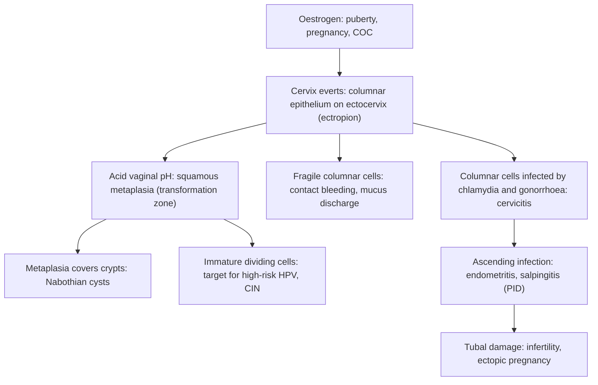

## 1. Definition

The cervix is the most visible, most examined and most worried-about organ in the gynaecology clinic. In Uganda, where cervical cancer is the commonest cancer in women, any woman with **abnormal discharge, post-coital bleeding (PCB), inter-menstrual bleeding or an "abnormal-looking" cervix** makes both her and the clinician think of cancer. Most of the time the cause is benign: **ectropion, cervicitis, a polyp, Nabothian cysts, or a cervical fibroid**. These are easy to recognise once you understand the **anatomy of the transformation zone**, and easy to manage, provided you follow one rule:

> [!REDFLAG]
> **Always exclude malignancy first.** A benign diagnosis is a diagnosis of exclusion: look at the cervix with a speculum, make sure she is up to date with screening (VIA or HPV test), and **biopsy anything that looks suspicious** (ulcer, friable mass, irregular growth, contact bleeding that does not settle after treating infection).

The second thing to master is **syndromic management of vaginal discharge** as practised in Uganda, because cervicitis caused by *Neisseria gonorrhoeae* and *Chlamydia trachomatis* is common, often silent, and is the root of much of Uganda's **PID, ectopic pregnancy and tubal infertility**.

| Term | Definition |
|---|---|
| **Ectocervix** | Vaginal part of the cervix, covered by pink, smooth, **non-keratinised stratified squamous epithelium** |
| **Endocervix** | Canal from external to internal os, lined by a **single layer of mucus-secreting columnar epithelium** thrown into crypts ("glands") |
| **Original squamocolumnar junction (SCJ)** | Where squamous meets columnar epithelium at birth/childhood |
| **New (functional) SCJ** | Where the junction lies now, after metaplasia has replaced exposed columnar cells with squamous cells |
| **Transformation zone (TZ)** | Area between the original and new SCJ: the site of metaplasia and of almost all CIN and squamous cancer |
| **Ectropion (ectopy / "erosion")** | Columnar epithelium visible on the ectocervix, giving a red, velvety area around the os. "Erosion" is an old, misleading word: the epithelium is not eroded |
| **Cervicitis** | Inflammation of the cervix. **Acute**: mucopurulent discharge, oedema, friability, usually infective. **Chronic**: persistent low-grade inflammation, often histological, with discharge |
| **Nabothian cyst** | Mucus-retention cyst formed when squamous metaplasia covers the opening of an endocervical crypt |
| **Cervical polyp** | Pedunculated or sessile benign overgrowth of endocervical (commonest) or ectocervical tissue |
| **Cervical fibroid (leiomyoma)** | Fibroid arising in the cervix (about 1–2% of all fibroids); may be interstitial, sub-serous, or a pedunculated fibroid prolapsing through the os |
| **Cervical stenosis** | Narrowing of the canal, usually at the internal os, that may cause haematometra/pyometra |
| **Cervical insufficiency ("incompetence")** | Painless dilatation of the cervix in the second trimester without contractions, causing mid-trimester loss or preterm birth |

## 2. Epidemiology

- **Ectropion** is found in a large proportion of adolescents, pregnant women and COC users: it is a normal variant, not a disease.
- **Nabothian cysts** are among the most common incidental findings on speculum examination and pelvic ultrasound.
- **Cervical polyps** occur in roughly 2–5% of women, commonest in multiparous women in their 40s and 50s. Malignant change is rare (well under 1–2%), but that is exactly why every polyp is sent to histology. Recurrence is about 6%.
- **Cervical fibroids** make up about 1–2% of all fibroids.
- **Cervicitis / STIs**: gonorrhoea and chlamydia are common in young sexually active Ugandans, and most infected women are **asymptomatic**. Untreated, 10–15% ascend to PID, which then drives tubal infertility and ectopic pregnancy: hence the very high secondary infertility in the region.
- **Antimicrobial resistance** is real: a 2023 study from a tertiary hospital in south-western Uganda found high resistance of vaginal isolates to **doxycycline, azithromycin and cefixime** (the very drugs used in syndromic packages), which is why follow-up and partner treatment matter so much.
- Most women with vaginal discharge in Uganda are managed at **HC II–IV** level using **syndromic management** (treatment by clinical syndrome without laboratory confirmation) because Gram stain, NAAT/GeneXpert for CT/NG and culture are rarely available at the point of care.

> [!UGANDA]
> The Ministry of Health approach (Uganda Clinical Guidelines, "Abnormal vaginal discharge syndrome") is **syndromic**: take a history and risk assessment, do a speculum examination if possible, and treat for the likely group of organisms (cervical infection and/or vaginal infection), with partner notification, condoms and HIV testing: the "**4 Cs**": **Compliance, Counselling, Condoms, Contact tracing**.

**Services by level of care** (detail of tests in section 8 and of procedures in section 9) [VERIFY: compiled from the source notes, not an MoH service list]

| Level | What you can do |
|---|---|
| **HC III** | History, speculum, VIA (where trained), syndromic treatment, partner slips, HIV test, referral |
| **HC IV** | All the above + polypectomy, cryotherapy/thermal ablation, HPV sample collection (GeneXpert hubs), management of mild PID, admission for severe PID, basic ultrasound |
| **General/regional referral hospital** | Colposcopy, LEEP, punch biopsy + histology, cultures/NAAT, EUA, vaginal myomectomy, cerclage, hysterectomy for fibroids, drainage of TOA/pyometra |
| **National referral / UCI** | Gynae-oncology for suspected malignancy |

## 3. Aetiology and Risk Factors

| Lesion | Cause / driver | Risk factors |
|---|---|---|
| **Ectropion** | **Oestrogen** makes the cervix bulk up and evert | Puberty and adolescence, **pregnancy**, **combined oral contraceptive** |
| **Acute cervicitis** | *C. trachomatis*, *N. gonorrhoeae* (main); also *Mycoplasma genitalium*, trichomonas, herpes simplex; rarely schistosomiasis, TB | Positive **risk assessment**: partner with urethral discharge or genital ulcer; age under about 21–25; new partner in the last 3 months; more than one partner; no condoms; HIV |
| **Chronic cervicitis** | Long-standing low-grade inflammation | Childbirth lacerations, repeated infection |
| **Condylomata** | HPV 6/11 | HIV |
| **Nabothian cysts** | Squamous metaplasia covering crypt openings | Physiological (TZ activity), chronic cervicitis |
| **Endocervical polyp** | Focal hyperplasia of endocervical glands and stroma, probably driven by **chronic inflammation and oestrogen** | Multiparity, age 40s–50s |
| **Cervical fibroid** | Smooth-muscle tumour like uterine fibroids | As for uterine fibroids |
| **Cervical stenosis** | Scarring or atrophy | LEEP/cone, cryotherapy, radiotherapy, cervical cancer, oestrogen deficiency after menopause |
| **Cervical insufficiency** | Weak or damaged cervical tissue | Previous cone/LEEP, repeated dilatation (D&C), obstetric cervical lacerations, congenital uterine anomalies |

## 4. Pathophysiology

**The cervix you need to know**

```
          Uterine body
              |
      ----- internal os -----      <- cervical stenosis usually here
     |   endocervical canal   |    <- simple columnar, mucus-secreting crypts
     |   (crypts / "glands")  |
     |                        |
     |  original SCJ     new SCJ   <- the TRANSFORMATION ZONE lies between them
      ---- external os -------     <- nulliparous: round; parous: transverse slit
          ectocervix (squamous)
```

- **Length** about 2.5–3 cm; the ectocervix projects into the vaginal vault, surrounded by the anterior, posterior and lateral fornices.
- **Blood supply**: the cervical (descending) branches of the **uterine artery** enter at about **3 and 9 o'clock**: this is why haemostatic sutures after a cone/LEEP are placed at 3 and 9.
- **Ureter**: runs about **1.5–2 cm lateral to the supravaginal cervix**, passing **under the uterine artery** ("water under the bridge"). A cervical fibroid or a cancer in the parametrium distorts or obstructs it.
- **Nerve supply**: the ectocervix has few pain fibres (sensitive to stretch, not to cutting/heat), which is why VIA, biopsy, polypectomy and thermal ablation are done in clinic without anaesthesia.
- **Lymphatics**: to parametrial, obturator, internal/external iliac nodes (important for cancer staging).

**Why ectropion and the transformation zone happen**

1. At birth, puberty, in pregnancy and on the combined pill, **oestrogen** makes the cervix bulk up and **evert**, exposing endocervical columnar epithelium onto the ectocervix: that exposed columnar tissue is the **ectropion**. It looks red because the single cell layer lets you see the underlying capillaries.
2. The exposed columnar cells now sit in the **acidic vaginal pH (about 4)**. Reserve cells beneath them respond by **squamous metaplasia**: the columnar cells are gradually replaced by squamous cells. The zone where this is happening is the **transformation zone**.
3. Metaplastic squamous epithelium sometimes grows over the mouth of a crypt, trapping mucus → **Nabothian cyst**. So Nabothian cysts mark the outer edge of the TZ.
4. Metaplastic cells are **immature and actively dividing**: the perfect target for **high-risk HPV** to integrate and cause CIN. That is why the TZ is where cancer starts, and why screening (VIA/HPV/cytology) samples the TZ.
5. Exposed columnar epithelium is thin and fragile: it **bleeds on contact** (post-coital bleeding), **produces more mucus** (discharge), and is the preferred target of *Chlamydia* and *N. gonorrhoeae*, which infect **columnar**, not squamous, cells. Ectopy also increases the risk of acquiring HIV.
6. After menopause the SCJ retreats **into the canal** (type 3 TZ), which is why VIA is unreliable after about 50 years and why stenosis is common.

**Why cervicitis causes what it causes**

- *C. trachomatis* and *N. gonorrhoeae* infect **columnar cells** of the endocervix → neutrophil exudate (**mucopus**), oedema and fragile vessels (**friability, contact bleeding**).
- Organisms can **ascend** through the canal (especially at menstruation, after abortion/delivery or instrumentation) → endometritis → salpingitis → **PID**. Tubal cilia are destroyed and the fimbriae agglutinate → **tubal blockage, hydrosalpinx, ectopic pregnancy and infertility**. Chlamydia in particular does this silently.
- **Trichomonas** causes a vaginitis with a punctate "**strawberry cervix**" (colpitis macularis), not true endocervicitis.
- **Candida and bacterial vaginosis** are **vaginal** infections: they do not cause mucopus from the os. That distinction is the basis of the WHO/Uganda syndromic flowchart: *vaginal* infection vs *cervical* infection.
- **Chronic cervicitis**: long-standing low-grade inflammation, often after childbirth lacerations or repeated infection; the cervix may be hypertrophied with many Nabothian cysts and a mucoid discharge.

**Polyps, fibroids and stenosis**

- **Endocervical polyps** arise from focal hyperplasia of endocervical glands and stroma; they have a vascular core and so bleed easily (inter-menstrual bleeding, PCB).
- **Cervical fibroids** are smooth-muscle tumours like uterine fibroids, but because the cervix is fixed in the pelvis they cause **pressure effects** (urinary retention/frequency, constipation, dyspareunia), **distort the ureters and bladder**, and can **obstruct labour**. A submucous uterine fibroid can also prolapse through the os and masquerade as a cervical polyp ("**fibroid polyp**").
- **Stenosis** follows scarring (LEEP/cone, cryotherapy, radiotherapy, cervical cancer), or oestrogen deficiency after menopause. Blood or pus cannot drain → **haematometra** (young: cyclic pain, amenorrhoea) or **pyometra** (elderly: offensive discharge, fever), and **pyometra in an elderly woman is cancer (cervix or endometrium) until proven otherwise**.



**Feature links**

- Exposed columnar epithelium, visible capillaries → red velvety cervix.
- Fragile columnar epithelium → post-coital bleeding, contact bleeding.
- More mucus-secreting columnar cells → mucoid discharge.
- GC/CT infection of columnar cells → neutrophil exudate → mucopus from the os.
- Inflamed fragile vessels → friability, bleeding on swab touch.
- Ascent to the tubes → lower abdominal pain, cervical motion tenderness, fever (PID).
- Tubal cilia destroyed, fimbriae agglutinated → infertility, ectopic pregnancy.
- Metaplasia over crypt openings → Nabothian cysts.
- Vascular core of a polyp → inter-menstrual bleeding, PCB.
- Fibroid fixed in the pelvis → urinary frequency/retention, constipation, dyspareunia, obstructed labour, displaced ureters.
- Stenosed canal → haematometra (cyclic pain, amenorrhoea) or pyometra (offensive discharge, fever).
- Weak cervix → painless second-trimester dilatation → mid-trimester loss.

## 5. Classification / Staging

**A practical classification of benign cervical lesions**

1. **Physiological / developmental**: ectropion, Nabothian cysts, squamous metaplasia.
2. **Inflammatory / infective**: acute and chronic cervicitis (gonorrhoea, chlamydia, *Mycoplasma genitalium*, trichomonas, herpes simplex, schistosomiasis, TB (rare)), condylomata (HPV 6/11).
3. **Neoplastic but benign**: polyps, fibroids, (rarely) papillomas and haemangiomas.
4. **Traumatic / iatrogenic**: obstetric lacerations, cervical stenosis after LEEP/cone/cryotherapy/radiotherapy, cervical insufficiency.

> [!EXAM]
> **TZ types** (colposcopy): **Type 1**: fully ectocervical and fully visible; **Type 2**: has an endocervical component but is fully visible; **Type 3**: extends into the canal and is **not** fully visible. Only type 1 (and some type 2) lesions are suitable for ablation (cryotherapy/thermal ablation); type 3 needs excision (LEEP).

**VIA result categories**: **negative**; **positive** (dense, well-defined acetowhite lesion at or near the SCJ); **suspicious for cancer** (growth, ulcer).

## 6. Clinical Features

### History

Work through this checklist; every item has an answer that **changes the plan**.

| Ask | Why it matters |
|---|---|
| **Main complaint and its timing**: discharge? bleeding (post-coital, inter-menstrual, post-menopausal)? pain? lump? | Bleeding after sex or menopause → cancer must be excluded: she needs a speculum look, a screening test and a low threshold for biopsy, not a packet of antibiotics. Discharge alone → infection or ectropion |
| **Discharge**: colour, smell, amount, itch, onset, relation to cycle | Curdy + itch = candida; thin grey fishy = BV; frothy green-yellow = trichomonas; mucopurulent/yellow = cervicitis; blood-stained, offensive or watery = **think cancer** |
| **Lower abdominal pain, fever, deep dyspareunia, dysuria** | Ascending infection (PID) changes the treatment (14-day regimen, admission if severe) |
| **Sexual history (risk assessment)**: new partner in the last 3 months, more than one partner, partner with urethral discharge or genital ulcer, age under about 21–25, condom use | These are the **risk-assessment** questions in the syndromic flowchart: **any "yes" = treat for cervical infection** even if the cervix looks clean |
| **Age** | Under 25 years: STIs and ectropion common; over 35 years: polyps, fibroids and cancer more likely |
| **LMP, contraception** (COC, IUD, DMPA), possibility of **pregnancy** | COC and pregnancy cause ectropion; IUD strings and infection, IUD matters in PID; pregnancy removes doxycycline and fluconazole from the menu |
| **Cervical screening history**: ever had VIA/HPV/Pap? when? result? treated (cryo/thermal/LEEP)? | An **unscreened woman aged 25–49 (or any woman living with HIV)** is screened **today**; prior LEEP/cone → stenosis or insufficiency |
| **HIV status**, ART, CD4/last viral load | HIV raises risk of STIs, candida, persistent HPV, CIN and cancer; she gets **screen, triage and treat** and shorter screening intervals |
| **Previous episodes and treatment** | A woman who has already failed one syndromic packet needs a **swab for NAAT/culture** and a hunt for another diagnosis, not the same packet again |
| **Obstetric history**: parity, mid-trimester losses, cervical tears, recent delivery/abortion/D&C/instrumentation | Chronic cervicitis, lacerations, cervical insufficiency, stenosis, ascending infection |
| **Menstrual history and menopause** | Post-menopausal bleeding (PMB) needs **endometrial** as well as cervical assessment |
| **Pressure symptoms**: urinary frequency/retention, constipation | Cervical fibroid |
| **Constitutional / "late" symptoms**: weight loss, back or sciatic pain, leg swelling, urine or faeces per vagina | Features of **advanced cervical cancer**: do not miss; change pathway |
| **Partner**: symptoms, can he come? | Treatment of the couple prevents re-infection |

### Examination

Follow the order of Hutchison's Clinical Methods (24th edition). If she is bleeding heavily, shocked or septic, resuscitation comes first (section 9).

#### Introduction, consent and preparation

- Introduce yourself, confirm identity, explain the examination and gain **consent**; a **chaperone** for every speculum and bimanual examination.
- **Hand hygiene** before and after.
- Ask her to **empty her bladder**. **Position and exposure**: supine for the abdomen; dorsal or lithotomy with good light for the pelvic examination; keep her covered except for the area examined.

#### General inspection and vital signs

- Well or unwell, distress, **pallor** (chronic bleeding), wasting/weight, fever.
- **Vitals**: pulse, BP, temperature, respiratory rate; **shock index** (HR ÷ SBP) if bleeding.

#### Hands, face and neck

- Palmar and conjunctival pallor; **supraclavicular nodes** (metastatic cervical cancer).

#### Abdomen and groins

- **Inspection** and **palpation**: tenderness and guarding (PID), a mass arising from the pelvis (fibroid, pyometra, TOA), a palpable bladder (retention from a cervical fibroid), ballotable kidneys (hydronephrosis: think cancer).
- **Inguinal lymph nodes**; leg oedema.

#### Pelvic examination

1. **Vulva/introitus**: discharge at the introitus, ulcers, warts, excoriation (candida).
2. **Cusco speculum**: the key examination. Warm and lubricate, insert obliquely and rotate. Describe in this order:
   - **(a) Discharge**: amount, colour, and whether it comes **from the os** (cervical, mucopurulent) or coats the **vaginal walls** (vaginal).
   - **(b) The SCJ**: visible, or inside the canal (menopause).
   - **(c) The ectocervix**: ectropion (red, velvety, **symmetrical** area around the os with a **regular, clear border**, not raised, os in the centre); Nabothian cysts (smooth, dome-shaped, yellow/white, translucent blebs); friability (does it bleed when touched with a cotton swab?).
   - **(d) Any mass**: polyp (red/purple, smooth, pedunculated mass protruding from the os; try to see the stalk), fibroid, growth, ulcer. **Growth, ulcer, irregular/necrotic tissue, raised edges, hard texture → suspicious for cancer**.
   - **(e) Vaginal walls**.
3. **Take samples before acetic acid**: endocervical swab (NAAT/culture) and high vaginal swab (wet mount/KOH/pH) where a laboratory exists; HPV sample if HPV-based screening is available.
4. **VIA** if due and she is not pregnant or menstruating (acetic acid 3–5%, read at 1 minute).
5. **Bimanual**: **cervical motion tenderness** (PID), adnexal tenderness or mass, uterine size, a cervix that is **hard, bulky or irregular** (cancer or fibroid), parametrial thickening.
6. **Rectal/rectovaginal** only if cancer is suspected (to assess the parametria).

#### Completing the examination

Remove the speculum carefully, cover her, thank her, hand hygiene, explain the findings and **summarise**.

**Document the key negatives**: "no CMT, no adnexal mass, no growth or ulcer, SCJ fully visible, no contact bleeding after treatment". These negatives are what let you call a lesion benign.

> [!PEARL]
> **Ectropion vs early cancer by eye:** ectropion is flat, symmetrical around the os, with a regular border, and turns **pale-pink/transparent (not dense white)** with acetic acid; you can often see grape-like columnar villi. A cancer is raised or ulcerated, irregular, asymmetric, hard, bleeds heavily and may be necrotic. If you cannot be sure, **biopsy**.

> [!PEARL]
> A well-written speculum note makes the diagnosis for you: "Mucopurulent discharge **from the os**, oedematous friable cervix, no CMT" = cervicitis without PID. "Thin grey discharge **coating the vaginal walls**, healthy cervix" = vaginitis. "Smooth red 1 cm pedunculated mass, stalk seen arising from the canal" = polyp.

### Red flags

> [!REDFLAG]
> - **Post-coital, inter-menstrual or post-menopausal bleeding**: screen and biopsy as needed.
> - **Visible growth, ulcer, or a hard/irregular cervix**: biopsy the same day (or refer the same week).
> - **Offensive blood-stained discharge**, weight loss, back or leg pain, leg swelling, urinary or faecal leakage: advanced cancer.
> - **Pyometra in an elderly woman**: cervical or endometrial cancer until proven otherwise.
> - **Cervical motion tenderness, fever, peritonism**: PID/tubo-ovarian abscess; exclude **ectopic pregnancy** with a pregnancy test.
> - **Symptoms not settling after one full course** of syndromic treatment: do not just repeat the same drugs; examine, screen, test, consider resistance and cancer.

> [!REDFLAG]
> Call for help at once if: shock index ≥0.9 or signs of shock; heavy active bleeding; a positive pregnancy test with pain, bleeding or collapse (ectopic until proven otherwise); fever with peritonism; or any bleeding in the second half of pregnancy before placenta praevia is excluded.

### Thinking like a clinician

- **Start with the "must not miss" and then the "most likely".** In a 45-year-old with PCB, the most likely cause is a polyp or ectropion, but the must-not-miss is cancer. Your plan must address both.
- **Where is the discharge coming from?** From the os = cervicitis (treat GC/CT). From the vaginal walls = vaginitis (BV/TV/candida). This single speculum observation decides the drug combination.
- **"Red cervix" in a 19-year-old on COC** with a regular-bordered velvety area is ectropion; test/treat for chlamydia (ectopy is its favourite target), confirm she is not overdue for screening (in Uganda screening usually starts at 25–30 unless HIV-positive), and **reassure**. Do not cauterise to "cure" a normal variant.
- **Pregnant woman with PCB**: ectropion is very common in pregnancy; but still speculum (after placenta praevia has been excluded by ultrasound in the late second/third trimester), and remember cervical cancer can occur in pregnancy.
- **HIV-positive woman with recurrent discharge**: think of STIs, candida, but also CIN/cancer: she needs screening (HPV/VIA) at the visit.
- **A "polyp" that bleeds a lot, is broad-based or is fleshy/firm** may be a prolapsed submucous fibroid or a polypoid cancer: do not avulse blindly in OPD; feel for the stalk, and arrange ultrasound/theatre.
- **Heavy bleeding from the cervix** is far more often a **cancer, an incomplete miscarriage or a prolapsed fibroid** than a polyp or ectropion.
- **Treat the couple, not just the woman.** If her partner is not treated, she is re-infected in weeks ("ping-pong" infection). Give partner notification slips.
- **Screening tests are for asymptomatic women**: a symptomatic woman with persistent PCB despite a normal screen needs diagnostic assessment (colposcopy ± biopsy).
- **Common student mistakes:** calling every red cervix "cervicitis"; doing a speculum without looking for the SCJ; forgetting a pregnancy test before doxycycline; forgetting partner treatment and HIV testing; avulsing a polyp and not sending it to histology; reassuring a woman with PCB without a screening test.

## 7. Differential Diagnoses

| Differential | Distinguishing clinical feature | Distinguishing investigation |
|---|---|---|
| **Ectropion** | Young, pregnant or on COC; red velvety symmetrical area around os, regular border; mucoid discharge, PCB | Speculum + VIA/HPV screen; test for chlamydia if possible |
| **Acute cervicitis (GC/CT)** | Mucopurulent discharge from os, oedematous friable cervix, contact bleeding; partner symptoms; ± dysuria | Endocervical NAAT (GeneXpert CT/NG) or Gram stain/culture where available; syndromic otherwise |
| **PID** | Cervicitis **plus** lower abdominal pain, cervical motion/adnexal tenderness, fever | Pregnancy test, FBC/CRP, pelvic ultrasound (TOA) |
| **Vaginitis (BV/TV/candida)** | Discharge on vaginal walls; itch (candida), fishy odour (BV), frothy + strawberry cervix (TV) | Wet mount, KOH/whiff test, vaginal pH |
| **Cervical polyp** | Smooth red pedunculated mass at os; IMB/PCB | Avulsion + histology |
| **Prolapsed submucous fibroid** | Firm, pale mass through os, stalk from the uterine cavity, heavy bleeding, cramping | Pelvic ultrasound; examination under anaesthesia |
| **Nabothian cysts** | Smooth translucent yellow-white blebs, asymptomatic | Clinical (ultrasound if deep) |
| **Cervical fibroid** | Bulky, firm, smooth cervix; pressure symptoms; uterus pushed up ("lantern on the dome") | Pelvic ultrasound |
| **CIN / early cervical cancer** | Often asymptomatic; PCB; acetowhite lesion at SCJ; friable, irregular growth | VIA/HPV, colposcopy, **punch biopsy** |
| **Advanced cervical cancer** | Offensive bloody discharge, hard fixed cervix, parametrial involvement, fistula | Biopsy; staging (FIGO) |
| **Condylomata acuminata** | Warty growths on cervix/vulva (HPV 6/11); HIV | Clinical; biopsy if atypical |
| **Genital schistosomiasis / TB** | Endemic areas; "sandy patches", grainy lesions; infertility | Biopsy; urine/stool ova, TB workup |
| **Endometrial pathology** | Post-menopausal bleeding with normal cervix | TVUS endometrial thickness, endometrial biopsy |
| **Ectopic pregnancy / miscarriage** | Positive pregnancy test with pain or bleeding | Urine hCG, ultrasound |
| **Placenta praevia** | Painless bleeding after about 20 weeks | Ultrasound **before** any speculum |

## 8. Clinical Workup

This is the order in which you would work up a woman who comes to the gynae clinic (or the OPD at an HC IV) with **discharge, post-coital or inter-menstrual bleeding, or "something on the cervix"**. Most of these women are well and walking; the workup is about **not missing cancer, PID, ectopic pregnancy or placenta praevia**, and then naming the benign lesion precisely. The first 5 minutes (vitals, heavy bleeding, pregnancy, sepsis) are in section 9.

### Bedside

"Available at" is the lowest level that usually offers the test [VERIFY: availability compiled from the source notes, not an MoH list].

| Test | Minutes | What it tells you | Available at |
|---|---|---|---|
| **Urine pregnancy test (hCG)** | 3–5 | Must be done before doxycycline, before any procedure and in every woman with pain/bleeding (ectopic) | All levels |
| **VIA** | 2 | Negative / positive (dense acetowhite at the SCJ) / suspicious for cancer (growth, ulcer). Same-visit treatment decisions | HC III (where trained) and above |
| **HemoCue / Hb** | 2 | Anaemia from chronic bleeding (polyp, fibroid, cancer); Hb <7 g/dL = severe | HC III and above |
| **Vaginal pH strip** (where available) | 1 | **>4.5** suggests BV or trichomonas; **≤4.5** with curdy discharge suggests candida | Variable |
| **Whiff test** (10% KOH on the discharge) | 1 | Fishy amine smell = BV (also trichomonas) | Where KOH is available |
| **Wet mount / KOH microscopy** (if a microscope is on the ward) | 5–10 | Clue cells (BV), motile trichomonads, hyphae/spores (candida), many pus cells | HC IV labs with a microscope |
| **Rapid HIV and syphilis tests** | 15 | Any STI is a marker for others; HIV changes screening and follow-up | All levels |
| **Random blood sugar** | 1 | Recurrent candida: exclude diabetes | HC III and above |
| **Point-of-care ultrasound** (if skilled) | 5 | Free fluid/adnexal mass in suspected ectopic/TOA; placenta site before speculum in late pregnancy | HC IV and above with an operator |

**Reading vaginal microscopy**

| Finding | What you are looking for | Why |
|---|---|---|
| **Bacterial vaginosis (Amsel criteria, 3 of 4)** | Thin, grey, homogeneous discharge; **pH >4.5**; **positive whiff test** (fishy smell with 10% KOH); **clue cells** (epithelial cells coated with bacteria) on wet mount | Metronidazole; BV is a vaginal, not cervical, infection |
| **Trichomoniasis** | Motile flagellated trichomonads on a fresh saline wet mount (read within minutes); pH >4.5; "strawberry cervix" | Metronidazole for her **and** her partner |
| **Candida** | Hyphae and spores on KOH mount; pH usually ≤4.5 | Clotrimazole (pregnancy) or fluconazole; recurrent → check glucose and HIV |
| **Gonorrhoea on Gram stain** | Gram-negative **intracellular diplococci** in pus cells (less sensitive in women than in men) | A negative Gram stain does **not** exclude cervical gonorrhoea: keep treating syndromically |
| **Many pus cells, no organism** | Cervicitis (chlamydia is not seen on microscopy) | Treat for GC + CT if mucopus/risk assessment positive |

### Basic lab

| Test | When | Expected / abnormal finding | How it changes management | Available at |
|---|---|---|---|---|
| **High vaginal swab: wet mount, KOH, Gram (Nugent)** | Vaginal discharge, recurrent or unresponsive symptoms | Clue cells, trichomonads, yeast | Chooses metronidazole vs antifungal vs both | HC IV labs with a microscope |
| **FBC** | Bleeding, suspected PID | Anaemia; leucocytosis | Iron or transfusion; supports severe PID | HC IV and above |
| **Syphilis (RPR/TPHA), hepatitis B** | Any STI syndrome | Positive serology | Treat and trace partners | HC III/IV (rapid tests) and above |

### Imaging

| Test | When | Expected / abnormal finding | How it changes management | Available at |
|---|---|---|---|---|
| **Pelvic ultrasound (TVUS/TAS)** | Cervical/prolapsed fibroid, pyometra/haematometra, suspected TOA, PMB | Fibroid size and site; fluid in the cavity; adnexal mass; **endometrial thickness** in PMB | Plans vaginal myomectomy vs hysterectomy; PMB with a thick endometrium → endometrial sampling | HC IV (basic) and above |
| **Obstetric ultrasound** | Bleeding after about 20 weeks | Placental site | Excludes placenta praevia before any speculum | HC IV and above |

### Specialised / referral-level

| Test | When | Expected / abnormal finding | How it changes management | Available at |
|---|---|---|---|---|
| **Endocervical swab: NAAT for CT/NG** (GeneXpert) | Mucopus from the os, positive risk assessment, failed syndromic treatment; any woman where available | Positive CT and/or NG | Confirms cervicitis; targeted treatment and partner tracing | GeneXpert CT/NG cartridges mainly at regional/national referral hospitals and research sites; **not routine at HC III/IV**, hence syndromic care |
| **Gram stain / culture of endocervical swab** | Suspected gonorrhoea, especially after treatment failure | Gram-negative intracellular diplococci; culture gives **sensitivities** | With Ugandan AMR to cefixime, azithromycin and doxycycline, a sensitivity result directs second-line therapy | Regional/national referral labs |
| **HPV DNA test** (clinician or self-sample) | Every woman due for screening (general population from 30, WLWH from 25) | HPV negative / positive (± 16/18) | Negative = very low risk, re-screen at interval; positive → **VIA triage** and treatment | GeneXpert hubs and HIV clinics; sample can be taken at HC III/IV and transported |
| **Punch biopsy** | Any growth, ulcer, suspicious or atypical lesion; persistent PCB with an abnormal-looking cervix | CIN or invasion vs benign inflammation | Only histology diagnoses cancer | Biopsy at HC IV/general hospital; histology read at regional/national referral labs |
| **Colposcopy** | Persistent PCB with negative screening; suspected glandular lesion; SCJ not seen | Acetowhite, mosaicism, punctation, atypical vessels | Guides biopsy; decides ablation vs LEEP | Referral hospitals (Mengo, Mulago, UCI, regional referrals) |
| **Polyp histology** | Every polyp removed | Benign endocervical polyp (expected) vs dysplasia/malignancy (rare) | Malignant or dysplastic → gynae-oncology referral | Regional/national referral labs |
| **Endometrial biopsy (Pipelle/D&C)** | PMB with thick endometrium or persistent bleeding | Hyperplasia/cancer | Changes the whole diagnosis | General/referral hospital |

> [!UGANDA]
> At **HC III/IV** your "lab" is the speculum, VIA, a pregnancy test, rapid HIV/syphilis tests and perhaps a microscope: that is exactly why Uganda uses **syndromic management**. **NAAT, culture and sensitivities, colposcopy and histology** live at general, regional and national referral hospitals. Refer or send a sample when the woman has **failed one full course**, has **suspicious findings**, or has **persistent PCB**.

### Putting it together

**Model one-line summary**: "A 34-year-old para 3, HIV-negative, last screened never, with 2 months of post-coital spotting; speculum shows a 1 cm smooth pedunculated mass at the os with the stalk seen in the canal, the rest of the cervix VIA-negative, no CMT; pregnancy test negative, Hb 11.8 g/dL."

**Problem list**

1. Post-coital bleeding (cancer must be excluded).
2. Mass at the os: likely endocervical polyp.
3. Never screened.
4. Sexual health: risk assessment, HIV and syphilis status.

**Working diagnosis**: endocervical polyp, with VIA negative today; differentials: prolapsed submucous fibroid, polypoid cancer, ectropion.

**Plan**: avulse the polyp in clinic, send it for histology, HIV/syphilis tests, condoms/counselling, review with histology in 2–4 weeks; if PCB persists after polypectomy → colposcopy.

**Model case presentation 1 (clinic)**

> "Mrs N, a 38-year-old P4, presents with a 3-month history of post-coital bleeding. She has never been screened and is HIV-negative. On speculum there is a 1 cm smooth red pedunculated mass arising from the os; the rest of the cervix appears healthy. My impression is an endocervical polyp; differentials are a prolapsed submucous fibroid, ectropion and cervical cancer. I would do VIA/HPV testing, avulse the polyp and send it for histology, and review with results."

**Model case presentation 2 (ward round)**

> "A 26-year-old para 1+1, HIV-negative, with a 2-week history of yellow vaginal discharge and post-coital spotting, a new partner 2 months ago and a partner with dysuria. Speculum shows mucopurulent discharge from a friable oedematous cervix; no cervical motion tenderness. Impression: acute cervicitis, likely gonococcal/chlamydial, without PID. Plan: pregnancy test, endocervical swab for NAAT if available, ceftriaxone 1 g IM stat (or cefixime 400 mg), doxycycline 100 mg 12-hourly for 7 days and metronidazole 2 g stat; partner notification and treatment, condoms, HIV/syphilis testing, VIA once treated, review in 7 days."

**Worked example 1: reading a speculum + VIA result**

> A 29-year-old woman living with HIV (viral load suppressed) attends for screening. HPV test: **positive**. Speculum: SCJ fully visible; after acetic acid, a **dense, well-defined acetowhite area at the SCJ from 11 to 2 o'clock**, covering about a quarter of the ectocervix, not entering the canal; no growth or ulcer. Pregnancy test negative.

- **Interpretation**: HPV-positive, **VIA-positive** (triage positive), lesion **eligible for ablation** (whole lesion and SCJ seen, <75% of the ectocervix, no canal extension, no suspicion of cancer, not pregnant).
- **Next step**: **thermal ablation the same day** (≥100 °C, 20–30 s per application, overlapping) or cryotherapy (3-5-3). Advise watery discharge for 2–4 weeks and no intercourse/tampons for 4 weeks; **re-test at 12 months**.
- **Contrast**: the same woman with a raised, irregular, ulcerated area that bleeds on touch = **"suspicious for cancer"** → **punch biopsy from the edge and refer**; **never ablate**. A flat, symmetrical, red area around the os that turns only pale pink/translucent = **ectropion**, VIA negative.

**Worked example 2: reading discharge findings**

> A 22-year-old with yellow discharge; new partner 1 month ago; partner has dysuria. Speculum: **mucopus from the os**, friable cervix; no CMT. pH 5.0, whiff test positive, wet mount shows clue cells. Pregnancy test negative.

- **Interpretation**: **cervicitis** (mucopus + positive risk assessment) **plus BV** (Amsel: pH >4.5, positive whiff, clue cells). No CMT, so **no PID**.
- **Next step**: **ceftriaxone 1 g IM stat (or cefixime 400 mg PO stat) + doxycycline 100 mg PO 12-hourly for 7 days + metronidazole** (2 g stat, or 400–500 mg 12-hourly for 7 days, which cures BV better); partner slip and partner treatment, condoms, HIV/syphilis tests, **review in 7 days** and do VIA/HPV once the inflammation settles.
- **If she were pregnant**: azithromycin 1 g stat instead of doxycycline; metronidazole 400–500 mg 12-hourly for 7 days.

**Worked example 3: post-menopausal "polyp"**

> A 58-year-old with PMB has a small cervical polyp. After avulsion, **TVUS shows an endometrial thickness of 11 mm**.

- **Interpretation**: the polyp may not be the (only) source; a thick endometrium in PMB needs **endometrial sampling**. Most units use **>4 mm** as the cut-off for sampling in PMB (some use 5 mm; follow your unit).
- **Next step**: Pipelle or D&C (ideally hysteroscopy) for histology before any reassurance.

## 9. Management

### Immediate / emergency

Most women are stable, but check before you reach for the speculum (first 5 minutes):

1. **Vitals (A, B, C)**: pulse, BP, temperature, respiratory rate. Work out the **shock index** (HR ÷ SBP) if she is bleeding; a shock index of 0.9 or more, pallor, cold peripheries or dizziness means she is **not** an OPD patient.
2. **Is she bleeding heavily now?** (soaking pads, clots, faintness) → lie her down, **IV access (two large-bore cannulae)**, **Hb and group and cross-match**, start crystalloid and **call a senior**. Heavy bleeding from the cervix is far more often a **cancer, an incomplete miscarriage or a prolapsed fibroid** than a polyp or ectropion.
3. **Could she be pregnant?** Ask the LMP and do a **urine pregnancy test** on everyone of reproductive age. Positive + pain/bleeding → think **ectopic pregnancy or miscarriage** first. Positive and beyond about 20 weeks with bleeding → **no speculum or digital examination until an ultrasound has excluded placenta praevia**.
4. **Is she septic or peritonitic?** Fever ≥38.0 °C, tachycardia, guarding/rebound, vomiting → treat as **severe PID / tubo-ovarian abscess** (or a surgical abdomen): admit, IV access, bloods, IV antibiotics, and call the team.
5. **Obvious advanced cancer** (fungating, foul-smelling growth, fistula, uraemic) → this is now the malignant pathway: biopsy, stage, refer and palliate.

### Definitive

**Principles (apply to every benign cervical lesion)**

1. **Exclude pregnancy and malignancy**: speculum, screening test (VIA/HPV) if due, biopsy of anything suspicious.
2. **Identify and treat infection** (syndromically or by test results), and **treat partners**.
3. **Treat the lesion only if it causes symptoms** or histology is needed (polyp).
4. **Counsel**: explain that the finding is benign, give condoms, offer HIV testing, and arrange screening follow-up.

#### A. Syndromic management of vaginal discharge (HC II–IV)

This is how a Ugandan health worker manages a woman who says "I have a discharge":

1. **History + risk assessment.** Risk assessment is **positive** if **any** of: partner has urethral discharge/genital ulcer; she is young (under about 21–25) or has had a new partner in the last 3 months or more than one partner.
2. **Examine** (abdomen, vulva, speculum ± bimanual).
3. **Lower abdominal pain or cervical motion tenderness?** → manage as **PID** (B, below).
4. **Mucopurulent cervical discharge, friable cervix, or positive risk assessment?** → treat **cervical infection (gonorrhoea + chlamydia)** **and** vaginal infection (BV + trichomonas).
5. **Vaginal discharge only, risk assessment negative** → treat **vaginal infection** (BV + trichomonas); **add candida treatment** if curdy discharge / itch / vulval erythema.
6. **Always**: 4 Cs (compliance, counselling, condoms, contact tracing), HIV and syphilis testing, and **review in 7 days**.

**Cervical infection (cervicitis), gonorrhoea + chlamydia**: **cefixime 400 mg PO stat** (UCG option) **or ceftriaxone 1 g IM stat** (WHO 2024 preferred single-dose regimen because of rising cefixime/azithromycin resistance) **plus doxycycline 100 mg PO 12-hourly for 7 days**. **In pregnancy**: **azithromycin 1 g PO stat** replaces doxycycline (or erythromycin 500 mg PO 6-hourly for 7 days).

**Vaginal infection, BV + trichomonas (± candida)**: **metronidazole 2 g PO stat** (covers trichomonas and BV) or **400–500 mg PO 12-hourly for 7 days** (better cure for BV; preferred in pregnancy and for recurrence). Candida: **clotrimazole 500 mg pessary** at night once (or 100 mg nightly for 6 nights / 200 mg for 3 nights; safe in pregnancy) or **fluconazole 150 mg PO stat** (avoid in pregnancy; for recurrent candida consider longer courses and check glucose/HIV). Doses in the drug table.

> [!UGANDA]
> The Uganda Clinical Guidelines use **cefixime 400 mg stat or ceftriaxone** + **doxycycline 100 mg 12-hourly for 7 days** (azithromycin/erythromycin in pregnancy) + **metronidazole 2 g stat** as the core package for a woman with abnormal discharge and cervical infection. WHO's 2024 update prefers **ceftriaxone 1 g IM** as single-dose gonorrhoea treatment because of antimicrobial resistance. Ugandan resistance data (doxycycline, azithromycin and cefixime) mean that **a woman who fails one course needs a swab for culture/NAAT**, not another identical packet.

**Partner management**: give a notification slip; treat the partner(s) with the **urethral discharge regimen** (ceftriaxone/cefixime + doxycycline) whether or not he has symptoms; **abstain or use condoms until 7 days after both have completed treatment**.

#### B. Pelvic inflammatory disease (when cervicitis has ascended)

Features: lower abdominal pain + cervical motion/adnexal tenderness ± fever, ± mucopurulent discharge. **Always do a pregnancy test** (ectopic!).

- **Outpatient (mild–moderate; can tolerate oral drugs)**, international regimen (CDC/BASHH, used in Uganda): **ceftriaxone 1 g IM stat** (CDC: 500 mg if <150 kg) + **doxycycline 100 mg PO 12-hourly for 14 days** + **metronidazole 400–500 mg PO 12-hourly for 14 days**.
- **Admit (HC IV / hospital) if**: severe illness, high fever, vomiting, peritonism, tubo-ovarian abscess, pregnancy, failed oral therapy after 72 h, or diagnosis unclear (appendicitis, ectopic).
- **Inpatient**: **ceftriaxone 1 g IV daily + metronidazole 500 mg IV 8-hourly + doxycycline 100 mg PO 12-hourly**, switching to oral once improved for 24–48 h to complete 14 days. Remove an IUD only if no improvement in 48–72 h. Drain a TOA that does not respond.

> [!NOTE]
> Check the exact PID regimen in the current Uganda Clinical Guidelines at your facility: the principle (a cephalosporin for gonorrhoea + doxycycline for chlamydia + metronidazole for anaerobes, **14 days**) is universal.

#### C. Ectropion

1. Confirm the diagnosis on speculum; **screen** (VIA/HPV) if due; test/treat for chlamydia if symptomatic or at risk.
2. **Asymptomatic** → reassure; no treatment. Explain it is a normal variant that often regresses.
3. **Symptomatic** (troublesome mucoid discharge or PCB) **after** normal screening and treated infection:
   - If on COC and symptoms bother her, consider switching to a progestogen-only method (reduces oestrogen stimulus).
   - **Ablation** (cryotherapy, thermal ablation (cold coagulation) or diathermy) in clinic; warn of watery discharge for 2–4 weeks, and avoid intercourse/tampons for about 4 weeks.
4. **In pregnancy**: reassure; it regresses postpartum. Never ablate in pregnancy.

#### D. Nabothian cysts

- **No treatment** if asymptomatic (almost always).
- Large symptomatic cysts (rare): puncture/drain or ablate. If the cysts are deep, multiple and the cervix is hard or enlarged, get an ultrasound and consider **adenoma malignum** (rare minimal-deviation adenocarcinoma): biopsy.

#### E. Cervical polyp: step by step (OPD procedure)

1. Counsel and consent; exclude pregnancy; screen the cervix (VIA/HPV).
2. Speculum; clean with saline; identify the pedicle.
3. Grasp the polyp at its base with **sponge-holding (polyp) forceps** and **twist (avulse)** repeatedly in one direction until it detaches.
4. Control bleeding from the base with pressure, **silver nitrate** or Monsel's solution; diathermy if needed.
5. Put the specimen in **formalin** and send for **histology**: always.
6. **Refer to theatre** (EUA/hysteroscopic removal) if the base is broad (sessile), the polyp is large or very vascular, the stalk arises high in the canal or from the uterine cavity (prolapsed fibroid), or if it looks suspicious.
7. **Post-menopausal woman** (or abnormal bleeding persists): also assess the **endometrium** (TVUS endometrial thickness ± endometrial sampling), because coexisting endometrial pathology is common.
8. Review with histology in 2–4 weeks.

#### F. Cervical fibroid

1. **Ultrasound** to map it; FBC; correct anaemia (ferrous sulphate 200 mg PO 8-hourly).
2. **Asymptomatic, small** → observe.
3. **Pedunculated fibroid prolapsing through the os ("fibroid polyp")** → vaginal myomectomy: clamp/ligate the pedicle and twist off, in theatre (spinal or GA), with histology.
4. **Symptomatic intramural/supravaginal cervical fibroid** → myomectomy (if fertility desired) or total hysterectomy at a **referral hospital** by an experienced surgeon: the ureters are displaced laterally/upwards and are at high risk; consider pre-operative GnRH analogue where available to shrink it.
5. **In pregnancy**: may obstruct labour → plan **caesarean section**; do not remove at CS (bleeding).

#### G. Cervical stenosis

1. Ultrasound for haematometra/pyometra.
2. **Dilate** the canal with Hegar dilators under anaesthesia (ultrasound-guided if difficult); drain pus/blood; send endometrial/cervical tissue for histology.
3. **Pyometra**: drainage + antibiotics (e.g. ceftriaxone + metronidazole) + **exclude malignancy** (endometrial and cervical biopsy).
4. Recurrent stenosis may need repeated dilatation or, in post-menopausal women with recurrent pyometra, hysterectomy.

#### H. Cervical insufficiency (brief)

- **History**: painless second-trimester loss or preterm birth, often with bulging membranes and little pain; risk factors in section 3.
- **History-indicated cerclage** at **12–14 weeks** if **three or more** previous mid-trimester losses/preterm births (RCOG).
- **Ultrasound-indicated cerclage** if a previous mid-trimester loss/preterm birth **and** transvaginal cervical length **≤25 mm before 24 weeks**.
- **Techniques**: McDonald (purse-string at the cervico-vaginal junction; commonest in Uganda) or Shirodkar (higher, after bladder dissection). **Remove at 36–37 weeks**, or immediately in labour, PPROM with infection or bleeding.

> [!UGANDA]
> Cerclage in Uganda is done at **general and regional/national referral hospitals** (Mengo, Mulago, regional referral hospitals), usually McDonald under spinal anaesthesia. Transvaginal cervical-length screening is not routine; decisions are usually **history-based**. Vaginal progesterone is an alternative for a short cervix where available.

#### I. Approach to post-coital bleeding (algorithm)

1. **History**: age, screening history, HIV, contraception, pregnancy, other bleeding, discharge, partner.
2. **Pregnancy test**; if pregnant in the second/third trimester, **ultrasound for placenta praevia before any speculum**.
3. **Speculum**:
   - Obvious growth/ulcer → **biopsy now/refer urgently** (gynae-oncology).
   - Polyp → avulse + histology.
   - Cervicitis → swabs + syndromic treatment; **re-examine after treatment**.
   - Ectropion or normal cervix → **screening test** (VIA/HPV) and STI tests.
4. **VIA/HPV positive** → screen-and-treat pathway (ablation or LEEP; see Malignant lesions of the cervix).
5. **Persistent PCB** despite normal screen and treated infection → **colposcopy ± biopsy** at a referral centre (screening tests are for asymptomatic women; a symptomatic woman needs diagnostic assessment).
6. **Post-menopausal** → also TVUS endometrium ± endometrial biopsy.

### Drug table

| Drug | Dose (adult) | Route | Frequency | Duration | Key cautions |
|---|---|---|---|---|---|
| **Cefixime** (gonorrhoea) | 400 mg | PO | Single dose | Stat | UCG option; Ugandan resistance reported |
| **Ceftriaxone** (gonorrhoea; PID) | 1 g (CDC PID: 500 mg if <150 kg) | IM (outpatient); IV daily for inpatient PID | Single dose (cervicitis, outpatient PID); daily (inpatient PID) | Stat; inpatient until improved 24–48 h | WHO 2024 preferred for gonorrhoea; IM in 3.5 mL of 1% lignocaine reduces pain; do not mix with calcium-containing fluids IV |
| **Doxycycline** (chlamydia; PID) | 100 mg | PO | 12-hourly | **7 days** (cervicitis); **14 days** (PID) | **Not in pregnancy or breastfeeding** (tooth discolouration, bone effects): pregnancy test first |
| **Azithromycin** (chlamydia in pregnancy) | 1 g | PO | Single dose | Stat | Replaces doxycycline in pregnancy |
| **Erythromycin** (chlamydia in pregnancy, alternative) | 500 mg | PO | 6-hourly | 7 days | GI upset |
| **Metronidazole** (BV, trichomonas) | 2 g | PO | Single dose | Stat | Disulfiram-like reaction with alcohol: avoid for 24–48 h |
| **Metronidazole** (BV, recurrence, pregnancy; PID) | 400–500 mg | PO | 12-hourly | 7 days (BV); **14 days** (PID) | Better BV cure than 2 g stat; avoid alcohol |
| **Metronidazole** (inpatient PID) | 500 mg | IV | 8-hourly | Until oral tolerated | Switch to oral to complete 14 days |
| **Clotrimazole** (candida) | 500 mg pessary (or 100 mg × 6 nights / 200 mg × 3 nights) | Vaginal | At night | Single dose (or as stated) | Safe in pregnancy |
| **Fluconazole** (candida) | 150 mg | PO | Single dose | Stat | **Avoid in pregnancy**; recurrent: longer courses, check glucose/HIV |
| **Ferrous sulphate** | 200 mg | PO | 8-hourly | Until Hb corrected | Anaemia from bleeding (fibroid, polyp) |
| **Silver nitrate / Monsel's solution** | Topical to polyp base | Topical | Once | At polypectomy | Haemostasis |

> [!DRUG]
> Doxycycline is contraindicated in pregnancy (tooth discolouration, bone effects): always ask about the LMP or do a pregnancy test before prescribing it. Metronidazole with alcohol causes a disulfiram-like reaction. Ceftriaxone should be given **IM** in the outpatient setting (1 g in 3.5 mL of 1% lignocaine reduces pain) and should not be mixed with calcium-containing fluids if given IV.

### Referral criteria

Referral triggers compiled from the source notes and UCG levels of care [VERIFY: not an MoH referral list].

| Level | What to do | Refer up when |
|---|---|---|
| **HC III** | History, speculum, VIA (where trained), syndromic treatment, partner slips, HIV/syphilis tests | Suspicious lesion, polyp, failed syndromic course, PID needing admission, persistent PCB → HC IV |
| **HC IV** | Polypectomy, cryotherapy/thermal ablation, HPV sample collection, mild PID, admission for severe PID, basic ultrasound | Not eligible for ablation (needs LEEP), suspicious lesion for biopsy/histology, colposcopy, sessile or high polyp, cervical fibroid, stenosis/pyometra, TOA not responding, cerclage → General/RRH |
| **General / regional referral hospital** | Colposcopy, LEEP, punch biopsy + histology, cultures/NAAT, EUA, vaginal myomectomy, cerclage, hysterectomy for fibroids, drainage of TOA/pyometra | Histology shows dysplasia/malignancy, suspected invasive cancer → NRH/UCI |
| **National referral / UCI** | Gynae-oncology | n/a |

### Monitoring and follow-up

- **Syndromic treatment**: review in **7 days**; abstain or use condoms until 7 days after both partners complete treatment.
- **Failure of one full course**: check adherence and partner treatment, re-examine, **swab for NAAT/culture and sensitivities**, consider resistance and other diagnoses (cancer, TB, schistosomiasis), HIV.
- **Outpatient PID**: reassess at 72 h; admit if no improvement.
- **After polypectomy**: review with histology in 2–4 weeks; colposcopy if PCB persists.
- **After ablation**: watery discharge 2–4 weeks; no intercourse or tampons for 4 weeks; **re-test at 12 months**.
- **Cerclage**: remove at 36–37 weeks, or at once in labour, PPROM with infection, or bleeding.
- **Screening**: do VIA/HPV once inflammation settles; arrange routine screening at the correct interval (section 14).

## 10. Complications

**Disease-related**

| Condition | Complications |
|---|---|
| **Cervicitis (untreated)** | PID, tubo-ovarian abscess, **tubal infertility**, **ectopic pregnancy**, chronic pelvic pain; in pregnancy: PROM, preterm labour, chorioamnionitis, **neonatal ophthalmia** and chlamydial pneumonia; increased HIV transmission/acquisition |
| **Ectropion** | PCB, discharge; increased susceptibility to chlamydia/HIV |
| **Polyp** | Bleeding, anaemia; rare malignancy; recurrence (about 6%) |
| **Cervical fibroid** | Urinary retention, hydronephrosis, obstructed labour, haemorrhage |
| **Stenosis** | Haematometra, pyometra, dysmenorrhoea, infertility, inability to sample the TZ/endometrium |
| **Cervical insufficiency** | Mid-trimester loss, preterm birth |

**Treatment-related**

| Treatment | Complications |
|---|---|
| **Ablation of ectropion** (cryotherapy, thermal, diathermy) | Watery discharge, stenosis (rare) |
| **Polypectomy** | Bleeding from the base (pressure, silver nitrate, diathermy) |
| **Surgery for a cervical fibroid** | **Ureteric injury**, haemorrhage |
| **Cerclage** | Rupture of membranes, infection, bleeding, cervical tear if left in during labour |
| **LEEP/cone, cryotherapy, radiotherapy** | Cervical stenosis, cervical insufficiency |
| **Drugs** | Doxycycline in pregnancy (fetal teeth/bone); metronidazole with alcohol (disulfiram-like reaction); fluconazole in pregnancy |

## 11. Prognosis

- **Ectropion** is a normal variant that often regresses (and regresses postpartum in pregnancy).
- **Nabothian cysts** are harmless.
- **Polyps**: cured by avulsion; recurrence about 6%; malignant change well under 1–2%.
- **Cervicitis**: curable with correct treatment of the woman **and her partner**; untreated, about 10–15% of GC/CT infections ascend to PID, with long-term risk of tubal infertility, ectopic pregnancy and chronic pelvic pain. Rising antimicrobial resistance in Uganda makes follow-up essential.
- **Cervical fibroids**: benign; the risk lies in pressure effects, obstructed labour and surgical (ureteric) injury.

## 12. Prevention

- **STIs**: condoms, partner notification and treatment, the **4 Cs** (compliance, counselling, condoms, contact tracing), HIV and syphilis testing at every STI visit.
- **Preventing PID and its sequelae**: early syndromic treatment of cervicitis, treating partners, safe abortion and delivery practices (ascending infection after abortion/delivery/instrumentation).
- **Cervical screening** (VIA/HPV) at every opportunity, particularly when a woman attends with cervical symptoms; screen-and-treat to prevent cancer (see Malignant lesions of the cervix).
- **Iatrogenic stenosis and insufficiency**: avoid unnecessary cautery of a physiological ectropion and unnecessary repeated cervical dilatation.

## 13. Special Populations

- **Pregnancy**: no doxycycline (azithromycin 1 g stat or erythromycin), no fluconazole (clotrimazole), metronidazole 400–500 mg 12-hourly for 7 days; **never ablate** an ectropion; bleeding after about 20 weeks needs ultrasound for placenta praevia before any speculum; PID in pregnancy is an admission; a cervical fibroid may obstruct labour (plan CS, do not remove at CS); cervical cancer can occur in pregnancy.
- **Women living with HIV**: more STIs, candida, persistent HPV, CIN and cancer; screening starts at **25** years with shorter intervals (HPV every 3–5 years); screen at the visit; recurrent candida → check glucose.
- **Post-menopausal women**: the SCJ retreats into the canal (type 3 TZ), so VIA is unreliable after about 50 years; stenosis and pyometra (cancer until proven otherwise); PMB needs endometrial assessment (sample if endometrium >4 mm).
- **Adolescents and young women (under 25)**: ectropion and STIs common; risk assessment positive by age alone.

## 14. Key Points

### High-yield points

- A benign cervical diagnosis is a **diagnosis of exclusion**: look, screen, biopsy anything suspicious.
- The **transformation zone** is where metaplasia, Nabothian cysts and almost all cervical cancers arise.
- **Ectropion** is physiological: treat only if symptomatic **after** normal screening and treated infection; never in pregnancy.
- Mucopus **from the os** = gonorrhoea/chlamydia; discharge **on the vaginal walls** = BV/TV/candida.
- **Any positive risk-assessment answer** = treat for cervical infection even if the cervix looks normal.
- **Pregnancy test before doxycycline**, fluconazole or any procedure; ultrasound before a speculum for bleeding after about 20 weeks.
- **Every polyp goes for histology**; in PMB assess the endometrium too.
- **Treat the partner**: otherwise "ping-pong" re-infection.
- **Failed one course** = swab for NAAT/culture and sensitivities, not the same packet.
- A cervical fibroid displaces the **ureters** (1.5–2 cm lateral, under the uterine artery).

### Numbers & doses

| Item | Value |
|---|---|
| VIA | **3–5% acetic acid**, read after **1 minute**; positive = dense, well-defined acetowhite lesion at/near the SCJ |
| Screening start (WHO 2021) | General population **30** years (HPV DNA every **5–10 years**; VIA every 3 years); women living with HIV **25** years (HPV every **3–5 years**). Uganda intervals are in transition: check the current MoH algorithm |
| Ablation eligibility | Whole lesion and SCJ visible, lesion **<75%** of the ectocervix, no canal/vaginal extension, no suspicion of cancer, not pregnant |
| Thermal ablation / cryotherapy | **≥100 °C for 20–30 s** per application / **freeze 3 min, thaw 5, freeze 3** |
| After ablation | Watery discharge **2–4 weeks**; no intercourse or tampons for **4 weeks**; re-test at **12 months** |
| Cervicitis (UCG) | **Cefixime 400 mg PO stat** or **ceftriaxone 1 g IM stat** + **doxycycline 100 mg PO 12-hourly × 7 days** |
| Chlamydia cover in pregnancy | **Azithromycin 1 g PO stat** (or erythromycin 500 mg PO 6-hourly × 7 days) |
| BV / trichomonas | **Metronidazole 2 g PO stat** or **400–500 mg PO 12-hourly × 7 days** |
| Candida | **Clotrimazole 500 mg pessary stat** (safe in pregnancy) or **fluconazole 150 mg PO stat** (avoid in pregnancy) |
| Outpatient PID | Ceftriaxone **1 g IM stat** + doxycycline **100 mg 12-hourly × 14 days** + metronidazole **400–500 mg 12-hourly × 14 days** |
| PID oral failure | Admit if no improvement after **72 h** |
| Abstinence after STI treatment | Until **7 days** after both partners complete treatment |
| Vaginal pH | Normal about **4**; **>4.5** = BV or trichomonas |
| BV (Amsel) | **3 of 4**: thin homogeneous discharge, pH >4.5, positive whiff test, clue cells |
| Untreated GC/CT → PID | About **10–15%** |
| Cervical polyp | Prevalence about **2–5%**; malignant change **well under 1–2%**; recurrence about **6%** |
| Cervical fibroids | About **1–2%** of all fibroids |
| Ureter | About **1.5–2 cm lateral** to the supravaginal cervix, **under** the uterine artery |
| Cervical branches of the uterine artery | **3 and 9 o'clock** (haemostatic sutures) |
| Cerclage | History-indicated at **12–14 weeks** if **≥3** mid-trimester losses/PTB; ultrasound-indicated if prior loss/PTB **and** cervix **≤25 mm before 24 weeks**; remove at **36–37 weeks** |
| PMB endometrial thickness | Sample if **>4 mm** (some units use 5 mm) |
| Shock index | **≥0.9** = not an OPD patient |

### Exam traps

- **"Cervical erosion" treated with cautery.** Wrong: an ectropion is a physiological variant; treat only if symptomatic **after** normal screening and treated infection. Never ablate in pregnancy.
- **PCB treated with antibiotics and reassurance.** Wrong: PCB needs a speculum look, a screening test, and biopsy of anything abnormal; persistent PCB with a normal screen needs **colposcopy**.
- **Candida or BV listed as causes of cervicitis.** Wrong: they are **vaginal** infections; mucopus from the os means **gonorrhoea/chlamydia** (columnar-cell bugs).
- **Doxycycline to a woman who "might be pregnant".** Wrong: do the pregnancy test first; in pregnancy use **azithromycin 1 g stat**.
- **Polyp avulsed and thrown away.** Wrong: **every** polyp goes for histology; in PMB also assess the endometrium.
- **Repeating the same syndromic packet after failure.** Wrong: check adherence and partner treatment, then **swab for NAAT/culture and sensitivities** and think of other diagnoses (cancer, TB, schistosomiasis).
- **Speculum for bleeding at 32 weeks.** Wrong: exclude **placenta praevia by ultrasound** first.
- **Ablating a lesion that looks invasive** "because VIA was positive". Wrong: a growth or ulcer is **suspicious for cancer** → biopsy and refer.

### Questions seniors ask

**Viva questions**

1. *What is the transformation zone and why does it matter?* The area between the original and the new SCJ where columnar epithelium undergoes squamous metaplasia; metaplastic cells are vulnerable to HPV, so almost all CIN and squamous cancers start here; it is what screening must sample.
2. *Why is "cervical erosion" a bad term?* The epithelium is intact; it is columnar epithelium on the ectocervix (ectopy), a physiological change.
3. *What organisms cause mucopurulent cervicitis?* *C. trachomatis* and *N. gonorrhoeae* mainly; also *M. genitalium*, trichomonas, HSV.
4. *Why doesn't candida cause cervicitis?* Candida and BV are vaginal infections of the squamous-lined vagina; GC/CT infect columnar endocervical cells.
5. *How do you remove a cervical polyp and what must you always do?* Avulsion by twisting with polyp forceps, haemostasis, and **always histology**.
6. *What is the significance of Nabothian cysts?* Benign; they mark the TZ; no treatment.
7. *Why are cervical fibroids surgically dangerous?* They distort the ureters and bladder and bleed; ureteric injury.
8. *Give the indications for history- and ultrasound-indicated cerclage.* ≥3 mid-trimester losses/PTB → 12–14 weeks; previous loss/PTB + cervix ≤25 mm before 24 weeks.
9. *A woman fails syndromic treatment: what next?* Check adherence and partner treatment; re-examine; swab for culture/NAAT and sensitivities; consider resistance, other diagnoses (cancer, TB, schistosomiasis), HIV.

**On the ward round**

- **Where exactly is the discharge coming from, and why does it matter?** From the os = cervical infection (treat GC + CT); coating the vaginal walls = vaginitis (BV/TV/candida). That single observation chooses the drugs.
- **What makes the risk assessment positive?** Partner with urethral discharge or genital ulcer, age under about 21–25, a new partner in the last 3 months, or more than one partner. Any one → treat for cervical infection even if the cervix looks normal.
- **How do you know this red area is an ectropion and not cancer?** Flat, symmetrical around the os, regular border, grape-like columnar villi, no dense acetowhitening, SCJ seen; cancer is raised or ulcerated, irregular, hard and friable. If in doubt, biopsy.
- **This woman is HPV-positive and VIA-positive: what now?** If eligible (whole lesion and SCJ seen, <75%, no canal extension, no suspicion of cancer, not pregnant) → thermal ablation or cryotherapy the same day; if not eligible → LEEP; if suspicious → biopsy. Re-test at 12 months.
- **Why do you send a benign-looking polyp for histology?** Rarely it contains dysplasia or carcinoma, and a "polyp" may be a prolapsed fibroid or a polypoid cancer; histology is cheap insurance.
- **When would you not avulse a polyp in OPD?** Broad (sessile) base, large or very vascular, stalk high in the canal or from the cavity (prolapsed fibroid), or suspicious appearance → theatre (EUA/hysteroscopy).
- **She has pyometra at 70 years: what are you worried about?** Cervical or endometrial cancer causing stenosis: drain, give antibiotics, and biopsy.
- **Why is a cervical fibroid dangerous at hysterectomy?** It displaces the ureters (1.5–2 cm lateral to the cervix, under the uterine artery) and bladder: ureteric injury.

### Mnemonics

- **"Red cervix: ECCC"**: **E**ctropion, **C**ervicitis, **C**IN/Cancer, **C**ontraceptive pill (hormonal ectopy); then look for the border and the discharge.
- **Causes of PCB: "PEACE"**: **P**olyp, **E**ctropion, **A**trophic vaginitis, **C**ervicitis, **E**ndometrial/cervical cancer (cancer must be excluded first!).
- **The 4 Cs of STI care**: **C**ompliance, **C**ounselling, **C**ondoms, **C**ontact tracing (some add a 5th C: **C**linical follow-up).
- **"Water under the bridge"**: the ureter passes under the uterine artery 1.5–2 cm lateral to the cervix: danger zone for cervical fibroids and cancer surgery.
- **Columnar-loving bugs = GC and CT** (the "Cervix Club"); **squamous/vaginal bugs = BV, TV, Candida**.
- **Polyp rule: "Twist, dab, pot"**: twist it off, dab the base (silver nitrate), put it in the pot for histology.

### OSCE tips

> [!EXAM]
> **OSCE: speculum and VIA station:** introduce, consent, chaperone, empty bladder, lithotomy, inspect vulva, warm and lubricate speculum, insert obliquely and rotate, open to visualise the cervix, **describe the SCJ, discharge and lesions**, apply 3–5% acetic acid, wait 1 minute, **report VIA negative / positive / suspicious for cancer**, close and withdraw the speculum carefully, explain findings and the plan.

- **Polypectomy station**: consent, exclude pregnancy, identify the stalk, grasp at the base, twist in one direction, haemostasis, specimen in formalin for histology, state when you would send her to theatre instead.
- **Counselling station (ectropion)**: explain that it is a normal variant caused by hormones, not a wound or cancer; screening confirms this; treatment only if troublesome.

## 15. References

1. Ministry of Health Uganda. Uganda Clinical Guidelines 2023: National Guidelines for Management of Common Health Conditions (Abnormal vaginal discharge syndrome; PID). Kampala: MoH; 2023. https://library.health.go.ug/sites/default/files/resources/Uganda%20Clinical%20Guidelines%202023.pdf
2. World Health Organization. Guidelines for the management of symptomatic sexually transmitted infections: Vaginal discharge syndrome. 2021. https://www.ncbi.nlm.nih.gov/books/NBK572663/
3. World Health Organization. Updated recommendations for the treatment of Neisseria gonorrhoeae, Chlamydia trachomatis and Treponema pallidum (syphilis). 2024. https://www.ncbi.nlm.nih.gov/books/NBK605896/
4. IUSTI. 2023 European (IUSTI/WHO) guideline on the management of vaginal discharge. 2023. https://iusti.org/wp-content/uploads/2023/04/IUSTI-vaginal-discharge-guidelines_2023.pdf
5. Bacterial isolates and antibiotic susceptibility among women with abnormal vaginal discharge attending the gynecology clinic at a tertiary hospital in southwestern Uganda. BMC Women's Health. 2023. https://pubmed.ncbi.nlm.nih.gov/37932705/
6. US Centers for Disease Control and Prevention. Pelvic Inflammatory Disease: STI Treatment Guidelines. 2021. https://www.cdc.gov/std/treatment-guidelines/pid.htm
7. BASHH. UK national guideline for the management of pelvic inflammatory disease. 2019. https://www.bashh.org/_userfiles/pages/files/resources/pidupdate2019.pdf
8. StatPearls. Cervical Polyps. https://www.ncbi.nlm.nih.gov/sites/books/NBK562185/
9. StatPearls. Nabothian Cyst. https://www.ncbi.nlm.nih.gov/sites/books/NBK559047/
10. StatPearls. Cervical Ectropion. https://www.statpearls.com/point-of-care/19233
11. Abnormal Cervical Appearance: What to Do, When to Worry? Mayo Clinic Proceedings. 2011. https://pmc.ncbi.nlm.nih.gov/articles/PMC3031439/
12. Royal College of Obstetricians and Gynaecologists. Cervical Cerclage (Green-top Guideline No. 75). 2022. https://www.rcog.org.uk/guidance/browse-all-guidance/green-top-guidelines/cervical-cerclage-green-top-guideline-no-75/
13. Glynn M, Drake WM, editors. Hutchison's Clinical Methods: An Integrated Approach to Clinical Practice. 24th edition. Edinburgh: Elsevier; 2018.
