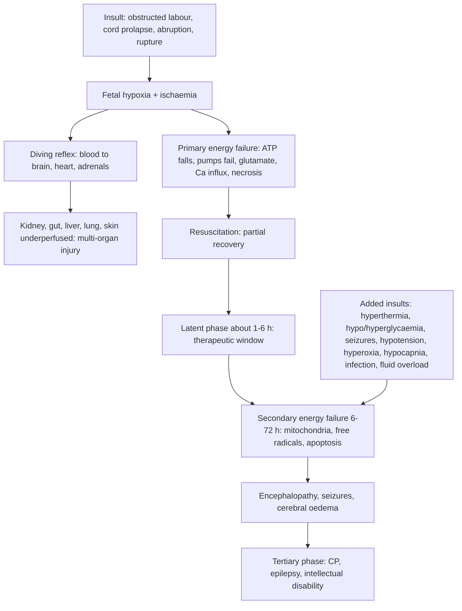

## 1. Definition

**Birth asphyxia** means the baby's oxygen supply was interrupted before, during or just after birth so that he fails to start or sustain breathing. The resulting brain damage is **hypoxic-ischaemic encephalopathy (HIE)**. "Neonatal encephalopathy" is the broader clinical term for a term baby with abnormal consciousness, tone, feeding or seizures; HIE is its commonest cause.

| Term | Meaning |
|---|---|
| **Birth asphyxia** (WHO) | Failure to initiate and sustain breathing at birth |
| **Perinatal asphyxia** (physiological) | Impaired gas exchange → **hypoxaemia, hypercapnia and metabolic acidosis** |
| **Neonatal encephalopathy (NE)** | Clinical syndrome in a baby of ≥35 weeks: reduced consciousness or seizures, abnormal tone and reflexes, poor feeding, often breathing difficulty |
| **HIE** | NE caused by intrapartum hypoxia-ischaemia |
| **Apgar score** | 0–10 at 1 and 5 min; describes the baby's state, **does not diagnose asphyxia** and is never used to decide whether to resuscitate |

**Criteria that support an intrapartum hypoxic-ischaemic cause** (ACOG/AAP "Neonatal encephalopathy and neurologic outcome"; used in research and medicolegal work):

1. **Cord (or early) arterial pH <7.0** and/or **base deficit ≥12 mmol/L**.
2. **Apgar 0–3 beyond 5 minutes** (or <5 at 5 and 10 minutes).
3. Early-onset **moderate or severe encephalopathy**.
4. **Multi-organ dysfunction** (kidney, liver, heart, gut, blood).
5. A **sentinel event** (cord prolapse, abruption, uterine rupture, shoulder dystocia) and fetal heart abnormalities.
6. Neuroimaging consistent with acute hypoxic injury (basal ganglia and thalamus, watershed).

> [!UGANDA]
> Cord blood gases are rarely available in Ugandan public hospitals. On the ward, asphyxia is diagnosed **clinically**: a history of a difficult or prolonged labour or fetal distress, a baby who needed resuscitation (low Apgar), and **encephalopathy** in the first hours to days. Write all three in your notes.

> [!PEARL]
> The one thing never to forget: **prevention is the treatment.** A well-monitored labour (partograph, fetal heart every 30 min in active labour, timely action) and a trained person with a working bag and mask at every birth prevent most HIE.

## 2. Epidemiology

- **Global**: intrapartum-related events cause roughly a quarter of neonatal deaths and over a million stillbirths a year, almost all in low- and middle-income countries (LMICs) [VERIFY: figures against the latest WHO/UNICEF estimates].
- **Uganda**: intrapartum-related events (asphyxia) are one of the **three leading causes of neonatal death** (with prematurity and infection), a major cause of **fresh stillbirth**, and the commonest preventable cause of **cerebral palsy**.
- Many asphyxiated babies in Uganda come from **prolonged or obstructed labour**, delayed referral from lower-level facilities, home births, inadequate fetal monitoring and a lack of skilled resuscitation.

**Services by level of care** [VERIFY: compiled from the source notes, not an MoH equipment list]

| Level | Usually available | Often missing |
|---|---|---|
| **HC III / HC IV** | HBB resuscitation (bag and mask), phenobarbital injection, ampicillin and gentamicin, glucometer at some | Oxygen and pulse oximetry at HC III, IV infusions for neonates, SCBU |
| **General Hospital / RRH** | Newborn unit (SCBU), oxygen, IV fluids, phenobarbital, glucose monitoring, NGT feeding | Electrolytes at some, CPAP at some, blood gas |
| **NRH and tertiary (Mulago/Kawempe, Mengo, Nsambya, Lubaga)** | CPAP and ventilation, blood gases, electrolytes, cranial ultrasound | **Therapeutic hypothermia** is not standard in public Ugandan units; **aEEG/EEG and MRI** in only a few Kampala centres |

## 3. Aetiology and Risk Factors

Most cases follow prolonged or obstructed labour, poorly monitored labour, cord prolapse, abruption, ruptured uterus or delayed resuscitation.

| Antepartum and maternal | Intrapartum | Fetal / neonatal |
|---|---|---|
| Eclampsia, maternal shock | **Prolonged second stage, obstructed labour** | Preterm and post-term babies |
| APH (abruption) | Malpresentation, breech delivery | Twin delivery |
| Maternal infection (chorioamnionitis) | **Cord prolapse** | Thick meconium |
| Lack of ANC, home birth | **Ruptured uterus** | Shoulder dystocia |
| Delayed referral | Oxytocin overuse (**hyperstimulation**) | Delayed or ineffective resuscitation |
| | Inadequate fetal heart monitoring | |

## 4. Pathophysiology

### The two phases of brain injury

1. **Insult (hypoxia + ischaemia)**.
2. **Primary energy failure**: ATP falls, Na⁺/K⁺ pumps fail, cytotoxic oedema, glutamate release, calcium influx, cell necrosis.
3. **Resuscitation** → partial recovery of brain energy.
4. **Latent phase** (about 1–6 hours): the "therapeutic window" (cooling must start here).
5. **Secondary energy failure** (6–72 h): mitochondrial failure, free radicals, inflammation, apoptosis, seizures.
6. **Tertiary phase** (weeks to months): ongoing injury, impaired repair.

Everything that adds to the energy deficit in the secondary phase makes the injury worse: **hyperthermia, hypoglycaemia, hyperglycaemia, seizures, hypotension, hypoxaemia, hyperoxia, hypocapnia (over-ventilation reduces cerebral blood flow), infection and fluid overload**.

### The "diving reflex" and multi-organ injury

When oxygen falls, the fetus redistributes blood to the **brain, heart and adrenals** at the expense of the **kidneys, gut, liver, skin and lungs**. So asphyxia damages several organs:

| Organ | Consequence | What to monitor |
|---|---|---|
| **Brain** | HIE, seizures, cerebral oedema | Neurological examination, seizures |
| **Kidneys** | Acute tubular necrosis → **oliguria, AKI**, hyponatraemia | Urine output, creatinine, sodium |
| **Heart** | Myocardial dysfunction, tricuspid regurgitation, hypotension | HR, CRT, BP |
| **Lungs** | Meconium aspiration, persistent pulmonary hypertension (PPHN), haemorrhage | SpO₂ (pre- and post-ductal) |
| **Liver** | Raised transaminases, coagulopathy, hypoglycaemia | Glucose, bleeding |
| **Gut** | Feed intolerance, NEC | Abdomen, aspirates |
| **Blood** | Thrombocytopenia, **DIC** | Bleeding, platelets |
| **Endocrine / metabolic** | **Hypoglycaemia**, hypocalcaemia, SIADH | Glucose, calcium, sodium |

### Patterns of brain injury

- **Acute profound ("near total")** insult (for example cord prolapse, uterine rupture): deep grey matter (**basal ganglia, thalami**) → dyskinetic or spastic quadriplegic CP.
- **Prolonged partial** insult (for example long obstructed labour): **watershed** cortex and white matter → cognitive problems, spastic CP, cortical visual impairment.

**Feature links**

- Cortical and brainstem energy failure → **altered consciousness** (hyperalert → lethargy → coma).
- Early sympathetic surge (mild) → **dilated pupils, tachycardia, jitteriness**.
- Parasympathetic dominance (moderate) → **constricted pupils, bradycardia, secretions**.
- Brainstem injury (severe) → **apnoea, absent suck and Moro, poor pupil responses**.
- Neuronal hyperexcitability (glutamate, calcium) → **seizures**, often subtle, typically starting within 12–24 h.
- Cortical and basal ganglia injury → **hypotonia** early, later **spasticity or dyskinesia**.
- Acute tubular necrosis → **oliguria**, rising creatinine and potassium; ADH excess → **SIADH, hyponatraemia, weight gain**.
- Myocardial ischaemia → **hypotension, poor perfusion**, tricuspid regurgitation murmur.
- Hypoxic pulmonary vasoconstriction → **PPHN**: labile SpO₂, pre- and post-ductal difference.
- Gasping in utero → **meconium aspiration**.
- Hepatic injury → **coagulopathy, hypoglycaemia**; endothelial injury → **DIC, bleeding**.
- Gut ischaemia → **feed intolerance, NEC**.

## 5. Classification / Staging

### Sarnat staging (modified): the ward version

| Feature | Stage 1 (mild) | Stage 2 (moderate) | Stage 3 (severe) |
|---|---|---|---|
| **Level of consciousness** | **Hyperalert**, irritable, jittery | **Lethargic** or obtunded | **Stupor or coma** |
| **Tone** | Normal or increased | **Mild hypotonia** | **Flaccid** |
| **Posture** | Mild distal flexion | Strong distal flexion | Intermittent decerebration |
| **Stretch reflexes** | Brisk | Brisk | Decreased or absent |
| **Moro** | Strong, low threshold | Weak, incomplete | Absent |
| **Suck** | Weak | Weak or absent | Absent |
| **Autonomic** | Sympathetic: **dilated pupils**, tachycardia | Parasympathetic: **constricted pupils**, bradycardia, secretions | Both depressed: pupils variable, poor light reflex, apnoea |
| **Seizures** | **None** | **Common** (often subtle) | Uncommon clinically (EEG suppressed) or frequent early |
| **Duration** | <24 h | 2–14 days | Hours to weeks |
| **Outcome** | **Usually normal** | **Variable**: about 20–40% die or have disability (lower with cooling in high-income countries) | **Death in about half or more; nearly all survivors disabled** |

> [!EXAM]
> Examiners love: "Mild = hyperalert + no seizures + normal outcome; moderate = lethargy + hypotonia + seizures; severe = coma + flaccid." Also: **pupils dilated in mild (sympathetic), constricted in moderate (parasympathetic)**.

**Thompson score** (0–22; tone, consciousness, fits, posture, Moro, grasp, suck, respiration, fontanelle) is a simple bedside alternative, used in African and Asian research and some Ugandan units. A higher score means worse encephalopathy; scores of about 15 or more on days 1–7 predict poor outcome.

## 6. Clinical Features

### History

| Question | Why it matters |
|---|---|
| **Labour**: duration, augmentation, partograph, obstructed, malpresentation | Mechanism and severity of the insult |
| **Fetal heart**: bradycardia, decelerations, meconium | Evidence of fetal hypoxia |
| **Sentinel event**: cord prolapse, abruption, rupture, eclamptic fit, shoulder dystocia | Supports an intrapartum cause, predicts pattern |
| **Resuscitation**: time to first breath or cry, bag-mask duration, HR response, compressions or adrenaline, Apgar 1/5/10 | Longer resuscitation = more severe HIE |
| **Gestation and birth weight** | Cooling eligibility (≥36 weeks); preterm encephalopathy has different causes |
| **Maternal fever, ROM duration (>18 h), foul liquor** | **Sepsis or meningitis** can mimic or add to HIE |
| **Maternal drugs** (opioids, MgSO₄, diazepam) | Can cause depression without HIE |
| **Seizures noticed**: when, what they looked like | Timing (HIE seizures typically start within 12–24 h) |
| **Feeding, urine and meconium passed since birth** | Suck = neurological status; oliguria = AKI |
| **Maternal HIV (last viral load), syphilis, blood group** | Prophylaxis and other causes |
| **Immunisation (BCG, OPV0)** | Give before discharge |

### Examination

Follow Hutchison's Clinical Methods (24th edition) order adapted for the newborn. Resuscitation and stabilisation come first; then a full examination with the **Sarnat items recorded one by one**. **Repeat the Sarnat examination at least daily** (and at 6 h if cooling were possible): encephalopathy evolves.

#### Introduction, consent and preparation

- Introduce yourself to the mother; confirm the baby's name, age in hours and sex; explain and gain consent.
- **Hand hygiene**.
- **Position and exposure**: under a radiant warmer or in a warm room, fully undressed only for as long as needed; watch the temperature (do not overheat).

#### General inspection (before touching)

| Sign | Mechanism | What it means |
|---|---|---|
| Hyperalert, jittery, wide-eyed | Sympathetic surge | Sarnat 1 |
| Lethargic, little spontaneous movement | Cortical depression | Sarnat 2 |
| Stupor or coma, no spontaneous movement | Severe cortical and brainstem injury | Sarnat 3 |
| Posture: distal flexion; decerebrate posturing | Tone abnormality | Stage 2 (strong flexion) or 3 (decerebration) |
| Subtle seizures: lip smacking, eye deviation, cycling, apnoea; clonic, tonic, myoclonic jerks | Neuronal hyperexcitability | Seizures: treat |
| Colour: cyanosis, pallor, plethora, jaundice; meconium staining | Hypoxaemia, PPHN; blood loss; polycythaemia | Other organ involvement |
| Breathing pattern: irregular, apnoea, recession | Brainstem injury, meconium aspiration | Respiratory support |
| Dysmorphism | Syndrome or malformation | Other cause of encephalopathy |

**Vital signs and growth**: temperature (avoid >37.5 °C), HR, RR and apnoea, SpO₂ (pre- and post-ductal if PPHN is suspected), CRT (<3 s), BP if available; weight (and daily weights), length and **head circumference** plotted.

#### Hands, face and neck

- **Hands**: grasp; peripheral perfusion; fisting.
- **Face**: pupils (dilated in mild, constricted in moderate, poor light reflex in severe); suck (finger in the mouth); facial movement.
- **Head**: fontanelle (bulging = meningitis or cerebral oedema), sutures, scalp swelling: **caput** (crosses sutures, soft, present at birth) versus **cephalhaematoma** (limited by sutures) versus **subgaleal haemorrhage** (boggy, crosses sutures, spreads to the neck and ears, falling Hb, shock).

#### Nervous system (Sarnat items)

- **Level of consciousness and spontaneous activity**.
- **Tone**: pull-to-sit (head lag), ventral suspension, limb recoil.
- **Posture**; **stretch reflexes**; **Moro**; **grasp**; **suck**.
- **Autonomic**: pupils, HR, secretions.
- **Seizures**: describe and time them.

#### Completing the examination

- **Chest**: meconium aspiration (crackles, recession), PPHN.
- **Heart**: murmur of tricuspid regurgitation, poor perfusion.
- **Abdomen**: liver size, distension (NEC).
- **Skin and bleeding**: puncture sites, cord, gut; jaundice; skin lesions.
- **Urine output**: weigh nappies.
- **Thank** the mother, re-dress the baby, **hand hygiene**, **summarise** with the Sarnat stage and time.
- Document key negatives: "no bulging fontanelle, no dysmorphism, no subgaleal swelling".

### Red flags

> [!REDFLAG]
> - **Apnoea** or irregular breathing, SpO₂ falling
> - **Seizures**, especially repeated or prolonged; seizure in the first hours
> - **Coma, flaccidity, absent suck and Moro** (severe HIE)
> - **Hypotension**, poor perfusion, bradycardia
> - **No urine for 24 h**, rising weight, oedema (AKI, fluid overload)
> - **Bleeding** from puncture sites, gut or cord (DIC)
> - **Hypoglycaemia** (<2.6 mmol/L) or hyperthermia (>37.5 °C)
> - **Bulging fontanelle** or fever (think meningitis)

### Thinking like a clinician

- **Not every floppy baby after a hard labour has HIE.** Always consider **hypoglycaemia, sepsis and meningitis**, maternal drugs, intracranial haemorrhage (subgaleal, subdural after instrumental delivery), metabolic disease, congenital neuromuscular disorders.
- **Encephalopathy without a hypoxic history** (normal labour, good Apgar) points away from HIE: look for infection, metabolic disease, stroke, or malformation.
- **Seizures in HIE are often subtle**: a baby with apnoea and eye deviation is seizing until proven otherwise.
- **Over-treatment harms too**: hyperthermia from radiant heaters, hyperoxia from 100% oxygen, fluid overload from "routine" 60–90 mL/kg/day in an oliguric baby, and stacked anticonvulsants causing apnoea.
- **Mild HIE today can be moderate tomorrow.** Re-examine; write the stage and the time.
- **Prognosis needs time.** Avoid firm predictions on day 1; recovery of suck and tone over the first week is the best clinical guide in Uganda.

## 7. Differential Diagnoses

| Differential | Distinguishing clinical feature | Distinguishing investigation |
|---|---|---|
| **Neonatal sepsis / meningitis** | Maternal fever, ROM >18 h, fever or hypothermia, bulging fontanelle, onset after a normal period | Blood culture, CRP, LP |
| **Hypoglycaemia** | Jittery, lethargic, seizures; SGA or infant of a diabetic mother; responds to glucose | Glucose |
| **Intracranial / subgaleal haemorrhage** | Instrumental delivery, boggy scalp crossing sutures, falling Hb, shock | Hb, head circumference, cranial ultrasound |
| **Maternal drug effect** | Opioid or MgSO₄ before delivery; depression improves over hours; no seizures | History; naloxone not routine |
| **Inborn error of metabolism** | Normal at birth, then lethargy, vomiting, seizures after feeds; consanguinity | Glucose, ammonia, lactate, ketones |
| **Neonatal stroke** | Focal seizures in a well-looking term baby, often day 1–3 | Cranial ultrasound, MRI |
| **Congenital neuromuscular disease / malformation** | Hypotonia from birth without encephalopathy; dysmorphism, contractures | Genetics, imaging |
| **Hypocalcaemia / hypomagnesaemia** | Jitteriness, seizures, infant of a diabetic mother, preterm | Calcium, magnesium |
| **Kernicterus** | Day 3–7, deep jaundice, opisthotonus, high-pitched cry | Bilirubin |

HIE itself: hypoxic labour, low Apgar, resuscitation, encephalopathy from birth, multi-organ dysfunction; diagnosed clinically, supported by blood gas and imaging.

## 8. Clinical Workup

"Available at" is the lowest level that usually offers the test [VERIFY: availability compiled from the source notes].

### Bedside

| Test | Why | Expected / abnormal finding | Available at |
|---|---|---|---|
| **Glucose** | Hypo- and hyperglycaemia both worsen brain injury | <2.6 mmol/L (treat); >10 mmol/L (reduce glucose infusion rate). Check within the first hour and every 3–6 h for 24–48 h | HC III and above (glucometer) |
| **Temperature** | Hyperthermia worsens injury | Keep 36.5–37.5 °C; avoid >37.5 °C | All levels |
| **SpO₂** | Avoid hypoxaemia and hyperoxia | Target 90–95%; pre- and post-ductal difference >3–5% suggests PPHN | HC IV and above |
| **Urine output** (weigh nappies: 1 g = 1 mL) | AKI | <**1 mL/kg/h** after the first 24 h = oliguria | All levels |
| **Daily weight** | Fluid balance | Weight gain in the first week = fluid retention | All levels |
| **HemoCue Hb / PCV** | Blood loss (subgaleal), polycythaemia | Falling Hb | HC IV and above |
| **20-minute whole-blood clotting test** | DIC | No clot at 20 min | All levels with a glass tube |
| **Sarnat (or Thompson) score** | Grade and trend | Stage and time recorded | All levels |

### Basic lab

| Test | When | Expected / abnormal finding | How it changes management | Available at |
|---|---|---|---|---|
| **FBC, platelets** | Bleeding, sepsis | Thrombocytopenia, anaemia | Platelets, transfusion | HC IV and above |
| **Electrolytes, urea, creatinine** | Day 1–3 | Hyponatraemia (SIADH), rising creatinine and potassium (AKI) | Fluid restriction; stop potassium; adjust gentamicin | Regional and national referral |
| **Calcium, magnesium** | Seizures | Hypocalcaemia (total calcium <1.75–2.0 mmol/L) | 10% calcium gluconate 2 mL/kg slow IV | Referral hospitals |
| **Blood culture, CRP** | Risk factors or signs of sepsis | Positive culture | Antibiotic duration | Referral hospitals |
| **LFTs, coagulation** | Severe HIE, bleeding | Raised transaminases; DIC | Drug dosing; FFP, vitamin K | Referral hospitals |

### Imaging

| Test | When | Expected / abnormal finding | How it changes management | Available at |
|---|---|---|---|---|
| **Cranial ultrasound** | Day 1–3 | Oedema, haemorrhage; excludes other lesions | Prognosis | Kampala tertiary |
| **MRI brain** | Day 5–14 | Basal ganglia and thalamus or watershed injury | **Best prognostic test** | Few private and tertiary centres |

### Specialised / referral-level

| Test | When | Expected / abnormal finding | How it changes management | Available at |
|---|---|---|---|---|
| **Cord / arterial blood gas** | At birth or first hour | pH <7.0, base excess ≥12 | Supports intrapartum asphyxia; cooling eligibility in high-income settings | Few Kampala centres |
| **Lumbar puncture** | Fever, bulging fontanelle, seizures without clear HIE, positive culture | Meningitis | 21 days IV antibiotics | Hospital, once stable |
| **aEEG / EEG** | Seizures, grading | Background suppression, electrographic seizures | Seizure treatment, prognosis | Very limited |
| **Ammonia, lactate** | Encephalopathy without a hypoxic history | Inborn error of metabolism | Metabolic referral | NRH |

### Putting it together

**Model one-line summary**

> "A 14-hour-old term male, birth weight 3.4 kg, born by vacuum after **obstructed labour for 6 hours** with thick meconium and FHR 90/min, needing **4 minutes of bag-mask ventilation** (Apgar 2, 5, 7), now with **moderate HIE (Sarnat 2)**: lethargic, hypotonic, weak suck, constricted pupils, with **two subtle seizures** (lip smacking and eye deviation) treated with phenobarbital. Temperature 37.0 °C, glucose 3.8 mmol/L, SpO₂ 95% in air, no urine yet."

**Problem list**

1. Moderate HIE with seizures.
2. Risk of AKI or SIADH (no urine at 14 h).
3. Possible meconium aspiration.
4. Sepsis to be excluded.
5. Feeding (unable to suck).
6. Family counselling.

**Model case presentation (ward round)**

> "**Baby Okello**, a **2-day-old** term male, birth weight **3.5 kg**, born at Mengo by emergency CS for **obstructed labour** (referred from a HC IV after 14 hours of labour) with **thick meconium** and **FHR 80/min**. He was **not breathing at birth**, needed **5 minutes of bag-mask ventilation**, HR rose above 100 at 3 minutes; Apgar 2, 4 and 7.
>
> On day 1 he had **moderate HIE (Sarnat 2)**: lethargic, hypotonic, weak suck, constricted pupils, with **three seizures** (cycling movements and eye deviation) controlled with **phenobarbital 20 mg/kg** then a further **10 mg/kg**; now on **5 mg/kg/day**. Temperature 36.8–37.3 °C. He has had no seizures for 20 hours. Glucose 3.5–6.0 mmol/L. On **10% dextrose 60 mL/kg/day**; passed **1.2 mL/kg/h** urine in the last 12 hours. Sodium 132. Blood culture pending; on **ampicillin and gentamicin** (ROM 20 h). Started **EBM 10 mL/kg/day by NGT** today.
>
> Mother **HIV-negative** in labour, RPR negative. **BCG and OPV0 not yet given** (will give before discharge). Weight today **3.4 kg** (−3%).
>
> **Assessment:** moderate HIE, improving, seizures controlled; problems: feeding, fluid balance, sepsis exclusion, family counselling. **Plan:** daily Sarnat, advance feeds as suck returns, stop antibiotics at 48 h if culture negative and well, continue phenobarbital and review, development follow-up at 6 weeks."

**Worked example 1: fluids in an oliguric baby.** A 3.0 kg baby with moderate HIE has passed 10 mL of urine in 24 h (0.14 mL/kg/h) and his weight has risen from 3.0 to 3.15 kg. Sodium is 128 mmol/L. **Interpretation**: **oliguria + weight gain + hyponatraemia = fluid retention (AKI or SIADH)**. **Plan**: restrict to **insensible losses (about 30–40 mL/kg/day) plus urine output**, no potassium, recheck electrolytes and creatinine, review gentamicin (prolong interval or stop if culture negative), weigh twice daily.

**Worked example 2: phenobarbital.** A 3.2 kg baby → loading **64 mg** IV over 20 min; if still seizing after 15–30 min, **32 mg** (10 mg/kg), repeat once if needed (total 40 mg/kg = 128 mg); maintenance **16 mg once daily**.

**Worked example 3: glucose infusion rate.** GIR = (% dextrose × mL/kg/day) ÷ 144. 10% dextrose at 60 mL/kg/day = 600 ÷ 144 = **4.2 mg/kg/min**.

## 9. Management

There is no antidote. In Ugandan units, the treatment is **meticulous supportive care**: keep the baby normothermic (and **never overheated**), keep glucose normal, give the right fluids, support breathing, **stop seizures with phenobarbital**, treat infection, feed carefully and follow up.

### Immediate / emergency

**First 5 minutes**

1. **Resuscitation** as per HBB and neonatal resuscitation (see that topic): dry, airway, **bag-mask ventilation by 60 s**, HR checks, compressions and adrenaline in hospital. Ventilation is the key intervention.
2. Once breathing, **admit** if: prolonged ventilation (>1–2 min), abnormal tone, poor suck, seizures, or ongoing respiratory distress.
3. Call the senior; inform and support the mother.

**ABCDE**

- **A**: position, suction if secretions.
- **B**: oxygen only to keep SpO₂ **90–95%** (avoid hyperoxia); bag-mask for apnoea; CPAP or ventilation for respiratory failure; avoid over-ventilation (hypocapnia).
- **C**: CRT and HR; **IV access** (peripheral or umbilical venous catheter); normal saline **10 mL/kg** over 10–20 min only if clearly hypovolaemic (for example blood loss, subgaleal haemorrhage); dopamine where available for hypotension due to myocardial dysfunction.
- **D**: **glucose** within the first hour; treat <**2.6 mmol/L** with **10% dextrose 2 mL/kg IV**; **seizure?** → **phenobarbital 20 mg/kg IV**.
- **E**: **temperature 36.5–37.5 °C**. Turn the radiant warmer down if >37.5 °C; do not overwrap. **Do not actively cool** without a cooling protocol and NICU; no ad hoc cooling with ice or fans. **Vitamin K** if not given.
- **Sepsis risk** → blood culture, **ampicillin + gentamicin**.

### Definitive

**Emergency algorithm (first 24 hours)**

1. **Resuscitate effectively** (HBB/NRP).
2. **Admit** to the newborn unit (SCBU) every baby with encephalopathy, prolonged resuscitation, or an abnormal examination.
3. **Thermoregulation**: **36.5–37.5 °C**; avoid hyperthermia.
4. **Oxygenation and ventilation**: SpO₂ **90–95%**.
5. **Circulation**: saline only if hypovolaemic; inotropes where available.
6. **Glucose**: keep **≥2.6 mmol/L** (many units target 2.6–8 mmol/L); bolus then infusion.
7. **Fluids**: **10% dextrose 60 mL/kg/day** on day 1; **restrict** (for example 40 mL/kg/day, or insensible losses + urine output) if oliguric or hyponatraemic.
8. **Seizures**: **phenobarbital** (drug table); exclude hypoglycaemia, hypocalcaemia and meningitis.
9. **Antibiotics**: ampicillin + gentamicin if sepsis cannot be excluded; take care with gentamicin in AKI (extend interval, check levels if available).
10. **Feeding**: nil by mouth or small EBM feeds by NGT while unstable; start and advance as the baby improves.
11. **Monitor**: temperature, HR, RR, SpO₂, glucose, urine output, weight, Sarnat stage, seizures.
12. **Communicate** with the family; document carefully.

### Drug table

| Drug | Dose (per kg; neonate) | Route | Frequency | Duration | Key cautions |
|---|---|---|---|---|---|
| **Phenobarbital** (first line, WHO/UCG) | **Loading 20 mg/kg**; if seizures persist, **further 10 mg/kg** doses up to **40 mg/kg total**; **maintenance 5 mg/kg/day** | IV slowly over **15–20 min** (IM if no IV) | Load once; maintenance once daily (start 12–24 h after load) | Stop when seizure-free (often before discharge; senior decision) | Watch for **apnoea and hypotension**; bag and mask ready |
| **Phenytoin** (second line) | **Loading 20 mg/kg**; maintenance 3–5 mg/kg/day | IV in normal saline over **20–30 min** (max 1 mg/kg/min) | Load once; maintenance in 2 doses | Per response | Not in dextrose (precipitates); arrhythmias: ECG or HR monitoring |
| **Levetiracetam** (second line where available) | **40–60 mg/kg** loading, then 10–30 mg/kg | IV / oral | Maintenance 12-hourly per local protocol | Per response | Fewer side effects; less effective than phenobarbital as first line (NEOLEV2 trial) |
| **Midazolam** (refractory, NICU) | 0.05–0.15 mg/kg bolus, then infusion | IV | Infusion | NICU only | Respiratory depression; needs ventilation support |
| **10% calcium gluconate** (if hypocalcaemic) | **2 mL/kg** | **Slow IV** over 10 min with HR monitoring | Then oral or IV maintenance | Until calcium normal | Extravasation burns; bradycardia if fast |
| **10% dextrose** (if hypoglycaemic) | **2 mL/kg** bolus; infusion 60 mL/kg/day on day 1 | IV | Then infusion | Recheck glucose in 30 min | Avoid hyperglycaemia (>10 mmol/L) |
| **Normal saline** (only if hypovolaemic) | **10 mL/kg** | IV | Over 10–20 min | Single bolus, reassess | Fluid overload in myocardial dysfunction |
| **Dopamine** | **5–10 µg/kg/min** | IV infusion | Continuous | Until BP stable | Where available; needs monitoring |
| **Ampicillin + gentamicin** | Neonatal doses per the sepsis protocol (common neonatal disorders topic) | IV / IM | Per age and weight | Stop at 48 h if well and culture negative | Extend gentamicin interval in AKI; check levels if available |
| **Vitamin K** | 1 mg (term); 0.5 mg (preterm) [VERIFY: dose against UCG] | IM | Once | Single dose | If not given at birth |

> [!DRUG]
> Diazepam is **not** recommended as a routine neonatal anticonvulsant (respiratory depression; the sodium benzoate in it displaces bilirubin from albumin).

### Referral criteria

| Level | What to do | Refer up when |
|---|---|---|
| **HC III / HC IV** | HBB resuscitation; keep warm (not hot); breastfeed or EBM by cup if able; check glucose or give EBM or sugar water by NGT; **first dose of phenobarbital 20 mg/kg IM** if convulsing; first dose of ampicillin + gentamicin if risk factors | Every baby with encephalopathy, seizures, prolonged resuscitation or inability to suck: **refer** with the mother and a referral note |
| **General Hospital / RRH** | SCBU admission, oxygen, IV fluids, glucose monitoring, phenobarbital, antibiotics, NGT feeding, daily Sarnat | Refractory seizures, need for CPAP or ventilation, AKI needing electrolytes, imaging → NRH or tertiary unit |
| **NRH and tertiary (Kampala)** | CPAP and ventilation, blood gases, electrolytes, cranial ultrasound, EEG and MRI in some centres, multidisciplinary follow-up | n/a |

### Monitoring and follow-up

- **Ward monitoring**: temperature, HR, RR, SpO₂, glucose (3–6-hourly for 24–48 h), urine output, weight (daily or twice daily), electrolytes, Sarnat stage daily, seizure chart.
- **Follow-up plan**: weight and head circumference, development at 6 weeks, 3, 6, 9, 12 and 18–24 months; hearing and vision screening; physiotherapy early; nutrition support; epilepsy care; refer to paediatric neurology and cerebral palsy and rehabilitation services (for example Mulago, CoRSU, Katalemwa Cheshire Home) and parent support groups.
- **Every survivor of moderate or severe HIE** needs follow-up for cerebral palsy, epilepsy, developmental delay, hearing and vision problems, and feeding difficulty. Mild HIE still needs a developmental review.

### Fluids and nutrition

| Day | Typical total fluids in HIE | Notes |
|---|---|---|
| Day 1 | **60 mL/kg/day** 10% dextrose (some units 40–60 if oliguric) | Glucose infusion rate ≈ 4 mg/kg/min at 60 mL/kg/day |
| Day 2–3 | Increase by 20–30 mL/kg/day **only if** passing urine and sodium normal | Add sodium after 48 h (for example 10% dextrose with 0.18% saline) |
| Oliguria / AKI | **Insensible losses (30–40 mL/kg/day) + urine output** | No potassium; daily weight and electrolytes |

- **Glucose infusion rate (GIR)** = (% dextrose × mL/kg/day) ÷ 144.
- **Feeding**: start **EBM by NGT** (10–20 mL/kg/day) once the baby is stable (no seizures for 24 h, abdomen soft, bowel sounds); advance by 20–30 mL/kg/day; move to cup or breast as suck returns. Severe HIE babies may need long-term NGT feeding.

### Temperature and therapeutic hypothermia

- **Therapeutic hypothermia (TH)** = whole-body cooling to **33.5 °C for 72 hours**, started **within 6 hours** of birth, followed by slow rewarming (0.5 °C per hour), for babies **≥36 weeks** with **moderate or severe HIE**, in a **NICU** with ventilation, monitoring and blood gases. In high-income settings it reduces death or disability (number needed to treat about 6–9).
- **HELIX trial** (Lancet Global Health 2021; India, Sri Lanka, Bangladesh): TH did **not** reduce death or disability and **significantly increased death** in LMIC tertiary units. Many babies in LMICs have longer, partial insults, more infection, and different timing, so the benefit from high-income trials does not transfer.

> [!UGANDA]
> Therapeutic hypothermia is **not standard care** in Ugandan public hospitals and should be offered only within a research protocol or a fully equipped NICU. On the ward, the priority is the opposite mistake: **avoid hyperthermia** (radiant warmers set too high, heavy wrapping, fever). Keep the baby at **36.5–37.5 °C**.

### Other organ support

- **Respiratory**: meconium aspiration → oxygen, CPAP, antibiotics; PPHN (labile SpO₂, pre- and post-ductal difference) → oxygen, avoid acidosis and hypothermia, refer.
- **Cardiovascular**: hypotension → cautious saline (only if hypovolaemic), inotropes (dopamine 5–10 µg/kg/min) where available.
- **Renal**: fluid restriction, avoid nephrotoxins, adjust gentamicin; monitor potassium.
- **Liver and blood**: vitamin K, FFP and platelets for bleeding.
- **Gut**: delay or slow feeds; watch for NEC.

### Communicating with the family

- **Breaking news**: be honest and gentle; use plain words ("the baby's brain was short of oxygen during labour"); avoid blame; avoid firm predictions on day 1; review with the family daily; involve the father; screen the mother for depression.

## 10. Complications

**Disease-related**

| Acute | Long-term |
|---|---|
| Seizures, cerebral oedema | **Cerebral palsy** (often spastic quadriplegia or dyskinetic) |
| Apnoea, respiratory failure, PPHN, meconium aspiration | Epilepsy |
| AKI, SIADH, hyponatraemia | Intellectual disability, developmental delay |
| Myocardial dysfunction, hypotension | Visual impairment (cortical) |
| Hypoglycaemia, hypocalcaemia | Hearing loss |
| DIC, liver injury | Feeding difficulty, aspiration, malnutrition |
| NEC, feed intolerance | Microcephaly |
| Sepsis | Behavioural problems, family stress |

**Treatment-related**

| Complication | Cause | Recognition and action |
|---|---|---|
| Apnoea, hypotension | Stacked anticonvulsants (phenobarbital, diazepam, midazolam) | Bag and mask ready; avoid diazepam |
| Fluid overload, hyponatraemia, cerebral oedema | "Routine" maintenance fluids in an oliguric baby | Restrict to insensible losses + urine output |
| Worse brain injury | Hyperthermia (radiant warmer too high), hyperoxia, hypocapnia from over-ventilation | Temperature 36.5–37.5 °C; SpO₂ 90–95%; gentle ventilation |
| Hyperglycaemia | Excess glucose infusion | Check glucose; reduce GIR |
| Nephrotoxicity, ototoxicity | Gentamicin in AKI | Extend interval; stop if culture negative |
| Death | Uncontrolled therapeutic hypothermia in LMIC settings (HELIX) | Do not cool outside a NICU protocol |
| Extravasation burns, bradycardia | Calcium gluconate given fast or into a tissued line | Slow IV with HR monitoring |

## 11. Prognosis

- **Mild HIE**: usually normal outcome; still review development.
- **Moderate HIE**: significant risk of death or disability (roughly a third or more without cooling); outcome depends on recovery.
- **Severe HIE**: high mortality; most survivors have **cerebral palsy** (often spastic quadriplegia or dyskinetic), microcephaly, epilepsy, intellectual disability, cortical visual impairment, hearing loss, feeding problems.
- **Good signs**: normal tone, alertness and **sucking by day 7** (WHO: "an infant who is normally active will usually do well"); seizures controlled early; normal neurological examination at discharge.
- **Bad signs**: severe (Sarnat 3) encephalopathy, prolonged resuscitation (no HR at 10 min), seizures that are hard to control, abnormal examination beyond 1 week, **inability to suck at 1 week**, abnormal EEG or MRI, microcephaly at follow-up. A baby still floppy or spastic, unresponsive and unable to suck at 1 week has severe brain injury and will do poorly (WHO).

## 12. Prevention

- **Prevention is the treatment.** A well-monitored labour (partograph, fetal heart every 30 min in active labour, timely action) and a trained person with a working bag and mask at every birth prevent most HIE.
- **Primary**: ANC; birth preparedness; facility delivery with a skilled attendant; early referral of prolonged or obstructed labour; careful oxytocin use; timely CS for obstruction, cord prolapse and abruption.
- **At birth**: Helping Babies Breathe (HBB) skills at every birth, with **bag-mask ventilation within the Golden Minute**; a working bag and mask (sizes 0 and 1) checked every shift.
- **Secondary**: avoid secondary injury (normothermia, normoglycaemia, correct fluids, early seizure control, treat infection).
- **Tertiary**: early developmental follow-up and rehabilitation for survivors.

## 13. Special Populations

- **Preterm babies (<36 weeks)**: encephalopathy has different causes (IVH, periventricular leukomalacia, sepsis); not eligible for cooling; Sarnat staging is less reliable.
- **Babies with AKI**: gentamicin interval must be extended; no potassium in fluids; fluids restricted to insensible losses + urine output.
- **Babies born after instrumental (vacuum) delivery**: look specifically for **subgaleal haemorrhage** (boggy scalp crossing sutures, falling Hb, shock) as a cause or co-existing problem.
- **HIV-exposed babies**: continue PMTCT prophylaxis; give by NGT if unable to suck.

## 14. Key Points

### High-yield points

- Asphyxia is the event; HIE is the brain injury; neonatal encephalopathy is the clinical syndrome.
- Diagnose clinically in Uganda: hypoxic labour + resuscitation + encephalopathy.
- Grade with Sarnat and re-grade daily: mild = hyperalert, no seizures; moderate = lethargy, hypotonia, seizures; severe = coma, flaccid.
- Two waves of injury; treatment prevents secondary injury.
- Temperature 36.5–37.5 °C; **avoid hyperthermia**; no ad hoc cooling (HELIX).
- SpO₂ 90–95%; avoid hyperoxia and over-ventilation.
- Glucose ≥2.6 mmol/L; avoid hyperglycaemia.
- 10% dextrose 60 mL/kg/day on day 1; restrict if oliguric (AKI, SIADH).
- Phenobarbital 20 mg/kg, up to 40 mg/kg; maintenance 5 mg/kg/day; no routine diazepam.
- Always exclude sepsis, meningitis and hypoglycaemia.
- Suck and tone at 1 week are the best bedside prognostic guide.
- Follow up every survivor of moderate or severe HIE.

### Numbers & doses

| Item | Value |
|---|---|
| Asphyxia supporting criteria | **pH <7.0**, **base excess ≥12**, Apgar **0–3 beyond 5 min**, encephalopathy, multi-organ failure |
| Latent phase / therapeutic window | About **6 hours** |
| Cooling (where offered) | **33.5 °C for 72 h**, start within **6 h**, **≥36 weeks**, moderate or severe HIE |
| HELIX trial (LMIC, 2021) | No benefit; **more deaths** with cooling |
| Temperature target | **36.5–37.5 °C**; avoid >37.5 °C |
| SpO₂ target | **90–95%** |
| Glucose | Treat **<2.6 mmol/L** with **10% dextrose 2 mL/kg** |
| Day-1 fluids | **10% dextrose 60 mL/kg/day** (restrict if oliguric) |
| Oliguria | **<1 mL/kg/h** |
| GIR formula | **(% dextrose × mL/kg/day) ÷ 144** |
| Phenobarbital | **20 mg/kg** load (+10 mg/kg to **40 mg/kg**); maintenance **5 mg/kg/day** |
| Phenytoin | **20 mg/kg** IV over 20–30 min in saline |
| Levetiracetam | **40–60 mg/kg** loading |
| Calcium gluconate 10% | **2 mL/kg** slow IV |
| Saline bolus (if hypovolaemic) | **10 mL/kg** |
| Prognostic checkpoint | Suck and tone at **1 week** |

### Exam traps

- **"Apgar of 3 at 1 minute = birth asphyxia."** → Apgar alone does not diagnose asphyxia; it is affected by prematurity, drugs and resuscitation.
- **"Cool all asphyxiated babies with a fan and wet towels."** → Wrong. Uncontrolled cooling is dangerous; **avoid hyperthermia** and offer TH only within NICU protocols.
- **"Give diazepam for neonatal seizures."** → Phenobarbital is first line; diazepam causes apnoea and is not recommended routinely.
- **"Give full maintenance fluids from day 1 and increase daily."** → Restrict if oliguric; AKI and SIADH are common.
- **"No seizures = mild HIE."** → Severe HIE may have few clinical seizures; grade on **consciousness and tone**.
- **"Floppy baby after a long labour: it's HIE; no need for antibiotics."** → Always exclude **sepsis, meningitis and hypoglycaemia**.
- **"Mild HIE needs no follow-up."** → Review development; mild cases can still have subtle problems.

### Questions seniors ask

**Viva questions**

1. *What is the difference between birth asphyxia and HIE?* Asphyxia is the event (hypoxia, hypercapnia, acidosis, failure to breathe); HIE is the brain injury that results.
2. *Describe Sarnat stage 2.* Lethargy, hypotonia, weak suck and Moro, constricted pupils, bradycardia, seizures common.
3. *Why avoid hyperthermia?* It increases cerebral metabolic demand and worsens secondary energy failure; even a 1 °C rise increases the odds of death or disability.
4. *First-line anticonvulsant and dose?* Phenobarbital 20 mg/kg IV over 15–20 min; further 10 mg/kg to 40 mg/kg; maintenance 5 mg/kg/day.
5. *Why restrict fluids in HIE?* Risk of AKI and SIADH → fluid overload, hyponatraemia, cerebral oedema.
6. *Is cooling recommended in Uganda?* Not as routine care; HELIX showed increased mortality in LMICs; use only within protocols in fully equipped NICUs.
7. *What predicts a poor outcome?* Severe encephalopathy, prolonged resuscitation (no HR at 10 min), seizures hard to control, abnormal examination and inability to suck at 1 week, abnormal EEG or MRI.

**On the ward round**

1. **"What Sarnat stage is he, and why?"** Name each feature (consciousness, tone, suck, pupils, seizures).
2. **"How long was he ventilated and when did the heart rate come up?"** Reflects the depth of the insult.
3. **"Why is he on antibiotics?"** Infection risk (ROM, fever) and sepsis cannot be excluded; stop at 48 h if well and culture negative.
4. **"What is his urine output and fluid plan?"** mL/kg/h and total fluids mL/kg/day.
5. **"What anticonvulsant and how much?"** Phenobarbital in mg/kg and total mg.
6. **"Would you cool this baby?"** Not in our setting outside a NICU protocol (HELIX); keep normothermic.
7. **"What will you tell the parents about the future?"** Honest uncertainty; review suck and tone over the week; follow-up for development, hearing and vision.

### Mnemonics

- **Avoid secondary injury: "Keep it in the middle"**: not too hot, not too cold; not too much glucose, not too little; not too much oxygen, not too little; not too much fluid, not too little.
- **Multi-organ injury: "Brain Kills Heart, Lungs, Liver, Gut, Blood"** (brain, kidneys, heart, lungs, liver, gut, blood/DIC).
- **Sarnat: "1 = Hyper, 2 = Hypo + fits, 3 = Coma + flat"**.

### OSCE tips

- Expect a station on **Sarnat staging** from a video or description, or on **calculating phenobarbital doses**.
- When counselling parents, use plain words ("the baby's brain was short of oxygen during labour"), avoid blame, explain uncertainty, describe the plan and follow-up.
- In an examination station, record each Sarnat item aloud, state the stage, and give the time.

## 15. References

1. World Health Organization. Pocket Book of Hospital Care for Children: guidelines for the management of common childhood illnesses, 2nd edition (sections 3.5 HIE, 3.7 Convulsions, 3.10 Supportive care). Geneva: WHO; 2013. https://www.who.int/publications/i/item/978-92-4-154837-3
2. Ministry of Health Uganda. Uganda Clinical Guidelines 2023 (16.5.1 Newborn resuscitation; 17.1 Sick newborn). Kampala: MoH; 2023. https://library.health.go.ug/uganda-clinical-guidelines-2023
3. Medscape eMedicine. Hypoxic-ischemic encephalopathy treatment and management. 2024. https://emedicine.medscape.com/article/973501-treatment
4. Thayyil S, et al. Hypothermia for moderate or severe neonatal encephalopathy in low-income and middle-income countries (HELIX): a randomised controlled trial in India, Sri Lanka, and Bangladesh. Lancet Global Health 2021;9(9):e1273–e1285. https://pubmed.ncbi.nlm.nih.gov/34358491/
5. Medscape Drugs & Diseases. Phenobarbital (Sezaby) dosing: neonatal seizures. 2024. https://reference.medscape.com/drug/sezaby-phenobarbital-343017
6. MSD Manual Professional Edition. Physical examination of the newborn. 2024. https://www.msdmanuals.com/professional/pediatrics/care-of-newborns-and-infants/physical-examination-of-the-newborn
7. American College of Obstetricians and Gynecologists, American Academy of Pediatrics. Neonatal encephalopathy and neurologic outcome. 2nd edition [VERIFY: edition and year].
8. Glynn M, Drake WM, editors. Hutchison's Clinical Methods: An Integrated Approach to Clinical Practice. 24th edition. Edinburgh: Elsevier; 2018.
