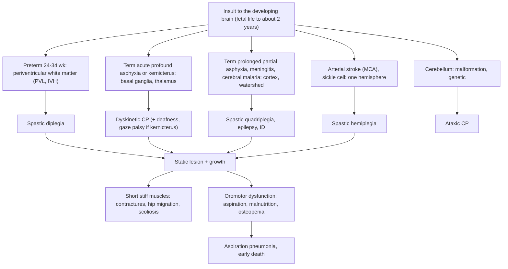

## 1. Definition

**Cerebral palsy (CP)** is a group of permanent disorders of **movement and posture** that limit activity, caused by a **non-progressive** disturbance in the **developing brain** (in the womb, at birth or in early childhood, up to about 2 years). The motor problem is often accompanied by **epilepsy, intellectual disability, problems with vision, hearing, communication, feeding and behaviour**, and later by secondary **musculoskeletal** problems (contractures, hip dislocation, scoliosis).

**Definition (Rosenbaum et al., 2007, still the accepted definition)**: "Cerebral palsy describes a group of permanent disorders of the development of movement and posture, causing activity limitation, that are attributed to non-progressive disturbances that occurred in the developing fetal or infant brain. The motor disorders of CP are often accompanied by disturbances of sensation, perception, cognition, communication and behaviour, by epilepsy, and by secondary musculoskeletal problems."

| Term | Meaning |
|---|---|
| **Spasticity** | Velocity-dependent increase in tone ("clasp-knife") from upper motor neurone damage |
| **Dystonia** | Sustained or intermittent muscle contractions causing twisting postures, worse with effort or emotion |
| **Choreoathetosis** | Involuntary, writhing (athetoid) and jerky (choreic) movements |
| **Ataxia** | Loss of coordination: wide-based gait, intention tremor, dysmetria |
| **Contracture** | Fixed shortening of a muscle–tendon unit limiting passive range |
| **Migration percentage** | Proportion of the femoral head lateral to Perkin's line on an AP pelvis X-ray |

> [!PEARL]
> The one thing never to forget: **CP does not get worse.** The child gains skills slowly, but never loses them. A child who **loses** skills (regression), has a progressive course, or has no risk factor in the history does not have CP until a progressive or treatable disorder (HIV encephalopathy, metabolic, neurodegenerative, dopa-responsive dystonia, a spinal or brain tumour) has been excluded.

## 2. Epidemiology

- **Commonest cause of physical disability in children.**
- **Global**: about **2–3.5 per 1000 live births** in high-income countries (HICs), falling slightly as neonatal care improves; much higher in preterm and very-low-birth-weight babies (risk rises steeply below 32 weeks).
- **Uganda**: a population-based study in the **Iganga-Mayuge** Health and Demographic Surveillance Site (Kakooza-Mwesige et al., *Lancet Global Health* 2017) found a prevalence of roughly **3 per 1000 children** aged 2–17 years. Compared with HIC registers, Ugandan children were **older at diagnosis**, more **severely affected** (more GMFCS IV–V), more often **malnourished**, had more **postnatal causes** (malaria, meningitis, other infections) and more **epilepsy**; few had ever received rehabilitation or assistive devices.
- **A large share of Ugandan CP is preventable**: good intrapartum care, neonatal resuscitation, treating neonatal jaundice, preventing and treating malaria and meningitis, and immunisation.
- **Mortality**: children with severe CP (GMFCS IV–V), feeding difficulties and malnutrition die young, mostly from **aspiration pneumonia** and malnutrition. In Ugandan cohorts, mortality is many times higher than in children without CP.
- **Stigma**: CP is often blamed on witchcraft, curses or the mother. Children may be hidden at home, mothers abandoned by partners, and children excluded from school. Families spend heavily on traditional healers before reaching a rehabilitation service.

> [!UGANDA]
> Rehabilitation services exist but are concentrated in and around Kampala: **CoRSU Rehabilitation Hospital (Kisubi)**, **Mulago** physiotherapy, occupational therapy and paediatric neurology clinics, **Katalemwa Cheshire Home**, **Mengo** physiotherapy, regional referral hospital physiotherapy departments and **community-based rehabilitation (CBR)** programmes run by NGOs and churches. Group-based parent training programmes developed and tested in Uganda (for example **"Getting to Know Cerebral Palsy"** and the **ABAaNA** early-intervention programme) teach parents positioning, feeding, play and communication and reduce stigma. Botulinum toxin, intrathecal baclofen, selective dorsal rhizotomy and MRI are largely unavailable or very expensive.

## 3. Aetiology and Risk Factors

| Timing | Share (HIC) | Examples |
|---|---|---|
| **Prenatal** | ~70–80% in HICs (lower in Uganda) | Brain malformations, congenital infection (CMV, rubella, toxoplasmosis, Zika), maternal infection or chorioamnionitis, placental insufficiency and fetal growth restriction, multiple pregnancy, fetal stroke, genetic causes, maternal thyroid disease, toxins |
| **Perinatal** | ~10–20% | **Birth asphyxia / HIE**, prematurity complications (PVL, IVH), **neonatal sepsis and meningitis**, **hypoglycaemia**, **kernicterus**, birth trauma |
| **Postnatal** (to ~2 years) | ~10% in HICs, **much higher in Uganda** | **Cerebral malaria**, **bacterial meningitis**, encephalitis, **head injury**, near-drowning, **sickle cell stroke**, severe dehydration with venous sinus thrombosis, poisoning |

**Preventable causes in Uganda**: birth asphyxia (obstructed and prolonged labour, poor monitoring), **severe neonatal jaundice** (kernicterus; G6PD deficiency, ABO incompatibility, home births, delayed phototherapy), neonatal sepsis and meningitis, hypoglycaemia, **cerebral malaria**, **bacterial meningitis** (Hib and pneumococcus, now reduced by vaccines), **measles encephalitis**, **sickle cell stroke**, head injury.

> [!EXAM]
> **When can CP be blamed on birth asphyxia?** Only with evidence of **intrapartum hypoxia–ischaemia** (severe metabolic acidosis in cord or early neonatal blood, low Apgar scores), **moderate or severe neonatal encephalopathy** soon after birth, a **spastic quadriplegic or dyskinetic** pattern, and **exclusion of other causes**. Most CP in HICs is not caused by events in labour; in Uganda birth asphyxia is a much bigger contributor.

## 4. Pathophysiology

1. **Lesion location determines the type.** The developing brain's vulnerability changes with gestational age:
   - **24–34 weeks**: the **periventricular white matter** is a vascular watershed and its oligodendrocyte precursors are very sensitive to ischaemia and inflammation → **PVL** → damage to corticospinal fibres for the **legs** (which run closest to the ventricles) → **spastic diplegia**. IVH with venous infarction → hemiplegia.
   - **Term**: grey matter is most active. **Acute profound asphyxia** (cord prolapse, uterine rupture, abruption) damages the metabolically active **basal ganglia and thalamus** → **dyskinetic** CP. **Prolonged partial asphyxia** injures **parasagittal cortex and watershed zones** → **spastic quadriplegia**. Perinatal **arterial stroke** (usually left MCA) → **hemiplegia**.
   - **Unconjugated bilirubin** crosses an immature or damaged blood–brain barrier and deposits in the **globus pallidus, subthalamic nucleus, hippocampus, brainstem auditory nuclei and oculomotor nuclei** → **kernicterus**: dyskinetic CP, sensorineural hearing loss, upward-gaze palsy, dental enamel dysplasia.
   - **Postnatal infection** (cerebral malaria, meningitis): diffuse cortical injury, infarcts, hydrocephalus → quadriplegia, hemiplegia, epilepsy, deafness, blindness.
2. **Why spasticity develops**: loss of descending inhibition from the cortex onto spinal reflex arcs → **hyperexcitable stretch reflexes**, co-contraction of agonists and antagonists, persistent primitive reflexes, and weakness and poor selective motor control.
3. **Why the picture "changes" although the lesion does not**: as the child grows, **muscles fail to grow as fast as bones** (spastic muscle is short and stiff) → **contractures**; abnormal muscle pull on growing bones → **hip migration**, **scoliosis**, foot deformities (equinus, planovalgus). Tone often appears first as **hypotonia** in early infancy, with spasticity or dystonia becoming obvious at 6–18 months as myelination proceeds.
4. **Why nutrition fails**: oromotor dysfunction (poor lip closure, tongue thrust, uncoordinated swallow), long feeding times, GORD, constipation, aspiration, and high energy needs in dyskinetic CP (low needs in severe spastic quadriplegia) → **undernutrition, osteopenia, poor immunity, pressure sores**.

**Feature links**

- Loss of cortical inhibition → **spasticity, brisk reflexes, clonus, upgoing plantars**, scissoring, toe-walking.
- Immature myelination → **early hypotonia**, later spasticity or dystonia (6–18 months).
- Failure of cortical suppression → **persistent primitive reflexes** (Moro, ATNR, grasp beyond 4–6 months); absent or asymmetric **parachute** after 9 months.
- Unilateral cortical lesion → **early hand preference** (before 1 year), hemiplegic gait with arm flexed.
- Basal ganglia injury → **fluctuating tone, writhing movements**, dysarthria, drooling.
- Bilirubin in auditory and oculomotor nuclei → **sensorineural deafness, upward-gaze palsy**; enamel → **dental enamel dysplasia**.
- Cerebellar lesion → **wide-based gait, intention tremor, nystagmus**.
- Cortical injury → **epilepsy, intellectual disability, cortical visual impairment**, microcephaly.
- Muscles shorter than bones → **contractures** (equinus, knee flexion, hip adduction).
- Spastic adductors and no weight-bearing → **hip migration**, painful dislocation.
- Asymmetric trunk tone → **scoliosis**.
- Oromotor dysfunction → **long meals, coughing with feeds, drooling, aspiration pneumonia, malnutrition**.
- Immobility, poor nutrition, anticonvulsants → **osteopenia, low-trauma fractures**.

## 5. Classification / Staging

Four things classify a child with CP: **motor type, topography, function, and timing and cause** (section 3).

### Motor type (the main tone abnormality)

| Type | Proportion | Lesion | Clinical features |
|---|---|---|---|
| **Spastic** | ~70–80% | Upper motor neurone: motor cortex, periventricular white matter (corticospinal tracts) | Velocity-dependent increased tone ("clasp-knife"), brisk reflexes, clonus, upgoing plantars, persistent primitive reflexes, contractures, scissoring, toe-walking |
| **Dyskinetic** (dystonic, choreoathetoid) | ~10–15% | Basal ganglia and thalamus: term HIE (acute profound asphyxia), **kernicterus** | Fluctuating tone, involuntary writhing or twisting movements and postures worse with effort or emotion, dysarthria, drooling; intelligence often better than it looks; kernicterus adds **sensorineural deafness, upward-gaze palsy and dental enamel dysplasia** |
| **Ataxic** | <5% | Cerebellum | Hypotonia, wide-based unsteady gait, intention tremor, dysmetria, nystagmus. **Look hard for a genetic or progressive cause** |
| **Mixed** | Common | Several areas | Usually spastic–dystonic |

> [!NOTE]
> **Hypotonic infants** may later declare themselves as spastic or dyskinetic: many children with CP are floppy in the first months and become stiff later. Truly persistent hypotonia without other signs is not usually called CP; think of genetic, neuromuscular or metabolic causes.

### Topography (which limbs)

| Pattern | Description | Typical cause |
|---|---|---|
| **Hemiplegia** (unilateral spastic) | One side; arm usually worse than leg | Perinatal arterial stroke (MCA territory), unilateral malformation, postnatal stroke (**sickle cell disease**), head injury |
| **Diplegia** (bilateral, legs worse) | Legs much more affected than arms; scissoring, toe-walking; IQ often normal | **Preterm** birth with **periventricular leukomalacia** (PVL) or intraventricular haemorrhage (leg fibres run closest to the ventricles) |
| **Quadriplegia** (bilateral, all four limbs, also called tetraplegia) | All four limbs, trunk, bulbar muscles; often epilepsy, severe intellectual disability, microcephaly, feeding problems | Term **HIE** (watershed injury), **meningitis**, **cerebral malaria**, severe hypoglycaemia, congenital infection (CMV), brain malformation |

The European SCPE system simply uses **unilateral versus bilateral spastic**, dyskinetic and ataxic.

### Function: the Gross Motor Function Classification System (GMFCS, expanded and revised 2007)

| Level | Between 6th and 12th birthday | Prognosis / priorities |
|---|---|---|
| **I** | Walks indoors and outdoors and climbs stairs **without limitations**; runs and jumps but with reduced speed, balance and coordination | Near-normal mobility |
| **II** | **Walks with limitations**: difficulty on long distances, uneven ground, crowds; uses a rail on stairs; minimal running or jumping | Independent walker with limits |
| **III** | **Walks using a hand-held mobility device** (walker, crutches) indoors; wheelchair for longer distances | Hip surveillance; orthoses |
| **IV** | **Self-mobility with limitations**; may use **powered mobility**; transported in a manual wheelchair outdoors | High risk: hip dislocation, scoliosis, feeding problems |
| **V** | **Transported in a manual wheelchair**; limited head and trunk control; all areas of motor function limited | Highest risk: aspiration, malnutrition, hip dislocation, early death |

Companion systems: **MACS** (Manual Ability Classification System) for hand use, **CFCS** (Communication Function Classification System) and **EDACS** (eating and drinking).

> [!EXAM]
> **Prognosis for walking**: a child who **sits independently by 2 years** will very likely walk (with or without aids); a child who cannot sit by about 4 years is unlikely ever to walk. GMFCS level is fairly stable after about age 2, so it is the best single predictor of future mobility, hip displacement and need for nutritional support.

## 6. Clinical Features

### History

| Question | Why it matters |
|---|---|
| **Presenting concern**: delayed motor milestones, stiffness or floppiness, abnormal posture, early hand preference, toe-walking, feeding problems, fits, "not like other children" | Pattern of presentation |
| **Developmental history by domain** (gross motor, fine motor and vision, language and hearing, social): head control, sitting, crawling, standing, walking; first words; smile | Motor-only versus global delay |
| **Has the child ever lost a skill?** | **Regression = not CP** |
| **Antenatal**: maternal illness, fever, rash (rubella, CMV), HIV and syphilis status, bleeding, pre-eclampsia, multiple pregnancy, drugs or alcohol, fetal movements | Prenatal cause |
| **Birth**: gestation, place of birth (home, HC, hospital), duration of labour, obstructed labour, cord prolapse, mode of delivery, **cried at birth?**, **resuscitation**, Apgar, birth weight, **fits in the first days**, neonatal unit admission, **jaundice** (when, how deep, phototherapy, exchange transfusion), hypoglycaemia, sepsis or meningitis | Perinatal cause and timing (and whether it was preventable, which matters for counselling and MPDSR-type learning) |
| **Postnatal**: cerebral malaria, meningitis, convulsions, head injury, near-drowning, severe dehydration, measles, **sickle cell disease** | Postnatal cause |
| **Seizures**: type, frequency, drugs, adherence | Epilepsy control; side effects (sedation, drooling) |
| **Vision** (follows faces?), **hearing** (turns to sound?), communication | Early referral |
| **Feeding**: time per meal, coughing or choking during feeds, chest infections, vomiting; breastfeeding history, current diet (thin porridge only?), texture, who feeds the child and how | Aspiration risk; need for SLT, NG or gastrostomy |
| **Drooling, constipation, sleep, pain** (hips, constipation, dental), behaviour, continence | Treatable problems |
| **Immunisation** (UNEPI card) and **HIV status** of child and mother | HIV encephalopathy; preventable infections |
| **Family**: consanguinity, similar conditions, siblings' health | Genetic cause |
| **Social**: who cares for the child, distance to services, cost, support from partner, stigma, schooling, previous treatments (traditional healers, physiotherapy, devices) | Caregiver capacity, support |

### Examination

Follow Hutchison's Clinical Methods (24th edition) order adapted for children: be opportunistic, **observe first** (posture, movements, aids, orthoses), use play, and leave distressing parts (ears, throat, passive stretch of tight muscles) to last.

#### Introduction, consent and preparation

- Introduce yourself; confirm the child's name and age and the carer's relationship; explain; gain consent from the carer and assent from the child.
- **Hand hygiene**.
- **Position and exposure**: on the carer's lap or a mat on the floor; undress to the underwear in a warm, private space; have toys ready; remove orthoses (and look at them).

#### General inspection (before touching)

| Sign | Mechanism | What it means |
|---|---|---|
| Posture: frog-leg (hypotonia), scissoring, fisting with adducted thumb, opisthotonus, asymmetry | Abnormal tone | Type and topography |
| Spontaneous and involuntary movements | Basal ganglia or cerebellar involvement | Dyskinetic or ataxic |
| How the child sits, crawls or walks; hand use | Function | GMFCS, MACS |
| Dysmorphic features, neurocutaneous signs | Syndromic or neurocutaneous cause | Look for another diagnosis |
| Wasting, oedema | Malnutrition | SAM protocol if indicated |
| Skin: pressure sores | Immobility | Postural care |
| Signs of HIV | HIV encephalopathy | Test |

**Vital signs and growth**: weight, length or height (or **knee height or ulna length** if contractures prevent standing), **head circumference** (microcephaly is common in quadriplegia; macrocephaly suggests hydrocephalus), **MUAC**, Z-scores, oedema; plot over time. Temperature, RR and SpO₂ if unwell.

#### Hands, face and neck

- **Hands**: fisting, adducted thumb, grasp, hand preference.
- **Face**: drooling, lip closure, **teeth** (caries, enamel dysplasia in kernicterus), facial asymmetry.
- **Eyes**: fix and follow, squint, nystagmus, upward-gaze palsy, red reflex.
- **Head**: head circumference, fontanelle in infants.

#### Nervous system and musculoskeletal system

- **Tone**: pull-to-sit (head lag), ventral suspension (floppy "inverted U"), **vertical suspension** (scissoring legs in spastic CP; slips through hands if hypotonic), passive movement of limbs (spastic catch, "clasp-knife"; lead-pipe rigidity in dystonia), **Modified Ashworth** score in older children.
- **Power and selective control** (functional in young children).
- **Reflexes**: brisk, spreading, **clonus**, upgoing plantar after ~12–18 months.
- **Primitive reflexes**: Moro, ATNR, palmar grasp persisting beyond 4–6 months; **protective reflexes** (parachute absent or asymmetric after 9 months).
- **Joints**: range of **hip abduction** (limited = hip at risk), Thomas test (hip flexion contracture), popliteal angle (hamstrings), ankle dorsiflexion (equinus), leg-length discrepancy, feet.
- **Spine**: scoliosis.
- **Gait**: toe-walking, scissoring (diplegia), circumduction with arm flexed (hemiplegia), wide-based (ataxia), dystonic posturing.

#### Completing the examination

- **Chest**: crackles (aspiration pneumonia).
- **Hearing** (response to sound, otoscopy last), **communication**, **oromotor** (drooling, lip closure; observe a feed if possible).
- **Thank** the child and carer, re-dress the child, replace orthoses, **hand hygiene**.
- **Classify** at the end: motor type, topography, GMFCS level, associated impairments.

| Document these positives | And these negatives |
|---|---|
| Type, topography, GMFCS level | "No regression; no loss of skills" |
| Tone (Ashworth), reflexes, clonus, contractures | "Head circumference following centile" |
| Hip abduction range, spine | "No neurocutaneous stigmata, no dysmorphism" |
| Weight, height, MUAC, Z-scores | "HIV test negative; no chest signs" |

**Early warning signs (NICE NG62)**: not sitting by **8 months**, not walking by **18 months**, hand preference before **1 year** (corrected age), persistent fisting, toe-walking, feeding difficulty, abnormal tone; primitive reflexes persisting beyond 6 months.

### Red flags

> [!REDFLAG]
> Refer for paediatric neurology and look for another diagnosis (NICE NG62) if:
> - **No known risk factor** in the history
> - **Loss of skills** (developmental regression) or a progressive course
> - **Family history** of a progressive neurological disorder
> - **New or unexpected focal neurological signs**
> - Signs of **MRI-negative** dystonia or fluctuating symptoms (try **levodopa**: dopa-responsive dystonia)
> - Abnormal head growth (crossing centiles upward = hydrocephalus or tumour; acquired microcephaly with regression = HIV encephalopathy, Rett syndrome)
> - Peripheral signs: **absent reflexes**, wasting, fasciculation, sensory level, bladder or bowel problems (spinal cord or neuromuscular disease)
>
> Acute red flags on the ward: coughing and choking with feeds, SpO₂ <90%, status epilepticus, hypoglycaemia, severe acute malnutrition, pain or a new deformity after minor handling (fracture).

### Thinking like a clinician

- **"Delayed walking at 18 months in a boy who walks on his toes and has big calves"**: think **Duchenne muscular dystrophy** (Gowers sign, raised CK), not CP.
- **"Floppy baby who later becomes stiff"** is typical of evolving CP; **"floppy and weak but alert"** suggests a neuromuscular cause (spinal muscular atrophy: absent reflexes, tongue fasciculation).
- **"Dystonia that is worse in the evening and better after sleep"**: dopa-responsive dystonia; a levodopa trial transforms the child.
- **HIV encephalopathy** presents with delayed or **lost** milestones, **acquired microcephaly** and spastic diplegia or quadriplegia. UCG 2023: **test every child with developmental delay for HIV** and start ART.
- **Kernicterus history** (deep jaundice in week 1, exchange transfusion, "the baby's eyes were yellow and he stopped breastfeeding") + dyskinetic CP + deafness: arrange a **hearing test** early.
- **Poor weight gain** in CP is not "just CP": it is a treatable feeding problem (and sometimes TB, HIV or neglect).
- **Pain** is often missed: the irritable child with CP may have a **dislocated hip, constipation, dental abscess, reflux oesophagitis, fracture (osteopenia)** or urinary infection.
- **A child who "refuses to eat" and coughs at meals** is aspirating; this is the commonest route to death in severe CP.
- **A preterm survivor with legs stiffer than arms** = spastic diplegia from PVL; arms are involved too if you look carefully (fine motor clumsiness).

## 7. Differential Diagnoses

| Differential | Distinguishing clinical feature | Distinguishing investigation |
|---|---|---|
| **HIV encephalopathy** | Regression or plateau, acquired microcephaly, spasticity, other HIV features | HIV test; CD4, viral load |
| **Neurodegenerative / metabolic disease** (leukodystrophies, mitochondrial, lysosomal) | Regression, progressive course, consanguinity, organomegaly, seizures, vision loss | MRI, metabolic screen, enzyme and genetic tests |
| **Duchenne muscular dystrophy** | Boy, toe-walking, Gowers sign, calf pseudohypertrophy, normal early milestones then weakness | **CK markedly raised** |
| **Spinal muscular atrophy / other neuromuscular** | Floppy, weak, **absent reflexes**, tongue fasciculation, alert face | Genetic test, EMG |
| **Dopa-responsive dystonia** | Dystonia (often legs), diurnal variation, normal MRI | **Levodopa trial** |
| **Hereditary spastic paraplegia** | Slowly progressive spastic legs, family history | Genetics |
| **Spinal cord lesion** (spina bifida, tethered cord, TB spine, tumour) | Leg weakness, sensory level, bladder and bowel problems, back findings | MRI spine |
| **Hydrocephalus / brain tumour** | Large or growing head, vomiting, headache, papilloedema, regression | Cranial ultrasound, CT, MRI |
| **Rett syndrome** | Girl, normal to 6–18 months then regression, hand-wringing, acquired microcephaly | *MECP2* testing |
| **Congenital hypothyroidism** | Hypotonia, large tongue, constipation, prolonged jaundice, delay | TSH, T4 |
| **Global developmental delay without CP / genetic syndromes** (Down syndrome) | Hypotonia, dysmorphism, delay in all domains without UMN signs | Karyotype, genetic tests |
| **Severe malnutrition / rickets** | Delay that improves with feeding; bony signs of rickets | Growth, wrist X-ray, ALP |

## 8. Clinical Workup

"Available at" reflects the source notes [VERIFY: availability not checked against an MoH list].

### Bedside

| Test | How / why | Expected finding | Available at |
|---|---|---|---|
| **Weight, length or height, HC, MUAC → Z-scores** | Scales, length board, tape; knee height if contractures | Malnutrition, microcephaly, growth faltering | All levels |
| **Observed feed** | Watch the carer feed thin and thick textures, child upright | Coughing, wet voice, desaturation = aspiration risk | All levels |
| **SpO₂** | Pulse oximeter, also during feeding | Aspiration, pneumonia | HC IV and above |
| **Glucose** | Glucometer | Hypoglycaemia in ill, malnourished children | HC III and above |
| **HIV rapid test** (DNA PCR <18 months if exposed) | Per national algorithm | HIV encephalopathy | All levels |
| **Simple hearing and vision screen** | Response to voice or rattle; fix and follow, red reflex | Refer for formal testing | All levels |
| **Developmental screening** | Milestone checklist; Malawi Developmental Assessment Tool (MDAT) or similar | Global versus motor-only delay | All levels |

### Basic lab

| Test | When | Expected / abnormal finding | How it changes management | Available at |
|---|---|---|---|---|
| **HIV test, FBC, sickle test** | All with developmental delay (HIV per UCG); sickle test if hemiplegia | HIV, HbSS | ART; stroke prevention (hydroxyurea, transfusion programme) | HC IV and above |
| **TSH / T4, CK** | Hypotonia, ataxia, regression, normal MRI, family history | Hypothyroidism; raised CK (Duchenne) | Treatable mimics | Referral labs |

### Imaging

| Test | When | Expected / abnormal finding | How it changes management | Available at |
|---|---|---|---|---|
| **Cranial ultrasound** | Neonates and infants with an open fontanelle at risk (preterm, HIE) | PVL (cysts), IVH, hydrocephalus | Early diagnosis, follow-up | Most hospitals with a skilled sonographer |
| **MRI brain** | Every child with suspected CP **if available** (abnormal in ~80–90%) | PVL, basal ganglia or thalamic injury, infarct, malformation, kernicterus (globus pallidus), normal (think genetic or metabolic) | Confirms timing and cause; normal MRI = look for another diagnosis | **Mulago, Mengo and private centres in Kampala; costly** |
| **CT brain** | When MRI is not available | Calcification (CMV), infarcts, hydrocephalus, atrophy | Cause; hydrocephalus needs neurosurgery | Mulago, Mengo, some RRHs |
| **Hip X-ray (AP pelvis)** | From about 2 years, especially GMFCS III–V; repeat 6–12-monthly | **Reimers migration percentage**: >30% = hip at risk; >40% = displacement | Orthopaedic referral (soft-tissue release, osteotomy) | Hospitals |
| **Spine X-ray** | Clinical scoliosis | Cobb angle | Bracing or surgery referral | Hospitals |
| **Chest X-ray** | Recurrent chest infections | Right-lower-lobe consolidation (aspiration) | Feeding plan, antibiotics | Hospitals |

### Specialised / referral-level

| Test | When | Expected / abnormal finding | How it changes management | Available at |
|---|---|---|---|---|
| **EEG** | Seizures of uncertain type, suspected epileptic syndrome | Epileptiform activity, hypsarrhythmia (infantile spasms) | Antiepileptic choice | Mulago, CoRSU, private |
| **Metabolic and genetic tests** | Regression, normal MRI, family history, dysmorphism | Specific metabolic disease or syndrome | Treatable or inherited disorders | Referral labs; genetic testing mostly abroad or research |
| **TORCH serology / CMV PCR** | Microcephaly, calcification, deafness, chorioretinitis | Congenital infection | Counselling, hearing follow-up | Referral labs |
| **Hearing test (OAE/ABR) and ophthalmology** | All children with CP early on | Sensorineural loss (kernicterus, meningitis, CMV); cortical visual impairment, strabismus, refractive error | Hearing aids, glasses, communication plan | Mulago ENT and eye clinics, CoRSU |
| **Prechtl General Movements Assessment / HINE** | High-risk infants <6 months corrected age | Absent "fidgety" movements at 3–5 months corrected age | Early diagnosis and intervention | Very limited [VERIFY: availability in Uganda] |

> [!PEARL]
> **Early diagnosis is now possible before 6 months corrected age** in high-risk infants, using **MRI** plus the **Prechtl General Movements Assessment** (absent "fidgety" movements at 3–5 months corrected age is highly predictive) or the **Hammersmith Infant Neurological Examination (HINE)**. Even where these are not available, a high-risk baby (asphyxia, preterm, kernicterus, meningitis) should get **enhanced developmental follow-up** to 2 years (NICE NG62), because early intervention while the brain is most plastic improves function.

### Putting it together

**Model one-line summary**

> "A 4-year-old boy with spastic quadriplegic cerebral palsy, GMFCS level V, following severe birth asphyxia, complicated by epilepsy on carbamazepine, severe feeding difficulty with probable chronic aspiration, moderate underweight and stunting, bilateral hip adduction contractures and a right hip at risk, now admitted with aspiration pneumonia."

**Problem list** (always organise CP by problems, not just the diagnosis)

1. Acute: aspiration pneumonia, hypoxaemia.
2. Motor: spastic quadriplegia, GMFCS V, adductor and hamstring contractures, right hip migration.
3. Epilepsy: monthly seizures on carbamazepine (check dose and adherence).
4. Nutrition: WAZ −2.6, HAZ −1.8, oromotor dysfunction, thin-porridge diet.
5. Communication, vision, hearing: to be assessed.
6. Family: single mother, stigma, far from services.

**Model case presentation (ward round)**

> "Peter is a 4-year-old boy from Kayunga weighing 12.0 kg (WAZ −2.6), height 96 cm (HAZ −1.8), head circumference 46 cm (below the 3rd centile), MUAC 13.0 cm, with known spastic quadriplegic cerebral palsy, GMFCS level V, attributed to severe birth asphyxia after a prolonged home labour (did not cry at birth, fitted on day 1, admitted to a neonatal unit for 10 days). He is HIV-negative, fully immunised per the UNEPI card (including MR at 9 and 18 months) and fed thin millet porridge by bottle lying down. He has epilepsy on carbamazepine 50 mg twice daily (8 mg/kg/day) with about 2 seizures a month. He presents with 3 days of cough and fever and choking during feeds. On examination: T 38.6 °C, RR 52, SpO₂ 89% in air, crackles at the right base; increased tone in all limbs with brisk reflexes, scissoring, bilateral equinus, restricted hip abduction to 20° on the right; no head control. **Impression: aspiration pneumonia in a child with spastic quadriplegic CP, GMFCS V, with moderate underweight, microcephaly, suboptimally controlled epilepsy, unsafe feeding and a right hip at risk.** Plan: oxygen, IV antibiotics per UCG, NG feeds while acutely ill, increase carbamazepine towards 10–15 mg/kg/day, SLT feeding assessment and caregiver training on upright thickened feeds, nutrition plan, hip X-ray, physiotherapy referral, link the mother to a parent support group."

> [!EXAM]
> **Worked example: hip surveillance X-ray.** A 5-year-old with GMFCS IV CP has painful nappy changes. AP pelvis: on the right, 45% of the femoral head lies lateral to Perkin's line (**migration percentage 45%**); on the left 20%. **Interpretation**: right hip displacement (>40%), left within normal limits. **Action**: orthopaedic referral (adductor release ± femoral or pelvic osteotomy), pain relief, positioning (abduction wedge), repeat the left hip X-ray in 6–12 months.

**Worked example: baclofen.** A 15 kg 5-year-old with painful generalised spasticity: start 0.3 mg/kg/day = 4.5 mg/day, given as about 1.5 mg 8-hourly (or 2.5 mg twice daily if only 5 mg tablets can be split); increase every 3 days towards 0.75–2 mg/kg/day (11–30 mg/day), never above 40 mg/day under 8 years. If he is admitted nil by mouth, continue it via NG tube.

## 9. Management

The aims are not to "cure the brain" but to **maximise function and participation, prevent secondary complications, keep the child well nourished and pain-free, control seizures, and support the family**. Care is **multidisciplinary, family-centred and lifelong**, and goals are set with the family (for example "sit to eat", "walk to school with crutches", "communicate yes or no").

### Immediate / emergency

Most children with CP come to clinic, not to the emergency room. But on the ward they often arrive **acutely ill**.

- **A**: secretions, poor head control, aspiration: **position safely** (side-lying or supported upright), suction; nil by mouth if drowsy or choking.
- **B**: pneumonia or aspiration: oxygen if SpO₂ <90% (or <94% if in distress).
- **C**: dehydration from poor intake: fluids per ETAT (SAM protocol if malnourished).
- **D**: **convulsions** (status epilepticus: treat as in the febrile convulsions topic: diazepam 0.5 mg/kg PR or buccal midazolam 0.3 mg/kg; phenobarbital 15–20 mg/kg; phenytoin 15–20 mg/kg); **glucose** (malnourished children are often hypoglycaemic).
- **E**: **nutrition emergency**: MUAC, oedema, WHZ → SAM protocol if indicated. **Pain or a new deformity** after minor handling: think **fracture** (osteopenia) and splint.
- **Continue baclofen** (via NG tube if nil by mouth); never stop it abruptly.

### Definitive

#### The multidisciplinary team

| Team member | Role |
|---|---|
| **Paediatrician / paediatric neurologist** | Diagnosis, coordination, epilepsy, spasticity drugs, nutrition, general health |
| **Physiotherapist** | Positioning, stretching, strengthening, mobility training, standing frames, walking aids, seating; teaches the family a **home programme** |
| **Occupational therapist** | Hand function, daily living skills (feeding, dressing), adaptive seating and equipment, splints |
| **Speech and language therapist** | **Swallowing safety**, feeding techniques, communication (including augmentative and alternative communication: picture boards, signs) |
| **Nutritionist / dietitian** | Energy and texture plan, NG or gastrostomy feeding, micronutrients |
| **Orthopaedic surgeon and orthotist** | AFOs (ankle–foot orthoses), serial casting, hip surveillance and surgery, scoliosis, tendon lengthening |
| **Neurosurgeon** | Hydrocephalus; selective dorsal rhizotomy, intrathecal baclofen (HIC) |
| **Ophthalmologist, audiologist, dentist** | Squint, glasses, cortical visual impairment; hearing aids; caries, drooling-related problems |
| **Psychologist, social worker, teacher, CBR worker** | Behaviour, family support, disability registration, **inclusive or special needs education**, community inclusion, parent groups |

> [!UGANDA]
> At HC III/IV level the realistic team is the **clinician, a nurse or midwife and a CBR worker or VHT**, with referral to a regional physiotherapy department, Mulago, Mengo or CoRSU. **Teaching the mother** is the core intervention: daily positioning, stretching, feeding upright with thickened food, a simple home-made **corner seat or standing frame**, and play. Parent support groups (for example "Getting to Know Cerebral Palsy") reduce stigma and maternal depression.

#### Motor management: step by step

1. **Physiotherapy and positioning (everyone)**: daily stretching of hip adductors, hamstrings and calf muscles; **24-hour postural care** (supported side-lying or supine with legs apart at night, supported sitting by day, prone lying); standing frames to load bones and stretch muscles; mobility training appropriate to the GMFCS level.
2. **Orthoses and casting**: AFOs to hold the ankle at 90° and improve gait; **serial casting** for equinus; hip abduction wedges or braces; hand splints.
3. **Oral drugs for generalised spasticity or dystonia** (drug table): used when tone causes pain, care difficulty (nappy changes, hygiene), sleep problems or limits function.
4. **Focal treatment**: **botulinum toxin A** injected into specific spastic muscles (calf, hamstrings, adductors, elbow flexors) with casting and physiotherapy; effect lasts 3–6 months. Specialist, limited availability in Uganda.
5. **Surgery**: tendon lengthening (Achilles, hamstrings, adductors), hip reconstruction (osteotomy), scoliosis correction; **selective dorsal rhizotomy** for selected spastic diplegic walkers; **intrathecal baclofen** pump for severe spasticity or dystonia (HIC).

#### Epilepsy

About **1 in 3** children with CP has epilepsy (range 15–60%; highest in quadriplegia and hemiplegia, and with intellectual disability). UCG 2023 choice: **<2 years** phenobarbital or carbamazepine; **>2 years** carbamazepine or valproate; **avoid phenobarbital and phenytoin in children with intellectual disability or behaviour problems** (worsens behaviour and cognition). Doses in the drug table. Give families with frequent prolonged seizures a written **rescue plan**.

#### Nutrition, feeding and drooling

1. **Assess** at every visit: weight, height or knee height, MUAC, Z-scores; feeding time (>30 minutes per meal is a warning), coughing or choking, chest infections.
2. **Feed safely**: **upright (90°)** seated with head slightly flexed, never lying flat; small spoonfuls; **thickened** feeds (thick porridge, mashed matooke, groundnut paste) rather than thin liquids; pace the feed; oral hygiene.
3. **Energy-dense diet**: add oil, groundnut or simsim paste, milk, eggs; RUTF or F-100 if SAM; vitamin and mineral supplements.
4. **NG tube** for short-term support or during acute illness; **gastrostomy** (PEG) for long-term unsafe swallowing or failure to gain weight (available at Mulago and some private and mission hospitals; families need counselling).
5. **GORD**: positioning, small frequent feeds, omeprazole if oesophagitis is suspected.
6. **Constipation** (very common): fluids, fibre, lactulose or polyethylene glycol; treat impaction.
7. **Bone health**: vitamin D 400 IU/day (more if deficient), calcium-rich diet, sunlight, weight-bearing; beware fractures with low trauma.
8. **Drooling**: positioning, oromotor therapy; anticholinergics (glycopyrronium, trihexyphenidyl, hyoscine patch: NICE NG62), specialist botulinum toxin to salivary glands.

#### Other associated problems

| Problem | Action |
|---|---|
| **Vision** (strabismus, refractive error, cortical visual impairment) | Ophthalmology early; glasses; patching |
| **Hearing** | OAE/ABR early (especially after kernicterus, meningitis, CMV); hearing aids |
| **Communication** | SLT; augmentative and alternative communication (picture boards, gestures, devices) |
| **Pain** | Look for hips, constipation, reflux, dental, fractures, menstrual pain; regular paracetamol while the cause is treated |
| **Sleep** | Treat pain, reflux, seizures; sleep hygiene; melatonin (specialist) |
| **Respiratory** | Treat aspiration pneumonia (UCG antibiotics; cover anaerobes if severe), immunise (PCV, measles), chest physiotherapy, safe feeding |
| **Dental** | Brushing, fluoride, dental review (caries, gum hyperplasia on phenytoin) |
| **Behaviour, learning, school** | Psychology; inclusive education; special schools; disability registration |
| **Family and carers** | Screen the mother for depression, link to parent groups and CBR, social work, respite; address stigma and myths |

### Drug table

| Drug | Dose (paediatric per kg, max; adult) | Route | Frequency | Duration | Key cautions |
|---|---|---|---|---|---|
| **Baclofen** (GABA-B agonist) | Start **0.3 mg/kg/day** (or 2.5–5 mg/dose); increase every 3 days to usual **0.75–2 mg/kg/day**; max **40 mg/day <8 y; 60 mg/day ≥8 y** (adult 80 mg/day) | Oral (or NG) | Divided **3–4 times daily** | Long-term; review benefit | Sedation, hypotonia (trunk and head control may worsen), constipation, may lower seizure threshold. **Never stop abruptly**: withdrawal causes seizures, hallucinations, rebound spasticity, hyperthermia. Better for spinal than cerebral spasticity but worth a trial |
| **Diazepam** (GABA-A), spasticity | **0.1–0.8 mg/kg/day** (often 0.1–0.2 mg/kg at night); adult 10 mg/dose | Oral | Divided **6–8-hourly**, or at night | Short-term | Painful spasms, night-time, peri-operative. Sedation, drooling, tolerance, dependence |
| **Trihexyphenidyl** (anticholinergic) | Start about **1 mg/day** (0.05–0.1 mg/kg/day); increase weekly | Oral | Divided 2–3 times daily | Specialist titration [VERIFY: local protocol] | **Dyskinetic or dystonic CP** (NICE NG62: with specialist input). Also reduces drooling. Dry mouth, constipation, urinary retention, blurred vision, behaviour change |
| **Levodopa (with carbidopa)** | Trial about 1 mg/kg/day levodopa, increasing slowly | Oral | Divided 2–3 times daily | Specialist | **Always trial** in unexplained dystonia (dopa-responsive dystonia); may help some dyskinetic CP |
| **Tizanidine** (α2 agonist) | Specialist | Oral | Specialist | Specialist | Rarely available in Uganda; hypotension, liver toxicity |
| **Botulinum toxin A** | Units/kg per muscle by product (for example Botox total roughly ≤10–12 units/kg per session) | IM into target muscles | Every 3–6 months | Repeated courses | Focal spasticity; must be combined with physiotherapy and casting; specialist only |
| **Carbamazepine** (focal and generalised tonic–clonic; >2 y, or <2 y) | Start **5 mg/kg/day**; maintenance **10–20 mg/kg/day** | Oral | 2–3 divided doses | Long-term; recalculate by weight | Rash (stop if severe), ataxia, diplopia; avoid in myoclonic or absence seizures |
| **Sodium valproate** (generalised, myoclonic, absence; >2 y) | Start 10–15 mg/kg/day; maintenance **20–30 mg/kg/day** (max 60) | Oral | 2 divided doses | Long-term | Weight gain, tremor, hepatotoxicity (risk highest <2 y with metabolic disease); **teratogenic** (counsel adolescent girls) |
| **Phenobarbital** (<2 y per UCG; cheap and widely available) | **3–5 mg/kg/day** | Oral | Once daily at night | Long-term | **UCG: avoid in children with intellectual disability or behaviour problems** |
| **Diazepam** (acute seizure) | **0.5 mg/kg** | Rectal | Once; may repeat per protocol | Acute | Respiratory depression |
| **Midazolam** (acute seizure) | **0.3 mg/kg** | Buccal | Once | Acute | Respiratory depression |
| **Phenobarbital / phenytoin** (status) | **15–20 mg/kg** | IV | Loading | Acute | See febrile convulsions topic |
| **Omeprazole** (GORD, oesophagitis) | About **1 mg/kg/day** | Oral | Once daily | Review at 4–8 weeks | |
| **Lactulose** (constipation) | About **0.5–1 mL/kg/dose** | Oral | Once or twice daily | Ongoing | Or polyethylene glycol; treat impaction first |
| **Vitamin D** | **400 IU/day** (more if deficient) | Oral | Daily | Ongoing | Bone health |
| **Paracetamol** (pain) | **15 mg/kg**, max 60 mg/kg/day; adult 1 g | Oral | 6-hourly | While the cause is treated | |

> [!DRUG]
> **Baclofen withdrawal** is dangerous. If a child on baclofen is admitted nil by mouth (for example pneumonia, surgery), **continue it via NG tube** or taper; never just stop it.

### Referral criteria

| Level | What to do | Refer up when |
|---|---|---|
| **Community / VHT / CBR worker** | Identify children with delay; support positioning, feeding and home programme; link to parent groups | Delayed milestones, feeding difficulty, fits → HC |
| **HC III / HC IV** | Classify and document, treat acute illness and seizures, measure growth and manage malnutrition, teach positioning, stretching and safe feeding, **test for HIV**, refill antiepileptics, link to a CBR worker | Physiotherapy, imaging, hearing and vision assessment, uncontrolled seizures, SAM with complications → General Hospital or RRH |
| **General Hospital / RRH** | Physiotherapy and OT, CT at some, hip X-ray, SAM management, epilepsy care | Red flags for another diagnosis (regression, no risk factor), MRI, EEG, gastrostomy, orthopaedic surgery, botulinum toxin → NRH, CoRSU, Mengo |
| **NRH (Mulago), CoRSU, Katalemwa, Mengo** | Paediatric neurology, MRI, EEG, orthopaedic and neurosurgery, gastrostomy, audiology, ophthalmology, orthotics | n/a |

### Monitoring and follow-up

| When | What |
|---|---|
| Every visit (1–3-monthly when young or unwell) | Growth and MUAC, feeding, seizures and drug doses (recalculate by weight), chest, pain, sleep, development, family coping |
| 6–12-monthly | GMFCS review, contractures, **hip X-ray** (GMFCS III–V, or II with concerns), spine, orthoses fit |
| Once early, then as needed | Vision and hearing assessments, MRI or CT (if not done), HIV status |
| Transition (adolescence) | Puberty, menstrual care, sexuality and safeguarding, vocational training, adult services |

**High-risk infants** (asphyxia, preterm, kernicterus, meningitis): enhanced developmental follow-up to 2 years (NICE NG62).

### Breaking the news and counselling

Private setting, both parents, ask what they know, use simple words, explain that CP is not contagious or caused by witchcraft, focus on what the child **can** do and on practical steps (therapy, feeding, school), and arrange follow-up. Set goals using the **F-words** (section 14).

## 10. Complications

**Disease-related**

| Musculoskeletal | Medical | Psychosocial |
|---|---|---|
| Contractures (equinus, knee flexion, hip adduction and flexion) | Aspiration pneumonia (leading cause of death) | Stigma, exclusion from school |
| Hip subluxation or dislocation (up to 60–90% in GMFCS V) | Malnutrition, micronutrient deficiency | Maternal depression, family breakdown |
| Scoliosis | Epilepsy, status epilepticus | Abuse and neglect (higher risk) |
| Osteopenia and low-trauma fractures | GORD, constipation, urinary infections | Poverty from caring costs |
| Pressure sores | Dental caries, drooling, skin breakdown | Limited access to devices and therapy |

**Treatment-related**

| Complication | Cause | Recognition and action |
|---|---|---|
| Withdrawal seizures, hallucinations, rebound spasticity, hyperthermia | Stopping baclofen abruptly | Continue via NG or taper |
| Loss of trunk and head control, sedation | Baclofen, diazepam | Reduce dose; balance tone reduction against function |
| Worse behaviour and cognition | Phenobarbital, phenytoin | Switch to carbamazepine or valproate (UCG) |
| Hepatotoxicity, teratogenicity | Valproate | LFTs if unwell; counsel adolescent girls |
| Severe rash | Carbamazepine | Stop the drug |
| Dry mouth, urinary retention, constipation | Trihexyphenidyl, anticholinergics for drooling | Reduce dose |
| Gum hyperplasia | Phenytoin | Dental review |
| Skin breakdown | Ill-fitting orthoses or casts | Check fit at every visit |

## 11. Prognosis

- The brain lesion is static; function depends on type, topography, GMFCS level and associated impairments.
- **Walking**: a child who **sits independently by 2 years** will very likely walk (with or without aids); a child who cannot sit by about 4 years is unlikely ever to walk. GMFCS level is stable after about age 2.
- **Survival**: most children with GMFCS I–II have near-normal life expectancy; GMFCS IV–V with feeding difficulty and malnutrition die young, mostly from **aspiration pneumonia** and malnutrition. In Ugandan cohorts, mortality is many times higher than in children without CP.
- Dyskinetic CP after kernicterus: intellectual function is often relatively preserved.
- When parents ask whether their child will walk: it depends on the GMFCS level and on sitting; GMFCS IV–V children usually need wheelchairs. Focus on goals the child can achieve and on comfort, communication and participation.

## 12. Prevention

- **Antenatal**: ANC, treat maternal infections, rubella immunisation, MgSO₄ for neuroprotection before very preterm birth, antenatal steroids.
- **Intrapartum**: partograph, timely action for prolonged or obstructed labour, skilled birth attendance, neonatal resuscitation (HBB).
- **Neonatal**: detect and treat **jaundice** early (phototherapy, exchange transfusion), prevent and treat **hypoglycaemia**, **sepsis and meningitis**; KMC and good preterm care.
- **Postnatal**: **malaria** prevention (bed nets) and prompt treatment of cerebral malaria; **immunisation** (Hib, PCV, measles); **sickle cell** screening and stroke prevention (hydroxyurea, transfusion); injury and drowning prevention.
- **Secondary prevention** in children with CP: hip surveillance, postural care, safe feeding, nutrition, immunisation, seizure control.

## 13. Special Populations

- **HIV-positive children**: HIV encephalopathy can mimic or add to CP; start ART; regression demands review.
- **Sickle cell disease**: hemiplegia from stroke; stroke prevention (hydroxyurea, transfusion programme).
- **Severe acute malnutrition**: follow the SAM protocol (fluids, feeds, antibiotics); feeding plan with SLT.
- **Adolescent girls on valproate**: teratogenic; counsel and consider alternatives.
- **Adolescents**: puberty, menstrual care, sexuality and safeguarding, vocational training, transition to adult services.
- **Preterm-born children**: use corrected age to 2 years; spastic diplegia from PVL.

## 14. Key Points

### High-yield points

- CP = permanent, non-progressive brain lesion (fetal life to ~2 years) → disorder of movement and posture.
- Regression = not CP: look for HIV encephalopathy, metabolic, neurodegenerative disease.
- Classify by type, topography, GMFCS and associated impairments.
- Preterm → spastic diplegia (PVL); term asphyxia or kernicterus → dyskinetic or quadriplegic; stroke → hemiplegia.
- Test every child with developmental delay for HIV.
- Aspiration pneumonia and malnutrition kill: weigh, measure and watch a feed at every visit.
- Feed upright with thickened textures.
- Hip X-ray from about 2 years in GMFCS III–V; >40% migration → orthopaedics.
- Baclofen: never stop abruptly.
- Avoid phenobarbital and phenytoin in children with intellectual disability or behaviour problems.
- Try levodopa in unexplained dystonia.
- Teach the mother: she is the core of the team.

### Numbers & doses

| Item | Value |
|---|---|
| Prevalence | **2–3.5/1000** in HICs; about **3/1000** in Uganda (Iganga-Mayuge) |
| Spastic / dyskinetic / ataxic | **~70–80% / 10–15% / <5%** |
| Epilepsy in CP | **15–60%** (about 1 in 3) |
| Intellectual disability | **30–50%** |
| Lesion timing for CP | Fetal life to about **2 years** |
| NICE NG62 warning signs | Not sitting by **8 months**, not walking by **18 months**, hand preference before **1 year** (corrected age) |
| Primitive reflexes | Moro, ATNR, grasp normally gone by **4–6 months**; persistence suggests CP |
| Walking prognosis | Sits by **2 years** → likely to walk; not sitting by about 4 years → unlikely |
| Hip migration percentage | **>30%** at risk; **>40%** displaced → orthopaedics |
| Baclofen | Start **0.3 mg/kg/day** ÷ 3–4; usual **0.75–2 mg/kg/day**; max **40 mg/day (<8 y)**, **60 mg/day (≥8 y)** |
| Diazepam (spasticity) | **0.1–0.8 mg/kg/day** ÷ 6–8-hourly |
| Carbamazepine | **5 mg/kg/day → 10–20 mg/kg/day** (UCG 2023) |
| Sodium valproate | **10–15 → 20–30 mg/kg/day** |
| Phenobarbital maintenance | **3–5 mg/kg/day** |
| Paracetamol | **15 mg/kg 6-hourly**, max 60 mg/kg/day |
| Feeding warning | Meal time **>30 minutes**, coughing with feeds, recurrent chest infections |

### Exam traps

- **"The child lost the ability to sit, so the CP is getting worse."** Wrong: CP is non-progressive; regression means another diagnosis (HIV encephalopathy, metabolic, neurodegenerative).
- **"All CP is caused by birth asphyxia."** Wrong: most CP in HICs is prenatal; in Uganda infection, jaundice, prematurity and asphyxia all matter.
- **"Spastic diplegia = only the legs are affected."** Wrong: the arms are mildly involved.
- **"Toe-walking boy with delayed walking = CP."** Check CK and Gowers sign: Duchenne.
- **"Stop baclofen while nil by mouth."** Wrong: abrupt withdrawal causes seizures and hallucinations; give it by NG.
- **"Phenobarbital is ideal for a child with CP and behaviour problems."** Wrong: UCG advises avoiding phenobarbital and phenytoin in children with intellectual disability or behaviour problems.
- **"He is just thin because of CP."** Wrong: undernutrition is treatable and is a major cause of death.
- **"Feed lying down so he does not fall."** Wrong: feed upright with thickened textures to prevent aspiration.

### Questions seniors ask

**Viva questions**

1. *Define CP.* Permanent disorder of movement and posture due to a non-progressive lesion of the developing brain, often with epilepsy, sensory, cognitive, communication and behaviour problems.
2. *Why is it called non-progressive if the child gets contractures?* The brain lesion is static; secondary musculoskeletal problems develop with growth.
3. *Name the motor types and their lesions.* Spastic (pyramidal: cortex and white matter), dyskinetic (basal ganglia and thalamus), ataxic (cerebellum), mixed.
4. *Preterm baby → which type?* Spastic diplegia (PVL).
5. *What does kernicterus cause?* Dyskinetic CP, sensorineural deafness, upward-gaze palsy, dental enamel dysplasia; intellectual function often relatively preserved.
6. *What is GMFCS and why does it matter?* Five-level classification of gross motor function; predicts mobility, hip displacement, nutrition needs and survival.
7. *What would make you doubt the diagnosis?* Regression, progressive course, no risk factors, family history, normal MRI, peripheral signs.
8. *Drugs for spasticity?* Baclofen, diazepam, botulinum toxin A (focal), tizanidine; intrathecal baclofen in HICs. Dystonia: trihexyphenidyl, levodopa trial.

**On the ward round**

- **How would you classify this child's CP?** By motor type (spastic, dyskinetic, ataxic, mixed), topography (hemi-, di-, quadriplegia), function (GMFCS, MACS, CFCS) and associated impairments, plus the likely cause and timing.
- **What makes you sure this is CP and not a progressive disorder?** A clear risk factor (for example birth asphyxia, kernicterus, meningitis), steady slow gains with no regression, a static neurological picture, and, where available, a consistent MRI. Any regression, no risk factors, or a family history needs a neurology referral.
- **What are the main causes of death in severe CP, and how do you prevent them?** Aspiration pneumonia and malnutrition. Safe upright feeding with thickened textures, SLT assessment, nutritional support (NG or gastrostomy), immunisation, early treatment of chest infections, seizure control.
- **Why do you X-ray the hips of a child who cannot walk?** Spastic adductors and hip flexors plus lack of weight-bearing lead to progressive hip migration and painful dislocation; surveillance allows early soft-tissue surgery before dislocation.
- **How does baclofen work and what are its side effects?** GABA-B agonist reducing spinal reflex excitability; sedation, hypotonia, constipation, lower seizure threshold, and a dangerous withdrawal syndrome if stopped suddenly.
- **What can a HC IV do for this child?** Classify and document, treat acute illness and seizures, measure growth and manage malnutrition, teach positioning, stretching and safe feeding, test for HIV, refill antiepileptics, link to a CBR worker and refer for physiotherapy, imaging, hearing and vision.
- **What do you tell parents who ask whether their child will walk?** It depends on the GMFCS level and on sitting: if the child sits alone by 2 years, walking (perhaps with aids) is likely; GMFCS IV–V children usually need wheelchairs. Focus on goals the child can achieve and on comfort, communication and participation.

### Mnemonics

- **The "F-words" for childhood disability** (Rosenbaum and Gorter): **F**unction, **F**amily, **F**itness, **F**un, **F**riends, **F**uture. Set goals in each.
- **Associated problems "PLEASE SEE FOOD"**: **P**ain, **L**earning disability, **E**pilepsy, **A**spiration, **S**leep, **E**yes; **S**peech, **E**ars, **E**limination (constipation, bladder); **F**eeding, **O**steopenia, **O**rthopaedic (hips, spine), **D**rooling.
- **Topography by timing**: "**P**reterm = **P**araplegic-ish (diplegia, legs), **T**erm = **T**otal (quadriplegia) or **T**witchy (dyskinetic), **S**troke = **S**ide (hemiplegia)."
- **Kernicterus tetrad "DDUE"**: **D**yskinesia, **D**eafness, **U**pward-gaze palsy, **E**namel dysplasia.

### OSCE tips

- In an **examination station**, observe first (posture, movements, aids, orthoses), then tone, power, reflexes, plantar responses, clonus, primitive reflexes (in infants), joints (hips!), spine, gait. Finish by **classifying**: "spastic diplegia, GMFCS II" and listing what else you would assess (growth, vision, hearing, speech, feeding, seizures).
- In a **counselling station** (breaking the news): private setting, both parents, ask what they know, use simple words, explain that CP is not contagious or caused by witchcraft, focus on what the child **can** do and on practical steps (therapy, feeding, school), and arrange follow-up.

## 15. References

1. NICE. Cerebral palsy in under 25s: assessment and management (NG62; 2017, last updated September 2024). https://www.nice.org.uk/guidance/ng62/chapter/Recommendations
2. Medscape eMedicine. Cerebral palsy: practice essentials, background, anatomy. 2024. https://emedicine.medscape.com/article/1179555-overview
3. Medscape eMedicine. Cerebral palsy treatment and management. 2024. https://emedicine.medscape.com/article/1179555-treatment
4. Medscape eMedicine. Cerebral palsy medication (muscle relaxants, botulinum toxins, anticholinergics, dopamine prodrugs). 2024. https://emedicine.medscape.com/article/1179555-medication
5. Medscape Drug Reference. Baclofen (Lioresal): dosing and warnings. https://reference.medscape.com/drug/lioresal-baclofen-343335
6. Ministry of Health Uganda. Uganda Clinical Guidelines 2023: section 9.1.1 Epilepsy and HIV developmental monitoring. Kampala: MoH; 2023. https://library.health.go.ug/uganda-clinical-guidelines-2023
7. Rosenbaum P, Paneth N, Leviton A, et al. A report: the definition and classification of cerebral palsy, April 2006. Developmental Medicine & Child Neurology 2007;49(s109):8–14.
8. Palisano RJ, Rosenbaum P, Bartlett D, Livingston MH. Content validity of the expanded and revised Gross Motor Function Classification System. Developmental Medicine & Child Neurology 2008;50(10):744–750.
9. Kakooza-Mwesige A, et al. Prevalence of cerebral palsy in Uganda: a population-based study. Lancet Global Health 2017;5(12):e1275–e1282.
10. Novak I, et al. Early, accurate diagnosis and early intervention in cerebral palsy: advances in diagnosis and treatment. JAMA Pediatrics 2017;171(9):897–907.
11. Glynn M, Drake WM, editors. Hutchison's Clinical Methods: An Integrated Approach to Clinical Practice. 24th edition. Edinburgh: Elsevier; 2018.
