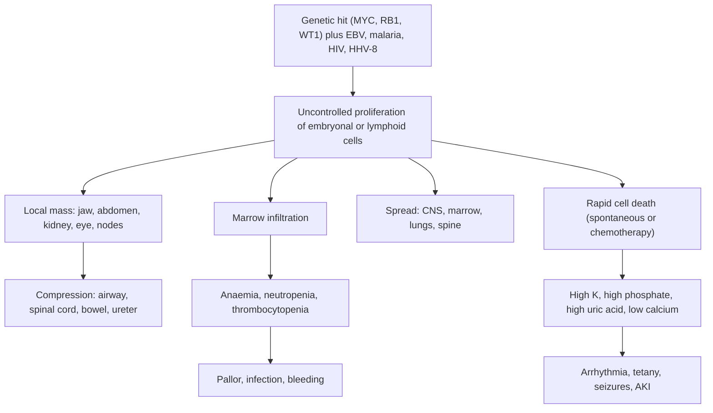

## 1. Definition

**Childhood cancer** is malignancy arising in children and adolescents (0–19 years in the WHO fact sheet; UCG 2023 counts children 0–14 years). Cancer is **rare in children compared with adults**, but it is a leading cause of death from disease in children worldwide. The pattern in Uganda differs from Europe: **Burkitt lymphoma** and **Kaposi sarcoma** are common here, alongside leukaemia, Wilms tumour, retinoblastoma, Hodgkin lymphoma and sarcomas.

Most childhood cancers are **very sensitive to chemotherapy** and are **curable**.

**Key terms**

| Term | Definition |
|---|---|
| **Staging** | How far the tumour has spread (e.g. Murphy/St Jude stages I–IV for Burkitt; SIOP/COG stages I–V for Wilms; INRGSS for neuroblastoma) |
| **Febrile neutropenia** | Absolute neutrophil count (ANC) **<0.5 × 10⁹/L** (or expected to fall below this) with a temperature **≥38.3 °C once or ≥38.0 °C sustained for 1 hour** |
| **Tumour lysis syndrome (TLS)** | Metabolic chaos when many tumour cells die at once (spontaneously or after chemotherapy), releasing **potassium, phosphate and nucleic acids (which become uric acid)** |
| **Abandonment of treatment** | Missing **4 or more consecutive weeks** of planned curative therapy; a leading cause of treatment failure in Uganda |
| **Leukocoria** | A white pupillary reflex instead of red: retinoblastoma until proven otherwise |
| **Hyperleukocytosis** | WBC **>100 × 10⁹/L**: risk of stroke, respiratory failure and TLS |

> [!PEARL]
> The one thing never to forget: **a child with a lump, a white pupil, unexplained bruising or pallor, persistent bone pain or a rapidly growing jaw swelling needs a diagnosis this week, not after another course of antibiotics or dewormers.** Your fast referral is the first step of the cure.

## 2. Epidemiology

- **Global (WHO fact sheet)**: about **400,000 children and adolescents aged 0–19** get cancer each year. **Over 80%** survive in high-income countries but **under 30%** in many low- and middle-income countries. The difference comes from:
  1. **Late diagnosis**: a "toothache" treated with extractions for 2 months, an eye "infection" for 6 months, a "big tummy from worms".
  2. **Abandonment**: families stop treatment because of cost of transport and food, fear, or traditional healers.
  3. **Treatment-related deaths**: infection, tumour lysis and malnutrition.
- **WHO Global Initiative for Childhood Cancer (GICC, "CureAll")**: aims for **at least 60% survival by 2030**, focusing on six index cancers: **ALL, Burkitt lymphoma, Hodgkin lymphoma, retinoblastoma, Wilms tumour and low-grade glioma**.
- **Uganda**: children (0–14 years) make up about **10% of cancer patients** (UCG 2023). The **Kampala Cancer Registry** and the **Uganda Cancer Institute (UCI)** show that **Burkitt lymphoma, Kaposi sarcoma, leukaemias, Wilms tumour, retinoblastoma and Hodgkin lymphoma** account for most childhood cancers seen in Uganda.
- **History**: **Burkitt lymphoma was first described in Kampala**. In 1958 the Irish surgeon **Denis Burkitt**, working at Mulago, mapped a "lymphoma belt" across malaria-endemic equatorial Africa. Epstein and colleagues later found the **Epstein–Barr virus (EBV)** in his tumour samples, the first virus linked to a human cancer.
- **Kaposi sarcoma** rose with the HIV epidemic. With better ART coverage and **early infant HIV diagnosis**, it is falling but still seen.
- **Services**: the **UCI paediatric oncology unit (Mulago, Kampala)** is the national centre, with free chemotherapy, a children's ward and outpatient day care. **Lacor Hospital (Gulu)** has a long-running Burkitt lymphoma programme. Regional cancer services are being developed (e.g. **Gulu and Mbarara**) [VERIFY: current status]. **Mulago Eye** (Department of Ophthalmology) handles retinoblastoma. Radiotherapy is only at UCI. **Palliative care**: Uganda was a pioneer of **oral morphine for palliative care** (Hospice Africa Uganda), and it is available free through the public system.
- **Barriers**: travel costs to Kampala, food and lodging for caretakers, stigma ("cancer is a death sentence"), use of traditional healers, stock-outs, and limited pathology outside Kampala.

> [!UGANDA]
> At a HC III/IV you will not confirm cancer, but you **can** suspect it, do a **FBC, malaria test, HIV test and abdominal ultrasound** where available, start **allopurinol and hydration** for a big Burkitt or leukaemia, treat infection and pain, and refer **urgently with a clear letter** to UCI (via the regional referral hospital if needed). Tell the family that **treatment at UCI is free** and that many children are cured; this helps prevent abandonment.

## 3. Aetiology and Risk Factors

Most childhood cancers arise from **embryonal cells** that fail to mature (e.g. nephrogenic rests → Wilms; neural crest → neuroblastoma; retinal cells → retinoblastoma) or from **lymphoid cells** during rapid immune development. Unlike adult cancers, they are **rarely caused by lifestyle**. Known contributors:

| Factor | Cancer |
|---|---|
| **EBV + holoendemic malaria** | Endemic Burkitt lymphoma. Malaria drives B-cell proliferation and weakens T-cell control of EBV, giving more chances for the **MYC** translocation |
| **HIV + HHV-8 (KSHV)** | Kaposi sarcoma; HIV also increases NHL (including Burkitt) |
| **RB1 mutation (chromosome 13q14)** | Retinoblastoma (Knudson "two-hit" hypothesis); also later osteosarcoma. Bilateral disease is heritable |
| **WT1 (11p13), syndromes** | Wilms: WAGR (Wilms, aniridia, genitourinary anomalies, retardation), Denys–Drash, Beckwith–Wiedemann (also hepatoblastoma), hemihypertrophy |
| **Down syndrome** | ALL (10–20× risk) and AML (especially megakaryoblastic) |
| **Li–Fraumeni (TP53)**, NF1, ionising radiation, prior chemotherapy | Various |

**Risk factors for tumour lysis syndrome**: **Burkitt lymphoma and ALL with high WBC (>100 × 10⁹/L)**, bulky disease, high LDH (>2× normal), pre-existing renal impairment and dehydration.

**Risk factors for abandonment and poor outcome**: distance from Kampala, cost of transport and food, no caretaker able to stay, stigma, traditional healers, malnutrition.

## 4. Pathophysiology

**Burkitt lymphoma: the fastest human tumour**

- A B-cell lymphoma with **MYC on chromosome 8** translocated next to an immunoglobulin gene: **t(8;14)** (about 80%), or t(2;8) or t(8;22). MYC drives constant cell division.
- **Growth fraction close to 100% and a doubling time of about 25 hours**. A jaw mass can double in a day or two. This explains both its **high chemosensitivity** (cures with fairly simple regimens) and its **high risk of tumour lysis**.
- **Histology**: "**starry sky**" pattern (sheets of blue tumour cells with pale macrophages eating dead cells), **Ki-67 ~100%**, CD20+, CD10+, BCL2−.
- **Three types**: **endemic** (Africa; jaw, orbit, abdomen, kidneys, ovaries; almost 100% EBV+), **sporadic** (Western; abdomen, ileocaecal; about 20% EBV+), **immunodeficiency-associated** (HIV, transplant).

**Tumour lysis syndrome**: when cells die, they release:

- **Potassium** → hyperkalaemia → arrhythmias, cardiac arrest.
- **Phosphate** → hyperphosphataemia → binds calcium → **hypocalcaemia** (tetany, seizures) and **calcium phosphate crystals in the kidney** → AKI.
- **Nucleic acids** → purines → hypoxanthine → xanthine → **uric acid** (via xanthine oxidase) → **uric acid crystals** in renal tubules → AKI.

**Allopurinol** blocks xanthine oxidase (stops new uric acid). **Rasburicase** converts existing uric acid to soluble allantoin.

**Feature links**

- Rapidly dividing B cells in the jaw → **jaw or maxillary swelling, loose teeth**, proptosis (orbit).
- Abdominal Burkitt → **multiple masses, ascites**, kidney and ovary involvement; ileocaecal disease → **intussusception or bowel obstruction** in a child over 3.
- Renal embryonal tumour confined by the capsule → **smooth flank mass that does not cross the midline**; renin release → **hypertension**; collecting system invasion → **haematuria**.
- Neural crest tumour → **irregular, calcified mass crossing the midline**; catecholamines → **hypertension, raised VMA/HVA**; orbital metastases → **periorbital bruising ("raccoon eyes")**, proptosis; marrow and bone → **bone pain**; skin → "blueberry muffin" nodules in infants.
- Retinal tumour reflects light → **leukocoria**; loss of central vision → **squint**.
- Marrow replacement → **pallor** (anaemia), **fever and infections** (neutropenia), **petechiae, bruising, nosebleeds** (thrombocytopenia), **bone pain and limp**.
- Lymphoid infiltration → **hepatosplenomegaly, lymphadenopathy**, testicular enlargement.
- Anterior mediastinal mass (T-cell ALL/lymphoma) → **stridor, orthopnoea, facial swelling, distended neck veins** (superior mediastinal syndrome).
- Paraspinal or epidural tumour → **back pain, leg weakness, urinary retention** (cord compression).
- HHV-8 endothelial proliferation → **purple skin or palate lesions, woody oedema, lymphadenopathy** (Kaposi sarcoma).
- Cytokines and tumour burden → **fever, night sweats, weight loss** (B symptoms), **high LDH**.
- Mass in the posterior fossa → **morning headache, vomiting, ataxia**, enlarging head (brain tumour).

## 5. Classification / Staging

**Groups of childhood cancer**

| Group | Examples | Typical age |
|---|---|---|
| **Haematological** | Acute lymphoblastic leukaemia (ALL), acute myeloid leukaemia (AML), chronic myeloid leukaemia (rare) | ALL 2–5 y; AML any age |
| **Lymphomas** | **Burkitt lymphoma** (non-Hodgkin), Hodgkin lymphoma, other NHL | Burkitt 4–7 y; Hodgkin older children/teens |
| **Embryonal tumours ("-blastomas")** | **Wilms tumour** (nephroblastoma), **neuroblastoma**, **retinoblastoma**, hepatoblastoma, medulloblastoma | Mostly under 5 |
| **Sarcomas** | Rhabdomyosarcoma, osteosarcoma, Ewing sarcoma, **Kaposi sarcoma** | Rhabdo any age; bone sarcomas teens |
| **CNS tumours** | Low-grade glioma, medulloblastoma, ependymoma, craniopharyngioma | Any age |
| **Germ cell tumours** | Sacrococcygeal teratoma, testicular, ovarian | Infants and teens |

**Key facts by tumour**

| Cancer | Age and sex | Hallmark |
|---|---|---|
| **Burkitt lymphoma** | 4–7 years (UCG), boys > girls | Jaw or abdominal mass; t(8;14); doubles in ~25 h |
| **ALL** | Peak 2–5 years; ~75–80% of childhood leukaemia | Pallor, fever, bleeding, bone pain or limp, hepatosplenomegaly, nodes |
| **Wilms tumour** | 2–5 years (UCG average 2) | Smooth flank mass in a well child; haematuria and hypertension in about a quarter |
| **Neuroblastoma** | Under 5 years; median ~18 months | Irregular mass crossing the midline in a sick child; raised VMA/HVA in >90% |
| **Retinoblastoma** | Usually under 3–5 years | Leukocoria, squint; RB1 13q14 |
| **Kaposi sarcoma** | Any age; often HIV-associated | Lymphadenopathic disease, woody oedema, palate lesions more than skin lesions |
| **Hodgkin lymphoma** | Older children and teens | Painless rubbery cervical nodes; Reed–Sternberg cells |

**Burkitt lymphoma staging (Murphy/St Jude)**

| Stage | Disease |
|---|---|
| **I** | Single tumour (extranodal) or single nodal area, **excluding mediastinum and abdomen** |
| **II** | Single extranodal tumour with regional nodes; ≥2 nodal areas on the **same side** of the diaphragm; resectable primary GI tumour |
| **III** | Disease on **both sides** of the diaphragm; any **primary intrathoracic** tumour; **extensive intra-abdominal** disease; **paraspinal or epidural** tumour |
| **IV** | **CNS and/or bone marrow** involvement |

A jaw-only tumour is stage I; jaw plus extensive abdominal disease is III; any CSF or marrow involvement is IV.

**Tumour lysis syndrome (Cairo–Bishop)**: laboratory TLS = 2 or more of these, from 3 days before to 7 days after starting therapy.

| Parameter | Threshold (or 25% change from baseline) |
|---|---|
| Uric acid | ≥476 µmol/L (8 mg/dL) |
| Potassium | ≥6.0 mmol/L |
| Phosphate | ≥2.1 mmol/L in children (≥1.45 in adults) |
| Calcium | ≤1.75 mmol/L (25% decrease) |

**Clinical TLS** = laboratory TLS plus one of: **creatinine ≥1.5 × upper limit of normal**, **arrhythmia/sudden death**, or **seizure**.

## 6. Clinical Features

### History

| Ask about | Why it matters |
|---|---|
| **Duration and speed of growth** of a lump | Burkitt grows over days to weeks; Wilms over weeks; benign lumps slowly or not at all |
| **Loose teeth, "toothache", dental extractions, facial swelling** | Classic endemic Burkitt (UCG: extractions do not relieve the swelling) |
| **Abdominal distension, pain, vomiting, constipation, urinary retention** | Abdominal Burkitt, Wilms, neuroblastoma; bowel obstruction or intussusception (ileocaecal Burkitt) |
| **Leg weakness, back pain, incontinence** | **Spinal cord compression** (Burkitt, neuroblastoma): an emergency |
| **Fever, night sweats, weight loss (B symptoms)** | Lymphoma, leukaemia |
| **Pallor, bruising, nosebleeds, gum bleeding, recurrent infections** | Marrow failure: leukaemia, marrow infiltration |
| **Bone pain, limp, refusal to walk, night pain** | Leukaemia, neuroblastoma, bone sarcoma |
| **White pupil in photos or at night ("cat's eye"), squint, red painful eye, bulging eye** | Retinoblastoma |
| **Headache worse in the morning, vomiting, unsteady gait, squint, head enlarging, regression** | Brain tumour |
| **Haematuria** | Wilms (also schistosomiasis, PSGN: keep a broad view) |
| **HIV status, ART, CD4/viral load; maternal HIV** | Kaposi sarcoma, NHL |
| **Family history** (retinoblastoma, early cancers) | Heritable syndromes; screen siblings in retinoblastoma |
| **Prior treatment**: herbs, steroids, dental extraction, surgery | Steroids partially treat lymphoma or leukaemia and ruin diagnosis; incomplete surgery upstages tumours |
| **Social**: distance from Kampala, who can stay, money for transport, who decides | Predicts abandonment; plan support early |
| **Growth, feeding, immunisation (UNEPI), development** | Malnutrition worsens treatment toxicity; live vaccines are avoided on chemotherapy |

### Examination

Follow the order of Hutchison's Clinical Methods (24th edition), adapted for children: observe first, examine painful areas gently, and leave distressing parts (mouth, eyes with the ophthalmoscope) to last. In an emergency the ABCDE assessment (section 9) comes first.

#### Introduction, consent and preparation

- Introduce yourself; confirm the child's name, age and the carer's relationship.
- Explain; consent from the parent and assent from the child.
- **Hand hygiene**.
- Position the child comfortably (**never flat if stridor or orthopnoea**: mediastinal mass); expose in a warm room.

#### General inspection (end of the bed)

- Well or unwell; respiratory distress (mediastinal mass, effusion); stridor.
- **Pallor, jaundice**, bleeding signs (petechiae, bruises).
- **Wasting**: weight, height, **MUAC**, Z-scores; **body surface area** (needed for chemotherapy and fluids: Mosteller BSA = √(height cm × weight kg ÷ 3600)).
- Obvious masses: jaw, abdomen, eye.
- **Vital signs**: HR, RR, SpO₂, temperature, and **BP** (hypertension in Wilms from renin, and in neuroblastoma from catecholamines).

#### Hands, face and neck

- **Hands**: pallor, petechiae.
- **Face and mouth**: jaw or maxillary swelling, loose teeth, proptosis, **palatal lesions** (KS: purple), gum hypertrophy (AML).
- **Eyes**: **red reflex** in both eyes with an ophthalmoscope in a dim room from arm's length (absent or white = leukocoria), squint, proptosis, periorbital bruising ("**raccoon eyes**", neuroblastoma).
- **Lymph nodes** (cervical, axillary, inguinal): size and consistency: **rubbery** in Hodgkin, **woody/hard and matted** in KS, **firm and non-tender** in malignancy.

#### Abdomen

- **Inspection**: distension, visible mass.
- **Palpation**: liver and spleen size; **masses**: site, size (measure with a tape), shape, surface (smooth versus irregular), consistency, tenderness, mobility, moves with respiration, **whether it crosses the midline**, ballotable (renal); check the **other kidney**. **Palpate a suspected Wilms tumour gently and only once** (rupture upstages it).
- **Percussion**: ascites (shifting dullness).
- **Testes**: enlargement (leukaemia, germ cell tumour).

#### Completing the examination

- **Neurological**: lower-limb power, sensory level, reflexes, anal tone, bladder (cord compression); cranial nerves, papilloedema (brain tumour, CNS Burkitt).
- **Skin**: purple plaques or nodules (KS), "blueberry muffin" nodules (neuroblastoma in infants, leukaemia), petechiae.
- **Bones**: tenderness, swelling, limp.
- Thank, re-dress, **hand hygiene**.
- **Document clearly**: "Right flank mass 10 × 8 cm, smooth, firm, ballotable, does not cross the midline; BP 128/84 (>95th centile)."

### Red flags

> [!REDFLAG]
> - **Spinal cord compression**: back pain, leg weakness, urinary retention. Needs same-day referral (urgent steroids/chemotherapy are decided by the oncologist after diagnosis is secured where possible).
> - **Superior mediastinal syndrome**: stridor, orthopnoea, facial swelling, distended neck veins (T-cell ALL/lymphoma). **Do not lay the child flat or sedate them.**
> - **Hyperleukocytosis** (WBC >100 × 10⁹/L): risk of stroke, respiratory failure and TLS. **Avoid transfusing red cells quickly** (raises viscosity) unless essential.
> - **Tumour lysis**: oliguria, high K⁺, arrhythmia, seizures, tetany.
> - **Febrile neutropenia**: give antibiotics within 60 minutes.
> - **Bleeding with platelets <20 × 10⁹/L**, DIC (APML).
> - **Bowel obstruction / intussusception** in a child older than 3 years: think ileocaecal Burkitt.

### Thinking like a clinician

- **Abdominal mass in a well child, smooth, flank, does not cross the midline** → Wilms. **Irregular, crosses the midline, child unwell, bruised eyes, bone pain** → neuroblastoma. **Rapidly growing, multiple masses, ascites, kidneys/ovaries involved, age 5–10** → abdominal Burkitt. **Massive spleen, Karamoja, long fever** → visceral leishmaniasis, not cancer (but rule out leukaemia).
- **Jaw swelling in a 6-year-old** is Burkitt until proven otherwise. Do not extract the teeth.
- **"Malaria not responding"**: pallor, fever, big spleen and liver, with low platelets and a negative RDT → do an FBC and film for **blasts**.
- **Lymphadenopathy**: TB is far more common, but **KS** (HIV, woody nodes, cytopenias), **Hodgkin** (painless rubbery cervical nodes, older child) and **Burkitt** are in the differential. FNA or biopsy before giving TB treatment "trials" if possible.
- **Leukocoria** is retinoblastoma until an ophthalmologist says otherwise. Other causes include congenital cataract, Coats disease, toxocariasis, retinopathy of prematurity.
- **Steroids before diagnosis** are a common, harmful mistake: they shrink lymphoma or leukaemia, hide the diagnosis, and can trigger TLS.
- **Fever in a child on chemotherapy** is febrile neutropenia until the FBC proves otherwise: do not wait for the result before antibiotics.

## 7. Differential Diagnoses

| Differential | Distinguishing clinical feature | Distinguishing investigation |
|---|---|---|
| **Jaw / facial swelling**: Burkitt, rhabdomyosarcoma versus dental abscess, osteomyelitis, fibrous dysplasia | Burkitt: rapid growth over days to weeks, loose teeth, not relieved by extraction | FNA/biopsy, OPG/X-ray, LDH |
| **Abdominal mass**: Wilms, neuroblastoma, Burkitt, hepatoblastoma versus hydronephrosis, splenomegaly (malaria, leishmaniasis), TB abdomen, full bladder, faecal mass | Wilms smooth, unilateral, well child; neuroblastoma irregular, crosses the midline, unwell; Burkitt multiple masses and ascites | Ultrasound, urine VMA/HVA, FNA |
| **Lymphadenopathy**: Hodgkin, NHL/Burkitt, KS, leukaemia versus **TB**, HIV lymphadenopathy, reactive nodes | Rubbery (Hodgkin), woody and matted (KS), cytopenias | FNA/excision biopsy, GeneXpert, HIV test |
| **Pallor, fever, bleeding**: leukaemia versus malaria, sepsis, aplastic anaemia, ITP, kala-azar | Hepatosplenomegaly, nodes, bone pain; negative RDT | FBC + film (blasts), marrow |
| **White pupil / squint**: retinoblastoma versus cataract, Coats disease, toxocariasis, ROP | Leukocoria under 5 years, family history | Dilated fundoscopy, ultrasound/CT orbit |
| **Bone pain / limp**: leukaemia, neuroblastoma, osteosarcoma/Ewing versus osteomyelitis, SCD crisis, rheumatic fever, trauma | Night pain, cytopenias, mass | FBC/film, X-ray, ESR |
| **Skin/palate purple lesions**: Kaposi sarcoma versus bacillary angiomatosis, haemangioma, bruising | HIV, woody oedema, nodes | Biopsy, HIV test |
| **Headache, vomiting, ataxia**: brain tumour versus meningitis, TB meningitis, hydrocephalus, cerebral malaria | Morning headache, progressive over weeks, focal signs | CT/MRI |
| **Massive splenomegaly**: leukaemia versus visceral leishmaniasis (Karamoja), hyper-reactive malarial splenomegaly | Long fever, endemic area | FBC/film; rK39 or splenic aspirate for leishmaniasis |

## 8. Clinical Workup

Tissue is the diagnosis: diagnosis is never made on imaging alone (except Wilms under SIOP and retinoblastoma). "Available at" is the lowest level that usually offers the test [VERIFY: availability compiled from the source notes, not an MoH list].

### Bedside

| Test | Why | Expected finding | Available at |
|---|---|---|---|
| HemoCue Hb, malaria RDT, glucose | Pallor, fever, coexisting malaria | Low Hb; RDT may be positive (coexisting) | All levels |
| Urine dipstick | Wilms | Haematuria, protein | All levels |
| **Red reflex (ophthalmoscope)** | Leukocoria | Absent or white reflex | All levels with an ophthalmoscope |
| HIV rapid test | KS, NHL; ART | Positive | All levels |
| Point-of-care ultrasound | Mass origin (kidney, adrenal, liver), ascites, IVC | Organ of origin | Where a trained operator is available |
| Bedside clotting test | DIC (APML, sepsis) | Prolonged clotting | All levels |

### Basic lab

| Test | When | Expected / abnormal finding | How it changes management | Available at |
|---|---|---|---|---|
| **FBC + peripheral film** | Every suspected cancer | Blasts (leukaemia), pancytopenia, anaemia, high WBC | Leukaemia diagnosis; transfusion and platelet needs | HC IV and hospitals (film needs an experienced reader) |
| **LDH, uric acid, U&E, creatinine, K⁺, phosphate, Ca²⁺** | Burkitt, leukaemia, any large tumour | High LDH (tumour burden), TLS markers | TLS prevention and grading | Hospitals/RRH |
| **HIV test, CD4, viral load** | KS, NHL, every child with cancer | Positive; low CD4 | ART, cotrimoxazole prophylaxis | HIV test at all levels; CD4/viral load via hub system |
| G6PD (if rasburicase planned) | High TLS risk | Deficient | Rasburicase contraindicated | Referral labs |

### Imaging

| Test | When | Expected / abnormal finding | How it changes management | Available at |
|---|---|---|---|---|
| **Abdominal ultrasound** | Any abdominal mass | Renal origin with claw sign (Wilms), adrenal mass with calcification (neuroblastoma), multiple masses and ascites (Burkitt), IVC thrombus | First-line imaging; distinguishes Wilms, neuroblastoma, Burkitt | Most hospitals and many HC IVs |
| **Chest X-ray** | Wilms, lymphoma, leukaemia, osteosarcoma | Lung metastases, mediastinal mass, effusion | Staging; anaesthetic and sedation risk | Hospitals |
| X-ray / OPG of the jaw | Jaw swelling | Bone destruction, displaced teeth | Supports Burkitt | Hospitals |
| **CT / MRI** | Staging Wilms, neuroblastoma, CNS tumours, orbit | Extent, nodes, metastases | Treatment planning | UCI/Mulago/private |

### Specialised / referral-level

| Test | When | Expected / abnormal finding | How it changes management | Available at |
|---|---|---|---|---|
| **Bone marrow aspirate ± trephine** | Suspected leukaemia; Burkitt and neuroblastoma staging | >20% blasts (WHO) / ≥25% lymphoblasts in ALL protocols; tumour infiltration | Confirms and stages | UCI/Mulago, some RRHs |
| **Flow cytometry** | Leukaemia typing | B-ALL versus T-ALL versus AML | Protocol choice | UCI/Mulago/private labs |
| **FNA cytology or core/excision biopsy** | Lymph nodes, jaw/abdominal masses | Starry sky (Burkitt), Reed–Sternberg cells (Hodgkin), spindle cells (KS) | Diagnosis. **Do NOT biopsy a suspected Wilms tumour or retinoblastoma** before oncology/ophthalmology review | RRH (FNA), UCI/Mulago |
| **CSF (lumbar puncture) cytology** | Burkitt, ALL (staging) | Malignant cells | CNS-directed therapy. Only after platelets are adequate and no mass effect | UCI, RRH |
| **Urine catecholamines (VMA, HVA)** | Suspected neuroblastoma | Raised in >90% | Diagnosis | Referral labs |
| **Hepatitis B, echocardiography** | Before chemotherapy (anthracyclines) | Baseline | Doxorubicin cardiotoxicity monitoring | UCI |
| Examination under anaesthesia with dilated fundoscopy | Suspected retinoblastoma | Intraocular tumour, extent | Enucleation versus chemotherapy | Mulago Eye |

### Putting it together

**Model one-liner**: "A 6-year-old boy, 17 kg (WAZ −1.8), with a 3-week history of a rapidly enlarging right maxillary swelling and loose molars after an extraction, with abdominal distension and ascites, LDH 1,450 U/L and uric acid 520 µmol/L: **probable endemic Burkitt lymphoma, likely Murphy stage III, at high risk of tumour lysis**."

**Problem list**

1. Suspected Burkitt lymphoma needing tissue diagnosis and staging.
2. High TLS risk (bulky disease, high LDH, hyperuricaemia).
3. Moderate malnutrition.
4. Family lives 300 km from UCI (abandonment risk).

**Model case presentation (ward round)**

> "**Okello is a 7-year-old boy from Arua weighing 19 kg** (WAZ −1.7, HAZ −0.9, BMI-for-age Z −1.9, MUAC 15.2 cm). He is **immunised per UNEPI**, eats 2 meals a day of posho and beans, and is **HIV-negative**. He presents with a **4-week history of a painless left mandibular swelling**, loose lower molars after a dental extraction failed to help, and **2 weeks of abdominal swelling**. On examination he is pale, with a 6 × 5 cm firm non-tender left jaw mass, a 12 cm irregular abdominal mass with shifting dullness, no spinal tenderness and normal lower-limb power. Hb 9.1 g/dL, WBC 7.2, platelets 260, **LDH 1,850 U/L, uric acid 498 µmol/L, K⁺ 4.6, creatinine 58 µmol/L**. My working diagnosis is **endemic Burkitt lymphoma, probable stage III**, with **laboratory evidence of high TLS risk**. I have started **hyperhydration at 3 L/m²/day without potassium** and **allopurinol 10 mg/kg/day in 3 doses**, requested an FNA of the jaw and ascitic cytology, and arranged urgent referral to UCI, with social work for transport support."

**Worked example 1: staging Burkitt.** Jaw mass only → stage I. Jaw mass plus extensive abdominal disease and ascites → stage III. Malignant cells in CSF or marrow → stage IV.

**Worked example 2: is this TLS?** Day 2 of chemotherapy: uric acid 510 µmol/L, K⁺ 6.2 mmol/L, phosphate 2.4 mmol/L, calcium 1.9 mmol/L, creatinine 1.6 × upper limit of normal. Three laboratory criteria (urate, K⁺, phosphate) = **laboratory TLS**; creatinine ≥1.5 × ULN makes it **clinical TLS**. Act: stop all K⁺, ECG, hyperkalaemia treatment, maximise hydration if not overloaded, discuss rasburicase (if G6PD normal) and dialysis.

**Worked example 3: hyperhydration volume.** A 19 kg, 115 cm child: BSA = √(115 × 19 ÷ 3600) ≈ 0.78 m². At 3 L/m²/day → about 2.3 L/day (≈ 97 mL/h) without potassium. Target urine output 80–100 mL/m²/h ≈ 62–78 mL/h.

## 9. Management

### Immediate / emergency

**First 5 minutes (ABCDE)**

1. **A and B**: stridor or orthopnoea (mediastinal mass) → sit up, oxygen, **avoid sedation and lying flat**, call senior.
2. **C**: shock (sepsis, bleeding, tumour rupture) → fluid bolus 10–20 mL/kg (not in SAM; caution with severe anaemia, where blood is the answer).
3. **Fever in a known oncology patient**: assume **febrile neutropenia** → cultures and IV antibiotics within 60 minutes.
4. **D**: check **glucose**, **Hb (HemoCue)**, malaria RDT; **neurology**: leg power, sensory level, bladder (cord compression).
5. **E and urine**: urine output (catheterise or weigh nappies if oliguric: TLS, obstruction).
6. Start **IV access and hydration** if a large tumour is suspected (TLS risk) and give **analgesia**.

**Treating established TLS**

| Problem | Treatment |
|---|---|
| **Hyperkalaemia** (K⁺ ≥6.0 or ECG changes) | Stop all K⁺. **Calcium gluconate 10% 0.5 mL/kg IV over 5–10 min (max 20 mL)** with ECG monitoring if ECG changes; **salbutamol nebulised 2.5 mg (<25 kg) or 5 mg (≥25 kg)**; **insulin 0.1 unit/kg with glucose 0.5 g/kg** (5 mL/kg of 10% dextrose) IV over 30 min, check glucose hourly; sodium polystyrene sulfonate/calcium resonium 1 g/kg oral or rectal; **dialysis** if refractory |
| **Hyperphosphataemia** | Limit phosphate intake; oral phosphate binder (e.g. calcium carbonate with meals, aluminium hydroxide short term); dialysis if severe |
| **Hypocalcaemia** | **Treat only if symptomatic** (tetany, seizures, arrhythmia): calcium gluconate 10% 0.5 mL/kg IV slowly. Giving calcium when phosphate is high risks calcium phosphate precipitation |
| **AKI / oliguria** | Fluid balance, avoid nephrotoxins, adjust drug doses; **dialysis** (peritoneal dialysis is the usual option for children in Uganda) for refractory hyperkalaemia, overload, acidosis or rising creatinine |

**Febrile neutropenia (and fever in any child on chemotherapy)**

1. **Triage immediately**; assume neutropenia until the FBC returns.
2. **Blood culture** (peripheral ± central line), FBC, malaria RDT/film, urine, CXR if respiratory signs; do not delay antibiotics for tests.
3. **Empirical IV antibiotics within 60 minutes** (drug table): ceftriaxone + gentamicin (common Ugandan first line) or ceftazidime or piperacillin–tazobactam; add cloxacillin/vancomycin for line or skin infection, metronidazole for abdominal pain, typhlitis or perianal infection.
4. Treat **malaria** if positive (IV artesunate if severe).
5. Persistent fever after 4–7 days of antibiotics with neutropenia → consider **antifungal** (fluconazole/amphotericin B) at specialist level.
6. **Prevention**: hand hygiene, safe food and water, avoid crowded wards, **cotrimoxazole PCP prophylaxis** in ALL (and HIV), mouth care.

### Definitive

**At first contact (HC III/IV or general hospital)**

1. **Stabilise**: ABC, oxygen, treat shock, sepsis, hypoglycaemia, severe anaemia.
2. **Do no harm**:
   - **No steroids** before diagnosis (unless life-threatening airway compression, and then only after discussing with the oncologist).
   - **No dental extractions** for jaw swellings; no incisional biopsy of an eye mass; **no needle biopsy or excision of a suspected Wilms tumour** outside a specialist centre.
   - **Do not repeatedly palpate** an abdominal tumour.
3. **Basic tests** (FBC, RDT, HIV, ultrasound if available).
4. **Start TLS prevention** for suspected Burkitt or leukaemia with a high WBC: **IV or oral hydration and allopurinol** (TLS prevention below).
5. **Treat pain** and **infection**.
6. **Refer urgently** (same week; retinoblastoma within **72 hours** per UCG 2023) to UCI paediatric oncology (or Mulago Eye for retinoblastoma) with a referral note: history, findings, measurements, results, treatment given, HIV status, weight and height.
7. **Counsel** the family: cancer in children is often curable; treatment is free at UCI; finish all the treatment.

**Tumour lysis syndrome: prevention**

| Step | What to give | Dose | Notes |
|---|---|---|---|
| **Hyperhydration** | 0.9% saline or 0.45% saline/5% dextrose **without potassium** (no Ringer's lactate) | **2–3 L/m²/day** (≈ 2× maintenance; in children <10 kg about 200 mL/kg/day) starting **24–48 h before** chemotherapy and continuing 48–72 h after | Target urine output **80–100 mL/m²/h** (≥3–4 mL/kg/h if <10 kg). Monitor weight, BP and input/output **every 6–8 h**; watch for overload |
| **Allopurinol** | Oral | **10 mg/kg/day in 3 divided doses** (or 100 mg/m² 8-hourly), **max 800 mg/day** | Start 24–48 h before chemotherapy; continue 3–7 days. Reduce dose in renal impairment and with mercaptopurine/azathioprine. Prevents new uric acid only |
| **Rasburicase** | IV over 30 min | **0.2 mg/kg once daily** for up to 5 days | High-risk patients or uric acid already high. **Contraindicated in G6PD deficiency** (haemolysis, methaemoglobinaemia); check G6PD first. Expensive and rarely available in Uganda |
| **Diuretic** | Furosemide | 0.5–1 mg/kg IV | Only if fluid overloaded and not hypovolaemic |
| **Monitoring** | K⁺, PO₄, Ca²⁺, uric acid, creatinine | Every 6–12 h in high risk for the first 72 h | ECG monitoring if K⁺ ≥6.0 |
| **Urinary alkalinisation** | None | **Not recommended** | It reduces calcium phosphate solubility and is no longer advised |

**Disease-specific outlines (what happens at UCI)**

| Cancer | Key diagnosis | Treatment in Uganda (outline) | Outlook |
|---|---|---|---|
| **Burkitt lymphoma** | FNA/biopsy (starry sky), marrow, CSF, LDH | **Cyclophosphamide-based combination** (e.g. **COM**: cyclophosphamide, vincristine [Oncovin], methotrexate) with **intrathecal chemotherapy**; adding **rituximab (R-COM)** improved 1-year event-free survival in East Africa (67% vs 43%, *Blood Advances* 2025). Surgery only for complications (obstruction). TLS prevention is essential | Highly curable when localised; survival in East Africa is lower in advanced stage and with abandonment |
| **ALL** | FBC/film, marrow, flow cytometry, CSF | Multi-phase chemotherapy over **2–2.5 years** (induction with steroid, vincristine, asparaginase ± anthracycline; consolidation; CNS prophylaxis with intrathecal methotrexate; maintenance with oral mercaptopurine and methotrexate). Cotrimoxazole prophylaxis | ~90% survival in high-income countries; lower but improving in Uganda |
| **AML** | Marrow, flow; Auer rods; chloroma (green orbital/skin masses) | Intensive chemotherapy (cytarabine, anthracycline); high toxicity | Poorer prognosis |
| **Wilms tumour** | Ultrasound (renal origin, IVC), CXR/CT (lungs). **SIOP approach: no biopsy needed for typical cases** | **SIOP-style** (used in Africa, adapted by SIOP-PODC): **pre-operative chemotherapy** (vincristine + actinomycin-D for about 4 weeks in localised disease) → **nephrectomy** → post-operative chemotherapy ± radiotherapy by stage and histology. (The North American COG approach is upfront nephrectomy) | >90% in high-income countries; lower in SSA due to late presentation and abandonment |
| **Neuroblastoma** | Ultrasound/CT (adrenal, calcification), urine VMA/HVA, marrow, biopsy | Depends on risk group: observation (some infant tumours regress, stage MS), surgery, chemotherapy, or intensive multimodal therapy for high-risk | Good if <18 months and localised; poor for high-risk metastatic |
| **Retinoblastoma** | Dilated fundoscopy under anaesthesia, ultrasound/CT/MRI orbits. **No biopsy** (risk of seeding) | **Enucleation** for advanced unilateral disease; chemotherapy (vincristine, etoposide, carboplatin) for bilateral/extraocular; focal therapy (laser, cryotherapy) for small tumours; **prosthetic eye** | Eye and life saved if intraocular; extraocular disease has poor survival |
| **Kaposi sarcoma** | Biopsy; HIV test, CD4, viral load | **ART** for all + chemotherapy (e.g. bleomycin + vincristine, paclitaxel, or doxorubicin) per UCI protocol | Lymphadenopathic and mild skin forms respond well; woody oedema and visceral forms worse |
| **Hodgkin lymphoma** | Excision node biopsy (Reed–Sternberg cells) | Combination chemotherapy (e.g. ABVD/COPP-type) ± radiotherapy | >80–90% curable |

> [!DRUG]
> **Never give intrathecal vincristine.** Vincristine given intrathecally is uniformly fatal. It must be given **IV only**, ideally in a minibag, and kept physically apart from intrathecal drugs.

### Drug table

| Drug | Dose (paediatric per kg, max; adult) | Route | Frequency | Duration | Key cautions |
|---|---|---|---|---|---|
| **Allopurinol** | **10 mg/kg/day** in 3 doses (or 100 mg/m² 8-hourly); **max 800 mg/day** | Oral | 8-hourly | From 24–48 h before chemotherapy for 3–7 days | Reduce in renal impairment and with mercaptopurine/azathioprine |
| **Rasburicase** | **0.2 mg/kg** | IV over 30 min | Once daily | Up to 5 days | **Contraindicated in G6PD deficiency**; expensive, rarely available |
| **Hyperhydration fluid** (0.9% saline or 0.45% saline/5% dextrose, no K⁺) | **2–3 L/m²/day** (<10 kg: ~200 mL/kg/day) | IV (or oral) | Continuous | 24–48 h before to 48–72 h after chemotherapy | No Ringer's lactate; watch for overload |
| **Furosemide** | 0.5–1 mg/kg | IV | As needed | During hyperhydration | Only if overloaded and not hypovolaemic |
| **Calcium gluconate 10%** | **0.5 mL/kg** (max 20 mL) | IV over 5–10 min | Repeat if ECG changes persist | Acute | ECG monitoring; in hypocalcaemia treat only if symptomatic |
| **Salbutamol** (hyperkalaemia) | **2.5 mg (<25 kg); 5 mg (≥25 kg)** | Nebulised | Repeat as needed | Acute | Tachycardia |
| **Insulin + glucose** | **Insulin 0.1 unit/kg + glucose 0.5 g/kg** (5 mL/kg of 10% dextrose) | IV over 30 min | As needed | Acute | Check glucose hourly |
| **Calcium resonium / sodium polystyrene sulfonate** | **1 g/kg** | Oral or rectal | Divided doses | Until K⁺ controlled | Constipation |
| **Ceftriaxone** (febrile neutropenia) | **80–100 mg/kg** (max 4 g) | IV | Once daily | Until afebrile and ANC recovering | Follow UCI protocol |
| **Gentamicin** (with ceftriaxone) | **7.5 mg/kg** | IV | Once daily | As above | Check renal function; avoid in TLS-related AKI |
| **Ceftazidime** | **50 mg/kg** (max 2 g/dose) | IV | 8-hourly | As above | Preferred if *Pseudomonas* risk |
| **Piperacillin–tazobactam** | **90 mg/kg** (piperacillin) (max 4.5 g/dose) | IV | 6-hourly | As above | International first line; limited availability in Uganda |
| **Cloxacillin** | **50 mg/kg** (max 2 g) | IV | 6-hourly | As above | Line or skin/soft tissue infection; vancomycin if MRSA risk |
| **Metronidazole** | **7.5 mg/kg** | IV | 8-hourly | As above | Abdominal pain, typhlitis, perianal infection |
| **Ondansetron** | **0.15 mg/kg (max 8 mg)** | IV or oral | Before chemotherapy, then 8–12-hourly | During chemotherapy | QT prolongation |
| **Cotrimoxazole** (PCP prophylaxis) | **5 mg/kg/day trimethoprim component** (max 160 mg) | Oral | 2–3 days a week or daily per protocol | Throughout ALL therapy (and HIV) | Marrow suppression |
| **Lactulose** (vincristine constipation) | **0.5 mL/kg** | Oral | Twice daily | While constipated | With fluids |
| **Paracetamol** | **15 mg/kg**; max 60 mg/kg/day (max 4 g) | Oral | 6-hourly | As needed | Masks fever: check temperature before giving in neutropenia |
| **Ibuprofen** | **5–10 mg/kg**; max 30–40 mg/kg/day (max 2.4 g) | Oral | 6–8-hourly | As needed | **Avoid if platelets low, bleeding or renal impairment** |
| **Oral morphine** (immediate release) | **1–12 years: 0.2–0.4 mg/kg every 4 h** (UCG range); 1–12 months: 0.08–0.2 mg/kg every 4 h; **no ceiling dose**, titrate | Oral | 4-hourly | As long as needed | Add a laxative; monitor sedation |
| **IV morphine** | **0.05–0.1 mg/kg** (max 2.5–5 mg) | IV, slowly | Repeat as needed | Acute | Monitor sedation and RR |

Adult doses are not given: dosing in this topic is weight- or BSA-based up to the stated maxima, and chemotherapy doses follow UCI protocols.

**Avoid**: **codeine and tramadol** in children under 12 years (unpredictable metabolism); steroids before diagnosis; urinary alkalinisation; intrathecal vincristine.

### Referral criteria

| Level | What to do | Refer up when |
|---|---|---|
| **HC III** | Suspect cancer (SILUAN); Hb, RDT, HIV test; red reflex; treat pain and infection; counsel | Any suspected cancer → hospital or directly to RRH/UCI the same week |
| **HC IV / General Hospital** | FBC, ultrasound, CXR; start hydration and allopurinol for a big Burkitt or leukaemia; treat sepsis, anaemia, pain | All suspected cancers → RRH or UCI (same week) |
| **RRH** | FBC and film, ultrasound, FNA, LDH and electrolytes; Lacor Burkitt programme | Tissue diagnosis, staging and chemotherapy → UCI |
| **NRH: UCI paediatric oncology (Mulago); Mulago Eye for retinoblastoma** | Marrow, flow cytometry, CT/MRI, chemotherapy (free), radiotherapy, surgery, palliative care | n/a |

Level split adapted from UCG 2023 levels of care [VERIFY: UCG level codes].

- **Retinoblastoma**: refer every suspected case to an ophthalmologist **within 72 hours** (UCG 2023).
- **Referral note**: history, findings, measurements, results, treatment given, HIV status, weight and height.

### Monitoring and follow-up

- **TLS risk**: weight, BP and input/output every 6–8 h; K⁺, PO₄, Ca²⁺, uric acid, creatinine every 6–12 h for the first 72 h in high risk; ECG if K⁺ ≥6.0.
- **During chemotherapy**: FBC before each cycle; temperature checks at home with a plan to return immediately for fever; **MUAC/WHZ weekly**.
- **Abandonment prevention**: social work, transport support, a named contact, tracing of missed appointments (missing 4 consecutive weeks = abandonment).
- **Survivorship**: growth, fertility, cardiac function after anthracyclines, second cancers, school.

### Supportive care during chemotherapy

| Need | Drug / action | Dose |
|---|---|---|
| **Nausea and vomiting** | **Ondansetron** | **0.15 mg/kg (max 8 mg)** IV/oral before chemotherapy, then 8–12-hourly |
| **PCP prophylaxis** | **Cotrimoxazole** | **5 mg/kg/day trimethoprim component** (max 160 mg), e.g. on 2–3 days a week or daily per protocol |
| **Anaemia** | Packed cells | 10 mL/kg if Hb <7 g/dL or symptomatic (caution with hyperleukocytosis) |
| **Thrombocytopenia** | Platelets | 10–15 mL/kg if <10 × 10⁹/L, or <20–50 with bleeding or before procedures |
| **Nutrition** | Assess MUAC/WHZ weekly; therapeutic or supplementary feeds; NG feeding | Malnourished children have more toxicity and abandonment |
| **Mouth care** | Chlorhexidine mouthwash, nystatin for thrush | Per protocol |
| **Constipation** (vincristine) | Lactulose, fluids | 0.5 mL/kg twice daily |
| **Vaccines** | Avoid **live vaccines** (measles, BCG, OPV, yellow fever) during chemotherapy and for 3–6 months after; give inactivated vaccines per oncologist | n/a |

### Pain and palliative care

WHO uses a **two-step approach for persisting pain in children** (WHO 2012 guidance on persisting pain in children; UCG 2023 section 13.1.2 follows the same principle of oral morphine for moderate–severe pain):

| Step | Drug | Dose | Max |
|---|---|---|---|
| **Mild pain** | **Paracetamol** | **15 mg/kg** oral every 6 h | 60 mg/kg/day (max 4 g) |
| | **Ibuprofen** (avoid if platelets low or bleeding, renal impairment) | **5–10 mg/kg** every 6–8 h | 30–40 mg/kg/day (max 2.4 g) |
| **Moderate–severe pain** | **Oral morphine** (immediate release) | **1–12 years: 0.2–0.4 mg/kg every 4 h** (UCG range); 1–12 months: 0.08–0.2 mg/kg every 4 h; titrate | No ceiling dose; titrate to effect; add a laxative |
| | IV morphine | 0.05–0.1 mg/kg (max 2.5–5 mg) slowly, repeat as needed | Monitor sedation and RR |

- Avoid **codeine and tramadol** in children under 12 years (unpredictable metabolism).
- **Palliative care** is part of care from diagnosis, not just at the end: pain, nutrition, psychosocial and spiritual support, and **end-of-life care at home** when cure is not possible.

## 10. Complications

**Disease-related**

- Tumour lysis syndrome, AKI.
- Spinal cord compression, raised ICP.
- Airway compression (mediastinal mass).
- Bowel obstruction, intussusception, perforation.
- Hyperleukocytosis, DIC, bleeding.
- Bone marrow failure.
- Blindness, loss of an eye (retinoblastoma).

**Treatment-related**

| Complication | Cause | Recognition and action |
|---|---|---|
| Febrile neutropenia, sepsis (Gram-negative, *Staph*, fungi) | Chemotherapy | Antibiotics within 60 min; antifungal if persistent fever |
| Mucositis, malnutrition | Chemotherapy | Mouth care, feeds, NG feeding |
| Cardiotoxicity | Doxorubicin | Baseline and follow-up echo |
| Nephrotoxicity, ototoxicity | Cisplatin, ifosfamide | Renal function, hearing |
| Neuropathy, constipation, jaw pain | Vincristine | Lactulose; never intrathecal |
| Hepatotoxicity, pancreatitis | Methotrexate, mercaptopurine; asparaginase | LFTs; abdominal pain |
| TLS | Chemotherapy in bulky disease | Prevention (section 9) |
| Haemolysis, methaemoglobinaemia | Rasburicase in G6PD deficiency | Check G6PD first |
| Infertility, second cancers, growth problems | Chemotherapy, radiotherapy | Survivorship clinic |
| Psychosocial distress, school disruption, **abandonment** | Long treatment far from home | Social support, counselling |

## 11. Prognosis

- **Over 80%** of children with cancer survive in high-income countries, but **under 30%** in many LMICs, mainly because of **late diagnosis and abandoned treatment**.
- **Burkitt**: highly curable when localised; R-COM improved 1-year event-free survival in East Africa (67% vs 43%); worse in advanced stage and with abandonment.
- **ALL**: ~90% survival in high-income countries; lower but improving in Uganda. **AML**: poorer.
- **Wilms**: >90% in high-income countries; lower in SSA due to late presentation and abandonment.
- **Neuroblastoma**: good if under 18 months and localised; poor for high-risk metastatic disease.
- **Retinoblastoma**: eye and life saved if intraocular; extraocular disease has poor survival.
- **Kaposi sarcoma**: lymphadenopathic and mild skin forms respond well; woody oedema and visceral forms worse.
- **Hodgkin lymphoma**: >80–90% curable.

## 12. Prevention

- **Early diagnosis is the main "prevention" of death**: use **SILUAN** warning signs, examine the red reflex, and refer the same week.
- **HIV**: early infant diagnosis and ART reduce Kaposi sarcoma and HIV-associated NHL.
- **Malaria control** may reduce the EBV–malaria interaction behind endemic Burkitt.
- **Retinoblastoma**: screen siblings and offspring of children with heritable (bilateral) disease.
- **Prevent treatment deaths**: TLS prophylaxis, prompt febrile neutropenia care, nutrition support.
- **Prevent abandonment**: counsel that treatment is free and often curative, plan transport and food support early.

## 13. Special Populations

- **HIV-positive children**: Kaposi sarcoma (lymphadenopathic, woody oedema, palate) and NHL; ART for all, cotrimoxazole prophylaxis.
- **Down syndrome**: 10–20× risk of ALL; AML (especially megakaryoblastic).
- **Severe acute malnutrition**: no fluid boluses; more chemotherapy toxicity and abandonment; therapeutic feeding.
- **G6PD deficiency**: rasburicase contraindicated.
- **Infants under 10 kg**: hyperhydration about 200 mL/kg/day; urine target ≥3–4 mL/kg/h; neuroblastoma stage MS may regress; morphine 0.08–0.2 mg/kg every 4 h (1–12 months).
- **Children under 12 years**: avoid codeine and tramadol.
- **Children on chemotherapy**: no live vaccines during and for 3–6 months after.

## 14. Key Points

### High-yield points

- A lump, white pupil, unexplained bruising or pallor, persistent bone pain or a rapidly growing jaw swelling needs a **diagnosis this week**.
- **Jaw swelling in a 6-year-old = Burkitt**: do not extract teeth.
- **Wilms is well and stays on one side; neuroblastoma is nasty and crosses the line.** Palpate Wilms gently and once; no local biopsy.
- **Leukocoria = retinoblastoma**: ophthalmologist within 72 hours.
- **No steroids before diagnosis.**
- **TLS prevention**: 2–3 L/m²/day without K⁺, urine 80–100 mL/m²/h, allopurinol 10 mg/kg/day; no urinary alkalinisation.
- **Febrile neutropenia**: IV antibiotics within 60 minutes.
- **Never intrathecal vincristine.**
- Oral morphine has no ceiling dose; avoid codeine and tramadol under 12.
- Treatment at UCI is free; preventing abandonment saves lives.

### Numbers & doses

| Item | Value |
|---|---|
| Children with cancer per year worldwide (0–19 y) | ~400,000 |
| Survival HIC vs many LMIC | >80% vs <30% |
| GICC target | ≥60% survival by 2030 |
| Uganda: children among cancer patients | ~10% (UCG 2023) |
| Burkitt doubling time | ~25 hours |
| Burkitt peak age (UCG) | 4–7 years, boys > girls |
| Wilms typical age | 2–5 years (UCG average 2) |
| Neuroblastoma median age | ~18 months |
| Retinoblastoma | Usually <3–5 years; refer within 72 h |
| ALL share of childhood leukaemia | ~75–80%; peak 2–5 years |
| Hyperleukocytosis | WBC >100 × 10⁹/L |
| TLS hyperhydration | 2–3 L/m²/day, no K⁺ |
| Target urine output | 80–100 mL/m²/h |
| Allopurinol | 10 mg/kg/day ÷ 3 (max 800 mg/day) |
| Rasburicase | 0.2 mg/kg IV daily; not in G6PD deficiency |
| TLS lab thresholds | Urate ≥476 µmol/L; K⁺ ≥6.0; PO₄ ≥2.1 (child); Ca ≤1.75 mmol/L |
| Febrile neutropenia | ANC <0.5; T ≥38.3 once or ≥38.0 for 1 h; antibiotics within 60 min |
| Calcium gluconate 10% (hyperkalaemia) | 0.5 mL/kg IV over 5–10 min (max 20 mL) |
| Ondansetron | 0.15 mg/kg (max 8 mg) |
| Oral morphine (1–12 y) | 0.2–0.4 mg/kg every 4 h, titrate |
| Mosteller BSA | √(height cm × weight kg ÷ 3600) |
| Abandonment | ≥4 consecutive weeks of missed curative therapy |

### Exam traps

- **Trap**: Extracting loose teeth in a child with a jaw swelling. **Right**: suspect Burkitt; refer for FNA/biopsy.
- **Trap**: Biopsying a suspected Wilms tumour locally. **Right**: SIOP-style care treats typical Wilms with pre-operative chemotherapy without biopsy; biopsy or rupture upstages it.
- **Trap**: Prednisolone "for the swollen nodes" before diagnosis. **Right**: no steroids until a tissue diagnosis.
- **Trap**: Alkalinising the urine in TLS. **Right**: no longer recommended; hyperhydrate and give allopurinol/rasburicase.
- **Trap**: Giving IV calcium to every child with low calcium in TLS. **Right**: only if symptomatic, because of calcium phosphate precipitation.
- **Trap**: Rasburicase in a boy with G6PD deficiency. **Right**: contraindicated (haemolysis, methaemoglobinaemia).
- **Trap**: Treating a white pupil as conjunctivitis. **Right**: leukocoria = retinoblastoma until proven otherwise.
- **Trap**: Waiting for the FBC before antibiotics in a febrile child on chemotherapy. **Right**: antibiotics within 60 minutes.
- **Trap**: Laying a child with stridor and a mediastinal mass flat for a CXR or sedating them. **Right**: keep upright, no sedation.

### Questions seniors ask

**Viva questions**

1. **Why does Burkitt lymphoma respond so well to chemotherapy?** Nearly all cells are dividing (growth fraction ~100%), so cell-cycle drugs kill them efficiently. The same property causes TLS.
2. **How do you tell Wilms from neuroblastoma clinically?** Wilms: well child, smooth flank mass, does not cross the midline, haematuria/hypertension. Neuroblastoma: younger, unwell, irregular mass crossing the midline, bone pain, raccoon eyes, raised VMA/HVA, calcification.
3. **What is leukocoria and what do you do?** A white pupillary reflex instead of red; refer to an ophthalmologist urgently (UCG: within 72 h) for retinoblastoma.
4. **Why is allopurinol not enough for established hyperuricaemia?** It stops new uric acid production but does not remove what is already there; rasburicase breaks down existing uric acid.
5. **Why must we avoid steroids in a child with suspected leukaemia or lymphoma?** They can induce partial remission, obscuring the diagnosis and immunophenotype, and can precipitate TLS.
6. **What is the definition of febrile neutropenia and your first action?** ANC <0.5 × 10⁹/L with temperature ≥38.3 °C once or ≥38.0 °C for 1 h; cultures then IV antibiotics within 60 minutes.

**On the ward round**

1. **What are the three types of Burkitt lymphoma?** Endemic (Africa, EBV, jaw), sporadic (abdomen), immunodeficiency-associated (HIV).
2. **Which cancers are WHO GICC index cancers?** ALL, Burkitt, Hodgkin, retinoblastoma, Wilms, low-grade glioma.
3. **How do you prevent TLS in a child with Burkitt?** Hyperhydration 2–3 L/m²/day without potassium, allopurinol 10 mg/kg/day (or rasburicase if high risk and G6PD normal), monitoring of electrolytes and urine output.
4. **What associations does Wilms tumour have?** WAGR, Denys–Drash, Beckwith–Wiedemann, hemihypertrophy, aniridia.
5. **What are the features of neuroblastoma outside the abdomen?** Periorbital ecchymosis, proptosis, Horner syndrome, opsoclonus–myoclonus, bone pain, blueberry-muffin skin, hypertension, diarrhoea (VIP).
6. **Why do Ugandan children with cancer do worse?** Late presentation, misdiagnosis, abandonment, infection, malnutrition, limited radiotherapy and pathology, distance.
7. **What is your referral pathway?** HC → general hospital → RRH → Uganda Cancer Institute (Mulago Eye for retinoblastoma), with urgent referral and a clear note.

### Mnemonics

- **SILUAN early warning signs** (used in childhood cancer awareness campaigns): **S**eek help early for persistent symptoms; **I**nsight: white spot in the eye, new squint, blindness, bulging eye; **L**ump in abdomen, pelvis, head, neck, limbs, testes or glands; **U**nexplained fever (>2 weeks), weight loss, pallor, fatigue, bruising or bleeding; **A**ching bones, joints or back, easy fractures; **N**eurological signs: change in walk, balance or speech, regression, headache >1 week with or without vomiting, enlarging head.
- **TLS = "PUKE Ca down"**: **P**hosphate up, **U**ric acid up, **K**⁺ up, **E**nd-organ (creatinine, arrhythmia, seizures), **Ca**lcium down.
- **Wilms versus neuroblastoma**: "**W**ilms is **W**ell and stays on one side; **N**euroblastoma is **N**asty and crosses the line."
- **Burkitt: "8-14, the jaw is seen"** (t(8;14), jaw tumour).
- **Retinoblastoma: "13 makes a white eye"** (RB1 on chromosome 13).

### OSCE tips

- **Abdominal mass station**: always state **site, size (cm), shape, surface, consistency, tenderness, mobility, moves with respiration?, ballotable?, crosses the midline?** and check **BP** and the **other kidney**.
- **Eye station**: do the **red reflex test** in a dim room from arm's length, comparing both eyes.
- **Counselling station**: explain the diagnosis is suspected, not confirmed; treatment at UCI is free; many children are cured; the importance of completing treatment; ask about support needs.

## 15. References

1. Ministry of Health Uganda. Uganda Clinical Guidelines 2023: sections 12.3.1 Common Cancers in Children, 20.4.1 Retinoblastoma, 23.3.3 Kaposi's Sarcoma, 23.5.1 Burkitt's Lymphoma. Kampala: MoH; 2023. https://library.health.go.ug/uganda-clinical-guidelines-2023
2. World Health Organization. Childhood cancer: fact sheet. 2025. https://www.who.int/news-room/fact-sheets/detail/cancer-in-children
3. Medscape (eMedicine). Burkitt Lymphoma and Burkitt-like Lymphoma: Background, Etiology and Pathophysiology. 2025. https://emedicine.medscape.com/article/1447602-overview
4. Medscape (eMedicine). Tumor Lysis Syndrome Treatment & Management. 2025. https://emedicine.medscape.com/article/282171-treatment
5. Cairo MS, Bishop M. Tumour lysis syndrome: new therapeutic strategies and classification. Br J Haematol 2004;127:3-11. https://pubmed.ncbi.nlm.nih.gov/15384972/
6. Rituximab for children with EBV-positive Burkitt lymphoma in East Africa. Blood Advances 2025. https://pubmed.ncbi.nlm.nih.gov/39983056/
7. Global Retinoblastoma Study Group. Global Retinoblastoma Presentation and Analysis by National Income Level. JAMA Oncol 2020. https://pubmed.ncbi.nlm.nih.gov/32105305/
8. World Health Organization. WHO guidelines on the pharmacological treatment of persisting pain in children with medical illnesses. Geneva: WHO; 2012.
9. Glynn M, Drake WM, editors. Hutchison's Clinical Methods: An Integrated Approach to Clinical Practice. 24th edition. Edinburgh: Elsevier; 2018.
