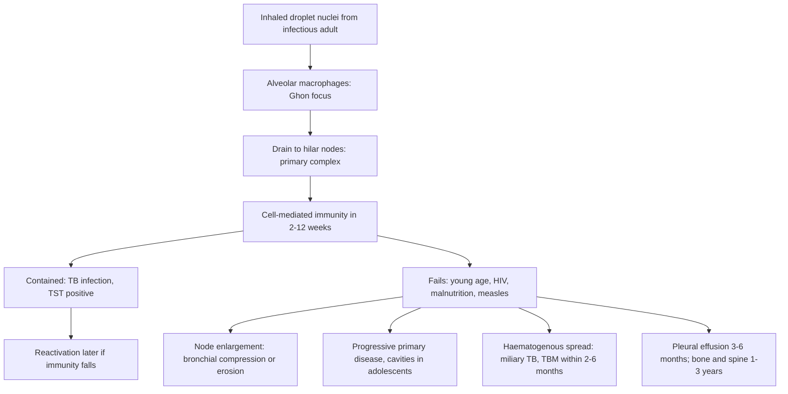

## 1. Definition

**Tuberculosis (TB)** in children is infection and disease caused by *Mycobacterium tuberculosis*, almost always caught from an **adult or adolescent with pulmonary TB in the same household**. Children differ from adults in three ways that shape the whole tutorial:

1. **They progress quickly and severely**: infants and under-fives, HIV-positive and malnourished children are the most likely to develop disease, including **TB meningitis** and **miliary TB**, often within a year of infection.
2. **They are hard to confirm**: they rarely produce sputum and have few bacilli (paucibacillary), so most are **diagnosed clinically**, supported by a contact history, a chest X-ray and Xpert Ultra on **sputum, gastric aspirate or stool**.
3. **They respond well**: with correct weight-band dosing, cure rates are high, and **non-severe TB can now be treated in 4 months** (WHO 2022, SHINE trial, adopted in UCG 2023).

> [!PEARL]
> The one thing never to forget: **every child with TB has an infectious adult somewhere, and every infectious adult has children at home.** Ask about the contact, screen every child in the household, treat the ones with disease, and give **TB preventive therapy** to the rest. This is the single most effective thing a clinician can do about childhood TB.

| Term | Meaning |
|---|---|
| **TB infection** (latent TB infection, LTBI) | Infection with *M. tuberculosis* without symptoms or signs of disease; positive TST or IGRA; **not infectious** |
| **TB disease** | Symptoms, signs or radiological changes caused by *M. tuberculosis* |
| **Presumptive TB** | A child with symptoms or signs suggestive of TB who needs evaluation |
| **Bacteriologically confirmed TB** | *M. tuberculosis* detected (Xpert, culture, smear, LF-LAM) |
| **Clinically diagnosed TB** | Treated on clinical grounds (history, contact, examination, CXR, response) without bacteriological confirmation; most childhood TB |
| **Pulmonary TB (PTB)** | Disease of the lung parenchyma or tracheobronchial tree (UCG: if both pulmonary and extrapulmonary, classify as PTB) |
| **Extrapulmonary TB (EPTB)** | Any other site; isolated intrathoracic lymph node TB or pleural effusion without lung involvement is classed as EPTB (UCG 2023) |
| **Drug-resistant TB** | Rifampicin-resistant (RR), multidrug-resistant (MDR: R + H), pre-XDR (+ fluoroquinolone), XDR (+ bedaquiline or linezolid) |
| **Contact** | Anyone exposed to a person with TB; **household contact** = shared the same enclosed living space for ≥1 night or frequent or extended daytime periods in the 3 months before the index case started treatment |

## 2. Epidemiology

- **Global**: in 2024 an estimated **10.7 million people** fell ill with TB, including **1.2 million children**, and **1.23 million died** (WHO fact sheet, 2026). TB is the world's leading cause of death from a single infectious agent. Children account for about 11% of cases but a larger share of deaths, mostly in under-fives who were **never diagnosed or treated**.
- **Uganda** is on WHO's list of high **TB/HIV** burden countries; about 4 in 10 adults with TB are HIV-positive in some districts [VERIFY: district figure source], and children living with HIV have a much higher risk of TB.
- **Ugandan practice**: TB is diagnosed and treated at HC III and above (DOTS sites); **Xpert MTB/RIF (Ultra)** is available at HC IVs and hospitals and through a **sample transport (hub) network**; stool Xpert (using simple one-step stool processing) is used for children; **TB/HIV is managed in one-stop clinics**; drug-resistant TB is managed at designated **MDR-TB treatment initiation centres** (e.g. Mulago, regional referral hospitals). **Digital adherence technologies** and **treatment supporters (DOT)** are standard (UCG 2023).

> [!UGANDA]
> UCG 2023 adopted the **4-month regimen 2HRE(Z)/2RH for children 2 months to 16 years with non-severe disease** at **general hospital level and above**. At HC III and HC IV, children are usually started on the standard **2RHZE/4RH** regimen. If a child is clearly non-severe and stable, discuss with your senior whether they qualify for the shorter regimen.

## 3. Aetiology and Risk Factors

**Cause**: *Mycobacterium tuberculosis*, spread by **inhalation of droplet nuclei** from an adult or adolescent with pulmonary TB (cough, laughter, singing; poorly ventilated rooms). Young children rarely infect others.

**Who gets TB disease after infection**

| Risk factor | Why it matters |
|---|---|
| **Age <1 year (up to 30–40% progress)** and **<2 years** | Immature cell-mediated immunity; highest risk of TBM and miliary TB. Risk falls in school-age children and rises again in adolescence |
| **Household contact with pulmonary TB** (especially smear- or Xpert-positive) | Strongest predictor of TB in a child |
| **HIV infection** | Blunted CD4 and IFN-γ response: more frequent, disseminated and atypical disease |
| **Severe malnutrition** | Same mechanism; TST often negative |
| **Recent measles** | Transient immune suppression can trigger TB |
| **Diabetes, steroid use** | Impaired immunity |
| **No BCG** | Loses protection against TBM and miliary TB |

**BCG** (UNEPI: at birth) protects young children against **TB meningitis and miliary TB** (about 70–80% protection) but much less against pulmonary TB. Do not give BCG to a child with symptomatic HIV (UCG 2023).

## 4. Pathophysiology

**Natural history after infection**

1. **Inhalation** of droplet nuclei from an adult with pulmonary TB.
2. Bacilli multiply in alveolar macrophages and drain to the **hilar lymph nodes**: the **primary (Ghon) complex** = a small parenchymal focus + enlarged hilar nodes.
3. **Cell-mediated immunity** develops in 2–12 weeks (TST becomes positive). In most children, infection is contained (TB infection).
4. In young or immunocompromised children, containment fails:
   - **Lymph node disease**: enlarging hilar or paratracheal nodes compress bronchi (wheeze, collapse, hyperinflation) or erode into them (endobronchial TB, consolidation).
   - **Progressive primary disease**: caseation and cavitation (more in adolescents, adult-type disease).
   - **Haematogenous spread**: **miliary TB** and **TB meningitis** (within 2–6 months of infection, mainly <2 years), bones and joints (spine: 1–3 years after infection), kidneys.
   - **Pleural effusion** (school-age children; hypersensitivity reaction, 3–6 months after infection).
5. **Timeline (Wallgren)**: most disease appears **within 12 months** of infection; that is why TPT for recent contacts works.

**Why children are paucibacillary and rarely infectious**: most childhood disease is in lymph nodes and small lesions with few bacilli, and young children swallow rather than cough out sputum, so smears are negative and **young children rarely infect others** (adolescents with cavities can). Swallowed bacilli pass into the gut, which is why **gastric aspirate and stool** samples work.

**Why HIV and malnutrition matter**: TB control depends on **CD4 T cells and macrophage activation (IFN-γ)**. HIV and malnutrition blunt this, so disease is more frequent, disseminated and atypical, the **TST is often negative**, and mortality is higher. ART and nutritional rehabilitation are part of TB treatment.

**Why we treat with several drugs for months**

- Bacilli exist in different populations: rapidly dividing (killed by **isoniazid**), slowly or intermittently dividing (killed by **rifampicin**), and in acidic, inflamed sites (killed by **pyrazinamide**). **Ethambutol** protects against resistance when isoniazid resistance or high bacillary load is possible.
- The **intensive phase** (2 months, 3–4 drugs) kills most bacilli and prevents resistance; the **continuation phase** (2–10 months, H + R) sterilises the persisters.
- **Monotherapy** of active disease (e.g. isoniazid alone given as "IPT" to a child with undiagnosed TB) selects resistance: this is why we **exclude active TB before TPT**.

**Why children need higher mg/kg doses than adults**: children metabolise isoniazid and rifampicin faster; the 2010 WHO revision raised paediatric doses (H 10, R 15, Z 35, E 20 mg/kg) to reach adult-equivalent blood levels. Hepatotoxicity remains rare in children at these doses.

**Feature links**

- Chronic cytokine release (TNF-α, IL-1) → persistent fever, night sweats, anorexia → weight loss, poor weight gain, faltering growth, lethargy, reduced play.
- Enlarged hilar or paratracheal nodes compressing a bronchus → monophonic wheeze unresponsive to bronchodilators, lobar collapse, hyperinflation; tracheal compression → stridor.
- Node eroding into a bronchus → endobronchial TB, consolidation, persistent cough.
- Caseation and cavitation in adolescents → productive cough, haemoptysis, smear-positive and infectious disease.
- Caseating peripheral nodes → firm, matted, non-tender neck nodes → fluctuant "cold abscess" → sinuses.
- Haematogenous seeding of the lungs → miliary pattern, hypoxaemia; of liver and spleen → hepatosplenomegaly; of the choroid → choroid tubercles.
- Rich focus rupturing into the subarachnoid space → basal exudate → cranial nerve palsies (VI, III, VII), obstructive hydrocephalus (bulging fontanelle, rising head circumference, sunsetting eyes), vasculitis → infarcts, hemiparesis, convulsions; CSF lymphocytes, high protein, low glucose.
- Hypersensitivity to TB antigen in the pleura → lymphocytic exudative effusion → stony dullness, reduced breath sounds.
- Vertebral body destruction → collapse → gibbus; paravertebral abscess or collapse → cord compression → leg weakness; psoas abscess.
- Pericardial involvement → effusion → muffled heart sounds, raised JVP, pulsus paradoxus, hepatomegaly; later constriction.
- Abdominal nodes and peritoneum → ascites, doughy abdomen, masses.
- Blunted cell-mediated immunity (HIV, SAM) → negative TST, atypical and disseminated disease.

## 5. Classification / Staging

**Severity (WHO 2022)**

| Category | Includes | Treatment |
|---|---|---|
| **Non-severe TB** | **Peripheral lymph node TB**; **intrathoracic lymph node TB without airway obstruction**; **uncomplicated TB pleural effusion**; or **paucibacillary, non-cavitary disease confined to one lobe of the lungs without a miliary pattern** | 4 months (2HRZ(E)/2HR) |
| **Severe TB** | Anything else: miliary TB, TB meningitis, osteoarticular TB, abdominal TB, pericardial TB, cavitary or extensive lung disease, airway compression, complicated effusion; also most clinicians treat **SAM or advanced HIV** with the standard 6-month regimen | 6 months; TBM and bone or joint TB 12 months |

**By site**: pulmonary vs extrapulmonary (definitions in section 1).

**By drug susceptibility**: drug-susceptible; RR, MDR, pre-XDR, XDR (section 1).

**Treatment history categories (UCG 2023)**: **New** (no previous treatment or <1 month), **relapse**, **treatment after failure**, **treatment after loss to follow-up**, **history unknown**. In Uganda the **choice of regimen depends on rifampicin susceptibility (Xpert)**, not on treatment history.

**TB meningitis stage (BMRC)**

| Stage | Criteria |
|---|---|
| **I** | GCS 15, no focal signs |
| **II** | GCS 11–14 or focal signs (e.g. cranial nerve palsy) |
| **III** | GCS ≤10 |

**Treatment outcome definitions (UCG 2023)**

| Outcome | Meaning |
|---|---|
| **Cured** | Bacteriologically confirmed at start; smear or culture negative in the last month and on ≥1 previous occasion |
| **Treatment completed** | Completed without evidence of failure, without the negative results needed for "cured" (most children) |
| **Treatment failed** | Smear or culture positive at month 5 or later |
| **Lost to follow-up** | Did not start or interrupted for ≥2 consecutive months |
| **Died** / **Not evaluated** | – |

## 6. Clinical Features

### History

Each question has a reason.

- **TB contact**: anyone at home or a carer coughing, on TB treatment, or who died of a chest illness in the past 1–2 years? Smear- or Xpert-positive? Drug-resistant? → the strongest predictor of TB in a child; a DR contact changes the regimen and the TPT choice.
- **Symptoms** (any for ≥2 weeks): **cough** not improving, **fever**, **night sweats** → presumptive TB.
- **Weight loss or poor weight gain** (check the Child Health Card growth chart) → presumptive TB; faltering growth is a TB symptom.
- **Reduced playfulness, lethargy, poor feeding** → TB in young children.
- **Site-specific**: neck swellings (lymph node TB); headache, vomiting, irritability, convulsions, drowsiness (TBM → LP); back hump or refusal to walk (spinal TB); abdominal swelling (abdominal TB); joint swelling; breathlessness and leg swelling (pericardial TB).
- **HIV status** of child and mother; on ART? which regimen? cotrimoxazole? → TB/HIV management, drug interactions, LF-LAM.
- **Previous TB treatment or TPT**, adherence and outcome → relapse, resistance.
- **Immunisation**: BCG (scar at right upper arm), measles (recent measles can trigger TB).
- **Nutrition**: weight trend, oedema, feeding → SAM management; slower response.
- **Response to previous antibiotics or antimalarials** → pneumonia or fever not responding is a TB clue.

### Examination

Follow the order of Hutchison's Clinical Methods (24th edition), adapted for children: observe first, listen to the chest while the child is quiet, and leave distressing parts (fundoscopy, ears, throat) to last.

#### Introduction, consent and preparation

- Introduce yourself; confirm identity; explain; consent from the parent and assent from the child; **hand hygiene**.
- If an adolescent or adult carer is coughing: give a mask and examine in a ventilated space.
- **Position and exposure**: on the parent's lap; expose the chest, abdomen and back (spine) in a warm room.

#### General inspection (end of the bed)

| Sign | What it means |
|---|---|
| Lethargic, not playing | Systemic TB; TBM if drowsy or irritable |
| Fast breathing, indrawing | Miliary TB, effusion, extensive disease |
| Wasting, oedema | Malnutrition: TB evaluation and SAM care |
| Abnormal posture, head size, sunsetting eyes | TBM with hydrocephalus |
| Gibbus visible on the back | Spinal TB |

**Vital signs and growth**: temperature, RR, HR, **SpO₂**; **weight, height, Z-scores (WHZ, WAZ, HAZ), MUAC, oedema**, plotted on the growth chart; head circumference in infants.

#### Hands, face and neck

- **Hands**: pallor, clubbing (chronic lung disease, HIV).
- **Face and mouth**: oral thrush and parotid swelling (HIV).
- **Lymph nodes**: cervical (and axillary): **firm, matted, non-tender, may fluctuate as a "cold abscess" or form sinuses**; generalised lymphadenopathy (HIV).
- **BCG scar** on the right upper arm.

#### Respiratory system

- **Inspection**: RR, indrawing, asymmetry.
- **Palpation**: trachea, expansion.
- **Percussion**: **stony dullness** (effusion); dullness (consolidation, collapse).
- **Auscultation**: crackles, bronchial breathing, **monophonic wheeze** (node compression), reduced breath sounds.

#### Completing the examination

- **Abdomen**: hepatosplenomegaly (miliary), ascites, doughy abdomen, masses (abdominal TB).
- **Spine and joints**: **gibbus** (angular deformity), tenderness, swollen joints, sinuses.
- **Heart**: muffled heart sounds, raised JVP, pulsus paradoxus, hepatomegaly (pericardial effusion).
- **Neurology**: consciousness (GCS or AVPU), neck stiffness, bulging fontanelle, **cranial nerve palsies (VI, III, VII)**, hemiparesis.
- **Fundoscopy, last**: papilloedema, choroid tubercles (miliary TB).
- **Thank**, **wash hands**, **summarise**.

| Document these positives | And these negatives |
|---|---|
| Weight, Z-scores, growth trend | "No neck stiffness, no cranial nerve palsy, GCS 15" |
| Lymph nodes (site, size, matted, fluctuant, sinus) | "No gibbus; no joint swelling" |
| Chest signs; SpO₂ | "No hepatosplenomegaly or ascites" |
| BCG scar present or absent | "Heart sounds normal; no raised JVP" |

### Red flags

> [!REDFLAG]
> **TB meningitis until proven otherwise**: a child (often <5 y) with **fever and irritability or lethargy for more than a week**, vomiting, headache, **cranial nerve palsy**, convulsions, reduced consciousness, especially with a TB contact. Do an LP, start treatment (anti-TB + steroids) urgently: outcome depends on the stage at which treatment starts.

> [!REDFLAG]
> **Other emergencies**: **airway compression** by nodes (stridor, severe wheeze, lobar collapse); **miliary TB** with hypoxaemia; **pericardial tamponade**; **spinal TB with leg weakness** (cord compression); **severe malnutrition** with TB; **drug-induced hepatitis** (jaundice, vomiting, abdominal pain on treatment).

### Thinking like a clinician

- **"Persistent, unremitting, not improving"** is the TB pattern: symptoms for >2 weeks that do not settle with antibiotics or antimalarials.
- **Contact + symptoms = treat** in a young child, even with a negative Xpert, if the picture fits (or use the treatment decision algorithm).
- **Faltering growth is a TB symptom.** A child in the nutrition unit who is not gaining weight on RUTF needs TB evaluation.
- **TB and HIV travel together.** Test every child with TB for HIV, and screen every child with HIV for TB at every visit.
- **Wheeze that does not respond to bronchodilators in an infant with a TB contact** = node compression until proven otherwise.
- **A negative TST does not exclude TB** (malnutrition, HIV, miliary TB, TBM, early infection); a positive one shows infection, not disease.
- **Lymphocytic exudate pleural effusion in a school-age child** = TB until proven otherwise.
- **Adolescents can have adult-type cavitary disease** and are infectious: isolate and test sputum.
- **Before starting TPT, always exclude active disease** with a symptom screen; giving TPT to a child with TB creates resistance.
- **Common student mistakes**: waiting for sputum from a toddler; keeping the same dose for 6 months as the child gains weight; forgetting to screen the siblings; giving 4 months to TBM.

## 7. Differential Diagnoses

| Differential | Distinguishing clinical feature | Distinguishing investigation |
|---|---|---|
| **Recurrent or unresolved bacterial pneumonia** | Acute onset, fever, responds to antibiotics | CXR, response to treatment |
| **HIV-related lung disease** (LIP, bronchiectasis, PCP) | HIV-positive, clubbing, parotid swelling (LIP), severe hypoxaemia (PCP) | HIV test, CXR pattern |
| **Asthma** | Recurrent wheeze, responds to bronchodilator, atopy | Bronchodilator trial |
| **Foreign body** | Sudden onset, unilateral signs | CXR, bronchoscopy |
| **Pertussis** | Paroxysms, whoop, apnoea | Clinical |
| **Malnutrition from food insecurity** | Improves with feeding, no contact or fever | Response to nutritional rehabilitation |
| **Malignancy** (lymphoma, Kaposi sarcoma in HIV, leukaemia) | Rapid node growth, hard nodes, cytopenias | FNA or biopsy, FBC |
| **Lymphadenitis (bacterial, BCG adenitis, non-tuberculous mycobacteria)** | Acute tender node; BCG adenitis in the axilla on the side of the BCG (right axilla after right-arm BCG) | FNA |
| **Bacterial or cryptococcal meningitis** (vs TBM) | Acute onset (bacterial); HIV with headache (cryptococcal) | CSF Gram stain, CrAg |
| **Heart failure, rheumatic carditis** (vs pericarditis) | Murmur, rheumatic history | Echo |

## 8. Clinical Workup

**Confirm when you can, treat when you must.** "Available at" is the lowest level that usually offers the test [VERIFY: compiled from the source notes, not an MoH list].

### Bedside

| Test | Why / how | Expected finding | How it changes management | Available at |
|---|---|---|---|---|
| **Weight and growth chart** | Every visit | Weight loss or flat curve = TB symptom | Dose by weight band; response to treatment | All levels |
| **SpO₂** | Pulse oximeter | Hypoxaemia: miliary TB, severe disease | Oxygen; admission | HC IV and above |
| **HIV rapid test** (DNA PCR <18 months) | All children with presumptive TB | Positive | LF-LAM, ART, cotrimoxazole | Rapid test all levels; PCR via hub |
| **Tuberculin skin test (TST)** | 0.1 mL (5 TU) PPD intradermally on the forearm; read at **48–72 h** (transverse induration) | **≥10 mm** positive; **≥5 mm** in HIV-positive or severely malnourished children | Shows infection, not disease; supports a clinical diagnosis; **not required** before TPT in <5 y or HIV | Variable; PPD supply often limited [VERIFY] |
| **Urine LF-LAM** | Urine strip, 25 min; HIV-positive children with TB signs or symptoms who are seriously ill or have advanced HIV, or inpatients | Positive | Treat TB | HIV clinics |
| **Sample collection** | Expectorated (older), **induced sputum** (hypertonic saline nebulisation + suction), **gastric aspirate** (early morning, fasting, NG tube), **nasopharyngeal aspirate** | – | Samples for Xpert and culture | HC IV and hospitals |
| **Stool for Xpert** | Fresh stool in a container; easy sample in young children (WHO 2022) | – | Xpert | Collected at any level; tested via hub |

**How to collect a gastric aspirate**: fasting overnight (or ≥4 h in infants), early morning before the child gets up, NG tube, aspirate 5–10 mL (or instil 10 mL sterile water and aspirate), send promptly (neutralise if delayed).

### Basic lab

| Test | When | Expected / abnormal finding | How it changes management | Available at |
|---|---|---|---|---|
| **Xpert MTB/RIF Ultra** | Every child with presumptive TB: sputum (expectorated or induced), **gastric aspirate, NPA, stool**; CSF, node aspirate, pleural fluid for EPTB | MTB detected (including "trace", which counts as positive in children); **rifampicin resistance** detected or not | Positive → treat; **RR** → refer to MDR-TB centre. **Negative does not exclude TB** (Ultra sensitivity in children about 60–70% against culture) | HC IV and hospitals, or via hub transport |
| **LFTs** | Baseline if liver disease, HIV, or jaundice on treatment | ALT >3× ULN with symptoms or >5× without | Stop hepatotoxic drugs; reintroduce sequentially | General hospital and above [VERIFY] |
| **CD4, viral load** | HIV-positive | Advanced HIV | ART timing, prophylaxis | Via hub |

### Imaging

| Test | When | Expected finding | How it changes management | Available at |
|---|---|---|---|---|
| **Chest X-ray** (AP + lateral if possible) | Presumptive PTB, contacts with symptoms, HIV | **Hilar or paratracheal lymphadenopathy**, consolidation, collapse, **miliary pattern**, cavities (adolescents), **pleural effusion** | Supports diagnosis; classifies severe vs non-severe | HC IV (some) and hospitals |
| **Abdominal ultrasound** | Abdominal TB, HIV | Enlarged abdominal nodes, ascites, splenic micro-abscesses | Supports EPTB | Hospitals |
| **Spine X-ray / MRI** | Back pain, gibbus | Vertebral collapse, disc space loss, paravertebral abscess | Spinal TB (12 months); neurosurgery if cord compression | X-ray at hospitals; MRI at NRH and private |
| **Echocardiography** | Suspected pericardial TB | Pericardial effusion | Pericardiocentesis; steroids | RRH, NRH |
| **CT head** | TBM | Hydrocephalus, basal enhancement, infarcts | VP shunt | NRH, CURE Mbale, private |

### Specialised / referral-level

| Test | When | Expected finding | How it changes management | Available at |
|---|---|---|---|---|
| **Lumbar puncture** | Suspected TBM | **Clear CSF, lymphocytes 50–500/µL, protein high (>1 g/L), glucose low** (CSF:blood <0.5), Xpert Ultra on CSF; CrAg if HIV | TBM regimen + steroids | Hospitals |
| **Fine-needle aspirate of a node** | Lymphadenopathy >2 cm, persistent | Caseation, AFB, Xpert positive | Diagnosis of node TB | Hospitals |
| **Pleural tap** | Effusion | Straw-coloured lymphocytic exudate, protein >30 g/L; Xpert (low yield) | TB effusion vs empyema | Hospitals |
| **IGRA** | Contact without symptoms; supportive in diagnosis | Positive = infection | Supports decision to treat | Private and research laboratories [VERIFY] |
| **Culture and DST** (liquid culture, line probe assay, Xpert XDR) | RR-TB, failure, contacts of DR-TB | Resistance pattern | Second-line regimen | National reference laboratory (CPHL/NTRL) |

### Putting it together

**Model one-line summary**

> "A 3-year-old boy weighing 11 kg (WAZ −2.4, WHZ −1.8, HAZ −1.5), HIV-negative, BCG scar present, whose grandmother started treatment for Xpert-positive pulmonary TB a month ago, with 5 weeks of cough, intermittent fever, night sweats and weight loss despite amoxicillin, with right hilar lymphadenopathy on CXR and stool Xpert Ultra 'MTB detected, rifampicin resistance not detected': **bacteriologically confirmed pulmonary TB (intrathoracic lymph node disease without airway obstruction)**."

**Problem list**

1. Pulmonary TB, drug-susceptible, likely non-severe.
2. Moderate underweight (WAZ −2.4) and borderline wasting.
3. Household TB exposure: other children need screening and TPT.

**Working diagnosis**: *drug-susceptible, bacteriologically confirmed, non-severe pulmonary TB in an HIV-negative child with undernutrition.*

**Model case presentation (ward round)**

> "Kato is a 3-year-old boy from Kisenyi weighing 11 kg (WAZ −2.4, WHZ −1.8, HAZ −1.5; MUAC 12.8 cm, no oedema), fully immunised per UNEPI with a BCG scar, HIV-negative (rapid test today), on family diet. He has had a cough for 5 weeks, intermittent fevers and night sweats, and has lost 1 kg on his growth chart despite a course of amoxicillin. His grandmother, who sleeps in the same room, started treatment for Xpert-positive pulmonary TB a month ago; two siblings aged 18 months and 6 years live with them. On examination: T 37.9 °C, RR 32, SpO₂ 96%, small right cervical nodes, few crackles at the right upper zone, no hepatosplenomegaly, no neck stiffness, no gibbus. CXR: right hilar lymphadenopathy with a small right upper-lobe opacity, no cavity, no airway compression. Stool Xpert Ultra: MTB detected, rifampicin resistance not detected. Assessment: **bacteriologically confirmed, drug-susceptible, non-severe pulmonary TB with moderate underweight**. Plan: register and start **2HRZE/2HR** (4-month regimen) with RHZ 75/50/150 × 2 + E 100 mg × 2 daily, then RH × 2, pyridoxine; treatment supporter (mother); nutritional support; screen both siblings and give **3HR** to the 18-month-old and **3HP** to the 6-year-old if symptom-free; monthly weight and band review."

> [!EXAM]
> **Worked example 1: dosing by weight band.** An 11 kg child is in the **8–11.9 kg band** → **2 tablets of RHZ 75/50/150** (= R 150 mg, H 100 mg, Z 300 mg, i.e. R 13.6, H 9.1, Z 27 mg/kg) plus **ethambutol 100 mg × 2** (18 mg/kg) daily in the intensive phase, then **RH 75/50 × 2** daily. Dispersible: dissolve in a small amount of water and give at once. If the child reaches **12 kg** next month, move to **3 tablets**. (The pyrazinamide is just under 30 mg/kg at the top of the band; that is accepted within the band design.)

> [!EXAM]
> **Worked example 2: reading a CSF.** A 2-year-old with 10 days of fever, irritability, vomiting and a left VI nerve palsy. CSF: clear, WBC 220/µL (85% lymphocytes), protein 2.1 g/L, glucose 1.2 mmol/L (blood 5.0; ratio 0.24), Gram stain negative, Xpert Ultra on CSF "trace". **Interpretation**: lymphocytic meningitis with very high protein and very low glucose plus a cranial nerve palsy and subacute course = **TB meningitis, BMRC stage II**. Start **2RHZE/10RH** (or 6HRZ-Eto) plus **prednisolone 2 mg/kg/day**, check for hydrocephalus (CT if available), test for HIV, and screen the household.

#### Treatment decision scores (when bacteriology is negative or unavailable)

**WHO 2022 treatment decision algorithms (TDAs)** for children <10 years with presumptive pulmonary TB, used at facilities with or without CXR: the clinician scores symptoms (cough, fever, lethargy, weight loss, haemoptysis, night sweats), signs (lymph nodes, tachycardia, tachypnoea) and, where available, CXR features; **a total score >10 means treat for TB**. They are recommended for young children who cannot be confirmed, and they increase diagnosis without many false positives.

**Keith Edwards score** (older, still taught in Ugandan and East African units): a total of **≥7 suggests TB and justifies treatment**.

| Feature | 0 | 1 | 2 | 3 | 4 |
|---|---|---|---|---|---|
| Duration of illness | <2 weeks | 2–4 weeks | | >4 weeks | |
| Nutrition (weight-for-age) | >80% | 60–80% | | <60% | |
| Family history of TB | None | | Reported by family | Proven (sputum-positive) | |
| Positive tuberculin test | | | | Yes | |
| Malnutrition not improving after 4 weeks of treatment | | | | Yes | |
| Unexplained fever and night sweats not responding to malaria treatment | | | Yes | | |
| Pneumonia or chest disease not responding to antibiotics | | | Yes | | |
| Lymph nodes (neck, axilla), abdominal mass or ascites | | | | Yes | |
| CNS signs with abnormal CSF | | | | Yes | |
| Angle deformity of the spine | | | | | Yes |
| Joint or bone swelling or sinuses | | | | Yes | |

## 9. Management

### Immediate / emergency

Most children with TB are not acutely unstable, but some are:

1. **ETAT triage**: respiratory distress (miliary TB, effusion, airway compression), shock (sepsis, tamponade), **coma or convulsions (TBM)**, severe malnutrition.
2. **Oxygen** for SpO₂ <90%; position; check glucose.
3. **Convulsions**: diazepam 0.5 mg/kg rectally or 0.2–0.3 mg/kg IV.
4. **Altered consciousness with fever**: treat as meningitis (ceftriaxone ± antimalarial) while you plan an LP; if the picture is subacute, add anti-TB treatment and steroids early.
5. **Infection control**: if an adolescent or adult carer is coughing, give masks, ventilate, separate (cough triage).
6. **Weigh** the child: every TB drug dose depends on the weight band.

**ABCDE**: **A** stridor from node compression → senior, steroids; **B** oxygen, effusion → tap; **C** muffled heart sounds and raised JVP → tamponade → pericardiocentesis; **D** GCS, glucose, convulsions, signs of raised ICP or hydrocephalus; **E** temperature, nodes, spine, weight.

### Definitive

**Principles**

1. **Confirm when you can, treat when you must**: collect the best sample (sputum, gastric aspirate, stool) for Xpert, but **do not delay treatment** in a sick child with a convincing picture.
2. **Classify**: site (PTB, EPTB), severity (non-severe, severe), drug susceptibility (Xpert), HIV status, nutrition.
3. **Choose the regimen** and **dose by weight band** using dispersible paediatric FDCs.
4. **Directly observed or supported treatment** (treatment supporter, digital adherence technologies), with a **TB treatment card** and register entry at the DOTS clinic.
5. **Treat HIV and malnutrition** alongside TB.
6. **Trace the source and screen all contacts**; give **TPT** to eligible contacts.
7. **Notify** (the TB register is the notification).

#### Paediatric dispersible FDC weight bands (WHO; Uganda NTLP)

| Weight band | Intensive phase: **RHZ 75/50/150** | + **Ethambutol 100 mg** | Continuation: **RH 75/50** |
|---|---|---|---|
| **4–7.9 kg** | **1** tablet | 1 tablet | **1** tablet |
| **8–11.9 kg** | **2** | 2 | **2** |
| **12–15.9 kg** | **3** | 3 | **3** |
| **16–24.9 kg** | **4** | 4 | **4** |
| **≥25 kg** | Use **adult FDCs** (RHZE 150/75/400/275; RH 150/75) by adult weight bands | | |

Children **<4 kg** (young infants): mg/kg dosing with specialist input. **Re-weigh monthly** and move bands as weight rises.

#### Regimens for drug-susceptible TB

| Type of TB | Regimen | Duration | Where (Uganda) |
|---|---|---|---|
| **Non-severe TB**, children **3 months–16 years** (WHO 2022; UCG 2023: 2 months–16 years) | **2HRZ(E) / 2HR** (E added in high-HIV or high isoniazid-resistance settings, i.e. Uganda) | **4 months** | General hospital and above (UCG) |
| **All other forms of PTB and EPTB** (except TBM, bone or joint) | **2RHZE / 4RH** | **6 months** | HC III and above |
| **TB meningitis** and **osteoarticular (bone or joint) TB** | **2RHZE / 10RH** | **12 months** | HC IV and above |
| **TBM alternative** (WHO 2022, children and adolescents with bacteriologically confirmed or clinically diagnosed DS-TBM) | **6HRZ-Eto** (high-dose H and R, Z, ethionamide daily) | **6 months** | Specialist centres; not yet standard in UCG 2023 |
| **Adolescents ≥12 y, >40 kg** (WHO; UCG for adults) | 2HPMZ/2HPM (rifapentine-moxifloxacin) | 4 months | Specialist; HIV-positive only if CD4 >100 |

> [!UGANDA]
> **Which children qualify for 4 months?** Only clearly **non-severe** disease (section 5) with no TBM, miliary, osteoarticular, abdominal, pericardial or extensive or cavitary disease, and no airway compression. In practice many Ugandan clinicians **also give 6 months** to children with **severe acute malnutrition** or **advanced HIV**, because these groups were few in the SHINE trial. Check with your senior and the NTLP chart. Note the age range: WHO 2022 says 3 months–16 years; UCG 2023 says 2 months–16 years.

#### Adjunctive treatment

- **Corticosteroids**: **TB meningitis** (prednisolone **2 mg/kg/day, max 60 mg**, for **4 weeks**, then taper over 2 weeks; UCG 2023: 1–2 mg/kg, max 60 mg; dexamethasone IV if unable to swallow), **TB pericarditis**, and **airway compression** by nodes.
- **Pyridoxine** with isoniazid.
- **Nutritional support**: RUTF, F-75 or F-100 per the WHO 2023 wasting/SAM guideline if malnourished; food support.
- **Analgesia, antipyretics**, physiotherapy (spinal TB).
- **Surgery**: drainage of cold abscesses, spinal decompression for cord compression, ventriculoperitoneal shunt for hydrocephalus in TBM (NRH, CURE Mbale).

#### TB meningitis: step by step

1. **Suspect early** (subacute fever, irritability, vomiting, headache, cranial nerve palsy, convulsions, reduced consciousness).
2. **LP** (if no signs of raised ICP or focal deficit that make it unsafe; otherwise treat empirically): cell count, protein, glucose (with blood glucose), Gram stain, **Xpert Ultra**, CrAg (if HIV).
3. **Stage** (BMRC, section 5).
4. **Start anti-TB treatment immediately**: 2RHZE/10RH (or 6HRZ-Eto) + **prednisolone 2 mg/kg/day** (max 60 mg) × 4 weeks then taper over 2 weeks.
5. **Supportive**: airway, nutrition (NG), seizure control, head positioning, monitor for **hydrocephalus** (bulging fontanelle, increasing head circumference, sunsetting eyes), hyponatraemia.
6. **HIV-positive**: start ART **4–8 weeks** after TB treatment (to reduce IRIS-related deaths).

#### TB and HIV co-infection

| Issue | What to do (Uganda consolidated HIV guidelines; UCG 2023; WHO) |
|---|---|
| **HIV testing** | Every child with presumptive or confirmed TB |
| **Timing of ART** | Start **TB treatment first**, then **ART within 2 weeks** (as soon as tolerated); **TBM: delay ART 4–8 weeks** |
| **Already on ART** | Continue ART; adjust for rifampicin interactions |
| **Dolutegravir (DTG)** | With rifampicin, give **DTG twice daily** (both pDTG 10 mg dispersible and DTG 50 mg), continue twice daily for **2 weeks after rifampicin stops** |
| **Lopinavir/ritonavir** | **Super-boost** with extra ritonavir (LPV:RTV 1:1) or switch to a DTG-based regimen; or use rifabutin (specialist) |
| **Efavirenz** (older regimens in UCG tables) | Can continue at standard dose with rifampicin (≥3 y) |
| **Nevirapine** | Avoid with rifampicin (switch) |
| **Cotrimoxazole prophylaxis** | All HIV/TB co-infected children |
| **IRIS** | Worsening fever, nodes or chest signs after starting ART: continue both; prednisolone for moderate–severe paradoxical IRIS (specialist) |

> [!UGANDA]
> The **TB/HIV ART table in UCG 2023** still shows **EFV- and NVP-based** regimens for children and triple-NRTI options for under-3s; Uganda's current **consolidated HIV guidelines** use **DTG-based ART** for children ≥4 weeks and ≥3 kg (pDTG 10 mg dispersible; DTG 50 mg ≥20 kg). On today's wards, the practical rule is: **child on DTG + rifampicin → DTG twice daily**. Check the child's ART regimen against the current HIV guideline, not only the UCG table.

#### Drug-resistant TB (overview)

- Suspect if: contact of DR-TB, Xpert rifampicin resistance, failure on first-line, relapse.
- **Refer to an MDR-TB treatment initiation centre**; culture and DST.
- WHO 2022 recommends **all-oral regimens** for children of all ages, including **bedaquiline and delamanid**; the 6-month **BPaLM** regimen is for **≥14 years**; children receive 9-month or longer individualised regimens.

#### Contact screening and TB preventive therapy (TPT)

**Who to screen**: every household and close contact of a person with TB, especially **children <5 years** and **HIV-positive** people.

**Algorithm** (UCG 2023, WHO 2024):

1. **Symptom screen** the child: **cough, fever, poor weight gain** (and lethargy, night sweats).
2. **Any symptom** → evaluate for TB disease (CXR, Xpert, clinical assessment).
3. **No symptoms** → TB disease unlikely → check contraindications (active hepatitis, alcohol use in adolescents, peripheral neuropathy) → **give TPT**. TST or IGRA is **not required** before TPT in children <5 years or people with HIV.
4. **HIV-positive children <1 year** receive TPT **only if they have a TB contact** (UCG 2023); HIV-positive children ≥1 year receive TPT as part of HIV care once TB is excluded.

**TPT regimens**

| Regimen | Who | Dosing |
|---|---|---|
| **3HP** (isoniazid + rifapentine **once weekly for 12 weeks**) | **≥2 years** (Uganda's preferred option for most) | Child FDC **HP 300/300**: **10–15.9 kg 1 tab; 16–23.9 kg 1.5; 24–30.9 kg 2; 31–34.9 kg 2.5; ≥35 kg 3** (UCG chart); or single drugs H 100 mg + P 150 mg tablets per NTLP chart. Pyridoxine weekly or daily |
| **3HR** (isoniazid + rifampicin **daily for 3 months**) | **Any age** (good for <2 y) | **RH 75/50 dispersible**: 4–7.9 kg 1 tab; 8–11.9 kg 2; 12–15.9 kg 3; 16–24.9 kg 4; ≥25 kg adult RH |
| **6H** (isoniazid **daily for 6 months**) | Any age; HIV-positive (also pregnant women) | **Isoniazid 10 mg/kg (7–15), max 300 mg** + pyridoxine |
| **1HP** (daily isoniazid + rifapentine for 28 days) | **≥13 years** | H 300 mg + P 600 mg daily |
| **6Lfx** (levofloxacin daily for 6 months) | Contacts of **MDR/RR-TB** (WHO 2024) | ≈15–20 mg/kg/day by weight band (specialist) |

> [!UGANDA]
> **UCG 2023 says "do not use TPT in contacts of MDR-TB"**; **WHO 2024** now recommends **6 months of levofloxacin** for household contacts of MDR/RR-TB after excluding disease. In Uganda, such children should be **referred to (or discussed with) the MDR-TB centre**, screened and followed up for 2 years, and given levofloxacin where the programme provides it.

**Interactions**: rifapentine and rifampicin-based TPT interact with ART (PIs, NVP); **3HP can be given with DTG** at the standard once-daily dose (WHO); with LPV/r use 6H.

**TPT follow-up**: monthly (or at each dose pick-up) for adherence, side effects and new TB symptoms; record completion.

### Drug table

| Drug | Dose (per kg + max for children; adult) | Route | Frequency | Duration | Key cautions |
|---|---|---|---|---|---|
| **Isoniazid (H)** | **10 mg/kg (7–15)**, max 300 mg | Oral (in FDC) | Once daily | Whole regimen; 6 months as 6H TPT | Hepatitis, **peripheral neuropathy** (give **pyridoxine**), rash |
| **Rifampicin (R)** | **15 mg/kg (10–20)**, max 600 mg | Oral (in FDC) | Once daily | Whole regimen; 3 months as 3HR | **Orange urine and tears**, hepatitis, flu-like symptoms, thrombocytopenia; **enzyme inducer** (ART, contraceptives, anticonvulsants, warfarin) |
| **Pyrazinamide (Z)** | **35 mg/kg (30–40)**, max 2,000 mg | Oral (in FDC) | Once daily | Intensive phase (2 months; 6 months in 6HRZ-Eto) | Hepatitis, arthralgia, raised urate |
| **Ethambutol (E)** | **20 mg/kg (15–25)**, max 1,200 mg | Oral (100 mg dispersible) | Once daily | Intensive phase | **Optic neuritis** (rare in children at this dose; safe in young children who cannot report vision) |
| **Pyridoxine (vitamin B6)** | UCG 2023: **25 mg daily** with isoniazid (many units give 12.5 mg in infants) | Oral | Once daily | With isoniazid | Prevents neuropathy, especially in HIV, malnutrition, breastfed infants |
| **Ethionamide (Eto)** (TBM 6-month regimen) | 17.5–22.5 mg/kg, max 750 mg | Oral | Once daily | 6 months | GI upset, hypothyroidism |
| **Rifapentine (P)** (3HP, 1HP) | By weight band (3HP FDC HP 300/300 table above); 1HP: P 600 mg daily | Oral | Weekly (3HP); daily (1HP) | 12 weeks (3HP); 28 days (1HP) | ≥2 y (3HP), ≥13 y (1HP); interacts with PIs and NVP; fine with DTG |
| **Levofloxacin** (MDR-TB contacts) | ≈15–20 mg/kg/day by weight band | Oral | Once daily | 6 months | Specialist; not in UCG 2023 |
| **Prednisolone** (TBM, pericarditis, airway compression, IRIS) | **2 mg/kg/day, max 60 mg** (UCG 2023: 1–2 mg/kg) | Oral | Once daily | **4 weeks, then taper over 2 weeks** | Dexamethasone IV if unable to swallow |
| **Diazepam** (convulsions) | 0.5 mg/kg rectally or 0.2–0.3 mg/kg IV | PR/IV | Once, repeat if needed [VERIFY] | – | Respiratory depression |
| **Cotrimoxazole prophylaxis** (TB/HIV) | Per HIV guideline [VERIFY: weight-band dose] | Oral | Once daily | Ongoing | Rash |

Adult doses: adult FDCs (RHZE 150/75/400/275; RH 150/75) by adult weight bands from 25 kg [VERIFY: adult band table against UCG 2023].

### Referral criteria

| Level | What to do | Refer up when |
|---|---|---|
| **VHT / community** | Identify coughing adults and symptomatic child contacts; adherence support | Any child with TB symptoms or a contact → HC III |
| **HC III** (DOTS site) | Symptom screen, collect sputum or stool for hub transport, HIV test, start **2RHZE/4RH**, TPT for contacts, monthly weights | Severe TB, TBM suspicion, sick or malnourished child, diagnostic doubt, RR on Xpert → HC IV or hospital |
| **HC IV** | Xpert, CXR at some, gastric aspirate; 6- and 12-month regimens | TBM, miliary or complicated disease, airway compression, hepatotoxicity, non-response, MDR → hospital or RRH |
| **General Hospital** | **4-month regimen** for non-severe TB (UCG), LP, inpatient care | Surgery, pericardiocentesis, hydrocephalus, MDR → RRH or MDR centre |
| **RRH / MDR-TB treatment initiation centre** | DR-TB treatment, culture and DST via CPHL/NTRL, echocardiography | Neurosurgery (VP shunt), spinal decompression → NRH or CURE Mbale |
| **NRH (Mulago)** | Neurosurgery, MRI, PICU | n/a |

Level split derived from UCG 2023 and the source notes [VERIFY].

### Monitoring and follow-up

| When | What |
|---|---|
| **Every visit (at least monthly)** | **Weight (adjust band)**, symptoms, adherence (treatment card, supporter), side effects (jaundice, vomiting, rash, numbness, vision), growth |
| **End of month 2** (bacteriologically confirmed PTB who can give sputum) | Smear or Xpert: positive → Xpert for rifampicin resistance, continue continuation phase, review adherence (UCG) |
| **Month 5 and 6** | Smear: positive at month 5 or later = **treatment failure** → Xpert or DST, refer |
| **Hepatotoxicity** | Jaundice, vomiting, abdominal pain, hepatomegaly → **stop H, R, Z**, check LFTs; reintroduce one by one once LFTs are normal (specialist) |
| **Interruptions** | Trace; manage per NTLP (resume or restart depending on duration and phase) |
| **Outcome** | Record cured, completed, failed, LTFU, died or not evaluated for every child |

**Expect** weight gain and fewer symptoms within 1–2 months. **Not improving**: check dose (band), adherence, HIV, malnutrition, wrong diagnosis, **drug resistance** (source case DR-TB? Xpert), IRIS.

## 10. Complications

**Disease-related**

| Complication | Notes |
|---|---|
| **TB meningitis sequelae** | Hydrocephalus, blindness, deafness, cerebral palsy, epilepsy, intellectual disability, death |
| **Airway compression** | Lobar collapse, bronchiectasis, obstructive emphysema |
| **Miliary TB** | Respiratory failure, meningitis, death |
| **Spinal TB (Pott's)** | Gibbus, paraplegia (cord compression), cold abscess (psoas) |
| **Pericardial TB** | Tamponade, constrictive pericarditis |
| **Post-TB lung disease** | Bronchiectasis, fibrosis, chronic cough, reduced lung function (UCG 2023 post-TB management) |
| **Growth faltering, school loss, family poverty** | Social support, school letters |

**Treatment-related**

| Complication | Notes |
|---|---|
| **Drug toxicity** | Hepatitis (stop drugs, LFTs), neuropathy (pyridoxine), optic neuritis (ethambutol), rash, SJS |
| **IRIS** in HIV | Paradoxical worsening after ART |
| **Drug resistance** | Poor adherence, under-dosing, monotherapy (TPT given to a child with undiagnosed TB) |
| **Drug interactions** | Rifampicin lowers DTG, LPV/r, NVP and other drug levels |

## 11. Prognosis

- With correct weight-band dosing, **cure rates are high**; expect weight gain and fewer symptoms within 1–2 months.
- **Non-severe TB**: the SHINE trial (NEJM 2022; 1,204 children in Uganda, Zambia, South Africa and India) found 4 months non-inferior to 6 months (unfavourable outcome 3% in both arms).
- **TB meningitis**: prognosis depends on the stage at the start of treatment: **stage I usually recovers fully; stage III often leaves disability or dies**.
- **Deaths** are mostly in under-fives who were **never diagnosed or treated**.
- HIV and malnutrition raise mortality.

## 12. Prevention

- **BCG at birth** (UNEPI; not for symptomatic HIV-positive infants).
- **Find and treat adults** with TB early (cough triage, Xpert).
- **TPT for contacts and people with HIV** (section 9).
- **Infection control**: ventilation, cough etiquette, masks for coughing adults and adolescents, separating infectious adolescents on the ward.
- **ART and nutrition** reduce TB risk in HIV and malnutrition.
- **Neonate born to a mother with infectious TB**: if the baby is well, give **TPT (isoniazid 6 months or 3HR)**, then BCG after TPT (or per national guidance); continue breastfeeding; mother treated and wears a mask until non-infectious.

## 13. Special Populations

- **Infants and children <2 years**: highest risk of TBM and miliary TB; use 3HR or 6H for TPT (3HP only from 2 years); **<4 kg**: mg/kg dosing with specialist input.
- **Neonate of a mother with infectious TB**: TPT, then BCG; continue breastfeeding.
- **HIV-positive children**: TB first then ART within 2 weeks (TBM 4–8 weeks); DTG twice daily with rifampicin; cotrimoxazole; LF-LAM; TST ≥5 mm; TPT under 1 year only with a contact; IRIS.
- **Severe acute malnutrition**: TST ≥5 mm; many clinicians give 6 months rather than 4; nutritional rehabilitation; slower response.
- **Adolescents**: adult-type cavitary disease and infectious; isolate; ≥25 kg adult FDCs; 1HP from 13 years; 2HPMZ/2HPM if ≥12 y and >40 kg; BPaLM for DR-TB from 14 years; ask about alcohol before TPT.
- **Contacts of MDR-TB**: UCG 2023 no TPT vs WHO 2024 levofloxacin; refer to the MDR-TB centre; follow for 2 years.

## 14. Key Points

### High-yield points

- Every child with TB has an infectious adult somewhere: trace the source, screen the household.
- Suspect TB: cough or fever >2 weeks, poor weight gain, lethargy, contact.
- Samples: induced sputum, gastric aspirate, NPA or **stool** for Xpert Ultra; **negative Xpert does not exclude TB**.
- Doses **10-15-35-20**; dispersible FDCs by weight band; re-weigh monthly.
- 4 months for non-severe, 6 months standard, 12 months for TBM and bone TB.
- TBM: prednisolone 2 mg/kg/day (max 60 mg) for 4 weeks, then taper.
- TB/HIV: ART within 2 weeks (TBM 4–8 weeks); DTG twice daily with rifampicin.
- TPT only after excluding active disease: 3HP (≥2 y), 3HR (any age), 6H, 1HP (≥13 y).
- Faltering growth is a TB symptom.
- Test every child with TB for HIV, and screen every child with HIV for TB.

### Numbers & doses

| Item | Value |
|---|---|
| Suspect TB | Cough or fever **>2 weeks**, poor weight gain **1 month**, contact |
| Isoniazid | **10 mg/kg** (7–15), max 300 mg |
| Rifampicin | **15 mg/kg** (10–20), max 600 mg |
| Pyrazinamide | **35 mg/kg** (30–40) |
| Ethambutol | **20 mg/kg** (15–25) |
| Pyridoxine | **25 mg daily** (UCG) |
| FDC bands (RHZ 75/50/150; RH 75/50) | **4–7.9 kg: 1; 8–11.9: 2; 12–15.9: 3; 16–24.9: 4; ≥25: adult** |
| Non-severe TB | **2HRZ(E)/2HR = 4 months** (3 months–16 years) |
| Standard | **2RHZE/4RH = 6 months** |
| TBM and bone or joint TB | **2RHZE/10RH = 12 months** (WHO alternative for TBM: 6HRZ-Eto) |
| TBM steroid | Prednisolone **2 mg/kg/day (max 60 mg) × 4 weeks + 2-week taper** |
| TST positive | **≥10 mm**; **≥5 mm** HIV or SAM |
| WHO TDA | Score **>10** → treat |
| Keith Edwards | Score **≥7** → treat |
| ART timing | Within **2 weeks**; TBM **4–8 weeks** |
| DTG with rifampicin | **Twice daily**, until **2 weeks after** rifampicin stops |
| 3HP | Weekly × **12 doses**, **≥2 years** |
| 3HR | Daily × **3 months**, any age |
| 6H | **10 mg/kg** daily × **6 months** |
| Treatment failure | Positive smear or culture at **month 5** or later |
| Lost to follow-up | Interruption **≥2 consecutive months** |
| Progression risk | Infants <1 y: up to **30–40%** |
| Most disease appears | Within **12 months** of infection |

### Exam traps

- **"No sputum, so no TB."** Use gastric aspirate, induced sputum, NPA or **stool**; diagnose clinically if needed.
- **"Xpert negative excludes TB."** It doesn't in children.
- **"TST negative excludes TB."** False negatives in HIV, SAM, TBM, miliary TB.
- **"Give isoniazid to every contact."** Only after **excluding active TB** with a symptom screen; isoniazid alone for active TB breeds resistance.
- **"Children need adult mg/kg doses."** They need **higher** mg/kg doses (H 10, R 15).
- **"Keep the same dose for 6 months."** Re-weigh monthly; move up the band.
- **"Start ART on the same day as TBM treatment."** Delay **4–8 weeks** in TBM.
- **"4 months for every child."** Only **non-severe** disease; TBM and bone TB need 12 months.

### Questions seniors ask

**Viva questions**

1. *What are the doses of the first-line drugs in children?* H 10, R 15, Z 35, E 20 mg/kg/day.
2. *What is the Ghon complex?* Primary parenchymal focus plus enlarged draining hilar lymph nodes.
3. *What are the CSF findings in TBM?* Clear, lymphocytes, high protein, low glucose (ratio <0.5), Xpert Ultra may be positive.
4. *Define treatment failure.* Smear or culture positive at month 5 or later.
5. *How does rifampicin interact with ART?* It induces CYP3A4/UGT1A1: double DTG (twice daily), super-boost LPV/r, avoid NVP.
6. *What is non-severe TB (WHO 2022)?* Peripheral node TB, intrathoracic node TB without obstruction, uncomplicated effusion, paucibacillary non-cavitary disease in one lobe, no miliary.

**On the ward round**

- **What makes you suspect TB in this child?** Contact with an adult with pulmonary TB, cough or fever over 2 weeks, faltering growth, lethargy, and no response to antibiotics or antimalarials.
- **How will you confirm it?** Xpert Ultra on the best available sample (induced sputum, gastric aspirate, NPA or stool; CSF or FNA for EPTB), CXR, HIV test, LF-LAM if HIV-positive and ill; TST as supportive evidence.
- **What regimen and dose would you give a 14 kg child with non-severe PTB?** 2HRZE/2HR: RHZ 75/50/150 three tablets + ethambutol 100 mg three tablets daily for 2 months, then RH 75/50 three tablets daily for 2 months, with pyridoxine; re-weigh monthly.
- **What about the siblings?** Symptom-screen all; evaluate any with symptoms; give TPT to symptom-free contacts (3HR or 6H under 2 y; 3HP or 3HR ≥2 y); follow up monthly; check HIV status.
- **The child is HIV-positive on DTG. What changes?** Start TB treatment, continue ART, give DTG twice daily during rifampicin and for 2 weeks after, cotrimoxazole prophylaxis, watch for IRIS.
- **How do you know TBM, and what is your plan?** Subacute fever, irritability, vomiting, cranial nerve palsy, altered consciousness; CSF lymphocytic with high protein and low glucose; start RHZE (12 months) with prednisolone, manage hydrocephalus and seizures, delay ART 4–8 weeks if HIV-positive.
- **Why is the 4-month regimen safe?** SHINE (NEJM 2022; 1,204 children in Uganda, Zambia, South Africa and India) found 4 months non-inferior to 6 months for non-severe, smear-negative TB (unfavourable outcome 3% in both arms).

### Mnemonics

- **Doses "10-15-35-20"**: **H 10, R 15, Z 35, E 20** mg/kg.
- **Weight bands "4-8-12-16-25"**: 1 tab at 4, 2 at 8, 3 at 12, 4 at 16, adult at 25 kg.
- **Suspect TB in a child "C-F-W-L-C"**: **C**ough >2 weeks, **F**ever >2 weeks, **W**eight loss or poor gain, **L**ethargy, **C**ontact.
- **Non-severe TB "PINO"**: **P**eripheral nodes, **I**ntrathoracic nodes without obstruction, uncomplicated **N**on-cavitary disease in one lobe, uncomplicated pleural effusi**O**n.
- **TPT "3-3-6-1"**: **3HP** weekly (≥2 y), **3HR** daily (any age), **6H** daily, **1HP** daily (≥13 y).
- **TB/HIV "Two weeks, but TBM waits"**: ART within 2 weeks; TBM 4–8 weeks.

### OSCE tips

- **Counselling a mother starting TB treatment**: what TB is, that it is curable, daily dosing (dispersible in water, same time daily, on an empty stomach if tolerated), **orange urine is normal**, side effects to report (yellow eyes, vomiting, rash), monthly weighing, duration, **screening of all household members**, infection control for the adult source, HIV test.
- **TST reading station**: read induration (not redness) transversely in mm with a ruler at 48–72 h; interpret ≥10 mm (≥5 mm if HIV or SAM).
- **Prescription station**: write drug, FDC strength, number of tablets for the weight band, phase and duration, pyridoxine, and review date.

### Presenting this tutorial

**Edith presents: Week 3, Tuesday, 08:00–09:30, Dr Mawanda.**

**Your goal**: in about **40 minutes plus 30 minutes of discussion**, leave every classmate able to (1) suspect TB in a child, (2) choose the right sample and test, (3) prescribe by weight band, and (4) manage the household contacts.

| Time | Segment | What to say or do |
|---|---|---|
| 0–3 min | **Hook case** | Kato (section 8): "A 3-year-old with a coughing grandmother and a flat growth chart. Sputum? He can't produce any. What now?" Take 2 answers |
| 3–8 min | **Why children are different** | Burden (1.2 million children a year; most under-fives who die were never diagnosed); progression risk by age; paucibacillary disease; BCG protects against TBM and miliary TB |
| 8–14 min | **Natural history in one diagram** | Draw the Ghon complex → nodes → compression or erosion → haematogenous spread (miliary, TBM) → pleural effusion → bone. Mark the 12-month window |
| 14–22 min | **Diagnosis** | UCG "suspect TB" list; contact history; exam (growth chart!); samples: sputum or induced, gastric aspirate, NPA, **stool**; **Xpert Ultra**; LF-LAM in HIV; CXR features; TST; scores (Edwards ≥7; WHO TDA >10). Stress: **negative Xpert ≠ no TB** |
| 22–32 min | **Treatment** | Doses (10-15-35-20), **the weight-band table**, regimens (4 months non-severe vs 6 vs 12), TBM steroids, monitoring, side effects. One Uganda slide on where the 4-month regimen is given |
| 32–37 min | **TB/HIV and TPT** | ART within 2 weeks (TBM 4–8), DTG twice daily; contact algorithm; 3HP, 3HR, 6H with weight bands; MDR contacts (UCG vs WHO 2024) |
| 37–40 min | **Back to Kato** | Full answer: stool Xpert, regimen, dose, siblings' TPT. Five take-home messages |
| 40–70 min | **Discussion** | Use the questions below; quiz two MCQs |

**Tips**

- **Bring props**: a paediatric RHZ dispersible tablet strip (ask the TB clinic), a growth chart showing faltering, and a printed weight-band table. Show how to dissolve a dispersible tablet in a spoon of water.
- **Make the weight-band table the centrepiece.** Ask a classmate: "This child weighs 13.5 kg; how many tablets?" (3).
- **Name the editions**: "WHO consolidated guidelines Module 5 (2022)", "UCG 2023 section 5.3", "WHO 2024 TPT update". Tutors notice when you quote the current version.
- **Use a CXR image** (hilar nodes, miliary) if you can project; otherwise sketch it.
- **Keep doses exact** and with maxima; **never** say "IPT for everyone" without "after excluding active TB".
- **Rehearse the TBM CSF interpretation**: it is a favourite viva question.
- **Prepare a one-page handout**: suspect list, sample list, weight-band table, regimen table, TPT table.

**Questions Dr Mawanda is likely to ask (prepare these)**

1. *How do you collect a gastric aspirate?* Fasting overnight (or ≥4 h in infants), early morning before the child gets up, NG tube, aspirate 5–10 mL (or instil 10 mL sterile water and aspirate), send promptly (neutralise if delayed).
2. *Which children get the 4-month regimen?* Non-severe TB (peripheral nodes, uncomplicated intrathoracic nodes, uncomplicated effusion, non-cavitary disease in one lobe), 3 months–16 years.
3. *Why does a negative Xpert not exclude TB?* Paucibacillary disease; Ultra sensitivity in children is only about 60–70% against culture, and most childhood TB is culture-negative too.
4. *When do you start ART in a child with TB?* Within 2 weeks of TB treatment; 4–8 weeks in TBM.
5. *How do you manage a 2-year-old contact with no symptoms?* TPT (3HR or 3HP at ≥2 y, or 6H) after a symptom screen; no TST needed; follow monthly.
6. *What is the steroid dose in TBM?* Prednisolone 2 mg/kg/day (max 60 mg) for 4 weeks, tapered over 2 weeks.

## 15. References

1. World Health Organization. WHO consolidated guidelines on tuberculosis: Module 5: management of tuberculosis in children and adolescents. Geneva: WHO; 2022. https://www.who.int/publications/i/item/9789240046764
2. Ministry of Health Uganda. Uganda Clinical Guidelines 2023 (5.3 Tuberculosis; 5.3.1.1 TB in children and adolescents; 5.3.2.3 TB preventive treatment; 3.1.10.1 TB/HIV co-infection). Kampala: MoH; 2023. https://library.health.go.ug/uganda-clinical-guidelines-2023
3. Turkova A, et al. Shorter Treatment for Nonsevere Tuberculosis in African and Indian Children (SHINE). N Engl J Med. 2022. https://pubmed.ncbi.nlm.nih.gov/35263517/
4. Ministry of Health Uganda. Consolidated Guidelines for the Prevention and Treatment of HIV and AIDS in Uganda. 2022. https://dsduganda.com/wp-content/uploads/2023/05/Consolidated-HIV-and-AIDS-Guidelines-20230516.pdf
5. World Health Organization. Tuberculosis: fact sheet. 2026. https://www.who.int/news-room/fact-sheets/detail/tuberculosis
6. World Health Organization. Pocket Book of Hospital Care for Children, 2nd edition. Geneva: WHO; 2013. https://www.who.int/publications/i/item/978-92-4-154837-3
7. Medscape (eMedicine). Pediatric Tuberculosis. https://emedicine.medscape.com/article/969401-overview
8. Glynn M, Drake WM, editors. Hutchison's Clinical Methods: An Integrated Approach to Clinical Practice. 24th edition. Edinburgh: Elsevier; 2018.
