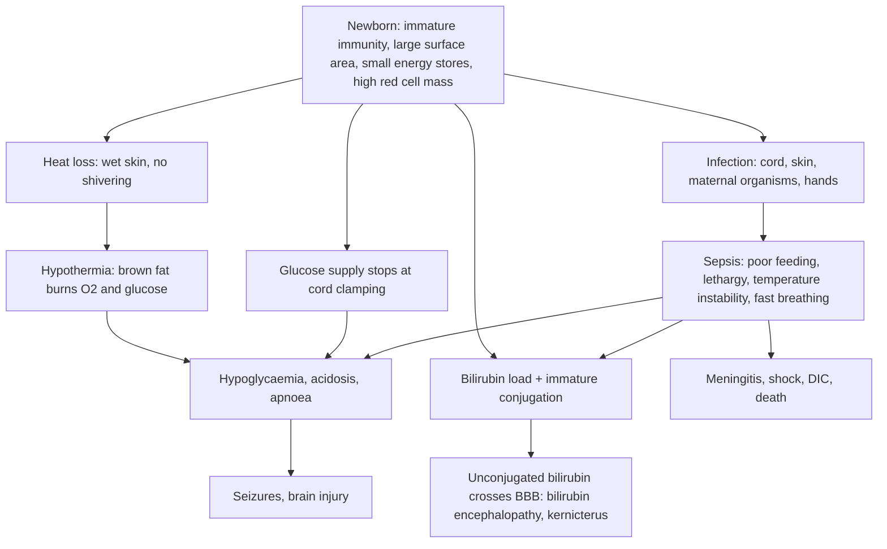

## 1. Definition

The newborn has a narrow margin of safety: little energy reserve, immature immunity and a big surface area. The same few problems cause most admissions and deaths after the first day: **sepsis**, **jaundice**, **hypoglycaemia**, **hypothermia**, **local infections** (cord, eyes, skin) and **birth injuries**, often together in the same baby.

| Term | Definition |
|---|---|
| **Neonatal period** | First **28 days** of life (early neonatal = first 7 days) |
| **Early-onset sepsis (EOS)** | Onset in the first **72 hours** (some use 7 days); usually maternal organisms acquired in labour |
| **Late-onset sepsis (LOS)** | Onset after **72 hours**; community or hospital-acquired (hands, equipment, cord) |
| **Possible serious bacterial infection (PSBI)** | IMNCI classification for a young infant with any danger sign; treat as sepsis |
| **Physiological jaundice** | Appears **after 24 h**, peaks day 3–5 (term), mild, baby well, gone by **14 days** (term) / 21 days (preterm) |
| **Pathological jaundice** | **First 24 h**, rapidly rising, above treatment thresholds, **palms and soles yellow**, baby unwell, conjugated, or prolonged |
| **Neonatal hypoglycaemia** | Blood glucose **<2.6 mmol/L** (operational threshold in Ugandan units; WHO Pocket Book 2.2; NICE/BAPM 2.0) |
| **Hypothermia** | Axillary **<36.5 °C**: cold stress 36.0–36.4, moderate 32.0–35.9, **severe <32** |
| **Omphalitis** | Infection of the umbilical stump; "**local**" (red, pus) versus **periumbilical flare** (redness spreading to the abdominal wall = serious) |
| **Ophthalmia neonatorum** | Conjunctivitis in the first **28–30 days** of life, classically gonococcal or chlamydial |

**Neonatal danger signs (WHO/UCG)**: not feeding well, convulsions, drowsy or unconscious or moves only when stimulated, **RR ≥60**, severe chest indrawing, grunting, temperature **>37.5 °C or <35.5 °C**, central cyanosis. Any one = PSBI.

> [!PEARL]
> The one thing never to forget: **a newborn shows almost every serious illness the same way** (poor feeding, lethargy, temperature instability, fast breathing, jaundice). Check **temperature and glucose**, and if any danger sign is present, **start antibiotics** after a blood culture (where available) and **do not wait** for results.

## 2. Epidemiology

- **Uganda**: **infection** is one of the three leading causes of neonatal death (with prematurity and asphyxia). Severe jaundice causes **kernicterus**, which still leaves Ugandan children with athetoid cerebral palsy and deafness. Hypothermia and hypoglycaemia are cheap to prevent and deadly when missed.
- **Organisms**: sepsis in Ugandan and other sub-Saharan newborn units is commonly caused by ***Klebsiella pneumoniae*, *Staphylococcus aureus*, *E. coli*** and other Gram-negatives; **Group B Streptococcus** is less often isolated than in high-income countries but does occur. **Resistance to ampicillin and gentamicin is common** in hospital-acquired infections, which is why second-line drugs and cultures matter.
- **Practices**: **hand hygiene, chlorhexidine cord care, exclusive breastfeeding and KMC** are the main prevention tools. Harmful traditional practices (cow dung, ash or herbs on the cord; "sucking" the baby's mouth; prelacteal feeds) still occur.
- **Jaundice**: G6PD deficiency is common in Uganda, as are ABO incompatibility, sepsis and prematurity; Rh disease is less common because few Ugandan women are Rh-negative, but it is severe when it occurs. Many babies are discharged within 24 h, so **jaundice is often first seen at home** and presents late.

**Services by level of care** [VERIFY: compiled from the source notes, not an MoH equipment list]

| Level | Usually available | Often missing |
|---|---|---|
| **HC III / HC IV** | First-dose IM antibiotics, glucose and feeds, KMC, gentian violet, chlorhexidine, tetracycline eye ointment | Bilirubin measurement, phototherapy, blood culture, oxygen at HC III |
| **General Hospital / RRH** and PNFP hospitals (Mengo, Nsambya, Lubaga) | Phototherapy, serum bilirubin, FBC, oxygen, IV antibiotics, blood culture at some | Exchange transfusion, DAT and G6PD testing at many |
| **NRH and a few referral centres** | **Exchange transfusion**, full laboratory, CPAP, paediatric surgery (biliary atresia) | n/a |

The approach is the **IMNCI** one: look for **danger signs** first, classify, treat (often first-dose antibiotics and glucose before referral), keep warm, keep feeding, and counsel the mother on when to return.

## 3. Aetiology and Risk Factors

| Problem | Causes and risk factors |
|---|---|
| **Early-onset sepsis** | **ROM >18 h**, maternal fever **>38 °C**, foul-smelling liquor, chorioamnionitis, maternal UTI in labour, preterm labour; GBS, *E. coli*, *Klebsiella* |
| **Late-onset sepsis** | Hospital stay, unwashed hands, equipment, IV lines, umbilical stump (harmful substances on the cord), prelacteal feeds, prematurity, LBW; *Klebsiella*, *S. aureus*, Gram-negatives |
| **Jaundice** | **Haemolysis** (ABO: mother O, baby A or B; Rh; G6PD, triggered by naphthalene or herbs; spherocytosis), sepsis, prematurity, bruising and cephalhaematoma, polycythaemia, poor breastfeeding intake, hypothyroidism, cholestasis (biliary atresia) |
| **Hypoglycaemia** | **Preterm, LBW/SGA, infant of a diabetic mother** (hyperinsulinism), asphyxia, sepsis, hypothermia, poor or delayed feeding, maternal β-blockers (labetalol) |
| **Hypothermia** | No drying at birth, early bathing, cold room, separation from the mother, preterm and LBW, sepsis |
| **Local infections** | Cow dung, ash, herbs or ghee on the cord; maternal gonorrhoea or chlamydia (eyes); poor hygiene (skin) |
| **Birth injuries** | **Vacuum** (subgaleal), forceps (facial nerve), **shoulder dystocia** and big babies (brachial plexus, clavicle), **breech** (bruising, fractures) |

## 4. Pathophysiology

**Why newborns get infected easily**: low complement and neutrophil reserves, little IgM, IgG mainly from the mother (crosses after 32 weeks, so preterms lack it), thin skin, an open umbilical wound, and exposure to maternal organisms in labour (prolonged ROM, chorioamnionitis). Sepsis spreads quickly to the meninges (up to a quarter of septic newborns have meningitis).

**Why newborns get jaundiced**: high red cell mass with a short lifespan (70–90 days) → a large bilirubin load; immature **UDP-glucuronyl transferase** in the liver; more **enterohepatic circulation** (gut β-glucuronidase, sterile gut, slow passage of meconium). Unconjugated bilirubin is fat-soluble and, when very high (or with acidosis, sepsis, prematurity, low albumin, drugs that displace it such as ceftriaxone), crosses the blood–brain barrier and stains the **basal ganglia** → **acute bilirubin encephalopathy** and **kernicterus**.

**Why newborns get hypoglycaemic**: after the cord is cut, glucose supply stops; the baby relies on glycogen (small in preterm and SGA), gluconeogenesis and ketones from milk. Risk is greatest in **preterm, SGA, infants of diabetic mothers (hyperinsulinism), asphyxia, sepsis, hypothermia and delayed feeding**.

**Why newborns get cold**: large surface area, wet skin at birth (evaporation), little fat, cannot shiver (rely on brown fat, which uses oxygen and glucose). Cold → hypoglycaemia, acidosis, apnoea, sepsis, death.

**Feature links**

- Bacteraemia → cytokines → **temperature instability** (hypothermia more often than fever), **poor feeding, lethargy, mottling, tachycardia**, apnoea.
- Sepsis with pneumonia or acidosis → **fast breathing, grunting, indrawing**.
- Meningeal spread → **bulging fontanelle, convulsions**.
- Bilirubin in skin → **cephalocaudal jaundice** (face first, palms and soles last); **yellow palms and soles** = high bilirubin.
- Haemolysis → **pallor, hepatosplenomegaly, early jaundice**.
- Bilirubin in the basal ganglia → **poor suck, hypotonia, then hypertonia, retrocollis, opisthotonus, high-pitched cry**.
- Cholestasis → **pale stools, dark urine**, conjugated bilirubin.
- Low glucose → catecholamine surge → **jitteriness, sweating**; neuroglycopenia → **lethargy, apnoea, seizures**.
- Brown fat metabolism in the cold → **hypoglycaemia, acidosis**; peripheral vasoconstriction → **cold peripheries**.
- Bleeding into the subgaleal space (vacuum) → **boggy scalp crossing sutures, pallor, tachycardia, shock**.
- Traction on C5–C6 → **waiter's tip posture**; C8–T1 → **claw hand ± Horner syndrome**.

## 5. Classification / Staging

**Sepsis**: early-onset (<72 h) versus late-onset (>72 h); IMNCI classifies a young infant with any danger sign as **PSBI / very severe disease**.

**Jaundice by timing**

| Onset | Likely causes |
|---|---|
| **First 24 h** (always pathological) | **Haemolysis** (ABO, Rh, G6PD, spherocytosis), sepsis, congenital infection (TORCH, syphilis) |
| **Day 2–14** | Physiological, breastfeeding (poor intake) jaundice, sepsis, haemolysis, bruising or cephalhaematoma, polycythaemia, prematurity |
| **After 14 days (term) / 21 days (preterm)** | Breast milk jaundice (unconjugated, well baby), **UTI or sepsis**, **hypothyroidism**, G6PD; **conjugated**: **biliary atresia**, neonatal hepatitis, choledochal cyst |

**Kramer's zones** (rough guide only; always confirm high values)

| Zone | Extent | Approx. bilirubin (µmol/L) |
|---|---|---|
| 1 | Head and neck | About 100 |
| 2 | Upper trunk (to umbilicus) | About 150 |
| 3 | Lower trunk and thighs | About 200 |
| 4 | Arms and lower legs | About 250 |
| 5 | **Palms and soles** | **>250** |

**Hypothermia grades**: normal 36.5–37.5 °C; cold stress 36.0–36.4 °C; moderate 32.0–35.9 °C; severe <32 °C.

**Omphalitis**: local (redness or pus not spreading) versus **periumbilical flare** (spreading onto the abdominal wall). **Skin pustules**: <10 (local) versus ≥10, bullae, abscess or cellulitis (serious).

## 6. Clinical Features

### History

| Question | Why it matters |
|---|---|
| **Age in hours or days** | EOS versus LOS; jaundice timing (day 1 = pathological) |
| **Feeding**: breastfeeding? how often? last good feed? other fluids or prelacteal feeds? | Poor feeding is the commonest sign of illness; cause of hypoglycaemia and dehydration |
| **Urine and stool output** | Dehydration; cholestasis |
| **Maternal fever, ROM >18 h, foul liquor, UTI in labour** | EOS risk; give antibiotics |
| **Gestation and birth weight; percentage weight change** | Preterm and LBW: sepsis, jaundice and hypoglycaemia risk; lower bilirubin thresholds |
| **Mother's blood group (and Rh), previous baby with jaundice or exchange** | ABO or Rh haemolysis |
| **Family history of G6PD deficiency or jaundice; exposure to naphthalene or herbs** | Haemolysis triggers |
| **Stool and urine colour** | Pale stools and dark urine = conjugated (cholestatic) jaundice |
| **Cord care**: what was applied? Home remedies to the eyes | Omphalitis, tetanus |
| **Eye discharge onset** | Day 2–5 gonococcal; day 5–14 chlamydial |
| **Delivery**: vacuum, breech, shoulder dystocia, big baby | Birth injuries |
| **Maternal HIV (last viral load), syphilis (RPR), HBsAg, TB** | Prophylaxis and congenital infection |
| **Immunisation**: BCG, OPV0 (HepB birth dose) | Missed doses; BCG ulcer versus abscess |

### Examination

Follow Hutchison's Clinical Methods (24th edition) order adapted for the newborn: observe first, examine warmly, and leave distressing parts (mouth, eyes) to last.

#### Introduction, consent and preparation

- Introduce yourself to the mother; confirm the baby's name, age in hours or days and sex; explain and gain consent.
- **Hand hygiene** (the single most important infection-control step on a newborn ward).
- **Position and exposure**: in **good daylight** (for jaundice), on a warm surface, undress fully but briefly; keep the room warm.

#### General inspection

| Sign | Mechanism | What it means |
|---|---|---|
| Activity: lethargic, moves only when stimulated, weak cry | Sepsis, hypoglycaemia, bilirubin encephalopathy | Danger sign |
| Colour: pink, pale, yellow, blue, mottled | Anaemia (haemolysis, bleeding), jaundice, cyanosis, poor perfusion | Guides work-up |
| Jitteriness, convulsions | Hypoglycaemia, hypocalcaemia, meningitis | Check glucose now |
| Posture: arching (opisthotonus), retrocollis | Bilirubin encephalopathy, meningitis, tetanus | Emergency |
| Breathing: RR, indrawing, grunting | Pneumonia, sepsis, RDS, heart disease | Danger sign if RR ≥60 or severe indrawing |
| Hydration: sunken fontanelle, dry mucosa | Poor intake | Dehydration |

**Vital signs and growth**: temperature (axillary), RR (count 60 s; repeat if ≥60), HR, SpO₂, CRT, **weight compared with birth weight** (loss >10% suggests poor intake or dehydration), plotted on a growth chart.

#### Hands, face and neck

- **Jaundice**: press the skin in good daylight; note how far down it extends (face → chest → abdomen → limbs → **palms and soles**).
- **Pallor** (haemolysis, bleeding).
- **Scalp swellings**: caput, cephalhaematoma, **subgaleal haemorrhage**; fontanelle (bulging = meningitis; sunken = dehydration).
- **Face**: asymmetric cry (facial nerve palsy).
- **Neck**: sternomastoid lump, torticollis; clavicle crepitus.

#### The systems

- **Chest**: RR, indrawing, grunting, crackles.
- **Heart**: murmur, femoral pulses (congenital heart disease).
- **Abdomen**: distension (NEC, surgical), **hepatosplenomegaly** (haemolysis, congenital infection).
- **Cord**: redness, pus, smell, **flare** spreading onto the abdominal wall, bleeding.
- **Skin**: pustules (count: <10 versus ≥10), bullae, abscess, cellulitis, peeling, bruising. Benign: erythema toxicum, milia, miliaria, Mongolian spots.
- **Neurology** (in jaundice): lethargy, poor suck, hypotonia → hypertonia, retrocollis, opisthotonus, high-pitched cry (acute bilirubin encephalopathy); tone, suck, fontanelle.
- **Limbs and nerves**: arm movement (Erb's palsy), grasp (Klumpke's), asymmetric Moro, swelling of long bones.

#### Last (distressing parts)

- **Eyes**: swelling, pus (copious = gonococcal), corneal haze.
- **Mouth**: thrush (white patches that do not wipe off).

#### Completing the examination

- **Thank** the mother, re-dress the baby and return her skin-to-skin, **hand hygiene**, and **summarise** (danger signs present or absent, jaundice zone, temperature, glucose, working diagnosis).

### Red flags

> [!REDFLAG]
> - Any **danger sign** = PSBI: first-dose antibiotics and urgent referral or admission
> - **Jaundice on day 1**, **yellow palms and soles**, jaundice with **lethargy, poor suck, high-pitched cry, arching**
> - **Pale stools / dark urine** with jaundice (biliary atresia)
> - **Glucose <2.6 mmol/L** with symptoms, or persisting despite feeds
> - **Temperature <35.5 °C** or >37.5 °C
> - **Periumbilical flare** or bleeding from the cord
> - **Copious purulent eye discharge** with lid swelling in the first week
> - **Bulging fontanelle**, convulsions (meningitis)
> - **Bilious vomiting** or abdominal distension (surgical emergency or NEC)
> - **Boggy scalp swelling crossing sutures with pallor** after vacuum (subgaleal haemorrhage)

### Thinking like a clinician

- **Sepsis looks like everything.** Hypothermia, hypoglycaemia, jaundice, apnoea, poor feeding and "just not right" can each be the only sign. Lower your threshold to treat.
- **Fever in a newborn is serious, but so is a low temperature.** Hypothermia is more common than fever in neonatal sepsis, especially in preterms.
- **Early jaundice = haemolysis or sepsis; late or prolonged jaundice = breast milk, hypothyroidism, sepsis or UTI, or cholestasis.** Always look at the stool colour.
- **A jaundiced baby who is sleepy and feeding poorly is either septic or developing bilirubin encephalopathy.** Both are emergencies.
- **Do not give ceftriaxone to a deeply jaundiced or preterm neonate** if an alternative exists (it displaces bilirubin from albumin), and never mix it with IV calcium.
- **A cold baby is a hypoglycaemic baby until proven otherwise**, and a hypoglycaemic baby may be septic.
- **Not all skin spots are infection**: erythema toxicum (blotchy red with white or yellow centres, day 2–3, baby well), milia, miliaria and Mongolian spots are benign. Pustules with surrounding redness in a baby with other signs are not.

## 7. Differential Diagnoses

**The baby who is "not feeding well and sleepy"**

| Differential | Distinguishing clinical feature | Distinguishing investigation |
|---|---|---|
| **Sepsis / meningitis** | Risk factors, temperature instability, bulging fontanelle, mottling | Culture, CRP, LP |
| **Hypoglycaemia** | Jittery, sweaty, apnoea, seizures; SGA, infant of a diabetic mother, preterm | Glucose |
| **Hypothermia** | Cold peripheries, temperature <36.5 °C | Temperature |
| **Severe jaundice / bilirubin encephalopathy** | Deep jaundice, poor suck, then arching, high-pitched cry | TSB |
| **Dehydration / breastfeeding failure** | Weight loss >10%, few wet nappies, hypernatraemia | Weight, sodium |
| **HIE** | History of asphyxia, onset from birth | Clinical (Sarnat) |
| **Congenital heart disease** | Cyanosis, murmur, weak femoral pulses, hepatomegaly | SpO₂ pre- and post-ductal, echocardiography |
| **Neonatal tetanus** | Day 3–14, could suck then stopped, trismus, spasms, alert between spasms | Clinical |
| **Inborn error of metabolism** | Well at birth then vomiting, encephalopathy after feeds | Ammonia, lactate, ketones |

**The jaundiced baby**

| Differential | Distinguishing clinical feature | Distinguishing investigation |
|---|---|---|
| Physiological jaundice | After 24 h, well, feeding, peaks day 3–5, gone by 14 days | TSB below threshold |
| Breastfeeding (poor intake) jaundice | Weight loss, few feeds, few wet nappies | Weight, sodium |
| ABO / Rh haemolysis | Day 1 jaundice, pallor, mother O or Rh-negative | Blood groups, DAT, FBC, reticulocytes |
| G6PD deficiency | Male, family history, naphthalene or herbs, sudden rise | G6PD screen |
| Sepsis or UTI | Unwell, temperature instability | Culture, urine |
| Hypothyroidism | Prolonged jaundice, constipation, large tongue, umbilical hernia | TSH, T4 |
| Biliary atresia | Pale stools, dark urine, prolonged jaundice, hepatomegaly | **Conjugated bilirubin >25 µmol/L**; ultrasound |

**Benign versus infective skin lesions**: erythema toxicum, milia, miliaria and Mongolian spots (well baby) versus pustules with surrounding redness, bullae, abscess.

## 8. Clinical Workup

"Available at" is the lowest level that usually offers the test [VERIFY: availability compiled from the source notes].

### Bedside

| Test | Why | Expected / abnormal finding | Available at |
|---|---|---|---|
| **Glucose** | Hypoglycaemia; stress hyperglycaemia in sepsis | <2.6 mmol/L = treat | HC III and above |
| **Temperature** | Grade hypothermia or fever | <36.5 °C or >37.5 °C | All levels |
| **SpO₂** | Hypoxaemia (pneumonia, sepsis, CHD) | <90% = oxygen | HC IV and above |
| **Transcutaneous bilirubin (TcB)** | Screening in babies ≥35 weeks after 24 h (NICE) | Confirm with serum if high or on day 1 | Some hospitals |
| **Weight** | Intake and hydration | Loss >10% suggests poor intake or dehydration | All levels |
| **HemoCue Hb** | Pallor, haemolysis, bleeding | Low Hb | HC IV and above |
| **Urine dipstick** (bag or clean catch) | UTI in prolonged jaundice or LOS | Nitrites, leucocytes | HC III and above |
| **Malaria RDT or film** | Fever in a malaria-endemic area (congenital or neonatal malaria is rare but possible) | Positive | All levels |

### Basic lab

| Test | When | Expected / abnormal finding | How it changes management | Available at |
|---|---|---|---|---|
| **FBC** | Sepsis, jaundice, pallor | WBC <5 or >20 × 10⁹/L, immature neutrophils, platelets <100; Hb low and reticulocytes high in haemolysis | Supports sepsis; transfusion; haemolysis work-up | HC IV and above |
| **Total serum bilirubin (TSB)** | Jaundice on day 1, palms and soles yellow, TcB high, preterm | Plot on the threshold chart by age in hours | Phototherapy or exchange | General and regional referral |
| **CRP** | Sepsis | Rising at 18–24 h; normal values at 0 and 18–24 h help stop antibiotics | Duration | Referral hospitals |
| **Blood culture** | Every suspected sepsis, **before antibiotics** (if it causes no delay) | Organism and sensitivity | Choice and duration; stop at 48 h if negative and well | Regional and national referral, PNFP hospitals |

### Imaging

| Test | When | Expected / abnormal finding | How it changes management | Available at |
|---|---|---|---|---|
| **X-ray** | Suspected fracture (clavicle, humerus, femur), pneumonia | Fracture, consolidation | Immobilisation; pneumonia treatment | Most hospitals |
| **Abdominal ultrasound** | Conjugated jaundice, pale stools | Absent or small gallbladder (biliary atresia), choledochal cyst | Urgent surgical referral | RRH, NRH [VERIFY: availability] |

### Specialised / referral-level

| Test | When | Expected / abnormal finding | How it changes management | Available at |
|---|---|---|---|---|
| **Lumbar puncture (CSF)** | Sepsis with seizures, bulging fontanelle, lethargy, or positive culture | WBC above about 20/mm³, low glucose, high protein, organisms | **21 days** of IV antibiotics | Hospital |
| **Conjugated (direct) bilirubin** | Jaundice beyond 14 days (term) or 21 days (preterm), pale stools | **>25 µmol/L** (NICE) = cholestasis | Urgent referral for biliary atresia | Referral hospitals |
| **Blood group, Rh and DAT (Coombs) of baby and mother** | Early jaundice | ABO (mother O, baby A or B) or Rh incompatibility; DAT positive | Lower thresholds, IVIG or exchange | Referral hospitals |
| **G6PD screen** | Unexplained haemolysis, family history, male | Deficient | Avoid triggers; counsel family | Limited (tertiary and private) |
| **Thyroid function** | Prolonged jaundice | Low T4, high TSH | Levothyroxine | Referral hospitals |
| **Eye swab: Gram stain and culture** | Purulent conjunctivitis | Gram-negative intracellular diplococci = gonococcus | Confirms; contact tracing | Referral hospitals |
| **Pus swab** | Abscess, omphalitis with flare | *S. aureus* (MRSA?) | Antibiotic choice | Referral hospitals |

### Putting it together

**Model one-line summary**

> "A **6-day-old** term male (birth weight 3.2 kg, now 2.9 kg, **9% loss**) born at home, brought with **2 days of poor feeding and fever 38.4 °C**, with a **red umbilicus with pus and redness spreading 2 cm onto the abdominal wall**, RR 64, glucose 2.3 mmol/L, jaundice to the abdomen, palms not yellow. Cow ghee was applied to the cord. Mother HIV-negative at ANC; no BCG yet."

**Working diagnosis**: late-onset neonatal sepsis from **omphalitis with periumbilical flare** (staphylococcal risk), with hypoglycaemia and dehydration; jaundice probably physiological but worsened by sepsis and poor intake.

**Problem list**

1. Late-onset sepsis (PSBI) from omphalitis with flare.
2. Hypoglycaemia (2.3 mmol/L).
3. Dehydration and poor feeding (9% weight loss).
4. Jaundice to the abdomen (Kramer 2–3): measure TSB.
5. Harmful cord practice; BCG and OPV0 not given.

**Model case presentation (ward round)**

> "**Baby Namusoke**, a **4-day-old** female, born at term by SVD at a HC IV, birth weight **3.0 kg**, today **2.75 kg (8% loss)**. Presented with **yellow eyes since day 2**, now spreading to the legs, and **poor feeding for 1 day**. Exclusively breastfed, **6 feeds in 24 h**, 3 wet nappies, yellow stools. Mother is **blood group O positive**, baby **B positive**, DAT not done. No fever, no family history of G6PD deficiency known.
>
> On examination she is jaundiced to the **legs (Kramer 4)**, palms and soles not yellow, alert with a good cry, normal tone and suck, temperature 36.9 °C, RR 46, no hepatosplenomegaly, umbilicus clean. TSB at **84 hours is 290 µmol/L**, just **below** the NICE phototherapy line at 84 h (**325 µmol/L**).
>
> **Assessment:** neonatal jaundice, probably physiological or breastfeeding-related with possible **ABO incompatibility**; she is near the phototherapy threshold, and feeding is inadequate. **Plan:** support breastfeeding (8–12 feeds a day, EBM top-ups by cup), repeat TSB in 6–12 h, start phototherapy if above threshold, FBC and reticulocytes, DAT, G6PD if available, review danger signs.
>
> Mother **HIV-negative** in labour. **BCG and OPV0 given** at birth. Weight-for-age Z-score about −1."

**Worked example 1: plotting bilirubin.** A term (39 weeks) baby at **36 hours** has TSB **240 µmol/L**. On the NICE table, the phototherapy threshold at 36 h is **225 µmol/L** and exchange **400**. So: **start phototherapy**, repeat TSB in 4–6 h, look for the cause (jaundice this high this early suggests haemolysis), and continue breastfeeding.

**Worked example 2: antibiotic doses.** A 3.0 kg baby, day 3 → ampicillin **150 mg IV 12-hourly** + gentamicin **15 mg IV once daily**. Same baby on day 10 → ampicillin **150 mg 8-hourly** + gentamicin **22.5 mg once daily** (7.5 mg/kg).

## 9. Management

### Immediate / emergency

**First 5 minutes (ABCDE)**

1. **A and B**: open airway; oxygen by nasal prongs if SpO₂ <90% or cyanosed or in severe distress; bag-mask if apnoeic or gasping.
2. **C**: **shock?** (CRT >3 s, weak pulses, HR >180) → **normal saline 10 mL/kg** over 10–20 min, reassess. IV or IO access.
3. **D**: **glucose** (glucometer): <2.6 mmol/L → **10% dextrose 2 mL/kg IV** (or EBM or 10% dextrose by NGT if no IV). **Phenobarbital 20 mg/kg** if convulsing.
4. **E**: **temperature**: if <36.5 °C start rewarming (skin-to-skin, incubator or radiant warmer); if >37.5 °C undress and adjust the environment (no paracetamol).
5. **Danger sign present?** → **blood culture**, **ampicillin + gentamicin** now.
6. **Vitamin K** if not given.
7. Call for senior help; explain to the mother.

### Definitive

#### Neonatal sepsis (possible serious bacterial infection)

**Who to treat**

- Any **danger sign** (PSBI / very severe disease).
- **Risk factors** (ROM >18 h, maternal fever >38 °C, foul liquor) in a baby under 1 day: **ampicillin + gentamicin for at least 2 days, then reassess** (WHO); stop if well and cultures negative.

**Steps**

1. Stabilise (ABC, warmth, glucose, fluids or feeds).
2. **Blood culture** (and LP when stable) **before** the first dose if it causes no delay.
3. **Ampicillin + gentamicin** (first line, WHO 2013 and WHO 2024 SBI recommendations; UCG 2023).
4. **Supportive care**: warmth; feeds (EBM by NGT if unable to suck) or IV 10% dextrose; oxygen if SpO₂ <90%; no paracetamol for fever (undress, control environment).
5. **Review at 48–72 h**: improving → complete course; not improving → **change** (ceftriaxone, or per culture; cloxacillin if staphylococcal; meropenem at referral hospitals for resistant Gram-negatives).
6. **Duration**: stop at **48 h** if culture-negative and baby well (NICE NG195 allows stopping at **36 h** with negative culture and reassuring CRP); **7–10 days** for clinical or culture-proven sepsis (UCG 10 days); **21 days** for meningitis (UCG/WHO).

> [!UGANDA]
> **If referral is not possible** (UCG/IMNCI), continue **ampicillin + gentamicin IM** for **7 days** at the health centre, keep warm, and support feeding. WHO's outpatient PSBI regimens (once-daily IM gentamicin plus oral amoxicillin for 7 days) are used for young infants whose families cannot accept referral, but never for babies with critical signs (unconscious, convulsions, not feeding at all, apnoea).

#### Neonatal jaundice

**Assess every baby**: look in daylight; **any jaundice in the first 24 h** → measure bilirubin urgently (NICE: within 2 h). Check palms and soles. Babies ≥35 weeks after 24 h → TcB (or serum if no TcB).

**WHO Pocket Book thresholds (µmol/L)**

| Age | Phototherapy: healthy ≥35 weeks | Phototherapy: <35 weeks or any risk factor* | Exchange: healthy ≥35 weeks | Exchange: <35 weeks or risk factor |
|---|---|---|---|---|
| Day 1 | **Any visible jaundice** | Any visible jaundice | 260 | 220 |
| Day 2 | 260 | 170 | 425 | 260 |
| Day 3 or more | 310 | 250 | 425 | 340 |

*Risk factors: small (<2.5 kg or <37 weeks), haemolysis, sepsis.

**NICE CG98 (updated 2023) threshold table, ≥38 weeks (µmol/L)**

| Age (h) | 0 | 6 | 12 | 18 | 24 | 30 | 36 | 42 | 48 | 60 | 72 | 84 | 96+ |
|---|---|---|---|---|---|---|---|---|---|---|---|---|---|
| **Phototherapy** | 100 | 125 | 150 | 175 | 200 | 212 | 225 | 237 | 250 | 275 | 300 | 325 | **350** |
| **Exchange** | 100 | 150 | 200 | 250 | 300 | 350 | 400 | 450 | 450 | 450 | 450 | 450 | **450** |

For babies <38 weeks use NICE's gestation-specific graphs (lower lines; rule of thumb for phototherapy after 72 h ≈ gestation in weeks × 10 − 100 µmol/L). The **AAP 2022** guideline (USA) uses hour-specific curves by gestation (≥35 weeks) with **neurotoxicity risk factors** and an "**escalation of care**" threshold 34 µmol/L (2 mg/dL) below the exchange line; many Ugandan units still use the WHO table or NICE charts.

**Phototherapy: how to do it well**

1. Baby **naked** (nappy only), **eyes covered**, under blue light (460–490 nm) at the right distance; turn 2–3-hourly or use double lights for intensive phototherapy.
2. **Continue breastfeeding** (short breaks, or EBM by cup); give **10–20% extra fluid** if under radiant heat or if dehydrated.
3. Monitor temperature, hydration, weight; **repeat TSB 4–6 h** after starting (rising fast or haemolysis), then 6–12-hourly.
4. **Stop** when TSB is **50 µmol/L below the phototherapy threshold** (NICE); check for **rebound** 12–18 h later.
5. **Do not use sunlight** as treatment (unreliable, burns, hypothermia or hyperthermia).

**Exchange transfusion** (double volume = **160 mL/kg** in term babies; about 200 mL/kg in preterm) for TSB above the exchange threshold or **signs of acute bilirubin encephalopathy**, at a centre that can do it; keep intensive phototherapy going during transfer.

**IVIG** for Rh or ABO haemolytic disease (drug table).

**Prolonged jaundice**: check **conjugated bilirubin**, stool and urine colour, TSH, urine culture, G6PD; **pale stools or conjugated >25 µmol/L** → urgent referral (biliary atresia needs a Kasai procedure, ideally **before 60 days**). Breast milk jaundice: well, thriving baby with unconjugated hyperbilirubinaemia: **continue breastfeeding**.

#### Hypoglycaemia

**At-risk babies** (check glucose before the second feed, 2–4 h after birth, then before feeds): preterm, LBW or SGA, infant of a diabetic mother, asphyxia, sepsis, hypothermia, poor feeding, maternal β-blockers (labetalol).

| Situation | Treatment |
|---|---|
| Glucose **<2.6**, **no symptoms**, baby can feed | **Breastfeed or give EBM** (for example 10 mL/kg by cup or NGT) now; recheck in **30–60 min** |
| Glucose **<2.6** with **symptoms** (jittery, lethargic, apnoea, seizure) or not feeding, or persistent despite feeds | **10% dextrose 2 mL/kg IV** over 5 min, then **10% dextrose infusion** (60 mL/kg/day on day 1 → GIR about 4–6 mg/kg/min); recheck in **30 min** |
| No IV access | **EBM or 10% dextrose by NGT** (Pocket Book), or sugar solution by cup (UCG HC level); refer |
| Persistent despite **GIR >8 mg/kg/min** | Think **hyperinsulinism** (infant of a diabetic mother, SGA), adrenal insufficiency; refer; specialists may use glucagon or hydrocortisone |

> [!NOTE]
> Thresholds differ: Ugandan neonatal units commonly treat below **2.6 mmol/L** (used throughout these notes), WHO Pocket Book uses **2.2 mmol/L** for sick infants, and NICE/BAPM use **2.0 mmol/L** (with IV treatment for any value below 1.0 or symptomatic). Follow your unit's protocol and say which you used.

#### Hypothermia

1. **Prevent**: dry at birth, skin-to-skin, hat, **delay bathing 24 h**, warm room (at least 25 °C), KMC for small babies.
2. **Cold stress (36.0–36.4 °C)**: skin-to-skin, extra layers, cover head, warm room, breastfeed; recheck in 1 h.
3. **Moderate (32.0–35.9 °C)**: KMC or incubator or radiant warmer (or a warm cot and room); check **glucose**, feed, look for sepsis; recheck every 30–60 min until normal.
4. **Severe (<32 °C)**: rapid rewarming in an incubator or radiant warmer, **IV 10% dextrose**, oxygen, **antibiotics**, monitor for apnoea and bradycardia.
5. Remove wet clothes; avoid hot-water bottles directly on skin (burns).

#### Cord, eye and skin infections

| Condition | Features | Treatment (UCG 2023 / WHO) |
|---|---|---|
| **Local umbilical infection** | Red umbilicus or pus, redness **not** spreading | Clean with boiled cooled water, dry, **gentian violet 0.5%** 3 times daily; **oral amoxicillin** (UCG: 250 mg dispersible tablet ¼ tab <1 month or <4 kg, ½ tab 1–2 months or 4–6 kg, **12-hourly for 5 days**); review in 2 days |
| **Omphalitis with periumbilical flare** | Redness or swelling spreading onto the abdominal wall, pus, baby may be unwell | Admit; **cloxacillin 50 mg/kg IV 6-hourly + gentamicin**; blood culture; 7–10 days; watch for necrotising fasciitis and portal vein thrombosis |
| **Cord bleeding** | Oozing from the stump | Retie the cord; vitamin K if not given; refer if it persists (UCG) |
| **Sticky eye / mild conjunctivitis** | Small amount of discharge, lids not swollen | Wash with clean water or breast milk; **tetracycline or chloramphenicol eye ointment 4 times daily for 5 days** (WHO); review in 48 h |
| **Gonococcal ophthalmia** | **Day 2–5**, copious pus, **swollen lids**, risk of corneal perforation | **Ceftriaxone 125 mg IM once** (UCG; WHO 50 mg/kg, max 125 mg) **plus azithromycin 20 mg/kg orally daily for 3 days** (UCG, covers chlamydia); irrigate frequently with saline; admit; treat **both parents** for gonorrhoea and chlamydia and screen for HIV and syphilis |
| **Chlamydial conjunctivitis** | Day 5–14, watery then purulent, milder; may have pneumonia at 4–12 weeks | **Azithromycin 20 mg/kg daily for 3 days** (or oral erythromycin 50 mg/kg/day in 4 doses for 14 days); treat parents |
| **Skin pustules, <10** | Small pustules, baby well | Clean, **gentian violet 0.5%** 2–3 times daily; review in 2 days |
| **Skin pustules ≥10, bullae, abscess, cellulitis** | Many or large pustules, swelling, hardness | Treat as **serious infection**: **cloxacillin + gentamicin** IV; drain abscess |
| **Oral thrush** | White plaques that do not wipe off | **Gentian violet** paint 4 times daily for 7 days (UCG) or **nystatin 100,000 IU (1 mL) 4 times daily for 7 days**; treat the mother's nipples |

> [!PEARL]
> Topical tetracycline at birth **prevents** ophthalmia neonatorum but **does not treat** established gonococcal infection; it needs systemic ceftriaxone (UCG: topical tetracycline has no added benefit in active disease).

#### Birth injuries

| Injury | Recognition | Management |
|---|---|---|
| **Caput succedaneum** | Soft, pitting oedema over the presenting part, **crosses sutures**, present at birth | Reassure; resolves in **1–3 days** |
| **Cephalhaematoma** | Firm swelling **limited by suture lines** (usually parietal), appears hours after birth | Reassure; resolves in **weeks to 3 months**; **do not aspirate**; watch for **jaundice** and anaemia |
| **Subgaleal haemorrhage** | Boggy, fluctuant swelling **crossing sutures**, spreading to neck and forehead, **pallor, tachycardia, shock**, after **vacuum** | **Emergency**: saline 10 mL/kg, **blood**, vitamin K, FFP, monitor head circumference |
| **Erb's palsy (C5–C6)** | Arm adducted, internally rotated, elbow extended, wrist flexed ("**waiter's tip**"); asymmetric Moro; grasp intact | Gentle handling, pin sleeve to the vest in the first week, then **passive physiotherapy**; most recover in weeks to months; refer if no biceps recovery by **3 months** |
| **Klumpke's palsy (C8–T1)** | Claw hand, absent grasp, ± **Horner syndrome** | Physiotherapy; refer |
| **Clavicle fracture** | Crepitus, swelling, reduced arm movement, asymmetric Moro (often after shoulder dystocia) | Reassure; heals in **7–10 days** with callus; pin sleeve, gentle handling, analgesia |
| **Humerus or femur fracture** | Breech or difficult delivery; swelling, pain, no movement | X-ray; splint; orthopaedics |
| **Facial nerve palsy** | Asymmetric cry, eye does not close on the affected side (forceps) | Eye lubricant and protection; usually recovers |
| **Bruising of buttocks and legs after breech** | Bruises, swelling | Reassure (UCG): resolves in 1–2 weeks; watch jaundice; do not force the legs |
| **Sternomastoid tumour** | Firm lump in sternomastoid at 2–3 weeks, torticollis | Stretching physiotherapy |

#### Respiratory distress and feeding problems (brief)

- **Respiratory distress** (RR ≥60, indrawing, grunting): oxygen to SpO₂ >90% (90–95% in preterms), **antibiotics** (pneumonia or sepsis cannot be excluded), consider CPAP, look for **transient tachypnoea** (CS, mild, settles in 24–72 h), **meconium aspiration**, **RDS** (preterm), **pneumothorax**, **congenital heart disease** (cyanosis, murmur, weak femorals) and **hypothermia or hypoglycaemia**.
- **Feeding problems** (IMNCI): poor attachment, <8 feeds in 24 h, other foods or drinks, thrush, low weight → correct positioning and attachment, feed more often day and night, stop other fluids, treat thrush, review in 2 days; refer for breastfeeding counselling if not improving.

### Drug table

| Drug | Dose (per kg; neonate) | Route | Frequency | Duration | Key cautions |
|---|---|---|---|---|---|
| **Ampicillin** | **50 mg/kg** (meningitis **100 mg/kg**) | IV / IM | **Every 12 h in week 1**; **every 8 h weeks 2–4** (UCG hospital protocol: 6-hourly IV) | 7–10 days (21 days meningitis); stop at 48 h if culture-negative and well | With gentamicin |
| **Gentamicin** | **Week 1: 5 mg/kg** (normal weight), **3 mg/kg** LBW (WHO) / **4 mg/kg** preterm (UCG); **weeks 2–4: 7.5 mg/kg** | IV / IM | **Once daily** (24-hourly; longer intervals in very preterm or AKI) | As ampicillin | Ototoxic and nephrotoxic; check levels where available |
| **Benzylpenicillin** (HC II pre-referral or alternative to ampicillin) | **50,000 IU/kg** | IM / IV | Pre-referral single dose (UCG); 12-hourly week 1, 8-hourly after | As ampicillin | Plus gentamicin |
| **Cloxacillin** (staphylococcal risk: omphalitis with flare, many pustules, abscess) | **50 mg/kg** (WHO range 25–50 mg/kg) | IV / IM | **Every 6 h** (UCG) | 7–10 days | With **gentamicin 5–7 mg/kg once daily** (UCG) |
| **Ceftriaxone** (second line; meningitis) | **100 mg/kg once daily** (UCG); meningitis **50 mg/kg 12-hourly or 100 mg/kg once daily** (WHO) | IV / IM | Once (or twice) daily | Per indication | **Avoid in hyperbilirubinaemia or preterm** if possible; **never with IV calcium**; cefotaxime 50 mg/kg 6–12-hourly is safer where available |
| **Ceftriaxone** (gonococcal ophthalmia) | **125 mg** (WHO 50 mg/kg, max 125 mg) | IM | Once | Single dose | Plus azithromycin; treat both parents |
| **Azithromycin** (gonococcal or chlamydial conjunctivitis) | **20 mg/kg** | Oral | Once daily | **3 days** | Alternative for chlamydia: erythromycin 50 mg/kg/day in 4 doses for 14 days |
| **Metronidazole** (NEC, anaerobes) | 7.5 mg/kg (some protocols 15 mg/kg load) | IV / oral | 12-hourly week 1, 8-hourly after | Per indication | With ampicillin + gentamicin for NEC |
| **Amoxicillin** (local umbilical infection) | 250 mg dispersible tablet: ¼ tab (<1 month or <4 kg); ½ tab (1–2 months or 4–6 kg) | Oral | 12-hourly | **5 days** | Review in 2 days |
| **10% dextrose** | **2 mL/kg** bolus over 5 min; infusion 60 mL/kg/day on day 1 | IV (or NGT if no IV) | Bolus then continuous | Until feeding and glucose stable | Recheck glucose in 30 min |
| **Normal saline** (shock, subgaleal haemorrhage) | **10 mL/kg** | IV | Over 10–20 min, reassess | Per response | Fluid overload |
| **Phenobarbital** (convulsions) | **20 mg/kg** loading | IV / IM | Once (see HIE topic for further doses) | Per response | Apnoea |
| **IVIG** (isoimmune haemolysis) | **500 mg/kg** (NICE); AAP 2022: 0.5–1 g/kg | IV | Over 4 h | Single dose, may repeat | NICE: if TSB keeps rising >8.5 µmol/L per hour despite intensive phototherapy; AAP: at escalation threshold with positive DAT |
| **Gentian violet 0.5%** | Topical | Skin, cord, mouth | 2–4 times daily | Cord and skin until healed; thrush 7 days | Stains |
| **Nystatin** | **100,000 IU (1 mL)** | Oral | 4 times daily | **7 days** | Treat the mother's nipples |
| **Tetracycline or chloramphenicol eye ointment** | Topical | Eye | 4 times daily | **5 days** | Mild conjunctivitis only; does not treat gonococcal disease |
| **Chlorhexidine 7.1% digluconate gel** | Topical | Cord stump | Once daily | **7 days** | Nothing else on the stump |
| **Vitamin K** | 1 mg (term); 0.5 mg (preterm) [VERIFY: dose against UCG] | IM | Once | Single dose | If not given at birth; cord bleeding |

### Referral criteria

| Level | What to do | Refer up when |
|---|---|---|
| **Home / VHT** | Recognise danger signs; skin-to-skin; breastfeed | Any danger sign, jaundice on day 1 or palms and soles yellow → nearest facility |
| **HC II / HC III** | Pre-referral benzylpenicillin or ampicillin + gentamicin IM; glucose or EBM or sugar solution; keep warm (KMC); local infection treatment (gentian violet, oral amoxicillin) | **Any danger sign (PSBI)**, day-1 jaundice, yellow palms and soles, periumbilical flare, gonococcal ophthalmia, subgaleal haemorrhage → HC IV or hospital. If referral impossible: ampicillin + gentamicin IM for 7 days |
| **HC IV / General Hospital** | Admission, IV antibiotics, glucose monitoring, phototherapy (most hospitals), blood transfusion | TSB at the exchange threshold or bilirubin encephalopathy; no improvement after 48–72 h of second-line antibiotics; conjugated jaundice or pale stools → RRH or NRH |
| **RRH** | Blood culture, CRP, LP, phototherapy, ceftriaxone, cloxacillin | Exchange transfusion, CPAP, paediatric surgery → NRH |
| **NRH (Mulago) and a few PNFP referral centres** | Exchange transfusion, meropenem, paediatric surgery (Kasai), CPAP | n/a |

Keep intensive phototherapy going during transfer where possible, and keep every referred baby warm (skin-to-skin) and fed.

### Monitoring and follow-up

- **Sepsis**: temperature, RR, HR, SpO₂, feeding, glucose; review at 48–72 h; culture result plan.
- **Jaundice**: TSB 4–6 h after starting phototherapy, then 6–12-hourly; rebound check 12–18 h after stopping; temperature, hydration and weight daily.
- **Hypoglycaemia**: recheck 30 min after treatment, then before feeds until stable on feeds.
- **Hypothermia**: recheck every 30–60 min until normal.
- **Before discharge, counsel the mother**: danger signs, cord care, exclusive breastfeeding, warmth, return for jaundice of palms and soles, immunisation at 6 weeks.
- **Follow-up**: local infections in 2 days; Erb's palsy for biceps recovery by 3 months; prolonged jaundice at 14 days (term) or 21 days (preterm); meningitis survivors for hearing and development.

## 10. Complications

**Disease-related**

| Problem | Complications |
|---|---|
| Sepsis | Meningitis (hydrocephalus, deafness, cerebral palsy, epilepsy), septic shock, DIC, NEC, osteomyelitis or septic arthritis, death |
| Jaundice | **Acute bilirubin encephalopathy → kernicterus** (athetoid cerebral palsy, sensorineural deafness, upward gaze palsy, dental enamel dysplasia, intellectual impairment) |
| Hypoglycaemia | Seizures, occipital brain injury, visual impairment, developmental delay |
| Hypothermia | Hypoglycaemia, acidosis, apnoea, pulmonary haemorrhage, sclerema, death |
| Omphalitis | Necrotising fasciitis, sepsis, portal vein thrombosis → portal hypertension later |
| Gonococcal ophthalmia | Corneal ulceration, perforation, **blindness** |
| Birth injuries | Shock and death (subgaleal), permanent brachial plexus palsy |

**Treatment-related**

| Complication | Cause | Recognition and action |
|---|---|---|
| Ototoxicity, nephrotoxicity | Gentamicin (especially 7.5 mg/kg in week 1, or in AKI) | Correct age-based dose; levels where available; hearing screen |
| Kernicterus risk, precipitation | Ceftriaxone (displaces bilirubin; precipitates with IV calcium) | Avoid in jaundiced or preterm neonates; never with IV calcium |
| Dehydration, temperature instability, rash, eye injury | Phototherapy | Extra fluid 10–20%; eye pads; temperature checks |
| Burns, hypothermia or hyperthermia | Sunlight "treatment"; hot-water bottles | Do not use |
| Infection | Aspirating a cephalhaematoma | Leave it alone |
| Antimicrobial resistance | Prolonged empirical antibiotics | Stop at 48 h if culture-negative and well |

## 11. Prognosis

- **Sepsis**: mortality is high in Ugandan units, especially with Gram-negative, resistant organisms, prematurity and late presentation [VERIFY: local case-fatality figure]; meningitis survivors risk hydrocephalus, deafness, cerebral palsy and epilepsy.
- **Jaundice**: excellent if treated against thresholds; kernicterus is permanent.
- **Hypoglycaemia**: brief, treated episodes usually do well; prolonged or symptomatic hypoglycaemia can cause occipital injury and visual impairment.
- **Birth injuries**: caput resolves in 1–3 days, cephalhaematoma in weeks to 3 months, clavicle fractures in 7–10 days; most Erb's palsies recover in weeks to months (refer if no biceps recovery by 3 months).
- **Gonococcal ophthalmia**: blindness if not treated systemically and early.

## 12. Prevention

- **Infection**: hand hygiene, clean delivery, **chlorhexidine 7.1% cord care daily for 7 days** with nothing else on the stump, exclusive breastfeeding, KMC, intrapartum antibiotics where indicated, avoid harmful traditional practices.
- **Eyes**: tetracycline eye ointment at birth; treat maternal gonorrhoea and chlamydia in pregnancy.
- **Hypothermia**: warm chain (dry at birth, skin-to-skin, hat, delay bathing 24 h, warm room ≥25 °C, KMC).
- **Hypoglycaemia**: early and frequent breastfeeding; glucose checks for at-risk babies.
- **Jaundice**: check every baby before discharge; teach mothers to look at the palms and soles and to return; avoid naphthalene and herbs in G6PD families; anti-D for Rh-negative mothers.
- **Birth injuries**: skilled delivery, correct vacuum use, anticipation of shoulder dystocia in big babies.

## 13. Special Populations

- **Preterm and LBW babies**: gentamicin **3 mg/kg (WHO) or 4 mg/kg (UCG)** in week 1; lower bilirubin thresholds; hypothermia more common than fever; IgG crosses after 32 weeks, so preterms lack maternal antibody.
- **Infants of diabetic mothers**: hyperinsulinism → hypoglycaemia (may need GIR >8 mg/kg/min); polycythaemia and jaundice; birth trauma from macrosomia.
- **HIV-exposed babies**: continue PMTCT prophylaxis; congenital infection screen as per maternal status.
- **Babies of mothers with syphilis, HBsAg or TB**: prophylaxis and treatment per the relevant guidelines.
- **G6PD-deficient babies**: avoid naphthalene, herbs and oxidant drugs; counsel the family.

## 14. Key Points

### High-yield points

- Danger signs first; any one = PSBI: culture, then ampicillin + gentamicin, and do not wait.
- Gentamicin 5 mg/kg in week 1 (3–4 mg/kg LBW or preterm), 7.5 mg/kg in weeks 2–4.
- Stop antibiotics at 48 h if well and culture-negative; sepsis 7–10 days; meningitis 21 days.
- Staphylococcal risk: cloxacillin + gentamicin.
- Day-1 jaundice is always pathological; yellow palms and soles = severe.
- Plot TSB by age in hours; stop phototherapy 50 µmol/L below threshold.
- Prolonged jaundice: conjugated bilirubin and stool colour; Kasai before 60 days.
- Glucose <2.6 mmol/L: feed if well; 10% dextrose 2 mL/kg if symptomatic.
- Keep every baby warm (36.5–37.5 °C) and feeding.
- Gonococcal ophthalmia needs systemic ceftriaxone; treat both parents.
- Chlorhexidine on the cord for 7 days; nothing else.

### Numbers & doses

| Item | Value |
|---|---|
| Neonatal period | **28 days** |
| EOS / LOS | **<72 h** / after 72 h |
| Sepsis risk factors | **ROM >18 h**, maternal fever **>38 °C**, foul liquor |
| Ampicillin | **50 mg/kg** IV/IM **12-hourly week 1, 8-hourly weeks 2–4** (100 mg/kg meningitis) |
| Gentamicin | **5 mg/kg** daily week 1 (**3 mg/kg** LBW WHO; **4 mg/kg** preterm UCG); **7.5 mg/kg** weeks 2–4 |
| Cloxacillin | **50 mg/kg 6-hourly** + gentamicin (staphylococcal) |
| Ceftriaxone | **100 mg/kg once daily** (second line); avoid with jaundice and IV calcium |
| Course length | Stop at **48 h** if well and culture negative; sepsis **7–10 days**; meningitis **21 days** |
| Jaundice | Day 1 = pathological; TSB within **2 h** |
| NICE phototherapy (≥38 weeks) | **200 at 24 h**, **250 at 48 h**, **300 at 72 h**, **350 at 96 h+** |
| NICE exchange (≥38 weeks) | **300 at 24 h**, **450 from 42 h** |
| WHO phototherapy (healthy ≥35 weeks) | Day 1 **any visible**, day 2 **260**, day 3+ **310** |
| Stop phototherapy | **50 µmol/L below threshold** |
| Exchange volume | **160 mL/kg** (double volume, term) |
| IVIG (isoimmune) | **500 mg/kg** over 4 h |
| Conjugated hyperbilirubinaemia | **>25 µmol/L**; Kasai **before 60 days** |
| Hypoglycaemia | **<2.6 mmol/L** → **10% dextrose 2 mL/kg** IV, recheck in 30 min |
| Hypothermia | **36.5–37.5** normal; **<32** severe |
| Gonococcal ophthalmia | **Ceftriaxone 125 mg IM once + azithromycin 20 mg/kg × 3 days** |
| Cord care | **Chlorhexidine 7.1% daily for 7 days** |
| Local skin infection | **<10 pustules** → gentian violet; ≥10 → IV cloxacillin + gentamicin |

### Exam traps

- **"Jaundice at 12 hours: it's physiological, review tomorrow."** → Wrong. Day-1 jaundice is **always pathological**; measure bilirubin now.
- **"Put the jaundiced baby in the morning sun."** → Wrong. Sunlight is unreliable and unsafe; use **phototherapy**.
- **"Stop breastfeeding for jaundice."** → Wrong. **Continue breastfeeding**; poor intake worsens jaundice.
- **"Febrile neonate: give paracetamol and observe."** → Wrong. Treat as **sepsis**; control the environment; no antipyretics (UCG).
- **"Gentamicin 7.5 mg/kg on day 2 of life."** → Too high: **5 mg/kg** in week 1 (3–4 mg/kg if LBW or preterm); 7.5 mg/kg is for **weeks 2–4**.
- **"Ceftriaxone for a deeply jaundiced preterm with sepsis."** → Avoid if possible (displaces bilirubin); use ampicillin + gentamicin or cefotaxime.
- **"Gonococcal ophthalmia: tetracycline ointment is enough."** → Wrong. Needs **systemic ceftriaxone** (and treat parents).
- **"Aspirate the cephalhaematoma."** → Wrong. Leave it; it resolves (aspiration risks infection).

### Questions seniors ask

**Viva questions**

1. *Name the WHO/UCG neonatal danger signs.* Not feeding well, convulsions, drowsy or unconscious or moves only when stimulated, RR ≥60, severe chest indrawing, grunting, temperature >37.5 °C or <35.5 °C, central cyanosis.
2. *First-line antibiotics for neonatal sepsis and doses?* Ampicillin 50 mg/kg 12-hourly (week 1) or 8-hourly (weeks 2–4) + gentamicin 5 mg/kg (3–4 mg/kg LBW or preterm) once daily in week 1, 7.5 mg/kg in weeks 2–4.
3. *Why is jaundice on day 1 pathological?* Physiological processes cannot raise bilirubin that fast; it implies haemolysis or infection.
4. *How do you stop phototherapy?* When TSB is 50 µmol/L below the threshold; check rebound in 12–18 h.
5. *What are the features of kernicterus?* Choreoathetoid cerebral palsy, sensorineural deafness, upward gaze palsy, dental enamel dysplasia.
6. *How do you treat gonococcal ophthalmia?* Ceftriaxone 125 mg IM once + azithromycin 20 mg/kg daily × 3 days, saline washes, treat both parents.
7. *Caput versus cephalhaematoma?* Caput crosses sutures, present at birth, resolves in days; cephalhaematoma is limited by sutures, appears later, lasts weeks.

**On the ward round**

1. **"What is the baby's age in hours, and where is the bilirubin on the chart?"** Give the TSB, the threshold for that age and gestation, and the decision.
2. **"Why is this baby on antibiotics, and when will you stop?"** Name the risk factor or sign, the culture result plan and the duration.
3. **"What dose of gentamicin, and why that dose?"** mg/kg by age and weight band; check renal function.
4. **"Is this jaundice conjugated or unconjugated? What colour are the stools?"** Pale stools = urgent biliary atresia work-up.
5. **"What is the glucose, and how often are you checking it?"** Value, threshold, frequency, treatment given.
6. **"Is this omphalitis local or spreading?"** Flare onto the abdominal wall changes oral to IV treatment.
7. **"What will you tell the mother before discharge?"** Danger signs, cord care, exclusive breastfeeding, warmth, return for jaundice of palms and soles, immunisation at 6 weeks.

### Mnemonics

**Danger signs: "FEEDS-COLD"**

- **F**eeding poorly
- **E**pisodes of convulsion
- **E**ffortful breathing (grunting, severe indrawing)
- **D**rowsy / moves only when stimulated
- **S**peed: RR ≥60
- **C**yanosis
- **O**ver 37.5 °C
- **L**ow temperature <35.5 °C
- **D**on't wait: treat and refer

**Jaundice timing: "1-14-21"**: day **1** = always pathological; beyond **14** days (term) or **21** days (preterm) = prolonged → check conjugated.

**Head swellings: "Caput Crosses, Cephal Confined, Subgaleal Shocks."**

### OSCE tips

- **Counsel a mother on danger signs and cord care** (chlorhexidine 7 days, nothing else on the stump, keep dry, fold nappy below).
- **Explain phototherapy** to a mother: why, eye pads, keep breastfeeding, temperature checks, how long.
- **Prescribe** antibiotics for a given weight and age; show mg/kg and the total dose.
- **Examination station**: examine in daylight, state the jaundice zone and whether palms and soles are yellow, and check the cord, eyes and skin.

## 15. References

1. Ministry of Health Uganda. Uganda Clinical Guidelines 2023 (2.1.7.1 Neonatal septicaemia; 3.2.9.1 Neonatal conjunctivitis; 17.1 Sick newborn; 17.2 Sick young infant). Kampala: MoH; 2023. https://library.health.go.ug/uganda-clinical-guidelines-2023
2. World Health Organization. Pocket Book of Hospital Care for Children, 2nd edition (Chapter 3 and neonatal drug doses). Geneva: WHO; 2013. https://www.who.int/publications/i/item/978-92-4-154837-3
3. World Health Organization. WHO recommendations for management of serious bacterial infections in infants aged 0–59 days. Geneva: WHO; 2024. https://www.who.int/publications/i/item/9789240102903
4. NICE. Jaundice in newborn babies under 28 days (CG98), last updated 2023: recommendations and threshold table. https://www.nice.org.uk/guidance/cg98/chapter/Recommendations
5. NICE. Neonatal infection: antibiotics for prevention and treatment (NG195). 2021. https://www.nice.org.uk/guidance/ng195
6. Kemper AR, et al. Clinical practice guideline revision: management of hyperbilirubinemia in the newborn infant 35 or more weeks of gestation. Pediatrics 2022;150(3):e2022058859. https://doi.org/10.1542/peds.2022-058859
7. Medscape eMedicine. Neonatal sepsis treatment and management. 2024. https://emedicine.medscape.com/article/978352-treatment
8. Medscape eMedicine. Neonatal jaundice treatment and management. 2024. https://emedicine.medscape.com/article/974786-treatment
9. MSD Manual Professional Edition. Birth injuries. 2024. https://www.msdmanuals.com/professional/pediatrics/perinatal-problems/birth-injuries
10. Glynn M, Drake WM, editors. Hutchison's Clinical Methods: An Integrated Approach to Clinical Practice. 24th edition. Edinburgh: Elsevier; 2018.
