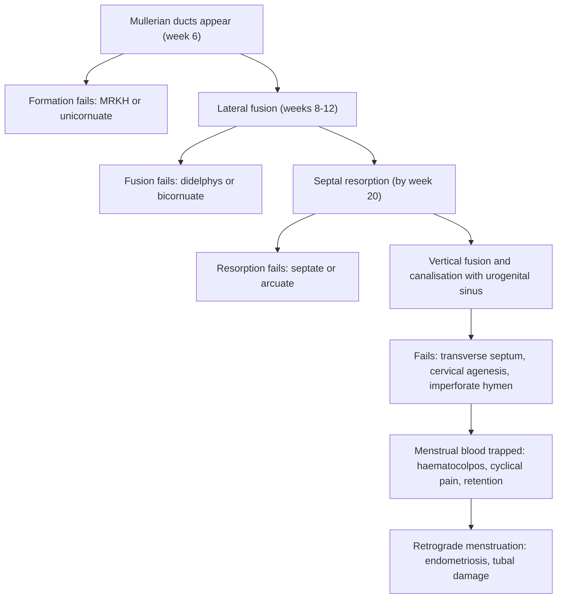

## 1. Definition

**Congenital malformations of the female genital tract** are developmental anomalies of the Müllerian (paramesonephric) duct system and the vaginal plate, producing abnormalities of the uterus, cervix, tubes and vagina (and hymen).

- The uterus, cervix, fallopian tubes and upper vagina are built from **two tubes (the Müllerian ducts) that must grow, meet in the midline, fuse, and then dissolve the wall between them**. The lower vagina must also **join up with, and open into, the urogenital sinus**.
- **Something going wrong at each step** produces a predictable anomaly:
  - **No ducts**: MRKH (no uterus, no upper vagina).
  - **One duct**: a unicornuate uterus.
  - **No fusion**: didelphys (two uteri, two cervices).
  - **Partial fusion**: bicornuate.
  - **No septal resorption**: septate.
  - **No canalisation or no vertical fusion**: transverse vaginal septum, imperforate hymen, cervical agenesis.
- The ovaries develop separately, so **these girls have normal ovaries, normal breasts and normal pubic hair**. That is the key to diagnosis in primary amenorrhoea.
- Because the **kidneys develop from the neighbouring Wolffian (mesonephric) system**, **renal anomalies are common**. Always scan the kidneys.
- **Never forget**: never needle-aspirate a haematocolpos, and never label a girl "pregnant" or "infertile" before examining her carefully and scanning her.

**Key terms**

| Term | Meaning |
|---|---|
| **Imperforate hymen** | The hymenal membrane has no opening, so menstrual blood collects in the vagina (haematocolpos) |
| **Haematocolpos / haematometra / haematosalpinx** | Blood collected in the vagina / uterus / tubes |
| **Mucocolpos** | Mucus collected in the vagina in a newborn (stimulated by maternal oestrogen) |
| **MRKH (Mayer–Rokitansky–Küster–Hauser) syndrome** | Congenital absence of the uterus and upper two-thirds of the vagina in a 46,XX female with normal ovaries. **Type I** is isolated. **Type II** has associated renal, skeletal or hearing anomalies (**MURCS**: Müllerian, Renal, Cervicothoracic Somite anomalies) |
| **OHVIRA / Herlyn–Werner–Wunderlich (HWW)** | **O**bstructed **H**emi**V**agina and **I**psilateral **R**enal **A**nomaly: uterus didelphys with one blocked hemivagina, and absent kidney on the same side |
| **DSD** | Differences (disorders) of sex development: a mismatch between chromosomal, gonadal and anatomical sex |
| **Primary amenorrhoea** | Investigate if **no periods by about 15 with normal breasts** (older texts say 16), or **by 13 with no breast development**; earlier if there is cyclical pain or a mass |

## 2. Epidemiology

- Müllerian anomalies are found in about **5–6% of the general female population**, about **8% of infertile women**, about **13% of women with recurrent miscarriage**, and about **25% of women with both miscarriage and infertility**. Many are **asymptomatic**.
- The **septate uterus** is the commonest structural uterine anomaly in most series, followed by the bicornuate uterus.
- **Imperforate hymen**: about 1 in 1,000–2,000 girls. **Transverse vaginal septum**: about 1 in 30,000–80,000. **MRKH**: about **1 in 4,500–5,000** female births. It is the **second commonest cause of primary amenorrhoea** after gonadal dysgenesis (Turner syndrome).
- **Uganda context**:
  - There are few local prevalence data. Anomalies are usually found **incidentally at CS or ultrasound**, during work-up for **infertility or recurrent miscarriage**, or when a girl presents in **acute retention or with an abdominal mass**.
  - These girls often present late: a 14-year-old with **urinary retention and a pelvic mass** (haematocolpos) who is thought to be pregnant or to have a tumour, or a young wife who **cannot consummate her marriage or conceive** (MRKH), or a woman with **recurrent miscarriage or breech presentation**.
  - **Ultrasound** is widely available; **MRI** is available mainly in Kampala (Mulago and private centres) and is costly.
  - **Specialist reconstruction** (vaginoplasty, septum resection, horn excision) is done at national and regional referral and private hospitals.
  - **IVF** is available at a small number of private centres. **Gestational surrogacy** options for women with MRKH are limited and not clearly regulated.

> [!UGANDA]
> Culturally, fertility and the ability to have intercourse are central to marriage (including bride-price expectations). A diagnosis of MRKH or of a DSD can bring **stigma, rejection and depression**. Counselling must be **private, sensitive and staged**, and involve the girl first and family members only with her consent. Watch for pressure towards early or inappropriate surgery.

## 3. Aetiology and Risk Factors

- **Mechanism-based causes** (section 4): failure of Müllerian duct **formation** (MRKH, unicornuate), **lateral fusion** (didelphys, bicornuate), **septal resorption** (septate, arcuate), **vertical fusion or canalisation** (transverse septum, cervical agenesis, imperforate hymen).
- **Associated Wolffian (mesonephric) insult**: renal agenesis or ectopia on the same side (unicornuate uterus, OHVIRA).
- **Genetic / familial**: most Müllerian anomalies are sporadic; rare familial cases. **CAIS** is X-linked (family history of amenorrhoea, infertility or "girls with hernias").
- **Drugs**: maternal diethylstilbestrol (DES), historically (AFS class VII).
- **DSD**: 46,XX virilisation from **CAH**; 46,XY DSD (CAIS, Swyer syndrome, 5-alpha reductase deficiency); 45,X Turner syndrome.

## 4. Pathophysiology

**1. The indifferent stage (weeks 5–7)**

- Both sexes have **two pairs of ducts**. The **mesonephric (Wolffian) ducts** drain the primitive kidney, and the **paramesonephric (Müllerian) ducts** form lateral to them from an invagination of the coelomic epithelium at about **week 6**.
- The gonad (the genital ridge, populated by germ cells migrating from the yolk sac) is still indifferent.

**2. Sex determination: male vs female pathway**

```
   46,XY -> SRY -> testis
      Sertoli cells -> AMH -> Mullerian ducts REGRESS
      Leydig cells  -> testosterone -> Wolffian ducts -> epididymis, vas, seminal vesicle
                    -> DHT (5-alpha reductase) -> penis, scrotum, prostate
   46,XX (no SRY) -> ovary
      no AMH -> Mullerian ducts PERSIST -> tubes, uterus, cervix, upper vagina
      no testosterone -> Wolffian ducts regress (remnants: Gartner duct cysts,
                         epoophoron, paroophoron)
      no DHT -> external genitalia stay female
```

**Key concept**: the female internal tract is the **default** when there is no AMH. The Wolffian ducts need **testosterone** to survive. External virilisation needs **DHT** acting through the **androgen receptor**.

**3. Building the uterus: the Müllerian ducts**

1. **Formation**: the ducts grow caudally beside the Wolffian ducts. If they do not form, the result is **agenesis (MRKH)**. If one fails, the result is a **unicornuate** uterus.
2. **Lateral fusion** (about weeks 8–12): the lower parts meet and fuse in the midline to form the **uterovaginal canal**. The unfused upper parts become the **fallopian tubes**.
   - Complete failure gives **didelphys**.
   - Partial failure at the fundus gives **bicornuate**.
3. **Septal resorption** (complete by about **week 20**): the midline wall between the fused ducts dissolves from **caudal to cranial**.
   - Failure gives a **septate** uterus (partial or complete).
   - Minimal residual gives an **arcuate** uterus.
4. **Vertical fusion and canalisation**: the fused Müllerian tip (the Müllerian tubercle) meets the **urogenital sinus**. That induces the **sinovaginal bulbs**, which form a solid **vaginal plate**. The plate then **canalises** (hollows out) by about 20 weeks.
   - Failure of the Müllerian and sinus parts to meet or canalise gives a **transverse vaginal septum** or **cervical agenesis**.
   - The **hymen** is the thin membrane left at the junction of the vaginal lumen and the urogenital sinus. If it does not perforate, the result is an **imperforate hymen**.

**4. Why the kidneys are involved.** The **Müllerian ducts form alongside, and depend on, the Wolffian ducts**, which also give rise to the **ureteric bud** (which induces the kidney). An insult to one side of the Wolffian system can therefore cause **both an absent kidney and a missing or obstructed Müllerian structure on the same side**. This explains the **unicornuate uterus with ipsilateral renal agenesis** and **OHVIRA**.

**5. Why ovaries and hormones are normal.** The ovaries come from the **genital ridge**, not the Müllerian ducts. So in MRKH, septa and fusion anomalies, the woman **ovulates, develops breasts and pubic hair normally, and has a normal 46,XX karyotype**. That is why these girls present with **amenorrhoea despite normal puberty**, and why **their eggs can be used in IVF**.



**Feature links**

- Normal ovaries (genital ridge) → normal breasts, pubic hair and ovulation despite amenorrhoea.
- Outflow obstruction + working endometrium → blood trapped → **cyclical pain without bleeding**, haematocolpos/haematometra.
- Haematocolpos pressing on the bladder neck, rectum or sacral nerves → **urinary retention**, constipation, back pain.
- Blood behind a thin membrane at the introitus → **tense, bulging, bluish membrane**, more on Valsalva.
- No uterus (MRKH, CAIS) → amenorrhoea **without** cyclical pain; short blind vagina.
- Androgen receptor failure (CAIS) → testes make testosterone (male range) but no effect → **scant pubic and axillary hair**; testes aromatise to oestrogen → breasts; testes may present as **inguinal hernias**.
- One side drains, the other blocked (OHVIRA, functional non-communicating horn) → **regular periods with worsening unilateral pain** and a paravaginal mass.
- Poorly vascularised septum → poor implantation → **miscarriage** (septate).
- Small or divided cavity → **mid-trimester loss, preterm birth, cervical insufficiency, FGR, malpresentation**, retained placenta.
- Pregnancy in a thin-walled rudimentary horn → **rupture** (often second trimester) → haemorrhage.
- Long-standing obstruction → retrograde menstruation → **endometriosis**, tubal damage, infertility.
- Shared Wolffian origin → **ipsilateral renal agenesis or ectopia**.

## 5. Classification / Staging

**ASRM Müllerian Anomalies Classification 2021 (MAC2021)**. The American Society for Reproductive Medicine replaced the 1988 AFS system with **nine descriptive categories**, illustrated with diagrams and designed to be easy to use:

| # | Category | Key features |
|---|---|---|
| 1 | **Müllerian agenesis** (MRKH) | Absent or rudimentary uterus and upper vagina; may have rudimentary uterine "bulbs" |
| 2 | **Cervical agenesis** | Absent or dysgenetic cervix, with or without the vagina; a functional uterus causes haematometra |
| 3 | **Unicornuate uterus** | One horn, with or without a rudimentary contralateral horn (communicating or not; with or without a cavity) |
| 4 | **Uterus didelphys** | Two separate uteri and two cervices, often with a longitudinal vaginal septum |
| 5 | **Bicornuate uterus** | An external fundal cleft; two cavities joined lower down; one cervix (or two) |
| 6 | **Septate uterus** | Normal or near-normal external contour; an internal septum (partial or complete) |
| 7 | **Longitudinal vaginal septum** | Obstructing or non-obstructing |
| 8 | **Transverse vaginal septum** | At any level; complete (obstructing) or with a small perforation |
| 9 | **Complex anomalies** | Combinations, e.g. OHVIRA, cervical duplication with septate uterus |

> [!NOTE]
> You will still see the **1988 AFS classes** (I agenesis or hypoplasia, II unicornuate, III didelphys, IV bicornuate, V septate, VI arcuate, VII DES-related) and the **ESHRE/ESGE 2013** system (U0–U6 for the uterus, C0–C4 for the cervix, V0–V4 for the vagina). Most classifications now regard the **arcuate** uterus (a mild fundal indentation of the cavity) as a **normal variant** with little clinical impact.

**MRKH**: type I (isolated) vs type II (with renal, skeletal or hearing anomalies; MURCS).

## 6. Clinical Features

### History

Most of these patients are adolescent girls with **primary amenorrhoea**, sometimes with **cyclical pain, a pelvic mass or urinary retention**; a smaller group are women worked up for **recurrent miscarriage, preterm birth, malpresentation or infertility**, and a few are **newborns with ambiguous genitalia**.

| Ask | Why it changes the plan |
|---|---|
| **Age; when did breasts and pubic hair start; growth spurt** | Breasts = working ovaries (oestrogen): the cause is **anatomical (outflow or Müllerian) or CAIS**. No breasts = **gonadal or hypothalamic** (Turner, Swyer, low weight, Kallmann) or constitutional delay |
| **Cyclical (monthly) lower abdominal or back pain, but no bleeding** | **Blood is made but trapped**: imperforate hymen, transverse septum, cervical agenesis, or a functional non-communicating horn |
| **Urinary retention, frequency, constipation, pain on defecation, back pain** | Mass effect of a haematocolpos on the bladder neck, rectum or sacral nerves |
| **Periods regular but worsening one-sided pain and dysmenorrhoea, and a unilateral pelvic mass** | **OHVIRA** or a functional non-communicating horn: an obstruction can coexist with normal periods (one side drains, the other is blocked) |
| **Sexual activity; tampons; pain or failure at intercourse; dyspareunia; "a double vagina"** | Short or blind vagina (MRKH, CAIS, septum); a longitudinal septum; decides whether a speculum is appropriate |
| **Obstetric history**: miscarriages (trimester), preterm births, repeated breech or transverse lies, retained placenta, cervical insufficiency | **Septate** (first-trimester and recurrent loss), **bicornuate/unicornuate** (mid-trimester loss, preterm birth, malpresentation) |
| **Infertility; heavy dysmenorrhoea** | Septate uterus; **endometriosis** from retrograde menstruation through a long-standing obstruction |
| **Kidney problems, UTIs, a single kidney; back or spine problems (scoliosis); hearing loss** | Renal agenesis/ectopia; **MURCS** (type II MRKH) |
| **Sense of smell, weight change, exercise, chronic illness** | Kallmann syndrome, hypothalamic amenorrhoea |
| **Family history** of amenorrhoea, infertility or "girls with hernias"; maternal drugs (DES, historically) | Familial CAIS (X-linked); rare familial cases |
| **Previous surgery**: hernia repair (testes found?), "cutting" of the hymen, aspiration of a mass | CAIS; re-closure or pyocolpos |
| **Neonate**: ambiguous genitalia, vomiting or dehydration, an interlabial bulge | **CAH** (salt-wasting crisis), mucocolpos |
| **Who knows, and what she wants to know** | Staged, confidential disclosure; marriage pressure |

### Examination

Follow the order of Hutchison's Clinical Methods (24th edition). In an emergency (retention, sepsis, ruptured horn, salt-wasting baby) resuscitate first (section 9).

#### Introduction, consent and preparation

- Introduce yourself; **privacy**; an adolescent is examined with a **chaperone**, with a guardian's **consent** plus her own **assent**; explain every step.
- **Hand hygiene**.
- **Position and exposure**: supine for the abdomen; **lithotomy or frog-leg** for the genitalia; expose only what is needed.

#### General inspection and vital signs

- **Height and weight (BMI)**; plot growth.
- **Dysmorphic features**: **Turner syndrome** (short stature, webbed neck, widely spaced nipples, wide carrying angle); spine (**scoliosis**); hearing.
- **Vital signs** (pulse, BP, temperature) and **pain score**.

#### Hands, face and neck; chest

- Webbed neck, low hairline (Turner); widely spaced nipples.
- **Tanner staging**: breasts **and** pubic and axillary hair, separately. **Normal breasts with scant pubic and axillary hair = CAIS** until proven otherwise.

#### Abdomen and groins

- **Suprapubic mass** (haematocolpos or haematometra, or a distended bladder: re-examine after catheterising), tenderness.
- **Inguinal hernias or masses** in a "girl" (testes in CAIS).

#### Genitalia (gentle, chaperoned)

| Look for | Interpretation |
|---|---|
| Clitoral size, labial fusion, position of the urethral opening | Virilisation: DSD (CAH, 5-alpha reductase deficiency) |
| **Tense, bulging, bluish membrane** that bulges more on Valsalva; no separate hymenal ring | **Imperforate hymen** with haematocolpos |
| Normal hymen with a **short blind vagina** behind it and **no bulge** | **Transverse septum** (mass above it on rectal exam), **MRKH** or **CAIS** (no mass) |
| Vaginal length, measured gently with a moistened **cotton-tipped swab** (**never force a speculum** in a girl who is not sexually active) | Short blind pouch = agenesis or septum |
| Speculum (sexually active only) | **Longitudinal septum**, **two cervices** (didelphys), a unilateral **bulge in the lateral vaginal wall** (obstructed hemivagina) |

#### Rectal (rectoabdominal) examination

- Cystic, **bulging mass anteriorly** = **haematocolpos** (and its lower level: close to the introitus or high); **no uterus** palpable = MRKH or CAIS.

#### Completing the examination

- Thank her, cover her, hand hygiene; explain findings privately; summarise.

### Red flags

> [!REDFLAG]
> - **Acute urinary retention in a pubertal girl without periods**: haematocolpos until proven otherwise. Catheterise and examine the hymen.
> - **Fever and pelvic pain with a known obstruction**: **pyocolpos or pyometra** (often after needle aspiration). Needs drainage and antibiotics.
> - **First- or second-trimester pregnancy with abdominal pain and shock in a woman with a unicornuate uterus**: **rupture of a rudimentary horn pregnancy**. Resuscitate and do a laparotomy.
> - **A newborn with ambiguous genitalia who is vomiting, dehydrated or collapsing at 1–3 weeks**: **salt-wasting CAH**. Check electrolytes and glucose, and give IV hydrocortisone.
> - **A "girl" with inguinal hernias**: consider **CAIS**. Karyotype before the hernia repair.

### Thinking like a clinician

1. **Primary amenorrhoea: ask two questions.**
   - "**Has she developed breasts?**" Yes means the ovaries are producing oestrogen, so look for an anatomical cause or CAIS.
   - "**Does she have monthly pain?**" Yes means blood is trapped, so look for an **outflow obstruction**. No means **there is no functional uterus** (MRKH) or no uterus at all (CAIS).
2. **MRKH or CAIS?** Both have breasts and a short blind vagina with no uterus.
   - **MRKH**: **46,XX**, **normal pubic and axillary hair**, ovaries, **female-range testosterone**.
   - **CAIS**: **46,XY**, **scant or absent pubic hair**, **testes** (inguinal or abdominal), **male-range testosterone**.
   - **The karyotype settles it.**
3. **Imperforate hymen or transverse septum?** An imperforate hymen **bulges at the introitus**, and there is **no hymenal ring visible separately**. A transverse septum sits **higher**: the hymen is normal, the vagina is short, and there is **no bulge at the introitus**. Getting this wrong is dangerous. A "hymenotomy" on a septum does not work and scars the vagina.
4. **Septate or bicornuate?** Look at the **outside of the fundus**. **Flat or minimally indented** means **septate** (treatable hysteroscopically). A **deep external cleft** means **bicornuate** (hysteroscopic resection would perforate the uterus). An HSG shows only the cavity and **cannot distinguish them**. Use 3D ultrasound, MRI, or laparoscopy plus hysteroscopy.
5. **Regular periods do not exclude an obstruction.** In OHVIRA, one side drains normally and the other side fills, so she has increasing pain and a paravaginal mass.
6. **Always scan the kidneys.** Also think about the spine and hearing in MRKH.
7. **Always do a pregnancy test first**, however young she is and whatever she or her family says. Ask for it privately.
8. **Common student mistakes**:
   - calling a pelvic mass in a 13-year-old "pregnancy" or a "tumour" without looking at the hymen
   - needle aspiration of a haematocolpos
   - not checking pubic hair and inguinal regions (CAIS)
   - forgetting the renal scan

> [!EXAM]
> "Breasts? Pain? Hair?" Breasts + pain = obstruction. Breasts + no pain + normal hair = MRKH. Breasts + no pain + no hair = CAIS. No breasts = Turner, Swyer or hypothalamic.

## 7. Differential Diagnoses

**Primary amenorrhoea with normal breast development**

| Differential | Distinguishing clinical feature | Distinguishing investigation |
|---|---|---|
| **Imperforate hymen** | Cyclical pain, a **bulging bluish membrane**, suprapubic mass, sometimes retention | Clinical; ultrasound showing haematocolpos |
| **Transverse vaginal septum** | Cyclical pain, normal hymen, **short blind vagina**, a mass felt on rectal exam | Ultrasound or **MRI** (level and thickness) |
| **Cervical agenesis** | Cyclical pain, haematometra, no cervix | MRI |
| **MRKH** | **No cyclical pain**, normal pubic hair, short blind vagina, no uterus | Ultrasound or MRI; **karyotype 46,XX**; renal US |
| **CAIS** | **Scant pubic and axillary hair**, inguinal masses, no uterus | **Karyotype 46,XY**, **testosterone in the male range** |
| **Constitutional delay** (breasts developing) | Family history of late menarche, otherwise normal | Watch; ultrasound shows a normal uterus |
| **Pregnancy** | Always consider (even in a "primary" presentation) | **Pregnancy test** |

**Primary amenorrhoea without breast development**

| Differential | Distinguishing clinical feature | Distinguishing investigation |
|---|---|---|
| **Turner syndrome (45,X)** | Short stature, webbed neck, streak ovaries, **uterus present** | High FSH; karyotype |
| **Swyer syndrome (46,XY gonadal dysgenesis)** | Tall, uterus present, streak gonads (high tumour risk) | High FSH; karyotype 46,XY |
| **Hypothalamic / pituitary** | Low weight, exercise, anosmia (Kallmann), chronic illness | Low FSH and LH; MRI of the pituitary |

**Pelvic mass in an adolescent**

| Differential | Distinguishing clinical feature | Distinguishing investigation |
|---|---|---|
| Haematocolpos / haematometra | Primary amenorrhoea, cyclical pain | Ultrasound |
| **Pregnancy** | Sexual activity (often denied) | Pregnancy test |
| Ovarian cyst or tumour (dermoid, germ cell tumour) | Adnexal mass, periods may be normal | Ultrasound, tumour markers |
| Full bladder | Retention | Mass disappears after catheterisation |
| Obstructed hemivagina | Regular periods, unilateral pain, paravaginal bulge | Ultrasound/MRI; renal US (ipsilateral agenesis) |
| Pelvic kidney | Asymptomatic | Renal ultrasound |

## 8. Clinical Workup

The workup answers: **Is she pregnant? Is there an emergency (retention, infection, a ruptured horn, a salt-wasting baby)? Are the ovaries working (breasts)? Is blood trapped (cyclical pain), and where exactly is the block? Is there a uterus, and what is the karyotype? Are the kidneys normal?** Three rules: **pregnancy test first**; **always scan the kidneys**; **define the anatomy fully (MRI for anything above the hymen) before the first operation**, because the first operation is the best chance.

### Bedside

"Available at" is the lowest level that usually offers the test [VERIFY: availability compiled from the source notes, not an MoH list].

| Test | What you want | Why | Available at |
|---|---|---|---|
| **Urine pregnancy test** | hCG | Always first in amenorrhoea or a pelvic mass | All levels |
| **Catheter volume** (if retention) | Volume drained; does the mass shrink? | A mass that persists after emptying the bladder is haematocolpos/metra (or another mass) | All levels |
| **Urine dipstick** | Nitrites, leucocytes, blood | UTI from retention; renal anomaly clues | All levels |
| **Point-of-care (transabdominal) ultrasound** | Distended vagina or uterus full of echogenic fluid; is there a uterus? kidneys present? | Confirms haematocolpos quickly; **no uterus** points to MRKH/CAIS | HC IV and above with an operator |
| **Hb / HemoCue** | Anaemia | Before surgery; long-standing obstruction | HC III and above |
| **Random blood sugar and electrolytes** (neonate) | Hypoglycaemia, **low Na⁺, high K⁺** | **Salt-wasting CAH** | Glucose at all levels; electrolytes at hospitals |
| **Vaginal length by swab** | Blind short vagina | Agenesis vs septum | All levels |

### Basic lab

| Test | When | Expected / abnormal finding | How it changes management | Available at |
|---|---|---|---|---|
| **FBC** | Before surgery; pyocolpos | Anaemia; raised WBC | Transfusion, antibiotics | HC IV and above |
| **Urea, creatinine** | Renal anomaly, single kidney, hydronephrosis | Raised creatinine | Protect the single kidney; avoid nephrotoxins | General hospital and above |
| **Blood culture** | Fever with suspected pyocolpos/pyometra | Organism | Antibiotic choice | Regional/national referral |

Basic lab rows added to complete the workup; not in the source notes [VERIFY: local practice].

### Imaging

| Test | When | Expected / abnormal finding | How it changes management | Available at |
|---|---|---|---|---|
| **Pelvic ultrasound** (transabdominal; transperineal in adolescents; transvaginal if sexually active) | Every case, first line | Haematocolpos ± haematometra; uterus absent (MRKH/CAIS) or present; horns; ovaries (present in MRKH) | Diagnosis and urgency | Widely available (HC IV and above) |
| **Renal ultrasound** | **Always** | Renal agenesis, pelvic or horseshoe kidney, hydronephrosis | About **30–40%** association in MRKH and unicornuate uterus; protect a single kidney; OHVIRA side | HC IV and above |
| **MRI pelvis** | Transverse septum (level, thickness), cervical agenesis, obstructed hemivagina, rudimentary horns, before any reconstructive surgery | Exact anatomy | Surgical planning; the first operation is the best chance | **Kampala only** (Mulago and private), costly |
| **3D ultrasound** | Septate vs bicornuate | External fundal contour | Only the septate uterus is resected hysteroscopically | Specialist and private units |
| **HSG** | Infertility work-up | Cavity shape | **Cannot see the outer contour**, so cannot tell septate from bicornuate | Regional/national referral, private |
| **Spine X-ray, audiology** | MRKH | Vertebral anomalies, hearing loss | Type II MRKH (MURCS) | General hospital and above (audiology at referral) |
| **Cervical length scans** in pregnancy | Known bicornuate/unicornuate uterus or previous mid-trimester loss | Short cervix | Cerclage and/or vaginal progesterone | Referral and private units |

### Specialised / referral-level

| Test | When | Expected / abnormal finding | How it changes management | Available at |
|---|---|---|---|---|
| **Karyotype** | No uterus (MRKH vs CAIS); no breasts (Turner, Swyer); ambiguous genitalia | 46,XX / 46,XY / 45,X | Settles MRKH vs CAIS; gonadectomy decisions (Swyer at diagnosis, CAIS after puberty) | National referral, research or private laboratories; costly and slow |
| **FSH, LH, oestradiol** | Absent or poor breast development; suspected gonadal failure | **High FSH** = gonadal failure (Turner, Swyer); **low FSH/LH** = hypothalamic/pituitary | Directs to karyotype or pituitary work-up | Regional/national referral and private labs |
| **Testosterone** | No uterus with a blind vagina | **Male range** = CAIS; female range = MRKH | Supports the karyotype result | Regional/national referral and private labs |
| **Prolactin, TSH** | Primary amenorrhoea without an anatomical cause | Raised | Treat the endocrine cause | Regional/national referral and private labs |
| **17-OH progesterone, electrolytes, glucose** | Newborn with ambiguous genitalia | Raised 17-OHP; low Na⁺, high K⁺ | **CAH**: hydrocortisone ± fludrocortisone; paediatric endocrinology | 17-OHP mainly at national referral/private labs |
| **Hysteroscopy ± laparoscopy** | Recurrent loss or infertility with a suspected septum; endometriosis | Septum, cavity, fundal contour, endometriosis | Diagnosis and treatment in one sitting | Referral and private centres |

### Putting it together

**Model one-line summary**: "A 14-year-old with **primary amenorrhoea, normal breasts and pubic hair (Tanner 4)**, 4 months of **cyclical pain**, **acute urinary retention**, a 20-week suprapubic mass and a **bulging bluish membrane at the introitus**; pregnancy test negative, ultrasound showing a **haematocolpos**, both kidneys normal: imperforate hymen."

**Problem list**

1. Primary amenorrhoea with outflow obstruction (imperforate hymen).
2. Haematocolpos with mild haematometra.
3. Acute urinary retention (catheterised).
4. Anxiety and family fear of pregnancy or tumour.

**Working diagnosis and plan**: imperforate hymen → catheter, analgesia, **cruciate or elliptical hymenotomy under anaesthesia with drainage** (no needle aspiration), follow-up for normal menses and stenosis.

**Model case presentation (ward round)**

> "N is a 14-year-old girl from Mukono brought with **acute urinary retention** and 4 months of **cyclical lower abdominal pain**. She has **not started her periods** despite **normal breast development (Tanner 4) and pubic hair**. On examination she has a **tender suprapubic mass** (about 20 weeks' size) and a **tense, bulging, bluish membrane at the introitus**. The urine pregnancy test is negative. Ultrasound shows a **large haematocolpos with mild haematometra**, and both kidneys are normal. **Summary: primary amenorrhoea due to imperforate hymen with haematocolpos causing urinary retention.** Plan: catheterise, analgesia, and **hymenotomy (cruciate incision) under anaesthesia with drainage**, with no needle aspiration, then follow up for normal menses."

**Worked example 1: primary amenorrhoea with cyclical pain**

Two 15-year-olds, both with normal breasts and pubic hair, monthly pain and no periods. Both pregnancy tests are negative.

| | Girl A | Girl B |
|---|---|---|
| Introitus | **Bulging bluish membrane**, bulges more on Valsalva | **Normal hymenal ring**, pink, no bulge |
| Swab | Cannot pass | Enters a **blind vagina about 3 cm** long |
| Rectal exam | Large tense cystic mass low in the pelvis | Tense mass **higher up** |
| Ultrasound | Haematocolpos reaching the introitus | Haematocolpos above a short lower vagina |
| Kidneys | Normal | Normal |
| **Diagnosis** | **Imperforate hymen** | **Transverse vaginal septum** (mid-vagina) |
| **Next step** | Hymenotomy with drainage | **MRI** for level and thickness; **menstrual suppression** (norethisterone 5 mg 2–3 times daily) as a bridge; **septum resection** with end-to-end anastomosis by an experienced surgeon, then dilators |

A **third pattern**: normal breasts, cyclical pain, a **normal-length vagina ending without a cervix**, and haematometra on scan = **cervical agenesis**: MRI and specialist referral.

> [!REDFLAG]
> Doing a "hymenotomy" on Girl B would not reach the blood and would scar the lower vagina. **Look before you cut**: a normal hymenal ring means the block is higher.

**Worked example 2: primary amenorrhoea without pain**

Two 17-year-olds with normal breasts, no cyclical pain and a **short blind vagina**. Ultrasound in both: **no uterus**.

| | Girl C | Girl D |
|---|---|---|
| Pubic and axillary hair | **Normal** | **Scant** |
| Inguinal regions | Normal | **Bilateral inguinal swellings** (previous "hernia repair" as a child) |
| Ovaries on scan | **Present** | Not seen; gonads in the groins |
| Testosterone | Female range | **Male range** |
| Karyotype | **46,XX** | **46,XY** |
| Kidneys | **Right renal agenesis** | Normal |
| **Diagnosis** | **MRKH** (type II if renal/spinal anomalies) | **CAIS** |
| **Plan** | Staged counselling; **vaginal dilators first line**; spine and hearing check; no HRT needed; motherhood via IVF with her own eggs and a gestational carrier, or adoption | Staged, sensitive disclosure; dilators; **gonadectomy usually after puberty**, then oestrogen replacement; MDT |

## 9. Management

### Immediate / emergency

**First 5 minutes**

1. **A, B, C: vital signs** (pulse, BP, temperature) and **pain score**. Give analgesia early.
2. **Urine pregnancy test** in every girl or woman with amenorrhoea or a pelvic mass, however young and whatever she or her family says. Ask for it privately.
3. **Acute urinary retention** in a pubertal girl without periods: **catheterise** (gently; the urethra is stretched over the mass) and record the volume. Then **look at the hymen**: haematocolpos until proven otherwise.
4. **Fever with pelvic pain** and a known or suspected obstruction (especially after someone has "tapped" the mass): **pyocolpos or pyometra**. Blood culture if available, **IV ceftriaxone 1 g daily + metronidazole 500 mg 8-hourly**, and plan surgical drainage.
5. **Pregnant with a known unicornuate uterus, abdominal pain and shock**: **ruptured rudimentary horn pregnancy**. Two large-bore cannulae, cross-match, fluids and **laparotomy**.
6. **Newborn with ambiguous genitalia who is vomiting, dehydrated or collapsed** (often at 1–3 weeks): **salt-wasting CAH**. Check glucose and electrolytes, send 17-OH progesterone before treatment if possible, give **IV saline, glucose and hydrocortisone** per the paediatric protocol, and call the paediatrician. **Do not assign sex at the bedside.**
7. **Privacy and consent**: an adolescent is examined with a chaperone, and a guardian's consent plus her own assent; explain every step.

### Definitive

#### A. General principles

1. **Diagnose the anatomy precisely before any surgery** (ultrasound, and MRI if complex). The first operation is the best chance.
2. **Relieve obstruction promptly**: pain, retention, and the risk of endometriosis, infection and tubal damage.
3. **Scan the kidneys** and assess other associated anomalies.
4. **Refer complex cases** to a paediatric or adolescent gynaecology or reconstructive centre (a national or regional referral hospital).
5. **Psychological support and staged, confidential counselling** for the girl and, with her consent, her family.
6. **Temporary menstrual suppression** can "buy time" before definitive surgery for an obstruction.

#### B. Imperforate hymen: step by step

1. **Confirm the diagnosis**: a bulging bluish membrane, and ultrasound showing haematocolpos. **Catheterise if she is in retention.**
2. **Do not needle-aspirate**. It drains incompletely, and the blood becomes infected (**pyocolpos**).
3. **Hymenotomy under anaesthesia** (GA or spinal, or ketamine per local practice), in **lithotomy**:
   - Make a **cruciate (X-shaped) or elliptical incision** in the membrane.
   - **Drain the thick, dark "chocolate" blood.** Do not probe or instrument the uterus.
   - **Excise the four quadrant flaps** back to the hymenal ring.
   - **Suture the vaginal mucosa to the hymenal ring edges** with fine absorbable sutures (e.g. 3-0 or 4-0 polyglactin) to prevent re-closure.
4. **Afterwards**:
   - analgesia
   - sitz baths
   - **a single prophylactic antibiotic dose** is commonly given
   - check she can void
   - **follow up** to confirm normal menses and to check for stenosis or re-closure, and for endometriosis symptoms if the obstruction was long-standing
5. **Timing in children**:
   - An asymptomatic imperforate hymen found in infancy is ideally repaired **after oestrogenisation (around early puberty) but before menarche**.
   - A **symptomatic neonatal mucocolpos** (retention, mass effect) is drained at diagnosis.

#### C. Transverse vaginal septum

1. Define the **level (lower, mid or upper vagina)** and **thickness** by **MRI**. A thin, low septum is easier.
2. **Menstrual suppression** while waiting (see the drug table).
3. **Excision of the septum with end-to-end anastomosis** of the upper and lower vaginal mucosa, by an experienced surgeon. A thick septum may need **pre-operative dilator therapy**, grafts or flaps.
4. **Post-operatively**: **vaginal moulds or dilators** to prevent **stenosis**, which is the main complication.
5. A small perforated septum in pregnancy may cause **dystocia**. It can be incised at delivery or deliver by CS.

#### D. Longitudinal vaginal septum and OHVIRA

- **Non-obstructing longitudinal septum**: excise it only if it is symptomatic (dyspareunia, difficulty with tampons) or it obstructs labour. It can often be divided in the second stage with ligatures if it tightens across the presenting part.
- **OHVIRA (obstructed hemivagina)**:
  - **resect the obstructing vaginal septum** to drain the blocked side and create one vagina
  - **do not remove the uterus**
  - the renal agenesis needs no treatment except **protecting the single kidney**: avoid nephrotoxins, and check BP and renal function periodically
  - pregnancy outcomes after septum resection are generally good

#### E. MRKH syndrome

1. **Disclosure and counselling first**:
   - Do it privately, with the girl, in stages.
   - Emphasise that **she is a woman, with normal ovaries and hormones**.
   - A **functional vagina can be created**.
   - Motherhood is possible through **IVF with her own eggs and a gestational carrier (surrogate)** or adoption. Uterine transplantation is experimental.
   - Offer **peer support** and psychology.
2. **Creating a vagina**:
   - **Timing**: when **she** is emotionally mature and motivated, usually late adolescence. **Never rush it** because of marriage pressure.
   - **First line: progressive vaginal dilator therapy (Frank method)**. Graduated dilators are pressed against the vaginal dimple for about 20–30 minutes once or twice daily over months. This is effective in most motivated women, and has no surgical risk. ACOG recommends it first line.
   - **Surgery** if dilation fails or she chooses it:
     - **McIndoe** (split-thickness skin graft over a mould)
     - **Vecchietti** (traction device, laparoscopic)
     - **Davydov** (peritoneal lining)
     - **bowel vaginoplasty** (sigmoid)
     - all need **ongoing dilation or intercourse** to maintain the vagina
3. **Associated anomalies**: renal ultrasound, spine and hearing assessment.
4. **No HRT is needed** (the ovaries work). If rudimentary uterine horns contain functional endometrium and cause pain, laparoscopic excision may be needed.

#### F. Uterine anomalies

| Anomaly | Main problems | Management |
|---|---|---|
| **Septate** | **Highest miscarriage risk** among the anomalies (the septum is poorly vascularised, so implantation is poor), preterm birth, malpresentation, infertility | **Hysteroscopic septum resection (metroplasty)** is offered to women with **recurrent pregnancy loss** (or after a poor outcome) after counselling. Recent trials have questioned its benefit in unselected women, so do not operate on an incidental septum in asymptomatic women |
| **Bicornuate** | Second-trimester loss, **preterm labour**, **cervical insufficiency**, malpresentation | Usually **no surgery**. **Serial cervical length** scans in pregnancy, with cerclage if the cervix shortens. Abdominal (Strassman) metroplasty only rarely, in selected recurrent loss |
| **Unicornuate** | Miscarriage, preterm birth, **FGR**, malpresentation. **Rudimentary horn pregnancy with rupture** | **Laparoscopic excision of a functional non-communicating rudimentary horn** (with the ipsilateral tube), to prevent horn pregnancy, haematometra and endometriosis. Monitor the cervix and fetal growth in pregnancy. **Renal scan** |
| **Didelphys** | Generally the **best outcomes** of the fusion defects; preterm birth, malpresentation; a **longitudinal septum**; OHVIRA | Usually none. Excise the vaginal septum if symptomatic. Metroplasty is not recommended |
| **Arcuate** | Usually none | No treatment |
| **Cervical agenesis** | Haematometra, endometriosis, infertility | Specialist management: **menstrual suppression**, then **uterovaginal anastomosis** in expert centres. Historically hysterectomy |

#### G. Pregnancy in a woman with a known uterine anomaly

1. **Early ultrasound** to confirm the site (exclude a rudimentary horn pregnancy, and check which horn).
2. **Serial cervical length** (from 16–24 weeks) in bicornuate or unicornuate uterus, or with a previous mid-trimester loss. **Cerclage and/or vaginal progesterone** as indicated.
3. **Growth scans** (FGR, especially with a unicornuate uterus).
4. **Check the presentation at 36 weeks**. **ECV is relatively contraindicated** with a major uterine anomaly.
5. **Delivery**: vaginal birth is possible with a cephalic presentation. Anticipate **retained placenta and PPH**. CS rates are higher. **Document the anomaly** in the operation note for future care.

#### H. DSD: an overview for the student

- **Newborn with ambiguous genitalia**:
  - Do **not** assign sex at the bedside.
  - Use neutral language ("your baby").
  - **Exclude CAH urgently** (17-OH progesterone, electrolytes, glucose): it is the **commonest cause of ambiguous genitalia in a 46,XX baby**, and salt-wasting can kill in the second or third week.
  - Refer to a **multidisciplinary team** (paediatric endocrinology, surgery, genetics, psychology).
- **46,XY DSD**:
  - **CAIS**: female phenotype, blind vagina, testes. **Gonadectomy**, usually **after puberty** (the testes provide oestrogen by aromatisation for natural breast development, and the tumour risk before adulthood is low), then **oestrogen replacement**. Disclosure is sensitive.
  - **Swyer syndrome**: streak gonads with a **high risk of gonadoblastoma**, so **gonadectomy at diagnosis**, then HRT. The uterus is present, so pregnancy is possible with donor eggs.
  - **5-alpha reductase deficiency**: virilises at puberty.
- **Turner syndrome (45,X)**: streak ovaries, short stature, cardiac (coarctation, bicuspid aortic valve) and renal anomalies. Growth hormone, oestrogen for puberty, and cardiac follow-up.

### Drug table

| Drug | Dose (adult; child per kg where stated) | Route | Frequency | Duration | Key cautions |
|---|---|---|---|---|---|
| **Norethisterone** (menstrual suppression while awaiting surgery) | 5 mg | PO | 2–3 times daily, continuously | Until definitive surgery (short term) | Bloating, spotting; a bridge, not a cure |
| **Combined oral contraceptive** (continuous, skipping pill-free weeks) | 1 tablet (e.g. ethinylestradiol 30 µg + levonorgestrel 150 µg) | PO | Once daily, continuously | Until surgery | Alternative suppression; check UKMEC/WHO MEC eligibility |
| **GnRH agonist** (e.g. goserelin) | 3.6 mg | SC | Every 28 days | Specialist; add-back therapy if more than 6 months | Specialist use, for cervical agenesis or complex obstruction; hypo-oestrogenic effects |
| **Ibuprofen** | 400 mg | PO | 8-hourly with food | As needed | Cyclical pain / dysmenorrhoea; avoid in renal impairment (single kidney) |
| **Paracetamol** | 1 g (15 mg/kg in children) | PO / IV | 6-hourly | As needed | Max 4 g/day (60 mg/kg/day in children) |
| **Ceftriaxone + metronidazole** (pyocolpos or pyometra) | 1 g + 500 mg | IV | Ceftriaxone once daily; metronidazole 8-hourly | Switch to oral to complete about 7 days | Plus **surgical drainage** |
| **Prophylactic antibiotic** (hymenotomy) | Single dose per unit protocol | IV | Once | Single dose | Commonly given |
| **Hydrocortisone** (neonatal salt-wasting CAH crisis) | 25 mg stat, then 50–100 mg/m²/day | IV | Stat dose, then the daily dose split 6-hourly per the paediatric protocol | Until stable, then maintenance per paediatric endocrinology | **Paediatric emergency**; plus IV saline and glucose; specialist guidance |

> [!DRUG]
> Menstrual suppression is a **bridge**, not a cure. It relieves cyclical pain and stops further accumulation while you arrange imaging and definitive surgery. It does **not** drain an existing haematocolpos.

### Referral criteria

Referral triggers compiled from the source notes and UCG levels of care [VERIFY: not an MoH referral list].

| Level | What to do | Refer up when |
|---|---|---|
| **HC III** | Pregnancy test, catheterise retention, analgesia, look at the hymen | Any suspected anomaly, pelvic mass, primary amenorrhoea → HC IV / general hospital |
| **HC IV / General hospital** | Pelvic and renal ultrasound, hymenotomy for a clear imperforate hymen, drainage and antibiotics for pyocolpos, laparotomy for ruptured horn, start menstrual suppression, resuscitation of a salt-wasting neonate | Normal hymen with a blind vagina (septum), no uterus (MRKH vs CAIS), cervical agenesis, OHVIRA, rudimentary horn, ambiguous genitalia → RRH / NRH |
| **Regional referral hospital** | Specialist gynaecology, hysteroscopy/laparoscopy where available, cervical length surveillance, karyotype sampling | MRI, karyotype/hormones, complex reconstruction (septum resection, vaginoplasty, uterovaginal anastomosis), DSD MDT → NRH / private specialist centres |
| **National referral (Mulago) and private centres** | MRI, karyotype, 17-OHP, paediatric endocrinology, reconstructive surgery, IVF (private) | n/a |

### Monitoring and follow-up

- **After hymenotomy**: confirm normal menses; check for stenosis or re-closure; ask about endometriosis symptoms if the obstruction was long-standing.
- **After septum resection or vaginoplasty**: vaginal moulds or dilators; review for stenosis.
- **MRKH on dilator therapy**: regular review of progress and psychological support.
- **Single kidney**: BP and renal function periodically; avoid nephrotoxins.
- **Pregnancy with a uterine anomaly**: early scan, serial cervical length from 16–24 weeks, growth scans, presentation at 36 weeks.
- **CAIS after gonadectomy**: oestrogen replacement; **Turner**: cardiac follow-up.

## 10. Complications

| Of the anomaly (disease-related) | Of treatment (treatment-related) |
|---|---|
| Haematocolpos causing **retention**, **hydronephrosis**, constipation | **Pyocolpos** after needle aspiration or incomplete drainage |
| **Endometriosis** and tubal damage from retrograde menstruation (long obstruction) causing infertility | **Vaginal stenosis** after septum resection or vaginoplasty (without dilator use) |
| Pyometra or pyocolpos | Re-obstruction or re-closure after hymenotomy |
| **Miscarriage, preterm birth, FGR, malpresentation, retained placenta, PPH** | **Uterine perforation** at hysteroscopic septum resection; uterine rupture in a later pregnancy |
| **Rudimentary horn pregnancy with rupture** | Bowel or bladder injury (vaginoplasty) |
| Infertility | Psychological harm from poorly handled disclosure |
| Psychosexual distress, marital breakdown, stigma | Gonadal tumour if gonadectomy is delayed in Swyer syndrome |
| Salt-wasting crisis (CAH) | Hysteroscopic resection of a bicornuate uterus: perforation |

## 11. Prognosis

- **Imperforate hymen**: excellent after a correct hymenotomy, provided no long-standing endometriosis or tubal damage.
- **Transverse septum**: stenosis is the main problem; thick and high septa do worse; the first operation is the best chance.
- **MRKH**: a functional vagina is achieved by dilators in most motivated women; normal ovarian function; motherhood possible via IVF with her own eggs and a gestational carrier, or adoption.
- **Uterine anomalies**: **didelphys** has the best outcomes of the fusion defects; **septate** has the highest miscarriage risk; bicornuate and unicornuate carry mid-trimester loss, preterm birth, FGR and malpresentation. **OHVIRA**: pregnancy outcomes after septum resection are generally good.
- **Ugandan outcome data are not available.**

## 12. Prevention

- Most anomalies cannot be prevented (developmental, mostly sporadic); historically, avoid DES in pregnancy.
- **Prevent the complications**: early recognition of primary amenorrhoea with cyclical pain; **never needle-aspirate**; define anatomy before the first operation; dilators after reconstruction; excise a functional non-communicating horn before pregnancy; serial cervical length in pregnancy.
- **Prevent harm from DSD**: do not assign sex at the bedside; screen for CAH in ambiguous genitalia; karyotype a "girl" with inguinal hernias before hernia repair; gonadectomy at diagnosis in Swyer.
- **Prevent psychological harm**: private, staged disclosure; resist marriage pressure for early surgery.

## 13. Special Populations

- **Newborns**: mucocolpos (drain if symptomatic); ambiguous genitalia = salt-wasting CAH until excluded; do not assign sex at the bedside.
- **Children**: an asymptomatic imperforate hymen is repaired after oestrogenisation but before menarche; never force a speculum; measure vaginal length with a swab.
- **Adolescents**: guardian consent plus her assent; privacy; staged disclosure; dilator therapy only when she is ready.
- **Pregnant women with a known anomaly**: early scan for horn pregnancy, cervical surveillance, growth scans, ECV relatively contraindicated, anticipate retained placenta and PPH.
- **Women with a single kidney**: avoid nephrotoxins (NSAIDs with care); periodic BP and renal function.

## 14. Key Points

### High-yield points

- **Form, fuse, dissolve, open**: each failure gives a predictable anomaly.
- **Ovaries are normal** in Müllerian anomalies: normal breasts and pubic hair.
- **Breasts? Pain? Hair?** sorts primary amenorrhoea.
- **Pregnancy test first**, always.
- **Imperforate hymen**: bulging bluish membrane; **hymenotomy, never needle aspiration**.
- **Normal hymenal ring + blind vagina** = block is higher: MRI before surgery; suppress menses as a bridge.
- **MRKH vs CAIS**: hair, gonads, testosterone, **karyotype**.
- **Always scan the kidneys** (30–40% association); OHVIRA = didelphys + obstructed hemivagina + ipsilateral renal agenesis.
- **Septate vs bicornuate**: external fundal contour (3D US/MRI); only septate is resected; HSG cannot tell.
- **Rudimentary horn pregnancy ruptures**: excise a functional non-communicating horn.

### Numbers & doses

| Item | Value |
|---|---|
| Müllerian anomalies in the general female population | About **5–6%** (about 8% infertile; about 13% recurrent miscarriage; about 25% miscarriage plus infertility) |
| Imperforate hymen | About **1 in 1,000–2,000** girls |
| Transverse vaginal septum | About **1 in 30,000–80,000** |
| MRKH | About **1 in 4,500–5,000** female births; **second commonest cause of primary amenorrhoea** after gonadal dysgenesis |
| Renal anomalies with MRKH or unicornuate uterus | About **30–40%** |
| Embryology | Müllerian ducts appear about **week 6**; lateral fusion about **weeks 8–12**; septal resorption and canalisation complete by about **week 20** |
| Investigate primary amenorrhoea | **No periods by about 15 with normal breasts** (older texts 16), or **by 13 with no breast development**; earlier with cyclical pain or a mass |
| ASRM MAC2021 | **9 categories** |
| Hymenotomy sutures | Fine absorbable, e.g. **3-0 or 4-0 polyglactin** |
| Norethisterone (menstrual suppression) | **5 mg orally 2–3 times daily**, continuously |
| Goserelin (specialist) | **3.6 mg SC every 28 days**; add-back if more than 6 months |
| Pyocolpos/pyometra | **Ceftriaxone 1 g IV daily + metronidazole 500 mg IV 8-hourly** + drainage; about 7 days in total |
| Neonatal salt-wasting CAH | **Hydrocortisone 25 mg IV stat**, then 50–100 mg/m²/day in divided doses + IV saline and glucose; crisis typically at **1–3 weeks** |
| Vaginal dilator therapy (MRKH) | About **20–30 min, once or twice daily**, over months |
| Cervical length surveillance (bicornuate/unicornuate) | From about **16–24 weeks** |
| Presentation check with a uterine anomaly | **36 weeks** (ECV relatively contraindicated) |

### Exam traps

- **Needle-aspirating a haematocolpos.** Never: incomplete drainage and **pyocolpos**. Do a formal hymenotomy.
- **A "hymenotomy" for a transverse septum.** A normal hymenal ring means the block is higher: MRI and a specialist septum resection.
- **Labelling a 13-year-old with a pelvic mass as pregnant (or as having a tumour)** without doing a pregnancy test and looking at the hymen.
- **Using HSG to tell septate from bicornuate.** HSG shows only the cavity; you need the **external contour** (3D ultrasound, MRI or laparoscopy).
- **Hysteroscopic resection of a bicornuate uterus.** Perforation; only the **septate** uterus is resected, and only after counselling (recurrent loss).
- **"Regular periods exclude an obstruction."** Not in **OHVIRA** or a functional non-communicating horn.
- **Forgetting the kidneys** (and spine and hearing in MRKH) or the **pubic hair and groins** (CAIS).
- **Starting HRT for MRKH.** Not needed: the ovaries work. CAIS needs oestrogen only after gonadectomy.

### Questions seniors ask

**Viva questions**

1. **What do the Müllerian ducts form?** The fallopian tubes, uterus, cervix and upper vagina. The lower vagina comes from the urogenital sinus.
2. **Why do girls with MRKH have normal breasts?** The ovaries come from the genital ridge, not the Müllerian ducts, so they produce oestrogen normally.
3. **How do you distinguish MRKH from CAIS?** MRKH: 46,XX, normal pubic hair, female testosterone. CAIS: 46,XY, scant pubic hair, testes, male testosterone.
4. **Why scan the kidneys?** The Müllerian and Wolffian ducts develop together, so renal agenesis or ectopia is common (about 30–40% in MRKH or unicornuate uterus).
5. **What is OHVIRA?** Didelphys, an obstructed hemivagina, and ipsilateral renal agenesis.
6. **How do you tell septate from bicornuate?** By the external fundal contour on 3D ultrasound or MRI (or laparoscopy). HSG cannot distinguish them.
7. **Which anomaly has the worst miscarriage rate?** Septate.
8. **What is the danger of a rudimentary horn?** A horn pregnancy ruptures (often in the second trimester), causing massive haemorrhage. Excise it.
9. **What is first-line treatment for vaginal agenesis?** Vaginal dilator therapy.

**On the ward round**

- **How do you work up primary amenorrhoea with cyclical pain?** Pregnancy test; Tanner staging; inspect the introitus (bulging membrane vs normal hymen), swab the vaginal length, rectal exam; pelvic and **renal** ultrasound; MRI if the block is above the hymen.
- **How do you tell MRKH from CAIS?** Pubic and axillary hair (normal vs scant), gonads (ovaries vs inguinal/abdominal testes), testosterone (female vs male range) and the **karyotype** (46,XX vs 46,XY).
- **Why does a girl with MRKH have normal breasts?** The ovaries come from the genital ridge, not the Müllerian ducts, so oestrogen production is normal.
- **What is the first-line treatment for vaginal agenesis?** Progressive **dilator therapy** when she is ready; surgery (McIndoe, Vecchietti, Davydov, bowel) if dilation fails or she chooses it.
- **What is OHVIRA and how is it treated?** Didelphys + obstructed hemivagina + ipsilateral renal agenesis; resect the obstructing vaginal septum, keep the uterus, protect the single kidney.
- **What is the danger of a non-communicating rudimentary horn?** Horn pregnancy ruptures (often in the second trimester) with massive haemorrhage; excise a functional horn with its tube.
- **A newborn has ambiguous genitalia. What do you do first?** Do not assign sex; check glucose and electrolytes; send 17-OHP and karyotype; watch for salt-wasting (hydrocortisone, saline); refer to the MDT.

### Mnemonics

- **"Form, Fuse, Dissolve, Open"**: the 4 steps.
  - **Form** fails: agenesis / unicornuate.
  - **Fuse** fails: didelphys / bicornuate.
  - **Dissolve** fails: septate.
  - **Open** fails (canalise / vertical fusion): transverse septum, cervical agenesis, imperforate hymen.
- **Primary amenorrhoea: "Breasts? Pain? Hair?"**
  - Breasts plus pain means **obstruction**.
  - Breasts, no pain, and hair means **MRKH**.
  - Breasts, no pain, and **no hair** means **CAIS**.
  - No breasts means **Turner or Swyer or hypothalamic**.
- **OHVIRA spells it out**: **O**bstructed **H**emi**V**agina + **I**psilateral **R**enal **A**genesis.
- **MURCS**: **MÜ**llerian aplasia, **R**enal aplasia, **C**ervicothoracic **S**omite dysplasia.
- **"Septate = Surgery (hysteroscopic); Bicornuate = Be patient (watch the cervix)."**

### OSCE tips

- In an **amenorrhoea history** station, ask about breasts, pubic hair, cyclical pain, urinary symptoms, growth, sense of smell, weight and exercise, family history, and sexual activity (and always consider pregnancy).
- In an **MRKH counselling** station: a private setting, check what she knows, give a **warning shot**, then give information in stages. Emphasise normal ovaries and womanhood, and the options for a vagina and for motherhood. Offer support, and ask who she wants involved.
- In an **examination** station: chaperone and assent, Tanner staging (breasts and hair separately), groins, inspect the introitus with and without Valsalva, never force a speculum, and state that you would do a rectal examination and a renal scan.

## 15. References

1. Pfeifer SM, et al. ASRM Müllerian Anomalies Classification 2021 (MAC2021). Fertility and Sterility. 2021.
2. American College of Obstetricians and Gynecologists. Müllerian Agenesis: Diagnosis, Management, and Treatment (Committee Opinion No. 728). 2018.
3. Grimbizis GF, et al. The ESHRE/ESGE consensus on the classification of female genital tract congenital anomalies. Human Reproduction. 2013.
4. Chan YY, et al. The prevalence of congenital uterine anomalies in unselected and high-risk populations: a systematic review. Human Reproduction Update. 2011.
5. ASRM Practice Committee. Uterine septum: a guideline. Fertility and Sterility. 2016.
6. Rikken JFW, et al. Septum resection versus expectant management in women with a septate uterus: an international multicentre open-label randomized controlled trial (TRUST). Human Reproduction. 2021.
7. RCOG. External Cephalic Version and Reducing the Incidence of Term Breech Presentation (Green-top Guideline No. 20a). BJOG. 2017. https://obgyn.onlinelibrary.wiley.com/doi/10.1111/1471-0528.14466
8. Gynaecology by Ten Teachers, 20th edition (Development and congenital abnormalities of the female reproductive tract). CRC Press; 2017.
9. Ministry of Health Uganda. Uganda Clinical Guidelines 2023: National Guidelines for Management of Common Health Conditions. Kampala: MoH; 2023. https://library.health.go.ug/sites/default/files/resources/Uganda%20Clinical%20Guidelines%202023.pdf
10. Glynn M, Drake WM, editors. Hutchison's Clinical Methods: An Integrated Approach to Clinical Practice. 24th edition. Edinburgh: Elsevier; 2018.
