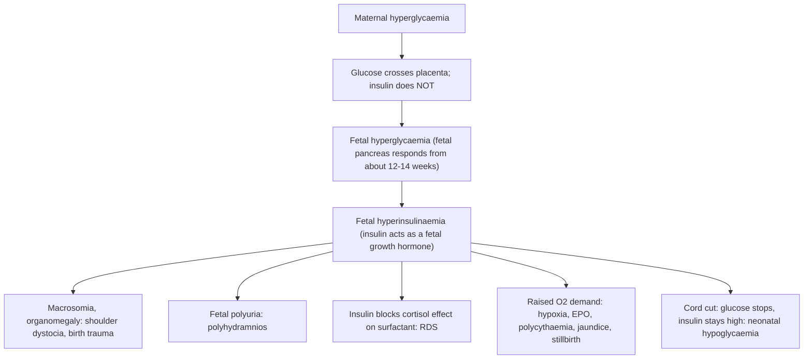

## 1. Definition

**Hyperglycaemia in pregnancy** includes women who had diabetes before pregnancy (type 1 or type 2, "pre-gestational") and women whose high glucose is first detected in pregnancy, either **gestational diabetes (GDM)** or overt **diabetes in pregnancy**.

| Category | Definition |
|---|---|
| **Pre-existing (pre-gestational) diabetes** | Type 1 or type 2 diabetes diagnosed before pregnancy |
| **Diabetes in pregnancy (overt diabetes first detected in pregnancy)** | Meets non-pregnant diabetes criteria at any gestation: fasting plasma glucose **7.0 mmol/L or more**, 2-hour OGTT **11.1 or more**, or random glucose **11.1 or more** with symptoms. Usually undiagnosed type 2 diabetes |
| **Gestational diabetes (GDM)** | Hyperglycaemia first detected in pregnancy below the overt-diabetes thresholds, typically from 24 weeks, that usually resolves after delivery |

**WHO 2013 criteria for a 75 g OGTT (used in Uganda)**

| Time | GDM (any one value) | Diabetes in pregnancy |
|---|---|---|
| **Fasting** | **5.1–6.9 mmol/L** | 7.0 mmol/L or more |
| **1 hour** | **10.0 mmol/L or more** | (no 1-hour criterion) |
| **2 hours** | **8.5–11.0 mmol/L** | 11.1 mmol/L or more |

> [!NOTE]
> **NICE (UK)** uses different, less strict cut-offs for GDM: **fasting 5.6 mmol/L or more, or 2-hour 7.8 mmol/L or more**. In exams, state which criteria you are using. Uganda follows **WHO 2013**.

Pregnancy is designed to be "diabetogenic": the placenta releases hormones that make the mother resistant to insulin so that more glucose goes to the baby. Most women respond by producing two to three times more insulin. Those who cannot (because of obesity, genetics or pre-existing beta-cell weakness) become hyperglycaemic.

> [!PEARL]
> The one thing never to forget: **glucose crosses the placenta, insulin does not.** Every fetal complication of diabetes flows from the fetus making its own excess insulin in response to the mother's high glucose.

## 2. Epidemiology

- Hyperglycaemia in pregnancy affects about **1 in 6 live births worldwide**; most of it is GDM.
- In Ugandan studies using WHO 2013 criteria at 24–28 weeks (Kampala, Mbarara and elsewhere), GDM prevalence has ranged from about **7% to over 20%** (roughly 1 in 10 to 1 in 5 women screened), depending on population and screening method. Rising obesity and urbanisation drive it.
- Many facilities do not do an OGTT, and screening is selective, so **most cases are missed**. Undiagnosed GDM shows up in the labour ward as **a big baby stuck at the shoulders**, a **fresh stillbirth**, or a **floppy, jittery hypoglycaemic newborn**.
- **Pre-existing type 1 diabetes** in Uganda often comes with poor pre-pregnancy control, limited access to insulin and glucometer strips, and no pre-conception care; these pregnancies carry high rates of congenital anomalies and stillbirth.
- **Realities of facilities**: OGTT needs a fasting woman, 75 g anhydrous glucose, a 2-hour wait and a reliable glucometer or laboratory. Many HC IVs lack strips or glucose powder. Insulin is available at hospitals (human soluble, isophane/NPH and premixed 70/30), but storage, syringes and daily glucose testing at home are real barriers.
- Women with diabetes should deliver in a **hospital with a doctor able to manage shoulder dystocia, an operating theatre and a neonatal unit**.

> [!UGANDA]
> Most Ugandan units screen **selectively** (risk factors or glycosuria) rather than universally, and many use a fasting or random capillary glucose instead of a full OGTT. When you see risk factors, **ask for an OGTT at 24–28 weeks** (earlier if very high risk). Know the WHO 2013 numbers cold; your consultants will ask.

## 3. Aetiology and Risk Factors

**Cause.** GDM is essentially **beta-cell failure unmasked by pregnancy**: chronic insulin resistance (obesity, PCOS, family history of type 2 diabetes) plus placental insulin resistance exceeds the pancreas's capacity.

**Risk factors for GDM** (decide who needs an OGTT)

| Risk factor | Notes |
|---|---|
| BMI above 30 (Ugandan studies: BMI 25 or more) | Chronic insulin resistance |
| Previous GDM | Recurrence 30–50%; test early and again at 24–28 weeks |
| Previous baby 4 kg or more | Pattern of undiagnosed diabetes |
| First-degree relative with diabetes | Genetic beta-cell weakness |
| Previous unexplained stillbirth or neonatal death | |
| Polyhydramnios in this pregnancy | Fetal polyuria |
| PCOS | Insulin resistance |
| Age 35 or more (Ugandan studies: 25 or more) | |
| Glycosuria (2+ once or 1+ twice) | Trigger for OGTT |

A substantial minority of women with GDM have **no risk factors**, so risk-factor-based screening misses cases.

**Triggers of DKA in pregnancy**: infection (UTI/pyelonephritis, malaria, pneumonia), vomiting/hyperemesis, missed insulin, new undiagnosed type 1 diabetes, **steroids**, **beta-agonists**, insulin pump failure.

## 4. Pathophysiology

### Normal glucose metabolism in pregnancy

| Stage | Change | Why |
|---|---|---|
| **First trimester** | **Increased insulin sensitivity**, lower fasting glucose | Oestrogen and progesterone stimulate beta-cell hyperplasia; the fetus uses glucose continuously. **Women with type 1 diabetes have more hypoglycaemia** in early pregnancy, especially with nausea and vomiting |
| **Second and third trimesters** | **Progressive insulin resistance** (insulin sensitivity falls by about 50%); insulin secretion rises 2–3 times | **Human placental lactogen (hPL)**, placental growth hormone, progesterone, cortisol and prolactin (and placental TNF-α) antagonise insulin at the receptor/post-receptor level. The purpose is to shift glucose to the fetus while the mother burns fat |
| **Fasting state** | "**Accelerated starvation**": mother quickly switches to fat metabolism and **ketone** production | The fetus continuously drains glucose and amino acids. This is why pregnant women develop ketosis (and DKA) faster |
| **After delivery of the placenta** | Insulin resistance **vanishes within hours** | Placental hormones disappear. This is why GDM treatment is **stopped** at delivery and why women with type 1 diabetes need an immediate **cut in insulin dose** |

### How GDM develops

Women who develop GDM usually already had **chronic insulin resistance**. When the placenta adds its insulin resistance, their pancreas cannot keep up. This also explains why **up to half develop type 2 diabetes within 5–10 years**: the underlying defect persists.

### Fetal consequences: the Pedersen hypothesis

- **Macrosomia** (birth weight 4,000 g or more, or above the 90th centile) is **asymmetric**: insulin-sensitive tissues (fat, liver, heart) grow, so the **shoulders and abdomen outgrow the head**. That is why diabetic babies get **shoulder dystocia** at lower birth weights than non-diabetic babies.
- **Stillbirth**, particularly in the last weeks, is related to fetal hyperinsulinaemia, increased oxygen demand, fetal acidaemia and placental vasculopathy. This is why we deliver women with diabetes **before 40 weeks**.
- **Neonatal hypocalcaemia and hypomagnesaemia** also occur.

### Pre-existing diabetes: the first-trimester problem

High glucose around **conception and organogenesis (first 8 weeks)** is **teratogenic**. The risk of **congenital anomalies** and **miscarriage** rises with periconception HbA1c:

- **Cardiac** (transposition of the great arteries, VSD, hypertrophic cardiomyopathy)
- **Neural tube defects**
- **Caudal regression syndrome** (rare but highly specific to maternal diabetes)
- Renal agenesis, duodenal atresia

GDM, which arises after organogenesis, does **not** raise anomaly rates (unless it is actually undiagnosed type 2 diabetes).

### Maternal consequences

**Pre-eclampsia** (endothelial dysfunction), **infections** (UTI, candidiasis, wound infection), **polyhydramnios** (preterm labour, malpresentation, cord prolapse), **worsening retinopathy and nephropathy** in pre-existing diabetes, **hypoglycaemia** (type 1), **DKA**, operative delivery and perineal trauma, and **future type 2 diabetes and cardiovascular disease**.

### Why DKA is different in pregnancy

Accelerated starvation, insulin resistance, and a respiratory alkalosis with **reduced serum bicarbonate buffer** (the kidneys excrete bicarbonate to compensate for pregnancy's hyperventilation) mean DKA develops **faster** and at **lower glucose levels** (sometimes below 11 mmol/L, "euglycaemic DKA"). **Fetal loss is 10–35%**.

**Feature links**

- Fetal hyperinsulinaemia → macrosomia → SFH larger than dates, AC above the 90th centile → shoulder dystocia, Erb's palsy, fractured clavicle.
- Fetal polyuria → polyhydramnios → tense shiny abdomen, fetal parts hard to feel, preterm labour, malpresentation, cord prolapse.
- Insulin blocking cortisol's effect on surfactant → RDS.
- Fetal hypoxia → erythropoietin → polycythaemia → jaundice.
- Persisting fetal insulin after cord clamping → neonatal hypoglycaemia → jittery, lethargic, poor feeding, convulsions.
- Periconception hyperglycaemia → cardiac defects, NTD, caudal regression, miscarriage (pre-existing diabetes only).
- Lower renal threshold for glucose (raised GFR) → glycosuria even with normal blood glucose.
- Raised red-cell turnover → falsely low HbA1c in pregnancy.
- Maternal hyperglycaemia → polyuria, polydipsia, recurrent candidiasis and UTI (often absent in GDM).
- Accelerated starvation + low bicarbonate buffer → ketosis → vomiting, abdominal pain, Kussmaul breathing, ketotic breath, drowsiness (DKA) at near-normal glucose.
- Placental insufficiency late in pregnancy → falling insulin requirement (more than about 15–20%).
- Placental delivery → insulin resistance vanishes → maternal hypoglycaemia if GDM treatment continues.

## 5. Classification / Staging

| Classification | Categories |
|---|---|
| **By timing** (WHO / current) | Pre-existing type 1; pre-existing type 2; diabetes in pregnancy (overt, first detected); GDM |
| **By treatment of GDM** (ACOG) | **A1GDM** = diet-controlled; **A2GDM** = on medication |
| **White classification** (historical) | A1 = GDM controlled by diet; A2 = GDM on medication; B to R/F by age of onset, duration and vascular complications. Still used in some textbooks and vivas |
| **Pre-existing control** (HbA1c) | Target below 48 mmol/mol (6.5%); **above 86 mmol/mol (10%)** = very high anomaly risk, advise against pregnancy |
| **Hyperglycaemia pattern** (drives treatment) | Fasting-predominant (basal insulin/metformin) vs post-meal-predominant (diet change or pre-meal soluble insulin) |

## 6. Clinical Features

### History

Two very different patients arrive with "diabetes" on the file: the **well woman referred for an abnormal glucose or a big SFH** (an outpatient diagnostic workup), and the **sick diabetic woman** who is vomiting, drowsy or hypoglycaemic (an emergency, section 9).

| Ask | Why it matters |
|---|---|
| **Type of diabetes and when diagnosed**: known type 1 or 2, GDM this pregnancy, or "sugar found in the urine"? Duration? | Pre-existing diabetes brings anomaly, stillbirth and DKA risk |
| **Current treatment, exact doses and timing**: metformin dose, insulin type (soluble, isophane, 30/70), units and times | You will need these to titrate; oral agents other than metformin must be switched |
| **Home glucose readings** (ask to see the book or the meter); last HbA1c: which readings are high, fasting or post-meal? | Control; decides which dose to change |
| **Hypoglycaemia**: how often, how low, does she feel it coming? | Recurrent hypos or unawareness need a dose cut; type 1 women lose hypo awareness in pregnancy |
| **Gestational age by the best dating** | Decides OGTT timing, delivery timing and steroid use |
| **Pre-conception care**: folic acid 5 mg? When started? **Aspirin**? | Neural tube defect risk; pre-eclampsia prevention |
| **Known complications** (pre-existing): eyes, kidneys, BP, neuropathy, heart disease | Retinopathy can progress rapidly; nephropathy predicts pre-eclampsia and FGR |
| **Medicines**: ACE inhibitors, ARBs, statins (stop), sulphonylureas and other oral agents (switch), **steroids given recently** (glucose rises for 3–5 days), **TLD** (dolutegravir raises metformin levels) | Safety and dosing |
| **GDM risk factors** (if not yet diagnosed): section 3 | Decide who needs an OGTT |
| **Polyuria, polydipsia, recurrent candidiasis or UTIs, blurred vision** | Symptoms of hyperglycaemia (often absent in GDM) |
| **Previous pregnancies**: birth weights, shoulder dystocia, stillbirth, neonatal hypoglycaemia or admission, congenital anomalies | Pattern of undiagnosed diabetes; guides delivery planning and counselling |
| **Vomiting, abdominal pain, breathlessness, drowsiness, fever, dysuria** | DKA and its triggers |
| **Fetal movements** | Reduced movements precede stillbirth |
| **Diet, activity, occupation, money for food and strips, insulin storage** | The plan must fit her life |

### Examination

Follow the order of Hutchison's Clinical Methods (24th edition), with the obstetric abdominal examination in its standard sequence. In a sick woman, capillary glucose and ABCDE come first (section 9).

#### Introduction, consent and preparation

- Introduce yourself; confirm her name, age and gestation; explain and gain consent; offer a chaperone.
- **Hand hygiene**.
- **Position and exposure**: semi-recumbent with a left lateral tilt; expose the abdomen; injection sites on the abdomen and thighs.

#### General inspection and vital signs

| Area | Look for | Document |
|---|---|---|
| **General** | **BMI**, hydration, pallor, **Kussmaul breathing**, ketotic (fruity) breath, drowsiness/GCS | "BMI 34, well hydrated, not acidotic" |
| **Vital signs** | **BP** (pre-eclampsia), pulse (tachycardia in DKA), temperature (infection trigger), RR, hypotension | "BP 124/78, afebrile, RR 16" |
| **Bedside** | Capillary glucose; **urine dipstick** (glucose, ketones, protein, nitrites) | |

#### Hands, face and neck

- **Hands**: capillary refill and cool peripheries (dehydration in DKA); finger-prick sites.
- **Face**: dry mucous membranes, sunken eyes (DKA); **fundoscopy** if you can (pre-existing diabetes; refer for a dilated retinal exam).
- **Neck**: thyroid (autoimmune thyroid disease in type 1).

#### Injection sites, feet and other systems

- **Injection sites**: lipohypertrophy causes erratic absorption. "No lipohypertrophy on the abdomen or thighs."
- **Feet** (pre-existing): sensation, peripheral neuropathy, foot ulcers. "Retinal screen booked; feet intact."
- **Signs of infection**: loin tenderness (pyelonephritis), vulvovaginal candidiasis, wound or chest signs. Infection is the commonest DKA trigger.
- **Oedema** (pre-eclampsia, nephropathy).

#### Obstetric abdominal examination

| Step | Finding | What it means |
|---|---|---|
| Inspection | Distension; tense, shiny abdomen | Polyhydramnios |
| **Fundal height** | **SFH larger than dates** (more than 2 cm, some use 3 cm, above gestation in weeks) | Macrosomia or polyhydramnios: scan |
| **Lie** and **presentation** | Malpresentation | Polyhydramnios |
| **Engagement** (fifths) | High head at term | Macrosomia, disproportion |
| Palpation | Fetal parts hard to feel | Polyhydramnios |
| **Auscultation of the fetal heart** | Hard to hear | Polyhydramnios |

**In labour**: clinical EFW, pelvic assessment, progress on the partograph (slow late first stage with a big baby = shoulder dystocia risk).

#### Completing the examination

- Thank her, cover her, **wash hands**, **summarise**.

**Document**: "SFH 36 cm at 32 weeks, liquor clinically increased, cephalic, 5/5 palpable, FHR 146".

### Red flags

> [!REDFLAG]
> - **Vomiting, abdominal pain, rapid deep breathing, drowsiness in a woman with diabetes**: DKA until proven otherwise, even if glucose is only mildly raised.
> - **Recurrent hypoglycaemia** (below 4.0 mmol/L) or hypoglycaemia unawareness in type 1 diabetes.
> - **Reduced fetal movements**: CTG/ultrasound the same day; stillbirth risk is high.
> - **Rising BP or proteinuria**: pre-eclampsia.
> - **Rapidly increasing SFH or polyhydramnios**: poor control, preterm labour risk.
> - **A falling insulin requirement in the third trimester** (more than about 15–20%): may signal **placental insufficiency**; assess the fetus.
> - **Suspected macrosomia in labour with slow progress in the late first stage or a prolonged second stage**: prepare for shoulder dystocia.

### Thinking like a clinician

- **Glycosuria in pregnancy is not diagnostic**: the renal threshold for glucose falls in pregnancy (increased GFR), so many normal women show glycosuria. But **glucose 2+ once or 1+ twice** should prompt an OGTT.
- **HbA1c is not used to diagnose GDM** (it falls in pregnancy due to increased red-cell turnover, and it is affected by anaemia and haemoglobinopathies common in Uganda). It is useful at booking to detect overt pre-existing diabetes and to judge control in pre-existing diabetes.
- **A large-for-dates uterus has a differential**: wrong dates, macrosomia, polyhydramnios, multiple pregnancy, fibroids, molar pregnancy. Diabetes is one cause, not the only one; confirm with ultrasound.
- **Polyhydramnios should always make you think of diabetes** (and of fetal anomalies such as oesophageal atresia).
- **Fasting hyperglycaemia and post-meal hyperglycaemia are treated differently**: a high fasting value needs night-time basal insulin (isophane) or metformin; high post-meal values need diet adjustment or pre-meal short-acting insulin.
- **Steroids for fetal lung maturity will push glucose up** for about 3–5 days: increase insulin and monitor closely; do not withhold steroids because of diabetes.
- **Avoid beta-agonist tocolysis (salbutamol, terbutaline)** in diabetics: they cause hyperglycaemia and can precipitate DKA. Nifedipine is preferred.
- **Common student mistakes**:
  1. Continuing insulin/metformin after delivery in a woman with GDM (causes maternal hypoglycaemia).
  2. Forgetting the baby: early feeding and glucose checks are part of the mother's management plan.
  3. Using a random glucose to rule out GDM.
  4. Treating DKA in pregnancy by rushing to caesarean section for an abnormal CTG. **Fix the mother first**; the CTG usually improves.
  5. Forgetting the **6–13-week postpartum test**.

## 7. Differential Diagnoses

| Differential | Distinguishing clinical feature | Distinguishing investigation |
|---|---|---|
| **GDM** | Usually asymptomatic; detected on OGTT at 24–28 weeks; resolves after birth | 75 g OGTT (WHO 2013) |
| **Overt (pre-existing undiagnosed) type 2 diabetes** | Fasting 7.0 or more, HbA1c 6.5% (48 mmol/mol) or more at booking; may have complications; persists postpartum | Fasting glucose, HbA1c at booking; postpartum OGTT |
| **Type 1 diabetes** | Young, lean, known insulin dependence, prone to DKA | Known history; ketones |
| **Physiological glycosuria of pregnancy** | Glycosuria with normal blood glucose | Normal OGTT |
| **Steroid-induced hyperglycaemia** | After betamethasone/dexamethasone doses | Timing; resolves in days |
| **Stress hyperglycaemia (sepsis, severe malaria)** | Acutely unwell; resolves with treatment | Repeat testing when well |
| **Large-for-dates from other causes** | Wrong dates, twins, fibroids, polyhydramnios from anomalies | Ultrasound |
| **DKA vs other causes of vomiting and abdominal pain** (hyperemesis, pyelonephritis, appendicitis, abruption, pre-eclampsia/HELLP) | DKA: ketonuria 2+ or more, acidosis, Kussmaul breathing, glucose may be only mildly raised | Blood/urine ketones, blood gas or bicarbonate, glucose |

## 8. Clinical Workup

### Bedside

| Test | How / when | What the result means | Available at |
|---|---|---|---|
| **Capillary blood glucose (glucometer)** | On arrival; then per regimen; **hourly in labour** | Below 4.0 hypoglycaemia; in labour target **4–7 mmol/L** | HC III and above (strips permitting) |
| **Capillary glucose profile** | Fasting + **1 hour after each main meal** (GDM on diet/metformin); add pre-meal and bedtime readings on insulin | Tells you *which* dose to change (worked example 2) | Home glucometer where possible |
| **Urine dipstick** | Every visit | **Glucose** 2+ once or 1+ twice → OGTT; **ketones** 2+ or more when unwell → think DKA; **protein** → pre-eclampsia; **nitrites/leucocytes** → UTI | All levels |
| **Blood ketone meter** (where available) | Glucose above 11 or unwell | 3.0 mmol/L or more with acidosis = DKA | Few units |
| **BP** | Every visit | Pre-eclampsia is commoner | All levels |
| **SFH tape measure** | Every visit from 20 weeks | SFH more than 2 cm (some use 3 cm) above gestation in weeks: scan for macrosomia/polyhydramnios | All levels |
| **Fetal heart (Pinard/Doppler) and CTG** | Every visit; CTG with reduced movements, in labour (continuous for pre-existing and insulin-treated) | Fetal wellbeing | CTG at hospitals |
| **Point-of-care ultrasound** | If SFH large or presentation unclear | Deepest pool above 8 cm or AFI above 24–25 cm = polyhydramnios | HC IV and above |
| **mRDT, HemoCue** | Fever / pallor | Malaria is a DKA trigger; anaemia lowers HbA1c | All levels |

> [!NOTE]
> A glucometer reading is **capillary whole blood**; the OGTT criteria are for **venous plasma**. A glucometer is acceptable for monitoring, and for the OGTT only if the laboratory cannot do it, but it is less accurate at diagnosis. Use a calibrated meter and in-date strips.

### Basic lab

| Test | When | Expected / abnormal finding | How it changes management | Available at |
|---|---|---|---|---|
| **75 g OGTT** (venous plasma, fluoride tube) | **24–28 weeks**; at booking/early if previous GDM or very high risk (repeat at 24–28 weeks if normal) | WHO 2013 GDM: **fasting 5.1–6.9, 1 h 10.0 or more, 2 h 8.5–11.0** (any one); overt: **fasting 7.0 or more or 2 h 11.1 or more** | Diagnosis; overt diabetes or fasting 7.0 or more → **insulin at once** | Possible at many HC IVs (glucose powder, strips, 2-hour wait); reliable at hospitals |
| **Fasting plasma glucose ± HbA1c at booking** (high-risk women) | First visit | FPG 7.0 or more or HbA1c **48 mmol/mol (6.5%) or more** = overt diabetes | Treat as pre-existing diabetes: early anomaly scan, joint clinic | FPG at HC IV; HbA1c at referral labs |
| **Urine culture** | Booking, symptoms, positive nitrites | Asymptomatic bacteriuria (commoner in diabetes) | Treat; prevents pyelonephritis and DKA triggers | Referral labs |
| **Postpartum fasting glucose or 75 g OGTT** (after GDM) | **6–13 weeks** (OGTT at 4–12 weeks per WHO/ACOG) | Fasting 6.0–6.9 high risk; 7.0 or more likely type 2 | Lifestyle programme, confirm and treat diabetes, annual testing | HC IV and above |
| **Neonatal glucose** | 2–4 hours after birth, before the second feed, then before feeds for 24 hours | Below local threshold (2.6 mmol/L in many Ugandan units; NICE 2.0) | Feed support; IV 10% dextrose 2 mL/kg if symptomatic | All delivering facilities with a glucometer |

**How to do an OGTT properly**

1. Normal carbohydrate diet for 3 days beforehand.
2. **Overnight fast of 8–14 hours** (water allowed).
3. Measure fasting plasma glucose (venous sample in a fluoride tube, or a calibrated glucometer if that is all you have).
4. Give **75 g anhydrous glucose dissolved in 250–300 mL of water**, drunk within 5 minutes.
5. Sit quietly (no walking about, no food, no smoking).
6. Measure glucose at **1 hour and 2 hours**.
7. Do not do the test if she is acutely unwell, vomiting, or within about a week of antenatal corticosteroids (glucose is falsely raised).

### Imaging

| Test | When | Expected / abnormal finding | How it changes management | Available at |
|---|---|---|---|---|
| **Dating ultrasound** | First visit / early | Accurate GA | Timing of OGTT and delivery | HC IV and above |
| **Detailed anomaly scan with cardiac views** (pre-existing or overt) | **18–22 weeks** | Cardiac defects, NTD, caudal regression | Counselling; delivery at a centre with paediatric cardiology/surgery | Regional/national referral |
| **Growth scans** | Pre-existing: every 4 weeks **28–36 weeks**; GDM: from diagnosis (e.g. 28, 32, 36 weeks) | **AC above the 90th centile**, EFW 4,000 g or more, polyhydramnios; FGR in vasculopathy | AC above the 90th centile = tighten control (consider insulin); EFW 4,500 g or more → offer CS; FGR → closer surveillance. EFW is inaccurate (about ±15%) in macrosomia | Hospitals |
| **CTG** | Reduced movements, from about 36–38 weeks per protocol, continuous in labour | Non-reassuring features | Delivery decisions (but correct DKA first) | Hospitals |

### Specialised / referral-level

| Test | When | Expected / abnormal finding | How it changes management | Available at |
|---|---|---|---|---|
| **HbA1c** (pre-existing diabetes) | Booking, then each trimester | Target below 48 mmol/mol; above 86 mmol/mol (10%) = very high anomaly risk | Intensify treatment; detailed anomaly scan. Falsely low with anaemia, recent transfusion, sickle cell | Regional/national referral or private laboratories |
| **Creatinine, electrolytes, urine albumin:creatinine ratio** (pre-existing) | Booking | Raised creatinine, albuminuria = nephropathy | Predicts pre-eclampsia and FGR; drug dosing; metformin contraindicated if eGFR below 30 | Hospitals |
| **Retinal assessment** (pre-existing) | Booking and 28 weeks | Retinopathy (can progress as control tightens) | Ophthalmology referral; timing of tightening control | Referral hospitals |
| **Thyroid function** (type 1) | Booking | Autoimmune thyroid disease | Treat | Referral hospitals |
| **DKA bundle**: venous/capillary ketones, **blood gas or serum bicarbonate**, **K⁺**, sodium, creatinine, FBC, blood/urine cultures, malaria test | Any suspicion of DKA | Ketones 3.0 or more (or urine 2+ or more) **plus** bicarbonate below 15 or pH below 7.3 | Confirms DKA; **K⁺ guides potassium replacement**; finds the trigger | Blood gas only at a few referral units: use serum bicarbonate and clinical Kussmaul breathing where it is lacking |

### Putting it together

**Model one-line summary**

> "A 32-year-old G3P2 at 29 weeks, BMI 33, with a previous 4.2 kg baby, diagnosed with GDM on a 75 g OGTT at 26 weeks (fasting 5.6, 1 h 10.2, 2 h 8.1 mmol/L), on diet for 2 weeks with persistently raised fasting readings, BP normal, SFH 31 cm, no ketonuria."

**Problem list**

1. GDM (WHO 2013), not at target on diet alone, **fasting-predominant** hyperglycaemia.
2. Previous macrosomic baby: risk of macrosomia and **shoulder dystocia**.
3. Obesity (BMI 33): pre-eclampsia and thromboembolism risk.
4. Plan for delivery timing, neonatal glucose checks and postpartum testing.

**Working diagnosis**: gestational diabetes mellitus requiring pharmacological treatment.

**Model case presentation (ward round)**

> "Mrs K is a 34-year-old G4P3+0 at 30 weeks, BMI 34, whose previous baby weighed 4.3 kg with a difficult delivery of the shoulders. Her 75 g OGTT at 26 weeks showed **fasting 5.8, 1-hour 10.9 and 2-hour 9.1 mmol/L**, meeting WHO 2013 criteria for **GDM**. After 2 weeks of diet her fasting readings remain 5.6–6.0 with post-meal values of 7.0–8.5, so she was started on **metformin 500 mg twice daily**, now 1 g twice daily. BP is 124/78, urine clear. SFH is 33 cm; a scan at 28 weeks showed an **AC above the 90th centile** with normal liquor. **Plan**: continue metformin, add **bedtime isophane** if fasting stays above 5.3, growth scan at 32 and 36 weeks, fetal movement counting, plan **induction around 38–39 weeks** with a senior present for possible shoulder dystocia, hourly glucose in labour, stop metformin after birth, neonatal glucose checks, and **fasting glucose/OGTT at 6–13 weeks postpartum**."

**Worked example 1: reading a 75 g OGTT (WHO 2013)**

| Woman | Fasting | 1 h | 2 h | Interpretation |
|---|---|---|---|---|
| A | 4.6 | **10.4** | 8.0 | **GDM** on the 1-hour value alone (any one value is enough) |
| B | **5.3** | 9.4 | 7.4 | **GDM** by WHO 2013 (fasting 5.1 or more). By NICE (fasting 5.6, 2 h 7.8) she would **not** have GDM: state which criteria you use |
| C | **7.4** | 13.0 | **12.2** | **Diabetes in pregnancy (overt)**: fasting 7.0 or more and 2 h 11.1 or more. Start **insulin at once**, early detailed scan, check HbA1c, retest postpartum |
| D | 4.8 | 9.6 | 8.3 | **Normal** (every value below threshold). If very high risk and tested early, repeat at 24–28 weeks |

> [!EXAM]
> Common exam mistake: calling woman D "borderline GDM". There is no borderline in WHO 2013: **each value is compared with its own cut-off (5.1 / 10.0 / 8.5)** and **one** abnormal value makes the diagnosis.

**Worked example 2: a capillary glucose profile on metformin.** Woman on **metformin 1 g twice daily** for 3 weeks, weight 80 kg. Three-day profile (mmol/L):

| Day | Fasting | 1 h after breakfast | 1 h after lunch | 1 h after supper |
|---|---|---|---|---|
| 1 | **6.1** | 7.2 | 7.5 | 7.4 |
| 2 | **6.0** | 7.0 | 7.6 | 7.1 |
| 3 | **5.9** | 7.3 | 7.2 | 7.5 |

**Reading it**: all post-meal values are below 7.8 (on target); **every fasting value is above 5.3**. The problem is overnight hepatic glucose output, not meals.

**Action**: metformin is at 2 g/day (the usual maximum). **Add bedtime isophane (NPH) at 22:00**, starting at about **0.1–0.2 units/kg** (8–16 units for 80 kg; start at the lower end, e.g. **8 units**), and increase by **2 units every 2–3 days** until fasting is below 5.3 mmol/L, without any reading below 4.0. Teach hypoglycaemia recognition and treatment. If post-meal values later rise, add **pre-meal soluble insulin** to the meal that is high.

**Worked example 3 (quick interpretation): is this DKA?** Glucose 13.2 mmol/L, urine ketones 3+, serum bicarbonate 12 mmol/L, RR 32 with deep breaths, vomiting for 2 days, febrile with loin pain. **Yes: DKA** (ketosis plus acidosis) with a probable **pyelonephritis trigger**. Fluids, fixed-rate insulin 0.1 unit/kg/h, potassium guided by K⁺, dextrose when glucose falls below 14, IV antibiotics, fetal monitoring once stable. **No emergency CS for the CTG.**

## 9. Management

### Immediate / emergency

**First 5 minutes (any woman with known or suspected diabetes who is unwell, in labour or newly admitted)**

1. **Capillary glucose now.**
   - **Below 4.0 mmol/L**: treat at once. Conscious: **15–20 g fast sugar** (3–4 teaspoons of sugar in water, or 150–200 mL of soda), recheck in 15 minutes, then a snack. Unconscious or unable to swallow: **IV 75–100 mL of 20% dextrose** (or 150–200 mL of 10%; 50% dextrose 25–50 mL only if nothing else, via a large vein, as it is irritant) or **glucagon 1 mg IM**.
   - **Above 11 mmol/L, or unwell with vomiting**: check **ketones** (urine dipstick or a blood ketone meter).
2. **ABCDE**: pulse, BP, RR (deep sighing **Kussmaul breathing** = acidosis), temperature, SpO₂, GCS, signs of dehydration. Left lateral tilt.
3. **Suspect DKA** if she is vomiting, has abdominal pain, is breathing deeply, is drowsy, or has **urine ketones 2+ or more**, even with glucose only mildly raised. **Call the obstetrician, physician and anaesthetist**, put in two large-bore cannulae, start **0.9% sodium chloride**, and follow the DKA algorithm below.
4. **Look for the trigger**: fever (mRDT, urine), vomiting, missed insulin, recent **steroids** or **salbutamol**.
5. **Fetal heart**: listen, but remember that an abnormal CTG in DKA usually recovers when the mother is corrected. **Stabilise the mother first.**
6. **In labour**: start **hourly capillary glucose** (target 4–7 mmol/L) and alert the neonatal team.

**DKA in pregnancy: diagnosis and algorithm**

**Diagnosis**: ketonaemia (blood ketones 3.0 mmol/L or more, or urine ketones 2+ or more) **plus** acidosis (bicarbonate below 15 mmol/L or venous pH below 7.3), with raised glucose or known diabetes.

1. **Call for help**: obstetrician, physician, anaesthetist; HDU/ICU if available. **ABCDE**. Left lateral tilt.
2. **Two large-bore IV cannulae**; bloods: glucose, ketones, electrolytes (especially **K⁺**), creatinine, FBC, blood gas/bicarbonate, cultures, malaria test; urinalysis.
3. **Fluids**: **0.9% sodium chloride**. If SBP below 90 mmHg: 500 mL over 10–15 minutes, repeat. Otherwise, for example, **1 L over 1 hour, 1 L over 2 hours, 1 L over 2 hours, 1 L over 4 hours, 1 L over 4 hours**, then reassess. Be more cautious if pre-eclampsia or cardiac/renal disease (risk of pulmonary oedema).
4. **Fixed-rate IV insulin**: **soluble insulin 0.1 unit/kg/hour** (weight at presentation) by syringe driver. Continue long-acting insulin if she normally takes it.
   - If no syringe driver: follow the UCG/ward protocol for hourly IM/SC soluble insulin; do not delay insulin.
5. **Potassium** (from the second litre, guided by K⁺):
   - K⁺ above 5.5 mmol/L: none.
   - K⁺ 3.5–5.5 mmol/L: **40 mmol KCl per litre**.
   - K⁺ below 3.5 mmol/L: senior review; more potassium via a central/large line; may need to delay insulin until K⁺ rises.
6. **Add 10% dextrose at 125 mL/hour** alongside saline **when glucose falls below 14 mmol/L**, continuing insulin until ketones clear (the insulin is needed to switch off ketogenesis, not just to lower glucose).
7. **Monitor**: glucose and ketones hourly, K⁺ and bicarbonate at 1, 2 and 4 hours then 4-hourly, fluid balance with a urinary catheter, GCS.
   - Aims: ketones fall by at least 0.5 mmol/L/hour, bicarbonate rises by 3 mmol/L/hour, glucose falls by 3 mmol/L/hour.
8. **Treat the trigger** (antibiotics for infection, antimalarials).
9. **Fetal monitoring** once the mother is stable. **Abnormal CTG in DKA reflects maternal acidosis and usually recovers as she is corrected: do not perform an emergency caesarean on an acidotic, unstable mother.**
10. **Thromboprophylaxis** (LMWH) and nasogastric tube if vomiting/drowsy.
11. **Resolution**: ketones below 0.6 mmol/L and pH above 7.3; convert to subcutaneous insulin when eating, overlapping with the infusion by 30–60 minutes.

### Definitive

**Overview of the step-up approach**

1. **Diagnosis (OGTT)** → education + diet + exercise + self-monitoring.
2. Targets not met after **1–2 weeks** → **metformin** (titrate).
3. Targets not met, or metformin not tolerated or contraindicated → **insulin** (add or replace).
4. **Start insulin at once** if fasting glucose is **7.0 or more** at diagnosis, or fasting **6.0–6.9 with macrosomia/polyhydramnios**.

#### Pre-conception care (pre-existing diabetes)

1. **Plan the pregnancy**: effective contraception until control is good.
2. **Target HbA1c below 48 mmol/mol (6.5%)** if achievable without hypoglycaemia; **strongly advise against pregnancy if HbA1c is above 86 mmol/mol (10%)**.
3. **Folic acid 5 mg orally once daily** from 3 months before conception until 12 weeks.
4. **Stop ACE inhibitors, ARBs and statins** (switch antihypertensives to methyldopa, nifedipine or labetalol).
5. **Switch oral hypoglycaemics** other than metformin to metformin and/or insulin.
6. **Retinal and renal assessment**; treat retinopathy before pregnancy.
7. **Weight loss** if BMI above 27.
8. **Educate** on hypoglycaemia (glucose tablets/sugar, glucagon for type 1) and sick-day rules/ketone testing.

#### Antenatal care: general measures for all women with hyperglycaemia

1. **Joint diabetes-antenatal clinic** (obstetrician, physician, midwife, dietitian), every 1–2 weeks with the diabetes team.
2. **Education and self-monitoring**: a glucometer and strips where possible.
   - GDM on diet or metformin: fasting and **1-hour post-meal** readings daily.
   - On insulin: fasting, pre-meal, 1-hour post-meal and bedtime readings.
3. **Targets**:

| Time | Target (NICE) |
|---|---|
| Fasting | **below 5.3 mmol/L** |
| 1 hour after meals | **below 7.8 mmol/L** |
| 2 hours after meals | **below 6.4 mmol/L** |
| On insulin: never below | **4.0 mmol/L** |
| HbA1c (pre-existing) | Below 48 mmol/mol (6.5%) if achievable safely |

4. **Aspirin 75–150 mg orally at night from 12 weeks until 36 weeks** for women with **pre-existing** diabetes (a high-risk factor for pre-eclampsia). Uganda commonly uses 75 mg.
5. **Folic acid 5 mg** through the first trimester (pre-existing).
6. **Monitor BP and urine protein** each visit.
7. **Fetal surveillance**: dating scan, anomaly and cardiac scan, growth scans, fetal movement awareness, CTG as indicated.

#### Diet and exercise (first line for GDM)

- **Regular meals**: 3 meals and 2–3 small snacks, including a bedtime snack if on insulin.
- **Carbohydrate quality and quantity**: replace refined carbohydrates (white bread, sweet tea, sodas, sweet bananas in large amounts, white rice in large portions) with **low-glycaemic-index foods**: whole grains (millet, sorghum, brown rice), **matooke, sweet potatoes, cassava and posho in moderate portions** paired with **beans, groundnuts, greens (dodo, nakati, sukuma), fish, eggs**.
- Spread carbohydrate through the day; avoid large single loads.
- **No sugar in tea**; avoid juices and sodas.
- **Exercise**: 30 minutes of walking daily, ideally **10–15 minutes after each meal**, lowers post-prandial glucose.
- Aim for appropriate, not excessive, weight gain; **do not advise weight-loss diets or fasting** in pregnancy (ketosis harms the fetus).

#### Metformin

- **Start metformin** if targets are not met after **1–2 weeks** of diet and exercise (dose in the drug table).
- **Add insulin** if targets are still not met on the maximum tolerated dose, or if metformin is contraindicated or not tolerated.
- **Glibenclamide** is a second-line option where insulin is refused, but it crosses the placenta and causes more macrosomia and neonatal hypoglycaemia than insulin or metformin.

#### Insulin regimens

Insulins used in Uganda: **soluble (regular) human insulin** (e.g. Actrapid), **isophane/NPH intermediate-acting** (e.g. Insulatard), and **premixed 30/70** (30% soluble, 70% isophane; e.g. Mixtard). Analogues (aspart, lispro, detemir, glargine) are used where available.

| Regimen | How | Best for |
|---|---|---|
| **Bedtime isophane (NPH) only** | Start about **0.1–0.2 units/kg** subcutaneously at 22:00 | GDM with **raised fasting** glucose only |
| **Pre-meal soluble insulin only** | Start about **2–4 units** subcutaneously 30 minutes before the meal(s) that cause high post-meal readings | GDM with **raised post-meal** glucose only |
| **Basal-bolus** (preferred for type 1 and most type 2) | Isophane at bedtime (± morning) + soluble before each meal | Most flexible; best control |
| **Twice-daily premixed 30/70** | Total daily dose split **2/3 before breakfast and 1/3 before supper**, 30 minutes before meals | Practical where multiple injections are not feasible |

- **Starting total daily dose (if no previous insulin)**: about **0.3–0.5 units/kg/day** in pregnancy (lower, around 0.2–0.3 units/kg/day, for mild GDM); requirements rise through the third trimester (often up to 0.8–1.0 unit/kg/day by term in type 2 diabetes).
- **Titrate** by about **2 units (or 10%) every 2–3 days** based on the reading the dose controls:
  - Fasting high: increase the bedtime isophane.
  - Post-breakfast high: increase the morning soluble.
  - Pre-supper high: increase the morning isophane (twice-daily regimen) or lunch soluble.

> [!DRUG]
> **Insulin safety**: write "units" in full, never "U" (misread as zero). Use the correct syringe for the vial strength (U-100 with U-100 syringes). Premixed insulin must be rolled, not shaken. Store unopened insulin in the fridge; in-use vials can be kept cool (clay pot) for 4 weeks.

#### Pre-existing type 2 diabetes

- Continue **metformin**; stop other oral agents (sulphonylureas other than glibenclamide, DPP-4 inhibitors, SGLT2 inhibitors, GLP-1 agonists) and switch to insulin where needed.
- Expect insulin requirements to **rise sharply after 20–24 weeks**.

#### Pre-existing type 1 diabetes

- Basal-bolus insulin; **hypoglycaemia risk is highest in the first trimester** (nausea, increased sensitivity): reduce doses, carry glucose, give the family **glucagon**.
- **Test for ketones** when unwell or glucose above 11 mmol/L.

#### Antenatal corticosteroids

- Give if preterm birth is expected (dexamethasone 6 mg IM 12-hourly for 4 doses or betamethasone 12 mg IM 24-hourly for 2 doses, per UCG/WHO criteria).
- **Increase insulin** (or start an IV insulin infusion) and monitor capillary glucose 2–4-hourly for 72 hours.

#### Fetal surveillance and timing of delivery

| Group | Fetal monitoring | Timing of delivery (NICE; widely adopted) |
|---|---|---|
| **Type 1 or type 2 diabetes** | Anomaly/cardiac scan; growth scans every 4 weeks from 28 to 36 weeks | **37+0 to 38+6 weeks** (earlier if complications: poor control, pre-eclampsia, macrosomia, growth restriction, fetal compromise) |
| **GDM on insulin/metformin** | Growth scans from diagnosis (e.g. 28, 32, 36 weeks) | Many units deliver at about **38–39 weeks**; ACOG advises **39+0 to 39+6** for well-controlled medication-treated GDM |
| **GDM, diet-controlled, well controlled** | Clinical SFH ± scan | **No later than 40+6 weeks** (ACOG: 39+0 to 40+6) |

> [!UGANDA]
> In many Ugandan referral hospitals, women with **pre-existing diabetes or insulin-treated GDM are admitted around 36–37 weeks** for glucose control and **delivered at 38 weeks**, because home glucose monitoring and fetal surveillance are limited. Follow your unit protocol.

#### Mode of delivery

- **Vaginal delivery is preferred** (induction at the planned time).
- **Offer caesarean section** if estimated fetal weight is **4,500 g or more** in a diabetic woman (ACOG), for a previous shoulder dystocia with a large baby, or for usual obstetric indications. Ultrasound EFW is inaccurate (about ±15%) in macrosomia; combine it with clinical judgement.

#### Intrapartum care

1. **Deliver in a hospital** with theatre, neonatal resuscitation and an experienced obstetrician.
2. **Capillary glucose hourly in established labour**, **target 4–7 mmol/L**. Maternal hyperglycaemia in labour causes **fetal hyperinsulinaemia, fetal acidosis and neonatal hypoglycaemia**.
3. **Continuous CTG** (EFM) for pre-existing diabetes and insulin-treated GDM.
4. **GDM on diet or metformin**: stop metformin at onset of labour; check glucose 1–2-hourly; start an insulin infusion if glucose is above 7 mmol/L on two consecutive readings.
5. **Type 1 diabetes**: start **IV dextrose + variable-rate insulin infusion** from the onset of established labour (or on the morning of induction/CS). Type 2 or GDM on insulin: the same if glucose is not in range.
6. **Anticipate shoulder dystocia**: senior obstetrician present in the second stage, McRoberts ready; **avoid mid-cavity instrumental delivery** with suspected macrosomia; empty the bladder.
7. **Anticipate PPH** (large baby, polyhydramnios, prolonged labour): active management of the third stage, oxytocin ready.
8. **Paediatrician/neonatal team informed**.

**Example variable-rate IV insulin infusion ("sliding scale")**

Set-up: **50 units soluble insulin in 50 mL 0.9% sodium chloride (1 unit/mL)** by syringe driver, **plus** a separate infusion of **5% or 10% dextrose (with 20 mmol KCl per litre if potassium is normal) at about 100 mL/hour** through the same cannula with a one-way valve. Check capillary glucose **hourly**.

| Capillary glucose (mmol/L) | Insulin rate (units/hour) |
|---|---|
| below 4.0 | **Stop insulin for 20 minutes (type 1: reduce to 0.5), treat hypoglycaemia, recheck in 15 minutes, call the doctor** |
| 4.0–5.5 | 0.5–1 |
| 5.6–7.0 | 1–2 |
| 7.1–8.5 | 2–3 |
| 8.6–11.0 | 3–4 |
| above 11.0 | 4–6; check ketones and call the doctor |

> [!NOTE]
> This is an **example only**: every hospital has its own scale. Always keep dextrose running with the insulin in type 1 diabetes (to prevent ketosis), and **never stop insulin completely in type 1 diabetes** for long.

**When no syringe driver is available: GKI (Alberti) infusion.** **500 mL of 10% dextrose + 10 units of soluble insulin + 10 mmol potassium chloride**, run at **100 mL/hour** (2 units of insulin/hour). Check glucose hourly; if above 10 mmol/L make a new bag with 15 units; if below 4, make a new bag with 5 units. It is safe because insulin and glucose run together, and it is simple enough for a busy labour ward.

**Elective caesarean section or induction**

- Put her **first on the morning list**.
- **Night before**: usual evening insulin (consider reducing the bedtime isophane by about a quarter in type 1).
- **Morning**: nil by mouth, **omit the morning short-acting insulin and metformin**, start the IV insulin–dextrose infusion, check glucose hourly.
- Give **antenatal corticosteroids** only if delivering before 37 weeks per guidelines, with extra insulin.
- **Regional anaesthesia** preferred. Antibiotic prophylaxis and thromboprophylaxis as usual.

### Drug table

| Drug | Dose (adult) | Route | Frequency | Duration | Key cautions |
|---|---|---|---|---|---|
| **Metformin** | Start **500 mg** with the evening meal (or twice daily); increase by 500 mg every few days to 1 week; usual maximum **2,000 mg/day** (up to 2,500 mg/day in some protocols) | Oral | Once to three times daily with meals | Until delivery (GDM); continue postpartum in type 2 | Crosses the placenta but appears safe; less maternal weight gain and less neonatal hypoglycaemia than insulin. GI upset: titrate slowly, with food. Avoid if eGFR below 30, hepatic failure, sepsis/shock. **Dolutegravir raises metformin levels** (keep dose low on TLD). Stop at onset of labour; safe in breastfeeding |
| **Isophane (NPH) insulin** | Bedtime-only start **0.1–0.2 units/kg** at 22:00 | SC | Nightly (± morning) | Titrate ~2 units every 2–3 days | Hypoglycaemia; reduce bedtime dose by about a quarter the night before surgery in type 1 |
| **Soluble insulin** (pre-meal) | Start **2–4 units** 30 min before the high meal(s) | SC | Before meals | Titrate ~2 units every 2–3 days | Write "units" in full |
| **Premixed 30/70 insulin** | Total daily dose (0.3–0.5 units/kg/day; 0.2–0.3 for mild GDM) split **2/3 before breakfast, 1/3 before supper** | SC | Twice daily, 30 min before meals | Throughout pregnancy | Roll, do not shake |
| **Soluble insulin** (variable-rate infusion, labour) | 50 units in 50 mL 0.9% NaCl (1 unit/mL); rate by sliding scale | IV | Continuous | Labour / peri-operative | With dextrose ± KCl running; hourly glucose |
| **GKI (Alberti)** | 500 mL 10% dextrose + 10 units soluble insulin + 10 mmol KCl | IV | 100 mL/h | Labour / peri-operative | Adjust insulin in the bag (15 units if above 10; 5 units if below 4) |
| **Soluble insulin** (DKA) | **0.1 unit/kg/h** fixed rate | IV | Continuous | Until ketones below 0.6 and pH above 7.3 | Continue usual long-acting insulin |
| **0.9% sodium chloride** (DKA) | 500 mL over 10–15 min if SBP below 90; then e.g. 1 L/1 h, 1 L/2 h, 1 L/2 h, 1 L/4 h, 1 L/4 h | IV | As listed | Reassess | Caution in pre-eclampsia, cardiac or renal disease |
| **Potassium chloride** (DKA) | 40 mmol per litre if K⁺ 3.5–5.5; none if above 5.5; senior review if below 3.5 | IV | In each litre from the second | Guided by K⁺ | |
| **10% dextrose** (DKA) | 125 mL/h | IV | When glucose below 14 mmol/L | Until ketones clear | Run alongside saline |
| **Glucose / sugar** (hypoglycaemia) | 15–20 g (3–4 teaspoons in water or 150–200 mL soda) | Oral | Once; recheck in 15 min | Then a snack | |
| **20% dextrose** (hypoglycaemia) | 75–100 mL (or 10% dextrose 150–200 mL; 50% 25–50 mL only if nothing else, large vein) | IV | Once; recheck | | 50% is irritant |
| **Glucagon** | 1 mg | IM | Once | | Give to the family of women with type 1 |
| **Folic acid** (pre-existing) | **5 mg** | Oral | Daily | 3 months before conception to 12 weeks | |
| **Aspirin** (pre-existing) | **75–150 mg** (Uganda commonly 75 mg) | Oral | At night | **12 to 36 weeks** | |
| **Dexamethasone** | 6 mg | IM | 12-hourly | 4 doses | Increase insulin; glucose 2–4-hourly for 72 h |
| **Betamethasone** | 12 mg | IM | 24-hourly | 2 doses | As above |
| Glibenclamide | Per protocol | Oral | | | Second line only; crosses placenta; more macrosomia and neonatal hypoglycaemia |
| **10% dextrose** (neonate) | **2 mL/kg** bolus, then maintenance infusion | IV | Once, then infusion | | Symptomatic neonatal hypoglycaemia |
| Nifedipine (tocolysis if needed) | See preterm labour topic | Oral | | | Preferred over beta-agonists in diabetes |

Methyldopa, nifedipine or labetalol replace ACE inhibitors and ARBs for hypertension (doses in the hypertension topic).

### Referral criteria

| Level | What should happen | Refer up when |
|---|---|---|
| **HC III** | Identify risk factors, urine dipstick, capillary glucose; health education; treat hypoglycaemia | High-risk women and those with glycosuria → HC IV for OGTT |
| **HC IV** | OGTT (if strips/glucose available), start diet and metformin under a doctor, monitor; manage emergencies (hypoglycaemia) | **Insulin-requiring or pre-existing diabetes** → hospital for joint care; **DKA** → refer after starting fluids |
| **General Hospital** | Joint diabetes-antenatal clinic, insulin initiation and titration, growth scans, CTG, induction/CS, IV insulin in labour, neonatal care | DKA needing HDU, pre-existing diabetes with complications, fetal anomaly → RRH |
| **Regional Referral Hospital** | As above plus DKA management, HbA1c, retinal assessment, detailed anomaly scan, neonatal unit | Fetal cardiac anomaly needing paediatric cardiology/surgery, ICU → NRH |
| **National Referral Hospital** | Paediatric cardiology/surgery, ICU, blood gas | n/a |

The source notes grouped general, regional and national referral hospitals together; the split is adapted [VERIFY: against UCG 2023 levels of care].

### Monitoring and follow-up

- **Antenatal**: glucose profile reviewed every 1–2 weeks; BP and urine each visit; HbA1c each trimester (pre-existing); growth scans by group; fetal movements; insulin requirement (a fall of more than 15–20% in the third trimester = assess the fetus).
- **Labour**: capillary glucose hourly (4–7 mmol/L); continuous CTG if pre-existing or insulin-treated.
- **DKA**: glucose and ketones hourly; K⁺ and bicarbonate at 1, 2 and 4 hours then 4-hourly; fluid balance.

### Postpartum care

**The mother**

| Group | Action |
|---|---|
| **GDM** | **Stop all glucose-lowering treatment immediately after delivery.** Check capillary glucose (e.g. fasting next day) before discharge to exclude persisting hyperglycaemia |
| **Type 1 diabetes** | **Reduce insulin immediately** to the pre-pregnancy dose (or about 50% of the late-pregnancy dose); stop the infusion once eating, with an overlap with subcutaneous insulin. Risk of **hypoglycaemia**, especially when breastfeeding: eat before or during feeds |
| **Type 2 diabetes** | Return to the pre-pregnancy regimen; **metformin (and glibenclamide) are safe in breastfeeding**. Avoid other oral agents while breastfeeding |
| **All** | Encourage **breastfeeding** (lowers the mother's future diabetes risk and the baby's obesity risk), **contraception** and pre-conception planning, thromboprophylaxis as per risk |

**Follow-up after GDM**

1. **Test at 6–13 weeks postpartum**: **fasting plasma glucose** (NICE) or a **75 g OGTT** (WHO/ACOG, at 4–12 weeks). After 13 weeks, HbA1c can be used.
2. Interpretation (NICE): fasting below 6.0 = low risk; **6.0–6.9 = high risk** (lifestyle, prevention programme); **7.0 or more = likely type 2 diabetes** (confirm).
3. **Annual HbA1c or fasting glucose for life**.
4. Lifestyle: weight control, diet, activity.
5. **Early OGTT in the next pregnancy** (recurrence is about 30–50%).

**The baby**

1. **Skin-to-skin and breastfeed within 30–60 minutes** of birth, then **every 2–3 hours**.
2. **Check blood glucose at 2–4 hours after birth, before the second feed**, then before feeds for at least 24 hours.
3. **Treat hypoglycaemia**: many Ugandan neonatal protocols treat glucose **below 2.6 mmol/L** (NICE uses below 2.0 mmol/L on two consecutive readings despite feeding support, or any low reading with abnormal clinical signs). Symptomatic babies (jittery, lethargic, convulsions, poor feeding) need **IV 10% dextrose 2 mL/kg bolus**, then a maintenance infusion, and admission.
4. Look for **respiratory distress, jaundice, polycythaemia, hypocalcaemia, birth trauma (Erb's palsy, fractured clavicle) and congenital anomalies**.
5. **Do not transfer to the neonatal unit for monitoring alone** if well: keep mother and baby together.

## 10. Complications

**Disease-related**

| Maternal | Fetal / neonatal |
|---|---|
| Pre-eclampsia | **Congenital anomalies** (pre-existing: cardiac, NTD, caudal regression) |
| Polyhydramnios leading to preterm labour, malpresentation, cord prolapse, abruption, PPH | **Miscarriage** (pre-existing) |
| Infections: UTI, pyelonephritis, candidiasis, endometritis, wound infection | **Macrosomia** leading to **shoulder dystocia**, brachial plexus injury (Erb's palsy), fractured clavicle, asphyxia |
| **DKA** | **Stillbirth** (late, unexplained) |
| Worsening **retinopathy** and **nephropathy** | **Neonatal hypoglycaemia**, hypocalcaemia, hypomagnesaemia |
| Operative delivery, perineal trauma, PPH | **Respiratory distress syndrome** (delayed surfactant maturation), transient tachypnoea |
| Future **type 2 diabetes** (up to about 50% within 5–10 years), metabolic syndrome, cardiovascular disease | **Polycythaemia**, **jaundice**, hypertrophic cardiomyopathy |
| Recurrent GDM in future pregnancies | Growth restriction (pre-existing diabetes with vasculopathy) |
| | Long term: childhood obesity and type 2 diabetes |

**Treatment-related**

| Complication | Cause | Action |
|---|---|---|
| **Maternal hypoglycaemia** | Insulin (especially type 1, first trimester, breastfeeding); GDM treatment continued after delivery | 15–20 g fast sugar or IV dextrose/glucagon; stop GDM treatment at delivery |
| Retinopathy progression | Rapid tightening of control | Retinal assessment at booking and 28 weeks |
| Hyperglycaemia, DKA | Steroids, beta-agonist tocolysis | Increase insulin; use nifedipine |
| GI upset; raised levels with dolutegravir | Metformin | Titrate slowly; lower dose on TLD |
| Macrosomia, neonatal hypoglycaemia | Glibenclamide | Second line only |
| Hypokalaemia, pulmonary oedema | DKA treatment | K⁺-guided replacement; cautious fluids |

## 11. Prognosis

- With tight control, the risks of macrosomia, shoulder dystocia, stillbirth and neonatal hypoglycaemia fall.
- **GDM** usually resolves after delivery, but **up to about 50% develop type 2 diabetes within 5–10 years**; **recurrence in a later pregnancy is about 30–50%**.
- **Pre-existing diabetes**: anomaly and miscarriage risk rise with periconception HbA1c; very high above 86 mmol/mol (10%).
- **DKA**: fetal loss **10–35%**.
- Children: long-term risk of obesity and type 2 diabetes.

## 12. Prevention

- **Primary**: healthy weight before pregnancy, diet and activity; universal (or at least risk-based) OGTT at 24–28 weeks.
- **Pre-existing diabetes**: pre-conception care (HbA1c target, folic acid 5 mg, stop ACEi/ARBs/statins, retinal and renal assessment, contraception until control is good).
- **Of complications**: tight control, growth scans, timed delivery before 40 weeks, senior at delivery, neonatal glucose checks.
- **Of DKA**: sick-day rules, ketone testing, avoid beta-agonists, extra insulin with steroids, treat infections early.
- **After GDM**: breastfeeding, lifestyle, test at 6–13 weeks and **annually for life**, early OGTT in the next pregnancy.

## 13. Special Populations

- **Type 1 diabetes**: first-trimester hypoglycaemia (reduce doses, glucagon for the family), ketone testing, IV insulin–dextrose from established labour, never stop insulin for long, reduce insulin immediately postpartum.
- **Type 2 diabetes**: continue metformin, switch other agents, insulin requirements rise after 20–24 weeks.
- **HIV on TLD**: dolutegravir raises metformin levels; keep the metformin dose low.
- **Anaemia, sickle cell disease, recent transfusion**: HbA1c falsely low; rely on glucose profiles.
- **Pre-eclampsia or renal/cardiac disease in DKA**: cautious fluids (pulmonary oedema).
- **Nephropathy**: metformin contraindicated if eGFR below 30; predicts pre-eclampsia and FGR.
- **Preterm labour**: give steroids with extra insulin; use nifedipine, not beta-agonists.
- **Breastfeeding mothers**: metformin and glibenclamide are safe; type 1 women eat before or during feeds.

## 14. Key Points

### High-yield points

- **Glucose crosses the placenta, insulin does not** (Pedersen).
- **75 g OGTT at 24–28 weeks**; WHO 2013 **5.1 / 10.0 / 8.5**, any one value.
- **HbA1c and glycosuria do not diagnose GDM.**
- Targets: fasting below 5.3, 1 h below 7.8, 2 h below 6.4; never below 4.0.
- Diet → metformin → insulin; insulin at once if fasting 7.0 or more.
- High fasting → bedtime isophane; high post-meal → diet or pre-meal soluble.
- Pre-existing: folic acid 5 mg, aspirin from 12 weeks, anomaly scan.
- Deliver type 1/2 at 37+0–38+6; diet GDM by 40+6; glucose 4–7 in labour.
- **Stop GDM treatment at delivery**; neonatal glucose at 2–4 h; test the mother at 6–13 weeks, then yearly.
- DKA: fluids, insulin 0.1 unit/kg/h, K⁺, dextrose; **treat the mother, not the CTG**.

### Numbers & doses

| Item | Value |
|---|---|
| OGTT timing | **24–28 weeks**; early (and repeat at 24–28) if previous GDM / very high risk |
| OGTT prep | **8–14 h fast**, **75 g anhydrous glucose in 250–300 mL water** over 5 min |
| WHO 2013 GDM (any one) | Fasting **5.1–6.9**, 1 h **10.0 or more**, 2 h **8.5–11.0** mmol/L |
| Overt diabetes in pregnancy | Fasting **7.0 or more**, 2 h **11.1 or more**, random **11.1 or more** with symptoms; HbA1c **48 mmol/mol (6.5%) or more** at booking |
| NICE GDM diagnosis | Fasting **5.6 or more** or 2 h **7.8 or more** |
| Targets (NICE) | Fasting **below 5.3**; 1 h **below 7.8**; 2 h **below 6.4**; never below **4.0** |
| Glycosuria trigger for OGTT | **2+ once or 1+ twice** |
| Metformin | Start **500 mg** with a meal, titrate to usual max **2,000 mg/day** |
| Starting insulin (no previous insulin) | Total **0.3–0.5 units/kg/day** (0.2–0.3 for mild GDM); bedtime isophane **0.1–0.2 units/kg**; titrate **~2 units every 2–3 days** |
| Premixed 30/70 split | **2/3 before breakfast, 1/3 before supper** |
| Insulin at diagnosis | Fasting **7.0 or more** (or 6.0–6.9 with macrosomia/polyhydramnios) |
| Hypoglycaemia | Below **4.0**: **15–20 g** fast sugar; unconscious: **20% dextrose 75–100 mL IV** or **glucagon 1 mg IM** |
| Pre-existing diabetes | **Folic acid 5 mg** daily; **aspirin 75–150 mg** from **12 to 36 weeks**; HbA1c target **below 48 mmol/mol**; avoid pregnancy if **above 86 mmol/mol (10%)** |
| Delivery timing | Type 1/2: **37+0 to 38+6**; diet-controlled GDM: **no later than 40+6** |
| Offer CS | EFW **4,500 g or more** (ACOG) |
| Intrapartum glucose | **4–7 mmol/L**, **hourly** |
| GKI (Alberti) | **500 mL 10% dextrose + 10 units soluble insulin + 10 mmol KCl at 100 mL/h** |
| DKA diagnosis | Ketones **3.0 or more** (urine **2+ or more**) + bicarbonate **below 15** or pH **below 7.3** |
| DKA insulin / dextrose | **0.1 unit/kg/h** fixed rate; add **10% dextrose 125 mL/h** when glucose **below 14** |
| Neonate | Feed within **30–60 min**; glucose at **2–4 h** (before 2nd feed); treat below **2.6** (many Ugandan units) / **2.0** (NICE); symptomatic: **10% dextrose 2 mL/kg IV** |
| Postpartum GDM test | **6–13 weeks** (fasting glucose or OGTT), then **yearly**; recurrence **30–50%** |

### Exam traps

- **"HbA1c of 5.4% rules out GDM."** Wrong: HbA1c **does not diagnose GDM** (it falls in pregnancy and is unreliable with anaemia/sickle cell). Do an **OGTT**.
- **"A random glucose of 6.8 excludes GDM."** Wrong: a random glucose cannot rule it out; do an OGTT at 24–28 weeks.
- **"Glycosuria 2+ confirms diabetes."** Wrong: the renal threshold falls in pregnancy; glycosuria is a **trigger for an OGTT**.
- **"Continue metformin and insulin after delivery in GDM."** Wrong: **stop all GDM treatment at delivery** (the placenta has gone) and test at 6–13 weeks.
- **"Abnormal CTG in DKA: category 1 caesarean."** Wrong: **correct the mother's acidosis first**; the CTG usually recovers.
- **"Salbutamol for tocolysis."** Wrong in diabetes: it causes hyperglycaemia and DKA; use **nifedipine**.
- **"Withhold steroids because she is diabetic."** Wrong: give them if indicated and **increase insulin** with 2–4-hourly glucose checks for 72 hours.
- **"GDM causes congenital anomalies."** Wrong: GDM starts after organogenesis. **Pre-existing** (or overt, undiagnosed type 2) diabetes does.
- **"Borderline GDM."** There is no borderline in WHO 2013: one abnormal value makes the diagnosis.

### Questions seniors ask

**On the ward round**

1. **"Read me this OGTT: fasting 5.3, 1 h 9.4, 2 h 7.4."** GDM by WHO 2013 (fasting 5.1 or more); not GDM by NICE. Uganda uses WHO 2013.
2. **"Her fasting readings are 6.0 on metformin 2 g/day but post-meal readings are fine. What do you add?"** **Bedtime isophane** at 22:00, about 0.1–0.2 units/kg, titrated by 2 units every 2–3 days to fasting below 5.3.
3. **"What does a falling insulin requirement in the third trimester mean?"** Possible **placental insufficiency** (more than about 15–20% fall): assess fetal wellbeing.
4. **"How will you manage her glucose in labour?"** Hourly capillary glucose, target 4–7 mmol/L; stop metformin; IV insulin–dextrose infusion (or GKI) if above 7 on two readings, and from established labour in type 1.
5. **"What do you tell the midwife about the baby?"** Skin-to-skin, breastfeed within 30–60 minutes and every 2–3 hours, glucose at 2–4 hours before the second feed, watch for jitteriness, respiratory distress, jaundice and birth injury.
6. **"Why is DKA different in pregnancy?"** Reduced bicarbonate buffer and accelerated starvation: it occurs faster and at lower glucose (even below 11 mmol/L); fetal loss is 10–35%.
7. **"When will you deliver a woman with type 1 diabetes, and how?"** 37+0 to 38+6 weeks, vaginal delivery by induction unless there is an obstetric indication or EFW 4,500 g or more; senior present for shoulder dystocia.
8. **"What follow-up does she need after GDM?"** Fasting glucose or OGTT at 6–13 weeks, then yearly HbA1c/fasting glucose for life, lifestyle advice, and an early OGTT in the next pregnancy.

**Likely viva questions**

1. **What hormones cause insulin resistance in pregnancy?** Human placental lactogen (the main one), placental growth hormone, progesterone, cortisol, prolactin (and TNF-α from the placenta).
2. **State the WHO 2013 OGTT criteria.** Fasting 5.1–6.9, 1-hour 10.0 or more, 2-hour 8.5–11.0 mmol/L; any one value.
3. **Explain the Pedersen hypothesis.** Maternal glucose crosses the placenta; fetal hyperglycaemia stimulates fetal hyperinsulinaemia, which causes macrosomia, organomegaly and, after cord clamping, neonatal hypoglycaemia.
4. **Why is GDM not associated with congenital anomalies?** It arises after organogenesis (after the first trimester).
5. **Which women in Uganda should be screened?** Ideally all women at 24–28 weeks (universal screening); at minimum those with BMI above 30, previous GDM, previous baby 4 kg or more, first-degree relative with diabetes, previous unexplained stillbirth, polyhydramnios, glycosuria, PCOS, age 35 or more. Previous GDM: test early and again at 24–28 weeks.
6. **What are the glucose targets?** Fasting below 5.3, 1-hour below 7.8, 2-hour below 6.4 mmol/L.
7. **When do you start insulin at diagnosis?** Fasting glucose 7.0 or more (or 6.0–6.9 with macrosomia/polyhydramnios).
8. **When should a woman with type 1 diabetes deliver?** 37+0 to 38+6 weeks.
9. **What is the intrapartum glucose target?** 4–7 mmol/L, hourly checks.
10. **What happens to GDM treatment after delivery?** Stop it; test at 6–13 weeks; annual screening.
11. **Why is DKA dangerous in pregnancy and how is it different?** Occurs faster and at lower glucose (reduced bicarbonate buffering, accelerated starvation); fetal loss up to a third; treat the mother, not the CTG.
12. **Why avoid salbutamol tocolysis in diabetes?** Beta-agonists raise glucose and can trigger DKA.

### Mnemonics

**Placental anti-insulin hormones: "Placental Hormones Can Produce Problems"**

- **P**lacental lactogen (hPL)
- **H**ormone, placental **G**rowth
- **C**ortisol
- **P**rogesterone
- **P**rolactin

**WHO 2013 OGTT: "5.1, 10, 8.5"** (think "**5-10-8**": fasting, 1 hour, 2 hours).

**NICE targets: "5.3, 7.8, 6.4"** (fasting, 1 h, 2 h). NICE diagnosis: "**5.6 / 7.8**".

**Fetal complications of hyperinsulinaemia: "MACROSOMIC"**

- **M**acrosomia and shoulder dystocia
- **A**nomalies (pre-existing only)
- **C**ardiomyopathy (septal hypertrophy)
- **R**espiratory distress syndrome
- **O**rganomegaly
- **S**tillbirth
- **O**ver-distended uterus (**polyhydramnios**, from fetal polyuria)
- **M**agnesium and calcium low
- **I**cterus (jaundice) and polycythaemia
- **C**old, jittery, hypoglycaemic newborn

**DKA management: "FIKD"** (in order): **F**luids, **I**nsulin 0.1 unit/kg/h, **K**⁺ (potassium), **D**extrose when glucose below 14.

### OSCE tips

- **Counselling a woman newly diagnosed with GDM**: explain what it is (placental hormones, not her fault), why it matters (big baby, stillbirth, baby's low sugar), what she will do (diet, walking, checking sugars, maybe tablets or injections), delivery plan, and **lifelong risk of diabetes** with the 6–13-week test. Check understanding.
- **Insulin prescribing station**: write drug name in full, dose in **units** (never "U"), route, timing relative to meals, and hypoglycaemia instructions.
- **OGTT station**: explain the preparation (3 days normal diet, 8–14 h fast), 75 g glucose in 250–300 mL over 5 minutes, sitting quietly, samples at 0, 1 and 2 hours, and the WHO 2013 cut-offs.

## 15. References

1. World Health Organization. Diagnostic Criteria and Classification of Hyperglycaemia First Detected in Pregnancy: Recommendations. 2013. https://www.ncbi.nlm.nih.gov/books/NBK169023/
2. National Institute for Health and Care Excellence. Diabetes in pregnancy: management from preconception to the postnatal period (NG3). https://www.ncbi.nlm.nih.gov/books/NBK555331/
3. NICE. Your blood glucose levels during pregnancy (NG3 information for the public). https://www.nice.org.uk/guidance/ng3/ifp/chapter/your-blood-glucose-levels-during-pregnancy
4. Ministry of Health Uganda. Uganda Clinical Guidelines 2023: National Guidelines for Management of Common Health Conditions. 2023. https://www.differentiatedservicedelivery.org/wp-content/uploads/UCG-2023-Publication-Final-PDF-Version-1.pdf
5. Antenatal management and maternal/fetal outcomes associated with hyperglycaemia in pregnancy (HIP) in Uganda; a prospective cohort study. BMC Pregnancy and Childbirth. 2021. https://pubmed.ncbi.nlm.nih.gov/34011299/
6. Maternal and fetal outcome of gestational diabetes mellitus in Mulago Hospital, Uganda. African Health Sciences. https://pmc.ncbi.nlm.nih.gov/articles/PMC2141655/
7. Prevalence of gestational diabetes mellitus and associated factors among women receiving antenatal care at a tertiary hospital in South-Western Uganda. https://pmc.ncbi.nlm.nih.gov/articles/PMC10768552/
8. Missed Diagnosis of Gestational Diabetes Mellitus Due to Selective Screening: Evidence from a Cross-Sectional Study in the West Nile Sub-Region, Uganda. Diabetes, Metabolic Syndrome and Obesity. https://www.tandfonline.com/doi/full/10.2147/DMSO.S447855
9. East African Diabetes Study Group. EADSG Guidelines: Insulin Therapy in Diabetes. 2018. https://pmc.ncbi.nlm.nih.gov/articles/PMC6104264/
10. Diagnosis of gestational diabetes in Uganda: The reactions of women, family members and health workers. https://pmc.ncbi.nlm.nih.gov/articles/PMC8111520/
11. Williams Obstetrics, 26th edition: Diabetes Mellitus chapter. McGraw Hill; 2022.
12. Glynn M, Drake WM, editors. Hutchison's Clinical Methods: An Integrated Approach to Clinical Practice. 24th edition. Edinburgh: Elsevier; 2018.
