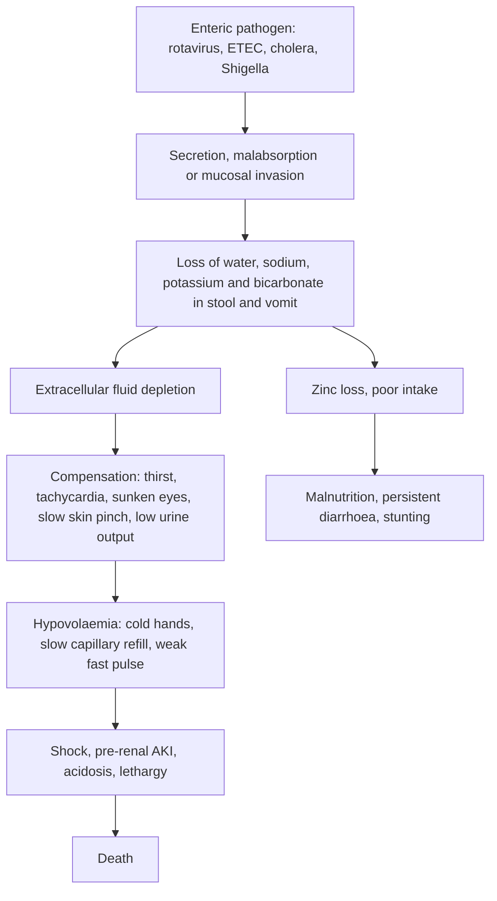

## 1. Definition

**Diarrhoea** is the passage of **3 or more loose or watery stools in 24 hours**. In children it is usually an infection of the gut (rotavirus, *E. coli*, *Shigella*, *Cryptosporidium*, cholera), and it kills by **dehydration**, by **dysentery and sepsis**, and by **worsening malnutrition**. Vomiting on its own usually means something else (malaria, UTI, meningitis, a surgical abdomen), but vomiting with diarrhoea is just gastroenteritis until proven otherwise.

The bedside skill is simple and life-saving: **assess the degree of dehydration with four signs, choose Plan A, B or C, give the exact volume, and reassess**. Add **zinc**, **keep feeding**, and give antibiotics **only** for blood in the stool, cholera or a separate bacterial infection.

| Term | Definition |
|---|---|
| **Diarrhoea** | 3 or more loose or watery stools in 24 hours (a change from normal; frequent pasty stools in a breastfed baby are **not** diarrhoea) |
| **Acute watery diarrhoea** | Diarrhoea lasting **less than 14 days** without visible blood (includes cholera) |
| **Dysentery** | Diarrhoea with **visible blood** in the stool (usually *Shigella*) |
| **Persistent diarrhoea** | An episode that began acutely and lasts **14 days or more** |
| **Severe persistent diarrhoea** | Persistent diarrhoea **with dehydration**: hospital management |
| **Dehydration** | Loss of water and salts; graded as **no**, **some** or **severe** (IMCI/WHO), roughly <5%, 5–10% and >10% of body weight |
| **Hypovolaemic shock** | All three of: **cold extremities, capillary refill > 3 s, and a weak, fast pulse** (WHO ETAT 2016); with severe dehydration it needs Plan C immediately |
| **Isonatraemic / hyponatraemic / hypernatraemic dehydration** | Serum Na 130–150 / < 130 / > 150 mmol/L |

## 2. Epidemiology

- **Globally**, diarrhoea is the **third leading cause of death in children under 5**: about **444,000 under-five deaths a year**, plus about 51,000 children aged 5–9 (WHO fact sheet). Pneumonia and diarrhoea together cause **23% of under-five deaths** (WHO 2024 guideline).
- **Uganda**: diarrhoea is one of the "big three" with pneumonia and malaria in every district report. Peaks follow the rains and **cholera outbreaks** recur in border districts (Kasese, Busia, Mbale, Namayingo), refugee settlements and Kampala's informal settlements.
- **Rotavirus vaccine** (**6 and 10 weeks** per UCG 2023; the 2025/26 MoH poster shows **6, 10 and 14 weeks**, depending on the brand) has cut severe rotavirus admissions; measles–rubella vaccine and vitamin A also prevent diarrhoeal deaths.
- **Malnutrition and diarrhoea feed each other**: diarrhoea causes weight loss and zinc loss; malnourished children have more, longer and deadlier episodes. UDHS 2022: **26% of under-fives stunted, 2.9% wasted**.

> [!UGANDA]
> At **HC II** you can give Plans A and B (ORS and zinc are HC II items in UCG 2023). **HC III** can start Plan C (IV Ringer's lactate). Many HC IIIs and IVs lack giving sets, cannulas for infants or Ringer's lactate at night, so the **nasogastric ORS route (20 mL/kg/h for 6 h)** is your back-up, and the referral note must say exactly how much fluid was given and when. Mulago, Mengo and the regional referral hospitals have ORS corners ("ORT corners") where Plan B is supervised; use them.

## 3. Aetiology and Risk Factors

**Causes by mechanism** (detail in section 4)

| Type | Main causes | Clue |
|---|---|---|
| **Secretory** | *Vibrio cholerae*, enterotoxigenic *E. coli* | Huge watery "rice-water" stools; outbreaks |
| **Osmotic / malabsorptive** | **Rotavirus** and norovirus (damage to villous tips), lactose intolerance, F-75 in some SAM children | Vomiting first, then watery diarrhoea; infants under 2 years |
| **Inflammatory (invasive)** | ***Shigella***, *Campylobacter*, *Salmonella*, *Entamoeba histolytica* | Blood, mucus, fever, tenesmus; risk of sepsis |
| **Persistent diarrhoea** | HIV enteropathy, *Giardia*, *Cryptosporidium*, *Strongyloides*, lactose intolerance, SAM, TB | ≥ 14 days, weight loss |
| **Non-infective** | Antibiotics, other drugs, herbal purgatives and enemas | Temporal link to medicines or local herbs |

**Risk factors for getting diarrhoea and for dying from it** (each is also a history question in section 6)

- **Unsafe water, no latrine, no hand-washing with soap**; cholera outbreak areas, refugee settlements, informal settlements.
- **Not exclusively breastfed** under 6 months; bottle feeding; over-concentrated or over-diluted feeds.
- **Malnutrition** (wasting, stunting) and **zinc and vitamin A deficiency**.
- **HIV** (child or mother), not on ART or co-trimoxazole.
- **Missed rotavirus or measles–rubella vaccine**; **recent measles**.
- **Young age** (infants dehydrate fastest).
- **Harmful home treatments**: sugary drinks and sodas, herbal enemas and purgatives, antimotility drugs.

## 4. Pathophysiology

**How the gut loses water**

- The small bowel secretes and absorbs several **litres** of fluid a day. Most of it is reabsorbed by sodium-coupled transport.
- **Secretory diarrhoea** (cholera toxin, enterotoxigenic *E. coli*): toxin raises cAMP in crypt cells → chloride and water pour out. Stools are huge and watery ("rice water"). The villi are intact.
- **Osmotic / malabsorptive diarrhoea** (rotavirus damaging villous tips, lactose intolerance, F-75 in some SAM children): unabsorbed solute holds water in the lumen.
- **Inflammatory (invasive) diarrhoea** (*Shigella*, *Campylobacter*, *Salmonella*, *E. histolytica*): mucosal invasion → blood, mucus, fever, tenesmus, and risk of sepsis.

**Why ORS works.** **Sodium–glucose co-transport (SGLT1)** in the villous enterocytes keeps working even when cholera toxin is driving secretion. One glucose molecule carries sodium in with it, and **water follows the sodium**. That is why the ratio matters: **low-osmolarity ORS** (glucose 75 and Na 75 mmol/L, total **245 mOsm/L**) is absorbed better than the old 311 mOsm/L formula, cuts stool output and vomiting, and reduces the need for unscheduled IV fluids. Too much sugar (sweet drinks, sodas, glucose water) does the opposite: it pulls water **into** the gut.

**Why children dehydrate so fast**

- Higher **body water** (about 70–80% of weight in infants) and a much higher **turnover** per kg.
- Larger **surface area** for insensible loss; fever adds about 10% more fluid need per °C.
- They **cannot ask for a drink**, and they vomit what they are given.

**Why zinc helps.** Zinc deficiency is common in Ugandan children and **diarrhoea increases zinc loss**. Zinc restores mucosal repair, improves water and electrolyte absorption and immune function. It **shortens the episode and reduces stool volume**, and a full course reduces diarrhoea in the following months.

**Sodium and potassium**

- **Hyponatraemia** follows replacing salty losses with water or very dilute fluids (or hypotonic IV fluids). It causes lethargy and convulsions.
- **Hypernatraemia** follows high-solute feeds (over-concentrated formula), high fevers and water loss more than salt. Signs of dehydration are **masked** (the skin feels **doughy**), the child is **very irritable** and thirsty, and convulsions occur if it is corrected too fast.
- **Potassium** is lost in every stool. Hypokalaemia causes **floppiness, abdominal distension (ileus)** and arrhythmias. ORS contains 20 mmol/L of potassium.

**Why SAM is different.** In **severe acute malnutrition** the heart muscle is thin, sodium is retained in cells and potassium is low (failure of the sodium pump), and the kidneys cannot excrete a sodium load. Rapid IV fluid or high-sodium ORS leads to **heart failure and death**. The "dehydration" signs (sunken eyes, slow skin pinch) are present anyway in marasmus. Hence ReSoMal (Na 45, K 40 mmol/L) and slow oral rehydration.

**Feature links**

- Loss of extracellular fluid → thirst, drinks eagerly → restless, irritable child ("some" dehydration).
- Loss of interstitial fluid → sunken eyes, sunken fontanelle, slow skin pinch, dry mouth.
- Falling circulating volume → tachycardia, then cold hands, capillary refill > 3 s, weak fast pulse (shock).
- Poor cerebral perfusion, hypoglycaemia or abnormal sodium → lethargy, unconsciousness, convulsions, unable to drink.
- Low renal perfusion → low urine output → pre-renal AKI (raised urea and creatinine) → acute tubular necrosis if prolonged.
- Bicarbonate loss in stool plus lactic acid from poor perfusion → metabolic acidosis → deep, sighing (Kussmaul) breathing.
- Potassium loss in stool → hypokalaemia → floppiness, abdominal distension (ileus), arrhythmia.
- Water loss more than salt (over-concentrated feeds, fever) → hypernatraemia → doughy skin, extreme irritability, convulsions.
- Salty losses replaced with water or hypotonic fluid → hyponatraemia → lethargy, convulsions.
- Mucosal invasion (*Shigella*) → blood and mucus, fever, tenesmus → rectal prolapse; neurotoxin and fever → convulsions.
- Shiga toxin (*S. dysenteriae* type 1, EHEC) → endothelial damage → haemolysis, low platelets, oliguria (HUS).
- Zinc and nutrient loss with poor intake → weight loss → malnutrition → longer, more frequent episodes.

## 5. Classification / Staging

**By duration and stool type**: acute watery diarrhoea (< 14 days), dysentery (visible blood), persistent diarrhoea (≥ 14 days), severe persistent diarrhoea (≥ 14 days with dehydration). Definitions in section 1.

**IMCI and WHO classification of dehydration (2 or more signs)**

| Sign | No dehydration | **Some** dehydration | **Severe** dehydration |
|---|---|---|---|
| General condition | Well, alert | **Restless, irritable** | **Lethargic or unconscious** |
| Eyes | Normal | Sunken | Sunken |
| Fontanelle (infant) | Normal | Sunken | Very sunken |
| Drinking | Drinks normally | **Thirsty, drinks eagerly** | **Drinks poorly or not able to drink** |
| Skin pinch (abdomen) | Goes back immediately | Goes back **slowly** (< 2 s) | Goes back **very slowly** (> 2 s) |
| Approximate deficit | < 5% | 5–10% | > 10% |
| Plan | **A** | **B** | **C** |

*Bold signs are the "key" signs. "Sunken eyes" counts in both; always ask the mother whether the eyes look different from usual.*

**By serum sodium**: isonatraemic (130–150 mmol/L), hyponatraemic (< 130), hypernatraemic (> 150).

> [!PEARL]
> The one thing never to forget: **first check whether the child is severely malnourished.** In a wasted or oedematous child, Plan C can kill: severe dehydration is over-diagnosed in SAM, the heart cannot handle a fast litre, and you must use ReSoMal slowly instead. Measure MUAC and look at both feet **before** you hang the drip.

## 6. Clinical Features

### History

Each question has a reason.

| Ask | Why it matters |
|---|---|
| **How long** has the diarrhoea lasted? | ≥ 14 days = persistent diarrhoea: think malnutrition, HIV, giardia, lactose intolerance; different work-up and feeding plan |
| **How many stools a day**, how watery, how much? | Volume of loss; "rice water" = cholera |
| **Blood or mucus** in the stool? | Dysentery → antibiotic; red-currant jelly in an infant with colicky pain = **intussusception** |
| **Vomiting**: how often, can the child keep anything down? **Bilious (green)?** | Persistent vomiting may need NG ORS; bilious vomiting = **obstruction** (surgical review) |
| **Drinking and urine**: thirsty? last wet nappy? | Thirst = some dehydration; refusing to drink is a severe sign; anuria for > 6–8 h is late; AKI risk |
| **Fever, convulsions, lethargy** | Danger signs; malaria, meningitis, sepsis, hypoglycaemia, abnormal sodium → malaria test, glucose, sodium, LP if meningism |
| **What has been given at home**: ORS, herbs, tea, sodas, antibiotics, "*enema*" | Herbal enemas and purgatives cause severe illness; sugary drinks worsen diarrhoea; inappropriate antibiotics |
| **Feeding**: breastfeeding? other milks? how diluted or concentrated? | Over-concentrated formula → hypernatraemia; dilute porridge → malnutrition; counselling |
| **Contacts**: others ill at home or in the village, cholera outbreak? | Cholera, *Shigella* outbreak, food poisoning; notify |
| **Water and sanitation**: source of water, latrine, hand-washing | Prevention counselling and outbreak recognition |
| **HIV status** of child and mother, EID results, ART, co-trimoxazole | HIV causes persistent diarrhoea, cryptosporidium, and changes feeding advice |
| **Immunisation**: rotavirus (6 and 10 weeks), measles–rubella | Missed rota or measles raises risk; catch up before discharge |
| **Recent measles** | Measles-associated diarrhoea is severe; give vitamin A |
| **Weight before the illness** (child health card) | Weight loss gives the **real percentage dehydration** |

### Examination

Follow the order of Hutchison's Clinical Methods (24th edition), adapted for children: observe first, keep the child on the mother's lap, and leave distressing parts (ears, throat) to the end. In an emergency the ETAT triage and ABCDE assessment (section 9) come first; complete the sequence once fluids are running.

#### Introduction, consent and preparation

- Introduce yourself; confirm the child's name, age and the carer's relationship.
- Explain the examination; gain consent from the parent and assent from the child.
- **Hand hygiene** before and after (and gloves for nappies and stool: think cholera and *Shigella*).
- **Position and exposure**: on the mother's lap; undress for weight and to see the abdomen and feet; keep the child warm.

#### General inspection (end of the bed)

1. **Emergency signs (ETAT ABCD)** first: obstructed breathing, severe respiratory distress, central cyanosis, **shock**, **coma**, **convulsing**, **severe dehydration** with lethargy.
2. **General condition**: alert, restless/irritable, or lethargic/unconscious? Is the child **floppy** (hypokalaemia)?
3. **Offer a drink** of ORS or water from a cup: drinks eagerly, poorly or not at all?
4. **Breathing**: deep, sighing (Kussmaul) breathing = **metabolic acidosis** from bicarbonate loss; fast breathing with chest indrawing = pneumonia.
5. **Nutrition**: visible wasting, **oedema of both feet**; signs of HIV (wasting, thrush).
6. **Vital signs**: temperature, HR, RR, capillary refill; SpO₂ if unwell. Judge against age norms:

| Age | Respiratory rate (fast if ≥) | Heart rate (normal awake) |
|---|---|---|
| < 2 months | **60**/min | 110–160 |
| 2–12 months | **50**/min | 100–160 |
| 1–5 years | **40**/min | 90–140 |
| > 5 years | 30/min | 70–120 |

7. **Growth**: **weight** (undressed), length, **MUAC**; plot **weight-for-length Z-score** and compare with the pre-illness weight on the card.

#### Hands, face and neck

| Sign | What it means |
|---|---|
| Cold hands, capillary refill > 3 s (press the thumbnail or sternum 3 s), weak fast radial pulse | **Shock** (all three) |
| Pallor of palms | Severe anaemia (blood, not more crystalloid); HUS |
| Sunken eyes (ask the mother), no tears | Dehydration |
| Sunken fontanelle | Dehydration; **bulging** = meningitis |
| Dry mouth and tongue | Dehydration |
| Oral thrush, parotid enlargement | HIV |
| Bitot spots, corneal clouding | Vitamin A deficiency (SAM, measles) |
| Cervical lymphadenopathy | HIV, TB |
| Neck stiffness | Meningitis |

#### Abdomen (the system)

- **Skin pinch**: pinch the abdominal skin halfway between the umbilicus and the side, **longitudinally**, hold 1 s and release. Very slow = > 2 s. **Doughy** skin = hypernatraemia.
- **Inspection**: distension (ileus from hypokalaemia, obstruction, NEC), visible peristalsis.
- **Palpation**: tenderness, guarding, masses (intussusception "sausage"), liver size (enlarging liver = fluid overload).
- **Percussion**: tympanic distension (ileus, obstruction).
- **Auscultation**: bowel sounds (absent in ileus; hyperactive in gastroenteritis).
- **Perianal area**: **rectal prolapse** (*Shigella*, trichuriasis), excoriation; **look at the stool** in the nappy (blood, mucus, rice water).

#### Completing the examination

- **Chest**: crackles (pneumonia; fluid overload during Plan C).
- **Heart**: gallop rhythm (overload; severe anaemia).
- **Ears and throat, last**: otitis media, tonsillitis.
- **Bedside tests**: random blood sugar, malaria RDT (section 8).
- **Thank** the mother and child, re-dress the child, **wash hands**, and **summarise**: the dehydration class, SAM status and the plan with volumes.

| Document these positives | And these negatives |
|---|---|
| Weight, MUAC, WLZ, oedema grade | "No oedema of the feet; MUAC 13.2 cm" |
| Each dehydration sign separately | "No blood in stool seen" |
| CRT, pulse volume, hand temperature | "Abdomen soft, no mass, bowel sounds present" |
| Stool character seen yourself | "No neck stiffness; fontanelle not bulging" |

### Red flags

> [!REDFLAG]
> Act now (and call the senior) if: **lethargy or unconsciousness, unable to drink, convulsions, shock (cold hands + CRT > 3 s + weak fast pulse)**, bilious vomiting or a tender distended abdomen, **blood in the stool in an infant under 2 months**, severe acute malnutrition, **hypoglycaemia**, no urine for > 8 hours, a very irritable child with doughy skin (hypernatraemia), or **cholera** in an outbreak area (notify).

### Thinking like a clinician

- **Grade dehydration with signs, not with the number of stools.** A child with 10 stools who is alert and drinking normally is Plan A.
- **"Some" dehydration is the commonest under-treated group.** Plan B means ORS **measured out in front of you** (75 mL/kg over 4 h), not two packets and home.
- **Vomiting is not a reason to give up on ORS.** Wait 10 minutes and give **small sips** (5 mL every 1–2 min by spoon or syringe). Most children keep ORS down once rehydration starts. If not, use an **NG tube**.
- **Deep breathing in a dehydrated child is acidosis**, not pneumonia. It settles with fluids.
- **A lethargic child after rehydration** is not "just tired": check **glucose**, then sodium, then think meningitis, malaria and sepsis.
- **Fever and diarrhoea in Uganda: test for malaria.** Malaria often presents with vomiting and loose stools in young children.
- **Blood plus pain plus pallor in an infant** = intussusception; blood plus oliguria plus pallor a week later = **haemolytic uraemic syndrome** (HUS).
- **If it lasts 14 days, it is no longer simple gastroenteritis.** Think HIV, malnutrition, giardia, TB, lactose intolerance.
- **Vomiting without diarrhoea** is not gastroenteritis until you have excluded malaria, UTI, meningitis, DKA and a surgical abdomen.
- **Common student mistakes**: Plan C in a child with SAM; forgetting zinc; stopping breastfeeding; giving metronidazole "for diarrhoea"; not weighing the child, so the volume is guessed; not reassessing after the first 30 mL/kg.

## 7. Differential Diagnoses

Differentials of **a child with vomiting and/or diarrhoea**:

| Differential | Distinguishing clinical feature | Distinguishing investigation |
|---|---|---|
| **Acute viral gastroenteritis** (rotavirus, norovirus) | Vomiting first, then watery diarrhoea; low-grade fever; under 2 years | Clinical |
| **Cholera** | Profuse painless "rice-water" stools, rapid severe dehydration, often older children too; outbreak | Cholera RDT, stool culture |
| **Bacillary dysentery** (*Shigella*) | Blood and mucus, fever, tenesmus, abdominal cramps; may convulse | Stool microscopy (pus cells), culture |
| **Amoebic dysentery** | Bloody mucoid stools, less fever, older children; rare under 5 years | Trophozoites with ingested RBCs |
| **Malaria** | Fever, vomiting, loose stools, pallor, splenomegaly | RDT / blood smear |
| **UTI / pyelonephritis** | Fever and vomiting in an infant, foul urine | Urine dipstick, microscopy, culture |
| **Pneumonia, otitis media** | Fast breathing, chest indrawing; ear discharge | Clinical, SpO₂ |
| **Meningitis** | Vomiting, fever, convulsions, bulging fontanelle, neck stiffness | Lumbar puncture |
| **Intussusception** | 3 months–3 years, episodic screaming and pallor, red-currant-jelly stool, sausage mass | Ultrasound (target sign) |
| **Intestinal obstruction / volvulus** | **Bilious vomiting**, distension, absolute constipation | X-ray, surgical review |
| **Appendicitis** | Older child, central then RIF pain, fever, guarding; diarrhoea in pelvic appendix | Clinical, ultrasound |
| **Diabetic ketoacidosis** | Vomiting, abdominal pain, **deep breathing**, polyuria despite "dehydration" | RBS, urine glucose and ketones |
| **Sepsis** | Very ill, fever or hypothermia, mottled; may have diarrhoea | Blood culture, FBC |
| **Haemolytic uraemic syndrome** | 5–10 days after bloody diarrhoea: pallor, oliguria, petechiae | FBC, film, creatinine |
| **Antibiotic-associated, drugs, herbal purgatives** | Temporal link to medicines or local herbs | History |
| **Persistent diarrhoea causes** (HIV enteropathy, giardia, cryptosporidium, lactose intolerance, SAM) | ≥ 14 days, weight loss | HIV test, stool microscopy, nutritional assessment |

## 8. Clinical Workup

Most children with acute watery diarrhoea need **no laboratory test at all**: the diagnosis and plan come from the bedside assessment. "Available at" is the lowest level that usually offers the test [VERIFY: availability compiled from the source notes, not an MoH list].

### Bedside

| Test | How / when | Expected finding and why | Available at |
|---|---|---|---|
| **Weight** (and serial weights) | Same scale, undressed | Exact fluid volumes; weight gain confirms rehydration (1 g ≈ 1 mL) | All levels |
| **MUAC and oedema check** | Every child, before choosing a plan | MUAC < 11.5 cm or bilateral oedema = SAM: changes the fluid plan | All levels |
| **Random blood sugar** | Lethargic, malnourished or vomiting children | Hypoglycaemia (< 3 mmol/L) | HC III and above (glucometer) |
| **Malaria RDT** | Fever | Malaria presenting with vomiting and diarrhoea | All levels |
| **Look at the stool** | Ask to see the nappy | Blood, mucus, rice-water stool, steatorrhoea | All levels |
| **Urine dipstick and output** | Bag or pad | Specific gravity, ketones, glucose (DKA!), UTI; first urine = rehydration working | HC III and above |
| **HemoCue Hb** | Pallor, severe illness | Severe anaemia changes fluid choices; HUS | HC III and above |
| **HIV rapid test** (if status unknown) | Finger prick, after counselling | Persistent diarrhoea, malnutrition, recurrent illness | All levels |
| **Cholera RDT** (outbreak setting) | Stool dipstick | Screens suspected cholera; confirm with culture | Outbreak response teams, HC IV and above |

### Basic lab

| Test | When | Expected / abnormal finding | How it changes management | Available at |
|---|---|---|---|---|
| **Serum electrolytes, urea, creatinine** | Severe dehydration needing IV fluids, convulsions or altered consciousness, doughy skin, SAM, persistent vomiting, no urine after rehydration | Na < 130 or > 150; K < 3.5; raised urea and creatinine (pre-renal AKI); low bicarbonate | Slow correction of hypernatraemia; add potassium once passing urine; renal review | **Regional/national referral hospitals**; rarely at HC IV |
| **Stool microscopy** | Persistent diarrhoea, dysentery not responding, HIV | Trophozoites of *E. histolytica* with ingested RBCs; *Giardia* cysts or trophozoites; ova (*Strongyloides*, *S. mansoni*); *Cryptosporidium* (modified ZN); pus cells in *Shigella* | Metronidazole only when amoeba or giardia is **seen** | HC III and above |
| **Full blood count** | Severe illness, dysentery, pallor | Leucocytosis, anaemia, low platelets (HUS) | Transfusion; HUS work-up | Most HC IVs |
| **Urinalysis / urine culture** | Fever without a clear source; infant | UTI; glucose and ketones | Alternative diagnosis | Microscopy HC IV; culture RRH |

### Imaging

| Test | When | Expected finding | How it changes management | Available at |
|---|---|---|---|---|
| **Abdominal ultrasound** | Bloody stool with colicky pain, mass, bilious vomiting | Target sign (intussusception); free fluid | Surgical referral; air/saline reduction at NRH | HC IV (some), General Hospital and above |
| **Abdominal X-ray** | Distension, bilious vomiting | Fluid levels (obstruction), pneumatosis (NEC) | Surgery; NG drainage | General Hospital and above |

### Specialised / referral-level

| Test | When | Expected finding | How it changes management | Available at |
|---|---|---|---|---|
| **Stool culture and sensitivity** | Dysentery not improving after 2 days, outbreak, suspected cholera | *Shigella*, *Salmonella*, *V. cholerae* with sensitivity | Change antibiotic; public health action | **RRH, Mulago, CPHL** |
| **Blood culture** | Sepsis, SAM, infant < 2 months, typhoid suspected | Gram-negative bacteraemia | IV antibiotics | RRH/NRH |
| **Blood film** | HUS suspected | Fragmented red cells (schistocytes) | Referral for dialysis | RRH/NRH |

### Putting it together

**Model one-line summary**

> "A 10-month-old girl, 7.0 kg (pre-illness 7.6 kg on her card), with 2 days of acute watery diarrhoea (8 stools/day) and vomiting, who is restless, has sunken eyes, drinks eagerly and has a slow skin pinch: acute watery diarrhoea with **some dehydration**, no blood, no SAM (MUAC 13.0 cm, no oedema), HIV-unexposed and fully immunised for age."

**Problem list**

1. Acute watery diarrhoea with some dehydration (about 8% from the weight loss).
2. Vomiting (not bilious).
3. Fever 38.2 °C: malaria RDT pending.
4. Feeding: breastfed plus porridge; continue.

**Working diagnosis**: *acute gastroenteritis (probably viral) with some dehydration.* **Plan B**: ORS 75 × 7.0 = **525 mL over 4 hours**, zinc 20 mg daily for 10 days, continue breastfeeding.

**Model case presentation (ward round)**

> "Baby A is a **10-month-old girl** from Kisenyi, brought by her mother with **2 days of watery, non-bloody diarrhoea about 8 times a day** and vomiting 4 times a day. She is breastfed and eats posho and beans. She has had **low-grade fever**, no convulsions, and passed urine 6 hours ago. She was **born at term, 3.1 kg**, is **up to date on UNEPI** for age including **both rotavirus doses**, and is **HIV-unexposed** (mother negative in this pregnancy and at 6 weeks postnatal). Development is normal.
> On examination she is **restless and irritable**, eyes sunken, **drinks eagerly**, skin pinch goes back slowly. **Weight 7.0 kg** (7.6 kg two weeks ago at the immunisation clinic), **length 70 cm**, **WLZ −1** and **WAZ −1.4**, **MUAC 13.0 cm**, **no oedema**. Temp 38.2 °C, HR 150, RR 42, CRT 2 s, hands warm. The abdomen is soft with no masses. Malaria RDT negative, RBS 4.6 mmol/L.
> **Summary**: acute watery diarrhoea with **some dehydration** (about 8%), no SAM. **Plan B**: ORS 525 mL over 4 hours in the ORT corner, zinc 20 mg once daily for 10 days, continue breastfeeding; reassess at 4 hours."

> [!EXAM]
> **Worked example 1: how much dehydration from the weights?**
> Pre-illness weight 7.6 kg, today 7.0 kg. Loss = 0.6 kg ≈ **600 mL**. Percentage = 0.6 ÷ 7.6 = **7.9%** = "some dehydration" (5–10%). Plan B replaces 75 mL/kg × 7.0 = **525 mL**, which is close to the measured loss. After 4 hours she weighs 7.5 kg, is alert, drinks normally and the skin pinch is normal: reclassify as **no dehydration → Plan A**.

> [!EXAM]
> **Worked example 2: Plan C, step by step.**
> A 2-year-old boy, **11 kg**, is lethargic, cannot drink, eyes very sunken, skin pinch 3 s, cold hands, CRT 4 s. MUAC 14 cm, no oedema. **Severe dehydration (with shock), no SAM.**
> He is **≥ 12 months**, so Ringer's lactate **100 mL/kg = 1100 mL**:
> - **30 mL/kg = 330 mL in 30 minutes** (with a 20-drop/mL giving set that is 330 × 20 ÷ 30 = **220 drops/min**: practically "run it as fast as it will go", squeezing the bag);
> - reassess: radial pulse still very weak → **repeat 330 mL once**;
> - then **70 mL/kg = 770 mL over 2.5 hours** = about **308 mL/h** (about 100 drops/min with a 20-drop set; 1 drop every 0.6 s);
> - **ORS 5 mL/kg/h (55 mL/h)** as soon as he can drink;
> - reassess every 15–30 min; full reclassification at **3 hours** (6 hours in an infant).

> [!EXAM]
> **Worked example 3: Plan C in an infant.** A 9-month-old weighing 8 kg with severe dehydration: Ringer's lactate **800 mL**: **240 mL in the first hour**, then **560 mL over 5 hours**; ORS **40 mL/h** once drinking; reclassify at **6 hours**.

> [!UGANDA]
> UCG 2023 says reassess **every 30–60 minutes** during Plan C; the WHO Pocket Book says every **15–30 minutes**. In practice: check pulse, CRT and conscious level **every 15 minutes during the first fast phase**, then every 30–60 minutes. A busy ward will not do this unless you write it in the plan.

## 9. Management

**The five WHO pillars**

1. **Rehydrate** with the right plan (A, B or C), using **low-osmolarity ORS** (WHO 2024, strong recommendation, now for children up to 10 years).
2. **Zinc** for every child with diarrhoea.
3. **Continue feeding** (and breastfeeding), with extra food during recovery.
4. **Antibiotics only when indicated**: dysentery, cholera with dehydration, or another bacterial infection (WHO 2024 suggests **against** antibiotics in acute watery diarrhoea).
5. **Counsel the mother**: home fluids, danger signs and when to return, hygiene and vaccines.

### Immediate / emergency

**First 5 minutes**

1. **Triage (ETAT)**: emergency signs? Lethargic/unconscious, unable to drink, **shock**, convulsing. Severe dehydration is an **emergency sign** when the child is also lethargic.
2. **Weigh the child** (or use a weight estimate only if a scale is not available) and **measure MUAC and check both feet for oedema**. This decides the fluid plan.
3. **Airway and breathing**: recovery position if unconscious; oxygen if SpO₂ < 90%.
4. **Circulation**: cold hands, CRT > 3 s, weak fast pulse? **IV or IO access** (an intraosseous needle if two IV attempts fail).
5. **Glucose**: check RBS; if **< 3 mmol/L** (or no glucometer and the child is lethargic), give **10% glucose 5 mL/kg IV** (or 50 mL of sugar water orally/NG).
6. **Start fluids at once**: Plan C (no SAM) or the SAM shock protocol. If the child can drink, give ORS by cup while the line goes in.
7. **Call for help** if shocked, unconscious, convulsing or severely malnourished.

**ABCDE summary**: **A** open, recovery position if unconscious; **B** oxygen if SpO₂ < 90%, note acidotic breathing; **C** shock signs, IV/IO, Plan C or SAM shock protocol, check Hb; **D** AVPU, glucose, treat convulsions (think sodium, glucose, *Shigella*); **E** temperature, MUAC and oedema, look at the stool.

> [!REDFLAG]
> **Shock (cold hands, CRT > 3 s, weak fast pulse) with severe dehydration**: the first 30 mL/kg of Plan C **is** the resuscitation, given as fast as possible; UCG 2023's shock protocol gives **20 mL/kg as rapidly as possible**, repeated if needed, then **70 mL/kg over 5 h (infant) or 2.5 h (child)**. Check **glucose** and look for **severe anaemia** (Hb < 5 g/dL → blood, not more crystalloid). **Stop** and reassess if crackles, a gallop rhythm, a liver that is enlarging or puffy eyelids appear.

> [!NOTE]
> **WHO ETAT 2016 and the FEAST trial**: children who are febrile and have **impaired circulation without full shock** (only 1–2 of the 3 signs) should **not** get rapid boluses; give maintenance fluids and reassess within 1 hour. Children in **full shock** get **10–20 mL/kg over 30–60 min**. Severe **dehydration from diarrhoea** is the main exception where rapid fluid (Plan C) is still correct, because the child has measurable losses to replace.

### Definitive

#### Plan A: no dehydration (treat at home)

**The 4 rules of home treatment:**

1. **Give extra fluid** (as much as the child will take):
   - Breastfeed more often and for longer at each feed.
   - Exclusively breastfed baby: give **ORS or clean water in addition** to breast milk.
   - Otherwise: ORS, soup, rice water, yoghurt drinks, clean water.
   - **ORS after each loose stool**: **under 2 years 50–100 mL**; **2 years and older 100–200 mL** (older children as much as they want).
   - Give **2 packets of ORS** to take home; teach how to mix **one packet in 1 litre** of clean water; discard after 24 h.
   - Small, frequent sips from a **cup** (spoon for babies). If the child vomits, **wait 10 minutes**, then continue more slowly.
2. **Give zinc** (drug table) for 10 days, even after the diarrhoea stops.
3. **Continue feeding**: breastfeed; give usual foods, fresh and well cooked, in small frequent meals; an **extra meal a day for 2 weeks** after the episode.
4. **Know when to return immediately**: not able to drink or breastfeed, becomes sicker, develops fever, **blood in the stool**, drinking poorly. Follow up in **5 days** if not improving.

#### Plan B: some dehydration (ORS in the clinic)

**Amount of ORS in the first 4 hours = weight (kg) × 75 mL.** Use age only if you cannot weigh.

| Age | Up to 4 months | 4–12 months | 12 months–2 years | 2–5 years |
|---|---|---|---|---|
| Weight | < 6 kg | 6–< 10 kg | 10–< 12 kg | 12–19 kg |
| ORS in 4 h | **200–400 mL** | **400–700 mL** | **700–900 mL** | **900–1400 mL** |

1. Sit the mother down in the ORT corner with a **measured** amount in a jug and a cup and spoon.
2. Give **frequent small sips**; for an infant, **1 teaspoon every 1–2 minutes**. If the child wants more, give more.
3. Continue **breastfeeding**. A non-breastfed infant under 6 months also gets **100–200 mL of clean water** during these 4 hours.
4. If vomiting, **wait 10 minutes** and continue slowly. If vomiting persists or the child cannot drink, use an **NG tube** at the same rate.
5. **Reassess every 30–60 minutes**; if signs of severe dehydration appear, move to Plan C.
6. **After 4 hours**: reassess and reclassify → Plan A, B (repeat) or C. **Start feeding in the clinic.**
7. Give **zinc** and, if the mother must leave early, enough ORS to finish the 4-hour amount plus 2 packets for Plan A.

#### Plan C: severe dehydration (rapid IV rehydration)

**If you can give IV fluids (HC III and above):**

1. Start IV (or IO) immediately; if the child can drink, give **ORS by mouth while the drip is set up**.
2. Give **Ringer's lactate 100 mL/kg** (if not available: normal saline 0.9%; half-strength Darrow's in 2.5% glucose is an older alternative). **Never plain 5% dextrose**: it does not rehydrate.

| Age | First give **30 mL/kg** in | Then give **70 mL/kg** in |
|---|---|---|
| **Infants under 12 months** | **1 hour** | **5 hours** |
| **Children 12 months to 5 years** | **30 minutes** | **2.5 hours** |

*Repeat the first 30 mL/kg once if the radial pulse is still very weak or not detectable.*

3. **Reassess** every 15–30 minutes (UCG: 30–60 minutes): if hydration is not improving, give the drip faster.
4. Give **ORS about 5 mL/kg/h** as soon as the child can drink (usually after **3–4 hours in infants, 1–2 hours in children**).
5. **Reclassify** after 6 hours (infant) or 3 hours (child), and choose Plan A, B or C to continue.
6. Observe for **at least 6 hours** after rehydration to make sure the mother can keep the child hydrated with ORS.

**If IV fluids are not available:**

- IV treatment **within 30 minutes**: refer urgently; mother gives sips of ORS on the way.
- **No IV nearby but an NG tube or the child can drink**: **ORS 20 mL/kg/h for 6 hours (total 120 mL/kg)** by NG tube or mouth; reassess every 1–2 hours; slow down if repeated vomiting or abdominal distension; **refer if not improving after 3 hours**.

### Drug table

| Drug | Dose (paediatric per kg, max; adult) | Route | Frequency | Duration | Key cautions |
|---|---|---|---|---|---|
| **Low-osmolarity ORS** | Plan A: 50–100 mL (< 2 y) or 100–200 mL (≥ 2 y) per loose stool. Plan B: **75 mL/kg** over 4 h. NG Plan C: **20 mL/kg/h** | Oral / NG | Continuous sips | Until diarrhoea stops | 1 sachet in 1 L of clean water; discard after 24 h |
| **Ringer's lactate** (Plan C) | **100 mL/kg**: 30 mL/kg then 70 mL/kg (timings in Plan C) | IV / IO | Continuous | 3 h (child) or 6 h (infant), then reclassify | Normal saline if unavailable; **never 5% dextrose**; not this regimen in SAM |
| **Zinc sulphate (dispersible 20 mg tab)** | **< 6 months: 10 mg** (½ tab); **≥ 6 months: 20 mg** (1 tab) | Oral, dissolved in breast milk or water | Once daily | **10 days** (UCG 2023); WHO: 10–14 days | **WHO 2024 suggests 5 mg daily** (less vomiting); **not needed if on RUTF/F-75/F-100** (already contain zinc) |
| **Ciprofloxacin** (dysentery, first line) | **15 mg/kg**, max 500 mg/dose. 500 mg tab: under 6 months ¼ tab; 6 months–5 years ½ tab (UCG); adult 500 mg [VERIFY: adult dose against UCG 2023] | Oral | **12-hourly** | **3 days** | Review in 2–3 days; switch if no better |
| **Ceftriaxone** (dysentery, severely ill or treatment failure) | **50–80 mg/kg**, max 2 g | IV or IM | Once daily | **3 days** | **Not with calcium-containing IV fluids** in neonates |
| **Doxycycline** (cholera, Uganda MoH 2025, children < 12 y) | **2–4 mg/kg**, max 300 mg | Oral | **Single dose** | Once | Repeat if vomited within 30 min |
| **Azithromycin** (cholera alternative; dysentery alternative per local sensitivity) | **20 mg/kg**, max 1 g | Oral | **Single dose** (cholera) | Once | Repeat if vomited within 30 min |
| **Erythromycin** (cholera, older UCG IMCI option) | 125 mg (< 2 y); 250 mg (2–5 y) | Oral | 6-hourly | 3 days | Use where doxycycline/azithromycin are unavailable |
| **Metronidazole** (amoebiasis **seen** on microscopy) | **10 mg/kg**, max 800 mg/dose | Oral | **8-hourly** | **5–10 days** (UCG adult course 10 days) | Only if trophozoites with RBCs seen, or dysentery fails 2 antibiotics |
| **Metronidazole** (giardiasis) | **5–7.5 mg/kg** | Oral | 8-hourly | 5–7 days | WHO 5 mg/kg for 5 days; UCG (SAM) 7.5 mg/kg for 7 days |
| **Vitamin A** (persistent diarrhoea, measles, SAM with eye signs) | **< 6 months 50,000 IU; 6–11 months 100,000 IU; ≥ 12 months 200,000 IU** | Oral | Single dose (days 1, 2 and 14 if eye signs) | | Skip if a dose was given in the last month |
| **Multivitamins and minerals including zinc**, folate (persistent diarrhoea) | As per UCG IMCI | Oral | Daily | **14 days** | |
| **ReSoMal** (SAM) | 5 mL/kg every 30 min for 2 h, then 5–10 mL/kg/h | Oral / NG | | Up to 10 h | Not in cholera (use standard ORS) |
| **10% glucose** (hypoglycaemia) | **5 mL/kg** | IV | Once, recheck in 30 min | | Or 50 mL sugar water oral/NG |
| **Paracetamol** (fever, pain in dysentery) | 15 mg/kg | Oral | 6-hourly | While febrile | |

> [!DRUG]
> **Do not give**: antidiarrhoeals (loperamide, codeine, kaolin), antiemetics (chlorpromazine/Largactil, promethazine, metoclopramide) in young children, **metronidazole "for diarrhoea"**, or **probiotics** (WHO 2024 suggests against). They do not save lives and some (antimotility drugs, chlorpromazine) are dangerous. Ondansetron is used in some high-income emergency departments for vomiting, but it is not part of the WHO or Ugandan protocols.

> [!UGANDA]
> **Zinc dose: Uganda vs WHO 2024.** UCG 2023 (both the IMCI chart and the diarrhoea chapter) still uses **10 mg (< 6 months) / 20 mg (≥ 6 months) for 10 days**. The **WHO 2024 Guideline on management of pneumonia and diarrhoea in children up to 10 years** now *suggests* **5 mg daily for 10–14 days**, because it works as well with about half the vomiting. Until the MoH updates the guideline and the dispersible tablet, Ugandan wards and HC dispensaries give the 10/20 mg tablet. In an exam, give the UCG dose and say WHO now suggests 5 mg.

### Referral criteria

| Level | What you can do | Refer up when |
|---|---|---|
| **Village health team / HC II** | Classify; Plans A and B; zinc; pre-referral ORS sips | Severe dehydration (if IV not available within 30 min, start NG/oral ORS 20 mL/kg/h and refer), dysentery in young infants, SAM with complications, any danger sign |
| **HC III** | Plan C with IV Ringer's lactate; NG ORS; ciprofloxacin; RBS and malaria RDT | Not improving after 3 hours of NG/IV rehydration; dysentery failing first-line treatment; SAM with complications; infant < 2 months with blood in stool; persistent diarrhoea under 4 months or with dehydration → HC IV |
| **HC IV / General Hospital** | Inpatient care, IV antibiotics (ceftriaxone), stool microscopy, Hb, blood transfusion (if blood fridge), admission of severe cases | Electrolyte derangement needing measurement (convulsions, doughy skin, no urine after rehydration), suspected intussusception or obstruction, HUS, complicated SAM without a nutrition unit → RRH |
| **Regional Referral Hospital** | Electrolytes, stool culture, ultrasound, surgery for intussusception, HDU care, inpatient SAM care | Dialysis for HUS or AKI, air/saline reduction, ICU care → NRH |
| **National Referral Hospital (Mulago) and large PNFP hospitals (Mengo)** | ICU, dialysis, specialist SAM ward (e.g. Mwanamugimu Nutrition Unit, Mulago), paediatric surgery | n/a |

Level split adapted from the source notes and UCG 2023 levels of care [VERIFY: refer-up thresholds at each level are compiled, not quoted from UCG].

**Referral note** must state the plan used, exactly how much fluid was given and when, drugs given (zinc, antibiotic, glucose), and the latest dehydration class; the mother gives ORS sips on the way.

### Monitoring and follow-up

- **Plan C**: pulse, CRT and conscious level **every 15 minutes during the first fast phase**, then every 30–60 minutes; reclassify at 3 hours (child) or 6 hours (infant); observe at least 6 hours after rehydration.
- **Plan B**: reassess every 30–60 minutes; full reclassification at 4 hours.
- **Signs of overload**: crackles, gallop rhythm, an enlarging liver, puffy eyelids → stop fluids and reassess.
- **Weight**: weigh before and after rehydration (1 g ≈ 1 mL).
- **Urine**: first urine shows rehydration is working; no urine after rehydration → electrolytes and renal function.
- **Follow-up**: Plan A, review in **5 days** if not improving; dysentery, review in **2–3 days**; persistent diarrhoea, **5 days**.

### Dysentery (blood in the stool)

1. **Assess dehydration** and treat with the right plan.
2. **Ciprofloxacin 15 mg/kg 12-hourly for 3 days** (UCG 2023, WHO 2024 remarks). If **severely ill**, under 2 months, or not better after 2 days: **ceftriaxone 50–80 mg/kg IV/IM daily for 3 days** and admit.
3. **Review in 2–3 days** (UCG: follow up in 3 days): better = fewer stools, less blood, less fever, eating better. If not, switch to the second-line drug, send stool for culture and microscopy, and look for **amoebae**.
4. **Young infants (< 2 months) with blood in the stool**: refer; consider **intussusception** and **surgical causes**.
5. Zinc, feeding, paracetamol for fever and pain. **No antimotility drugs** (risk of toxic megacolon).
6. Watch for complications: **convulsions** (Shigella neurotoxin, fever, hyponatraemia, hypoglycaemia), **rectal prolapse** (push back gently with a gloved hand), **HUS** (oliguria, pallor, low platelets), and **intestinal perforation**.

### Persistent diarrhoea (≥ 14 days)

**Severe persistent diarrhoea (with dehydration) or any child < 4 months**: admit.

1. **Rehydrate** (Plans A–C); watch electrolytes.
2. **Look for and treat infections**: **HIV test**, stool microscopy (giardia, amoebae, cryptosporidium, *Strongyloides*), UTI, pneumonia, otitis media, TB. **Antibiotics only for a specific infection**; metronidazole only when giardia or amoebae are found.
3. **Feeding** is the treatment:
   - Continue breastfeeding, more often and for longer.
   - **Reduce animal milk to no more than 50 mL/kg/day**, or replace it with **yoghurt** or fermented milk (less lactose).
   - Give energy-dense family foods (porridge with oil and groundnut paste, mashed beans and vegetables) **6 times a day**.
   - True **lactose intolerance** (diarrhoea restarts every time milk is reintroduced) is uncommon; use a reduced-lactose diet then reintroduce.
4. **Micronutrients for 14 days**: **multivitamins and minerals including zinc** (UCG IMCI); **vitamin A** single dose (100,000 IU at 6–11 months; 200,000 IU at 1 year or more); folate.
5. **Follow up in 5 days** (outpatients); weigh daily as an inpatient: the diet is working when the child **gains weight** and the stools fall to fewer than 3 a day.

### Cholera

1. **Notify** (it is a notifiable disease; call the District Surveillance Focal Person). Admit to a **cholera treatment unit (CTU)**; isolate; chlorine (0.05% hand-washing, 0.5% for surfaces and stool).
2. **Rehydrate** by the same plans: **Plan B 75 mL/kg over 4 h**; **Plan C Ringer's lactate 100 mL/kg** (30 mL/kg fast then 70 mL/kg) and **repeat once if still severely dehydrated** at reassessment. Losses can be enormous: **replace ongoing losses volume for volume** with ORS until the diarrhoea stops.
3. **Antibiotics for all cholera patients** (Uganda MoH Cholera Guidelines 2025): children < 12 years **doxycycline 2–4 mg/kg single dose**; alternatives **azithromycin 20 mg/kg single dose (max 1 g)** or ciprofloxacin per the guideline. If vomited within 30 minutes, repeat the dose.
4. **Zinc** for children under 5 (not if on RUTF).
5. **SAM with cholera** (Uganda 2025): use **standard ORS, not ReSoMal** (cholera stools are very salty); monitor closely for overload; severe dehydration without shock should not get IV fluids.
6. **Do not give** metronidazole, chlorpromazine or loperamide.
7. Prevention: oral cholera vaccine in outbreaks, safe water, latrines, hand-washing; chemoprophylaxis for household contacts per the guideline.

### When severe acute malnutrition changes the plan

| Feature | Well-nourished child | **Child with SAM** |
|---|---|---|
| Diagnosing dehydration | Four signs | Signs unreliable (sunken eyes and slow pinch occur anyway); rely on **history of recent watery stools, recent change in appearance, thirst, and weight** |
| Fluid | Low-osmolarity ORS | **ReSoMal** (Na 45, K 40 mmol/L); if not available, low-osmolarity ORS (WHO 2023) or half-strength ORS with added glucose and potassium (UCG). In **cholera: standard ORS** |
| Some/severe dehydration, not in shock | Plan B or C | **No IV.** ReSoMal **5 mL/kg every 30 min for 2 h**, then **5–10 mL/kg/h for the next 4–10 h** (alternating with F-75 in the same volume) |
| Shock | Plan C / 20 mL/kg | **15 mL/kg over 1 hour** of Ringer's lactate with 5% glucose, or half-strength Darrow's with 5% glucose, or 0.45% saline with 5% glucose; **repeat once** if improving, then ReSoMal by mouth/NG; **if not improving: blood 10 mL/kg over 3 h** and treat for septic shock |
| Monitoring | Hydration signs | **Every 30 min for 2 h, then hourly**: pulse, RR, liver size, urine, stool. **Stop if pulse rises by 25/min and RR by 5/min** (overload) |
| Ongoing losses | ORS per stool | ReSoMal **50–100 mL per watery stool** (UCG); small frequent unformed stools in SAM need no treatment |
| Zinc | Zinc tablets | Already in F-75, F-100 and RUTF; no extra tablets |
| Antibiotics | Only if indicated | **All** SAM children get antibiotics (see Malnutrition topic) |

### Discharge

- Discharge when **rehydrated, feeding, passing urine**, the mother has shown she can give ORS, and any danger signs have resolved.
- Counsel the **4 rules** of Plan A and the prevention messages in section 12; catch up missed rotavirus and measles–rubella doses before discharge.

## 10. Complications

**Disease-related**

| Group | Complications |
|---|---|
| Fluid | **Hypovolaemic shock**, **pre-renal AKI → acute tubular necrosis**, death |
| Electrolytes and metabolic | **Hypo- and hypernatraemia** (convulsions), **hypokalaemia** (ileus, weakness, arrhythmia), **metabolic acidosis**, **hypoglycaemia** |
| Infective | **Sepsis**, bacteraemia (non-typhoidal *Salmonella* in HIV, malaria and SAM), **HUS** (*S. dysenteriae* type 1, EHEC), reactive arthritis, toxic megacolon, intestinal perforation |
| Local | **Rectal prolapse** (*Shigella*, trichuriasis), perianal excoriation, intussusception |
| Nutritional | Weight loss, **persistent diarrhoea**, **malnutrition**, stunting with repeated episodes, zinc deficiency, transient lactose intolerance |
| Neurological | Convulsions (fever, sodium, glucose, *Shigella* toxin), cerebral venous thrombosis in severe hypernatraemic dehydration |

**Treatment-related**

| Complication | Cause | Recognition and action |
|---|---|---|
| **Fluid overload, heart failure** | Over-rapid IV fluids, especially in SAM and severe anaemia | Crackles, gallop, enlarging liver, puffy eyelids; in SAM pulse up by 25/min and RR by 5/min → stop fluids, reassess |
| **Cerebral oedema, convulsions** | Hypernatraemia corrected too fast | Lower sodium by no more than 0.5 mmol/L/h (10–12 mmol/L in 24 h), usually over 48 h or more |
| **Hyponatraemia** | Hypotonic IV fluids or plain water replacing salty losses; plain 5% dextrose | Use Ringer's lactate or normal saline; never 5% dextrose to rehydrate |
| **Toxic megacolon** | Antimotility drugs (loperamide, codeine) in dysentery | Never give them |
| **Sedation, dystonia** | Antiemetics (chlorpromazine, promethazine, metoclopramide) | Do not give to young children |
| **Ceftriaxone–calcium precipitation** | Ceftriaxone with calcium-containing IV fluids in neonates | Avoid the combination |
| **Vomiting** | Zinc (dose-related) | WHO 2024 suggests 5 mg daily; give dissolved, after a wait if the child vomits |

## 11. Prognosis

- With correct grading, the right plan and reassessment, almost all deaths from acute watery diarrhoea are preventable; most children are rehydrated within hours and the episode ends within days.
- The outlook is worse with **severe acute malnutrition, HIV, persistent diarrhoea, dysentery with sepsis or HUS, and young infants**.
- Repeated episodes drive **malnutrition and stunting**; a full zinc course reduces diarrhoea in the following months.
- Ugandan outcome data by plan are not available in the source notes.

## 12. Prevention

- **Exclusive breastfeeding to 6 months**, then continued breastfeeding with safe complementary food.
- **Hand-washing with soap** (after the latrine, before preparing food), **safe water** (boil or treat), **latrine use**.
- **Vaccines**: rotavirus (6 and 10 weeks per UCG 2023; 6, 10 and 14 weeks on the 2025/26 MoH poster, by brand), **measles–rubella**; oral cholera vaccine in outbreaks.
- **Vitamin A** every 6 months from 6 months to 5 years.
- **Zinc** course after every episode (reduces further episodes for 2–3 months).
- **Cholera control**: notification, chlorination, chemoprophylaxis for household contacts per the 2025 MoH guideline.
- **Tertiary**: every admission is a chance to catch up vaccines, check growth, test for HIV where indicated and counsel the 4 rules.

## 13. Special Populations

- **Severe acute malnutrition**: different signs, different fluid (ReSoMal), no IV unless shocked, 15 mL/kg shock bolus, all get antibiotics (section 9, SAM subsection).
- **Infants under 2 months**: blood in the stool → refer and think intussusception and surgical causes; Plan C timings are slower under 12 months (1 h + 5 h); non-breastfed infants under 6 months also get 100–200 mL of clean water during Plan B.
- **HIV**: persistent diarrhoea (cryptosporidium, HIV enteropathy), non-typhoidal *Salmonella* bacteraemia; feeding advice changes.
- **Severe anaemia** (Hb < 5 g/dL): blood, not more crystalloid; high overload risk.
- **Hypernatraemic dehydration** (over-concentrated feeds): signs masked, doughy skin; slow correction over 48 h or more.
- **Children 5–10 years**: the WHO 2024 guideline now covers children up to 10 years (low-osmolarity ORS, zinc, no antibiotics for watery diarrhoea).
- **Cholera with SAM**: standard ORS, not ReSoMal.

## 14. Key Points

### High-yield points

- Grade dehydration with **2 or more signs**, not by the number of stools.
- **Check for SAM (MUAC and both feet) before hanging any drip.**
- Plan A = 4 rules; Plan B = **75 mL/kg in 4 h**; Plan C = Ringer's lactate **100 mL/kg** (30 then 70).
- No IV? **NG ORS 20 mL/kg/h for 6 h**.
- **Zinc** for every child, full 10 days.
- **Keep breastfeeding** throughout.
- Antibiotics **only** for blood, cholera or another bacterial infection.
- **No** loperamide, chlorpromazine, metronidazole "for diarrhoea", probiotics or plain 5% dextrose.
- A lethargic child after rehydration: **glucose, then sodium**, then meningitis, malaria and sepsis.
- 14 days = persistent: test for HIV, look for parasites, fix the diet.

### Numbers & doses

| Item | Value |
|---|---|
| Diarrhoea | ≥ **3 loose/watery stools in 24 h** |
| Persistent diarrhoea | ≥ **14 days** |
| Degree of dehydration | None < 5%; some 5–10%; severe > 10% |
| Skin pinch | Slow < 2 s (some); **very slow > 2 s** (severe) |
| Plan A ORS per stool | **50–100 mL** (< 2 y); **100–200 mL** (≥ 2 y) |
| Plan B | **75 mL/kg over 4 h** |
| Plan C, < 12 months | **30 mL/kg in 1 h, then 70 mL/kg in 5 h** (RL) |
| Plan C, ≥ 12 months | **30 mL/kg in 30 min, then 70 mL/kg in 2.5 h** |
| NG ORS if no IV | **20 mL/kg/h × 6 h (120 mL/kg)** |
| ORS once drinking in Plan C | **5 mL/kg/h** |
| Low-osmolarity ORS | Na **75**, glucose **75**, K **20**, Cl **65**, citrate **10** mmol/L; **245 mOsm/L** |
| ReSoMal | Na **45**, K **40** mmol/L |
| Zinc (UCG 2023) | **10 mg** (< 6 mo) / **20 mg** (≥ 6 mo) daily × **10 days**; WHO 2024 suggests **5 mg** for 10–14 days |
| Dysentery | **Ciprofloxacin 15 mg/kg 12-hourly × 3 days**; ceftriaxone **50–80 mg/kg daily × 3 days** |
| Cholera (child) | **Doxycycline 2–4 mg/kg single dose** or azithromycin **20 mg/kg** single dose (max 1 g) |
| SAM dehydration | ReSoMal **5 mL/kg every 30 min × 2 h**, then **5–10 mL/kg/h** up to 10 h |
| SAM shock | **15 mL/kg over 1 h** (glucose-containing fluid); blood **10 mL/kg over 3 h** if not improving |
| Hypoglycaemia | RBS < 2.5 mmol/L (WHO; < 3 in SAM; UCG < 3.0) → **10% glucose 5 mL/kg IV** |
| Fast breathing | ≥ 60 (< 2 mo), ≥ 50 (2–12 mo), ≥ 40 (1–5 y) |
| Hypernatraemia correction | No faster than **0.5 mmol/L/h** (10–12 mmol/L in 24 h) |

### Exam traps

- **"Severe dehydration in a marasmic child → Plan C."** Wrong: no IV unless in shock; ReSoMal slowly.
- **"Give metronidazole for diarrhoea."** Wrong: only for amoebae or giardia seen on microscopy.
- **"Stop breastfeeding to rest the gut."** Wrong: breastfeeding continues throughout, including during Plan B and C.
- **"Child is vomiting, so ORS won't work, start a drip."** Wrong: some dehydration with vomiting = small sips or NG ORS.
- **"5% dextrose for rehydration."** Wrong: it contains no sodium; use Ringer's lactate or normal saline.
- **"Number of stools tells you the dehydration."** Wrong: grade with the signs.
- **"Antibiotics shorten watery diarrhoea."** Wrong: WHO 2024 suggests against antibiotics in acute watery diarrhoea; give them for blood or cholera.
- **"Zinc stops when the diarrhoea stops."** Wrong: complete the full 10 days.

### Questions seniors ask

**Viva questions**

1. *How do you classify dehydration?* Two or more signs: severe = lethargic/unconscious, sunken eyes, unable to drink, skin pinch very slow; some = restless/irritable, sunken eyes, thirsty, skin pinch slow; otherwise none.
2. *What is in low-osmolarity ORS and why is it better?* Na 75, glucose 75, K 20, Cl 65, citrate 10 mmol/L; 245 mOsm/L; less stool output, less vomiting and fewer IV drips than the old 311 mOsm/L formula.
3. *Give the Plan C volumes for a 9-month-old weighing 8 kg.* Ringer's lactate 800 mL: 240 mL in the first hour, then 560 mL over 5 hours; ORS 40 mL/h once drinking; reassess at 6 h.
4. *When do you give antibiotics in diarrhoea?* Dysentery, cholera, and co-existing bacterial infections (pneumonia, UTI, sepsis), plus all children with SAM. Not for watery diarrhoea.
5. *Why zinc?* Shortens duration and severity and prevents further episodes for 2–3 months.
6. *How does SAM change rehydration?* No IV unless shocked; ReSoMal slowly (5 mL/kg every 30 min for 2 h, then 5–10 mL/kg/h); shock 15 mL/kg over 1 h; watch for overload.
7. *What is the danger of correcting hypernatraemia quickly?* Cerebral oedema and convulsions; lower sodium by no more than 0.5 mmol/L/h (10–12 mmol/L in 24 h), usually over 48 h or more.

**On the ward round**

- **This child has diarrhoea and is very wasted. How will you rehydrate?** Confirm SAM (MUAC, WLZ, oedema). If not shocked: ReSoMal 5 mL/kg every 30 min for 2 h, then 5–10 mL/kg/h, with F-75, monitoring pulse, RR, liver and urine every 30–60 min. If shocked: 15 mL/kg over 1 h of RL with 5% glucose, then oral/NG ReSoMal or blood if not improving.
- **How do you know Plan B worked?** Reassess after 4 hours: the child is alert, drinks normally, eyes less sunken (ask the mother), skin pinch normal, passing urine, and has gained weight. Then Plan A.
- **What would make you think this is not gastroenteritis?** Bilious vomiting, a distended or tender abdomen, a mass, blood with episodic screaming, high fever with neck stiffness, deep breathing with glycosuria, or vomiting without diarrhoea.
- **Why Ringer's lactate rather than normal saline?** It contains potassium, lactate (a bicarbonate source) and less chloride, so it corrects acidosis better; normal saline is acceptable if RL is unavailable.
- **When would you check electrolytes?** Severe dehydration needing IV fluids, convulsions or altered consciousness, doughy skin or hypernatraemia suspected, SAM, persistent vomiting, or no urine after rehydration.
- **What does the WHO 2024 guideline change?** It extends the recommendations to children up to 10 years: low-osmolarity ORS (strong), zinc for acute and persistent diarrhoea with a suggested 5 mg dose, no antibiotics for watery diarrhoea, antibiotics for bloody diarrhoea, and no probiotics.
- **A child with dysentery is no better after 2 days of ciprofloxacin. Next step?** Admit if unwell, send stool for microscopy and culture, switch to ceftriaxone 50–80 mg/kg daily, look for amoebae (metronidazole if trophozoites seen) and complications (HUS, intussusception, dehydration, hypoglycaemia).

### Mnemonics

- **"Two signs make the class"**: you need **2 or more** signs to classify as some or severe.
- **Plan C "30–70, 1–5 or ½–2½"**: 30 mL/kg then 70 mL/kg; infants over **1 h + 5 h**, children over **½ h + 2½ h**.
- **Plan B "75 in 4"**: 75 mL/kg in 4 hours.
- **NG rescue "20 for 6"**: 20 mL/kg/h for 6 hours.
- **ReSoMal "5 every 30 for 2, then 5–10 an hour"**.
- **The 4 rules of Plan A: "Fluids, Feed, Zinc, Return" (FFZR)**.
- **Dysentery "Cipro 15 × 2 × 3"**: 15 mg/kg, twice daily, 3 days.
- **SAM shock "15 in 1"**: 15 mL/kg in 1 hour.

### OSCE tips

- **"Assess and classify a child with diarrhoea" station**: **wash hands, greet the mother, check general danger signs first**, then ask about duration and blood, look at general condition and eyes, **offer a drink**, do the skin pinch correctly, and **say the classification and plan out loud** with the exact volume.
- **"Counsel a mother on ORS" station**: demonstrate mixing **1 sachet in 1 litre**, the amount after each stool, sips by cup and spoon, and the **3 return signs**.
- **Plan C calculation station**: weigh, check for SAM, state the total (100 mL/kg), the two phases with timings for the age, the drop rate, and when to reassess.

## 15. References

1. Ministry of Health Uganda. Uganda Clinical Guidelines 2023: National Guidelines for Management of Common Health Conditions (sections 1.1.3 Dehydration, 6.1.5 Diarrhoea, 17.3.3 IMCI diarrhoea). Kampala: MoH; 2023. https://library.health.go.ug/sites/default/files/resources/Uganda%20Clinical%20Guidelines%202023.pdf
2. World Health Organization. Guideline on management of pneumonia and diarrhoea in children up to 10 years of age. Geneva: WHO; 2024. https://www.who.int/publications/i/item/9789240103412
3. Ministry of Health Uganda. Prevention, Control and Elimination of Cholera: Operational Guidelines for National and District Health Workers and Planners. 2025. https://health.go.ug/download/prevention-control-and-elimination-of-cholera-operational-guidelines-for-national-and-district-health-workers-and-planners_2025
4. World Health Organization. Pocket Book of Hospital Care for Children: Guidelines for the Management of Common Childhood Illnesses, 2nd edition (Chapter 5: Diarrhoea). Geneva: WHO; 2013. https://www.who.int/publications/i/item/978-92-4-154837-3
5. World Health Organization. Updated guideline: Paediatric emergency triage, assessment and treatment. Care of critically ill children. Geneva: WHO; 2016. https://www.who.int/publications/i/item/9789241510219
6. World Health Organization. WHO guideline on the prevention and management of wasting and nutritional oedema (acute malnutrition) in infants and children under 5 years. Geneva: WHO; 2023. https://www.who.int/publications/i/item/9789240082830
7. World Health Organization. Diarrhoeal disease: fact sheet. https://www.who.int/news-room/fact-sheets/detail/diarrhoeal-disease
8. Medscape (eMedicine). Dehydration in Children: Treatment & Management. https://emedicine.medscape.com/article/906999-treatment
9. NICE. Diarrhoea and vomiting caused by gastroenteritis in under 5s: diagnosis and management (CG84). 2009. https://www.nice.org.uk/guidance/cg84
10. Glynn M, Drake WM, editors. Hutchison's Clinical Methods: An Integrated Approach to Clinical Practice. 24th edition. Edinburgh: Elsevier; 2018.
