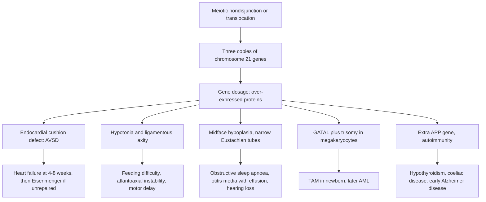

## 1. Definition

**Congenital anomalies** (birth defects) are structural or functional abnormalities present at birth. About **1 in 33 babies** has one, and they are a leading cause of neonatal and infant death and lifelong disability.

**Down syndrome (DS)** is the condition caused by an extra copy of chromosome 21 (whole or the critical part of its long arm). It is the commonest chromosomal disorder in live-born babies and the commonest genetic cause of intellectual disability. A child with DS is not "sick", but has **predictable medical problems** (heart disease, bowel obstruction, hypothyroidism, hearing and eye problems, sleep apnoea, leukaemia, atlantoaxial instability) that a **screening schedule** detects early.

This topic also covers the other anomalies you must recognise and give first care for: **hydrocephalus, spina bifida (neural tube defects), cleft lip and palate, congenital heart disease (CHD) and club foot**.

| Term | Meaning | Example |
|---|---|---|
| **Malformation** | Abnormal formation of a tissue (intrinsic) | Neural tube defect, cleft lip, CHD |
| **Deformation** | Normal tissue moulded by mechanical forces | Positional talipes, plagiocephaly (oligohydramnios, breech) |
| **Disruption** | Breakdown of normally formed tissue | Amniotic band amputation |
| **Dysplasia** | Abnormal organisation of cells in a tissue | Skeletal dysplasia (achondroplasia), ectodermal dysplasia |
| **Sequence** | One primary anomaly causing a cascade | **Pierre Robin** (micrognathia → glossoptosis → cleft palate); Potter sequence (renal agenesis → oligohydramnios → lung hypoplasia, flat face, limb deformities) |
| **Syndrome** | A recognisable pattern of anomalies with one cause | **Down syndrome**, Turner, fetal alcohol syndrome |
| **Association** | Anomalies that occur together more than by chance | **VACTERL** (Vertebral, Anorectal, Cardiac, TracheoEsophageal fistula, Renal, Limb) |
| **Major vs minor** | Major: medical, surgical or cosmetic significance (CHD, NTD). Minor: little significance alone (single palmar crease, ear tag), but **≥3 minor anomalies** raise the chance of a major one or a syndrome | |

> [!PEARL]
> The one thing never to forget: **every baby with Down syndrome needs an echocardiogram**, even if you hear no murmur. An atrioventricular septal defect can be silent in the first weeks while pulmonary pressures are high, and must be repaired by about 3–6 months before irreversible pulmonary hypertension (Eisenmenger) develops.

## 2. Epidemiology

**Global**

| Condition | Frequency |
|---|---|
| Any congenital anomaly | About **1 in 33** births; more than **240,000 newborns die each year** within 28 days from them (WHO) |
| Congenital heart disease | About **8 per 1000** births (about 1 in 4 of these critical) |
| Neural tube defects | **1–2 per 1000** without folic acid fortification (much lower with it) |
| Cleft lip ± palate | About **1 in 700–1000** |
| Club foot | **1–2 per 1000**; male:female **2:1**; **half bilateral** |
| Down syndrome | About **1 in 700–1000** live births; falls where prenatal screening and termination are common; rises with older maternal age |

**Uganda**

- Births with anomalies are **under-recorded**, especially from home births and stillbirths. Hospital-based surveillance (e.g. at Kawempe/Mulago) has found **neural tube defects, hydrocephalus, club foot, cleft lip/palate, abdominal wall defects and CHD** among the commonest anomalies.
- As infection-related deaths fall, congenital anomalies (especially **CHD, neural tube defects and hydrocephalus**) are an increasing share of child deaths and disability.
- Many Ugandan women do not take folic acid before conception, and the first ANC visit is often after 12 weeks, when the neural tube has already closed (**day 28**).
- **Down syndrome in Uganda**: there is **no routine prenatal screening**; diagnosis is made at birth or, often, **months later** when hypotonia, delayed milestones or heart failure are noticed. Mothers are frequently blamed; some families believe the child is cursed, and some children are hidden or abandoned.

> [!UGANDA]
> **Services**: the **Uganda Heart Institute** (Mulago) is the national centre for cardiac surgery (long waiting lists; some children go abroad with charity support). **CURE Children's Hospital of Uganda (Mbale)** and **Mulago** neurosurgery treat hydrocephalus and spina bifida. **CoRSU (Kisubi)** and other Smile Train partner hospitals offer free cleft surgery. **Ponseti club foot clinics** exist in many regional referral hospitals (the Uganda Sustainable Clubfoot Care Project introduced the method nationally).

## 3. Aetiology and Risk Factors

**Causes of congenital anomalies**

| Group | Share | Examples |
|---|---|---|
| Chromosomal | ~6–10% | Trisomies 21, 18, 13; Turner; deletions (22q11) |
| Single-gene | ~7% | Achondroplasia, many syndromes |
| **Multifactorial** (most identifiable) | Large share | NTD, cleft lip/palate, CHD, club foot |
| **Teratogens** | | Alcohol, **valproate, carbamazepine, phenytoin**, warfarin, isotretinoin, ACE inhibitors, uncontrolled maternal **diabetes**; maternal infections: **rubella, CMV, syphilis, toxoplasmosis, Zika** |
| **Nutritional** | | **Folate** and iodine deficiency |
| Unknown | ~50% | |

**Down syndrome**

- **Maternal age** is the main risk factor for free trisomy (nondisjunction rises with the age of the oocyte):

| Maternal age | Approximate risk of DS at birth |
|---|---|
| 30 | 1 in 1000 |
| **35** | **1 in 350** |
| **40** | **1 in 100** |
| 45 | 1 in 30 |

- **A parent carrying a balanced Robertsonian translocation** (suspect after previous affected pregnancies, recurrent miscarriages or stillbirths): risk independent of age (section 5).
- **Previous child with DS**: recurrence risk depends on the cytogenetic type (section 5).

**Specific anomalies**

- **Neural tube defects**: folate deficiency, **valproate/carbamazepine**, maternal diabetes, obesity, hyperthermia; previous affected child.
- **Cleft lip/palate**: multifactorial; teratogens (phenytoin, valproate, smoking, alcohol); syndromes (Pierre Robin, 22q11 deletion).
- **Club foot**: multifactorial; associations with spina bifida, arthrogryposis, oligohydramnios.
- **Hydrocephalus**: **neonatal sepsis and ventriculitis** (postinfectious, commonest in Uganda), preterm intraventricular haemorrhage, myelomeningocele (Chiari II), aqueduct stenosis, Dandy–Walker, tumour.
- **CHD**: DS and other syndromes, maternal rubella, diabetes, teratogens.
- **Consanguinity** increases autosomal recessive conditions.

## 4. Pathophysiology

### Down syndrome: why the features appear

- **Gene dosage**: three copies of chromosome 21 genes (e.g. *DYRK1A*, *APP*, *COL6A1*, *RCAN1*) over-express proteins. **APP** (amyloid precursor protein) explains **early-onset Alzheimer's disease** (amyloid plaques by 40). Genes affecting **endocardial cushion** development explain **AVSD**. **GATA1** mutations in fetal megakaryocytes combined with trisomy cause **transient abnormal myelopoiesis** and later megakaryoblastic leukaemia.
- **Hypotonia** and ligamentous laxity explain floppy babies, feeding difficulty, **atlantoaxial instability**, flat feet and joint hypermobility.
- **Midface hypoplasia**, a narrow upper airway, a large tongue relative to the mouth, adenotonsillar hypertrophy and hypotonia explain **obstructive sleep apnoea** (50–75%); narrow Eustachian tubes cause **otitis media with effusion** → conductive hearing loss.
- **Autoimmunity** is common: hypothyroidism (Hashimoto), coeliac disease, type 1 diabetes, alopecia.
- **Immune dysfunction** explains more frequent and severe respiratory infections.

### Other anomalies: key mechanisms

- **Neural tube defects**: failure of neural tube closure by **day 28** after conception (before many women know they are pregnant). In myelomeningocele the spinal cord is exposed and damaged (motor and sensory loss below the level, neurogenic bladder and bowel), and the **Chiari II malformation** (hindbrain herniation) blocks CSF flow → **hydrocephalus in 80–90%**.
- **Hydrocephalus**: CSF is made by the choroid plexus (~500 mL/day in adults) and absorbed by arachnoid granulations. Obstruction (aqueduct stenosis, Chiari II, Dandy–Walker, tumour) or failed absorption (post-haemorrhagic; **post-infectious**: ventriculitis after neonatal sepsis causes septations and blocked absorption) → ventricular enlargement. In infants the sutures are open, so the **head enlarges** before pressure signs appear.
- **Cleft lip and palate**: failure of fusion of the medial nasal and maxillary processes (lip, **4–7 weeks**) and of the palatal shelves (palate, **8–12 weeks**).
- **Congenital heart disease**: abnormal development of the heart tube, septa and outflow tract at **3–8 weeks**. The **transition at birth** decides when the baby becomes ill: left-to-right shunts (VSD, AVSD, PDA) cause **heart failure at 4–8 weeks** as pulmonary vascular resistance falls; **duct-dependent** lesions (coarctation, hypoplastic left heart, pulmonary atresia, TGA) cause collapse or cyanosis **when the duct closes** in the first days.
- **Club foot**: abnormal fibrosis and shortening of medial and posterior tendons and ligaments → fixed **equinus, varus (heel inversion), adductus (forefoot) and cavus**.

### Feature links

- Hypotonia → weak suck, long feeds, poor weight gain, weak Moro, joint hyperflexibility.
- Ligamentous laxity → atlantoaxial instability → neck pain, torticollis, gait change, weakness, bladder change (cord compression).
- Endocardial cushion defect → AVSD → large left-to-right shunt as pulmonary resistance falls → fast breathing, sweating with feeds, hepatomegaly at 4–8 weeks.
- Unrepaired large shunt → pulmonary vascular disease → Eisenmenger (cyanosis, inoperable).
- High pulmonary pressure in the first weeks → small shunt → **no murmur** despite AVSD.
- Narrow Eustachian tubes → otitis media with effusion → conductive hearing loss → speech delay.
- Small airway, large tongue, big adenoids and tonsils, hypotonia → snoring, apnoeas, daytime sleepiness → pulmonary hypertension.
- Autoimmune thyroiditis or congenital hypothyroidism → prolonged jaundice, constipation, poor growth, worse development.
- GATA1 mutation → blasts in the newborn blood film (TAM) → later megakaryoblastic AML.
- Duodenal atresia → bilious vomiting, double bubble, polyhydramnios in pregnancy.
- Aganglionic distal bowel (Hirschsprung) → delayed meconium, distension, constipation.
- Extra APP gene → amyloid plaques → early Alzheimer's disease from 40 years.
- Chiari II in myelomeningocele → blocked CSF → hydrocephalus (rising HC, tense fontanelle).
- Exposed cord in myelomeningocele → paralysis and sensory loss below the level, talipes, neurogenic bladder → UTIs and renal damage.
- Raised intracranial pressure in an infant → split sutures, sunsetting eyes, dilated scalp veins, vomiting.
- Cleft palate → no seal for suction → milk through the nose, aspiration, poor growth; abnormal palatal muscle insertion → OME, nasal speech.
- Duct closure in a duct-dependent lesion → cyanosis or collapse with weak femoral pulses in the first week.

## 5. Classification / Staging

**Down syndrome: cytogenetic types**

| Type | Share | Mechanism | Recurrence risk |
|---|---|---|---|
| **Free trisomy 21** (47,XX/XY,+21) | ~95% | **Meiotic nondisjunction**, ~90% maternal (mostly meiosis I); risk rises with maternal age | ~1% (or the maternal age risk, whichever is higher) |
| **Robertsonian translocation** (46 chromosomes, extra 21q attached to 14, 21 or 22) | ~3–4% | De novo (~75%) or inherited from a balanced carrier parent (~25%); **not** related to maternal age | Mother carrier ~10–15%; father carrier ~2–5%; **rob(21;21) carrier: 100%** |
| **Mosaic** (some cells 46, some 47) | ~1–2% | Post-zygotic nondisjunction | Low; features may be milder |

> [!EXAM]
> **Why karyotype a baby who obviously has Down syndrome?** Because the **type** determines the **recurrence risk**: if it is a translocation, both parents need karyotypes, and other relatives may be carriers. A rapid test (FISH/QF-PCR) confirms trisomy fast, but only a full karyotype shows a translocation.

**Neural tube defects**

| Type | Description |
|---|---|
| **Spina bifida occulta** | Vertebral arch defect only; skin covered; may have dimple, hair tuft, lipoma, haemangioma; check for tethered cord if neurological signs |
| **Meningocele** | Meninges herniate through the defect; cord in place; often normal neurology |
| **Myelomeningocele (MMC)** | Cord and meninges in an open sac; paralysis and sensory loss below the level, neurogenic bladder and bowel, talipes, hip dislocation; **hydrocephalus in 80–90%** (Chiari II) |
| **Encephalocele / anencephaly** | Cranial defects; anencephaly is incompatible with life |

**Hydrocephalus by cause**: **postinfectious** (commonest in Uganda, after neonatal sepsis/ventriculitis), congenital (aqueduct stenosis, Chiari II with MMC, Dandy–Walker), post-haemorrhagic (preterm IVH), tumour. Functionally: obstructive (non-communicating) versus failed absorption (communicating).

**Congenital heart disease**

| Group | Lesions | Typical presentation |
|---|---|---|
| **Acyanotic, left-to-right shunt** | **VSD** (commonest CHD), ASD, PDA, **AVSD** (DS) | Murmur; **heart failure at 4–8 weeks** (fast breathing, sweating and tiring during feeds, poor weight gain, hepatomegaly); recurrent chest infections; pulmonary hypertension if untreated |
| **Acyanotic, obstructive** | Coarctation, aortic stenosis, pulmonary stenosis | Murmur, weak/absent femoral pulses (coarctation), **collapse when the duct closes** |
| **Cyanotic** | **Tetralogy of Fallot** (commonest cyanotic beyond the newborn period: VSD, overriding aorta, RV outflow obstruction, RV hypertrophy), **transposition of the great arteries** (commonest cyanotic in the newborn), tricuspid atresia, TAPVD, truncus arteriosus | Cyanosis, **hypercyanotic spells** (TOF), clubbing, polycythaemia, squatting, brain abscess, stroke |

**Cleft lip and palate**: by extent: unilateral or bilateral lip, alveolus, hard and/or soft palate; **submucous cleft** (bifid uvula, notch in the hard palate) is easy to miss.

**Club foot**: **positional (postural) talipes** (fully correctable) versus **structural CTEV** (rigid). Severity by the **Pirani score** (0–6; higher = more severe), recorded for each foot at every visit.

## 6. Clinical Features

### History

Each question has a reason.

**Pregnancy**

- **Maternal age** → DS risk (section 3).
- **Parity, ANC attendance and gestation at first visit** → missed screening and folic acid window.
- **Folic acid** (when started) → NTD risk.
- **Drugs**: valproate, carbamazepine, phenytoin, warfarin, ACE inhibitors, herbal medicines; **alcohol, smoking** → teratogens.
- **Diabetes** → CHD, NTD, caudal regression.
- **Febrile illness or rash** (rubella) → cataract, CHD, deafness.
- **HIV and syphilis results** → congenital infection; PMTCT and feeding plan.
- **Ultrasound findings**: polyhydramnios (duodenal or oesophageal atresia), nuchal translucency, double bubble → anticipated anomaly.
- **Fetal movements; breech; oligohydramnios** → talipes, DDH, Potter sequence.

**Family**

- **Previous babies with anomalies, miscarriages or stillbirths** → balanced translocation or single-gene disorder.
- **Consanguinity** → autosomal recessive conditions.
- **Relatives with DS, clefts or NTDs** → recurrence counselling.

**Birth**: gestation, birthweight, Apgar, resuscitation → asphyxia as a cause of hypotonia; breech → talipes, DDH.

**Neonatal**

- **Feeding**: suck, choking, **milk through the nose** → cleft palate; frothing and choking with the first feed → oesophageal atresia.
- **Vomiting and its colour**: **bilious = obstruction** (duodenal atresia, malrotation).
- **Meconium passage within 48 h** → delayed in Hirschsprung, anorectal malformation.
- **Breathing difficulty, cyanosis, sweating with feeds, poor weight gain** → CHD and heart failure.
- **Jaundice** → prolonged in hypothyroidism; early with duodenal atresia.
- **Urine stream** → posterior urethral valves, neurogenic bladder.

**Later childhood**: milestones, hearing, vision, **snoring and pauses in breathing** (OSA), constipation, weight and growth, school; **neck pain, gait change, weakness, bladder or bowel change** (atlantoaxial instability).

**In every child**: **HIV status, immunisation and feeding**; **the parents' understanding, beliefs and support** → counselling plan.

### Examination

Follow the order of Hutchison's Clinical Methods (24th edition), adapted for the newborn and infant: observe first, examine the heart while the baby is quiet, leave distressing parts (palate, hips, eyes with the ophthalmoscope) to last.

#### Introduction, consent and preparation

- Introduce yourself; confirm the baby's name, age and the parent's relationship to the child.
- Explain the examination and gain consent from the parent (assent from an older child).
- **Hand hygiene** before touching the baby.
- **Position and exposure**: undress fully on a warm surface under a radiant heater or in a warm room; keep the baby warm (especially with open lesions or abdominal wall defects).

#### General inspection (end of the cot)

- **Gestalt**: look at the baby as a whole first. Well or unwell; colour (cyanosis, pallor, jaundice, plethora from polycythaemia); breathing pattern and effort; posture and tone (frog-leg posture in hypotonia); obvious anomalies.
- **Vitals**: temperature, RR, HR, **SpO₂ right hand and a foot**, capillary refill, blood glucose if unwell.
- **Growth**: weight, length, **head circumference** plotted with Z-scores (use DS-specific charts or WHO charts for DS).

**Newborn with possible Down syndrome**

| Area | Findings (approximate frequency in newborns with DS) |
|---|---|
| Tone and reflexes | **Hypotonia** (~80%), **weak or absent Moro** (~85%), joint hyperflexibility (~80%) |
| Face | **Flat facial profile** (~90%), **upslanting palpebral fissures** (~80%), epicanthic folds, **Brushfield spots** (speckled iris), small nose with flat nasal bridge, small mouth with protruding tongue |
| Head and neck | Brachycephaly with **flat occiput**, small **dysplastic, low-set ears** (~60%), **excess skin at the nape** (~80%), third fontanelle |
| Hands and feet | **Single palmar crease** (~45%; also in ~1–2% of normal people), short broad hands, **clinodactyly** of the 5th finger (~60%), **sandal gap** between first and second toes |
| Other | Dysplastic pelvis on X-ray (~70%), heart murmur (often absent early), abdominal distension or absent anus (GI anomalies) |

*Hall's criteria*: almost all newborns with DS have **6 or more** of the 10 cardinal signs (flat face, poor Moro, hypotonia, hyperflexibility, nuchal skin, upslanting fissures, dysplastic ears, dysplastic pelvis, clinodactyly, single palmar crease).

#### Hands, face and neck

- **Hands**: palmar creases, clinodactyly, polydactyly (trisomy 13), clenched hands with overlapping fingers (trisomy 18), nails, peripheral cyanosis.
- **Face**: profile, palpebral fissures, epicanthus, Brushfield spots, nasal bridge, tongue, **jaw (micrognathia: Pierre Robin)**, **lip** (cleft).
- **Head**: size and shape, fontanelles (size, tension), **sutures** (split in hydrocephalus), dilated scalp veins, **sunsetting eyes**.
- **Ears**: position, shape, tags, pits.
- **Neck**: nuchal skin, webbing, masses.

#### Systematic newborn anomaly examination (every baby)

- **Eyes**: **red reflex** (cataract, retinoblastoma).
- **Palate**: **look and feel with a finger**; soft palate clefts are easy to miss.
- **Chest and heart**: work of breathing; **murmur**, **femoral pulses**, **pre- and post-ductal SpO₂**, liver edge (heart failure).
- **Abdomen**: distension, masses, wall defects, umbilical hernia.
- **Genitalia**: hypospadias, undescended testes, ambiguous genitalia.
- **Anus**: patent, position.
- **Spine**: dimple, hair tuft, swelling, open lesion.
- **Limbs**: talipes (correctable or rigid; Pirani score), extra digits, arthrogryposis.
- **Hips (last)**: Ortolani and Barlow.
- **Skin**: haemangioma, cutis aplasia (trisomy 13).

**Focused additions by anomaly**

- **NTD**: **level of lesion** (motor function: hip flexion L1–2, knee extension L3–4, ankle dorsiflexion L4–5, plantar flexion S1–2), anal tone, bladder dribbling, **HC**, hips, feet.
- **Hydrocephalus**: HC centile and trend, fontanelle, sutures, eyes; in older children headache, vomiting, papilloedema, sixth nerve palsy.
- **Cleft**: extent (lip unilateral/bilateral, alveolus, hard/soft palate) and **watch a feed**.
- **Club foot**: flexibility and **Pirani score**; always examine **spine and hips** too.

#### Completing the examination

Re-dress and wrap the baby, thank the parents, **hand hygiene**, summarise and document.

| Document these positives | And these negatives |
|---|---|
| Dysmorphic features observed | "Palate intact on palpation" |
| SpO₂ right hand and foot | "Femoral pulses palpable, no murmur" |
| HC and centile | "Anus patent, meconium passed" |
| Level and neurology of NTD | "Spine intact, no sacral dimple" |
| Pirani score for each foot | "Hips stable (Ortolani/Barlow negative)" |

### Red flags

> [!REDFLAG]
> Emergencies in a newborn with an anomaly:
> - **Bilious (green) vomiting**, abdominal distension, no meconium by 48 h → bowel obstruction (duodenal atresia, malrotation, Hirschsprung): nil by mouth, NG tube on free drainage, IV fluids, urgent surgical referral
> - **Frothing, choking and cyanosis with the first feed**, unable to pass an NG tube → oesophageal atresia: keep nil by mouth, suction the pouch, refer
> - **Central cyanosis** not improving with oxygen, or **collapse with weak femoral pulses** in the first week → duct-dependent CHD
> - **Breathing difficulty with micrognathia** → Pierre Robin airway obstruction: prone position, nasopharyngeal airway
> - **Open lesion on the back or head** leaking CSF → infection risk: sterile saline-soaked dressing, prone, refer
> - **Rapidly enlarging head**, tense fontanelle, vomiting, sunsetting eyes → hydrocephalus with raised pressure
> - In DS: **neck pain, torticollis, new gait change, weakness or bladder/bowel change** → atlantoaxial instability with cord compression (urgent imaging)
> - In a child with a shunt: **vomiting, drowsiness, bulging fontanelle, headache** (blockage) or **fever, redness along the track** (infection) → return immediately

### Thinking like a clinician

- **The "floppy baby with a flat face"**: think DS but also check the glucose, temperature and sepsis signs; hypotonia from DS does not explain lethargy, poor perfusion or poor feeding with fever.
- **DS + vomiting**: bilious = duodenal atresia or malrotation; non-bilious, projectile at 3–6 weeks = pyloric stenosis; constipation + distension = **Hirschsprung disease** (DS carries a 40-fold higher risk).
- **DS + fast breathing and poor weight gain at 6 weeks**: heart failure from **AVSD/VSD** is far more likely than pneumonia (though both can coexist).
- **DS + "prolonged jaundice" or constipation**: congenital **hypothyroidism**.
- **DS + high white count with blasts on the film in the first week**: **TAM**; refer to haematology; usually resolves but needs follow-up for leukaemia.
- **DS + snoring and daytime sleepiness**: OSA (pulmonary hypertension risk); refer ENT.
- **DS + "behaviour problems" or school decline**: check hearing, vision, thyroid, sleep and depression before blaming the DS.
- **A baby with an NTD** has a **whole-body problem**: look at the legs (movement, talipes), anus (tone), bladder (dribbling), head (circumference daily), and hips.
- **A "club foot" that corrects fully with gentle pressure** is a **positional** talipes from uterine moulding; it needs only reassurance and stretching. A rigid foot needs Ponseti. Always examine the **spine and hips** too.
- **Cyanosis in a newborn that does not improve with 100% oxygen** (hyperoxia test) suggests cyanotic CHD rather than lung disease.
- **No murmur does not mean no heart disease** in DS: pulmonary pressures are high in the first weeks; get the echo.
- **A young mother does not mean a low recurrence risk**: translocations are not age-related; karyotype every child.
- **One minor feature is not a syndrome** (a single palmar crease or epicanthus alone); look for the pattern, and remember ≥3 minor anomalies should prompt a search for a major one.
- **Common student mistakes**: not feeling the palate, forgetting the anus and spine, measuring HC only once in an MMC, describing a dysmorphic baby as "a Down's baby" in front of the parents.

## 7. Differential Diagnoses

| Differential | Distinguishing clinical feature | Distinguishing investigation |
|---|---|---|
| **Down syndrome** | Hypotonia, flat face, upslanting fissures, single crease, sandal gap, AVSD | Karyotype |
| **Trisomy 18 (Edwards)** | IUGR, **clenched hands with overlapping fingers**, **rocker-bottom feet**, prominent occiput, small jaw, CHD; most die in the first year | Karyotype |
| **Trisomy 13 (Patau)** | **Midline defects**: holoprosencephaly, cleft lip/palate, scalp defects (cutis aplasia), **polydactyly**, microphthalmia, CHD | Karyotype |
| **Congenital hypothyroidism** | Large tongue, umbilical hernia, prolonged jaundice, hypotonia, large fontanelle, constipation; no upslanting eyes or single crease | TSH, T4 |
| **Zellweger and other hypotonic syndromes / Prader–Willi** | Severe hypotonia, feeding difficulty, distinctive faces | Genetic tests |
| **Sepsis, hypoglycaemia, birth asphyxia (acquired hypotonia)** | Lethargy, poor perfusion, fever or hypothermia, abnormal birth history; no dysmorphism | Glucose, FBC, blood culture |
| **Normal baby with minor features** (single palmar crease; epicanthus in some ethnic groups) | No other features, normal tone | Clinical; karyotype if doubt |
| **Positional talipes vs structural club foot** | Positional: fully correctable, normal creases; structural: rigid, deep creases, small calf | Clinical (Pirani) |
| **Macrocephaly: hydrocephalus vs benign familial macrocephaly vs subdural collections** | Hydrocephalus: crossing centiles, tense fontanelle, sunsetting; familial: large parents' heads, normal development | Cranial USS/CT, parents' HC |
| **Cyanosis: cyanotic CHD vs lung disease** | CHD: no improvement with 100% oxygen, little respiratory distress | Hyperoxia test, pre/post-ductal SpO₂, echo |

## 8. Clinical Workup

Diagnosis of most anomalies is clinical; tests confirm the type, find associated anomalies and plan surgery. Facility levels below are typical, not an MoH list [VERIFY: availability compiled from the source notes].

### Bedside

| Test | How / when | Expected finding | How it changes management | Available at |
|---|---|---|---|---|
| **Pulse oximetry** | Right hand (pre-ductal) and either foot (post-ductal) after 24 h (or before discharge) | **Pass**: ≥95% in either with ≤3% difference. **Fail**: <90% in either, or repeated 90–94% / >3% difference | Fail → echo (critical CHD) | HC IV and above; often missing at HC III |
| **Glucose** | Heel prick | Hypoglycaemia (sick, LBW babies; Beckwith–Wiedemann) | Treat; feeds | All levels with a glucometer |
| **NG tube passage** | Pass a size 8–10 tube | Stops at about 10 cm = oesophageal atresia | Nil by mouth, suction, refer | All levels |
| **Hb / haematocrit** | Capillary | Polycythaemia (common in DS) | Partial exchange if hyperviscosity | HC IV and above |
| **Hearing screen** (OAE) | Before discharge or at 6 weeks | Refer if fail | ABR, ENT | Where available (some hospitals) |
| **Red reflex** | Ophthalmoscope in a dim room | Absent/white = cataract (DS, rubella) or retinoblastoma | Urgent ophthalmology | Any level with an ophthalmoscope |
| **Head circumference trend** | Daily in NTD/hydrocephalus | Rising faster than **1 cm/week** in a neonate = progressive hydrocephalus | Cranial USS, neurosurgery | All levels |
| **Hyperoxia test** | 100% oxygen in a cyanosed newborn | No rise in SpO₂ = cyanotic CHD | Echo; careful oxygen | Where oxygen is available |

### Basic lab

| Test | When | Expected / abnormal finding | How it changes management | Available at |
|---|---|---|---|---|
| **FBC and blood film** | DS newborn; yearly Hb from 1 year | Polycythaemia, thrombocytopenia, **blasts (TAM)**; later anaemia or leukaemia | Haematology referral; partial exchange if hyperviscosity | HC IV (FBC); film at hospitals |
| **TSH, free T4** | DS (newborn, 6 and 12 months, then yearly); prolonged jaundice; constipation; poor growth | Raised TSH | Levothyroxine | RRH, NRH, private |
| **Electrolytes, urea, creatinine** | On diuretics or ACE inhibitors; vomiting baby with obstruction | Low K⁺, dehydration, raised creatinine | Adjust fluids and drugs | General hospital and above |
| **Ferritin / CRP** | DS with risk of iron deficiency | Low ferritin | Iron | RRH, private |
| **Coeliac serology** | DS with poor growth, diarrhoea, constipation or anaemia only | Positive | Gluten-free diet | NRH, private |

### Imaging

| Test | When | Expected / abnormal finding | How it changes management | Available at |
|---|---|---|---|---|
| **Abdominal X-ray** | Bilious vomiting, distension | **Double bubble** (duodenal atresia), dilated loops, absent rectal gas | Surgical referral (Mulago paediatric surgery) | General hospital and above |
| **Chest X-ray** | Heart failure, cyanosis | Cardiomegaly, plethora or oligaemia | Supports CHD; pneumonia | General hospital and above |
| **Cranial ultrasound** (through the fontanelle) / **CT** | Hydrocephalus, NTD | Ventriculomegaly, septations (postinfectious), Chiari II | Neurosurgery (ETV ± CPC, VP shunt) | USS at most hospitals; CT at RRH/NRH |
| **Renal and bladder ultrasound** | NTD (neurogenic bladder), anorectal malformation, VACTERL | Hydronephrosis | Clean intermittent catheterisation, urology | General hospital and above |
| **Hip ultrasound / X-ray** | Breech, club foot, NTD, clinical instability | DDH | Pavlik harness, orthopaedics | RRH and above |
| **Cervical spine X-ray (flexion/extension)** | DS with **neurological symptoms only** | Atlanto-dens interval increased | Neurosurgical review; **not routine screening** | RRH and above |

### Specialised / referral-level

| Test | When | Expected / abnormal finding | How it changes management | Available at |
|---|---|---|---|---|
| **Karyotype** (FISH/QF-PCR for rapid result) | Suspected DS or other chromosomal syndrome | 47,+21; translocation; mosaic | Confirms diagnosis; translocation → parental karyotypes and recurrence counselling | Mulago/MakCHS genetics and private labs; often paid, results in weeks |
| **Echocardiogram** | **Every newborn with DS**; murmur, cyanosis, failed pulse oximetry, heart failure | AVSD, VSD, ASD, PDA, TOF | Heart failure treatment; timely surgical referral | UHI, Mulago, Mengo, some RRHs, private clinics |
| **Contrast study / rectal biopsy** | Delayed meconium, constipation from birth | Transition zone; aganglionosis | Hirschsprung surgery | NRH paediatric surgery |
| **Hearing (ABR) and ophthalmology** | DS, congenital infections, cleft palate | Conductive/sensorineural loss; cataract, refractive error, strabismus | Grommets, hearing aids, glasses, cataract surgery | Mulago ENT, CoRSU, some RRHs |
| **Polysomnography** | DS by 4 years (AAP); snoring | OSA | Adenotonsillectomy, CPAP | Rarely available in Uganda; overnight oximetry as a proxy |

### Putting it together

**Model one-line summary**

> "A 3-day-old term boy, birthweight 2.9 kg, born to a 39-year-old para 6 with no antenatal ultrasound, with hypotonia, flat facial profile, upslanting palpebral fissures, Brushfield spots, a single palmar crease and sandal gaps, feeding poorly but without vomiting, SpO₂ 96% right hand and 95% foot, no murmur: clinically Down syndrome, awaiting karyotype and echocardiogram."

**Problem list**

1. Clinical DS: confirm (karyotype), counsel parents.
2. Screen for CHD (echo) despite no murmur.
3. Feeding difficulty from hypotonia: breastfeeding support, cup feeding expressed milk.
4. Baseline FBC (TAM, polycythaemia), TSH, hearing, red reflex.
5. Family: older mother, recurrence counselling after karyotype; support and myths.

**Model case presentation (ward round)**

> "Baby Joseph is a 6-week-old boy, weight 3.6 kg (birthweight 3.0 kg; WAZ −1.7), length 54 cm (LAZ −0.8), HC 37 cm (normal), with clinically diagnosed Down syndrome (karyotype pending), born at term at Mengo to a 38-year-old para 5 who is HIV-negative; BCG, OPV0 and HepB birth dose given, 6-week vaccines due today; exclusively breastfed but tiring during feeds. He presents with 2 weeks of fast breathing, sweating during feeds and poor weight gain. On examination: RR 64, HR 168, SpO₂ 94% in air, mild subcostal recession, no fever, liver 3 cm below the costal margin, pansystolic murmur at the left lower sternal border. Typical DS features; anus patent, normal stools. **Impression: heart failure from a probable atrioventricular septal defect in an infant with Down syndrome, with poor weight gain.** Plan: echo, CXR, FBC, TSH, electrolytes; furosemide 1 mg/kg 12-hourly, start enalapril 0.1 mg/kg/day if BP allows, expressed breast milk by cup/NG to maintain intake, vaccines today, urgent referral to the Uganda Heart Institute for surgical review before 3–6 months, and counselling and support for the parents."

> [!EXAM]
> **Worked example: the double bubble.** A 1-day-old with DS vomits green fluid after every feed; the abdomen is not distended; no meconium yet. Plain abdominal X-ray: two gas-filled bubbles (stomach and duodenal cap) and **no distal gas**. **Interpretation: duodenal atresia** (complete obstruction; partial obstruction or malrotation would show some distal gas, and malrotation with volvulus is the emergency not to miss). **Action:** nil by mouth, NG tube on free drainage with hourly aspirates, IV fluids (10% dextrose-containing maintenance plus NG losses replaced with 0.9% saline + KCl), check electrolytes, echo before anaesthesia, refer to paediatric surgery for duodenoduodenostomy.

**Worked example 2: the "club foot".** A 2-day-old born by breech has an inturned right foot. With gentle pressure the foot comes fully to neutral and beyond, creases are normal, the calf is normal. **Interpretation**: positional talipes from uterine moulding, not CTEV. **Action**: reassure, teach stretching, examine the **hips** (breech: DDH risk) and the **spine**, review in 2–4 weeks. A rigid foot with deep medial and posterior creases would need Ponseti casting within the first weeks.

## 9. Management

### Immediate / emergency

**First 5 minutes (any newborn with a significant anomaly)**

1. **Airway** with attention to the anomaly: **Pierre Robin** → prone or side-lying, nasopharyngeal airway. **Breathing**: in diaphragmatic hernia, **no bag-mask ventilation**; intubate. **Cyanosis**: SpO₂ pre- and post-ductal. **Circulation**: femoral pulses, CRT; collapse = duct-dependent lesion or sepsis.
2. **Thermal care** (especially with open lesions or abdominal wall defects: cover in cling film to reduce heat and fluid loss); **glucose** check.
3. **Protect open lesions**: myelomeningocele or gastroschisis → sterile saline-soaked gauze, cling film, **prone** (MMC) or bowel supported to the side (gastroschisis), **no latex** gloves.
4. **Nil by mouth and NG tube** for suspected bowel obstruction; **Replogle/suction** of the upper pouch for oesophageal atresia.
5. **Call the senior and plan referral early.**

**Hypercyanotic (tet) spell**: calm the child on the parent's lap in **knee–chest position**, **oxygen**, **morphine 0.1–0.2 mg/kg** IV/IM/SC, **0.9% saline 10–20 mL/kg**, correct acidosis and anaemia; specialist IV propranolol or phenylephrine if persistent; urgent surgical referral.

**Oxygen in suspected CHD**: give oxygen only to SpO₂ targets; excess oxygen can worsen shunts or promote duct closure in duct-dependent lesions. **Prostaglandin infusion** to keep the duct open is rarely available outside UHI.

### Definitive

#### Down syndrome: at diagnosis (newborn)

1. **Breaking the news** (see "Counselling the family" below), together with the senior, both parents present.
2. **Confirm**: karyotype (rapid FISH/QF-PCR if available).
3. **Examine for associated anomalies**: heart (echo), gut (vomiting, meconium, anus), eyes (red reflex), hearing, hips.
4. **Feeding support**: breastfeeding is possible and protective; hypotonia and a weak suck mean longer feeds; express breast milk and **cup-feed** if needed; watch weight closely (daily in hospital, weekly after discharge until gaining well). If CHD with heart failure: small frequent feeds, NG feeds.
5. **Baseline tests**: FBC and film, TSH (newborn), hearing screen.
6. **Immunise normally** (BCG, OPV, HepB birth dose, and all UNEPI vaccines); PCV and influenza vaccine are especially valuable.
7. **Plan follow-up** in a paediatric clinic and link to early intervention (physiotherapy, speech therapy) and parent support.

#### Down syndrome: specific problems

| Problem | Management |
|---|---|
| **AVSD / large VSD with heart failure** | Diuretics and ACE inhibitor (drug table), high-energy feeds, treat infections, **early surgical referral** (UHI) before 6 months; palivizumab not available; avoid long delays |
| **Duodenal atresia / Hirschsprung / anorectal malformation** | Surgical referral (Mulago paediatric surgery) |
| **Congenital or acquired hypothyroidism** | **Levothyroxine**, monitor TSH/T4 |
| **TAM** | Haematology; most resolve; follow FBC to 4–5 years (AML risk) |
| **OME and hearing loss** | Grommets, hearing aids, speech therapy |
| **Cataract, strabismus, refractive error** | Ophthalmology, glasses, surgery |
| **OSA** | Adenotonsillectomy, weight control, CPAP |
| **Atlantoaxial instability with symptoms** | Urgent imaging and neurosurgery; neck-safe anaesthesia positioning in all |
| **Constipation** | Fluids, fibre, lactulose; exclude hypothyroidism and Hirschsprung |
| **Development** | Early intervention (physio, OT, SLT), inclusive education |

### Drug table

| Drug | Dose (per kg + max for children; adult) | Route | Frequency | Duration | Key cautions |
|---|---|---|---|---|---|
| **Furosemide** (heart failure: VSD, AVSD, PDA) | **1 mg/kg/dose** (UCG 2023); increase as needed; **max 8 mg/kg/day** (UCG) | Oral or IV | Once daily or 12-hourly | Until surgical repair; review regularly | Hypokalaemia, dehydration; check electrolytes |
| **Spironolactone** (add-on, K⁺-sparing) | **1.5–3 mg/kg/day** (UCG 2023) | Oral | Divided 12-hourly | With furosemide | **Hyperkalaemia** with ACE inhibitors |
| **Enalapril** (afterload reduction in large left-to-right shunts) | Start **0.1 mg/kg/day**, up to 0.5–1 mg/kg/day (UCG: 0.1–1 mg/kg/day) | Oral | 1–2 doses/day | Until repair | Hypotension, renal function; caution if SBP low |
| **Captopril** (alternative) | **0.1–0.3 mg/kg/dose** (UCG) | Oral | 8–12-hourly | Until repair | Test dose; monitor BP |
| **Digoxin** (heart failure, selected) | Maintenance **15 µg/kg/day** (UCG) | Oral | Once daily or divided | Specialist decision | Toxicity with hypokalaemia; caution in renal disease |
| **Morphine** (hypercyanotic spell) | **0.1–0.2 mg/kg** | IV/IM/SC | Once, may repeat | Acute | With knee–chest position, O₂, **0.9% saline 10–20 mL/kg**; respiratory depression |
| **0.9% sodium chloride** (tet spell) | **10–20 mL/kg** | IV | Bolus | Acute | Volume expansion to raise systemic resistance |
| **Propranolol** (prevention of tet spells awaiting surgery) | **0.5–1 mg/kg/dose** | Oral | 6–8-hourly [VERIFY: frequency against local cardiology protocol] | Until surgery | Hypoglycaemia, bradycardia |
| **Levothyroxine** (congenital hypothyroidism) | **10–15 µg/kg/day** (newborn); older children by age/weight | Oral | Once daily | Lifelong (review) | Crush in a little milk; monitor TSH/T4 at 2 and 4 weeks then regularly |
| **Folic acid** (NTD prevention, mother) | **400 µg/day** (all women); **5 mg/day** if previous NTD, on antiepileptics, or diabetic | Oral | Daily | From ≥1 month before conception to 12 weeks | Give before conception: the neural tube closes by day 28 |
| **Paracetamol** (post-operative / tenotomy pain) | **15 mg/kg** | Oral | 6-hourly | Short course | Max 60 mg/kg/day |

### Referral criteria

| Level | What it can do | Refer up when |
|---|---|---|
| **HC II / III** | Newborn examination, protect open lesions, start feeding support, immunise | **Any** major anomaly, suspected DS, failed pulse oximetry, bilious vomiting, enlarging head, rigid club foot |
| **HC IV / General Hospital** | Stabilise (IV fluids, NG tube, oxygen), USS, X-ray, start diuretics | Surgical anomalies, suspected CHD needing echo, hydrocephalus, MMC |
| **Regional Referral Hospital** | Paediatrician, echo (some), Ponseti clinic, TSH, cranial USS | Cardiac surgery, neurosurgery, karyotype, complex surgery |
| **National Referral (Mulago, UHI) / CURE Mbale / CoRSU** | Cardiac surgery (UHI), neurosurgery (CURE, Mulago), paediatric surgery, cleft surgery (CoRSU, Smile Train partners), genetics | |

- **Urgent (same day)**: bilious vomiting, oesophageal atresia, duct-dependent CHD or collapse, open myelomeningocele (closure within **48–72 h**), Pierre Robin airway obstruction, rapidly enlarging head, DS with neurological signs of cord compression.
- **Early (weeks)**: AVSD/large VSD (surgical review by **2–3 months** so repair happens by 3–6 months), cleft lip/palate team, Ponseti clinic (ideally within 2–3 weeks), hydrocephalus without acute signs.

> [!UGANDA]
> Many children with AVSD in Uganda present late with pulmonary hypertension; **referring early** (in the first 2–3 months) is the single most important action. Echo is available at the **Uganda Heart Institute**, Mulago, Mengo and some RRHs and private clinics; TSH at RRH/NRH and private labs; formal hearing testing at Mulago ENT, CoRSU and some RRHs.

### Monitoring and follow-up

**Down syndrome health-surveillance schedule** (based on AAP 2022 health supervision guidance; adapt to what is available)

| Age | Checks |
|---|---|
| **Birth – 1 month** | Karyotype; **echocardiogram**; FBC (TAM, polycythaemia); **TSH**; hearing screen (OAE/ABR); **red reflex** (cataract); feeding and weight; check for GI anomalies (vomiting, stools); counselling |
| **1 month – 1 year** | **TSH at 6 and 12 months**; hearing every **6 months** (until reliable ear-specific testing, then yearly); **ophthalmology by 6 months**; growth on DS-specific charts (or WHO); development and early intervention; heart surgery timing (AVSD by 3–6 months); monitor for respiratory infections, OSA symptoms |
| **1 – 5 years** | **TSH yearly**; **Hb yearly** (with ferritin/CRP if risk of iron deficiency); hearing and eyes yearly; **sleep study (or oximetry) by 4 years**; speech and language therapy; dental care; ask about **neck symptoms** (atlantoaxial instability); coeliac testing only if symptoms (poor growth, diarrhoea, constipation, anaemia) |
| **5 – 12 years** | Yearly TSH, Hb, hearing; eyes every 1–2 years; growth and weight (obesity); school progress and inclusive education; behaviour (ADHD, autism are more common) |
| **Adolescence – adult** | Puberty, menstrual care, sexuality and safeguarding, contraception; mental health (depression); keratoconus, cataracts; vocational training; transition to adult care; from 40 years watch for **early Alzheimer's disease** |

> [!UGANDA]
> Where tests cannot be done, the minimum is: **echo once**, **clinical thyroid assessment and TSH when possible**, **regular weight and length**, **hearing and vision checks by simple tests**, and **ask about neck symptoms**.

**Other anomalies**: HC daily in NTD and hydrocephalus (weekly after discharge); weight weekly in cleft palate and in heart failure; Pirani score at every Ponseti visit; electrolytes on diuretics and ACE inhibitors; TSH/T4 at 2 and 4 weeks after starting levothyroxine.

### Hydrocephalus

1. **Recognise**: HC crossing centiles upward (> +2 SD or rising **>1 cm/week in a neonate, >2 cm/month in an infant**), bulging tense fontanelle, **split sutures**, **sunsetting eyes**, dilated scalp veins, irritability, vomiting, poor feeding, developmental delay; in older children headache, vomiting, papilloedema, sixth nerve palsy.
2. **Classify cause** (section 5).
3. **Investigate**: cranial USS through the fontanelle; CT (septations, cause); screen for ongoing infection (CSF only by the neurosurgical team).
4. **Refer** to neurosurgery: **endoscopic third ventriculostomy (ETV) with choroid plexus cauterisation (CPC)**, developed largely at CURE Children's Hospital of Uganda, avoids lifelong shunt dependence in suitable infants; otherwise **ventriculoperitoneal (VP) shunt**.
5. **Shunt complications** (teach parents): **blockage** (vomiting, drowsiness, bulging fontanelle, headache), **infection** (fever, redness along the track, peritonitis), over-drainage; any of these = return immediately.
6. **Supportive care**: nutrition, physiotherapy, vision and development follow-up, pressure-area care for a large head.

### Spina bifida (myelomeningocele)

**Immediate management**

1. Delivery and resuscitation as usual; **do not lie the baby on the lesion**.
2. Cover the lesion with **sterile gauze soaked in warm sterile saline**, then cling film; keep it moist; nurse **prone or on the side**.
3. **Latex-free** handling (high risk of latex allergy later).
4. Assess the **level** (leg movements, anal tone, bladder dribbling), **HC daily**, hips and feet.
5. Antibiotics if the sac is leaking or infected (per local neonatal protocol).
6. **Refer for surgical closure within 48–72 hours** (CURE Mbale, Mulago neurosurgery), with a referral note and the mother.
7. **Long term**: hydrocephalus surveillance, **clean intermittent catheterisation**, bowel programme, renal ultrasound, physiotherapy and orthoses, pressure-sore prevention, school inclusion.

> [!UGANDA]
> UCG 2023 (newborn care) lists **club foot** ("refer for special evaluation and treatment"), **cleft lip/palate** ("help mother breastfeed or teach an alternative method if not possible") and **open tissue on the head, back or abdomen** ("cover with sterile gauze soaked in sterile saline before referral") among the abnormal findings to act on before discharge.

### Cleft lip and palate

1. **Examine**: extent (unilateral/bilateral lip, alveolus, hard and/or soft palate; submucous cleft with bifid uvula); look for **Pierre Robin sequence** (small jaw, tongue falls back, airway obstruction) and other anomalies (heart, syndromes).
2. **Feeding first**: babies with **cleft lip only** usually breastfeed well. With **cleft palate**: hold **upright**, express breast milk and feed by **cup and spoon**, special squeezable bottles or long teats; small frequent feeds; burp often (swallowed air); **weigh weekly**; NG feeds if failing.
3. **Airway** in Pierre Robin: prone or side-lying, nasopharyngeal airway, refer.
4. **Refer early** to a cleft team (free surgery via Smile Train/partner hospitals such as CoRSU).
5. **Surgery timing**: lip repair at about **3 months** (classic "rule of 10s": ≥10 weeks old, ≥10 lb (4.5 kg), Hb ≥10 g/dL); palate repair at **9–12 months** (before speech develops); later alveolar bone graft (8–11 years), orthodontics, revision surgery.
6. **Follow-up**: hearing (OME is very common with cleft palate: grommets), speech therapy, dental care, psychosocial support; counsel recurrence risk (**~2–4%** for a sibling if one parent or child affected; higher with more relatives).

### Congenital heart disease on the ward

Oxygen only to SpO₂ targets, **diuretics ± ACE inhibitor** for heart failure, **energy-dense feeds** (NG if needed), treat anaemia and infections, **dental care and endocarditis prevention**, immunisation, early echo and **referral to the Uganda Heart Institute**. Tet spells: see Immediate / emergency.

### Club foot (congenital talipes equinovarus)

1. **Diagnose**: rigid **CAVE** deformity (Cavus, Adductus, Varus, Equinus) that cannot be corrected passively; deep medial and posterior creases, small calf. Distinguish **positional talipes** (fully correctable). Examine **spine** (spina bifida), **hips** (DDH) and the whole baby (arthrogryposis, syndromes).
2. **Score** with the **Pirani score** (0–6) at each visit.
3. **Ponseti method** (start in the first weeks of life, ideally within 2–3 weeks):
   - **Weekly manipulation and above-knee plaster casts**, correcting **cavus first, then adductus and varus together**, never pronating the foot; usually **5–7 casts**.
   - **Percutaneous Achilles tenotomy** (under local anaesthesia, ~80–90% of feet) to correct residual equinus, then a final cast for 3 weeks.
   - **Foot-abduction brace** (boots and bar, feet at 60–70° external rotation on the affected side): **23 hours a day for 3 months**, then **at night and naps until 4–5 years**.
4. **Brace adherence** is the main determinant of **relapse**; counsel and follow up regularly. Relapses are treated with repeat casting ± tibialis anterior tendon transfer.
5. **Uganda**: Ponseti clinics in regional referral hospitals and CoRSU/Mulago; treatment is often free; late presenters (walking age) can still be treated with casting, though less successfully.

### Counselling the family (applies to all anomalies)

1. **Prepare**: confirm facts, involve the senior, choose a private room, have the baby present (wrapped and named), both parents together if possible, a nurse or counsellor, and an interpreter if needed.
2. **Ask what they have noticed and what they understand.**
3. **Name the condition clearly**: "Your baby, Joseph, has a condition called Down syndrome." Use **person-first, positive language** ("a baby with Down syndrome", not "a Down's baby" or old offensive terms).
4. **Explain the cause simply**: an extra chromosome present from conception; **nobody's fault**; not caused by anything the mother did, not witchcraft, not contagious.
5. **Balanced information**: what to expect (slower development, learning disability usually mild to moderate, health checks for heart, thyroid, hearing, eyes), and what is possible (walking, talking, school, relationships, work, a long life).
6. **Practical plan**: feeding, tests (karyotype, echo), follow-up dates, early intervention.
7. **Recurrence risk** once the karyotype is known; offer genetic counselling for future pregnancies (and that prenatal screening exists, mostly privately in Uganda).
8. **Emotional support**: allow silence and grief, address myths with the extended family, link to **parent support groups**, social worker and church/community support; screen the mother for depression; follow up.
9. **Document** what was said, and arrange to meet again soon (parents remember little of the first conversation).

### Before discharge (newborn with DS)

Echo (or referral for it), feeding and weight, vomiting and stools (GI anomalies), red reflex, hearing screen, FBC (TAM, polycythaemia), TSH, immunisations, follow-up date, counselling done.

## 10. Complications

**Disease-related**

| Condition | Main complications |
|---|---|
| **Down syndrome** | Heart failure, pulmonary hypertension (Eisenmenger), recurrent pneumonia, OSA, hearing and visual impairment, hypothyroidism, leukaemia, atlantoaxial subluxation, obesity, coeliac disease, diabetes, early Alzheimer's, depression; stigma |
| **Hydrocephalus** | Developmental delay, blindness, seizures, death |
| **Myelomeningocele** | Paraplegia, neurogenic bladder (UTIs, renal damage), bowel incontinence, pressure sores, hydrocephalus, scoliosis, latex allergy, tethered cord |
| **Cleft lip/palate** | Malnutrition and aspiration, OME and hearing loss, speech problems (nasal speech), dental anomalies, psychosocial problems |
| **CHD** | Heart failure, failure to thrive, pulmonary hypertension, endocarditis, polycythaemia, stroke, brain abscess (cyanotic), arrhythmia, sudden death |
| **Club foot** | Neglected club foot (walking on the dorsum, callosities, disability) |

**Treatment-related**

| Treatment | Complication |
|---|---|
| VP shunt | **Blockage**, **infection**, over-drainage; lifelong shunt dependence (ETV ± CPC avoids this in suitable infants) |
| Diuretics | Hypokalaemia, dehydration; hyperkalaemia with spironolactone plus ACE inhibitor |
| ACE inhibitors | Hypotension, renal impairment |
| Digoxin | Toxicity, worse with hypokalaemia or renal disease |
| Propranolol | Hypoglycaemia, bradycardia |
| Excess oxygen in duct-dependent CHD | Duct closure, collapse |
| Ponseti treatment | **Relapse** with brace non-adherence |
| Anaesthesia and surgery in DS | Cord injury from neck manipulation if atlantoaxial instability: neck-safe positioning in all |
| Latex exposure in MMC | Latex allergy |

## 11. Prognosis

- **Down syndrome**: with good care, people with DS now live into their **50s and 60s** in high-income countries; in Uganda, **unrepaired heart disease and infections** still cause many early deaths. Learning disability is usually mild to moderate; most walk, talk and can attend school, work and form relationships. From 40 years early Alzheimer's disease becomes common.
- **AVSD**: good outcome if repaired by 3–6 months; once Eisenmenger develops, surgery is no longer possible.
- **Trisomy 18**: most die in the first year. **Anencephaly** is incompatible with life.
- **Myelomeningocele**: outlook depends on the level of the lesion, hydrocephalus control, bladder care (renal protection) and access to rehabilitation.
- **Hydrocephalus**: development depends on cause, timing of treatment and shunt or ETV complications.
- **Cleft lip/palate**: excellent appearance and speech outcomes with timely repair and speech therapy.
- **Club foot**: Ponseti corrects most feet; relapse is mostly due to brace non-adherence; late presenters do less well.

## 12. Prevention

- **Folic acid 400 µg daily** from at least 1 month before conception to 12 weeks (**5 mg** if a previous NTD, on valproate/carbamazepine, or with diabetes); **food fortification**; avoid valproate in women of childbearing potential where possible.
- **Control maternal diabetes** before and during pregnancy; avoid alcohol, smoking and known teratogens; review medicines (including herbal) before conception.
- **Rubella immunity** (measles–rubella vaccination) prevents congenital rubella syndrome; treat syphilis in pregnancy.
- **Early ANC booking** (before 12 weeks) and an anomaly scan; prenatal screening for DS exists, mostly privately in Uganda.
- **Postinfectious hydrocephalus**: clean delivery and prompt treatment of neonatal sepsis.
- **Recurrence counselling** after any affected baby: karyotype the child with DS (and parents if translocation); after a myelomeningocele, recurrence is about **2–5%** after one affected child, so **folic acid 5 mg daily** from before conception to 12 weeks, early ANC and an anomaly scan; cleft recurrence ~2–4% for a sibling.
- **Secondary prevention in DS**: the surveillance schedule (section 9) catches heart, thyroid, hearing, eye, sleep and blood problems early.

## 13. Special Populations

- **Children with DS undergoing anaesthesia or surgery**: neck-safe positioning in all (atlantoaxial instability); echo before anaesthesia.
- **DS with heart failure**: feeding (NG), immunisation (PCV, influenza) and early infection treatment matter more because respiratory infections are more frequent and severe.
- **Adolescents with DS**: puberty, menstrual care, sexuality and **safeguarding**, contraception, depression, transition to adult care.
- **Preterm babies**: post-haemorrhagic hydrocephalus after IVH; HC surveillance.
- **HIV-exposed infants with anomalies**: support the feeding plan (expressed breast milk by cup in cleft palate) within PMTCT guidance.

## 14. Key Points

### High-yield points

- Every newborn with DS gets an **echo**, even without a murmur.
- Karyotype every child with DS: the **type** decides recurrence risk.
- **Bilious vomiting** in a newborn is a surgical emergency.
- AVSD repair by **3–6 months**: refer in the first 2–3 months.
- DS surveillance: echo, FBC, TSH, hearing and red reflex at birth; TSH at 6 and 12 months then yearly; sleep study by 4 years; ask about neck symptoms.
- MMC: saline-soaked gauze, cling film, prone, no latex, HC daily, closure within 48–72 h.
- Hydrocephalus in Uganda is mostly **postinfectious**.
- Cleft palate: **feeding first**, weigh weekly.
- Club foot: Ponseti from the first weeks; the brace prevents relapse.
- Counsel with person-first language: nobody's fault, not witchcraft.

### Numbers & doses

| Item | Value |
|---|---|
| Congenital anomalies | ~**1 in 33** births |
| Down syndrome | ~**1 in 700–1000** live births |
| DS cytogenetics | Trisomy **~95%**, translocation **~3–4%**, mosaic **~1–2%** |
| Maternal age risk | ~1/1000 at 30, **1/350 at 35**, **1/100 at 40**, 1/30 at 45 |
| Recurrence | Free trisomy **~1%**; maternal translocation carrier **10–15%**; paternal **2–5%**; rob(21;21) **100%** |
| CHD in DS | **40–50%** (AVSD ~40% of these); repair AVSD by **3–6 months** |
| Duodenal atresia with DS | ~**30%** of duodenal atresia cases have DS |
| TAM | ~**10%** of DS newborns; **20–30%** later AML |
| Leukaemia risk in DS | **10–20 ×** |
| OSA in DS | ~**50–75%**; sleep study by **4 years** (AAP) |
| TSH in DS | Birth, **6 and 12 months**, then **yearly** |
| CHD overall | ~**8 per 1000** births |
| Pulse oximetry pass | ≥**95%** with ≤**3%** hand–foot difference; <90% = fail |
| NTD prevention | Folic acid **400 µg/day** (5 mg high risk) from pre-conception to **12 weeks**; neural tube closes by **day 28** |
| MMC closure | Within **48–72 h**; hydrocephalus in **80–90%** |
| Hydrocephalus HC alarm | Rising >**1 cm/week** (neonate), >**2 cm/month** (infant) |
| Cleft lip ± palate | ~**1 in 700**; lip repair **~3 months**; palate **9–12 months** |
| Club foot | **1–2/1000**, M:F **2:1**, **50%** bilateral; **5–7** casts; tenotomy **80–90%**; brace **23 h/day × 3 months**, nights to **4–5 years** |
| Furosemide | **1 mg/kg/dose** daily or 12-hourly; max **8 mg/kg/day** (UCG) |
| Enalapril | **0.1 → up to 1 mg/kg/day** in 1–2 doses (UCG) |
| Spironolactone | **1.5–3 mg/kg/day** divided (UCG) |
| Digoxin maintenance | **15 µg/kg/day** (UCG) |
| Morphine for tet spell | **0.1–0.2 mg/kg** IV/IM/SC |
| Levothyroxine (congenital hypothyroidism) | **10–15 µg/kg/day** |

### Exam traps

- **"No murmur, so no echo needed in DS."** Wrong: echo every DS newborn; AVSD can be silent early.
- **"Mother is 22, so recurrence risk is negligible."** Wrong: if it is a translocation, the risk depends on parental karyotypes, not age; karyotype every child.
- **"Single palmar crease = Down syndrome."** Wrong: 1–2% of normal people have one; diagnose on the overall pattern and karyotype.
- **"Routine neck X-rays for all children with DS."** Wrong: AAP no longer recommends routine screening; ask about symptoms.
- **"Wait for the MMC to be repaired before measuring the head."** Wrong: measure HC daily from birth; hydrocephalus is very common.
- **"Club foot can wait until the child walks."** Wrong: Ponseti works best started in the first weeks.
- **"Bottle-feed every baby with cleft lip."** Wrong: cleft lip alone usually breastfeeds; palate clefts need cup/spoon or special bottles.
- **"High-flow oxygen for every cyanotic newborn."** Careful: in duct-dependent CHD oxygen may promote duct closure; target saturations and get an echo.

### Questions seniors ask

**Viva questions**

1. *What are the cytogenetic causes of DS?* Free trisomy (~95%, nondisjunction), Robertsonian translocation (~3–4%), mosaicism (~1–2%).
2. *What is the commonest heart lesion in DS?* AVSD (also VSD, ASD, PDA, TOF).
3. *What is the recurrence risk after a free trisomy 21?* About 1% (or the age risk if higher).
4. *Name GI anomalies associated with DS.* Duodenal atresia, Hirschsprung, anorectal malformation, oesophageal atresia/TOF; coeliac disease later.
5. *What is TAM?* Transient abnormal myelopoiesis: a self-limiting leukaemoid proliferation in ~10% of DS newborns; 20–30% develop AML later.
6. *How do you manage a myelomeningocele at birth?* Cover with sterile saline-soaked gauze and cling film, prone position, latex-free, assess level and HC, refer for closure within 48–72 hours.
7. *Ponseti method?* Weekly casts (cavus first), Achilles tenotomy, foot-abduction brace 23 h/day for 3 months then nights until 4–5 years.
8. *When are cleft lip and palate repaired?* Lip ~3 months; palate 9–12 months.

**On the ward round**

- **How would you confirm Down syndrome and why does the type matter?** Karyotype (rapid FISH/QF-PCR first if available); a translocation changes recurrence risk and needs parental karyotypes.
- **What would you check before this baby with DS goes home?** Echo (or referral for it), feeding and weight, vomiting and stools (GI anomalies), red reflex, hearing screen, FBC (TAM, polycythaemia), TSH, immunisations, follow-up date, counselling done.
- **A baby with DS vomits green on day 1. What do you do?** Nil by mouth, NG tube on free drainage, IV fluids, abdominal X-ray (double bubble = duodenal atresia; exclude malrotation with volvulus), electrolytes, urgent surgical referral.
- **Why is early AVSD repair important?** A large shunt causes heart failure and, within months, irreversible pulmonary vascular disease (Eisenmenger), after which surgery is no longer possible.
- **What causes most hydrocephalus in Ugandan infants?** Postinfectious hydrocephalus after neonatal sepsis/ventriculitis; prevention is clean delivery and prompt treatment of neonatal sepsis.
- **How would you counsel a mother whose baby has a myelomeningocele about future pregnancies?** Recurrence risk is about 2–5% after one affected child; take **folic acid 5 mg daily** from before conception to 12 weeks, book ANC early and have an anomaly scan.
- **What makes the Ponseti method succeed or fail?** Correct casting technique and, above all, adherence to the foot-abduction brace; non-adherence is the main cause of relapse.

### Mnemonics

- **DS associated problems "HEART CLOGS"** (approximate): **H**ypothyroidism, **E**yes (cataract, refractive), **A**tlantoaxial instability, **R**espiratory infections and OSA, **T**AM/leukaemia; **C**HD (AVSD), **L**earning disability, **O**titis media/hearing, **G**I atresias and Hirschsprung, **S**hort stature.
- **Maternal age risk "35 → 1 in 350; 40 → 1 in 100; 45 → 1 in 30".**
- **Club foot "CAVE"**: **C**avus, **A**dductus, **V**arus, **E**quinus (corrected in that order: cavus first).
- **Cleft "rule of 10s"**: 10 weeks, 10 lb, Hb 10 g/dL for lip repair.
- **VACTERL**: Vertebral, Anorectal, Cardiac, TracheoEsophageal, Renal, Limb.
- **Trisomies**: **13** = midline ("13 is unlucky, splits the middle": cleft, holoprosencephaly, polydactyly); **18** = "Edwards clenches his fists and rocks on his feet" (overlapping fingers, rocker-bottom feet).

### OSCE tips

- **Dysmorphology station**: describe systematically from head to toe ("I would like to examine the whole baby"), list features with their names (upslanting palpebral fissures, epicanthic folds, Brushfield spots), then state "These features suggest Down syndrome; I would confirm with a karyotype and screen for associated conditions: echo, FBC, TSH, hearing and eyes."
- **Breaking-news station**: introduce yourself, check identity, ask what they know, warning shot ("I have some important news about Joseph"), name it clearly, pause, respond to emotion, correct myths, give a plan, check understanding, offer a follow-up meeting and support.
- **Newborn examination station**: say aloud that you feel the palate, check the anus and spine, do pre- and post-ductal SpO₂ and leave the hips to last.

## 15. References

1. Ministry of Health Uganda. Uganda Clinical Guidelines 2023: newborn examination and care; heart failure in children. Kampala: MoH; 2023. https://library.health.go.ug/uganda-clinical-guidelines-2023
2. Bull MJ, Trotter T, Santoro SL, et al. Health Supervision for Children and Adolescents With Down Syndrome. Clinical Report. American Academy of Pediatrics. Pediatrics 2022;149(5):e2022057010.
3. World Health Organization. Pocket Book of Hospital Care for Children, 2nd edition (newborn problems, congenital anomalies). Geneva: WHO; 2013. https://www.who.int/publications/i/item/978-92-4-154837-3
4. World Health Organization. Congenital disorders fact sheet [VERIFY: edition year and URL].
5. Centers for Disease Control and Prevention. Down Syndrome (birth defects: types, causes, health issues). 2024. https://www.cdc.gov/birth-defects/about/down-syndrome.html
6. Centers for Disease Control and Prevention. About Folic Acid. 2024. https://www.cdc.gov/folic-acid/about/index.html
7. Centers for Disease Control and Prevention. About Spina Bifida. 2024. https://www.cdc.gov/spina-bifida/about/index.html
8. Centers for Disease Control and Prevention. Cleft Lip/Cleft Palate. 2024. https://www.cdc.gov/birth-defects/about/cleft-lip-cleft-palate.html
9. Centers for Disease Control and Prevention. About Congenital Heart Defects. 2024. https://www.cdc.gov/heart-defects/about/index.html
10. Medscape (eMedicine). Down Syndrome Workup. 2024. https://emedicine.medscape.com/article/943216-workup
11. Medscape (eMedicine). Hydrocephalus: Background, Epidemiology, Etiology. 2024. https://emedicine.medscape.com/article/1135286-overview
12. Glynn M, Drake WM, editors. Hutchison's Clinical Methods: An Integrated Approach to Clinical Practice. 24th edition. Edinburgh: Elsevier; 2018.
