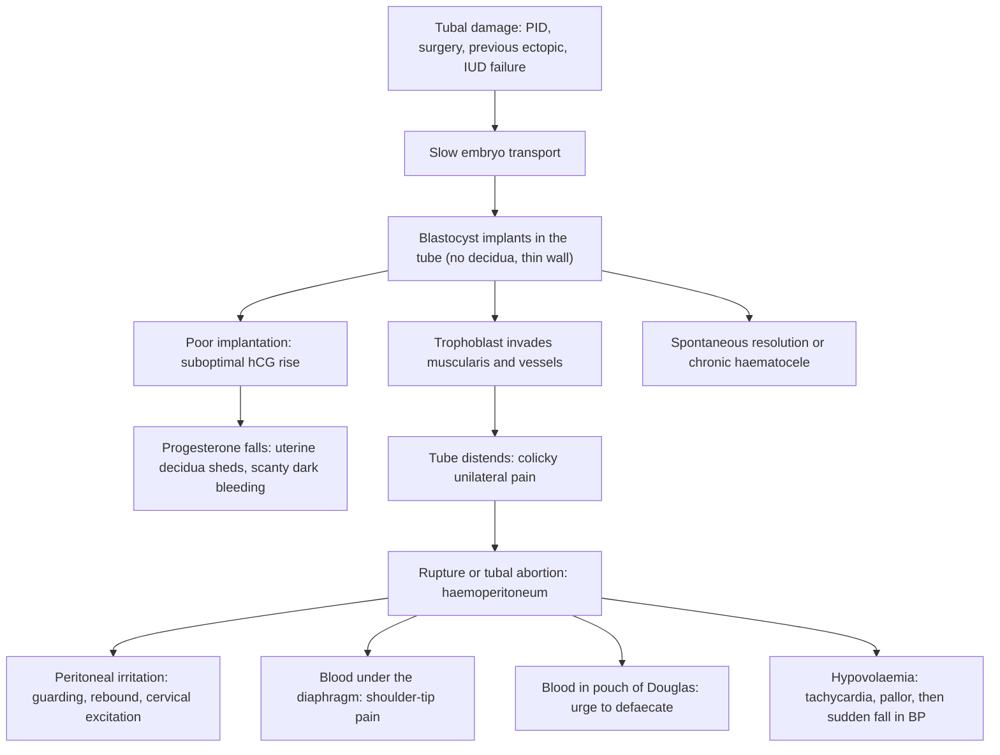

## 1. Definition

- **Ectopic pregnancy** means the fertilised ovum implants **anywhere other than the endometrial lining of the uterine cavity**. More than **95% are in the fallopian tube**.
- It is the **leading cause of maternal death in the first trimester** worldwide.
- The tube cannot stretch or form a decidua. The trophoblast erodes its wall, so the tube **ruptures and bleeds into the peritoneal cavity**, typically at **6–10 weeks**.
- **Diagnosis rests on three things:** a **pregnancy test**, **ultrasound** (empty uterus ± adnexal mass or free fluid) and **clinical suspicion**.

| Term | Meaning |
|---|---|
| **Ectopic pregnancy** | Implantation outside the endometrial cavity |
| **Ruptured vs unruptured** | Rupture = the tubal wall has burst, causing haemoperitoneum. Unruptured may still leak (tubal abortion) |
| **Tubal abortion** | The pregnancy is extruded through the fimbrial end, with bleeding from the fimbria |
| **Chronic ectopic** | Slow leak, forming an organised **pelvic haematocele** with a pelvic mass, low-grade fever, low hCG |
| **Heterotopic pregnancy** | Intrauterine + ectopic at the same time. About 1 in 30,000 spontaneous conceptions, but up to about 1 in 100 with assisted reproduction |
| **Pregnancy of unknown location (PUL)** | Positive pregnancy test but **no pregnancy seen in or outside the uterus** on TVUS. This is a *label* while you wait, not a final diagnosis |
| **Persistent trophoblast** | hCG fails to fall after conservative surgery (salpingotomy) |

> [!PEARL]
> **The one thing never to forget:** a young woman who is **pale, tachycardic and has abdominal pain** has a ruptured ectopic until you have proven otherwise. **Do the pregnancy test.**

## 2. Epidemiology

- Incidence is about **1–2% of pregnancies** worldwide, higher where **sexually transmitted infections and PID** are common.
- In **African hospital series**: most cases present **ruptured** (about 71% in a Ghanaian district hospital, about 90% in Cameroon; **70–90% in hospital series** overall), often after being treated for "malaria", "PID" or "gastritis"; case fatality is **several times higher than in high-income countries**; **PID is the dominant risk factor**, with a roughly threefold increase in risk.
- **Why Ugandan women present late:**
  - early symptoms are vague;
  - women first attend drug shops, clinics or traditional healers;
  - health workers treat "malaria/UTI/PID" without a pregnancy test;
  - ultrasound and quantitative hCG are limited to HC IV and above, and **transvaginal scanning and serum hCG are rarely available outside referral and private centres**;
  - transport is slow;
  - costs (e.g. for theatre supplies or blood) delay surgery.
- **Facility realities:** **HC IVs can perform laparotomy**, but blood is often short. **Laparoscopy** is available only in a few referral or private hospitals. **Methotrexate** is stocked mainly at referral and cancer centres. Repeated quantitative hCG is costly. The result: **laparotomy and salpingectomy remain the standard operation** in most Ugandan hospitals.

> [!UGANDA]
> In Uganda, the realistic goal is **early suspicion**: a urine pregnancy test for every woman of reproductive age with abdominal pain, fainting or abnormal bleeding, at every level, including HC II and III. Then **resuscitate and refer or operate without delay**. Keep the test strips in the OPD, casualty and the gynaecology ward.

## 3. Aetiology and Risk Factors

**Normal transport.** Fertilisation occurs in the **ampulla**. **Ciliary beating and muscular peristalsis** move the embryo to the uterus over **3–4 days**, and it implants at the blastocyst stage (around day 6–7). Anything that **slows transport** (damaged cilia, adhesions, hormonal effects on motility) lets the blastocyst implant in the tube.

**Risk factors** (but half of women have none)

| Category | Examples | Why |
|---|---|---|
| **Tubal damage** | **PID** (*Chlamydia*, gonorrhoea), post-abortal or puerperal sepsis, **genital TB**, schistosomiasis | Destroys the cilia and causes intraluminal adhesions, so the embryo is transported slowly |
| **Previous ectopic** | Recurrence about 10% after one, higher after two | Same underlying tubal disease, or a scarred tube |
| **Tubal surgery** | Tubal ligation (a pregnancy after sterilisation is often ectopic), salpingotomy, reversal | Scarring or recanalisation |
| **Contraception failure** | Pregnancy with an **IUD in situ**, or with progestogen-only methods | The IUD prevents intrauterine implantation far better than tubal implantation. Progestogens slow tubal motility. The *absolute* risk is low because these methods prevent most pregnancies |
| **Infertility / ART** | IVF, ovulation induction | Tubal factor; multiple embryos |
| **Others** | Smoking, age over 35, previous pelvic or abdominal surgery (appendicitis, CS), endometriosis | Ciliary dysfunction, adhesions |

## 4. Pathophysiology

**Why the tube ruptures**

- The tube has **no decidua** (the thick, specialised endometrial layer that limits trophoblast invasion in the uterus) and only a **thin muscular wall**.
- Trophoblast invades straight into the muscularis and blood vessels.
- As the pregnancy grows, the wall thins and **ruptures**, usually:
  - **isthmus: early** (6–8 weeks), because it is narrow and non-distensible;
  - **ampulla: later** (8–12 weeks), because it is wider;
  - **interstitial (cornual): latest** (12–16 weeks), and **catastrophic**. The cornu lies where the **uterine and ovarian arteries anastomose**, and the surrounding myometrium lets the pregnancy grow larger before bursting.

**Possible outcomes** of a tubal pregnancy

1. **Spontaneous resolution** (tubal miscarriage with reabsorption). This is why expectant management works for small, declining ones.
2. **Tubal abortion** through the fimbria, with bleeding.
3. **Rupture**, with haemoperitoneum.
4. **Chronic ectopic / pelvic haematocele.**

**hCG kinetics** (why serial hCG helps)

- In a viable intrauterine pregnancy, hCG roughly **doubles every 48 hours** in early pregnancy. NICE uses a **rise of more than 63% in 48 hours** as suggesting a developing IUP; ACOG uses a minimum rise of about 35%.
- A **fall of more than 50% in 48 hours** suggests a failing pregnancy.
- **Ectopic pregnancies usually show a suboptimal rise or a plateau**, because the implantation site is poor.

**Discriminatory zone.** The hCG level above which a normal IUP **should be visible** on scan:

- **TVUS:** about **1,500–2,000 IU/L** (ACOG cautions it may be as high as **3,500 IU/L**).
- **Transabdominal scan:** about **6,500 IU/L**.
- An empty uterus with hCG above the discriminatory zone strongly suggests ectopic (or a recent complete miscarriage).

**How methotrexate works.** It is a **folic acid antagonist** that inhibits **dihydrofolate reductase**, blocking DNA synthesis in rapidly dividing **trophoblast**. That explains:

- why it works best when **hCG is low** and there is **no cardiac activity** (less active, smaller trophoblast mass);
- why it is **contraindicated with an intrauterine pregnancy** and in breastfeeding;
- why its side-effects are in rapidly dividing tissues: **stomatitis, GI upset, marrow suppression, alopecia (rare)**, and **teratogenicity** (hence contraception for 3 months).

**Feature links (explaining the symptoms)**

- hCG maintains the corpus luteum → **amenorrhoea** (6–8 weeks typical).
- Poor trophoblast → less hCG → **progesterone falls** → uterine decidua sheds → **dark, scanty, "prune-juice" bleeding**; rarely a **decidual cast** mistaken for products of conception.
- Ectopic bleeding mistaken for a period → **no clear amenorrhoea** in about a third.
- Tubal distension → **colicky, unilateral pain** (visceral), typically **before** the bleeding.
- Blood in the peritoneum → **peritoneal irritation** → guarding, rebound, cervical motion tenderness.
- Blood under the diaphragm → irritates the **phrenic nerve (C3–5)** → pain referred to the C4 dermatome → **shoulder-tip pain**.
- Blood pooling in the **pouch of Douglas** → **painful defaecation / urge to defaecate**, boggy fullness on bimanual.
- Large haemoperitoneum → **distension, shifting dullness**, rarely **Cullen's sign**; free fluid in Morison's pouch on FAST.
- Haemoperitoneum → hypovolaemia → young women **compensate** with tachycardia and vasoconstriction until **30–40% of blood volume** is lost, then **BP falls suddenly**.
- Peritoneal blood → **vagally mediated bradycardia**, so a "normal" pulse does not exclude rupture.
- Ongoing bleeding → **falling Hb** on serial checks.
- Defibrinated peritoneal blood → **non-clotting blood** on culdocentesis.

## 5. Classification / Staging

**By site**

| Site | Share / notes |
|---|---|
| **Tubal** (over 95%) | **Ampulla ~70–80%**, isthmus ~12%, fimbria ~11%, **interstitial (cornual) 2–3%** |
| **Non-tubal** | **Ovarian** (~3%), **cervical** (under 1%), **caesarean scar** (rising with CS rates), **abdominal** (~1%), intramural |
| **Heterotopic** | IUP + ectopic |

**By state**: ruptured (haemoperitoneum, unstable or stable) versus unruptured; tubal abortion; chronic ectopic.

**By location certainty**: PUL (no pregnancy seen) → IUP, failing PUL, or ectopic on follow-up.

**By haemodynamics**: shock index (pulse ÷ systolic BP) **0.9 or more abnormal; 1.4 or more critical**.

**Management grouping by hCG** (NICE NG126): under 1,500 IU/L → methotrexate first-line if all criteria met; 1,500–5,000 IU/L → choice of methotrexate or surgery; 5,000 IU/L or more → surgery.

## 6. Clinical Features

### History

| Ask | Why (what changes the plan) |
|---|---|
| **LMP and regularity; was the last period normal, "missed" or "unusual"?** | 6–8 weeks of amenorrhoea is typical, but about a third have no clear amenorrhoea (ectopic bleeding mistaken for a period) |
| **Pain: site, onset, character; pain or bleeding first?** | **Unilateral pain before scanty bleeding** = ectopic; bleeding first, then central cramps = miscarriage |
| **Shoulder-tip pain, fainting, dizziness, urge to defaecate** | Haemoperitoneum: urgent theatre |
| **Bleeding: amount, colour, tissue passed** | Scanty dark "prune-juice" bleeding suggests ectopic; heavy bleeding with tissue suggests miscarriage; a decidual cast can mimic POC |
| **Previous ectopic, PID/STI, tubal ligation, IUD in situ, infertility treatment, pelvic or abdominal surgery** | Raise pre-test probability; pregnancy with an IUD or after ligation is ectopic until proven otherwise |
| **Contraception** | Pregnancy with an IUD or after ligation makes an ectopic much more likely |
| **Previous CS** | Caesarean scar pregnancy |
| **Any earlier scan showing an intrauterine pregnancy?** | A confirmed IUP makes ectopic very unlikely (except heterotopic after ovulation induction) |
| **Fever, dysuria, diarrhoea, vomiting, migratory pain** | Alternatives: PID, UTI, gastroenteritis, appendicitis; but always the pregnancy test first |
| **Blood group (Rh), HIV status, allergies, last meal** | Anti-D; anaesthesia and surgery planning |
| **Fertility wishes, number of living children, state of the other tube if known** | Salpingectomy vs salpingotomy; counselling |
| **Distance from the hospital, phone, ability to return** | Decides whether methotrexate or expectant care is even an option |

### Examination

Follow the order of Hutchison's Clinical Methods (24th edition). In a shocked woman, resuscitation and the pregnancy test come first (section 9), and the pelvic examination is omitted.

#### Introduction, consent and preparation

- Introduce yourself, confirm identity, explain, gain consent; **chaperone** for the speculum and bimanual examination.
- **Hand hygiene**.
- **Position and exposure**: supine (flat, legs raised if shocked) for the abdomen; lithotomy or dorsal for the speculum; keep her covered.

#### General inspection and vital signs

| Sign | Mechanism | What it means |
|---|---|---|
| **Pallor** | Blood loss | Haemoperitoneum or chronic anaemia |
| Cold clammy peripheries, capillary refill >2 s | Vasoconstriction | Compensated shock |
| Restlessness, confusion, drowsiness, air hunger | Cerebral hypoperfusion | Decompensating shock |
| Distended abdomen visible from the bed | Large haemoperitoneum | Theatre now |

**Vital signs**: **pulse** (tachycardia, or occasionally bradycardia), **BP** (including a **postural drop** if she is not shocked), capillary refill, respiratory rate, SpO₂, temperature, level of consciousness, urine output, **shock index** (0.9 or more abnormal; 1.4 or more critical).

#### Hands, face and neck

Cold hands, slow capillary refill; conjunctival pallor; dry mucous membranes.

#### Abdomen

- **Inspection**: distension; rarely **Cullen's sign** (periumbilical bruising); scars (previous CS, appendicectomy).
- **Palpation**: lower abdominal tenderness, usually unilateral; **guarding and rebound**.
- **Percussion**: **shifting dullness** (large haemoperitoneum).
- **Auscultation**: bowel sounds (ileus with peritonism).

#### Pelvic examination

- **Speculum**: small amount of dark blood, **os closed** (in contrast to inevitable or incomplete abortion, where the os is open with tissue); decidual tissue occasionally. A **ballooned, barrel-shaped cervix** with heavy bleeding suggests a **cervical ectopic** (do not attempt evacuation).
- **Bimanual** (gently, **once**, and **only if not in shock**, because it can rupture a friable tube):
  - **cervical excitation (motion) tenderness**;
  - adnexal tenderness or mass;
  - **fullness or bogginess in the pouch of Douglas**;
  - uterus slightly bulky but **smaller than dates**.

#### Completing the examination

Thank her, hand hygiene, summarise.

**Document:** "pale, pulse X, BP Y, shock index Z; abdomen soft/guarded, shifting dullness present/absent; os closed, dark blood; cervical excitation present; right adnexal tenderness; uterus 6-week size."

> [!NOTE]
> **Do not delay a shocked woman for a pelvic examination or a formal scan.** Positive pregnancy test + shock + signs of peritonism = theatre.

### Red flags

> [!REDFLAG]
> - **Shock:** pulse over 100–110, systolic BP under 90, shock index 0.9 or more, cold peripheries, confusion, air hunger.
> - **Syncope, shoulder-tip pain, abdominal distension, shifting dullness.** These mean haemoperitoneum.
> - **Hb falling** on serial checks, or **free fluid in Morison's pouch** on FAST scan. The bleed is large.
> - **Pregnancy after tubal ligation or with an IUD**, plus pain.
> - **Pain at 12–16 weeks with a "normal" early scan report.** Think **interstitial (cornual)** ectopic.
> - **Heavy painless bleeding with a ballooned cervix.** Think **cervical ectopic** (do not "evacuate" it at the bedside, as massive haemorrhage follows).

> [!REDFLAG]
> Positive pregnancy test **plus any of**: shock index 0.9 or more, fainting, shoulder-tip pain, abdominal distension, guarding or rebound, Hb falling, or free fluid in Morison's pouch = **ruptured ectopic until proven otherwise**. Senior and theatre now.

### Thinking like a clinician

- **Rule 1: pregnancy test for everyone.** Any woman aged 12–50 with abdominal pain, abnormal bleeding, collapse or "anaemia of unknown cause" gets a urine hCG. Modern urine tests detect about 25 IU/L, so a **negative test essentially excludes ectopic** (except in rare chronic ectopics).
- **Rule 2: an empty uterus + positive test = PUL or ectopic, never "complete abortion"**, unless an IUP was previously seen or the sac was seen being passed.
- **Rule 3: vital signs lie in the young.** A 22-year-old can keep a normal BP until she suddenly decompensates. Tachycardia, pallor and **a falling Hb** matter more. Some women are **bradycardic** from peritoneal blood.
- **Rule 4: in a shocked woman, surgery IS resuscitation.** You cannot fill a leaking bucket. Give fluids and blood **while transferring to theatre**. Aim for **permissive hypotension** (systolic about 80–90 mmHg, maintaining consciousness) until the tube is clamped, so you do not dilute clotting factors or "pop the clot".
- **"If X then think Y":**
  - **Positive test + adnexal mass + empty uterus:** ectopic.
  - **Positive test + fever + bilateral adnexal tenderness:** still exclude ectopic before calling it PID.
  - **"Incomplete abortion" but the evacuated tissue has no villi:** ectopic.
  - **IUP on scan, but free fluid and severe pain:** consider **heterotopic** (especially after ovulation induction) or a **ruptured corpus luteum**.
  - **Pregnancy 12–16 weeks with sudden collapse:** ruptured **interstitial or rudimentary-horn** pregnancy.
- **Common student mistakes:** forgetting the pregnancy test; accepting "PID" in a woman with a missed period; doing a vigorous bimanual examination; sending an unstable woman to the radiology department; forgetting anti-D and contraception counselling; presenting "BP normal" as reassurance.

## 7. Differential Diagnoses

| Differential | Distinguishing clinical feature | Distinguishing investigation |
|---|---|---|
| **Threatened / incomplete abortion** | Bleeding before pain; crampy central pain; **os open** (incomplete); uterine size nearer dates | Scan: IUP or retained products; villi in tissue |
| **Ruptured corpus luteum cyst** | Sudden pain mid-cycle or in early pregnancy; can cause haemoperitoneum | Scan: IUP present, ovarian cyst with free fluid |
| **Ovarian torsion** | Sudden severe unilateral pain, vomiting, adnexal mass | Scan: enlarged ovary ± reduced Doppler flow; laparoscopy or laparotomy |
| **PID / tubo-ovarian abscess** | Fever, purulent discharge, **bilateral** tenderness, pregnancy test **negative** | hCG negative; WBC raised; scan: complex adnexal mass |
| **Acute appendicitis** | Periumbilical pain migrating to the right iliac fossa, anorexia, fever; hCG negative | Clinical ± scan |
| **Urinary tract infection / ureteric colic** | Dysuria, loin pain, haematuria | Urinalysis |
| **Molar pregnancy** | Uterus large for dates, very high hCG, hyperemesis | Scan: "snowstorm" |
| **Malaria / gastroenteritis** | Fever, diarrhoea; no peritonism | mRDT; but **always do the hCG** |
| **Sickle cell crisis, ruptured spleen, perforated ulcer** | Other history and signs | As appropriate |

## 8. Clinical Workup

The two questions that drive everything are: **"Is she pregnant?"** and **"Is she bleeding into her abdomen?"** This is how the gynae emergency team at Mulago, Kawempe or Mengo would approach a woman of reproductive age with abdominal pain, abnormal bleeding or collapse. The first 5 minutes are in section 9.

### Bedside

| Test | Why / expected finding | How it changes management | Available at |
|---|---|---|---|
| **Urine hCG** | Detects about 25 IU/L. **Negative essentially excludes ectopic** (rare chronic ectopic excepted). Positive + pain = ectopic pathway | Decides the pathway in 3–5 minutes (catheter specimen if she cannot void) | All levels, including HC II |
| **HemoCue / bedside Hb** | Baseline and trend; a **falling Hb** on repeat is more telling than one value | Transfusion; ongoing bleeding → surgery | HC III and above |
| **Bedside clotting test** | No clot by 7 minutes = coagulopathy after massive bleeding | Blood products | All levels |
| **FAST / point-of-care ultrasound** | **Free fluid in Morison's pouch** or the splenorenal space = large haemoperitoneum. Empty uterus + free fluid in a woman with a positive test is enough | Theatre | HC IV and above with an operator |
| **Culdocentesis** (needle into the pouch of Douglas through the posterior fornix) **or abdominal paracentesis** (where no ultrasound) | **Non-clotting blood** = haemoperitoneum (clotted blood in the peritoneum lyses). A **negative tap does not exclude ectopic** | Supports haemoperitoneum → theatre | All levels with a trained clinician |
| **Urine dipstick, mRDT** | Only to look for co-existing problems | **Never instead of the hCG** | All levels |

> [!PEARL]
> **Culdocentesis:** blood aspirated from the peritoneum **does not clot**, because it has already clotted and been defibrinated by peritoneal movement. If the aspirated blood **clots in the syringe**, you probably hit a vessel.

### Basic lab

| Test | When | Expected / abnormal finding | How it changes management | Available at |
|---|---|---|---|---|
| **Hb / FBC** | Everyone | Low or falling Hb (a fall of 1–2 g/dL or more in a "stable" woman = ongoing intra-abdominal bleeding); platelets and WBC as baseline before methotrexate | Transfusion; a falling Hb in a "stable" woman → surgery | Hb at all levels; FBC at HC IV and above |
| **Group, Rhesus, crossmatch** | Everyone; **4 units if ruptured** | Rh-negative | Blood ready for theatre; **anti-D** after surgery | HC IV and above |
| **HIV, syphilis (chlamydia/gonorrhoea where available)** | Everyone | Positive | Linkage; treat her and her partner (PID is the main cause) | All levels (RDTs) |

### Imaging

| Test | When | Expected / abnormal finding | How it changes management | Available at |
|---|---|---|---|---|
| **Transvaginal ultrasound** (TVUS) | Stable woman with positive hCG | **Empty uterus**; adnexal mass separate from the ovary (**tubal ring / "bagel"**, "blob"); sac with yolk sac or embryo ± **heartbeat**; **echogenic free fluid**; **pseudosac** (central fluid without a double decidual ring); IUP (excludes ectopic in most) | Locates the pregnancy; mass size (35 mm cut-off), heartbeat and free fluid choose surgery vs methotrexate vs expectant | TVUS mainly at RRH/NRH and private units; **transabdominal** at most HC IVs |

### Specialised / referral-level

| Test | When | Expected / abnormal finding | How it changes management | Available at |
|---|---|---|---|---|
| **Serum quantitative hCG** | PUL; considering methotrexate or expectant care; after salpingotomy | Level vs **discriminatory zone** (TVUS about 1,500–2,000, up to 3,500 IU/L; transabdominal about 6,500 IU/L); 48 h trend | Above the zone with an empty uterus = ectopic (or recent complete miscarriage); **under 1,500** allows methotrexate; **5,000 or more** favours surgery | Referral hospitals and private labs; costly |
| **Repeat hCG at 48 h** | PUL | **Rise over 63%** (IUP likely); **fall over 50%** (failing); **in between** (suspect ectopic) | Rescan in 7–14 days; urine test in 2 weeks; or senior review and TVUS within 24 h | As above |
| **Serum progesterone** | Where available | Under 20 nmol/L suggests a failing pregnancy | Supports, but does not locate | Few units |
| **LFTs, creatinine, FBC** | **Before methotrexate** | Must be normal | Abnormal = methotrexate contraindicated → surgery | Referral hospitals |
| **Histology of the tube or evacuated tissue** | After surgery, where available | Chorionic villi | Confirms the diagnosis; excludes gestational trophoblastic disease | RRH/NRH |
| **Laparoscopy** | Stable woman, diagnosis uncertain or for treatment | Ectopic seen | Diagnosis and treatment in one | Few referral or private hospitals |

### Putting it together

**Model one-line summary**

> "A 24-year-old P1+0 with 7 weeks of amenorrhoea, 1 day of right iliac fossa pain followed by scanty dark bleeding, and one fainting episode; pulse 118, BP 96/60 (**shock index 1.2**), pale, with right iliac fossa guarding, **positive urine hCG**, closed os and free fluid in Morison's pouch on FAST. **Working diagnosis: ruptured right tubal ectopic pregnancy with haemoperitoneum.**"

**Problem list**

1. Suspected ruptured ectopic with haemorrhagic shock.
2. Anaemia (HemoCue 7.8 g/dL).
3. Rhesus status and HIV status unknown.
4. Future fertility and contraception.

**Plan:** resuscitate, crossmatch 4 units, emergency laparotomy and salpingectomy, inspect the other tube, anti-D if Rh-negative, counselling.

**Model case presentation (post-op day 1)**

> "Ms K is a 26-year-old P1+0 who presented yesterday with 8 weeks of amenorrhoea, 1 day of left iliac fossa pain, shoulder-tip pain and fainting. She was **in shock** (pulse 128, BP 78/50, Hb 6.2 g/dL) with a distended, tender abdomen and a **positive urine hCG**; FAST showed free fluid in Morison's pouch. After resuscitation with 1.5 L crystalloid and 2 units of blood, she had an **emergency laparotomy**: **ruptured left ampullary ectopic**, about 2 L haemoperitoneum, **left salpingectomy**; the right tube and both ovaries were normal. Today she is stable, pulse 88, BP 110/70, post-transfusion Hb 8.9 g/dL, passing urine, tolerating sips. Plan: oral iron, mobilise, anti-D (she is Rh-negative), counselling on the **10% recurrence and early scan in the next pregnancy**, contraception of choice (she prefers an implant), and discharge on day 3 with review in 2 weeks."

**Worked example 1: a stable woman with hCG above the discriminatory zone.** A 29-year-old at 6 weeks, mild left pain, pulse 84, BP 118/76. TVUS: **empty uterus**, **24 mm left adnexal mass separate from the ovary, no heartbeat**, a small amount of fluid in the pouch of Douglas. Serum hCG **2,400 IU/L**.

- hCG is **above the discriminatory zone** and the uterus is empty: this is an **ectopic**, not a PUL.
- Mass under 35 mm, no heartbeat, pain mild, hCG **between 1,500 and 5,000 IU/L**: NICE says **offer a choice of methotrexate or surgery**.
- In most Ugandan hospitals (no methotrexate, uncertain follow-up), **laparotomy or laparoscopy and salpingectomy** is the safer choice. If she lives near a referral centre with methotrexate and reliable hCG, she could have **50 mg/m² IM** with hCG on days 4 and 7.

**Worked example 2: interpreting serial hCG in a PUL.** A stable woman at 5 weeks, TVUS shows nothing in or outside the uterus. hCG at 0 h is **800 IU/L**.

| hCG at 48 h | Change | Interpretation | Action |
|---|---|---|---|
| **1,400 IU/L** | Rise of 75% (over 63%) | Likely developing IUP | Rescan in 7–14 days, or when hCG passes about 1,500–2,000 IU/L |
| **1,040 IU/L** | Rise of 30% (suboptimal) | **Suspect ectopic** | Senior review and repeat TVUS **within 24 h** |
| **820 IU/L** | Plateau | **Suspect ectopic** | As above |
| **350 IU/L** | Fall of 56% (over 50%) | Failing pregnancy (miscarriage) | Urine pregnancy test in 2 weeks; return if positive or symptoms |

Calculate the change as **(new − old) ÷ old × 100**. Every woman on a PUL pathway goes home with **written safety-net advice**: return at once with pain, shoulder-tip pain, fainting or heavy bleeding.

## 9. Management

**Choosing the pathway (positive hCG + suspected ectopic)**

1. **Haemodynamically unstable or signs of rupture?** → **Resuscitate + emergency laparotomy (salpingectomy).**
2. **Stable: is the ectopic seen on scan?** If **no (PUL)** → serial hCG at 48 h + repeat TVUS, safety-net advice.
3. **Ectopic seen: heartbeat, mass ≥35 mm, hCG ≥5,000, significant pain, or cannot follow up?** → **Surgery** (laparoscopy if available, otherwise laparotomy).
4. **hCG <1,500, pain-free, mass <35 mm, no heartbeat, reliable follow-up** → **methotrexate** (first-line), or **expectant** if hCG is low and falling.
5. **hCG 1,500–5,000** (other criteria met) → offer **methotrexate or surgery**.

### Immediate / emergency

**First 5 minutes**

1. **Look and feel:** pale, sweaty, cold peripheries, restless or drowsy, air hunger? A distended abdomen?
2. **Vitals now:** pulse, BP, respiratory rate, SpO₂, temperature, capillary refill, level of consciousness, **shock index** (0.9 or more abnormal; 1.4 or more critical). A normal BP does not reassure.
3. **Urine pregnancy test immediately** (catheter specimen if she cannot void).

**Ruptured ectopic with shock: emergency algorithm (HC IV or hospital), ABCDE**

1. **Shout for help.** Inform the theatre, the anaesthetist and the lab **at once**: "ruptured ectopic, theatre now".
2. **A/B:** oxygen by face mask at 10–15 L/min. Lay her flat and raise her legs.
3. **C:** **two large-bore IV cannulae (14–16 G)**. Draw blood for **Hb, grouping & crossmatch (4 units)**, and a bedside clotting test.
   - **Fluids:** warmed crystalloid (Ringer's lactate or normal saline), **500 mL–1 L bolus**, then reassess.
   - **Do not over-infuse**: **permissive hypotension**, target systolic BP about 80–90 mmHg and a conscious patient until the bleeding is controlled.
   - **Transfuse early:** crossmatched blood, or **group O Rh-negative / group-specific uncrossmatched** blood if she is in extremis.
   - **Catheterise** and measure urine output.
4. **D:** level of consciousness.
5. **E:** keep her warm.
6. **Consent** (a brief, honest explanation to her and her family, including the possibility of losing the tube). **Anti-D** for Rh-negative women after surgery.
7. **Emergency laparotomy. Do not wait to "stabilise first", and do not wait for a formal scan.**

> [!UGANDA]
> **At a HC III or a HC IV without a functioning theatre:** resuscitate (2 lines, fluids), make sure a **pregnancy test** is done, **call ahead**, and **refer immediately with a health worker escort**, a referral note (vitals, fluids and drugs given, time) and blood-donor relatives. Do not wait for an ultrasound. A positive pregnancy test with shock is enough to refer. In Kampala, ambulances go to Kawempe or Mulago (and Mengo, Nsambya, Rubaga for private-not-for-profit care).

### Definitive

#### Emergency laparotomy for rupture

- **Anaesthesia:** ketamine-based general anaesthesia is preferred in shock; spinal is contraindicated in hypovolaemia.
- **Incision:** lower midline (fast, good access) or Pfannenstiel if the surgeon is quick with it.
- **Find and deliver the bleeding tube; clamp across the mesosalpinx** close to the tube, **and the cornual end**. This controls the haemorrhage, and the BP usually improves at once.
- **Salpingectomy:** excise the tube, ligate the pedicles with absorbable sutures (e.g. No. 1 or 2-0 polyglactin / chromic catgut).
- **Remove clots and blood** from the peritoneum. **Inspect the other tube and both ovaries** and document their state (this matters for future fertility).
- Close the abdomen in layers.
- **Autotransfusion** (when no donor blood is available). Fresh, unclotted blood from the peritoneum, with **no bowel contamination** and a recent rupture, can be scooped, **filtered through several layers of sterile gauze** into a bag containing anticoagulant (citrate), and **reinfused**. This is a recognised lifesaving technique in low-resource settings; follow the local protocol.

#### Stable, unruptured tubal ectopic: surgical management

**Indications (NICE/RCOG):** significant pain; adnexal mass of **35 mm or more**; **fetal heartbeat** visible; **hCG 5,000 IU/L or more**; unable to return for follow-up; contraindication to methotrexate; signs of rupture.

| Procedure | When | Notes |
|---|---|---|
| **Salpingectomy** (removal of the tube) | **The other tube looks healthy.** This is the default | Subsequent intrauterine pregnancy rates are similar to salpingotomy when the other tube is normal (ESEP trial), with no risk of persistent trophoblast |
| **Salpingotomy** (open the tube, remove the pregnancy, leave the tube) | **The other tube is damaged or absent** and she wants future fertility | **Up to 1 in 5** need further treatment (persistent trophoblast). Check **serum hCG at 7 days, then weekly until negative**. Slightly higher recurrence in the same tube |
| **Laparoscopy vs laparotomy** | Laparoscopy is preferred where available in stable women (less pain, faster recovery). **Laparotomy** if unstable, or if laparoscopy is unavailable (most Ugandan units) | Uganda: laparotomy remains standard |

#### Medical management: methotrexate

**NICE first-line criteria (all must apply):**

1. No significant pain.
2. Unruptured tubal ectopic with an **adnexal mass under 35 mm** and **no visible heartbeat**.
3. **Serum hCG under 1,500 IU/L.**
4. **No intrauterine pregnancy** on scan.
5. **Able and willing to return for follow-up.**

If hCG is **1,500–5,000 IU/L** and the other criteria are met, offer a **choice of methotrexate or surgery**.

**Contraindications:** haemodynamic instability or rupture; **intrauterine pregnancy** (including heterotopic); **breastfeeding**; liver disease or raised LFTs; renal impairment; blood dyscrasias (anaemia, leucopenia, thrombocytopenia); active peptic ulcer; active lung disease; immunodeficiency; hypersensitivity; inability to follow up.

**Monitoring:** **hCG on days 4 and 7**. A fall of **15% or more between day 4 and day 7** means success. It may **rise between days 1 and 4**; that is expected. Then check **weekly until negative** (typically 4–6 weeks). Up to about 1 in 7 need a second dose; consider surgery if hCG plateaus or rises again.

**Patient advice:** expect **"separation pain" on days 2–7**. It is usually mild, but **severe pain, dizziness or shoulder-tip pain means come back now** (rupture can still occur). Avoid **alcohol, folic acid supplements, NSAIDs, sun exposure and sexual intercourse** until hCG is negative. Use **effective contraception for 3 months** after methotrexate (teratogenic).

**Side-effects:** abdominal pain, nausea and vomiting, **stomatitis**, conjunctivitis, photosensitivity, transient LFT rise; rarely, marrow suppression, alopecia, pneumonitis.

> [!DRUG]
> **Methotrexate 50 mg/m² IM.** Body surface area (Mosteller) = √(height in cm × weight in kg ÷ 3600). For example, 160 cm and 58 kg: √(9,280 ÷ 3,600) = √2.58 ≈ **1.6 m²**, giving **80 mg IM**. Methotrexate is a cytotoxic: prepare and dispose of it with cytotoxic precautions.

#### Expectant management

Offer only when she is:

- **clinically stable and pain-free**;
- has a tubal ectopic **under 35 mm with no heartbeat**;
- has a **low and falling hCG**: NICE NG126 *offers* expectant management at **1,000 IU/L or below** and says *consider* it at 1,000–1,500 IU/L; RCOG GTG 21 uses **under 1,500 IU/L and falling**;
- **can return**.

Check **hCG on days 2, 4 and 7**. If it falls by **15% or more** each time, check weekly until negative. If it does not fall, or she develops pain, **switch to methotrexate or surgery**. About two-thirds or more resolve.

> [!UGANDA]
> Medical and expectant management need **reliable serial quantitative hCG, a scan by a skilled sonographer, a phone, and money for transport to come back within hours**. For many Ugandan women these are not guaranteed. **In most Ugandan hospitals the safest option for a confirmed ectopic is surgery**, and methotrexate is used selectively at referral centres (e.g. Mulago / Kawempe) for stable women who meet the criteria and live nearby.

#### Pregnancy of unknown location (PUL)

1. **Serum hCG at 0 and 48 hours** (+ progesterone if available).
2. Interpret the trend:
   - **Rise over 63%:** likely a developing IUP. **Rescan in 7–14 days**, or sooner once hCG is above the discriminatory zone.
   - **Fall over 50%:** likely a failing pregnancy. **Urine pregnancy test in 2 weeks**; return if positive.
   - **In between (the suboptimal zone):** **review within 24 hours** by a senior with a repeat TVUS. High suspicion of ectopic.
3. **Safety-net advice every time:** return immediately with pain, shoulder-tip pain, fainting or heavy bleeding. Give a written number.
4. **Never do an MVA or D&C "to see"** on a woman with a PUL who may have a viable IUP.

#### Non-tubal ectopics (know the principles)

| Type | Clues | Management principles (specialist) |
|---|---|---|
| **Interstitial / cornual** | Later rupture (12–16 weeks), severe haemorrhage; eccentric sac with a thin myometrial mantle (under 5 mm) | Cornual resection or wedge resection at laparotomy; methotrexate if unruptured and criteria met |
| **Cervical** | Painless heavy bleeding; **barrel/hourglass cervix**; empty uterus with a sac in the cervix | Methotrexate (systemic ± local); **avoid blind evacuation**; be ready for tamponade (Foley balloon), uterine artery embolisation or ligation, and hysterectomy |
| **Caesarean scar** | Previous CS; sac in the anterior lower segment at the scar, thin myometrium | Specialist: surgical excision or aspiration under guidance; high risk of haemorrhage and accreta if left |
| **Ovarian** | Mass in the ovary; often diagnosed at surgery | Wedge resection / cystectomy; oophorectomy if necessary |
| **Abdominal** | Fetal parts easily felt, abnormal lie, painful fetal movements, empty uterus on scan; can reach late gestation | Laparotomy at a tertiary centre with blood; **leave the placenta in situ if it is attached to bowel or major vessels** (risk of torrential bleeding); follow hCG ± methotrexate |
| **Heterotopic** | IUP on scan **plus** free fluid or an adnexal mass, often after ovulation induction | Surgery for the ectopic (salpingectomy) preserving the IUP. **No methotrexate** |

### Drug table

| Drug | Dose (adult) | Route | Frequency | Duration | Key cautions |
|---|---|---|---|---|---|
| **Crystalloid** (Ringer's lactate or normal saline), warmed | 500 mL–1 L bolus, then reassess | IV | As needed | Until the tube is clamped | Permissive hypotension (systolic 80–90 mmHg); do not over-infuse |
| **Blood** | Crossmatched; group O Rh-negative / group-specific uncrossmatched in extremis | IV | As needed | | Transfuse early; post-op if Hb <7 g/dL or symptomatic |
| **Oxygen** | 10–15 L/min | Face mask | Continuous | Until stable | |
| **Ketamine** (anaesthetic induction) | Per anaesthetist | IV | | | Preferred in shock; spinal contraindicated in hypovolaemia |
| **Methotrexate** (single-dose protocol) | **50 mg/m² body surface area** (e.g. 1.6 m² gives 80 mg) | **IM** | Once (day 1) | Second dose 50 mg/m² if hCG falls **<15% between day 4 and day 7** | Baseline FBC, LFTs, creatinine, hCG, group & Rh. Cytotoxic precautions. Contraception 3 months. Avoid NSAIDs, folate, alcohol, sun |
| **Anti-D immunoglobulin** | 250 IU | IM | Once | | Rh-negative women having surgery. NICE: not needed for medical-only management; follow local policy |
| **Paracetamol** | 1 g | Oral | 6–8-hourly as needed | | **Avoid NSAIDs** after methotrexate (they reduce methotrexate clearance, increasing toxicity) |
| **Ferrous sulphate + folic acid** | Ferrous sulphate 200 mg + folic acid | Oral | 8–12-hourly | 3 months | Post-op anaemia; **no folic acid supplements during methotrexate treatment** |
| **LMWH** (thromboprophylaxis) | Per local protocol [VERIFY: dose not stated in source] | SC | Daily | If high risk | Early mobilisation for all |

### Referral criteria

| Level | What to do | Refer up when |
|---|---|---|
| **HC II / HC III** | Urine pregnancy test for every woman of reproductive age with pain, fainting or abnormal bleeding; two lines, fluids | **Positive test with pain or shock** → call ahead and refer immediately with a health worker escort, referral note and blood-donor relatives. Do not wait for an ultrasound |
| **HC IV / General Hospital** | Transabdominal scan, Hb, crossmatch, **laparotomy and salpingectomy** | No functioning theatre or no blood → refer; stable woman wanting methotrexate or laparoscopy → RRH/NRH |
| **RRH / NRH and private** (Mulago, Kawempe, Mengo, Nsambya, Rubaga) | TVUS, serial quantitative hCG, methotrexate, laparoscopy, non-tubal ectopics (cervical, scar, abdominal) | n/a |

### Monitoring and follow-up

- **Post-op**: vitals, urine output, Hb at 24 hours; **transfuse if Hb <7 g/dL** or symptomatic; oral iron (ferrous sulphate 200 mg 8–12-hourly + folic acid) for 3 months; thromboprophylaxis (early mobilisation; LMWH if available and high risk); analgesia; anti-D.
- **After salpingotomy**: serum hCG at 7 days, then weekly until negative.
- **After methotrexate**: hCG days 4 and 7, then weekly until negative.
- **Expectant**: hCG days 2, 4 and 7, then weekly until negative.

**Counselling (for every woman)**

1. Explain what happened. **It was not her fault.** Explain what was removed and the state of the other tube.
2. **Future fertility:** about **60–70%** of women conceive an intrauterine pregnancy within 18 months when the other tube is healthy.
3. **Recurrence** is about **10%**. **In every future pregnancy, attend early for a scan (by about 6–7 weeks)** to confirm the location.
4. **Contraception:** all methods are suitable after surgery; after methotrexate, **avoid pregnancy for 3 months**; previous ectopic is **MEC 1 for IUDs and implants**, and the POP is MEC 2.
5. **Screen and treat STIs** (and the partner); HIV test.
6. Iron for anaemia. **Anti-D** if Rh-negative and surgery was done.
7. Emotional support. Grief after pregnancy loss is real.

## 10. Complications

**Disease-related**

| Complication | Notes |
|---|---|
| **Haemorrhagic shock and death** | Mainly from delayed diagnosis. Most deaths are avoidable |
| **Recurrent ectopic, subfertility** | Early scan in future pregnancies; fertility referral |
| **Rh isoimmunisation** | Anti-D for Rh-negative women after surgery |
| **Chronic ectopic / pelvic haematocele** | Pelvic mass, low-grade fever |
| **Psychological morbidity** | Anxiety, grief, depression |

**Treatment-related**

| Complication | Notes |
|---|---|
| **Transfusion reactions; infections (HIV/HBV risk from blood)** | Screened blood; autotransfusion where appropriate |
| **Postoperative:** wound infection, ileus, VTE, adhesions | Standard post-op care |
| **Persistent trophoblast** | After salpingotomy (up to 1 in 5). hCG follow-up; methotrexate |
| **Methotrexate toxicity** | Stomatitis, marrow suppression, hepatotoxicity, pneumonitis. Avoid NSAIDs and folate |
| **Rupture despite methotrexate or expectant care** | Safety-net advice; return with pain or dizziness |
| **Massive haemorrhage** | Blind evacuation of a cervical ectopic; removing an abdominal placenta attached to bowel or vessels |
| **Ending a viable IUP** | MVA or D&C "to see" in a PUL |

## 11. Prognosis

- Death is mainly from **delayed diagnosis**; most deaths are avoidable with a pregnancy test and prompt surgery.
- About **60–70%** conceive an intrauterine pregnancy within 18 months when the other tube is healthy.
- **Recurrence about 10%** after one ectopic, higher after two.
- Methotrexate: up to about 1 in 7 need a second dose; expectant management: about two-thirds or more resolve.
- Salpingotomy: up to 1 in 5 need further treatment for persistent trophoblast.

## 12. Prevention

- **Primary**: prevent and treat **STIs and PID** promptly (and treat partners); safe abortion care and prevention of post-abortal and puerperal sepsis.
- **Secondary**: **pregnancy test for every woman of reproductive age** with abdominal pain, fainting or abnormal bleeding, at every level; keep test strips in OPD, casualty and the gynaecology ward.
- **Tertiary**: early scan at 6–7 weeks in every future pregnancy; effective contraception; STI screening and partner treatment after an ectopic.

## 13. Special Populations

- **IUD in situ or after tubal ligation**: any pregnancy is ectopic until proven otherwise.
- **Assisted reproduction / ovulation induction**: heterotopic pregnancy up to about 1 in 100; an IUP on scan does not exclude ectopic. No methotrexate with a coexisting IUP.
- **Breastfeeding**: methotrexate contraindicated.
- **Rh-negative**: anti-D 250 IU with surgery.
- **Previous CS**: caesarean scar pregnancy (specialist).
- **Single remaining or damaged other tube**: salpingotomy to preserve fertility, with hCG follow-up.
- **Women who cannot return** (distance, no phone, cost): surgery rather than methotrexate or expectant care.
- **HIV**: test, link to care; PID is the main cause, so screen and treat STIs.

## 14. Key Points

### High-yield points

- Pregnancy test for every woman of reproductive age with pain, bleeding or collapse.
- Positive test + empty uterus = ectopic (or PUL), never "complete abortion" without a previous IUP.
- Pain before scanty dark bleeding; shoulder-tip pain and fainting = haemoperitoneum.
- Vital signs lie in the young: pulse, pallor, shock index and a falling Hb.
- Shocked + positive test + peritonism = theatre; clamping the tube is the resuscitation.
- Discriminatory zone: TVUS about 1,500–2,000 (up to 3,500) IU/L; transabdominal about 6,500.
- PUL: rise >63% = IUP likely; fall >50% = failing; in between = suspect ectopic.
- Methotrexate 50 mg/m² IM if criteria met; hCG days 4 and 7, fall ≥15%.
- Salpingectomy if the other tube is healthy; salpingotomy if not, with hCG follow-up.
- Anti-D, contraception, STI treatment, early scan next time.

### Numbers & doses

| Item | Value |
|---|---|
| Tubal share of ectopics | Over **95%**; ampulla about 70–80% |
| Typical presentation | **6–8 weeks** of amenorrhoea |
| Urine hCG sensitivity | About **25 IU/L** |
| Shock index | **0.9 or more** abnormal; **1.4 or more** critical |
| Crossmatch for ruptured ectopic | **4 units** |
| Permissive hypotension target | Systolic about **80–90 mmHg**, conscious, until the tube is clamped |
| Discriminatory zone | TVUS about **1,500–2,000 IU/L** (up to 3,500); transabdominal about **6,500 IU/L** |
| PUL 48 h hCG | Rise **over 63%** = IUP likely; fall **over 50%** = failing; in between = suspect ectopic |
| Methotrexate first-line | hCG **under 1,500**, mass **under 35 mm**, no heartbeat, no pain, no IUP, can return |
| Methotrexate or surgery (choice) | hCG **1,500–5,000 IU/L** |
| Surgery indicated | Mass **35 mm or more**, heartbeat, hCG **5,000 or more**, significant pain, rupture |
| Methotrexate dose | **50 mg/m² IM** single dose |
| Methotrexate success | hCG fall of **15% or more** between **day 4 and day 7** |
| Avoid pregnancy after methotrexate | **3 months** |
| Expectant management | hCG **1,000 IU/L or below** (NICE offers; consider up to 1,500) and falling |
| After salpingotomy | hCG at **7 days**, then weekly; up to **1 in 5** need further treatment |
| Transfusion trigger post-op | Hb **under 7 g/dL** or symptomatic |
| Anti-D | **250 IU IM** with surgery if Rh-negative |
| Recurrence | About **10%**; early scan at **6–7 weeks** next time |

### Exam traps

- **"BP is 110/70, so she is not bleeding much."** Wrong: young women compensate until 30–40% blood loss. Look at the pulse, pallor, shock index and a **falling Hb**.
- **"Resuscitate until stable, then operate."** Wrong: in a ruptured ectopic, **clamping the tube is the resuscitation**; do both together.
- **"Fever and bilateral tenderness: treat as PID."** Wrong until the **pregnancy test** is negative.
- **"Empty uterus + positive test after bleeding = complete miscarriage."** Wrong without a previous IUP: it is a **PUL/ectopic**.
- **"The hCG is low, so it cannot be ruptured."** Wrong: ectopics can rupture at **any hCG level**.
- **"Negative culdocentesis excludes ectopic."** Wrong: only a positive (non-clotting blood) tap is useful.
- **"Give ibuprofen for separation pain after methotrexate."** Wrong: **avoid NSAIDs** (reduce methotrexate clearance); use paracetamol.
- **"Do an MVA to see if there are villi."** Wrong in a PUL: you may end a **viable IUP**.

### Questions seniors ask

**Viva questions**

1. *What is the commonest site of ectopic pregnancy?* The **ampulla** of the fallopian tube.
2. *Why does shoulder-tip pain occur?* Blood irritates the diaphragm; the phrenic nerve (C3–5) refers pain to the C4 dermatome.
3. *What is the discriminatory zone?* The hCG level (about 1,500–2,000 IU/L on TVUS) above which an intrauterine sac should be visible.
4. *Give the NICE criteria for first-line methotrexate.* No significant pain; unruptured; mass under 35 mm; no heartbeat; hCG under 1,500; no IUP; able to follow up.
5. *How do you monitor after methotrexate?* hCG on days 4 and 7; a fall of 15% or more is success, then weekly until negative. A second dose if the fall is under 15%.
6. *Salpingectomy or salpingotomy?* Salpingectomy if the other tube is healthy. Salpingotomy if the other tube is damaged or absent, with hCG follow-up.
7. *A shocked woman with a positive pregnancy test: resuscitate first, then theatre?* **Both at once.** Surgery is the resuscitation. Do not delay for the BP to normalise.
8. *What does non-clotting blood on culdocentesis mean?* Haemoperitoneum (defibrinated blood).

**On the ward round**

- **What is your first investigation in a young woman with abdominal pain?** A **urine pregnancy test**, at every level of care.
- **What is the discriminatory zone and why does it matter?** The hCG (about 1,500–2,000 IU/L on TVUS) above which an intrauterine sac should be seen; an empty uterus above it strongly suggests ectopic.
- **How do you interpret a 48 h hCG?** Rise over 63% = likely IUP; fall over 50% = failing pregnancy; in between = suspect ectopic, senior review and TVUS within 24 h.
- **Who can have methotrexate?** Stable, no significant pain, unruptured, mass under 35 mm, no heartbeat, hCG under 1,500 (up to 5,000 as a choice), no IUP, normal FBC/LFTs/renal function, able to return.
- **What will you look at in theatre besides the ruptured tube?** The **other tube and both ovaries**: their state decides salpingectomy vs salpingotomy and her fertility counselling.
- **What if there is no blood in the bank?** Resuscitate with crystalloid, ask relatives to donate, and consider **autotransfusion** of fresh, uncontaminated haemoperitoneum filtered through gauze into citrate.
- **What do you tell her before discharge?** It was not her fault; about 10% recurrence; **early scan at 6–7 weeks** next pregnancy; contraception of choice; STI treatment for her and her partner; anti-D if Rh-negative.

### Mnemonics

**Risk factors: "PID SITE"**

- **P**revious ectopic
- **I**UD / progestogen-only failure
- **D**amaged tubes (PID, TB, surgery)
- **S**terilisation / tubal surgery
- **I**nfertility / IVF
- **T**obacco (smoking)
- **E**lderly (over 35) / **E**ndometriosis

**Methotrexate criteria: "No PAIN, No BEAT, Under 35 mm, Under 1,500, Can come back"**

**Methotrexate avoid-list: "SAFE-N"**: **S**un, **A**lcohol, **F**olate, **E**xpectancy (pregnancy) for 3 months, **N**SAIDs.

**Classic presentation: "A-P-B"** (Amenorrhoea, Pain, Bleeding), with Pain before Bleeding.

**Ruptured ectopic: "Clamp is the cure"**: laparotomy is resuscitation.

### OSCE tips

> [!EXAM]
> **OSCE station ("young woman with abdominal pain"):** your first investigation must be the **pregnancy test**. Examiners fail candidates who order an abdominal X-ray or "malaria slide" first. In the history, always ask about the LMP, contraception, STI/PID, previous ectopic and **shoulder-tip pain / fainting**.

- In the examination station, say you would **not** do a bimanual examination in a shocked woman, and that a bimanual, when done, is gentle and once.
- In a counselling station, cover: what happened, not her fault, the state of the other tube, 10% recurrence, early scan next time, contraception, STI treatment for her and her partner.

## 15. References

1. NICE. Ectopic pregnancy and miscarriage: diagnosis and initial management (NG126). 2019. https://www.nice.org.uk/guidance/ng126/resources/ectopic-pregnancy-and-miscarriage-diagnosis-and-initial-management-pdf-66141662244037
2. NICE. Ectopic pregnancy and miscarriage: diagnosis and initial management (NCBI Bookshelf). https://www.ncbi.nlm.nih.gov/books/NBK544906/
3. Royal College of Obstetricians and Gynaecologists / AEPU. Diagnosis and Management of Ectopic Pregnancy (Green-top Guideline No. 21). 2016. https://www.rcog.org.uk/guidance/browse-all-guidance/green-top-guidelines/diagnosis-and-management-of-ectopic-pregnancy-green-top-guideline-no-21/
4. ACOG. Practice Bulletin No. 193: Tubal Ectopic Pregnancy. 2018. https://www.acog.org/clinical/clinical-guidance/practice-bulletin/articles/2018/03/tubal-ectopic-pregnancy
5. FIGO. Ectopic pregnancy: current management guidelines. https://www.figo.org/sites/default/files/2020-03/1_MAS%20Ectopic.pdf
6. Goyaux N, et al. Ectopic pregnancy in African developing countries. Acta Obstet Gynecol Scand. 2003. https://obgyn.onlinelibrary.wiley.com/doi/full/10.1034/j.1600-0412.2003.00175.x
7. Factors associated with ruptured ectopic pregnancy: a 10-year review at a district hospital in Ghana. Obstet Gynecol Int. 2022. https://www.ncbi.nlm.nih.gov/pmc/articles/PMC8920631/
8. Prevalence and management of ectopic and molar pregnancies in 17 countries in Africa and Latin America: WHO multi-country survey. 2024. https://pmc.ncbi.nlm.nih.gov/articles/PMC11474897/
9. Ministry of Health Uganda. Uganda Clinical Guidelines 2023. Kampala: MoH; 2023. https://www.differentiatedservicedelivery.org/wp-content/uploads/UCG-2023-Publication-Final-PDF-Version-1.pdf
10. Glynn M, Drake WM, editors. Hutchison's Clinical Methods: An Integrated Approach to Clinical Practice. 24th edition. Edinburgh: Elsevier; 2018.
