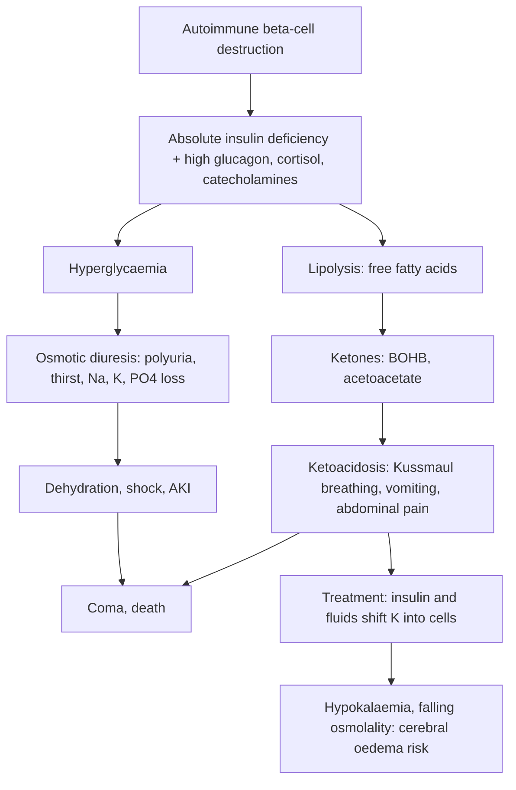

## 1. Definition

Endocrine disorders are less common than infections and malnutrition on a Ugandan paediatric ward, but they are **high-stakes**: they are easy to miss, they kill quickly when they present as emergencies (**DKA, adrenal crisis**), and they cause permanent disability when diagnosed late (**congenital hypothyroidism**, untreated **rickets**). Most are very treatable with cheap medicines (insulin, levothyroxine, hydrocortisone, vitamin D, calcium).

Five conditions matter most for the junior clerk:

1. **Type 1 diabetes mellitus (T1DM)**, often first diagnosed when the child arrives in **diabetic ketoacidosis (DKA)**, frequently mistaken for malaria, pneumonia or gastroenteritis.
2. **Congenital hypothyroidism (CH)**, the commonest preventable cause of intellectual disability; Uganda has **no routine newborn screening**, so diagnosis depends on clinical suspicion.
3. **Short stature**, mostly from chronic undernutrition (stunting), but sometimes the first clue to hypothyroidism, growth hormone deficiency, Turner syndrome, chronic disease or a skeletal dysplasia.
4. **Ambiguous genitalia / disorders of sex development (DSD)**, most often **congenital adrenal hyperplasia (CAH)**, which can cause a fatal **salt-wasting crisis** in the first weeks of life.
5. **Rickets**, from vitamin D and/or calcium deficiency.

**Core definitions**

| Term | Definition |
|---|---|
| **Diabetes mellitus** (WHO/ISPAD) | Symptoms plus **random plasma glucose ≥11.1 mmol/L**; or **fasting ≥7.0 mmol/L**; or **2-h OGTT ≥11.1 mmol/L**; or **HbA1c ≥48 mmol/mol (6.5%)**. Without symptoms, confirm on a second day |
| **DKA** (ISPAD 2022) | **Hyperglycaemia >11 mmol/L** + **venous pH <7.3 or bicarbonate <18 mmol/L** + **ketonaemia (BOHB ≥3 mmol/L) or moderate/large ketonuria** |
| **Congenital hypothyroidism** | Thyroid hormone deficiency present at birth |
| **Short stature** | Height (length) **below −2 SD** (Z-score <−2, roughly <3rd centile) for age and sex, or **height well below the mid-parental target**, or **falling across centiles** |
| **Ambiguous genitalia** | External genitalia that do not look clearly male or female, e.g. clitoromegaly with fused labia, micropenis with hypospadias and undescended testes, bifid scrotum |
| **Rickets** | Failure of mineralisation of the **growth plate** in a growing child (osteomalacia is the same process in bone matrix and can occur at any age) |

> [!PEARL]
> The one thing never to forget: **a child with deep sighing breathing, vomiting, dehydration and drowsiness may have DKA, not malaria or pneumonia. Dip the urine and check the glucose.** And in DKA, **fluids first, insulin an hour later, no insulin bolus, and watch for cerebral oedema.**

## 2. Epidemiology

- **Type 1 diabetes**: global incidence is rising; sub-Saharan Africa has many undiagnosed children who **die of DKA before diagnosis** (misdiagnosed as malaria, sepsis or pneumonia). In Ugandan hospitals, **most new cases present in DKA**, often severe. Almost all children with diabetes in Uganda have type 1 and need insulin from day one.
- **Diabetes services**: insulin, glucometers and strips are supplied to registered children through national and partner programmes (for example **Changing Diabetes in Children** and **Life for a Child**) at many regional and national referral hospitals; supply interruptions, cost of food, distance to clinic and school stigma remain big problems.
- **Congenital hypothyroidism**: occurs in about **1 in 2,000–4,000 births** worldwide. Uganda does **not have national newborn TSH screening**, so babies are diagnosed late (months), after brain damage. Uganda's **universal salt iodisation** (since the 1990s) has largely controlled iodine-deficiency goitre and cretinism, though goitre is still seen in some highland districts.
- **Short stature**: **stunting** affects about a quarter of Ugandan children under 5 (UDHS 2022), with higher rates in the south-west and Karamoja. Most short children are short because of **chronic undernutrition, recurrent infection, HIV, TB, sickle cell disease or chronic kidney or heart disease**. Endocrine causes are uncommon but treatable.
- **CAH and DSD**: rare but important; families face strong social and cultural pressures about the sex of the baby. Karyotyping and 17-hydroxyprogesterone are available mainly at Mulago/private labs (often sent abroad), so diagnosis is delayed.
- **Rickets**: still seen in Uganda despite abundant sunshine (risk groups in section 3).

> [!UGANDA]
> DKA in Uganda: **infusion pumps, blood gases and ketone meters are scarce** outside Mulago and a few RRHs; many units manage DKA with **0.9% saline by burette, hourly glucometer readings, urine dipstick ketones and hourly IM/SC soluble insulin**. UCG 2023 (section 8.1.4) gives children **0.9% saline 10–20 mL/kg** first, then 5–15 mL/kg/h according to response, **soluble insulin 0.05 units/kg/h (<5 years) or 0.1 units/kg/h (>5 years)**, switch to **5% dextrose when glucose <14 mmol/L**, and **potassium chloride 20 mmol/L (1 ampoule) once urine is passed** if K cannot be measured. ISPAD 2022 is more detailed (deficit over 24–48 h, potassium 40 mmol/L). Know both, and follow your ward protocol (Mulago and Mengo have paediatric DKA charts).

## 3. Aetiology and Risk Factors

**Diabetes**

| Type | Cause and features |
|---|---|
| **Type 1 diabetes** | Autoimmune destruction of beta cells → absolute insulin deficiency; >90% of childhood diabetes; needs insulin for life |
| **Type 2 diabetes** | Insulin resistance; rising in obese adolescents in urban Uganda; acanthosis nigricans |
| **Other types** | Monogenic diabetes (MODY, neonatal diabetes <6 months), cystic fibrosis, drug-induced (steroids), malnutrition-related diabetes |

- **DKA triggers in known diabetics**: missed insulin doses, insulin supply interruption, infection (malaria, sepsis, pneumonia, UTI).
- **Cerebral oedema risk factors**: young age, new diagnosis, severe acidosis, high urea, low pCO₂, falling corrected sodium, bicarbonate treatment, and (historically) large fluid volumes and insulin given early.

**Thyroid**

| Condition | Cause |
|---|---|
| **Congenital hypothyroidism** | Thyroid **dysgenesis** (absent, small or ectopic gland, ~85%), **dyshormonogenesis** (~10–15%; autosomal recessive, goitre), or central (pituitary) |
| **Endemic cretinism** | Severe intellectual disability, deafness, spasticity and short stature from maternal and fetal **iodine deficiency** (historically in parts of western and south-western Uganda) |
| **Acquired hypothyroidism** | Usually autoimmune (Hashimoto's) in older children; more common in **Down syndrome**, Turner syndrome and type 1 diabetes |
| **Hyperthyroidism** | Usually Graves' disease in adolescents (goitre, weight loss, tremor, tachycardia, exophthalmos) |

**Short stature**: familial, constitutional delay, nutritional (stunting) and chronic disease (HIV, TB, CKD, sickle cell, congenital heart disease, IBD/coeliac), SGA without catch-up, hypothyroidism, GH deficiency (including craniopharyngioma), Turner syndrome, Cushing's/steroids, skeletal dysplasia, rickets.

**Disorders of sex development**

- **46,XX DSD** (commonest: **CAH**; also maternal androgens).
- **46,XY DSD** (undervirilisation: androgen insensitivity, 5-alpha-reductase deficiency, testicular dysgenesis).
- **Sex chromosome DSD** (Turner 45,X; Klinefelter 47,XXY; mixed gonadal dysgenesis 45,X/46,XY).
- **CAH**: autosomal recessive defect in cortisol synthesis; **21-hydroxylase deficiency causes about 90–95%**; risk factors: consanguinity, previous unexplained neonatal deaths.

**Rickets**

- **Nutritional rickets**: from **vitamin D deficiency**, **dietary calcium deficiency**, or both (Global Consensus 2016).
- **Risk factors in Uganda**: infants kept indoors and wrapped up; exclusively breastfed infants of vitamin D–deficient mothers beyond 6 months without enough complementary foods; **low dietary calcium** (little milk); dark skin; malnutrition; long-term anticonvulsants; chronic liver or kidney disease.
- **Other causes**: X-linked hypophosphataemic rickets (normal calcium, very low phosphate), renal rickets (CKD), vitamin D–dependent rickets, drug-induced (phenytoin, phenobarbital).

## 4. Pathophysiology

**Type 1 diabetes and DKA**

- Autoimmune beta-cell destruction → **absolute insulin deficiency**, with **counter-regulatory hormones** (glucagon, cortisol, catecholamines, GH) raised.
- Glucose cannot enter cells and the liver makes more (gluconeogenesis) → **hyperglycaemia** → osmotic diuresis → **polyuria, thirst, dehydration**, loss of Na, K and PO₄.
- Lipolysis → free fatty acids → the liver makes **ketones** (BOHB, acetoacetate) → **ketoacidosis** (pH and HCO₃ fall) → Kussmaul breathing, vomiting, abdominal pain, acetone breath.
- Both limbs → **shock, AKI, coma**.
- **Total-body potassium is always depleted** (urine losses, vomiting), even if the serum K is normal or high at presentation (acidosis shifts K out of cells). **Insulin and correcting acidosis drive K back into cells**, so serum K falls sharply during treatment: hence potassium in the fluids from early on.
- **Sodium**: measured Na is falsely low because glucose draws water into the blood. **Corrected Na = measured Na + 0.3 × (glucose − 5.5) mmol/L** (ISPAD uses 2 mmol/L for each 5.5 above 5.5). A corrected Na that **falls** during treatment is a warning sign for cerebral oedema.
- **Cerebral oedema** occurs in about **0.5–1%** of paediatric DKA episodes and causes most DKA deaths in children. The **PECARN FLUID trial** (NEJM 2018) found that **neither the rate nor the sodium content** of fluids (within the ranges tested) changed neurological outcome, so the focus is on careful, steady correction, not fluid starvation.

**Congenital hypothyroidism**: thyroid hormone is essential for **brain myelination and neuronal growth in the first 2–3 years**. Maternal T4 crossing the placenta protects the fetus partly, so babies look **normal at birth** and signs appear over weeks. Each month of delay in treatment costs IQ points; treatment started in the **first 2 weeks** gives near-normal intelligence.

**CAH (21-hydroxylase deficiency)**

- 17-OH-progesterone → (blocked 21-hydroxylase) → 11-deoxycortisol → **cortisol falls**.
- Progesterone → (blocked 21-hydroxylase) → … → **aldosterone falls** (salt-wasting, about three-quarters of classic 21-hydroxylase deficiency).
- Low cortisol → **ACTH rises** → adrenal hyperplasia → precursors diverted → **androgens rise**.
- **46,XX girls**: virilised genitalia at birth (clitoromegaly, fused labia, common urogenital sinus) with **normal internal female organs** (uterus, ovaries).
- **46,XY boys**: normal genitalia (perhaps hyperpigmented scrotum), so the first sign is a **salt-wasting crisis at 1–3 weeks**: vomiting, poor feeding, weight loss, dehydration, shock, **low Na, high K, low glucose**. Many die undiagnosed ("sepsis").
- Later: rapid growth and advanced bone age in childhood, early pubic hair, then **short adult height** from early epiphyseal fusion.

**Rickets**: vitamin D (from skin exposure to UVB and from diet) is converted to 25-OH-D in the liver and 1,25-(OH)₂D in the kidney, which increases gut **calcium and phosphate absorption**. Deficiency → low calcium → **secondary hyperparathyroidism** → phosphate wasting in urine → **low phosphate** → the growth plate cannot mineralise → widened, cupped, frayed metaphyses and soft, bending bones. Low dietary calcium does the same even with adequate vitamin D.



**Feature links**

- High glucose → osmotic diuresis → **polyuria, nocturia, new bed-wetting, polydipsia**; calories lost in urine plus catabolism → **weight loss, tiredness**.
- Ketoacidosis → respiratory compensation → **deep, sighing (Kussmaul) breathing with a clear chest**; acetone → **fruity breath**; ketones and gut ileus → **vomiting, abdominal pain** (mimics appendicitis).
- Fluid and electrolyte loss → **dehydration, shock, AKI**; acidosis and K shifts → **hyperkalaemia at presentation, hypokalaemia during treatment** (arrhythmias).
- Brain cell osmolality and rapid shifts → **cerebral oedema**: headache, irritability, falling GCS, **bradycardia with rising BP**, abnormal posturing, cranial nerve palsy.
- Thyroid hormone lack → slowed metabolism and myxoedema → **prolonged jaundice, poor feeding, constipation, sleepiness, hoarse cry, large tongue, umbilical hernia, hypotonia, large posterior fontanelle, dry skin, hypothermia, bradycardia**; later **developmental delay, short stature**.
- Dyshormonogenesis → TSH drive → **goitre**.
- CAH: androgen excess → **virilised 46,XX genitalia**, early pubic hair, rapid growth, advanced bone age; aldosterone lack → **salt-wasting** (low Na, high K, dehydration, shock); cortisol lack → **hypoglycaemia**, shock; ACTH excess → **hyperpigmentation** (scrotum, labia).
- Rickets: low calcium → **tetany, hypocalcaemic seizures, laryngospasm**, dilated cardiomyopathy; unmineralised growth plates → **wide wrists, rachitic rosary**; soft bones → **bowed legs, Harrison's sulcus, craniotabes, frontal bossing**; weak muscles → **hypotonia, delayed walking**; high bone turnover → **high ALP**.
- GH or thyroid deficiency → **falling growth velocity**, delayed bone age; Turner syndrome → short stature with dysmorphism and absent puberty.

## 5. Classification / Staging

**Diabetes and DKA**

| Term | Definition |
|---|---|
| **DKA severity** (ISPAD 2022) | **Mild** pH <7.3 or HCO₃ <18; **moderate** pH <7.2 or HCO₃ <10; **severe** pH <7.1 or HCO₃ <5 mmol/L |
| **HHS** (hyperglycaemic hyperosmolar state) | Glucose >33.3 mmol/L, osmolality >320 mOsm/kg, little ketosis, pH >7.25; rare in children (obese adolescents with T2DM) |
| **Hypoglycaemia in diabetes** (ISPAD 2022) | Level 1 <3.9 mmol/L; level 2 <3.0 mmol/L; level 3 severe (needs help) |
| **DKA resolution** | pH >7.3, HCO₃ >18, BOHB <1 (or urine ketones falling), eating |

> [!NOTE]
> NICE NG18 (2020/2023) uses slightly different bicarbonate cut-offs (mild <15, moderate <10, severe <5 mmol/L) with the same pH cut-offs. ISPAD 2022 raised the diagnostic bicarbonate threshold to **<18 mmol/L**. Quote ISPAD 2022 and note the difference.

**Growth**

| Term | Definition |
|---|---|
| **Stunting** (WHO) | Height-for-age Z-score **<−2**; **severe stunting <−3**. Reflects chronic undernutrition and repeated infection |
| **Mid-parental height (MPH)** | (Father's height + mother's height) ÷ 2, **+6.5 cm for boys, −6.5 cm for girls**; target range ±8.5 cm (about ±2 SD) |
| **Growth velocity** | cm per year, measured over at least 6 (ideally 12) months; a falling velocity is more worrying than a short but steadily growing child |
| **Bone age** | Skeletal maturity from an X-ray of the left hand and wrist; delayed in constitutional delay, hypothyroidism, GH deficiency, malnutrition; normal in familial short stature |
| **Proportionate versus disproportionate** | Disproportionate (short limbs or short trunk) suggests a skeletal dysplasia (e.g. achondroplasia) or rickets |
| **Precocious puberty** | Breasts <8 years in girls, testicular enlargement <9 years in boys |
| **Delayed puberty** | No breasts by 13 years in girls, no testicular enlargement by 14 years in boys |

**Sex development**

| Term | Definition |
|---|---|
| **DSD** | Congenital condition where chromosomal, gonadal or anatomical sex is atypical: **46,XX DSD**, **46,XY DSD**, **sex chromosome DSD** (section 3) |
| **Salt-wasting CAH** | About three-quarters of classic 21-hydroxylase deficiency; aldosterone deficiency → **hyponatraemia, hyperkalaemia, dehydration, shock** at **1–3 weeks** of age |
| **Micropenis** | Stretched penile length **<2.5 cm at term** |
| **Prader stage** | Degree of virilisation of the external genitalia (1–5) |

**Rickets: vitamin D status (25-OH-D)**: **deficient <30 nmol/L** (12 ng/mL); insufficient 30–50 nmol/L; sufficient >50 nmol/L (20 ng/mL).

## 6. Clinical Features

### History

| Question | Why it matters |
|---|---|
| **Polyuria, polydipsia, nocturia, new bed-wetting, weight loss, tiredness**; how long | Classic T1DM; ask specifically, since parents rarely volunteer them; length of illness correlates with severity |
| **Vomiting, abdominal pain, fast/deep breathing, drowsiness, headache** | DKA (often misdiagnosed as gastroenteritis, malaria, pneumonia, appendicitis); cerebral oedema |
| Known diabetic: insulin type, dose, last dose, missed doses, supply, glucose diary; recent infection | DKA triggers in known diabetics; future plan |
| **Infection symptoms** (fever, cough, dysuria, diarrhoea) | Precipitant; malaria test in every febrile child |
| **Newborn**: prolonged jaundice, poor feeding, constipation, sleepy, hoarse cry, stool, genital appearance | Congenital hypothyroidism; DSD |
| **Vomiting, poor weight gain, collapse at 1–3 weeks** | Salt-wasting CAH |
| Previous neonatal deaths, consanguinity | Autosomal recessive conditions (CAH, dyshormonogenesis) |
| **Birth weight, gestation, growth chart** (child health card) | Short stature: SGA, timing of growth failure |
| **Parents' heights**, age of parents' puberty | Familial short stature, constitutional delay |
| Diet (milk, eggs, fish, complementary foods), sunlight exposure, breastfeeding duration | Rickets, stunting |
| Chronic illness: HIV, TB, sickle cell, heart/kidney disease, chronic diarrhoea, liver disease; medicines (steroids, anticonvulsants) | Secondary short stature, poor growth, rickets |
| Development, school performance, headaches, vision | Hypothyroidism, intracranial tumour (craniopharyngioma) with GH deficiency |
| Puberty: age of breast development/menarche or testicular enlargement | Precocious puberty (girls <8, boys <9) or delayed puberty (girls >13, boys >14) |
| Immunisation, HIV status of mother and child, feeding | Background in every child |

### Examination

Follow the order of Hutchison's Clinical Methods (24th edition), adapted for children. In suspected DKA or adrenal crisis the ABCDE assessment (section 9) comes first. Anthropometry is part of every endocrine examination.

#### Introduction, consent and preparation

- Introduce yourself; confirm the child's name, age and the carer's relationship.
- Explain; consent from the parent and assent from the child.
- **Hand hygiene**.
- Position and exposure: undress to underwear for growth and skeletal examination; examine **genitalia and pubertal stage with a chaperone**, with privacy and sensitivity; in a newborn with ambiguous genitalia, examine without guessing the sex aloud.

#### General inspection (end of the bed)

- Well or unwell; **Kussmaul breathing** (deep, sighing); drowsiness; **acetone smell**.
- **Hydration and shock**: pulse, CRT, BP; degree of dehydration.
- Pallor, jaundice, **pigmentation**, **dysmorphism** (Turner: webbed neck, wide carrying angle, widely spaced nipples, lymphoedema; Down syndrome).
- Coarse facies (hypothyroidism); Cushingoid features (steroids).
- **Anthropometry**: weight (used for all calculations in DKA; or use a recent weight), height/length (use a length board under 2 years), **plot on WHO charts**, Z-scores (WAZ, HAZ, WHZ/BMI), MUAC, head circumference; **arm span** and **upper:lower segment ratio** for proportion; **parents' heights**.
- **Vital signs**: HR, RR and pattern, BP with the right cuff, SpO₂, temperature (hypothermia in hypothyroidism), **GCS and pupils** (baseline for cerebral oedema).

#### Hands, face and neck

- **Hands**: **wrist widening** (rickets), clubbing (chronic disease), tremor (Graves'), injection sites.
- **Face**: **large tongue**, puffy face (hypothyroidism); frontal bossing, delayed dentition (rickets); midline defects (hypopituitarism); exophthalmos (Graves').
- **Head**: **large posterior fontanelle** (>0.5 cm), delayed fontanelle closure, **craniotabes** (ping-pong skull).
- **Neck**: **goitre** (dyshormonogenesis, iodine deficiency, Graves'), webbing (Turner).

#### The systems

- **Chest**: **rachitic rosary** (swollen costochondral junctions), **Harrison's sulcus**; crackles (pneumonia as a DKA trigger).
- **Abdomen**: tenderness (common in DKA, improves with treatment), **umbilical hernia** (hypothyroidism), hepatosplenomegaly (chronic disease).
- **Genitalia**: phallus length (stretched penile length <2.5 cm at term = micropenis), position of the urethral opening, labioscrotal fusion, **palpable gonads** (a palpable gonad is almost always a testis, so 46,XY or mosaic), pigmentation; **Prader stage** of virilisation; **Tanner staging** in older children.
- **Limbs**: bowed legs (genu varum) or knock knees (genu valgum), disproportion, lymphoedema (Turner).
- **Neurological**: hypotonia (hypothyroidism, rickets), tetany, GCS, pupils, cranial nerves (cerebral oedema).

#### Completing the examination

- Bedside glucose and urine ketones; urine output.
- Thank, re-dress, **hand hygiene**, summarise.

| Document these positives | And these negatives |
|---|---|
| Weight (used for all calculations) and degree of dehydration | "No signs of shock" |
| RR/pattern, GCS, pupils (baseline) | "No headache, no bradycardia or hypertension" |
| Height, Z-scores, MPH, growth velocity | "No dysmorphic features; proportionate" |
| Genitalia description (phallus length, gonads, Prader stage) | "Gonads not palpable" or "both testes in scrotum" |
| Rickets signs (wrists, rosary, legs) | "No craniotabes; no tetany" |

### Red flags

> [!REDFLAG]
> - **DKA with GCS falling, headache, irritability, bradycardia with rising BP, abnormal posturing, incontinence, or cranial nerve palsy** = cerebral oedema; treat now.
> - DKA in a child **under 5 years**, **pH <7.1**, shock, or corrected Na falling during treatment.
> - **Infant aged 1–3 weeks with vomiting, shock, Na <130 and K >6** (± ambiguous genitalia or a pigmented scrotum) = adrenal crisis.
> - **Bilateral impalpable testes in an apparently male newborn** = possible virilised 46,XX CAH girl; do not circumcise or register sex yet.
> - **Short child with falling growth velocity, headache or visual field loss** (craniopharyngioma), or with **weight gain** (hypothyroidism, Cushing's).
> - **Hypocalcaemic seizures** or **heart failure** (dilated cardiomyopathy) in an infant with rickets.

### Thinking like a clinician

- **"Tired, thin, thirsty, toilet"**: the 4 Ts of new T1DM. A child with **acidotic breathing and a clear chest** has acidosis (DKA, severe malaria, dehydration, AKI, salicylate), not pneumonia.
- **The glucose meter in a Ugandan emergency room is usually used for low glucose; use it for high glucose too.** "HI" on a glucometer means >33 mmol/L.
- **In DKA, the danger is not the glucose but the fluid, potassium and brain.** Glucose falls quickly with fluids alone; acidosis resolves more slowly; insulin is needed to switch off ketone production.
- **A short child growing at a normal velocity, with a short family and normal bone age** has familial short stature. **A short child with delayed bone age, normal velocity and a parent who was a "late bloomer"** has constitutional delay. **A child whose velocity falls** has a disease until proven otherwise.
- **In Uganda, the commonest causes of short stature are malnutrition and chronic disease**: check HIV, TB, sickle cell, renal function and diet before thinking of growth hormone.
- **Ambiguous genitalia is a medical emergency and a social one**: check glucose and electrolytes, avoid guessing the sex in front of the family, use neutral words ("your baby"), and refer to the paediatric endocrine/surgical team.
- **"Prolonged jaundice + constipation + umbilical hernia + large tongue" = check TSH**: your clinical suspicion is the screening test.
- **Common student mistakes**: insulin bolus in DKA; forgetting potassium; stopping the insulin infusion when glucose normalises (instead add dextrose); measuring short stature without plotting on a chart or ignoring parents' heights; telling parents "it's a boy" in a baby with impalpable testes; giving vitamin D without calcium in a child with poor diet.

> [!EXAM]
> Viva favourite: **"Why don't we give an insulin bolus in DKA, and why wait an hour?"** A bolus does not speed resolution of acidosis, causes a rapid fall in glucose and osmolality (cerebral oedema risk) and drops potassium suddenly. Starting insulin **1–2 hours after fluids** (ISPAD/NICE) was associated with less cerebral oedema in UK data, and glucose falls substantially with fluids alone.

## 7. Differential Diagnoses

**A child with acidotic breathing, vomiting and dehydration**

| Differential | Distinguishing clinical feature | Distinguishing investigation |
|---|---|---|
| **DKA** | Polyuria/polydipsia before, weight loss | Glucose >11, ketonuria, gas |
| Severe malaria with acidosis | Fever, anaemia; hypoglycaemia more likely than hyperglycaemia | mRDT/smear |
| Gastroenteritis with severe dehydration | Diarrhoea predominant | Glucose normal (stress hyperglycaemia is usually <11); ketones mild (starvation) |
| Pneumonia | Fever, crackles, focal signs, hypoxaemia | SpO₂, CXR |
| Sepsis/meningitis | Fever, neck stiffness, purpura | Cultures, LP |
| Salicylate poisoning | History, tinnitus | Mixed acid–base; salicylate level |
| Acute abdomen (appendicitis) | Localised tenderness, guarding; DKA abdominal pain improves with treatment | Re-examine after rehydration |

**Short stature**

| Differential | Distinguishing clinical feature | Distinguishing investigation |
|---|---|---|
| **Familial** | Short parents, normal velocity | MPH; bone age = chronological age |
| **Constitutional delay** | Normal velocity, delayed puberty, family history of late puberty | Bone age delayed |
| **Nutritional (stunting)/chronic disease** | Low weight-for-height first, poor diet, infections, HIV, TB, CKD, sickle cell, IBD/coeliac | Diet history, FBC, HIV, renal function |
| **Hypothyroidism** | Falling velocity, weight gain, constipation, school decline | TSH, FT4; delayed bone age |
| **GH deficiency** | Chubby, immature face, poor velocity; midline defects; neonatal hypoglycaemia; tumour symptoms | IGF-1, stimulation tests (specialist) |
| **Turner syndrome** (girls) | Dysmorphism, lymphoedema, no puberty, heart murmur (coarctation) | Karyotype |
| **Cushing's/steroids** | Obese, short, striae, hypertension, steroid creams/tablets | History, cortisol |
| **Skeletal dysplasia** | Disproportion | Skeletal survey |
| **Rickets** | Bowed legs, wide wrists | ALP, PO₄, X-ray |
| **SGA without catch-up** | Low birth weight, no catch-up by 2–4 years | Records |

**Ambiguous genitalia**

| Differential | Distinguishing clinical feature | Distinguishing investigation |
|---|---|---|
| **21-hydroxylase CAH (46,XX)** | Impalpable gonads, pigmentation, salt-wasting at 1–3 weeks | 17-OHP, electrolytes; uterus on ultrasound |
| **Maternal androgens** (46,XX) | Maternal virilisation, androgenic drugs | History |
| **Partial androgen insensitivity / 5-alpha-reductase deficiency (46,XY)** | Palpable gonads | Karyotype, no uterus, hormones (specialist) |
| **Mixed gonadal dysgenesis (45,X/46,XY)** | Asymmetric gonads, Turner features | Karyotype |
| **Severe hypospadias with undescended testes** | Usually 46,XY; always investigate if both testes impalpable | Karyotype, ultrasound |

**Bowed legs**

| Differential | Distinguishing clinical feature | Distinguishing investigation |
|---|---|---|
| **Physiological genu varum** | Under 2 years, symmetrical, improving | Clinical follow-up |
| **Nutritional rickets** | Wide wrists, rosary | High ALP; X-ray, biochemistry |
| **Blount disease** | Early walkers, obese, unilateral or asymmetrical, abrupt angulation | X-ray |
| **X-linked hypophosphataemic rickets** | Family history, poor response to vitamin D | Very low PO₄, normal Ca; family screening |
| **Skeletal dysplasia** | Disproportion, short stature | Skeletal survey |

## 8. Clinical Workup

"Available at" is the lowest level that usually offers the test [VERIFY: availability compiled from the source notes, not an MoH list].

### Bedside

| Test | Why | Expected finding | Available at |
|---|---|---|---|
| **Capillary glucose** | Diabetes, DKA, hypoglycaemia in adrenal crisis | ≥11.1 mmol/L; glucometer reads "HI" above about 33 mmol/L | HC IV and above (strips variable) |
| **Urine dipstick** | Glucose and **ketones** | Ketones ++ or more supports DKA | All levels |
| Blood ketone meter | DKA diagnosis and resolution | BOHB ≥3 mmol/L | Rare |
| **Urine output** (catheter or weigh nappies), fluid balance chart | Dehydration, AKI | Oliguria | All levels |
| **Blood pressure** with the right cuff | Cerebral oedema raises BP; CAH 11-beta-hydroxylase deficiency causes hypertension | High BP | All levels (paediatric cuffs variable) |
| **Hb, mRDT** | Fever in DKA may be malaria or sepsis | Positive RDT | All levels |
| **ECG** (if available, DKA and adrenal crisis) | Potassium | Peaked T waves = hyperkalaemia; flat T, U waves = hypokalaemia | General Hospital and above |
| **Anthropometry and plotting** | Short stature, malnutrition | HAZ <−2; crossing centiles | All levels |

### Basic lab

| Test | When | Expected / abnormal finding | How it changes management | Available at |
|---|---|---|---|---|
| **Electrolytes, urea, creatinine** | DKA, adrenal crisis, vomiting infant | K high/low; Na low (correct for glucose); urea high | Potassium in fluids; corrected Na trend; AKI | RRH/national referral |
| **Laboratory glucose** | Confirm glucometer | ≥11.1 mmol/L | Diagnosis | Hospitals |
| **HbA1c** | New diabetes, follow-up every 3 months | ≥48 mmol/mol (6.5%) supports chronic hyperglycaemia | Control assessment | Many hospitals and private labs |
| **FBC, blood culture, urine** | DKA with fever (precipitating infection) | Infection (DKA itself can raise WBC) | Antibiotics | Hospitals |
| **Calcium, phosphate, ALP** | Rickets | Ca low/normal, PO₄ low, ALP high | Vitamin D ± calcium; XLH if very low PO₄ with normal Ca | Hospitals |
| **FBC, ESR, renal function, LFTs, HIV, stool** | Short stature screen | Chronic disease markers | Treat underlying disease | Hospitals |

### Imaging

| Test | When | Expected / abnormal finding | How it changes management | Available at |
|---|---|---|---|---|
| **Pelvic/abdominal ultrasound** | Ambiguous genitalia | Uterus present (46,XX CAH) or absent; gonads | Diagnosis | Widely available |
| **Bone age** (left hand/wrist X-ray) | Short stature, puberty disorders | Delayed (CDGP, hypothyroid, GHD) or normal (familial) | Prognosis, cause | Hospitals |
| **Wrist/knee X-ray** | Rickets | Cupping, splaying, fraying of metaphyses; osteopenia; healing = dense provisional zone of calcification | Confirms rickets, monitors healing | Hospitals |
| **Chest X-ray** | DKA with chest signs | Pneumonia | Antibiotics | Hospitals |
| **CT head** | Cerebral oedema | Oedema | **Only after treatment has started** | RRH/NRH |

### Specialised / referral-level

| Test | When | Expected / abnormal finding | How it changes management | Available at |
|---|---|---|---|---|
| **Venous blood gas** | DKA | pH <7.3, HCO₃ <18, low pCO₂ | Severity → deficit 5% versus 10%; monitoring 2–4-hourly | Mulago, some RRHs/private; otherwise use clinical severity and bicarbonate on electrolytes |
| **TSH, free T4** | Suspected hypothyroidism, short stature, Down syndrome (at birth or by 2 weeks, then yearly) | High TSH + low FT4 = primary hypothyroidism | Levothyroxine | RRH/private; often sent out |
| **Karyotype** | Ambiguous genitalia, short girl (Turner) | 46,XX, 46,XY, 45,X, mosaics | Diagnosis, sex assignment | Mulago/private, send-out; weeks |
| **17-OH-progesterone** (≥24–48 h of age) and **cortisol** | Ambiguous genitalia, salt-losing infant (save serum before hydrocortisone) | Markedly raised 17-OHP in 21-OHD | Confirms CAH | Send-out lab |
| **PTH, 25-OH-D** | Rickets | PTH high, 25-OHD <30 nmol/L | Vitamin D versus other causes | Send-out |
| **Coeliac serology, IGF-1, GH stimulation tests** | Short stature screen (specialist) | Positive serology; low IGF-1 / failed stimulation | Diet; GH (largely unavailable) | Private/send-out |
| **Thyroid ultrasound / isotope scan** | CH (specialist) | Absent/ectopic gland | Prognosis, genetic counselling | Mulago/private |
| **LH/FSH, brain MRI** | Precocious puberty | Central versus peripheral | Referral | Mulago/private |

**Summary**: glucose and ketones (DKA versus hyperglycaemia without ketosis); gas, electrolytes and urea (acidosis severity, K, corrected Na); malaria test, cultures, CXR, urine (precipitating infection); HbA1c (control); TSH/FT4 (hypothyroidism); karyotype, 17-OHP, ultrasound (DSD/CAH and sex assignment); bone age (growth potential); Ca, PO₄, ALP, PTH, 25-OHD, X-ray (rickets type and severity).

### Putting it together

**Model one-line summary**: "A 9-year-old girl, 24 kg, with 3 weeks of polyuria, polydipsia and weight loss, now vomiting with Kussmaul breathing; glucose 28 mmol/L, urine ketones +++, pH 7.08: **severe DKA at first presentation of type 1 diabetes**, no shock, GCS 14."

**Problem list**

1. Severe DKA (new type 1 diabetes).
2. Dehydration (~10%), risk of hypokalaemia.
3. Cerebral oedema risk (new diagnosis, severe acidosis).
4. Recent weight loss; precipitating infection to exclude.
5. Education, insulin supply and follow-up.

**Model case presentation (ward round)**

> "Miss A.N., a **9-year-old girl** from Mukono, **weight 24 kg** (weight-for-age Z −1.8, BMI-for-age Z −1.5; she has lost about 3 kg in a month per her mother), height 128 cm (HAZ −0.7), presented with **3 weeks of polyuria, polydipsia, nocturia and new bed-wetting**, and **2 days of vomiting and abdominal pain**, then **fast deep breathing and drowsiness** today. She was treated for malaria at a clinic 3 days ago. On arrival: GCS 13, Kussmaul breathing, RR 36, HR 132, CRT 3 s, BP 98/60, **acetone smell**, ~10% dehydrated. **Glucose 'HI'** (lab 31 mmol/L), **urine ketones +++**, venous **pH 7.06, HCO₃ 5 mmol/L**, Na 131, K 5.2, urea 9. mRDT negative. **Fully immunised** (UNEPI including HPV dose 1 at school), **eats family food**, **HIV-negative**. **Assessment: severe DKA at first presentation of type 1 diabetes.** **Plan**: 0.9% saline 10 mL/kg (240 mL) over 1 hour then deficit (10%) plus maintenance over 48 h at 110 mL/h with KCl 40 mmol/L once urine passed; soluble insulin 0.1 units/kg/h (2.4 units/h) starting 1 hour after fluids, no bolus; add 5% dextrose at glucose 14 mmol/L; hourly glucose, GCS and vitals, 2-hourly gas and electrolytes; watch for cerebral oedema; diabetes education and SC insulin when DKA resolves."

> [!NOTE]
> **Worked example 1: DKA fluid prescription (ISPAD 2022 / NICE 2020).** 24 kg girl, **severe DKA** (pH 7.08), not shocked, received a 10 mL/kg bolus (240 mL) over 1 hour.
> - **Deficit**: severe → assume **10%** (NICE; ISPAD 7–10%): 24 kg × 10% = **2,400 mL**. NICE subtracts a non-shock bolus: 2,400 − 240 = **2,160 mL**.
> - **Maintenance** (Holliday–Segar): 100 × 10 + 50 × 10 + 20 × 4 = **1,580 mL/day** → 3,160 mL over 48 h.
> - **Total over 48 h** = 2,160 + 3,160 = 5,320 mL → **about 110 mL/h** of 0.9% saline (with potassium 40 mmol/L once K <5.5 and urine passed).
> - **Insulin**: start 1–2 h after fluids: **0.05–0.1 units/kg/h = 1.2–2.4 units/h** (50 units soluble insulin in 50 mL 0.9% saline = 1 unit/mL → 1.2–2.4 mL/h).
> - When glucose reaches about **14 mmol/L**, change to **0.9% saline with 5% dextrose** (+ KCl) at the same rate; keep the insulin running.

> [!NOTE]
> **Worked example 2: short stature.** A 10-year-old boy is 124 cm (HAZ −2.3). Father 160 cm, mother 152 cm → MPH = (160 + 152)/2 + 6.5 = **162.5 cm** (target range 154–171 cm). His growth record shows steady growth along the same Z-score line (5 cm/year), bone age 8 years, and the father "grew late". **Interpretation**: **constitutional delay of growth and puberty** (delayed bone age, normal velocity, family history), with some familial component; reassure and follow. If his velocity had fallen to 2 cm/year, you would screen for hypothyroidism, chronic disease, GH deficiency and an intracranial tumour.

## 9. Management

### Immediate / emergency

**First 5 minutes (suspected DKA or adrenal crisis)**

1. **A and B (ETAT)**: airway (vomiting, reduced GCS: recovery position, NG tube if vomiting and drowsy), oxygen if SpO₂ <94% or shocked.
2. **C**: shock (cold, CRT >3 s, weak fast pulse, or hypotension) → **0.9% saline 20 mL/kg** rapidly (DKA: ISPAD; NICE: 10 mL/kg, repeat if needed; adrenal crisis 20 mL/kg).
3. **D**: **glucose** (glucometer) and **urine/blood ketones**; **GCS** and neurological observations (baseline for cerebral oedema); **weigh** the child.
4. Bloods **before treatment**: venous gas (pH, HCO₃, pCO₂) if available, electrolytes (Na, K), urea/creatinine, FBC, glucose (lab), malaria test, blood culture if febrile; for adrenal crisis also save serum for **cortisol and 17-OHP** before hydrocortisone.
5. **Adrenal crisis suspected** (shock + low Na + high K ± hypoglycaemia in an infant) → **hydrocortisone IV now** (infant 25 mg).
6. **E**: temperature, look for infection.
7. Call senior; start the DKA flow chart and an hourly observation sheet.

> [!REDFLAG]
> Call the senior and anaesthetist immediately for: GCS ≤12 or falling, shock, pH <7.1, age under 5 with DKA, K <3 or >6 mmol/L, signs of cerebral oedema, or an infant in adrenal crisis.

**DKA algorithm (ISPAD 2022, NICE NG18, UCG 2023)**

```
Confirm DKA: glucose >11 + pH <7.3 / HCO₃ <18 + ketones
   │
SHOCK? ── yes ──► 0.9% saline 20 mL/kg rapidly, repeat if needed (senior)
   │ no
0.9% saline 10–20 mL/kg over 20–60 min (NICE: 10 mL/kg over 60 min)
   │
Deficit (mild–moderate 5%; severe 7–10%) + maintenance over 24–48 h
 (0.9% saline, or 0.45–0.9% saline per protocol) + KCl 40 mmol/L once K <5.5 and urine passed
   │
After 1–2 h of fluids: soluble insulin 0.05–0.1 units/kg/h IV (NO bolus)
   │
Glucose ≈14–17 mmol/L or falling >5 mmol/L/h → add 5% dextrose (10% if needed); keep insulin
   │
Hourly: glucose, vitals, GCS, fluid balance · 2–4 hourly: gas, Na, K
   │
Resolution: pH >7.3, HCO₃ >18, BOHB <1 (or urine ketones falling), eating
   → SC insulin, stop IV insulin 30–60 min after first SC dose
```

**DKA fluids**

- **Shock**: 0.9% saline **20 mL/kg** rapidly (NICE: 10 mL/kg, discuss before more); repeat if still shocked. The shock bolus is not subtracted from the deficit (NICE).
- **No shock**: 0.9% saline **10–20 mL/kg** over 20–60 min (UCG 10–20; NICE 10 mL/kg over 60 min). NICE subtracts this bolus from the deficit.
- **Rehydration**: deficit **5%** (pH ≥7.1) or **7–10%** (pH <7.1) of body weight **+ maintenance**, evenly over **24–48 h** (NICE: 48 h). Do not include ongoing urine losses; avoid exceeding 1.5–2 × maintenance. UCG 2023: 5–15 mL/kg/h according to response.
- **Glucose fall target**: **2–5 mmol/L per hour**; aim glucose 8–12 mmol/L once dextrose is added.

> [!DRUG]
> **Insulin infusion for a 20 kg child at 0.1 units/kg/h = 2 units/h = 2 mL/h** of a 1 unit/mL solution. Run it through a dedicated line, flush the line with 20–30 mL of the insulin solution first (insulin sticks to plastic), and **never stop it because the glucose is normal**: add dextrose instead, since ketones are still being made.

**Cerebral oedema**

- **Watch for**: headache, recurrent vomiting, irritability or lethargy, falling GCS, **inappropriate bradycardia with rising BP**, abnormal posturing, sluggish pupils, cranial nerve palsy, incontinence. Usually **4–12 h** into treatment.
- **Treat now** (do not wait for a scan): raise the head of the bed 30°, **reduce IV fluids by one-third**, **mannitol 0.5–1 g/kg over 10–15 min** (or **3% saline 2.5–5 mL/kg**), repeat mannitol after 30 min if no response, call senior/ICU, intubate if needed; **CT only after treatment has started**.

**Salt-wasting adrenal crisis**

| Treatment | Dose | Route | Frequency | Notes |
|---|---|---|---|---|
| **0.9% saline** | **20 mL/kg** bolus (repeat as needed), then rehydration with dextrose-saline | IV | Over the first hour, then 24–48 h | Correct hypovolaemia and hyponatraemia (raise Na no faster than about 10 mmol/L/24 h) |
| **10% dextrose** | **2–5 mL/kg** if hypoglycaemic (neonate 2 mL/kg) | IV | Then dextrose-containing fluids | Check glucose hourly |
| **Hydrocortisone** | **50–100 mg/m²** IV bolus (practical: infant **25 mg**, 1–5 years **50 mg**, >5 years **100 mg**) | IV (IM if no IV) | Then **50–100 mg/m²/day** divided **6-hourly** | Take blood for cortisol/17-OHP first if possible, but never delay |
| **Hyperkalaemia** | Usually corrects with saline and hydrocortisone; if K >7 or ECG changes: calcium gluconate 10% 0.5 mL/kg IV over 5–10 min, salbutamol, insulin-dextrose | IV | As needed | ECG monitoring |

**Hypocalcaemic seizures or tetany (rickets)**: **10% calcium gluconate 0.5 mL/kg (max 20 mL) IV over 5–10 minutes** with cardiac monitoring, then oral calcium.

### Definitive

#### A. Type 1 diabetes after DKA resolves: starting subcutaneous insulin

| Regimen | How to give | Notes |
|---|---|---|
| **Premixed 30/70 (Mixtard) twice daily** (common in Uganda) | TDD ≈ **0.5–1 unit/kg/day** (UCG: start 0.5 under 5 years); **2/3 before breakfast, 1/3 before supper**, 30 min before meals | Needs regular meals and mid-morning/afternoon snacks |
| **Basal-bolus** (preferred by ISPAD where feasible) | **40–50% of TDD as basal** (NPH at night or long-acting analogue), the rest as **soluble/rapid-acting before each meal** | More flexible; needs more injections and testing |
| **Typical TDD** | At diagnosis about **0.5 units/kg/day**; prepubertal **0.7–1 unit/kg/day**; puberty **1–1.5**; "honeymoon" (partial remission) may be <0.5 | Adjust by 10–20% every few days on glucose readings |

- Stop the IV insulin **30–60 minutes after the first SC dose**.
- **Targets (ISPAD 2022)**: glucose **4–10 mmol/L** most of the time; **HbA1c <7% (53 mmol/mol)**; avoid hypoglycaemia.
- **Diabetes education before discharge** (both caregivers, and the child if old enough): insulin storage (cool place: clay pot with wet sand works when there is no fridge), injection technique and site rotation, glucose testing, recognising and treating hypoglycaemia (sugar always available; glucagon where possible), sick-day rules, diet (regular meals, snacks), exercise, school letter, follow-up in the diabetes clinic, peer support.

**Sick-day rules (ISPAD 2022)**

- **Never stop insulin** even if not eating; check glucose every 2–3 hours and ketones.
- If ketones are raised and glucose high: give **extra rapid-acting insulin 10–20% of TDD** every 2–4 h.
- Drink sugar-free fluids if glucose high; sugary fluids if glucose low.
- Come to hospital for vomiting, abdominal pain, deep breathing, drowsiness, or ketones not falling.

#### B. Congenital hypothyroidism

1. **Suspect** in any baby with prolonged jaundice (>14 days term), poor feeding, constipation, hypotonia, large tongue, umbilical hernia, large posterior fontanelle, or a goitre; and in all babies with **Down syndrome** (check TSH at birth or by 2 weeks, then yearly).
2. Send **TSH and free T4**; **start treatment immediately** if TSH is high and FT4 low (do not wait for scans).
3. **Levothyroxine 10–15 µg/kg/day orally once daily** (about **37.5–50 µg/day** for a term baby): crush the tablet, mix with a little breast milk or water and give by spoon; **not with soy, iron or calcium** (reduce absorption).
4. **Targets**: FT4 in the upper half of normal within 2 weeks; TSH normal within 4 weeks.
5. **Counsel**: lifelong treatment (unless transient; reassess at 3 years), daily dosing, and the excellent outlook if treated early.

> [!UGANDA]
> Without newborn screening, Ugandan babies with CH are typically diagnosed at **several months** with established developmental delay. Your clinical suspicion is the screening test: **"prolonged jaundice + constipation + umbilical hernia + large tongue" = check TSH.** Levothyroxine 50 µg and 100 µg tablets are on the essential medicines list; halve or crush as needed.

#### C. Short stature

1. **Measure accurately** (length board/stadiometer), plot on **WHO charts**, calculate Z-scores, measure the parents.
2. Calculate **MPH** and compare.
3. **Assess growth velocity** over 6–12 months (bring child health card records).
4. **Look for chronic disease and malnutrition first** (diet, HIV, TB, sickle cell, renal, cardiac, gut).
5. **Screen**: FBC, renal function, LFTs, TSH/FT4, HIV, stool, urine, **bone age**; **karyotype in every short girl** (Turner syndrome can present only with short stature).
6. **Treat the cause**: nutrition rehabilitation, treat infections, levothyroxine for hypothyroidism; growth hormone for GH deficiency or Turner syndrome is specialist-only and largely unavailable/unaffordable in Uganda.
7. **Familial or constitutional delay**: reassure, monitor every 6 months; low-dose testosterone for boys with severe distress from delayed puberty (specialist).

#### D. Ambiguous genitalia and CAH

**Immediate approach to a newborn with ambiguous genitalia**

1. **Do not assign sex** or register the baby until assessed; use neutral words ("your baby"); explain this is a recognised condition and that tests will help decide; **avoid circumcision**.
2. **Examine** carefully: phallus length, urethral opening, labioscrotal fusion, **gonads** (palpable?), pigmentation, dysmorphism; BP.
3. **Investigate**: **glucose and electrolytes daily** (salt-wasting appears from day 4–5 onwards, usually by 1–3 weeks), **pelvic ultrasound** (uterus?), **karyotype**, **17-OHP** (after 24–48 h), cortisol.
4. **Watch for salt-wasting**: weight daily, feeding, vomiting.
5. **Refer** early to a paediatric endocrinologist and surgeon (Mulago); involve the family in a multidisciplinary decision about sex of rearing; psychological support.

**CAH maintenance**

| Drug | Dose | Route | Frequency | Notes |
|---|---|---|---|---|
| **Hydrocortisone** | **10–15 mg/m²/day** | Oral | Divided **3 times daily** | Prednisolone/dexamethasone avoided in growing children (growth suppression) |
| **Fludrocortisone** | **0.05–0.2 mg/day** | Oral | Once or twice daily | Salt-wasting forms; monitor BP, renin |
| **Sodium chloride** | **1–2 g/day (17–34 mmol)** in infancy (Medscape: up to 2–4 g/day) | Oral, in feeds | Divided | Infants up to about 6–12 months |
| **Sick-day ("stress") dosing** | **Double or triple** the oral hydrocortisone dose for fever/illness; **IM hydrocortisone** (as above) if vomiting or collapsed | Oral/IM | Until well | Give the family an emergency letter and IM hydrocortisone if possible |

#### E. Rickets (Global Consensus 2016)

1. **Confirm**: clinical signs + **high ALP**, low phosphate, low/normal calcium, high PTH ± **25-OHD <30 nmol/L**; wrist/knee X-ray.
2. **Treat hypocalcaemic seizures/tetany first** (Immediate / emergency above).
3. **Vitamin D (cholecalciferol)** for at least **12 weeks**:

| Age | Daily dose for 12 weeks | Single large dose ("stoss") alternative | Maintenance after |
|---|---|---|---|
| <3 months | **2,000 IU** | Not recommended | 400 IU/day |
| 3–12 months | **2,000 IU** | **50,000 IU** once | 400 IU/day |
| 1–12 years | **3,000–6,000 IU** | **150,000 IU** once | 600 IU/day |
| >12 years | **6,000 IU** | **300,000 IU** once | 600 IU/day |

4. **Calcium 500 mg/day** (elemental, oral) **with** vitamin D in all cases (dietary calcium deficiency is common in Africa); improve dietary calcium (milk, small fish such as mukene/silver fish, eggs, green leaves).
5. Bowing improves over 1–2 years; osteotomy only for severe persistent deformity after healing.

#### F. Other endocrine problems to recognise

| Condition | Key features | First steps |
|---|---|---|
| **Graves' disease** | Adolescent girl, goitre, weight loss, tremor, tachycardia, eye signs | TSH/FT4; carbimazole 0.25–1 mg/kg/day (max 30–40 mg) + propranolol 0.5–1 mg/kg/day in 3 doses; refer |
| **Endemic/iodine-deficiency goitre** | Diffuse goitre, euthyroid or hypothyroid | Iodised salt; TSH; refer large goitres |
| **Precocious puberty** | Breasts <8 years or testes enlargement <9 years | Bone age, LH/FSH; refer (brain MRI in boys and young girls) |
| **Delayed puberty** | No breasts by 13 or testicular enlargement by 14 | Chronic disease, malnutrition, constitutional delay, Turner/Klinefelter; karyotype |
| **Adrenal insufficiency from stopping steroids** | Child on long-term prednisolone (nephrotic syndrome, asthma) becomes ill | Stress-dose hydrocortisone; taper steroids slowly |
| **Diabetes insipidus** | Polyuria with normal glucose, dilute urine, hypernatraemia | Refer (head injury, tumour, Langerhans cell histiocytosis) |

### Drug table

| Drug | Dose (paediatric per kg, max; adult) | Route | Frequency | Duration | Key cautions |
|---|---|---|---|---|---|
| **0.9% saline** (DKA shock) | **20 mL/kg** (NICE 10 mL/kg, discuss before more) | IV rapidly | Repeat if still shocked | Acute | Not subtracted from the deficit (NICE) |
| **0.9% saline** (DKA no shock) | **10–20 mL/kg** | IV over 20–60 min | Once | Acute | NICE subtracts from the deficit |
| **DKA rehydration fluid** | Deficit 5% (pH ≥7.1) or 7–10% (pH <7.1) + maintenance | IV | Continuous | 24–48 h | Avoid >1.5–2 × maintenance; do not replace ongoing urine losses |
| **Soluble (regular) insulin** (DKA) | **0.05–0.1 units/kg/h** (UCG: 0.05 under 5 years; 0.1 over 5 years); 50 units in 50 mL 0.9% saline = 1 unit/mL | IV infusion | Start **1–2 h after fluids** | Until DKA resolved and SC insulin given | **No bolus**; if BOHB not falling at 6–8 h, increase to 0.1 units/kg/h or more; never stop for normal glucose |
| **Insulin without a pump** | **0.1 unit/kg** (0.05 in young children) soluble or rapid-acting | **IM or SC** | Hourly (or 1–2-hourly per protocol) | Until ketosis resolves | UCG 2023 and ISPAD accept SC/IM regimens where IV infusion is unsafe; perfusion must be restored first |
| **Potassium chloride** | **40 mmol/L** of IV fluid (UCG: 20 mmol/L if K 3.5–5.5; 40 mmol/L if <3.5; none if >5.5); max **0.5 mmol/kg/h** | In the IV fluid | Throughout | Until oral intake | Start with the first fluids if K <3.5; once urine passed if K normal; withhold if anuric or K >5.5. KCl 15% 10 mL ampoule = 20 mmol |
| **Dextrose** (in DKA fluids) | Add **5%** (10% if glucose keeps falling) | In the IV fluid | When glucose ≈**14–17 mmol/L** (UCG: <14) or falls >5 mmol/L/h | Until eating | Aim 8–12 mmol/L; never stop insulin to treat falling glucose |
| **Mannitol 20%** (cerebral oedema) | **0.5–1 g/kg** (2.5–5 mL/kg) | IV over 10–15 min | Repeat after 30 min if no response | Acute | Or **3% saline 2.5–5 mL/kg** over 10–15 min |
| **Sodium bicarbonate** | **Not routine** | n/a | n/a | n/a | Only for life-threatening hyperkalaemia or cardiovascular collapse; increases cerebral oedema risk |
| **Premixed insulin 30/70** | TDD **0.5–1 unit/kg/day**; 2/3 before breakfast, 1/3 before supper | SC | Twice daily, 30 min before meals | Lifelong | Regular meals and snacks; hypoglycaemia |
| **Levothyroxine** | **10–15 µg/kg/day** (term baby about 37.5–50 µg/day) | Oral (crushed in breast milk or water) | Once daily | Lifelong (reassess at 3 years if transient suspected) | Not with soy, iron or calcium |
| **Hydrocortisone** (adrenal crisis) | **50–100 mg/m²** bolus (infant 25 mg, 1–5 y 50 mg, >5 y 100 mg), then **50–100 mg/m²/day** | IV (IM if no IV) | 6-hourly | Until stable | Take cortisol/17-OHP first if possible, never delay |
| **Hydrocortisone** (CAH maintenance) | **10–15 mg/m²/day** | Oral | 3 times daily | Lifelong | Double or triple when ill; over-treatment → Cushing's, poor growth |
| **Fludrocortisone** | **0.05–0.2 mg/day** | Oral | Once or twice daily | Lifelong | Monitor BP, renin |
| **Sodium chloride** (salt-wasting CAH) | **1–2 g/day (17–34 mmol)** in infancy (Medscape: up to 2–4 g/day) | Oral in feeds | Divided | Until about 6–12 months | n/a |
| **Cholecalciferol** (rickets) | <1 year **2,000 IU/day**; 1–12 years **3,000–6,000 IU/day**; >12 years 6,000 IU/day; or stoss 50,000 / 150,000 / 300,000 IU once | Oral | Daily (or single dose) | ≥12 weeks, then maintenance 400–600 IU/day | Stoss not under 3 months |
| **Calcium** (elemental) | **500 mg/day** | Oral | Daily | With vitamin D course | Give in all nutritional rickets |
| **Calcium gluconate 10%** | **0.5 mL/kg** (max 20 mL) | IV over 5–10 min | Once, repeat if needed | Acute | Cardiac monitoring; extravasation injury |
| **Carbimazole** (Graves') | **0.25–1 mg/kg/day** (max 30–40 mg) | Oral | Daily | Specialist | Agranulocytosis (sore throat, fever) |
| **Propranolol** (Graves') | **0.5–1 mg/kg/day** in 3 doses | Oral | 8-hourly | Until euthyroid | Avoid in asthma |

Adult doses are not given: all doses here are paediatric weight- or BSA-based.

### Referral criteria

| Level | What to do | Refer up when |
|---|---|---|
| **HC III** | Glucose and urine ketones in every child with deep breathing, vomiting and drowsiness; plot growth; suspect CH, rickets, ambiguous genitalia | Suspected DKA (start 0.9% saline 10–20 mL/kg if shocked or dehydrated), new diabetes, ambiguous genitalia, suspected CH → hospital |
| **HC IV / General Hospital** | DKA with saline by burette, hourly glucometer, urine ketones, IM/SC soluble insulin, KCl once urine passed; vitamin D and calcium for rickets; start SC insulin and education | Severe DKA, age under 5, cerebral oedema, no K⁺ measurement, adrenal crisis, ambiguous genitalia, suspected CH (TSH) → RRH |
| **RRH (diabetes clinic)** | Electrolytes, some gases, diabetes clinic and insulin supply (CDiC, Life for a Child), TSH/FT4, bone age | Karyotype, 17-OHP, DSD and CAH, short stature work-up, precocious puberty, ICU-level DKA → NRH |
| **NRH (Mulago paediatric endocrinology and surgery)** | Gases, ICU, karyotype, specialist endocrine and surgical care | n/a |

Level split adapted from UCG 2023 levels of care [VERIFY: UCG level codes].

### Monitoring and follow-up

- **DKA, hourly**: glucose, HR, BP, RR, GCS (neuro obs), fluid input/output, insulin rate. **2–4-hourly**: venous gas, Na, K, urea; calculate corrected Na.
- **Diabetes clinic**: HbA1c **every 3 months**; growth, puberty, injection sites, thyroid and coeliac screening, BP, microalbuminuria, eyes over time; insulin supply.
- **Congenital hypothyroidism**: TSH and FT4 **2 and 4 weeks** after starting, then every **1–2 months in the first 6 months**, every 3–4 months until 3 years, then every 6–12 months; **plot growth and development**.
- **CAH**: growth, BP, bone age, signs of over- or under-treatment; emergency letter checked at each visit.
- **Rickets**: ALP and X-ray at **3 months** (healing: a dense provisional zone of calcification); then maintenance vitamin D.
- **Short stature**: height and velocity every 6 months.

## 10. Complications

**Disease-related**

| Condition | Complications |
|---|---|
| **DKA** | **Cerebral oedema**, hypokalaemia (arrhythmias), aspiration, AKI, venous thrombosis, death |
| **Type 1 diabetes (long term)** | Hypoglycaemia, recurrent DKA, poor growth, delayed puberty, retinopathy, nephropathy (microalbuminuria), neuropathy, hypertension, thyroid and coeliac disease, school and psychological problems |
| **Congenital hypothyroidism (untreated)** | Intellectual disability, short stature, deafness (if iodine deficient), delayed development |
| **CAH** | Salt-wasting death, hypoglycaemia, wrong sex assignment, short adult height, precocious pseudopuberty, infertility |
| **Rickets** | Hypocalcaemic seizures, dilated cardiomyopathy, laryngospasm, deformities (genu varum/valgum), pelvic deformity (obstructed labour later in girls), fractures, delayed motor milestones, pneumonia (soft chest wall) |

**Treatment-related**

| Complication | Cause | Recognition and action |
|---|---|---|
| Cerebral oedema | Insulin bolus, early insulin, rapid osmolality fall, bicarbonate | No bolus; insulin 1–2 h after fluids; steady correction |
| Hypokalaemia, arrhythmia | Insulin and correction of acidosis without K⁺ | KCl 40 mmol/L once urine passed; ECG |
| Hypoglycaemia | Insulin in DKA without dextrose; SC insulin at home | Add dextrose at 14–17 mmol/L; sugar always available |
| Iatrogenic Cushing's, poor growth | Over-treatment with hydrocortisone in CAH | Lowest effective dose; monitor growth |
| Adrenal crisis | Stopping long-term steroids abruptly; no stress dosing | Taper slowly; double or triple doses when ill |
| Over-treatment with levothyroxine | Excess dose | Tachycardia, poor sleep: check TSH and FT4 |
| Agranulocytosis | Carbimazole | Stop and check FBC if sore throat or fever |

## 11. Prognosis

- **DKA**: most children recover fully with careful treatment; **cerebral oedema** (0.5–1% of episodes) causes most deaths. In sub-Saharan Africa many children **die of DKA before diagnosis**.
- **Type 1 diabetes**: lifelong insulin; good control (HbA1c <7%) reduces long-term complications; supply interruptions and food insecurity worsen outcomes.
- **Congenital hypothyroidism**: treatment in the **first 2 weeks** gives near-normal intelligence; each month of delay costs IQ points.
- **CAH**: good with lifelong replacement and stress dosing; salt-wasting crisis is fatal if missed; risk of short adult height.
- **Short stature**: familial and constitutional delay have a normal outcome (constitutional delay reaches a normal adult height later); outcome otherwise depends on the cause.
- **Rickets**: biochemical healing within about 3 months; bowing improves over 1–2 years.

## 12. Prevention

- **DKA**: earlier diagnosis (check glucose and urine ketones in every child with deep breathing, vomiting or polyuria); sick-day rules and reliable insulin supply for known diabetics.
- **Congenital hypothyroidism**: universal salt iodisation (iodine deficiency); clinical suspicion and TSH testing in the absence of newborn screening; TSH in all babies with Down syndrome.
- **Stunting**: optimal infant and young child feeding, treatment of infections, HIV care.
- **CAH**: early recognition of ambiguous genitalia and of vomiting infants at 1–3 weeks; genetic counselling for families with affected children or consanguinity.
- **Adrenal crisis from steroids**: taper long-term steroids slowly; stress dosing.
- **Rickets**: sunlight exposure (face and arms outdoors for 15–30 min most days), **vitamin D 400 IU/day for infants** where deficiency is likely, adequate complementary foods with calcium.

## 13. Special Populations

- **Children under 5 with DKA**: higher cerebral oedema risk; insulin 0.05 units/kg/h (UCG); call a senior.
- **Neonates**: CH and CAH present in the first weeks; salt-wasting crisis at 1–3 weeks; stoss vitamin D not recommended under 3 months; dextrose 2 mL/kg.
- **Adolescents**: type 2 diabetes in obese adolescents (HHS rare); Graves' disease; pubertal insulin needs 1–1.5 units/kg/day; school and psychological support.
- **Down syndrome**: TSH at birth or by 2 weeks, then yearly.
- **Short girls**: karyotype for Turner syndrome.
- **Children on long-term steroids** (nephrotic syndrome, asthma): adrenal suppression; stress dosing when ill.
- **Children on anticonvulsants** (phenytoin, phenobarbital): rickets risk.
- **Families without a fridge**: store insulin in a clay pot with wet sand.

## 14. Key Points

### High-yield points

- Deep sighing breathing, vomiting and drowsiness: **dip the urine and check the glucose**; it may be DKA.
- DKA = glucose **>11** + pH **<7.3** or HCO₃ **<18** + ketones; severity **7.3–7.2–7.1**.
- **Fluids first, insulin 1–2 hours later, no bolus**, potassium early, **dextrose at 14–17 mmol/L**, never stop insulin for normal glucose.
- **Cerebral oedema**: treat on clinical signs with mannitol or 3% saline; scan later.
- Congenital hypothyroidism: **levothyroxine 10–15 µg/kg/day** within 2 weeks of birth protects IQ.
- Short stature: **plot, measure the parents, check velocity**; malnutrition and chronic disease first; karyotype every short girl.
- Ambiguous genitalia: **do not assign sex**; glucose and electrolytes daily; CAH crisis at 1–3 weeks.
- Adrenal crisis: **saline 20 mL/kg, dextrose, hydrocortisone** (infant 25 mg).
- Rickets: **vitamin D plus calcium** for at least 12 weeks.
- CAH and steroid-treated children: **double or triple hydrocortisone when ill**.

### Numbers & doses

| Item | Value |
|---|---|
| Diabetes diagnosis | Random glucose **≥11.1 mmol/L** + symptoms; fasting **≥7.0**; HbA1c **≥48 mmol/mol (6.5%)** |
| DKA (ISPAD 2022) | Glucose **>11**, pH **<7.3** or HCO₃ **<18**, BOHB **≥3** |
| DKA severity | pH <7.3 mild; **<7.2** moderate; **<7.1** severe |
| Shock bolus | 0.9% saline **20 mL/kg** (NICE 10 mL/kg) |
| Non-shock bolus | **10–20 mL/kg** over 20–60 min |
| Deficit | **5%** (pH ≥7.1); **7–10%** (pH <7.1); over **24–48 h** |
| Insulin infusion | **0.05–0.1 units/kg/h**, **1–2 h after fluids**, **no bolus** |
| Potassium | **40 mmol/L** (UCG 20–40) once K <5.5 and urine passed; max 0.5 mmol/kg/h |
| Add dextrose | Glucose ≈**14–17 mmol/L** (UCG <14) |
| Glucose fall target | **2–5 mmol/L per hour** |
| Cerebral oedema | Mannitol **0.5–1 g/kg** or 3% saline **2.5–5 mL/kg** over 10–15 min |
| Corrected Na | Na + 0.3 × (glucose − 5.5) |
| Insulin TDD | Start ~**0.5** units/kg/day; prepubertal **0.7–1**; puberty **1–1.5**; premix **2/3 am, 1/3 pm** |
| HbA1c target | **<7% (53 mmol/mol)** |
| Levothyroxine (CH) | **10–15 µg/kg/day**, start within 2 weeks of birth |
| CH incidence | 1 in 2,000–4,000 births |
| Short stature | Height Z **<−2**; MPH ± 6.5 cm; target range ±8.5 cm |
| Puberty | Precocious: girls <8, boys <9; delayed: girls >13, boys >14 |
| Micropenis | Stretched penile length <2.5 cm at term |
| Adrenal crisis hydrocortisone | **50–100 mg/m²** IV (infant 25 mg; 1–5 y 50 mg; >5 y 100 mg) |
| CAH maintenance | Hydrocortisone **10–15 mg/m²/day** ÷ 3; fludrocortisone **0.05–0.2 mg/day**; NaCl **1–2 g/day** in infancy |
| Vitamin D deficiency | 25-OHD **<30 nmol/L** |
| Rickets | Vitamin D **2,000 IU/day** (<1 y) / **3,000–6,000 IU/day** (1–12 y) × ≥12 weeks + calcium **500 mg/day** |
| Hypocalcaemic seizure | 10% calcium gluconate **0.5 mL/kg** (max 20 mL) IV over 5–10 min |

### Exam traps

- **"Give an insulin bolus of 0.1 units/kg to start DKA treatment."** Wrong: **no bolus**; infusion starts 1–2 h after fluids.
- **"Glucose is now 12 mmol/L, so stop the insulin."** Wrong: **add dextrose** and continue insulin until ketoacidosis resolves.
- **"Serum K is 5.0, so no potassium is needed."** Wrong: total-body K is low; add K once urine is passed.
- **"Sodium bicarbonate for pH 7.0."** Wrong: not routine; increases cerebral oedema risk.
- **"Drowsy, deep breathing, febrile child = cerebral malaria and pneumonia."** Check glucose and urine ketones: it may be **DKA**.
- **"Baby with ambiguous genitalia looks more like a boy, so register as male."** Wrong: **don't assign sex** until karyotype and assessment; check electrolytes.
- **"Short child: start with a growth hormone test."** Wrong: look for **malnutrition and chronic disease**, measure parents, check velocity, bone age, TSH, karyotype in girls.
- **"Rickets: vitamin D alone."** Often wrong in Africa: give **calcium** too.

### Questions seniors ask

**Viva questions**

1. **Define DKA (ISPAD 2022).** Glucose >11 mmol/L, venous pH <7.3 or HCO₃ <18 mmol/L, and ketonaemia (BOHB ≥3) or moderate–large ketonuria.
2. **Why is potassium added even when serum K is normal?** Total-body K is depleted; insulin and correction of acidosis shift K into cells, causing dangerous hypokalaemia.
3. **What are the signs of cerebral oedema and its treatment?** Headache, irritability, falling GCS, bradycardia with hypertension, abnormal posture; mannitol 0.5–1 g/kg or 3% saline 2.5–5 mL/kg, head up, reduce fluids, ICU.
4. **When do you add dextrose to the DKA fluids?** When glucose falls to about 14–17 mmol/L (UCG <14), keeping the insulin running.
5. **Dose of levothyroxine in congenital hypothyroidism?** 10–15 µg/kg/day, started as soon as the diagnosis is made.
6. **Why must a short girl have a karyotype?** Turner syndrome may present only with short stature, and growth hormone and puberty induction (plus cardiac and renal screening) change the outlook.
7. **Newborn with clitoromegaly, fused labia, no palpable gonads: what is the diagnosis and the danger?** 46,XX CAH (21-hydroxylase deficiency) until proven otherwise; salt-wasting crisis at 1–3 weeks.
8. **Treatment of nutritional rickets?** Vitamin D 2,000–6,000 IU/day (by age) for at least 12 weeks or a stoss dose, with calcium 500 mg/day, then maintenance.

**On the ward round**

1. **What is your fluid plan for this 20 kg child with moderate DKA (pH 7.15), not shocked?** 0.9% saline 10 mL/kg (200 mL) over 1 hour; deficit 5% = 1,000 mL (minus the bolus per NICE) plus maintenance 1,500 mL/day over 48 h ≈ 80 mL/h; KCl 40 mmol/L once urine passed; insulin 1–2 units/h after 1–2 hours; dextrose at 14 mmol/L.
2. **Why do we wait before starting insulin?** Glucose falls with fluids alone; early insulin has been associated with cerebral oedema and causes sharp falls in potassium and osmolality.
3. **The child's GCS has dropped from 15 to 12 at 6 hours and HR is 70 with BP 130/80. What now?** Cerebral oedema: head up, reduce fluids by a third, mannitol 0.5–1 g/kg (or 3% saline 2.5–5 mL/kg) over 10–15 minutes, call ICU/anaesthesia; scan after treatment.
4. **How would you diagnose congenital hypothyroidism without screening?** Clinical suspicion (prolonged jaundice, hypotonia, constipation, large tongue, umbilical hernia, large posterior fontanelle) → TSH and FT4 → start levothyroxine immediately.
5. **A 2-week-old boy with vomiting, Na 122, K 7.4 and glucose 2.1: diagnosis and immediate treatment?** Salt-wasting adrenal crisis (CAH): 0.9% saline 20 mL/kg, 10% dextrose 2 mL/kg, IV hydrocortisone 25 mg, then 6-hourly; ECG and K monitoring.
6. **How do you counsel a family about sick-day rules?** Never stop insulin, check glucose and ketones often, give extra insulin for high ketones, keep drinking, and come to hospital early if vomiting, deep breathing or drowsy.
7. **What causes rickets in a sunny country like Uganda?** Low dietary calcium, infants kept indoors or fully covered, prolonged breastfeeding without complementary foods by vitamin D–deficient mothers, dark skin, malnutrition, chronic illness and anticonvulsants.

### Mnemonics

- **New T1DM: the 4 Ts**: **T**oilet (polyuria), **T**hirsty, **T**ired, **T**hinner.
- **DKA order: "Fluids → (1 h) → Insulin → K → Dextrose at 14 → Watch the brain"**.
- **DKA diagnostic triad "D-K-A"**: **D**iabetes (glucose >11), **K**etones, **A**cidosis (pH <7.3/HCO₃ <18).
- **Severity by pH "7.3-7.2-7.1"**: mild, moderate, severe.
- **Congenital hypothyroidism "the 6 Ps"**: **P**rolonged jaundice, **P**oor feeding, **P**ot belly with umbilical hernia, **P**rotruding tongue, **P**uffy face, **P**osterior fontanelle large (plus constipation and hypotonia).
- **CAH crisis "Low Na, high K, low glucose, low BP"** at **1–3 weeks**.
- **MPH**: "(Dad + Mum) ÷ 2, **+6.5 boys, −6.5 girls**".
- **Rickets signs head to toe**: bossing and craniotabes → delayed teeth → rosary and Harrison's sulcus → wide wrists → bowed legs.

### OSCE tips

- **Growth station**: plot correctly (age in completed months; length lying under 2 years), state Z-scores, calculate MPH, comment on velocity and proportion.
- **DKA station**: say the sequence "**ABC, weigh, glucose and ketones, gas and electrolytes, fluids, insulin after 1–2 hours, potassium, dextrose at 14, hourly obs, cerebral oedema**".
- **Counselling a newly diagnosed diabetic family**: insulin storage, injection, hypoglycaemia, sick-day rules, school, follow-up; check understanding.
- **Newborn genital examination**: describe phallus length, urethral opening, labioscrotal fusion and gonads without naming a sex, and say you would check electrolytes and glucose.

## 15. References

1. Ministry of Health Uganda. Uganda Clinical Guidelines 2023: chapter 8 Endocrine and Metabolic Diseases (8.1.3 diabetes management, 8.1.4 DKA and HHS). Kampala: MoH; 2023. https://library.health.go.ug/uganda-clinical-guidelines-2023
2. Glaser N, et al. ISPAD Clinical Practice Consensus Guidelines 2022: Diabetic ketoacidosis and hyperglycemic hyperosmolar state. Pediatric Diabetes 2022.
3. NICE. Diabetes (type 1 and type 2) in children and young people: diagnosis and management (NG18), recommendations including DKA. 2023. https://www.nice.org.uk/guidance/ng18/chapter/Recommendations
4. Medscape / eMedicine. Pediatric Diabetic Ketoacidosis (DKA): Treatment & Management. 2024. https://emedicine.medscape.com/article/907111-treatment
5. Medscape / eMedicine. Congenital Hypothyroidism: Treatment & Management. 2024. https://emedicine.medscape.com/article/919758-treatment
6. Medscape / eMedicine. Congenital Adrenal Hyperplasia: Treatment & Management. 2024. https://emedicine.medscape.com/article/919218-treatment
7. Munns CF, et al. Global Consensus Recommendations on Prevention and Management of Nutritional Rickets. J Clin Endocrinol Metab 2016.
8. World Health Organization. Pocket book of hospital care for children, 2nd edition. Geneva: WHO; 2013. https://www.who.int/publications/i/item/978-92-4-154837-3
9. Kuppermann N, et al. Clinical trial of fluid infusion rates for pediatric diabetic ketoacidosis (PECARN FLUID). N Engl J Med 2018;378:2275-87.
10. Glynn M, Drake WM, editors. Hutchison's Clinical Methods: An Integrated Approach to Clinical Practice. 24th edition. Edinburgh: Elsevier; 2018.
