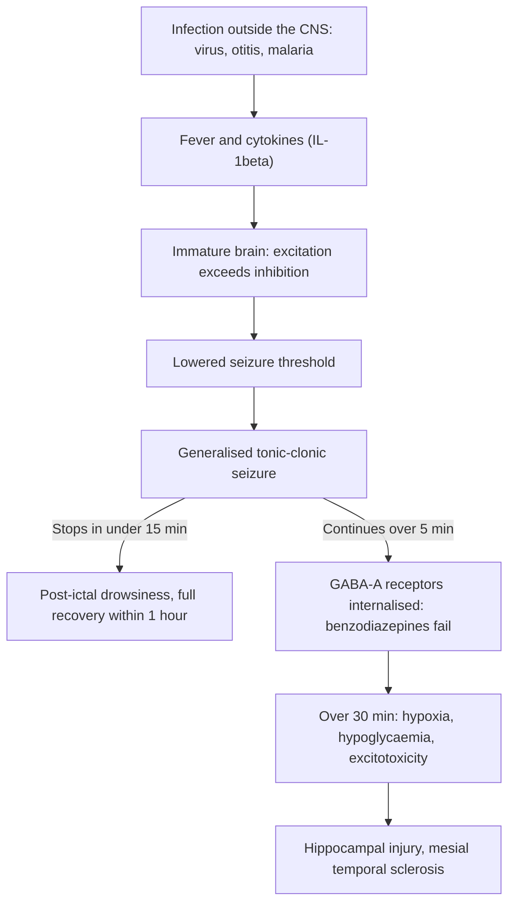

## 1. Definition

A **febrile convulsion** (febrile seizure) is a seizure that happens with a fever in a young child whose brain is otherwise normal and who has **no infection of the brain or meninges**. It is the **commonest seizure of childhood**. A **simple** febrile convulsion is frightening to watch but **harmless**: it does not damage the brain, cause learning problems or (much) increase the risk of epilepsy.

The challenge in Uganda is that a child with fever and a fit is **just as likely to have cerebral malaria, bacterial meningitis or hypoglycaemia** as a benign febrile convulsion. So the diagnosis is made by **exclusion**: stop the fit, check the glucose, test for malaria, decide whether the child needs a lumbar puncture, and only then reassure the family.

| Term | Definition |
|---|---|
| **Febrile convulsion** | Seizure with fever **≥38°C** in a child aged about **6 months to 5 years** (AAP; RCH Melbourne uses 6 months to 6 years; **UCG 2023 says 3 months to 6 years**), **without** CNS infection, metabolic disturbance (glucose, sodium, calcium), or a history of afebrile seizures. ILAE: after 1 month of age, with no previous neonatal or unprovoked seizure |
| **Status epilepticus (ILAE 2015 operational)** | Convulsive seizure lasting **>5 minutes** (time t1, when treatment must start) or repeated seizures without return to baseline; damage becomes likely after **30 minutes** (t2). **UCG 2023** still defines it as >30 minutes, repeated fits without recovery, or **not responding to 2 doses of diazepam**; treat at 5 minutes anyway |

Simple, complex and febrile status are defined in section 5.

> [!PEARL]
> The one thing never to forget: **"febrile convulsion" is the last diagnosis you make, not the first.** Every fitting febrile child at Mengo gets ABC, a glucose check, a malaria test and a meningitis decision. A child who is **not back to normal within an hour** does not have a simple febrile convulsion.

## 2. Epidemiology

- **Frequency**: 2–5% of children in Europe and North America by age 5 (higher in Japan, 6–9%); a sibling's risk rises to about 1 in 5, and higher still if a parent was affected.
- **Age**: peak **12–18 months**; uncommon before 6 months and after 5 years. Slight male predominance.
- **Triggers worldwide**: viral infections (HHV-6/roseola, influenza, adenovirus), otitis media, tonsillitis, gastroenteritis, and fever after some vaccines (MMR at 8–14 days, DTP within 48 h). Vaccine-related febrile seizures are uncommon and **not a reason to stop immunising**.
- **Uganda**: the leading cause of fever with convulsions in children admitted to Mulago and Mengo is **malaria**, followed by **pneumonia, URTI/otitis, UTI, gastroenteritis, bacterial meningitis and sepsis**. Hospital studies from East Africa show that a substantial share of "febrile seizures" are in fact **acute symptomatic seizures** from malaria, meningitis or hypoglycaemia, and that **complex seizures are commoner** than in Western series [VERIFY: primary East African studies not cited in source notes]. Children often arrive after a **long journey**, after **several fits**, and sometimes after traditional treatments (herbs by mouth, incisions, smoke), which raises the risk of aspiration and burns.

> [!UGANDA]
> Typical path: the child fits at home, is taken to a drug shop or HC II/III (perhaps given rectal diazepam or quinine IM), then to a HC IV or Mengo/Mulago. **Ask what was given and when**: a dose of diazepam given before arrival counts toward the maximum of two, and prior antibiotics change how you read the CSF.

## 3. Aetiology and Risk Factors

**Triggers (the fever source)**: viral URTI, roseola (HHV-6), influenza, adenovirus, otitis media, tonsillitis, pneumonia, gastroenteritis, UTI, post-vaccine fever. In Uganda, **malaria** must be considered first, but a fit with malaria is often an acute symptomatic seizure rather than a febrile convulsion (section 4).

**Risk factors for a first febrile convulsion**

| Factor | Notes |
|---|---|
| Age 6 months–5 years, peak 12–18 months | Immature brain |
| Family history | Sibling risk about 1 in 5; higher if a parent was affected |
| Genetics | FEB loci; *SCN1A*, *SCN1B* in GEFS+ families |
| High or rapidly rising temperature | Increases neuronal excitability |
| Male sex | Slight predominance |

**Risk factors for recurrence** (about 30% overall; about 50% if the first fit is before 12 months)

- **Age <18 months** at the first fit.
- **Family history** of febrile seizures.
- **Low peak temperature** at the fit (<40°C).
- **Short duration of fever** before the fit (<1 h).

All four: >70% recurrence; none: <20%.

**Risk factors for later epilepsy**: complex febrile seizures, family history of epilepsy, developmental delay or abnormal neurology.

## 4. Pathophysiology

**Why do young brains fit with fever?**

1. **Immature brain**: between 6 months and 5 years the balance between excitatory (glutamate) and inhibitory (GABA) signalling favours excitation. The seizure threshold is low and is lowered further by temperature.
2. **Temperature and cytokines**: fever itself (and the **rate of rise**) increases neuronal excitability. Interleukin-1β and other cytokines released during infection are pro-convulsant. That is why fits often happen **early in the illness**, sometimes before the parents notice the fever.
3. **Genetics**: strong family clustering; several loci (FEB genes) and sodium-channel genes (*SCN1A*, *SCN1B*) in GEFS+ families.
4. **Prolonged seizures harm**: a seizure lasting more than about 30 minutes causes neuronal injury (excitotoxicity, hypoxia, hypoglycaemia, hyperthermia). **Febrile status** is linked to **hippocampal injury and later mesial temporal sclerosis**, which is why we treat at 5 minutes.

**Why do benzodiazepines become less effective with time?** As a seizure continues, GABA-A receptors are internalised from the synapse and NMDA receptors move to the surface. Benzodiazepines work on GABA-A receptors, so the **longer you wait, the less they work**. Give the first dose promptly and correctly, and move to a second-line drug after **two** doses.

**Why malaria fits differ**: *P. falciparum* sequesters in cerebral capillaries, causing microvascular obstruction, brain swelling, hypoglycaemia and metabolic acidosis. Seizures in cerebral malaria are frequent, often **subtle** (eye deviation, twitching of a finger or mouth, irregular breathing) and recur. They are acute symptomatic seizures, not febrile convulsions.

**Feature links**

- Fever and cytokines lowering the threshold → seizure early in the illness, often in the first 24 hours.
- Generalised cortical discharge → loss of awareness, stiffening then rhythmic jerking of all four limbs, eyes rolled up.
- Focal cortical discharge (or a structural or infective lesion) → focal seizure, eye deviation to one side → complex seizure.
- Neuronal exhaustion after the fit → post-ictal drowsiness, improving within an hour; focal exhaustion → Todd's paresis.
- Seizure-related apnoea and secretions → cyanosis, hypoxia, aspiration.
- Muscle activity → raised temperature, lactic acidosis, hypoglycaemia.
- Prolonged seizure → GABA-A receptor internalisation → benzodiazepine resistance.
- Cerebral malaria sequestration → subtle, recurrent seizures and persistent coma.
- Meningeal inflammation (meningitis) → neck stiffness, bulging fontanelle, irritability, fits after day 1–2 of illness.

## 5. Classification / Staging

| Type | Criteria |
|---|---|
| **Simple febrile convulsion** (about 70–75%) | **Generalised** tonic–clonic, lasts **<15 minutes**, does **not recur within 24 h** (or the same illness), and the child is **fully recovered within 1 hour** |
| **Complex febrile convulsion** (about 25–30%) | **Any one** of: **focal** onset or focal features (including Todd's paresis afterwards); **≥15 minutes**; **recurrence within 24 h** or the same illness; prolonged altered consciousness (>1 h) |
| **Febrile status epilepticus** | A febrile seizure, or a series without recovery in between, lasting **≥30 minutes** (about 5% of febrile seizures) |
| **Febrile seizure plus / GEFS+** | Febrile seizures continuing after 6 years, or with afebrile seizures, in a family with a genetic epilepsy (e.g. *SCN1A*); **Dravet syndrome** is the severe end (prolonged, often focal, febrile seizures from about 6 months) |

> [!UGANDA]
> **UCG 2023** describes febrile convulsions as generalised, "usually <5 minutes, always <15 minutes", from **3 months to 6 years**, and lists **cerebral malaria, meningitis and epilepsy** as conditions to exclude first. It advises considering **LP or empirical meningitis treatment** when intracranial infection cannot be excluded clinically, **especially under 2 years**. International guidelines (AAP, NICE, RCH) start at 6 months. In a Ugandan ward, treat a child under 6 months with fever and a fit as **sepsis/meningitis until proven otherwise**.

**Status epilepticus time points (ILAE 2015)**: **t1 = 5 minutes** (start treatment); **t2 = 30 minutes** (damage likely).

## 6. Clinical Features

### History

Ask an eyewitness (the mother, not the person who carried the child last). Each answer changes the plan.

| Ask | Why it matters |
|---|---|
| **Describe the event**: stiffening and jerking of all four limbs vs one side, eyes turned to one side, or one limb. Did it start on one side? | Generalised vs focal; focal = complex → LP/imaging threshold drops |
| **Duration** (parents overestimate; anchor with "how long to get from home to the HC?") and **time the fit started** | ≥15 min = complex; still going = status |
| **Number of fits** in this illness and in the last 24 hours | ≥2 = complex; with malaria, **≥2 in 24 h = severe malaria** (UCG) |
| **Recovery**: back to normal within an hour? Weakness of a limb afterwards (Todd's paresis)? | Slow recovery = not simple; think meningitis, cerebral malaria, ongoing subtle seizures |
| **Fever**: how long before the fit? Highest temperature measured | Short duration and low peak predict recurrence |
| **Source of fever**: cough, fast breathing, ear discharge, diarrhoea and vomiting, rash (measles), dysuria/foul urine, joint or bone pain | Treat the source |
| **Red-flag symptoms**: irritability, high-pitched cry, refusing feeds, vomiting everything, headache, neck pain, photophobia, drowsiness, a rash, illness for several days before the fit | Meningitis/encephalitis |
| **Treatment already given**: antimalarials, **antibiotics**, **diazepam** (dose and time), traditional medicine, anything put in the mouth | Counts toward 2 benzodiazepine doses; partially treated meningitis; aspiration |
| **Past history**: previous febrile or afebrile fits, neonatal problems (asphyxia, jaundice, admission), head injury, **sickle cell disease** (stroke), known epilepsy or cerebral palsy | Epilepsy, CP, stroke, trauma |
| **Development**: milestones normal for age? Regression? | Abnormal development makes the diagnosis less likely and raises later epilepsy risk |
| **Family history**: febrile seizures, epilepsy | Recurrence and epilepsy risk; GEFS+ |
| **Immunisation**: UNEPI card; specifically **Hib (DPT-HepB-Hib) and PCV** at 6, 10, 14 weeks | Incomplete → higher risk of bacterial meningitis → lower threshold for LP |
| **HIV status** of mother and child, **feeding** (breastfeeding, weaning diet), **nutrition** (weight loss, oedema) | HIV-exposed or malnourished children get meningitis, cryptococcus and TB more often; SAM protocols |
| **Poisoning**: access to paraffin, organophosphates, traditional herbs, adult medicines (e.g. isoniazid, antimalarials, tricyclics) | Specific antidotes |

### Examination

In a fitting child, ABCD (ETAT) comes first (section 9). Once the fit has stopped, follow the order of Hutchison's Clinical Methods (24th edition), adapted for children: observe first, and leave the ears and throat to last.

**Introduction and preparation**

- Introduce yourself; confirm the child's name and age; consent from the caregiver and assent from the child when awake.
- Hand hygiene.
- Position and exposure: undress the child (also helps the fever) on the caregiver's lap or the bed; keep the airway in view.

**General inspection from the end of the bed**

- **Level of consciousness**: AVPU, and the **Blantyre coma scale** (pre-verbal children) or modified GCS. A child who remains **P or U** an hour after the fit is not a simple febrile convulsion.
- **Subtle seizure activity**: eye deviation, nystagmus, lip-smacking, finger twitching, irregular breathing.
- Colour: **pallor** (malaria, sickle cell), **jaundice** (malaria/haemolysis), cyanosis; hydration.
- **Skin**: **non-blanching petechiae/purpura** (meningococcus), measles rash, neurocutaneous signs (café-au-lait macules, ash-leaf macules), burns or incisions from traditional treatment, bruises (non-accidental injury).
- **Vital signs** with age norms: temperature, RR, HR, CRT, SpO₂, BP. Fast breathing: ≥50/min at 2–12 months, ≥40/min at 1–5 years. Repeat 15-minutely in the first hour.
- **Growth**: weight, length/height and **MUAC**; plot **Z-scores** (WAZ, HAZ, WHZ); **head circumference**. SAM changes fluids, glucose threshold and antibiotics.

**Hands, face and neck**

- Hands: CRT, cold peripheries (shock), pallor.
- Face and eyes: **pupils** (size, symmetry, reaction), eye deviation.
- Head: **fontanelle** (bulging is the best meningitis sign in infants; check with the child upright and quiet), signs of head injury.
- Neck: **neck stiffness**; **Kernig and Brudzinski** signs (unreliable under 18 months); photophobia; irritability when handled ("paradoxical irritability"); lymph nodes.

**Signs of raised ICP** (contraindicate LP): unequal or poorly reactive pupils, abnormal posturing (decorticate/decerebrate), focal limb weakness, irregular breathing, bradycardia with hypertension, papilloedema (late), deteriorating coma score.

**Systems (focus of infection and neurology)**

- **Respiratory**: inspection, palpation, percussion, auscultation (crackles, bronchial breathing): pneumonia or aspiration.
- **Abdomen**: spleen (malaria), liver.
- **Joints, skin and urine**: septic arthritis, cellulitis, UTI.
- **Neurology once awake**: tone, power and **symmetry** of limb movements (Todd's paresis), reflexes, posture, gait if walking.
- **Ears and throat last**: tympanic membranes (otitis media), tonsils.

**Complete the examination**: glucose and malaria results, check the immunisation card, thank the caregiver, wash hands, and summarise.

| Document these positives | And these negatives |
|---|---|
| Fit duration, type, number and time of each drug | "No neck stiffness, fontanelle not bulging" |
| Temperature and source of fever | "Pupils equal and reactive, no focal deficit" |
| Glucose and malaria result | "No petechial rash" |
| Time back to full consciousness | "Blantyre 5/5 at 1 hour" |

### Red flags

> [!REDFLAG]
> Not a simple febrile convulsion (treat as meningitis, cerebral malaria or another serious cause until proven otherwise):
> - Age **<6 months** (and especially <1 month)
> - Seizure **≥15 minutes**, **focal**, or **more than one** in 24 h
> - **Not fully alert within 1 hour**; Blantyre score ≤4 after the post-ictal period
> - **Bulging fontanelle**, neck stiffness, petechial/purpuric rash
> - Signs of **raised ICP** or focal neurological deficit
> - Fever for **several days** before the fit, or already on antibiotics
> - **Respiratory distress, shock, severe pallor** (malaria, sepsis), hypoglycaemia
> - **Developmental regression**, abnormal neurology, or known neurological disease

### Thinking like a clinician

- **"Fit + fever + malaria-positive" does not mean "malaria explains everything".** Up to a third of Ugandan children carry parasites with another illness [VERIFY: source for the one-third figure]. A positive RDT does **not exclude meningitis**; if there are meningeal signs or the child stays drowsy, do the LP (or treat for both).
- **Post-ictal or comatose?** After a simple fit the child is sleepy but rousable and improves within the hour. A Blantyre score that **stays low** means cerebral malaria, meningitis/encephalitis, hypoglycaemia, ongoing **subtle seizures** or poisoning.
- **Subtle seizures**: in a drowsy child with malaria watch for eye deviation, nystagmus, lip-smacking, finger twitching or irregular breathing. These are seizures and need treatment.
- **Rigors vs fits**: a febrile child shivering with a rigor is conscious, responds and the shaking stops when you hold the limb. A seizure involves loss of awareness and rhythmic jerking that does not stop with restraint.
- **Febrile syncope / breath-holding**: brief, child pale and floppy, recovers in seconds; may have a few jerks (reflex anoxic seizure).
- **Under 6 months**: fever and a fit = sepsis/meningitis workup and IV antibiotics. Under 1 month: neonatal sepsis protocol, phenobarbital first.
- **The second fit**: a child with a first fit at home and a second on the ward has a complex febrile seizure by definition: think harder, and do the LP if there is no contraindication.
- **Two benzodiazepine doses and still fitting = status**: move to phenobarbital/phenytoin, don't give a third diazepam dose (respiratory depression with little added benefit).
- **Common student mistakes**: calling it a febrile fit before checking glucose and malaria; forgetting the diazepam given before arrival; giving diazepam IM; mixing phenytoin in dextrose; telling parents that paracetamol will prevent the next fit.

## 7. Differential Diagnoses

| Differential | Distinguishing clinical feature | Distinguishing investigation |
|---|---|---|
| **Simple febrile convulsion** | 6 months–5 y, brief generalised fit, rapid full recovery, focus of fever outside CNS | Clinical; glucose, malaria test |
| **Cerebral malaria / severe malaria** | Malaria area, repeated or subtle fits, coma persisting >1 h after fit (Blantyre ≤2), anaemia, acidotic breathing, hypoglycaemia, retinopathy | RDT/smear, glucose, Hb; LP to exclude meningitis |
| **Bacterial meningitis** | Irritability, vomiting, bulging fontanelle, neck stiffness, petechiae, fits after day 1–2 of illness, focal fits, drowsiness | LP: cloudy CSF, neutrophils, low glucose; blood culture |
| **Viral encephalitis (HSV) / other encephalitis** | Behaviour change, focal fits, reduced consciousness for hours–days | CSF lymphocytes, PCR (rarely available), EEG, MRI |
| **TB meningitis** | Subacute (>5 days), weight loss, TB contact, HIV, cranial nerve palsies, hydrocephalus | CSF lymphocytes, high protein, low glucose; Xpert Ultra on CSF; CXR |
| **Hypoglycaemia** | Starved, vomiting, malaria, sepsis, SAM, quinine | Glucose <3.0 mmol/L |
| **Electrolyte disturbance** | Severe diarrhoea/dehydration (hypo/hypernatraemia), rickets (hypocalcaemia) | Na, Ca, Mg |
| **Epilepsy triggered by fever** | Previous afebrile seizures, abnormal development | History, EEG |
| **Shigella dysentery / gastroenteritis seizures** | Bloody diarrhoea, high fever | Stool, electrolytes |
| **Sickle cell stroke** | Known HbSS, hemiparesis, may be afebrile | Sickle test/Hb electrophoresis, CT |
| **Head injury / non-accidental injury** | History, bruising, retinal haemorrhages | CT head |
| **Poisoning** (organophosphates, paraffin, isoniazid, traditional herbs) | Exposure, pinpoint pupils, smell | History; specific antidote |
| **Rigors / febrile delirium / breath-holding / reflex anoxic seizure** | Conscious throughout, brief, triggered | Clinical |

## 8. Clinical Workup

The fitting child is managed and assessed at the same time; the tests below are what the team leader checks while the treatment runs.

### Bedside

| Test | How / why | Expected finding and action | Facility level |
|---|---|---|---|
| **Random blood glucose** | Glucometer, finger or heel prick | Hypoglycaemia (treat <3.0 mmol/L per UCG); also check after dextrose and 30 min later | All levels with a glucometer |
| **Malaria RDT** (and smear) | Finger prick; thick and thin film for parasite count | Malaria; parasitaemia + ≥2 fits/24 h or impaired consciousness = severe malaria | All levels (smear HC III and above) |
| **Haemoglobin (HemoCue)** | Finger prick | Severe anaemia (Hb <5 g/dL) from malaria or sickle cell: transfuse if Hb ≤4 g/dL, or 4–6 g/dL with distress, shock or coma | HC III and above |
| **SpO₂** | Pulse oximeter | Hypoxaemia from the fit, aspiration or pneumonia | HC IV and above |
| **Urine dipstick** | Clean-catch or bag (catheter if needed) | Nitrites/leucocytes in UTI (send culture) | All levels |
| **Bedside CSF look** | After LP | Cloudy CSF → treat as bacterial meningitis immediately | Where LP is done |

### Basic lab

| Test | When | Expected / abnormal finding | How it changes management | Facility level |
|---|---|---|---|---|
| **Blood smear with parasite count** | All febrile children | >250,000/µL or >10% = hyperparasitaemia | Severe malaria → IV artesunate | All levels with microscopy |
| **FBC** | Complex seizure, ill child | Leucocytosis (bacterial), anaemia, thrombocytopenia (malaria, sepsis; low platelets → delay LP) | Antibiotics; transfusion | HC IV and above |
| **Urine microscopy and culture** | Infant with no clear source; dipstick positive | UTI | Antibiotics; ultrasound of kidneys if recurrent | Culture at RRH/NRH |
| **HIV test** (rapid test; DNA PCR if <18 months and exposed) | Unknown status | Positive | ART, co-trimoxazole, CrAg, think TB meningitis | All levels |
| **Lumbar puncture**: CSF cell count, Gram stain, protein, glucose (with paired blood glucose), culture; CrAg if HIV; Xpert if TB suspected | Meningism, complex seizure, not normal within 1 h, <12 months (UCG: consider <2 years), incomplete Hib/PCV, pre-treated with antibiotics | Normal in febrile convulsion; bacterial meningitis: cloudy, high neutrophils, protein >0.4 g/L, glucose <1.5 mmol/L or CSF:blood ratio ≤0.4 | Ceftriaxone 100 mg/kg/day for 10–14 days | LP possible at HC IV (if trained) and hospitals; **culture only at RRH/NRH** (Mulago, Mengo labs) |

**Contraindications to LP**: signs of raised ICP (unequal pupils, posturing, focal deficit, irregular breathing, deteriorating coma score), shock or cardiorespiratory instability, ongoing seizures, low platelets or bleeding, infection at the LP site. Give ceftriaxone now and do the LP when safe.

### Imaging

| Test | When | Expected finding | How it changes management | Facility level |
|---|---|---|---|---|
| **Chest X-ray** | Clinical pneumonia, hypoxaemia, possible aspiration | Consolidation | Antibiotic choice | Hospitals |
| **CT/MRI brain** | **Not** for simple febrile seizure. Consider for focal seizure with persistent deficit, signs of raised ICP, head injury, suspected abscess | Abscess, bleed, infarct, hydrocephalus | Neurosurgery | **CT at Mulago, Mengo and some RRHs/private centres; MRI rare and expensive** |

### Specialised / referral-level

| Test | When | Expected finding | How it changes management | Facility level |
|---|---|---|---|---|
| **Blood culture** | Toxic child, suspected sepsis/meningitis | Organism | Tailor antibiotics | RRH/NRH; Mengo |
| **Electrolytes (Na, Ca, Mg), creatinine** | Diarrhoea/vomiting, prolonged fit, no fever source, abnormal recovery | Hypo/hypernatraemia, hypocalcaemia | Correct; reconsider the diagnosis (provoked seizure) | RRH/NRH |
| **EEG** | **Not** for simple febrile seizure; consider for recurrent complex seizures, afebrile seizures, developmental concerns | Epileptiform discharges | Epilepsy diagnosis | Specialist (Mulago, CoRSU, private) |

> [!EXAM]
> The AAP (2011) neurodiagnostic guideline for **simple** febrile seizures in children 6–60 months: **no routine** blood tests, EEG or neuroimaging; **LP if there are meningeal signs or symptoms or history suggesting meningitis**; LP is an **option** at 6–12 months if Hib/PCV immunisation is incomplete or unknown, and if the child has been pre-treated with antibiotics. In Uganda the threshold is lower because malaria and meningitis are common and follow-up is uncertain.

**Investigation summary**

| Test | What you are looking for | Why |
|---|---|---|
| Glucose | Hypoglycaemia | Treatable cause of fits and coma |
| Malaria RDT/smear | Parasitaemia, density | Commonest cause of febrile fits in Uganda; severe malaria needs IV artesunate |
| LP (when indicated) | Meningitis/encephalitis | Missing meningitis is the most dangerous error |
| FBC / Hb | Anaemia, infection, platelets | Transfusion; LP safety |
| Urine dipstick/culture | UTI | Common occult source in infants |
| Electrolytes | Na, Ca | Provoked seizures |
| HIV test | Infection status | CNS opportunistic infection, ART |
| EEG / imaging | Only for complex/atypical cases | Not needed for simple febrile convulsions |

### Putting it together

**Model one-line summary**

> "An 18-month-old boy, fully immunised, HIV-negative, with a 6-hour history of fever and coryza, had a single 4-minute generalised tonic–clonic seizure at home and was fully alert 40 minutes later; temperature 39.4°C, no meningism, glucose 5.6 mmol/L, malaria RDT negative, red bulging right eardrum: first simple febrile convulsion secondary to acute otitis media."

**Problem list**

1. Seizure with fever: simple febrile convulsion (diagnosis of exclusion: glucose normal, malaria negative, no meningism, rapid recovery).
2. Source: acute otitis media.
3. Parental anxiety: needs counselling and first-aid teaching.

> [!EXAM]
> **Worked example 1: interpreting the CSF.** A 10-month-old had a 20-minute focal fit and is still drowsy at 2 hours. CSF: cloudy; WBC 850/µL, 90% neutrophils; protein 1.8 g/L; glucose 0.9 mmol/L with blood glucose 6.0 (ratio 0.15); Gram-positive diplococci. **Interpretation:** pneumococcal meningitis. The "febrile convulsion" was an acute symptomatic seizure. Treat with ceftriaxone 100 mg/kg/day for 10–14 days, monitor for hearing loss, hydrocephalus and subdural effusions. Compare a **febrile convulsion**: clear CSF, WBC ≤5/µL, normal protein and glucose.

> [!EXAM]
> **Worked example 2: is it severe malaria?** A 3-year-old (13 kg) had 2 generalised fits in the last 12 hours; RDT positive, parasite count 80,000/µL; Blantyre 5/5 after 40 min; Hb 9.2 g/dL; glucose 4.8. **Interpretation:** by UCG 2023, **2 or more convulsions in 24 h with parasitaemia = severe malaria** even though the child is now alert. Give IV artesunate 3 mg/kg (39 mg) at 0, 12 and 24 h, then daily until able to take oral ACT; discharge on a full ACT course and **post-discharge malaria chemoprevention** (monthly DP for 3 months, UCG 2023).

**Worked example 3: dose calculation.** A 12 kg child: rectal diazepam 12 × 0.5 mg/kg = 6 mg = 1.2 mL of 10 mg/2 mL; phenobarbital 12 × 20 mg/kg = 240 mg IV over 15–20 min.

**Model case presentation (ward round)**

> "Baby K is an 18-month-old boy from Mukono, weighing 10.5 kg (WAZ −0.4, length 81 cm, HAZ −0.4, WHZ −0.2, MUAC 14.5 cm), fully immunised per the UNEPI card including three doses of DPT-HepB-Hib and PCV, HIV-unexposed, breastfeeding with a family diet. He presented 2 hours ago with a 6-hour history of fever and a runny nose, followed by one generalised tonic–clonic seizure lasting about 4 minutes at home, which stopped without treatment. He was sleepy for 30 minutes and is now playing. There is no previous history of seizures; development is normal (walks alone, says 6 words); an older sister had febrile fits. On examination, temperature 39.4°C, RR 32, HR 140, CRT <2 s, SpO₂ 98%, Blantyre 5/5, no meningism, fontanelle closed, no rash, red bulging right tympanic membrane. Glucose 5.6 mmol/L, malaria RDT negative. **Impression: first simple febrile convulsion secondary to right acute otitis media.** Plan: oral amoxicillin, paracetamol for comfort, observe overnight, counsel parents on first aid and recurrence, review in clinic if any further fits."

## 9. Management

### Immediate / emergency

**First 5 minutes (ABCDE)**

1. **Note the time** the fit started (ask the parent) and call for help.
2. **A**: position on the side (recovery position), suction the mouth gently, nothing in the mouth, no restraint. Jaw thrust if needed.
3. **B**: oxygen by face mask or nasal prongs (SpO₂ target ≥94% during the fit; ≥90% once stable). Bag-mask ventilation if apnoeic.
4. **C**: CRT, pulse, BP if possible; IV or IO access. Draw blood for **glucose**, malaria RDT/smear, FBC, culture, (electrolytes). Shock (cold hands, CRT >3 s, weak fast pulse) → fluid bolus per WHO guidance (not in SAM without the SAM protocol); severe dehydration → rehydrate.
5. **D**: **glucose**: if <3.0 mmol/L (UCG; WHO <2.5, or <3.0 in SAM) or you cannot measure it: **10% dextrose 5 mL/kg IV** rapidly. **If still fitting at 5 minutes**: first benzodiazepine dose; start the clock for the 10-minute repeat.
6. **E**: **temperature**: undress the child; paracetamol only once the fit has stopped and the child can swallow (or rectally).

> [!REDFLAG]
> Call the most senior person now if: the fit continues after **two benzodiazepine doses**, SpO₂ stays <90% or breathing is slow/irregular after diazepam, there are signs of **shock** or **raised ICP**, or the child is **<1 month old**.

**Stopping the fit: the status epilepticus algorithm (child >1 month)**

1. **0 min**: fit starts. Time it. Recovery position, airway, oxygen, glucose check. Most fits stop by themselves within 5 minutes.
2. **5 min, still fitting → 1st benzodiazepine**:
   - No IV: **diazepam 0.5 mg/kg PR** (max 10 mg) or **midazolam 0.3 mg/kg buccal/intranasal** (max 10 mg).
   - IV/IO: **diazepam 0.2–0.3 mg/kg slow IV** (max 10 mg) (or midazolam 0.15 mg/kg IV, 0.2 mg/kg IM; max 10 mg).
   - Glucose <3.0 or unknown → 10% dextrose 5 mL/kg IV.
3. **15 min, still fitting 10 min after dose 1 → 2nd benzodiazepine** (same dose). If a dose was given at home or the HC, this is already the 2nd: skip to second line. Call senior; prepare the second-line drug.
4. **25 min, still fitting = established status**:
   - **Phenobarbital 15–20 mg/kg IV** over 15–20 min (or IM 15 mg/kg), **or**
   - **Phenytoin 15–20 mg/kg IV** in 0.9% saline over 20–60 min, **or**
   - **Levetiracetam 40 mg/kg IV** over 5 min (where available).
5. **45 min, still fitting = refractory**: give the other second-line drug (e.g. phenytoin after phenobarbital; or extra phenobarbital 10 mg/kg). Anaesthetist/ICU: intubation, midazolam or thiopental infusion.

> [!DRUG]
> **Count every benzodiazepine dose**, including the one given at the drug shop or HC III. **No more than two doses** before a second-line drug: a third dose adds respiratory depression but little benefit. Have a bag-valve-mask ready whenever you give a benzodiazepine, especially after phenobarbital.

> [!UGANDA]
> **UCG 2023 (section 9.1.1, status epilepticus)** gives diazepam then **phenobarbital 10–15 mg/kg slowly IV** or **phenytoin 15–18 mg/kg over 1 hour**, then a further phenytoin 10 mg/kg. The child doses printed in that section ("0.05 mg/kg rectally, 0.02 mg/kg IV") appear to be misprints: the febrile convulsion section of the same guideline and the WHO Pocket Book both give **0.5 mg/kg rectally** (max 10 mg). Use 0.5 mg/kg PR and 0.2–0.3 mg/kg IV. On most Ugandan wards the sequence actually used is **diazepam → diazepam → phenobarbital → phenytoin**; levetiracetam IV and buccal midazolam are mainly available in private and some referral hospitals. **NICE NG217 (2022)** prefers buccal midazolam in the community and levetiracetam as second line.

### Definitive

**Treat the cause and the fever**

1. **Glucose**: correct hypoglycaemia (above); then IV fluids with dextrose at maintenance (Holliday–Segar 100 mL/kg/day for the first 10 kg, 50 mL/kg/day for the next 10 kg, 20 mL/kg/day thereafter) **restricted to about two-thirds** if meningitis or raised ICP is suspected; NG feeds as soon as safe.
2. **Malaria positive**:
   - Severe (≥2 fits in 24 h, impaired consciousness, prostration, etc.): **IV artesunate 3 mg/kg if <20 kg; 2.4 mg/kg if ≥20 kg** at 0, 12 and 24 h, then once daily until oral is tolerated, then a full course of oral ACT (UCG 2023; WHO malaria guidelines, latest consolidated edition). At a HC without IV facilities: **pre-referral rectal artesunate** (UCG: 100 mg for 5–<14 kg, 200 mg for 14–19 kg, children ≤6 years) and refer.
   - **Post-discharge malaria chemoprevention** (UCG 2023): monthly dihydroartemisinin–piperaquine for 3 months after severe malaria.
   - Uncomplicated (single brief fit, fully recovered): oral artemether–lumefantrine by weight band, observe for 24 h.
3. **Suspected bacterial meningitis** (or LP contraindicated/delayed): **ceftriaxone 100 mg/kg/day IV** (once daily or divided 12-hourly; max 4 g/day) for 10–14 days (UCG 2023). Do not delay antibiotics for an LP. Chloramphenicol 25 mg/kg 6-hourly if ceftriaxone unavailable. Under 2 months: ampicillin + gentamicin or ceftriaxone/cefotaxime per neonatal protocol.
4. **Other sources**: amoxicillin for otitis media or pneumonia, treat UTI, ORS/zinc for diarrhoea.
5. **Fever**: paracetamol or ibuprofen **for comfort, not to prevent fits** (drug table).

> [!UGANDA]
> **UCG 2023 still recommends tepid sponging** for febrile convulsions and educating carers on "fever control". **NICE NG143** (fever in under 5s) states that **tepid sponging is not recommended** and **antipyretics do not prevent febrile convulsions**. A practical compromise on the ward: undress the child, give paracetamol for comfort, avoid cold water or alcohol sponging (which causes shivering and distress), and **tell parents clearly that a fit is not their fault** for not bringing the temperature down.

> [!NOTE]
> **Long-term anticonvulsants?** Not for simple febrile seizures (AAP 2008 guidance on long-term management; NICE NG217 2022). Consider specialist review for frequent or prolonged febrile seizures, focal features, developmental concerns or a strong family history of epilepsy (possible GEFS+ or Dravet syndrome; avoid sodium-channel blockers such as carbamazepine in suspected Dravet). Intermittent diazepam during fevers is not routinely recommended (side effects outweigh benefits).

### Drug table

| Drug | Dose (per kg + max for children; adult) | Route | Frequency | Duration | Key cautions |
|---|---|---|---|---|---|
| **Diazepam** | **0.5 mg/kg**, max **10 mg/dose** (0.1 mL/kg of 10 mg/2 mL) | **Rectal** (injection drawn into a 1-mL syringe, needle removed, inserted 4–5 cm) | Once; repeat once after 10 min | **2 doses total** | UCG 2023 and WHO Pocket Book. Hold the buttocks together for a few minutes |
| **Diazepam** | **0.2–0.3 mg/kg** (WHO: 0.25 mg/kg = 0.05 mL/kg), max **10 mg/dose** | IV, slowly over 1–2 min | Once; repeat once after 10 min | 2 doses total | Apnoea risk; **do not give IM** (erratic absorption) |
| **Midazolam** | **0.3 mg/kg** (range 0.2–0.5), max **10 mg/dose** | Buccal (between gum and cheek) or intranasal | Once; repeat once after 10 min | 2 doses total | NICE NG217 first-line in the community, as effective as rectal diazepam and more acceptable. Injection solution can be used buccally |
| **Midazolam** | **0.15 mg/kg** IV; **0.2 mg/kg** IM; max **10 mg/dose** | IV / IM | Once; repeat once | 2 doses total | IM useful if no IV and rectal not possible |
| **Phenobarbital** | **15–20 mg/kg** (WHO 15 mg/kg; UCG 10–15 mg/kg), max **1 g** | IV, diluted, over 15–20 min (≤1–2 mg/kg/min); or IM | Once; extra 10 mg/kg after 30 min if still fitting | Maintenance (if needed) 3–5 mg/kg/day | Widely available in Uganda; respiratory depression and hypotension, especially after benzodiazepines |
| **Phenytoin** | **15–20 mg/kg** (UCG/WHO 15–18 mg/kg); local protocols cap at 1–1.5 g [VERIFY: maximum loading dose] | IV **in 0.9% saline only** (precipitates in dextrose), through a good separate line | Over **20–60 min**; rate **≤1 mg/kg/min** (max 50 mg/min) | UCG: a further 10 mg/kg over 30 min if still fitting | Cardiac monitor: bradycardia, arrhythmia, hypotension; extravasation causes necrosis ("purple glove"). Not IM |
| **Levetiracetam** | **40 mg/kg**, max **3 g** | IV over 5 min | Once | | NICE NG217 suggests it as the preferred second-line option where available (fewer adverse effects, quick to give). Limited IV availability in Uganda |
| **Paraldehyde** (legacy) | 0.4 mL/kg, max 10 mL | Rectal, mixed with equal volume of oil/saline | Once | | Older WHO option; rarely stocked now |
| **Phenobarbital (neonate)** | **20 mg/kg**; extra 10 mg/kg after 30 min, up to **40 mg/kg** total | IV (or IM) over 15–20 min | Loading | Maintenance 2.5–5 mg/kg/day | **First line in neonates** (WHO), not diazepam |
| **10% dextrose** | **5 mL/kg** | IV rapid bolus | Recheck glucose after 30 min | | Then maintenance fluid containing dextrose; feed as soon as safe |
| **Artesunate** | **3 mg/kg** (<20 kg); **2.4 mg/kg** (≥20 kg) | IV/IM | 0, 12, 24 h, then daily | Until oral ACT tolerated, then full ACT | Severe malaria (≥2 fits in 24 h) |
| **Rectal artesunate** (pre-referral) | 100 mg (5–<14 kg); 200 mg (14–19 kg); children ≤6 years | Rectal | Once | Then refer | HC without IV facilities |
| **Ceftriaxone** | **100 mg/kg/day**, max **4 g/day** | IV | Once daily or divided 12-hourly | **10–14 days** | Do not delay for LP |
| **Chloramphenicol** | 25 mg/kg | IV | 6-hourly | 10–14 days | If ceftriaxone unavailable; grey baby syndrome in neonates |
| **Paracetamol** | **15 mg/kg**, max **60 mg/kg/day**; 1 g/dose | Oral (rectal if vomiting) | Every 6 h until fever settles (UCG) | While febrile | Only once the child is awake and can swallow; comfort, not prevention |
| **Ibuprofen** | 5–10 mg/kg, max 30–40 mg/kg/day | Oral | Every 6–8 h | While febrile | Avoid if dehydrated, in shock, <3 months; not with suspected dengue |

### Referral criteria

| Level | What to do | Refer up when |
|---|---|---|
| **Home / VHT** | First aid: side position, time it, nothing in the mouth | Fit >5 minutes, repeated fits, blue, not waking properly → nearest facility |
| **HC II / HC III** | Rectal diazepam, dextrose, **pre-referral rectal artesunate** and/or **IM ceftriaxone** (or benzylpenicillin + gentamicin) | Then refer with a note (drugs and times) and an escort → HC IV |
| **HC IV / General Hospital** | Full status algorithm (phenobarbital, phenytoin), IV artesunate, ceftriaxone, LP if trained, observation | Status not controlled, raised ICP, CT needed, culture needed, shock or respiratory failure → RRH |
| **RRH / NRH (Mulago, Mengo HDU)** | HDU/ICU, ventilation, CT, CSF culture, EEG (Mulago, CoRSU) | n/a |

### Monitoring and follow-up

- **Neuro-observations** (Blantyre/GCS, pupils, glucose) **1–2-hourly for the first 6 hours** in admitted children; vitals 15-minutely in the first hour.
- **Glucose** 30 minutes after dextrose; SpO₂ and breathing after every benzodiazepine dose.
- **Disposition**:

| Situation | Plan |
|---|---|
| First simple febrile convulsion, >12 months, alert, source found, parents able to return | Observe 4–6 hours (often overnight in Uganda because of distance), treat source, counsel, discharge |
| <12 months, complex seizure, not fully recovered, LP abnormal or not done, malaria-positive with ≥2 fits, social concerns | **Admit**; neuro-observations 1–2-hourly for the first 6 hours |
| Status epilepticus, raised ICP, shock, respiratory failure | HDU/ICU (Mulago, Mengo HDU, RRHs with ICU) |
| HC II/III | Rectal diazepam, dextrose, pre-referral rectal artesunate and/or IM ceftriaxone, then refer with a note and an escort |

- **Follow-up**: clinic review if further fits; specialist review for frequent, prolonged or focal febrile seizures, developmental concerns or a family history of epilepsy.

### Counselling the family

Parents often think the child is dying. Counsel in plain language (Luganda/English as appropriate), with both parents if possible:

1. **What happened**: "A fit triggered by a high temperature in a young child's brain. It is common (1 in 30 children) and does not damage the brain."
2. **Prognosis**: about **1 in 3** will have another, usually within the next year; most children **outgrow them by 5–6 years**. Epilepsy develops in only about **1–2 in 100** (only slightly more than in all children).
3. **First aid at home**:
   - Stay calm, **note the time**; put the child on their side on a soft, safe surface away from the fire.
   - **Do not put anything in the mouth** (no spoon, finger, herbs, sugar or water), **do not restrain**, do not pour water on the child, **no traditional burns or incisions**.
   - If it lasts **more than 5 minutes**, or the child turns blue, or has repeated fits, or does not wake up properly: go to the nearest health facility immediately (rectal diazepam given by a trained person, or a home rescue buccal midazolam plan for selected families with recurrent prolonged fits).
4. **Fever**: give paracetamol for comfort, plenty of fluids and breastfeeds, light clothing. **This will not necessarily prevent another fit**, so a fit is not their failure.
5. **When to come back**: drowsiness, persistent vomiting, stiff neck, rash, breathing difficulty, fits >5 minutes or repeated fits.
6. **Malaria prevention**: sleep under an insecticide-treated net; test and treat every fever early.
7. **Immunisation**: **continue** all UNEPI vaccines (including measles-rubella); febrile convulsions are not a contraindication.
8. **No daily anticonvulsants** are needed after simple febrile convulsions; intermittent diazepam during fevers is not routinely recommended (side effects outweigh benefits).
9. **Stigma**: febrile fits are **not epilepsy, not contagious, and not caused by witchcraft**; the child can go to day care and school normally.

## 10. Complications

**Disease-related**

| Of the seizure | Long-term |
|---|---|
| Aspiration pneumonia, hypoxia | Recurrence (~30%) |
| Injury, burns (fire), tongue bite | Epilepsy (1–2% after simple; higher after complex) |
| Hypoglycaemia, hyperthermia, acidosis | Mesial temporal sclerosis after febrile status (rare) |
| Status epilepticus → hippocampal injury | Parental anxiety; stigma |

**Treatment-related**

| Complication | Cause | Action |
|---|---|---|
| Respiratory depression | Benzodiazepines + phenobarbital | Maximum 2 benzodiazepine doses; bag-valve-mask ready |
| Hypotension, arrhythmia | Phenytoin | Cardiac monitor; slow the infusion |
| Extravasation injury | Phenytoin ("purple glove"), dextrose | Good separate line; check the site |
| Sedation masking deterioration | Anticonvulsants | Neuro-observations; re-examine for meningitis |
| Aspiration, burns, incisions | Traditional treatments | Ask; teach first aid |

## 11. Prognosis

- **Simple febrile convulsions are benign**: no brain damage, no learning problems; most children **outgrow them by 5–6 years**.
- **Recurrence**: about **30%** (about 50% if the first fit is before 12 months); >70% with all four risk factors, <20% with none.
- **Epilepsy**: about **1–2%** after simple febrile seizures (general population about 1%); higher after complex seizures, with a family history of epilepsy or with developmental delay.
- **Febrile status** carries a small risk of hippocampal injury and later mesial temporal sclerosis.
- **Prognosis in Uganda depends on the cause**: an acute symptomatic seizure from cerebral malaria or bacterial meningitis carries the mortality and sequelae of that disease.

## 12. Prevention

- **No drug prevents simple febrile convulsions**: antipyretics and tepid sponging do not, and long-term anticonvulsants are not indicated.
- **Prevent the causes**: insecticide-treated nets and early testing and treatment of fever (malaria); full UNEPI immunisation (Hib, PCV, measles-rubella) to prevent meningitis and severe infections.
- **Prevent harm from fits**: first-aid teaching (side position, nothing in the mouth, time it), no traditional burns or incisions, a rescue plan for selected families.

## 13. Special Populations

- **Neonates (<1 month)**: not febrile convulsions; neonatal sepsis protocol; **phenobarbital 20 mg/kg first**, not diazepam.
- **Infants under 6 months**: fever and a fit = sepsis/meningitis workup and IV antibiotics (UCG starts the definition at 3 months; international guidelines at 6 months).
- **Infants 6–12 months**: lower threshold for LP, especially with incomplete Hib/PCV or prior antibiotics.
- **Severe acute malnutrition**: hypoglycaemia threshold <3.0 mmol/L; SAM fluid protocol (no standard boluses); higher risk of meningitis and TB.
- **HIV-exposed or HIV-positive**: CrAg, TB meningitis, opportunistic CNS infections.
- **Sickle cell disease**: a fit may be a stroke (hemiparesis, may be afebrile).
- **Suspected Dravet syndrome/GEFS+**: specialist review; avoid sodium-channel blockers such as carbamazepine.

## 14. Key Points

### High-yield points

- **"Febrile convulsion" is a diagnosis of exclusion**: glucose, malaria test and a meningitis decision first.
- **Simple** = generalised, <15 min, once in 24 h, recovered within 1 h; anything else is **complex**.
- **Treat at 5 minutes**: diazepam 0.5 mg/kg PR (max 10 mg) or buccal midazolam 0.3 mg/kg.
- **Maximum two benzodiazepine doses** (count the one given before arrival), then phenobarbital, phenytoin or levetiracetam.
- **Neonates: phenobarbital first.**
- **DEFG: Don't Ever Forget Glucose.**
- **Malaria + ≥2 fits in 24 h = severe malaria**: IV artesunate.
- **A positive RDT does not exclude meningitis.**
- **Antipyretics do not prevent fits**; no long-term anticonvulsants, EEG or CT after a simple febrile seizure.
- **Counsel**: recurrence 1 in 3, epilepsy 1–2 in 100, first aid, continue immunisation.

### Numbers & doses

| Item | Value |
|---|---|
| Fever threshold | **≥38°C** |
| Age range | **6 months–5 years** (UCG 2023: 3 months–6 years); peak 12–18 months |
| Prevalence | **2–5%** of children |
| Simple febrile convulsion | Generalised, **<15 min**, once in **24 h**, recovered within **1 h** |
| Febrile status | **≥30 min** |
| Start anticonvulsant | Fit lasting **≥5 min** |
| Diazepam rectal | **0.5 mg/kg** (0.1 mL/kg of 10 mg/2 mL), **max 10 mg**, repeat once after 10 min |
| Diazepam IV | **0.2–0.3 mg/kg** slowly, max 10 mg |
| Midazolam buccal/intranasal | **0.3 mg/kg** (0.2–0.5), max 10 mg; IV 0.15 mg/kg, IM 0.2 mg/kg |
| Phenobarbital | **15–20 mg/kg** IV over 15–20 min or IM (max 1 g); neonates **20 mg/kg**, then 10 mg/kg, max 40 mg/kg |
| Phenytoin | **15–20 mg/kg** IV in saline, **≤1 mg/kg/min** (UCG/WHO over 60 min) |
| Levetiracetam | **40 mg/kg** IV over 5 min, max 3 g |
| Hypoglycaemia | <3.0 mmol/L (UCG); WHO <2.5 (<3.0 in SAM) → **10% dextrose 5 mL/kg** |
| Paracetamol | **15 mg/kg 6-hourly**, max 60 mg/kg/day |
| IV artesunate | **3 mg/kg** (<20 kg) or 2.4 mg/kg (≥20 kg) at 0, 12, 24 h then daily |
| Severe malaria (convulsions) | **≥2 convulsions in 24 h** with parasitaemia (UCG 2023) |
| Ceftriaxone (meningitis) | **100 mg/kg/day** (max 4 g) for 10–14 days |
| Recurrence | ~**30%**; ~50% if first fit <12 months; >70% with all 4 risk factors; <20% with none |
| Epilepsy after simple FS | ~**1–2%** (general population ~1%) |

### Exam traps

- **"Give paracetamol to prevent another fit."** Wrong: antipyretics do not prevent recurrence; give them for comfort.
- **"Malaria RDT positive, so no LP."** Wrong: parasitaemia is common; meningism or a low coma score still needs LP (or treatment for meningitis).
- **"A third dose of diazepam."** Wrong: after two doses move to phenobarbital/phenytoin/levetiracetam.
- **"Diazepam IM."** Wrong: erratic absorption; use rectal, buccal, IV, or IM midazolam.
- **"Phenytoin in dextrose."** Wrong: it precipitates; dilute only in 0.9% saline.
- **"Start daily phenobarbital after a simple febrile fit."** Wrong: no long-term anticonvulsant.
- **"A 4-month-old with fever and a fit has a febrile convulsion."** Wrong: treat as sepsis/meningitis; the definition starts at 6 months (UCG 3 months).
- **"CT and EEG for every first febrile fit."** Wrong: not for simple febrile seizures.

### Questions seniors ask

**Viva questions**

1. **Define a febrile convulsion.** Seizure with fever ≥38°C, age about 6 months to 5 years, no CNS infection, metabolic cause or previous afebrile seizure.
2. **Simple vs complex?** Simple: generalised, <15 min, once in 24 h, full recovery within 1 h. Complex: focal, ≥15 min, recurrent in 24 h, or slow recovery.
3. **When do you start anticonvulsants?** If the fit lasts 5 minutes or longer (ILAE 2015 t1), or repeated fits without recovery.
4. **Rectal diazepam dose?** 0.5 mg/kg (0.1 mL/kg of 10 mg/2 mL), max 10 mg; repeat once after 10 min.
5. **What after two doses?** Phenobarbital 15–20 mg/kg IV over 15–20 min (or IM) or phenytoin 15–20 mg/kg IV over 20–60 min in saline; levetiracetam 40 mg/kg if available.
6. **Indications for LP?** Meningism, complex seizure, incomplete recovery, <12 months (lower threshold <2 years in Uganda), incomplete Hib/PCV, prior antibiotics; not if raised ICP, shock, coagulopathy or local skin infection.
7. **Risk factors for recurrence?** Age <18 months, family history of febrile seizures, low peak temperature, short duration of fever before the fit.
8. **Do antipyretics prevent recurrence?** No.

**On the ward round**

- **The child is still fitting on arrival and the mother says she got "an injection in the bottom" at the clinic an hour ago. What do you do?** Assume a benzodiazepine (or quinine/IM antibiotic) may have been given; check glucose, give one dose of benzodiazepine (that would be the second), and prepare phenobarbital if the fit continues 10 minutes later.
- **When would you NOT do an LP in a child you suspect has meningitis?** Signs of raised ICP (unequal pupils, posturing, focal deficit, irregular breathing, deteriorating coma score), shock or cardiorespiratory instability, ongoing seizures, low platelets or bleeding, infection at the LP site. Give ceftriaxone now and do the LP when safe.
- **Why does a seizure need treatment at 5 minutes when we call status 30 minutes?** Seizures lasting more than 5 minutes are unlikely to stop on their own, and benzodiazepines become less effective as GABA-A receptors are internalised; damage becomes likely by 30 minutes (ILAE 2015 t1 and t2).
- **How do you tell a post-ictal child from cerebral malaria coma?** Time course: the post-ictal child steadily improves and is fully alert within an hour. Persistent Blantyre ≤2 beyond 1 hour, retinopathy, hypoglycaemia, severe anaemia or acidosis point to cerebral malaria (and you must exclude meningitis).
- **Will my child get epilepsy?** After a simple febrile seizure the risk is about 1–2 in 100, close to the risk for any child. It is higher after complex seizures, with a family history of epilepsy or with developmental problems.
- **What is the recurrence risk and what raises it?** About 1 in 3 overall. Higher with first fit before 18 months, a family history of febrile seizures, a fit at a relatively low temperature, and a short time between fever onset and the fit.
- **Should this child stop vaccines?** No. Vaccine-associated fever can trigger a febrile seizure, but the vaccines prevent the very infections (Hib, pneumococcus, measles) that cause meningitis and seizures.

### Mnemonics

- **"5-10-2"**: treat at **5** minutes, repeat after **10** minutes, maximum **2** benzodiazepine doses.
- **"DEFG": Don't Ever Forget Glucose** in a fitting or unconscious child.
- **Simple = "1-15-1"**: **1** fit, **<15** minutes, recovered within **1** hour (and generalised).
- **Recurrence risk factors "YFLS"**: **Y**oung (<18 months), **F**amily history, **L**ow temperature at the fit, **S**hort fever duration.
- **Before you say "febrile fit", exclude "MMGHE"**: **M**alaria (cerebral), **M**eningitis, **G**lucose, **H**ead injury/poisoning, **E**pilepsy/electrolytes.

### OSCE tips

- In a **counselling station**: introduce yourself, explore what the parent saw and fears ("Is my child going to die? Is it epilepsy? Was it witchcraft?"), explain in plain words, cover recurrence, first aid (with a demonstration of the recovery position), danger signs, no need for daily medicine, continue immunisation, check understanding, and give a written leaflet if available.
- In a **management station**: say "I would time the seizure, call for help, ABC, check glucose" before naming any drug. Calculate the dose aloud (e.g. 12 kg × 0.5 mg/kg = 6 mg = 1.2 mL of 10 mg/2 mL).

## 15. References

1. Ministry of Health Uganda. Uganda Clinical Guidelines 2023: sections 1.1.5 Febrile Convulsions, 2.1.5 Meningitis, 2.5.2.2 Severe Malaria, 9.1.1 Epilepsy and Status Epilepticus. Kampala: MoH; 2023. https://library.health.go.ug/uganda-clinical-guidelines-2023
2. World Health Organization. Pocket Book of Hospital Care for Children: Guidelines for the Management of Common Childhood Illnesses, 2nd edition (Chart 9, Annex 2). Geneva: WHO; 2013. https://www.who.int/publications/i/item/978-92-4-154837-3
3. NICE. Epilepsies in children, young people and adults (NG217): treating status epilepticus, repeated or cluster seizures and prolonged seizures. 2022. https://www.nice.org.uk/guidance/ng217/chapter/7-Treating-status-epilepticus-repeated-or-cluster-seizures-and-prolonged-seizures
4. NICE. Fever in under 5s: assessment and initial management (NG143). 2021. https://www.nice.org.uk/guidance/ng143/chapter/Recommendations
5. Medscape (eMedicine). Febrile Seizures (overview and treatment). 2024. https://emedicine.medscape.com/article/801500-overview
6. The Royal Children's Hospital Melbourne. Clinical Practice Guidelines: Febrile seizure. 2024. https://www.rch.org.au/clinicalguide/guideline_index/Febrile_seizure/
7. Medscape Drug Reference. Phenytoin: pediatric dosing (status epilepticus). https://reference.medscape.com/drug/dilantin-phenytek-phenytoin-343019
8. Medscape Drug Reference. Phenobarbital: pediatric dosing (status epilepticus). https://reference.medscape.com/drug/sezaby-phenobarbital-343017
9. American Academy of Pediatrics. Neurodiagnostic evaluation of the child with a simple febrile seizure (Clinical Practice Guideline). Pediatrics 2011;127(2):389–394.
10. Trinka E, et al. A definition and classification of status epilepticus: Report of the ILAE Task Force on Classification of Status Epilepticus. Epilepsia 2015;56(10):1515–1523.
11. World Health Organization. WHO Guidelines for malaria (latest consolidated version). 2026. https://www.who.int/publications/i/item/guidelines-for-malaria
12. Glynn M, Drake WM, editors. Hutchison's Clinical Methods: An Integrated Approach to Clinical Practice. 24th edition. Edinburgh: Elsevier; 2018.
