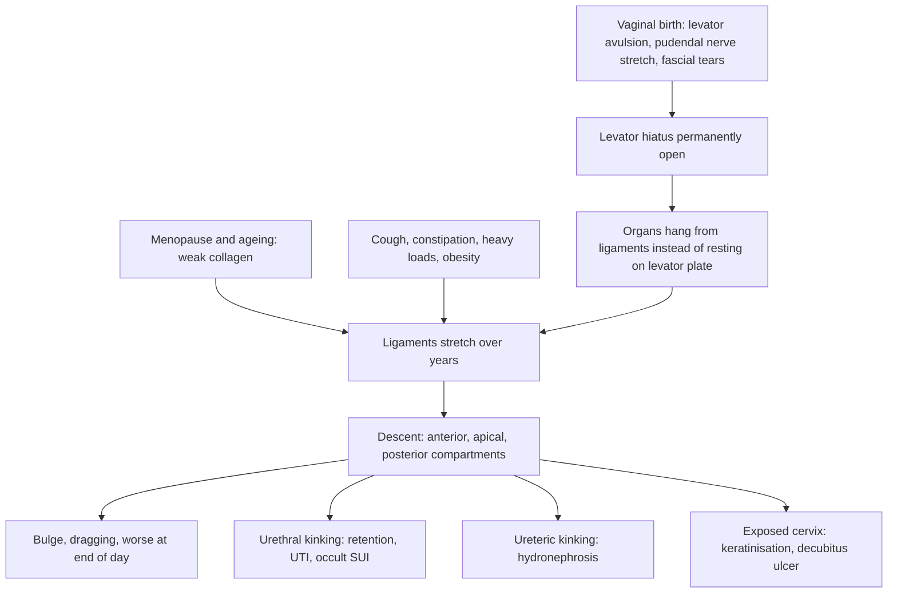

## 1. Definition

- **Genital (pelvic organ) prolapse** is the **downward displacement of the pelvic organs into or out of the vagina**. The uterus and cervix, the **vaginal vault** (after hysterectomy), or the anterior or posterior vaginal walls can come down, carrying the **bladder (cystocele), urethra (urethrocele), small bowel (enterocele) or rectum (rectocele)** with them.
- It is a **disease of failed support**. Vaginal childbirth tears and stretches the levator ani and its fascia and injures the pudendal nerve. Menopause and ageing weaken the collagen. Chronically raised intra-abdominal pressure (**cough, constipation, heavy loads**) keeps pushing down.
- It is **rarely life-threatening but very disabling**: dragging discomfort, a bulge, difficulty passing urine or stool, and sexual and social problems.

| Term | Meaning |
|---|---|
| **Cystocele** | The bladder bulges through the upper two-thirds of the **anterior** vaginal wall |
| **Urethrocele** | The urethra bulges through the lower third of the anterior wall (often with stress incontinence) |
| **Cystourethrocele** | Both together (the common presentation) |
| **Uterine (uterovaginal) prolapse** | The uterus and cervix descend along the vaginal axis |
| **Procidentia** | The **entire uterus lies outside the introitus**, with the vagina everted (POP-Q stage IV) |
| **Vault prolapse** | Descent of the vaginal apex **after hysterectomy** |
| **Enterocele** | Herniation of the pouch of Douglas (with small bowel or omentum) through the **upper posterior** wall or vault |
| **Rectocele** | The rectum bulges through the **lower or mid posterior** wall |
| **Cervical elongation** | A long cervix (often supravaginal) that mimics uterine descent while the fundus stays in place |

> [!PEARL]
> **The one thing to remember**: treat the **woman's symptoms, not the grade**. Always check the **bladder emptying, the kidneys (hydronephrosis in procidentia) and the cervix or ulcer (cancer)** before planning surgery.

## 2. Epidemiology

- Prolapse is found on examination in **up to about half of parous women**, but only a minority have symptoms (roughly **3–6%** report a bulge). The lifetime risk of having surgery for prolapse or incontinence is about **1 in 10 or more** in high-income countries.
- In Uganda it is common in **grand multiparous, post-menopausal women who do heavy farm work and carry loads**. In **low-income settings** such as Uganda, prolapse is common because of:
  - **high parity** (average family size remains around 4–5 children)
  - **births at home or without skilled attendants** (long second stages, early pushing, fundal pressure)
  - **heavy physical labour** (digging, carrying water, firewood and produce on the head)
  - **chronic cough** (TB, smoke from cooking fires, COPD)
  - **constipation**
  - **poor access to surgery**
- Many women present **late**, with **complete procidentia, decubitus ulcers, urinary retention and hydronephrosis**, often after years of shame, sometimes believing it is a curse or cancer, and some have been rejected by their husbands.

> [!UGANDA]
> Most prolapse surgery in Uganda is **native-tissue vaginal surgery**: vaginal hysterectomy with McCall culdoplasty, anterior and posterior colporrhaphy, and Manchester repair. It is done at regional and national referral hospitals (Mulago, Mengo and others) and during **surgical camps**. **Pessaries** are underused because supply and follow-up are hard, but they are cheap and useful for frail women if follow-up can be assured. **Vaginal oestrogen** is often not on the essential medicines list at lower levels and may have to be bought privately.

## 3. Aetiology and Risk Factors

**Risk factors ("PELVIC SAG")**

- **P**arity (vaginal): the strongest risk factor, especially large babies, a long second stage, instruments, premature pushing and fundal pressure.
- **E**lderly: ageing weakens collagen.
- **L**ifting heavy loads (farm work, water, firewood and produce carried on the head).
- **V**aginal instrumental delivery / large babies.
- **I**ntra-abdominal pressure: chronic cough (TB, cooking smoke, COPD), constipation, obesity, ascites, pelvic masses.
- **C**onnective tissue disorders.
- **S**urgery: previous hysterectomy (vault prolapse), especially without vault support.
- **A**trophy (menopause: falling oestrogen weakens collagen).
- **G**enetic / neurological (spina bifida occulta, neurological disease): consider in a young nulliparous woman.

## 4. Pathophysiology

### The pelvic floor: a muscular hammock and a fascial suspension

1. **Levator ani** (pubococcygeus, **puborectalis**, iliococcygeus) plus coccygeus. These muscles form the **pelvic diaphragm**. With **constant resting tone** they keep the **levator hiatus** (the gap through which the urethra, vagina and rectum pass) **closed**. They also lift the organs onto a flat **levator plate**.
2. **Endopelvic fascia** and ligaments: the connective tissue that **attaches the vagina and uterus to the pelvic side walls**.
3. **Perineal body and perineal membrane**: the **distal anchor**.

### DeLancey's three levels of vaginal support

| Level | Structures | What it does | Failure causes |
|---|---|---|---|
| **I (suspension)** | **Uterosacral–cardinal ligament complex** | Suspends the **cervix and upper vagina (apex)** towards the sacrum | **Uterine or vault prolapse, enterocele** |
| **II (attachment)** | **Paracolpium** to the **arcus tendineus fasciae pelvis** (laterally) and the fascia over the levators | Attaches the **mid-vagina** laterally, forming the "hammock" under the bladder | **Cystocele** (paravaginal or central defect) and **rectocele** (mid) |
| **III (fusion)** | **Perineal body, perineal membrane**, superficial perineal muscles | Fuses the **distal vagina** to surrounding structures | **Urethrocele, low rectocele, gaping introitus** (perineal deficiency) |

### Why childbirth causes prolapse

- During crowning, the **levator ani must stretch to more than 3 times its resting length**. **Avulsion** of the puborectalis from the pubic bone is common after difficult births.
- The **pudendal nerve** is stretched, causing **denervation** and weaker muscles.
- The **fascia tears**.
- Once the levator hiatus is **permanently open**, the organs are no longer resting on a muscular shelf. They hang from the ligaments, which then **stretch over years**, especially when **oestrogen falls** after menopause (collagen weakens) and with every cough or heavy load.
- That is why prolapse often **appears decades after** the births that caused it.

### Why prolapse causes the symptoms it does (feature links)

- Gravity on stretched ligaments → **bulge and dragging**, worse at the end of the day and on standing, better lying down.
- Large cystocele → **urethral kinking** → hesitancy, incomplete emptying, a need to **reduce the bulge with a finger to void** → residual urine → recurrent UTIs.
- Procidentia → **ureters dragged down** and compressed by the levator hiatus → **hydronephrosis** → obstruction and, rarely, renal failure.
- Prolapse kinks the urethra → masks SUI → **occult stress incontinence** that can **appear after repair**.
- Rectocele → stool pockets into the bulge → **incomplete evacuation** and a need to **splint** (press on the posterior vaginal wall or perineum to defaecate).
- Exposed cervix or vagina → keratinised, dry, friction-damaged; venous congestion and low oestrogen add ischaemia → **decubitus ulcer** (can mimic cancer), bleeding, discharge.
- Level I failure → apical descent (uterus, vault, enterocele); Level II → cystocele and mid rectocele; Level III → urethrocele, low rectocele, gaping introitus.
- Oedema in an irreducible prolapse → venous congestion → irreducibility, rarely strangulation or gangrene.

## 5. Classification / Staging

### Traditional grading of uterine prolapse (still used on Ugandan wards)

| Degree | Description |
|---|---|
| 1st | The cervix descends but stays **within the vagina** |
| 2nd | The cervix reaches or protrudes **through the introitus** on straining; the body of the uterus stays inside |
| 3rd (procidentia) | The **whole uterus lies outside** the introitus |

### Baden–Walker halfway system

Grade 0 = normal position. Grade 1 = halfway to the hymen. Grade 2 = to the hymen. Grade 3 = halfway past the hymen. Grade 4 = maximum descent.

### POP-Q (Pelvic Organ Prolapse Quantification)

This is the international standard (ICS/IUGA). The **hymen is the reference point (0)**. Points above it are negative (in cm) and points below it are positive. All are measured at **maximum strain (Valsalva)** except tvl.

| Point | Where it is | Normal range |
|---|---|---|
| **Aa** | Anterior wall, **3 cm** above the hymen (near the urethrovesical junction) | −3 (normal) to +3 |
| **Ba** | Most dependent part of the rest of the anterior wall | −3 (normal) up to +tvl |
| **C** | The cervix (or the vault after hysterectomy) | About −tvl (normal) to +tvl |
| **D** | Posterior fornix (omitted after hysterectomy) | Deep in the pelvis normally |
| **Ap / Bp** | Posterior wall equivalents of Aa and Ba (Ap 3 cm from the hymen, range −3 to +3) | As for Aa / Ba |
| **gh** (genital hiatus) | Middle of the urethral meatus to the posterior hymen | cm |
| **pb** (perineal body) | Posterior hymen to the mid-anal opening | cm |
| **tvl** (total vaginal length) | Depth of the vagina **at rest**, with the prolapse reduced | cm |

**The 3 × 3 grid**: row 1 = Aa, Ba, C (anterior wall and apex); row 2 = gh, pb, tvl; row 3 = Ap, Bp, D (posterior wall and posterior fornix).

| Stage | Criterion |
|---|---|
| 0 | No prolapse (Aa, Ap, Ba, Bp all −3; C or D within 2 cm of −tvl) |
| I | Most distal part is **more than 1 cm above** the hymen (less than −1) |
| II | Most distal part is **within 1 cm of the hymen** (−1 to +1) |
| III | Most distal part is **more than 1 cm below** the hymen, but no further than (tvl − 2) cm |
| IV | **Complete eversion** (at least tvl − 2 cm): procidentia or complete vault eversion |

> [!EXAM]
> POP-Q is objective and reproducible, which is why it is used in research and guidelines. On a busy Ugandan ward, you will more often hear "**third-degree uterine prolapse with a cystocele and a rectocele**". Know both, and translate: "third degree" roughly equals POP-Q stage III–IV.

**By compartment ("Front, top, back")**: front = bladder (cystocele, urethrocele); top = uterus, vault or enterocele; back = rectum (rectocele).

## 6. Clinical Features

Most women with prolapse are worked up calmly in the gynae clinic or on the ward before a surgical camp. The workup answers: **Which compartments are down, and how far (POP-Q or degree)? Is the bladder emptying and are the kidneys safe? Is there an ulcer or bleeding that could be cancer? What does she want (fertility, sex), and is she fit for which treatment?**

### History

| Ask | Why it changes the plan |
|---|---|
| **The bulge**: "something coming down"? How long, worse when standing or at the end of the day, can she push it back, is it always out? | Degree and impact; always out suggests stage III–IV; irreducible suggests oedema or ulceration |
| **Voiding**: frequency, hesitancy, poor stream, **pushing the bulge back to void**, incomplete emptying, recurrent UTI, dysuria, loin pain | Cystocele, urethral kinking and retention, UTI, hydronephrosis: check the residual and the kidneys |
| **Leakage on cough or sneeze** (and whether it got better as the prolapse got worse) | SUI or **occult SUI**: test with the prolapse reduced; may need a continence procedure |
| **Urgency, frequency, nocturia** | OAB or UTI; do not promise that surgery cures urgency |
| **Bowels**: constipation, straining, incomplete evacuation, **splinting or digitating**, faecal incontinence | Rectocele, enterocele, sphincter injury: posterior repair is indicated only if symptomatic |
| **Bleeding or blood-stained discharge; postmenopausal bleeding** | **Decubitus ulcer** vs **cervical or endometrial cancer**; PMB needs investigation |
| **Sexually active? Dyspareunia? Wishes for the future?** | Colpocleisis (no future intercourse) vs reconstructive surgery; avoid levator plication in sexually active women; posterior repair can cause dyspareunia |
| **Wants more children?** | Conservative or uterus-preserving surgery; avoid Manchester repair (cervical incompetence) and hysterectomy |
| **Obstetric history**: parity, birth weights, home or long births, instruments, tears | Risk factors; explains the mechanism; counselling |
| **Menopause; any oestrogen/HRT use** | Atrophy: vaginal oestrogen before a pessary or surgery |
| **Chronic cough (TB, cooking smoke, COPD), constipation, heavy loads, occupation, weight** | Modifiable "pushers": fix them or the prolapse recurs |
| **Comorbidity and medicines** (hypertension, diabetes, heart or lung disease, anticoagulants) | Fitness for anaesthesia; favours a pessary or colpocleisis for the frail |
| **Previous hysterectomy or repair** | Vault prolapse; recurrence; scarring, adhesions |
| **Can she return for follow-up?** | A pessary needs reviews every 3–6 months; a woman who cannot return may be safer with surgery |

### Examination

Follow the order of Hutchison's Clinical Methods (24th edition).

#### Introduction, consent and preparation

- Introduce yourself, confirm identity, explain, gain consent; **chaperone** for the pelvic examination.
- **Hand hygiene**; gloves.
- Ask her to **empty her bladder first** (then measure the residual); good light.
- **Position and exposure**: supine for the abdomen; **left lateral** for the Sims speculum; standing if the prolapse is not reproduced lying down.

#### General inspection and vital signs

BMI, pallor, hydration, frailty and mental state (many of these women are elderly); BP, pulse, temperature (pyelonephritis, sepsis).

#### Hands, face and neck, chest

Pallor; signs of chronic lung disease; **chest** (cough, wheeze, signs of TB or COPD): treat the cause of raised intra-abdominal pressure.

#### Abdomen

A **palpable bladder**, **renal angle tenderness**, pelvic or abdominal masses and **ascites** (which can push organs down: secondary prolapse), hernias.

#### Pelvic examination

| Step | What you document |
|---|---|
| **Inspect the vulva at rest, then on strain/cough** | Anything visible at the introitus; **atrophy**; ulcer (site, size, edge); **urine leak on cough** (SUI); gaping introitus and perineal body length |
| **Sims speculum, left lateral** (a Cusco hides the walls) | Insert it to **retract the posterior wall**, then ask her to strain: shows the **anterior wall (cystocele)** and the **cervix descending**. Withdraw it slowly while she strains to see the **apex** descend. Rotate it to **retract the anterior wall**: shows the **posterior wall (rectocele or enterocele)** |
| **Leading edge of each compartment** | In cm relative to the **hymen** (POP-Q) or as a degree |
| **Reduce the prolapse and ask her to cough** | **Occult SUI** |
| **Standing examination** if the story is bigger than the findings | Reproduces the maximum descent |
| **Bimanual** | Uterine size and mobility, fundal level, adnexal masses; **cervical elongation** (fundus high, cervix long) |
| **Rectovaginal** (thumb in the vagina, finger in the rectum) | **Rectocele** (rectum bulging into the vagina, felt with the rectal finger) vs **enterocele** (**bowel between your fingers** in the rectovaginal septum, above the rectocele); anal sphincter tone |
| **Cervix and any ulcer** | VIA or cytology; **biopsy** anything hard, raised, friable or not healing |
| **Pelvic floor contraction** ("squeeze and lift") | Oxford grade 0–5; baseline for PFMT |
| **POP-Q** if trained | 3 × 3 grid |

#### Completing the examination

- Measure a **post-void residual** (by catheter or bladder scan).
- Thank her, cover her, hand hygiene, summarise.

> [!PEARL]
> **Reduce the prolapse and ask her to cough** (a ring forceps or the posterior blade of the Sims holding the anterior wall up). If urine leaks, she has **occult stress incontinence**, and she needs counselling or a continence procedure at the time of the repair.

### Red flags

> [!REDFLAG]
> - **Irreducible, oedematous or gangrenous procidentia**: admit, reduce and elevate.
> - **Urinary retention**, a palpable bladder, rising creatinine: **obstructive uropathy** from ureteric kinking.
> - **Fever, loin pain, confusion, reduced urine output, vomiting** in an elderly woman with procidentia: obstructive uropathy or sepsis.
> - **Bleeding ulcer, or an ulcer that does not heal** after 2 weeks of reduction and packing: **biopsy for carcinoma** (cervix or vagina).
> - **Postmenopausal bleeding** with prolapse: exclude endometrial cancer (ultrasound for endometrial thickness, sampling).
> - **Prolapse in a young nulliparous woman**: consider **spina bifida occulta** or neurological disease, or a connective tissue disorder.
> - **Prolapse in pregnancy** (rare): risk of cervical oedema, infection and obstructed labour.
> - A **mass pushing the uterus down** (ovarian tumour, ascites): treat the cause.

### Thinking like a clinician

1. **Match the bulge to the compartment.** Anterior (bladder), apical (uterus, vault, enterocele), posterior (rectum). **Missed apical prolapse is the main cause of recurrence after an anterior repair.** If the apex is down, you must support it (vault suspension or hysterectomy with culdoplasty).
2. **Symptoms matter more than the stage.** A stage II prolapse with no symptoms needs no surgery. A stage II prolapse causing retention does.
3. **Ask "Does she want more children? Is she sexually active? Can she survive an anaesthetic?"** Those three questions choose the operation.
4. **Cervical elongation vs true uterine descent**: if the uterine fundus is in its normal place and the cervix is very long, the problem is **elongation**. Manchester repair (which amputates the cervix) suits this.
5. **Look for the pushers**: chronic cough, constipation, heavy lifting, obesity, pelvic masses. If you don't fix them, the prolapse comes back.
6. **Common student mistakes**:
   - using a Cusco (bivalve) speculum, which hides the walls
   - not examining with the woman straining
   - forgetting the **rectovaginal exam** (enterocele)
   - not checking the **residual urine** or the **kidneys**
   - calling every vaginal mass a prolapse (it could be a **fibroid polyp or chronic inversion**)

## 7. Differential Diagnoses

| Differential | Distinguishing clinical feature | Distinguishing investigation |
|---|---|---|
| **Uterine prolapse** | The cervix descends along the vaginal axis on straining; reducible; the uterus is small and mobile | Clinical: Sims speculum, POP-Q |
| **Cervical elongation** | A long cervix with the fundus at its normal level | Bimanual exam; uterine sound length (much over 8 cm, mostly cervix); ultrasound |
| **Fibroid polyp (pedunculated submucous fibroid)** | Firm mass through the os; the cervix **ring is felt around its stalk**; bleeding | Speculum (cervix identified separately), ultrasound |
| **Chronic uterine inversion** | Red, velvety mass with **no os visible**; the fundus is absent on abdominal palpation; a history of a difficult third stage | Ultrasound or MRI |
| **Cervical or vaginal carcinoma** | Hard, friable, bleeding ulcer or growth, contact bleeding | **Biopsy** |
| **Gartner's duct cyst / vaginal wall cyst** | Smooth, cystic, lateral or anterior-lateral wall; does not change with straining | Clinical, ultrasound |
| **Urethral diverticulum** | Tender suburethral swelling, post-void dribbling, pus expressed from the urethra | Ultrasound or MRI |
| **Urethral mucosal prolapse** (girls) | Red **doughnut** around the meatus, bleeding | Clinical |
| **Bartholin cyst** | Posterolateral vulval swelling at 4 or 8 o'clock | Clinical |

## 8. Clinical Workup

The diagnosis and staging of prolapse are **clinical** (Sims speculum and POP-Q): investigations look for **complications** (retention, hydronephrosis, UTI), **other pathology** (cancer, endometrial disease) and **fitness for surgery**. Availability reflects the source notes [VERIFY: compiled from the source notes, not an MoH list].

### Bedside

| Test | What you want | Why | Available at |
|---|---|---|---|
| **Post-void residual** (in–out catheter or bladder scan, straight after she voids) | **Over about 100–150 mL** = incomplete emptying | Retention from kinking: catheterise, check the kidneys; residual urine causes UTIs | All levels (catheter); bladder scan at hospitals |
| **Urine dipstick** | Nitrites, leucocytes, blood, glucose | UTI (send culture, treat before surgery); glucose = undiagnosed diabetes | All levels |
| **Cough stress test with the prolapse reduced** | Leak from the meatus | **Occult SUI**: counsel, or add a continence procedure | All levels |
| **Pregnancy test** (premenopausal women) | hCG | Before a pessary fitting or surgery | All levels |
| **HemoCue / Hb** | Anaemia | Ideally Hb above 10 g/dL before surgery | HC III upwards |
| **Random blood sugar** | Diabetes | Healing, infection risk | HC III upwards |
| **VIA** (visual inspection with acetic acid) | Acetowhite lesion | Cervical screening before hysterectomy or Manchester repair | HC III upwards |
| **HIV RDT** (if unknown) | Status | Healing, counselling, ART | All levels |
| **Trial pessary fitting** (if she chooses one) | Retained on straining, walking and squatting; a finger fits between ring and wall; she can **void** with it in | Confirms the right size before discharge | Where pessaries are stocked |

### Basic lab

| Test | When | Expected / abnormal finding | How it changes management (and where) |
|---|---|---|---|
| **Urine microscopy and culture** | Dipstick positive, retention, before surgery | Pyuria, organism | Treat per culture (e.g. nitrofurantoin 100 mg 12-hourly for 5 days) before surgery. Culture at regional/national referral hospitals |
| **Urea, creatinine, electrolytes** | Procidentia, retention, hydronephrosis, all older women before surgery | Raised creatinine | **Obstructive uropathy**: reduce and pack or catheterise, then recheck; anaesthetic and drug dosing (avoid NSAIDs and nitrofurantoin). Regional/national referral; limited at HC IV |
| **FBC, blood group and cross-match** | Before surgery | Anaemia | Correct anaemia; blood available for hysterectomy |

### Imaging

| Test | When | Expected / abnormal finding | How it changes management (and where) |
|---|---|---|---|
| **Renal and bladder ultrasound** | Procidentia, high residual, raised creatinine, loin pain | **Hydronephrosis**, small kidneys, bladder stones | Hydronephrosis usually resolves after reduction and surgery; persistent obstruction needs urology. Most HC IVs and hospitals |
| **Pelvic ultrasound** | Before surgery; **postmenopausal bleeding**; bimanual abnormal | Fibroids, adnexal mass, **endometrial thickness** (thickened in PMB = sample) | Choice of operation; excludes pathology before colpocleisis |
| **Chest X-ray, ECG** | Older women, chronic cough, cardiac history | TB, COPD, cardiac disease | Fitness for anaesthesia; treat the cause of raised intra-abdominal pressure |

### Specialised / referral-level

| Test | When | Expected / abnormal finding | How it changes management (and where) |
|---|---|---|---|
| **Endometrial sampling** | PMB, thickened endometrium, before colpocleisis | Hyperplasia or cancer | Cancer changes the whole plan (staging, oncology) |
| **Biopsy of an ulcer or lesion** | Ulcer not healed after about 2 weeks of reduction and packing, or looks suspicious | Squamous carcinoma vs decubitus ulcer | Carcinoma = oncology, not prolapse surgery. Histology at regional/national referral hospitals |
| **Cervical screening (VIA / cytology / HPV)** | Before hysterectomy or Manchester repair | Pre-invasive disease | Treat first or change the operation |
| **Urodynamics** | Before a continence procedure when the diagnosis is unclear (mixed symptoms, previous surgery) | SUI vs detrusor overactivity, voiding dysfunction | Selects who benefits from a continence operation. National referral and a few private centres only |
| **Sputum GeneXpert** | Chronic cough | TB | Treat the "pusher" before surgery |

### Putting it together

**Model one-line summary**: "A 62-year-old para 8, 12 years postmenopausal, with a **complete procidentia (POP-Q stage IV)**, a 2 × 3 cm decubitus ulcer, a **post-void residual of 250 mL** and **bilateral mild hydronephrosis**, with a chronic cough from cooking smoke."

**Problem list**

1. Uterovaginal prolapse, POP-Q stage IV (apical, anterior and posterior)
2. Decubitus ulcer (carcinoma not yet excluded)
3. Incomplete bladder emptying with bilateral hydronephrosis
4. Chronic cough (cooking smoke; exclude TB)
5. Atrophy; fitness for surgery to be assessed

**Working diagnosis and plan**: procidentia with ulcer and obstructive uropathy → admit, reduce and daily oestrogen pack, catheter, urine culture, U&E, sputum for TB, biopsy if the ulcer has not healed by about 2 weeks; then vaginal hysterectomy with McCall culdoplasty and anterior and posterior repair (or colpocleisis if frail and not sexually active).

**Model case presentation (ward round)**

> "Mrs K is a 62-year-old para 8, post-menopausal for 12 years, a farmer from Mukono. She has a 4-year history of 'something coming out of the vagina', which is now always outside, with a bloody discharge, difficulty passing urine (she has to push the mass back to void) and constipation. She has a chronic cough from cooking smoke. On examination she has a **complete procidentia (POP-Q stage IV)** with a 2 × 3 cm **decubitus ulcer** on the anterior lip of the cervix, a cystocele and a rectocele. The post-void residual was 250 mL and the renal scan shows **bilateral mild hydronephrosis**. **Summary: third-degree uterovaginal prolapse (procidentia) with a decubitus ulcer, urinary retention and hydronephrosis in a grand multipara.** Plan: admit, reduce it and pack it daily with oestrogen-soaked gauze, catheterise, treat UTI, U&E, biopsy the ulcer if it has not healed in 2 weeks, treat the cough, then vaginal hysterectomy with McCall culdoplasty and anterior and posterior repair."

**Worked example 1: recording POP-Q**

POP-Q is written as a **3 × 3 grid**. All points except **tvl** are measured **on maximum strain**, in cm relative to the **hymen (0)**: above = minus, below = plus.

**Example A**: a 45-year-old P5 with a bulge on standing.

| Aa 0 | Ba +1 | C −6 |
|---|---|---|
| **gh 4** | **pb 3** | **tvl 9** |
| **Ap −3** | **Bp −3** | **D −8** |

- The most distal point is **Ba at +1** (within 1 cm of the hymen): **stage II, anterior compartment (cystocele)**.
- The apex is well supported (C −6); the posterior wall is normal.
- **Plan**: PFMT for at least 16 weeks, or a ring pessary; if she chooses surgery, an **anterior colporrhaphy** (no need for hysterectomy, because the apex is well supported).

**Example B**: the 62-year-old above, tvl 9 cm.

| Aa +3 | Ba +7 | C +8 |
|---|---|---|
| **gh 6** | **pb 2** | **tvl 9** |
| **Ap +3** | **Bp +6** | **D +7** |

- C is +8, which is at least **tvl − 2 = +7**: **stage IV (procidentia)**, all three compartments.
- A wide hiatus (gh 6) and a short perineal body (pb 2) suggest a **perineal deficiency** (Level III), so add a perineorrhaphy.

> [!PEARL]
> A **large gap between C and D** (the cervix much lower than the posterior fornix) suggests **cervical elongation** rather than true uterine descent. A Manchester repair (which amputates the cervix) suits this.

**Worked example 2: the "cured" cystocele that leaks**

A 58-year-old with a stage III cystocele reports that her leaking on cough stopped as the bulge got bigger. With the prolapse reduced by the posterior blade of the Sims speculum, a cough produces a jet of urine from the meatus. **Interpretation**: **occult stress incontinence**, masked by urethral kinking. **Plan**: counsel that repair may unmask leakage; consider a continence procedure at the same time or as a second stage, and teach PFMT.

## 9. Management

### Immediate / emergency

Usually there is no emergency, but four situations turn prolapse into one. Start with **ABCDE**: vital signs, pallor, hydration and mental state, because many of these women are elderly and frail.

1. **Irreducible, oedematous, ulcerated or gangrenous procidentia**: admit, bed rest with the foot of the bed raised, analgesia, gentle reduction (after reducing oedema) and a pack (procidentia protocol below).
2. **Acute urinary retention** (a painful palpable bladder, overflow dribbling): **catheterise now** and measure the volume drained.
3. **Signs of obstructive uropathy or sepsis**: fever, loin pain, confusion, reduced urine output, vomiting in an elderly woman with procidentia. Check vitals, RBS, and send **U&E urgently**; start IV fluids and antibiotics for pyelonephritis if septic.
4. **Heavy bleeding** from an ulcer or the cervix: pressure, pack, Hb, and think of **carcinoma**.

**Procidentia with decubitus ulcer: step by step**

1. **Admit.** **Bed rest** with the foot of the bed elevated.
2. **Assess**:
   - Hb, U&E, **renal ultrasound** (hydronephrosis)
   - urinalysis and culture
   - **catheterise** if in retention
3. **Reduce the prolapse gently.** Lubricate, and push it back along the vaginal axis. If it is **oedematous**, first apply cold compresses or hypertonic (e.g. magnesium sulphate or glycerine) soaked gauze to reduce the oedema.
4. **Keep it reduced** with a **vaginal pack changed daily**. Use gauze soaked in **oestrogen cream** where available (or glycerine or an antiseptic per the ward's practice). Alternatively, use a **ring pessary** if it will stay in.
5. **Treat infection** (swab if purulent), and treat UTI.
6. **Most decubitus ulcers heal in 1–3 weeks.** If an ulcer **has not healed after about 2 weeks**, or looks suspicious, **biopsy it** to exclude **carcinoma**.
7. Correct anaemia, optimise comorbidities, and treat cough and constipation.
8. **Definitive surgery** once the ulcer has healed and the tissues are healthy. This is usually a **vaginal hysterectomy with vault suspension and repair**, or **colpocleisis** if she is frail.

### Definitive

#### A. Principles

1. **Asymptomatic or mild**: reassurance and lifestyle advice. Prolapse is **not dangerous** and may not progress.
2. **Symptomatic**: the options are **conservative (PFMT, pessary)** or **surgery**, chosen by symptoms, **wish for fertility, sexual activity, fitness** and her preference.
3. **Always**:
   - treat what raises intra-abdominal pressure (cough, constipation, obesity)
   - treat **atrophy** (vaginal oestrogen) and UTI
   - check the kidneys and bladder emptying

#### B. Conservative management

**1. Lifestyle**:

- **weight loss** if BMI is over 30
- **treat chronic cough** (stop smoking, reduce smoke exposure, treat TB or COPD)
- **prevent constipation** (fibre, fluids, lactulose)
- **avoid heavy lifting**: advise sharing loads and lifting with the legs

**2. Pelvic floor muscle training (PFMT)**:

- NICE advises a **supervised programme for at least 16 weeks** for symptomatic stage I–II prolapse.
- A typical regimen is **at least 8–12 slow maximal contractions (held up to 10 s), 3 times a day**, plus fast contractions, and the **"knack"** (contract before a cough or lift).
- Teach it by vaginal examination: "squeeze as if holding in wind and urine, lift up and in".
- It improves symptoms and may stop progression. It does not reverse advanced prolapse.

**3. Vaginal oestrogen** for post-menopausal women with **atrophy**. It improves the epithelium, pessary tolerance and ulcer healing, and prepares the tissues before surgery.

**4. Vaginal pessaries**:

| Type | Use |
|---|---|
| **Ring** (with or without support) | First choice for most **stage I–III** uterine or anterior prolapse. The woman may be able to remove and replace it herself, and intercourse is possible. |
| **Gellhorn / shelf** | Advanced prolapse, a wide hiatus, or when a ring falls out. Intercourse is not possible. A clinician removes it. |
| **Cube / donut** | Advanced prolapse, or when others fail. |

**Pessary care**:

- Fit the **largest size that is comfortable** and that is retained on straining and walking, with space for a finger between the ring and the vaginal wall.
- Make sure she **can void** with it in.
- Review at **2–4 weeks**, then every **3–6 months** to **remove, clean, inspect the vagina** (for erosion) and reinsert.
- Use **vaginal oestrogen** alongside.
- Complications: discharge, ulceration, bleeding, **impaction**, and **fistula if forgotten for years**.

> [!UGANDA]
> Before inserting a pessary, make sure she **can return** for regular changes. A neglected pessary can erode into the bladder or rectum. For a rural woman who cannot attend follow-up, **surgery may be the safer option** if she is fit.

#### C. Surgical management: choosing the operation

| Prolapse | Operation | Notes |
|---|---|---|
| **Uterine prolapse, family complete** | **Vaginal hysterectomy + vault support** (McCall culdoplasty or high uterosacral ligament suspension, or sacrospinous fixation) ± anterior or posterior repair | The commonest operation in Uganda. The vault **must** be supported to prevent vault prolapse. |
| **Uterine prolapse, wants to keep the uterus** (family complete) **or cervical elongation** | **Manchester (Fothergill) repair**: **amputation of the cervix**, **plication (shortening) of the cardinal ligaments** in front of the cervical stump, and **anterior colporrhaphy** (± posterior repair) | Shorter operation. **Cervical stenosis** (haematometra), **cervical incompetence**, infertility and miscarriage risk, so avoid it if more children are wanted. Screen the cervix first. |
| **Uterine prolapse, wants future fertility** | Conservative (PFMT, pessary) until her family is complete, or **sacrohysteropexy** or **sacrospinous hysteropexy** (uterus-preserving) | Delivery after repair: discuss CS. |
| **Cystocele** | **Anterior colporrhaphy**: incise the anterior wall, dissect the bladder off, **plicate the pubocervical fascia** in the midline, trim and close the vagina | Native tissue. **NICE: do not use transvaginal mesh** for anterior repair except in research. Recurrence is common (up to about 30%+). |
| **Rectocele / perineal deficiency** | **Posterior colporrhaphy + perineorrhaphy**: plicate the rectovaginal fascia and rebuild the perineal body | Avoid **levator plication** in sexually active women (dyspareunia). |
| **Enterocele** | Excise or close the sac high (purse-string), **McCall culdoplasty** | Often with hysterectomy or vault surgery. |
| **Vault prolapse** | **Sacrospinous ligament fixation** (vaginal: the vault is stitched to the sacrospinous ligament, usually on the right) or **sacrocolpopexy** (abdominal or laparoscopic: mesh from the vault to the sacral promontory) | Sacrocolpopexy is the most durable, but it involves mesh and a laparotomy or laparoscopy. Sacrospinous fixation risks buttock pain and pudendal vessel or nerve injury. |
| **Elderly, frail, not sexually active** | **Colpocleisis** (LeFort partial or total): closes the vagina | Short, often under regional or local anaesthesia, very high success. **No future intercourse**, so consent carefully. Exclude uterine pathology first (ultrasound, sampling). |

#### D. Peri-operative care (vaginal hysterectomy and repair)

1. **Before surgery**:
   - consent (recurrence, SUI, dyspareunia, bladder or ureteric injury)
   - **treat UTI**
   - **vaginal oestrogen for 4–6 weeks** if atrophic
   - Hb above 10 g/dL ideally
   - VTE risk assessment
   - **spinal anaesthesia** is common
2. **Antibiotic prophylaxis**: a single dose at induction.
3. **During surgery**: good haemostasis, **identify the ureters** mentally (they lie about 1.5–2 cm lateral to the cervix), support the vault, and check bladder integrity (cystoscopy or dye) if in doubt.
4. **After surgery**:
   - **vaginal pack and urinary catheter for about 24 hours** (longer after extensive anterior repair, per the surgeon)
   - after catheter removal, **trial of void** with a residual check (retention is common)
   - early mobilisation
   - thromboprophylaxis
   - stool softeners
5. **Discharge advice**:
   - avoid **heavy lifting and straining for about 6 weeks** (ideally longer)
   - no intercourse for about 6 weeks
   - continue PFMT lifelong
   - treat cough and constipation
   - review at 6 weeks

### Drug table

| Drug | Dose (adult) | Route | Frequency | Duration | Key cautions |
|---|---|---|---|---|---|
| **Estriol 0.1% vaginal cream** (0.5 mg per 0.5 g applicator) | 0.5 g | Vaginal | Nightly, then twice weekly | Nightly for 2–3 weeks, then twice weekly; **4–6 weeks** before surgery if atrophic | Atrophy, pessary users, pre-operative preparation, ulcer healing. Minimal systemic absorption |
| **Conjugated oestrogen vaginal cream** (alternative) | 0.5–1 g | Vaginal | Nightly, then twice weekly | Nightly for 2 weeks, then twice weekly | Use whichever is available |
| **Cefazolin** (surgical prophylaxis) | 2 g | IV | Single dose within 60 min before incision | Once | Or ceftriaxone 1 g IV **plus metronidazole 500 mg IV** per the local protocol for vaginal hysterectomy |
| **Enoxaparin** (VTE prophylaxis) | 40 mg | SC | Once daily | Until mobile | Or mechanical prophylaxis. Many older women have several risk factors; renal function |
| **Nitrofurantoin** (UTI) | 100 mg | Oral | Every 12 hours | 5 days | Adjust to the culture; avoid in renal impairment |
| **Lactulose** | 15 mL | Oral | Every 12 hours | While at risk of straining | Avoid straining after posterior repair |
| **Paracetamol** | 1 g | Oral | 6-hourly | Post-operative | Max 4 g/day |
| **Diclofenac** | 50 mg | Oral | 8-hourly | Short course | Avoid NSAIDs in renal impairment (obstructive uropathy) |
| **Hypertonic soaks** (magnesium sulphate or glycerine gauze) | Topical | To the prolapse | Before reduction | Until oedema settles | For oedematous procidentia (ward practice) [VERIFY: no standard dose in the source notes] |

### Referral criteria

| Level | What to do | Refer up when |
|---|---|---|
| **HC III** | Recognise, counsel, lifestyle advice, teach PFMT, treat UTI, catheterise retention, pregnancy test, VIA | Symptomatic prolapse wanting treatment, procidentia, ulcer, retention, bleeding → HC IV / General Hospital |
| **HC IV / General Hospital** | Residual, dipstick, Hb, ultrasound (renal, pelvic), pessary fitting where stocked, admission for reduction and packing | Surgery needed, hydronephrosis with raised creatinine, non-healing ulcer needing histology, suspected cancer → RRH (or a surgical camp) |
| **RRH** | Vaginal hysterectomy with vault support, anterior and posterior repair, Manchester repair, colpocleisis, sacrospinous fixation, histology, culture, U&E | Recurrent or vault prolapse needing sacrocolpopexy, urodynamics, persistent obstructive uropathy, carcinoma → NRH |
| **NRH (Mulago) and large PNFP hospitals (Mengo)** | Sacrocolpopexy, urodynamics, urology, gynae-oncology | n/a |

### Monitoring and follow-up

- **Procidentia on the ward**: daily pack change; ulcer healing (biopsy if not healed by about 2 weeks); urine output and creatinine; residual after catheter removal.
- **PFMT**: supervised for at least 16 weeks before judging success; lifelong after surgery.
- **Pessary**: review at **2–4 weeks**, then every **3–6 months** (remove, clean, inspect, reinsert); warning symptoms (bleeding, discharge, pain, retention).
- **After surgery**: trial of void with residual; review at **6 weeks**; watch for recurrence (especially a missed apex), de novo SUI, and dyspareunia.
- **Hydronephrosis**: repeat U&E and renal ultrasound after reduction and surgery.

## 10. Complications

**Disease-related**

- **Decubitus ulcer**, bleeding, infection.
- **Urinary retention**, recurrent UTI, **hydronephrosis, renal failure**.
- Irreducibility, oedema, strangulation or gangrene (rare).
- Faecal evacuation problems.
- Sexual dysfunction, social isolation.
- Squamous carcinoma arising in the prolapse (rare).

**Treatment-related**

| Complication | Cause | Recognition and action |
|---|---|---|
| **Recurrence** (especially anterior compartment, and missed apical prolapse) | Anterior repair without apical support; persistent "pushers" | Support the vault; treat cough and constipation |
| **De novo stress incontinence** | Unmasked occult SUI | Test before surgery with the prolapse reduced; continence procedure |
| Urinary retention, UTI | Surgery, catheter | Trial of void with residual |
| **Bladder or ureteric injury**, fistula (rare) | Vaginal hysterectomy, anterior repair | Identify the ureters; cystoscopy or dye if in doubt |
| Haemorrhage, pelvic haematoma, vault infection | Surgery | Haemostasis; prophylactic antibiotics |
| **Dyspareunia**, a shortened or narrowed vagina | Posterior repair (levator plication), colpocleisis | Avoid levator plication in sexually active women; consent |
| **Cervical stenosis, incompetence, infertility** | Manchester repair | Avoid if more children are wanted |
| **Buttock pain**, pudendal vessel injury | Sacrospinous fixation | Counsel |
| **Mesh erosion**, bowel injury | Sacrocolpopexy | Counsel; NICE: no transvaginal mesh for anterior or posterior repair outside research |
| Discharge, erosion, impaction, **fistula** if neglected | Pessary | Regular review |

## 11. Prognosis

- Prolapse is **not dangerous** in most women and may not progress; only a minority of women with prolapse on examination have symptoms.
- **PFMT** improves symptoms and may stop progression in stage I–II, but does not reverse advanced prolapse.
- **Pessaries** control symptoms if follow-up is assured.
- **Native-tissue anterior repair** recurs commonly (up to about 30%+), especially if the apex was missed; **sacrocolpopexy** is the most durable operation for vault prolapse; **colpocleisis** has very high success.
- **Hydronephrosis** usually resolves after reduction and surgery.

## 12. Prevention

- **Skilled birth attendance**:
  - avoid **premature pushing and fundal pressure**
  - manage a prolonged second stage appropriately
  - repair perineal tears well
- **Postnatal PFMT.**
- **Family planning** (fewer, spaced births).
- Weight control; treat chronic cough (TB, cooking smoke, COPD) and constipation; share heavy loads.
- **Vault support at every hysterectomy** (attach the uterosacral and cardinal ligaments to the vault).

## 13. Special Populations

- **Young woman who wants more children**: conservative (PFMT, pessary) until her family is complete, or uterus-preserving surgery (sacrohysteropexy, sacrospinous hysteropexy); **no Manchester repair or hysterectomy**; discuss CS for later deliveries.
- **Young nulliparous woman**: look for spina bifida occulta, neurological disease or connective tissue disorder.
- **Pregnancy** (rare): risk of cervical oedema, infection and obstructed labour.
- **Elderly, frail, not sexually active**: pessary or colpocleisis (after excluding uterine pathology).
- **Post-menopausal with atrophy**: vaginal oestrogen before a pessary or surgery.
- **Rural woman who cannot return for follow-up**: surgery may be safer than a pessary if she is fit.
- **Renal impairment from obstructive uropathy**: avoid NSAIDs and nitrofurantoin; reduce and drain first.

## 14. Key Points

### High-yield points

- Treat symptoms, not the grade.
- Sims speculum, left lateral, woman straining; rectovaginal exam for an enterocele.
- POP-Q: the hymen is zero; record a 3 × 3 grid.
- Missed apical prolapse is the main cause of recurrence: support the vault.
- Check the residual, U&E and kidneys in every advanced prolapse.
- Reduce and cough: occult SUI.
- Biopsy any ulcer not healed after about 2 weeks.
- PFMT for at least 16 weeks first; pessary only if follow-up is assured.
- Three questions choose the operation: more children? sexually active? fit for anaesthesia?
- No transvaginal mesh for anterior or posterior repair outside research.

### Numbers & doses

| Item | Value |
|---|---|
| POP-Q reference point | The **hymen = 0**; above minus, below plus; all at **maximum strain** except tvl |
| Aa / Ap | **3 cm** above the hymen; range −3 to +3 |
| Stage I / II / III / IV | Leading edge **< −1** / **−1 to +1** / **> +1 but < tvl − 2** / **≥ tvl − 2** (complete eversion) |
| Post-void residual suggesting incomplete emptying | **Over about 100–150 mL** |
| Supervised PFMT before judging success (NICE) | **At least 16 weeks** |
| PFMT regimen | **8–12 slow maximal contractions** (held up to 10 s), **3 times a day**, plus fast contractions and "the knack" |
| Pessary review | **2–4 weeks** after fitting, then every **3–6 months** |
| Decubitus ulcer | Most heal in **1–3 weeks** with reduction and daily packing; **biopsy if not healed after about 2 weeks** |
| Vaginal oestrogen before surgery | **4–6 weeks** if atrophic; estriol 0.1% cream **0.5 g nightly for 2–3 weeks, then twice weekly** |
| Hb before surgery | Ideally **above 10 g/dL** |
| Ureter distance from the cervix | About **1.5–2 cm** lateral |
| Surgical prophylaxis | Cefazolin **2 g IV** within 60 min of incision (or ceftriaxone 1 g + metronidazole 500 mg IV) |
| VTE prophylaxis | Enoxaparin **40 mg SC daily** until mobile |
| Pack and catheter after vaginal hysterectomy/repair | About **24 hours** (longer after extensive anterior repair) |
| After surgery | No heavy lifting or intercourse for about **6 weeks**; review at **6 weeks** |
| Anterior repair recurrence | Up to about **30%+** |
| Weight loss advised | If **BMI over 30** |
| Uterine sound length suggesting elongation | Much over **8 cm** (mostly cervix) |

### Exam traps

- **Using a Cusco speculum.** It hides the walls; use a **Sims speculum in the left lateral position** with her straining.
- **Operating on the grade, not the symptoms.** Asymptomatic stage II needs no surgery.
- **Doing an anterior repair alone when the apex is down.** Missed apical prolapse is the main cause of recurrence: support the vault.
- **Calling every ulcer "decubitus".** Biopsy any ulcer that is suspicious or has not healed after about 2 weeks: it may be carcinoma.
- **Forgetting the kidneys and residual** in procidentia (hydronephrosis, retention, renal failure).
- **Manchester repair for a young woman who wants more children.** No: cervical stenosis and incompetence; use conservative or uterus-preserving options.
- **Promising dryness after repair.** Test for **occult SUI** with the prolapse reduced first.
- **Colpocleisis without checking sexual wishes and the endometrium.** No future intercourse; exclude uterine pathology first.
- **Calling every vaginal mass a prolapse.** Fibroid polyp (ring of cervix around the stalk) and chronic inversion (no os visible) are mimics.

### Questions seniors ask

**On the ward round**

- **How do you record POP-Q?** Nine measurements in a 3 × 3 grid (Aa, Ba, C / gh, pb, tvl / Ap, Bp, D), in cm relative to the hymen on maximum strain, tvl at rest; the stage comes from the most distal point.
- **How do you tell an enterocele from a rectocele?** Rectovaginal examination: bowel between the fingers above the rectum = enterocele; the rectum bulging into the vagina = rectocele.
- **What investigations before surgery for procidentia?** Urine culture, U&E, renal ultrasound, post-void residual, FBC and cross-match, cervical screening, pelvic ultrasound, and biopsy of any non-healing ulcer.
- **What three questions choose the operation?** Does she want more children? Is she sexually active? Is she fit for anaesthesia?
- **How do you manage a decubitus ulcer?** Admit, reduce, daily pack with oestrogen cream, treat infection, biopsy if not healed in about 2 weeks, then definitive surgery.
- **How do you fit a pessary safely?** The largest comfortable size, retained on straining and walking, a finger's space, able to void; review in 2–4 weeks then every 3–6 months with vaginal oestrogen.
- **How do you suspect cervical elongation?** The fundus is at its normal level on bimanual examination, the cervix is long, and on POP-Q point C is much lower than point D.

**Viva questions**

1. **What are DeLancey's levels?** I = the uterosacral–cardinal complex (apex). II = paracolpium to the arcus tendineus (mid-vagina). III = the perineal body and membrane (distal). Level I failure causes uterine or vault prolapse.
2. **What does the Manchester repair involve, and what are its disadvantages?** Cervical amputation, cardinal ligament plication and anterior repair. Disadvantages: cervical stenosis or incompetence, infertility, miscarriage, and difficult later endometrial assessment.
3. **Which operations treat vault prolapse?** Sacrospinous fixation (vaginal) or sacrocolpopexy (abdominal or laparoscopic with mesh). Colpocleisis if she is frail.
4. **How do you tell an enterocele from a rectocele?** Rectovaginal examination: bowel between the fingers above the rectum indicates an enterocele. It is also seen at the upper posterior wall or vault.
5. **Why does procidentia cause hydronephrosis?** The ureters are dragged down through the levator hiatus and kinked or compressed.
6. **What is first-line treatment for symptomatic mild prolapse?** Supervised PFMT for at least 16 weeks, plus lifestyle changes. Then a pessary or surgery.
7. **What is occult SUI?** SUI masked by urethral kinking from the prolapse. It appears after repair, so test with the prolapse reduced.

### Mnemonics

- **Risk factors, "PELVIC SAG"**: **P**arity (vaginal), **E**lderly, **L**ifting heavy loads, **V**aginal instrumental delivery / large babies, **I**ntra-abdominal pressure (cough, constipation, obesity, ascites), **C**onnective tissue disorders, **S**urgery (previous hysterectomy), **A**trophy (menopause), **G**enetic / neurological (spina bifida).
- **Front, top, back**: **F**ront = bladder (cystocele), **T**op = uterus, vault or enterocele, **B**ack = rectum (rectocele).
- **Manchester = "ACP"**: **A**mputate the cervix, **C**ardinal ligaments plicated, **P**lus anterior repair.
- **POP-Q: "the hymen is zero"**. Above is minus, below is plus. Stage II is ±1 around the hymen.
- **DeLancey: "Suspend, Attach, Fuse"**. Levels I, II and III.

### OSCE tips

- For **PFMT teaching**, use simple language, check understanding by asking her to demonstrate, and give a daily routine.
- For the **pessary** station: explain the options, check the fit (a finger's space, retained on cough and standing, voiding possible), follow-up every 3–6 months, and warning symptoms (bleeding, discharge, pain, retention).
- For **examination**: consent and a chaperone, **Sims speculum in the left lateral position**, **ask her to strain**, and check each compartment in turn; reduce and ask her to cough; finish with a rectovaginal examination and the residual.

## 15. References

1. National Institute for Health and Care Excellence. Urinary incontinence and pelvic organ prolapse in women: management (NG123). London: NICE; 2019. https://www.nice.org.uk/guidance/ng123
2. Bump RC, Mattiasson A, Bø K, et al. The standardization of terminology of female pelvic organ prolapse and pelvic floor dysfunction. Am J Obstet Gynecol. 1996;175(1):10–17.
3. DeLancey JOL. Anatomic aspects of vaginal eversion after hysterectomy. Am J Obstet Gynecol. 1992;166(6):1717–1728.
4. Glynn M, Drake WM, editors. Hutchison's Clinical Methods: An Integrated Approach to Clinical Practice. 24th edition. Edinburgh: Elsevier; 2018.
