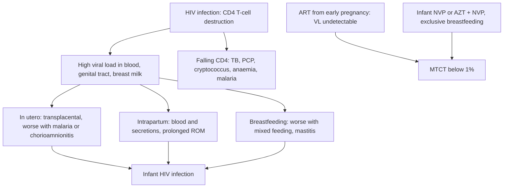
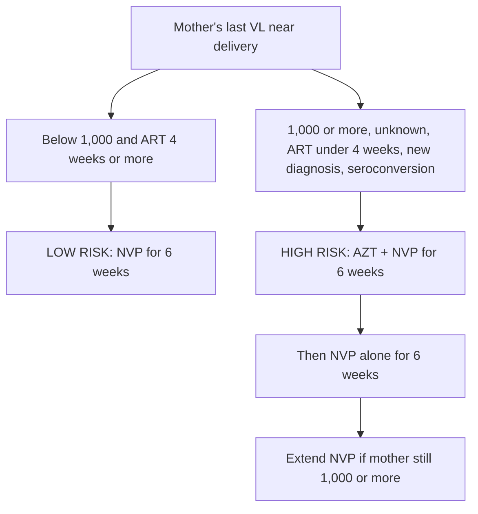

## 1. Definition

**HIV in pregnancy is an eMTCT problem** (elimination of mother-to-child transmission). The virus can pass to the baby **in utero, during labour and delivery, and through breastfeeding**. The whole strategy boils down to one idea: **get the mother's viral load undetectable as early as possible and keep it there until breastfeeding ends**, and cover the baby with prophylaxis during the window of highest risk.

In Uganda that means:

1. **Test** every pregnant woman at the first ANC visit (HIV/syphilis dual test plus HBsAg: the **triple elimination** package) and **retest** those who are negative.
2. **Treat** every woman with HIV with lifelong **TLD** the **same day** (test-and-treat, formerly called Option B+).
3. **Monitor** viral load every 3 months through pregnancy and breastfeeding.
4. **Protect the baby**: risk-based prophylaxis, early infant diagnosis (EID), co-trimoxazole and safe infant feeding.

| Term | Meaning |
|---|---|
| **MTCT / vertical transmission** | Transmission of HIV from mother to child during pregnancy, labour/delivery or breastfeeding |
| **eMTCT** | Uganda's programme to eliminate MTCT; the target is fewer than 50 new paediatric infections per 100,000 live births and a final transmission rate below 5% in breastfeeding populations |
| **Triple elimination** | Integrated elimination of vertical transmission of **HIV, syphilis and hepatitis B** |
| **Option B+ / test-and-treat** | Lifelong ART for every pregnant or breastfeeding woman with HIV, regardless of CD4 or clinical stage |
| **HIV-exposed infant (HEI)** | Any infant born to a mother living with HIV, until HIV infection is excluded after breastfeeding ends |
| **Viral suppression** | VL below 1,000 copies/mL (the programme threshold). **Undetectable** = below the assay's detection limit (usually below 50 copies/mL). **Low-level viraemia** = detectable but below 1,000 copies/mL |
| **Non-suppressed / unsuppressed** | VL of 1,000 copies/mL or more; triggers intensive adherence counselling (IAC) and a repeat VL |
| **High-risk HEI** | Infant at raised risk of infection (section 5); gets enhanced prophylaxis (AZT + NVP) |
| **Advanced HIV disease (AHD)** | CD4 below 200 cells/mm³ or WHO clinical stage 3 or 4 |
| **EID** | Early infant diagnosis by DNA PCR, because maternal antibodies make antibody tests unreliable until about 18 months |

> [!PEARL]
> The one thing never to forget: **the infant's risk is set by the mother's most recent viral load.** Before every delivery of an HIV-positive woman, ask "What was her last viral load, and when?" The answer decides whether the baby gets NVP alone or AZT + NVP.

## 2. Epidemiology

- **Transmission without and with intervention**: without any intervention MTCT is **15–45%**; with a suppressed maternal viral load throughout pregnancy and breastfeeding it is **below 1%**.
- Uganda has one of the largest HIV epidemics in East Africa, with adult prevalence of roughly **5–6%**, and it is **higher in women** than in men [VERIFY: figure against the latest UPHIA/UNAIDS estimate]. Young women aged 15–24 carry a disproportionate share of new infections, which is exactly the age group filling our antenatal clinics.
- Uganda was one of the first countries to adopt **Option B+ in 2012**. Coverage of ART among HIV-positive pregnant women is now very high, and Uganda has recorded a large reduction in new infections among newborns.
- The **remaining infections** come mainly from: women who **seroconvert during pregnancy or breastfeeding** (they tested negative at booking); women who **disengage from care** (especially postpartum); **non-suppressed** women with poor adherence; and **missed EID** so infected infants are found late.
- HIV services are integrated in ANC at HC III and above. **Point-of-care (POC) viral load and POC EID** machines are available at many HC IVs and hospitals; elsewhere samples go by the national **hub transport system** to CPHL, and results can take weeks. That delay is why you must plan ahead: order the VL early.
- **Dual HIV/syphilis rapid tests** have dramatically increased syphilis screening in ANC; **HBsAg testing** is being scaled up but is less consistently available.

> [!UGANDA]
> In Uganda the HIV-positive mother is usually managed in the **eMTCT/ART clinic** within the ANC, with a **"mother-baby pair" follow-up** until the baby's final HIV status is known. As a clerk, check her **ART card / HMIS register**: regimen, start date, last VL and date, adherence and TB screening are recorded there.

## 3. Aetiology and Risk Factors

**Cause**: infection with the human immunodeficiency virus (in Uganda almost all HIV-1), a retrovirus that infects CD4 T cells. Women acquire it mainly through heterosexual sex; the baby acquires it from the mother.

**Risk factors for a woman acquiring HIV in pregnancy or breastfeeding** (these are the women to offer PrEP and to retest)

- HIV-positive partner who is **not suppressed or of unknown status** (serodiscordant couple).
- Multiple partners, sex work, a **recent STI**.
- Partner at high risk (e.g. fishing communities, truck drivers).
- Young age (15–24 years).

**Risk factors for transmission to the baby**

| Factor | Why it raises risk |
|---|---|
| **High maternal viral load** (not on ART, non-suppressed, **acute seroconversion**) | More virus in blood, genital secretions and breast milk; the single biggest determinant |
| **Late ART start** (less than 4 weeks before delivery) | No time to suppress |
| **Advanced HIV disease** | High VL, opportunistic infections |
| **Placental inflammation**: malaria, chorioamnionitis | Breaks the placental barrier (in utero transmission) |
| **Prolonged rupture of membranes**, prolonged labour, ARM, episiotomy, scalp electrodes, instrumental delivery | Longer and greater exposure to maternal blood and secretions |
| **Genital infections** (ulcers, syphilis, herpes, discharge) | Raise genital VL |
| **Mixed feeding** in the first 6 months | Damages the infant gut barrier |
| **Mastitis, cracked nipples, infant oral thrush** | Raise breast-milk virus and breach the infant mucosa |
| **Disengagement from care postpartum** | VL rebounds while the baby is still breastfeeding |

**Causes of a non-suppressed viral load** (the commonest problem on the ward): poor adherence (most common), recent ART start, drug interactions (rifampicin, anticonvulsants, iron/calcium/antacids taken with DTG), vomiting or malabsorption (hyperemesis, diarrhoea), and, least often on DTG, drug resistance (section 7).

## 4. Pathophysiology

### How, and when, the baby gets infected

| Timing | Approx. share of infections without intervention | Mechanism | What reduces it |
|---|---|---|---|
| **In utero** | 5–10% | Transplacental passage, especially with high maternal VL, placental inflammation (malaria, chorioamnionitis) | Early ART, VL suppression, malaria prevention |
| **Intrapartum** | 10–20% (the largest single window) | Baby exposed to maternal blood and cervicovaginal secretions; microtransfusions during contractions; swallowing secretions | Suppressed VL, avoiding prolonged ROM, invasive procedures, episiotomy; infant prophylaxis |
| **Breastfeeding** | 5–20% over 18–24 months | Cell-free and cell-associated virus in breast milk; risk higher with mastitis, cracked nipples, oral thrush in baby, **mixed feeding** | Maternal ART with suppression, exclusive breastfeeding, infant NVP |

### Why viral load matters so much

The amount of virus in maternal blood and genital secretions determines exposure. Transmission risk rises steeply with VL: at undetectable VL on ART from before conception, transmission is close to zero. That is why the **timing of ART start** matters: a woman who starts ART at 12 weeks has months to suppress before delivery; a woman diagnosed at 36 weeks does not, and her baby is automatically **high-risk**.

### Why "mixed feeding" is dangerous

Other foods and fluids (water, formula, porridge) in the first 6 months **damage the infant's gut mucosa** and cause inflammation, allowing HIV in breast milk to cross the gut wall. Exclusive breastfeeding keeps the gut barrier intact. That is the physiological reason behind "exclusive, never mixed."

### Why DTG is preferred

**Dolutegravir (DTG)** is an **integrase inhibitor**. It lowers VL faster than efavirenz (important in late-presenting women), has a **high genetic barrier to resistance**, and is well tolerated. An early signal of neural tube defects with DTG at conception (Botswana, Tsepamo study) fell on further follow-up to a level very close to other ART, so WHO and Uganda now recommend DTG for **all** adults, including women who are pregnant or may become pregnant. Give folic acid as for every pregnancy.

### Why pregnancy is a period of danger for the mother too

- Pregnancy itself does not accelerate HIV, but HIV increases **anaemia, malaria, TB, preterm birth, low birth weight, stillbirth and puerperal sepsis**.
- **TB** is a leading cause of death in HIV-positive pregnant women, and the classic symptom of "weight loss" is masked by pregnancy weight gain.
- Postpartum is the time women most often **drop out of care**, and VL rebounds. That rebound happens while the baby is still breastfeeding.

**Feature links**

- High maternal VL → more virus crossing the placenta and in genital secretions → in utero and intrapartum infection.
- Acute seroconversion in pregnancy → very high VL before antibodies form → very high transmission risk → retest negatives.
- Placental malaria or chorioamnionitis → placental inflammation → in utero transmission → malaria prevention matters (co-trimoxazole, ITN).
- Prolonged ROM, ARM, episiotomy, scalp electrodes → more exposure of the baby's skin and mucosa to maternal blood → intrapartum transmission.
- Mixed feeding → infant gut mucosal damage → HIV in breast milk crosses the gut → breastfeeding transmission.
- Mastitis, cracked nipples, infant thrush → more virus and breached mucosa → breastfeeding transmission.
- CD4 depletion → cell-mediated immune failure → TB, PCP, cryptococcal meningitis, oral thrush, Kaposi sarcoma, herpes zoster.
- HIV, malaria and (formerly) AZT → anaemia → pallor, fatigue, poor reserve for PPH.
- Chronic infection and opportunistic disease → poor maternal nutrition and placental function → FGR, low birth weight, preterm birth, stillbirth.
- Postpartum disengagement → ART stopped → VL rebound while breastfeeding → late infant infection.
- Starting ART in AHD → immune recovery against existing infection → IRIS (why ART is delayed in cryptococcal meningitis).
- Maternal IgG crosses the placenta → antibody test positive in every HEI up to about 18 months → infant diagnosis needs DNA PCR.

## 5. Classification / Staging

### WHO clinical staging (summary)

| Stage | Examples |
|---|---|
| 1 | Asymptomatic; persistent generalised lymphadenopathy |
| 2 | Weight loss below 10%, recurrent URTIs, herpes zoster, oral ulcers, papular pruritic eruptions |
| 3 | Weight loss above 10%, chronic diarrhoea or unexplained fever for more than 1 month, oral candida, **pulmonary TB**, severe bacterial infections |
| 4 | HIV wasting, PCP, **extrapulmonary TB**, cryptococcal meningitis, Kaposi sarcoma, toxoplasmosis, oesophageal candida |

**Advanced HIV disease** = CD4 below 200 cells/mm³ or WHO stage 3 or 4.

### Viral load categories

| VL (copies/mL) | Category | Action |
|---|---|---|
| **Below 50** | Undetectable | Continue; repeat every 3 months in pregnancy and breastfeeding |
| **50 to 999** | Low-level viraemia (suppressed by programme definition) | Adherence support |
| **1,000 or more** | **Non-suppressed** | IAC ×3, check interactions, repeat VL; baby high-risk if near delivery |

### Infant risk category

**High-risk HEI**: an infant whose mother

- was **diagnosed in late pregnancy, in labour, or during breastfeeding**; or
- had **less than 4 weeks of ART** before delivery; or
- had a **VL of 1,000 copies/mL or more** in the last 4 weeks before delivery (or **no VL result** available near delivery); or
- **seroconverted** during pregnancy or breastfeeding.

All other HEIs are **low-risk**.

## 6. Clinical Features

Most HIV-positive pregnant women are **well**. The clinical task is to find the opportunistic infection, the drug problem and the non-suppression, and to classify the baby's risk.

### History

Each item has a reason: if the answer changes nothing, you do not need to ask it.

| Question | Why it matters |
|---|---|
| **When were you diagnosed with HIV?** New today, earlier this pregnancy, or years ago? | New diagnosis needs counselling, disclosure support, same-day ART and baseline tests. Diagnosis in late pregnancy means a high-risk infant |
| **When did you start ART, which regimen, any changes?** TLD, TLE400, ABC-based? | Less than 4 weeks of ART before delivery = high-risk infant. Past regimen changes suggest past treatment failure |
| **Last viral load: result AND date?** | The most important question. Decides infant prophylaxis and whether IAC is needed. A suppressed VL from 9 months ago is not reassuring |
| **Adherence**: doses missed in the last month (use a calendar), who reminds you, where you keep your drugs, vomiting (hyperemesis), stock-outs, alcohol, depression | Adherence is the main cause of non-suppression. Probe non-judgementally |
| **Disclosure, partner status, safety**: has your partner tested? on ART or PrEP? any violence? | Partner testing, discordance (partner may need PrEP), social support, safety (intimate partner violence), adherence |
| **TB symptom screen**: cough, fever, night sweats, poor weight gain | At **every** visit. Any one positive = investigate; TB drugs change the DTG dose |
| **Neurological**: headache, confusion, neck stiffness, fits | Cryptococcal or TB meningitis: **defer** ART start (section 9) |
| **Rash, jaundice, vomiting, abdominal pain** | Drug toxicity; hepatitis B flare |
| **Other medicines**: rifampicin, anticonvulsants, iron/calcium/antacids, metformin | **Drug interactions with DTG** cause non-suppression |
| **On co-trimoxazole?** | If yes, **no IPTp-SP**; give an ITN |
| **Triple elimination results**: syphilis (treated? how many doses?), HBsAg | Decides the penicillin course, TDF-based ART, and the HBV birth dose |
| **Gestational age and dating**: LNMP, early scan | Decides when the pre-delivery VL is due (around 34–36 weeks) |
| **Previous children**: HIV status, EID results, feeding | A previously infected child suggests previous poor control; shows how well she knows the programme |
| **Birth and feeding plan**: where she will deliver, exclusive breastfeeding | Ensures prophylaxis is ready and feeding is safe |

### Examination

Follow the order of Hutchison's Clinical Methods (24th edition), with the obstetric abdominal examination. A sick or labouring woman gets the ABCDE assessment first (section 9).

#### Introduction, consent and preparation

- Introduce yourself, confirm her identity and gestation, explain the examination and gain consent; offer a chaperone for abdominal, breast and genital examination. Respect confidentiality: do not discuss her status in front of relatives unless she has disclosed to them.
- **Hand hygiene** (and standard precautions; gloves for genital examination).
- **Position and exposure**: sitting, then semi-recumbent with **left lateral tilt** for the abdomen; expose only what you are examining.

#### General inspection and vital signs

| Sign | Mechanism | What it means |
|---|---|---|
| Well or unwell; breathlessness | Pneumonia, PCP, TB, anaemia | Sick woman: ABCDE first |
| **Wasting**, poor weight gain (track the trend) | Chronic infection, TB, poor intake | TB until proven otherwise; WHO stage 3–4 |
| **Pallor** | HIV, malaria, previous AZT, iron deficiency | Anaemia: Hb, iron, plan for PPH |
| **Jaundice** | Drug-induced hepatitis, HBV flare, malaria | LFTs, HBsAg |
| Skin: **Kaposi sarcoma**, herpes zoster scars, papular pruritic eruption | Immunosuppression | WHO stage 2–4 |
| Confusion, drowsiness | Meningitis (cryptococcal, TB), cerebral malaria, sepsis | Urgent CrAg, LP, mRDT |

**Vital signs**: pulse, **BP** (HIV-positive women also get pre-eclampsia), RR, **temperature** (fever: malaria first), **SpO₂** if breathless (a clear chest with low SpO₂ suggests PCP); weight and BMI.

#### Hands, face and neck

- Hands: clubbing (chronic lung disease, TB), palmar pallor, nail candida.
- Face and mouth: conjunctival pallor, scleral jaundice, **oral thrush**, **oral hairy leukoplakia**, oral ulcers, parotid enlargement.
- Neck: **lymphadenopathy** (persistent generalised lymphadenopathy versus large, matted or tender TB nodes), **neck stiffness** (meningitis).

#### Chest

Crackles, bronchial breathing, effusion (TB, pneumonia); clear chest with low SpO₂ suggests PCP.

#### Obstetric abdominal examination

- **Inspection**: size for dates, scars; liver or spleen visible.
- **Palpation**: liver tenderness (hepatitis), uterine tenderness (chorioamnionitis).
- **Fundal height (SFH) versus dates**: **growth restriction is more common**.
- **Lie and presentation**.
- **Engagement** (fifths palpable).
- **Auscultation of the fetal heart** for a full minute (fetal tachycardia with maternal fever suggests chorioamnionitis).

#### Neurological

Neck stiffness, focal deficits (meningitis, toxoplasmosis), GCS.

#### Completing the examination

- **Genital (speculum where indicated)**: ulcers (syphilis, herpes), warts, discharge. Genital infections raise genital VL and transmission risk.
- **In labour**: cervical dilatation, membranes intact or ruptured and **for how long**, liquor colour. Time of ROM matters: plan to shorten the interval to delivery.
- **Bedside tests**: urine dipstick, Hb, mRDT if febrile, rapid tests (section 8).
- Thank her, hand hygiene, summarise.

**Document (positives and key negatives)**

| Area | Model documentation |
|---|---|
| General | "Not pale, no jaundice, no oral thrush, no lymphadenopathy, weight 64 kg (up 2 kg in 4 weeks)" |
| Chest | "Chest clear, SpO₂ 98% on air" |
| Neurological | "No neck stiffness, GCS 15" |
| Obstetric | "SFH 34 cm at 35 weeks, cephalic, FHR 140" |
| Genital | "No ulcers, no abnormal discharge" |

### Red flags

> [!REDFLAG]
> - **Cough for 2 weeks or more, fever, night sweats, failure to gain weight**: TB until proven otherwise; do GeneXpert.
> - **Headache, fever, confusion, neck stiffness**: cryptococcal or TB meningitis; do CrAg, LP; defer ART start by 4–6 weeks for cryptococcal meningitis.
> - **Breathlessness with dry cough and desaturation** (SpO₂ below 94%, RR above 30): PCP, pneumonia or TB.
> - **Jaundice, vomiting, right upper quadrant pain** after starting ART: drug-induced hepatitis or HBV flare.
> - **Fever ≥38.0°C**: malaria first, then pyelonephritis, chorioamnionitis, pneumonia, TB.
> - **VL of 1,000 copies/mL or more in the third trimester**: high-risk infant; urgent adherence intervention.
> - **Newly diagnosed in labour or postpartum**: the baby is high-risk; start mother on TLD and baby on AZT + NVP now, not tomorrow.
> - **Advanced HIV disease** (CD4 below 200): needs CrAg screening, TB LAM, and close follow-up.

### Thinking like a clinician

- **"Positive test in pregnancy" is not the end of the history; it is the start.** Every HIV-positive pregnant woman on the ward should be summarised with four facts: **regimen, duration on ART, last VL (result and date), and adherence.** Then decide infant risk.
- **If VL is unknown near term, treat as high-risk.** Do not delay the baby's prophylaxis waiting for a result.
- **If the woman has been on ART for years and is now non-suppressed, think adherence first**, then drug interactions (for example, rifampicin, or iron taken with DTG), then resistance. On a DTG regimen, resistance is uncommon.
- **Negative at booking does not mean negative at delivery.** Seroconversion in pregnancy carries a very high transmission risk because acute HIV produces enormous viral loads. That is why we **retest**.
- **Fever in an HIV-positive pregnant woman in Uganda**: malaria, UTI/pyelonephritis, pneumonia, TB, chorioamnionitis, puerperal sepsis, meningitis. Always do an mRDT/blood smear first.
- **Weight loss is hidden by pregnancy**: a woman who is "not gaining" may be losing; plot the weight trend.
- **Common student mistakes**:
  1. Forgetting that **co-trimoxazole and IPTp-SP must not be combined**.
  2. Recommending caesarean section "because she is HIV-positive". Not in Uganda unless there is an obstetric indication.
  3. Forgetting to ask the **date** of the last VL (a suppressed VL 9 months ago is not reassuring).
  4. Advising formula feeding. Uganda recommends breastfeeding with ART.
  5. Saying the infant needs an antibody test at 6 weeks. Antibodies are maternal until about 18 months; use **DNA PCR**.

> [!PEARL]
> Before you present an HIV-positive woman, say the **four facts** (regimen, time on ART, last VL with date, adherence) and then say the **infant risk category out loud**. That is exactly what the consultant will ask for.

## 7. Differential Diagnoses

This topic is about managing a known diagnosis, so the useful differentials are **the causes of a sick HIV-positive pregnant woman** and **the causes of a non-suppressed viral load**.

### The unwell HIV-positive pregnant woman

| Differential | Distinguishing clinical feature | Distinguishing investigation |
|---|---|---|
| Malaria | Fever, rigors, headache; any trimester | mRDT or blood smear |
| Pulmonary TB | Cough 2 weeks or more, night sweats, poor weight gain, haemoptysis | GeneXpert on sputum; TB LAM if CD4 below 200 or seriously ill; CXR with abdominal shielding |
| PCP | Subacute dry cough, breathlessness, desaturation on exertion, often not on CTX | SpO₂, CXR (bilateral interstitial), clinical response to high-dose co-trimoxazole |
| Bacterial pneumonia | Acute fever, productive cough, focal crackles | CXR, FBC |
| Cryptococcal meningitis | Headache, fever, reduced consciousness; CD4 below 100 | Serum CrAg, LP with CSF CrAg, opening pressure |
| Pyelonephritis | Fever, loin pain, dysuria | Urinalysis, urine culture |
| Chorioamnionitis / puerperal sepsis | Fever, uterine tenderness, offensive liquor/lochia, fetal tachycardia | FBC, blood culture, HVS |
| Drug-induced hepatitis / HBV flare | Jaundice, RUQ pain after ART start | LFTs, HBsAg |

### Why is the viral load not suppressed?

| Cause | Clues | Action |
|---|---|---|
| Poor adherence (most common) | Missed doses, pill counts off, stigma, non-disclosure, hyperemesis | IAC, treatment supporter, address barriers |
| Recently started ART | Started less than 3 months ago | Recheck at 3 months after start |
| Drug interaction | Rifampicin, carbamazepine/phenytoin, iron/calcium/antacids taken with DTG | Adjust DTG dose or timing |
| Vomiting / malabsorption | Hyperemesis, diarrhoea | Antiemetics, treat cause |
| Drug resistance | Persistent non-suppression despite verified adherence | Discuss with ART clinic/switch committee; resistance testing where available |

## 8. Clinical Workup

The workup of a woman with HIV in pregnancy has two jobs: **keep the mother well** (find the opportunistic infection, the drug problem, the non-suppression) and **classify the baby's risk** before delivery. Most of this happens in the eMTCT clinic, but the same steps apply when she is admitted to the antenatal ward or arrives in labour. "Available at" reflects the source notes [VERIFY: availability compiled from the source notes, not an MoH list].

### Bedside

| Test (minutes, on the ward or in the clinic) | Why / expected finding | Available at |
|---|---|---|
| **HIV rapid tests** (national serial algorithm: screening test, then confirmatory test, then tie-breaker; the kits change, so follow the current algorithm) | Diagnosis. A single reactive screening test is **not** a diagnosis. Always confirm a first positive; retest before ART start per programme rules to avoid misdiagnosis | HC II upwards |
| **Dual HIV/syphilis RDT** | Syphilis screen. The treponemal test **stays positive after treatment**, so ask about past treatment before re-treating | HC II/III upwards |
| **HBsAg RDT** | Chronic HBV: TDF-containing regimen, HBV birth dose within 24 hours | HC III upwards where stocked |
| **Point-of-care CD4** (semi-quantitative, available at many sites) | Above or below 200 cells/mm³: identifies advanced HIV disease the same day | Many HC IVs and hospitals |
| **Serum CrAg lateral-flow test** | If CD4 is 200 or below: positive without meningitis = pre-emptive fluconazole (senior advice in the first trimester) | HC IV and hospitals |
| **Urine TB LAM** | CD4 below 200 or seriously ill: a positive result allows TB treatment the same day | HC IV and hospitals |
| **mRDT** | Every fever. Co-infection increases placental inflammation and transmission | All levels |
| **HemoCue / Hb** | Anaemia (HIV, malaria, previous AZT) | HC III upwards |
| **Urine dipstick** | Protein (pre-eclampsia, TDF kidney effect), nitrites/leucocytes (UTI), glucose | All levels |
| **RBS** | If symptoms or risk factors; DTG may modestly raise glucose; interaction with metformin | HC III upwards |
| **Fetal heart / CTG / partograph** | Fetal wellbeing; in labour, plot on the partograph and avoid prolonged labour | All levels (CTG at hospitals) |

### Basic lab

| Test | When | Expected / abnormal finding | How it changes management (and where) |
|---|---|---|---|
| **Viral load** | First ANC visit if already on ART; **3 months after starting ART**; then **every 3 months** until breastfeeding ends; make sure one is available at **34–36 weeks** | Below 50 = undetectable; 50–999 = low-level viraemia; **1,000 or more = non-suppressed** | Non-suppressed: IAC ×3, check interactions, repeat VL; **baby high-risk** if not suppressed near delivery. POC VL at many HC IVs and hospitals; otherwise DBS/plasma via the hub to CPHL (results can take weeks, so **order early**) |
| **CD4 count** | Baseline at diagnosis; if unwell or re-engaging after defaulting | Below 200 = advanced HIV disease | CrAg, TB LAM, closer follow-up; CTX is already given to all pregnant women. Full CD4 counts mainly at hospitals; POC CD4 at many HC IVs |
| **FBC** | Booking, then per ANC schedule; any fever | Anaemia; neutropenia/anaemia if on AZT; raised WBC in sepsis | Iron, transfusion planning, change AZT. HC IV upwards |
| **Creatinine / eGFR** | Baseline where available, especially before TDF; on TDF-based PrEP | CrCl below 50 mL/min | Switch TDF to ABC-based regimen (**check HBsAg first**). Regional/national referral mostly |
| **LFTs** | Jaundice, vomiting, RUQ pain, HBsAg-positive | Raised ALT/AST, bilirubin | Drug-induced hepatitis versus HBV flare; stop the offending drug only with senior advice (do not stop TDF abruptly in HBV). Hospital level |
| **Blood group and Rh** | Booking | Rh-negative | Anti-D plan. HC IV upwards |
| **Urine culture** | Dipstick positive or symptoms | Significant growth | Treat UTI/pyelonephritis. Hospital level |
| **Blood glucose** | Where indicated | Hyperglycaemia | DTG can modestly raise glucose; interaction with metformin |
| **Infant DNA PCR** | 4–6 weeks, 9 months, 6 weeks after breastfeeding stops (± at birth in high-risk infants where available) | Positive | Start ART the same day and send a confirmatory sample. Antibody tests are unreliable before 18 months because of maternal IgG. DBS from HC III upwards; POC EID at many HC IVs and hospitals |

> [!UGANDA]
> The **1,000 copies/mL** cut-off is the long-standing Uganda programme threshold for "non-suppressed", and it is what the rest of these notes use. Newer WHO guidance puts more emphasis on reaching **below 50** (undetectable) and treats **50–999** as low-level viraemia that still needs adherence support; some units act at **200**. Check the current Uganda Consolidated Guidelines and your clinic's rule, and flag any detectable VL near term to a senior.

### Imaging

| Test | When | Expected finding | How it changes management (and where) |
|---|---|---|---|
| **Chest X-ray (with abdominal shielding)** | Respiratory symptoms, suspected TB/PCP | Cavities, effusion, miliary pattern (TB); bilateral interstitial shadows (PCP) | Pregnancy is **not** a reason to withhold a needed CXR. Hospital level |
| **Obstetric ultrasound** | Dating, growth concerns | FGR, oligohydramnios | Fetal surveillance, timing of delivery. HC IV and hospitals |

### Specialised / referral-level

| Test | When | Expected / abnormal finding | How it changes management (and where) |
|---|---|---|---|
| **Serum CrAg (± LP with CSF CrAg)** | CD4 200 or below; any headache/confusion | Positive | Pre-emptive fluconazole, or LP and induction therapy if meningitis. **Delay ART 4–6 weeks** in cryptococcal meningitis. LP at hospital level |
| **GeneXpert (sputum)** | Any positive TB symptom screen | MTB detected ± rifampicin resistance | Start TB treatment; **DTG 50 mg twice daily** while on rifampicin and for 2 weeks after; TPT only once TB is excluded. HC IVs and hospitals via the hub |
| **HBV DNA / HBeAg** | HBsAg-positive (where available) | HBV DNA 200,000 IU/mL or more, or HBeAg-positive | TDF from about 28 weeks is a priority; where unavailable, many programmes offer TDF to all HBsAg-positive women. Rarely available outside national referral level |
| **HIV drug-resistance test** | Persistent non-suppression despite verified good adherence | Resistance mutations | Via the **switch committee**; sample to CPHL |

### Putting it together

**Model one-line summary**

> "A 24-year-old G2P1 at 35 weeks, HIV-positive diagnosed at booking at 20 weeks, on TLD for 15 weeks, with a VL of 2,400 copies/mL at 33 weeks, self-reports missing 'some' doses, co-trimoxazole prophylaxis, HBsAg and syphilis negative, TB screen negative, clinically well."

**Problem list**

1. HIV in pregnancy, **non-suppressed** VL in the third trimester.
2. **High-risk HIV-exposed infant** anticipated.
3. Adherence barriers to explore (disclosure, stigma, iron timing with DTG).
4. Routine ANC at 35 weeks (birth plan, feeding plan).

**Working diagnosis**: HIV infection on first-line TLD with non-suppression, most likely from poor adherence (recent start, missed doses) rather than resistance.

**Model case presentation (ward round)**

> "Mrs N is a 26-year-old G3P2+0 at 36 weeks by dates, known HIV-positive since 2019, on **TLD for 5 years**, with a **last VL of below 50 copies/mL in June** (3 months ago), good self-reported adherence and no missed doses. She is on **co-trimoxazole 960 mg daily** and therefore not on IPTp. HBsAg and syphilis negative this pregnancy. TB screen negative. She has disclosed to her husband, who is HIV-negative and on PrEP. Obstetrically she is well, SFH corresponds to dates, cephalic, fetal heart normal. **Plan**: repeat VL now so it is available at delivery; facility delivery; if VL remains suppressed the baby is **low-risk** and will receive **NVP 15 mg once daily for 6 weeks**, first PCR at 6 weeks; exclusive breastfeeding."

**Worked example 1: reading a VL/CD4/HBsAg panel** (the 24-year-old above)

| Result | What it means |
|---|---|
| VL at 33 weeks: **2,400 copies/mL** | Non-suppressed (1,000 or more). Only 13 weeks on ART, so partly "not yet suppressed", but missed doses too |
| Baseline CD4: **310 cells/mm³** | Not advanced HIV disease; CrAg not required by the CD4 rule |
| HBsAg: **negative** | No HBV action; routine infant immunisation |
| Syphilis: **negative** | Retest is not routine, but treat if there is a new genital ulcer |

**Plan**:

1. Start **intensive adherence counselling** today (session 1), with a treatment supporter; check that ferrous sulphate is taken **2 hours after or 6 hours before** DTG, or together with food.
2. Look for other interactions (rifampicin, anticonvulsants): none.
3. **Repeat VL** early so a result is available before delivery (the clinic may repeat within about 4 weeks late in pregnancy rather than waiting the full 3 months).
4. **Classify the baby as high-risk** unless a VL below 1,000 copies/mL is available from the last 4 weeks before delivery: **AZT + NVP for 6 weeks, then NVP alone for 6 weeks**; if she weighs 2.5 kg or more, both drugs at **15 mg (1.5 mL)**.
5. Consider a birth PCR for the baby where available; first routine PCR at 4–6 weeks.
6. Facility delivery; avoid prolonged ROM, routine ARM and episiotomy. Mode of delivery by obstetric indication.

**Worked example 2: new diagnosis in labour**

A 19-year-old primigravida at 38 weeks, 6 cm dilated, **no ANC**. Rapid HIV test: screening test reactive, confirmatory test reactive. POC CD4 **below 200**. HBsAg **reactive**. Syphilis RDT **reactive**.

| Finding | Interpretation | Action |
|---|---|---|
| HIV positive, no ART | Untreated, high VL likely; ART under 4 weeks before delivery | **TLD now**; baby **high-risk**: AZT + NVP within 6 hours of birth, 12 weeks in total |
| CD4 below 200 | Advanced HIV disease | Serum CrAg and urine TB LAM; TB symptom screen; co-trimoxazole 960 mg daily; ask about headache |
| HBsAg positive | HIV/HBV co-infection | TLD already contains TDF + 3TC, which treat HBV. **Never use an ABC-based regimen alone**. Baby: **HBV birth-dose vaccine within 24 hours** (± HBIG where available) |
| Syphilis RDT positive, never treated | Untreated syphilis, duration unknown | **Benzathine penicillin 2.4 MIU IM weekly × 3** (start now). Examine the baby for congenital syphilis and treat the newborn per the paediatric protocol, because treatment less than 30 days before delivery does not protect the fetus |

## 9. Management

### Immediate / emergency

**First 5 minutes (sick or labouring woman)**

1. **Is she sick or in labour?** Check **pulse, BP, RR, temperature, SpO₂**, level of consciousness, and whether she is contracting or bleeding. Work out the shock index (HR ÷ SBP; ≥0.9 is abnormal) if she is bleeding.
2. **Danger signs that need a senior now** (ABCDE):
   - **A/B**: **breathless with SpO₂ below 94%**, or RR above 30: PCP, pneumonia or TB. Oxygen, sit her up, call for help.
   - **C**: bleeding or shock: shock index, IV access, resuscitate as for any obstetric emergency.
   - **D**: **headache with fever, confusion or neck stiffness**: cryptococcal or TB meningitis. Do not start ART today; arrange CrAg and LP.
   - **E**: **fever ≥38.0°C**: mRDT or blood smear first, then look for pyelonephritis, chorioamnionitis, pneumonia, TB. **Jaundice, vomiting, RUQ pain**: drug-induced hepatitis or an HBV flare.
3. **In labour?** Ask straight away: **"Are you on ART? Did you take today's dose? What was your last viral load, and when?"** If her status is **unknown**, do the rapid HIV test now; do not wait for the ward round.
4. **Start at once**: if newly positive in labour, give **TLD now** and make sure **AZT + NVP syrup** is on the ward for the baby. If she is known positive, make sure she has **taken today's TLD** (even on the day of CS) and the infant syrups are ready.

**Staff exposure**: standard precautions for staff; post-exposure prophylaxis (**TLD for 28 days**) after a needlestick.

### Definitive

#### 1. Testing in ANC (triple elimination)

1. **Offer HIV/syphilis dual test and HBsAg at the first ANC visit** (provider-initiated, opt-out, with pre-test information and post-test counselling). Test the **partner** too (couple testing, assisted partner notification).
2. **If HIV-negative**: counsel on prevention; **retest in the third trimester** (or in labour/immediately postpartum if missed), and continue periodic retesting during breastfeeding (at the 6-week postnatal visit and then according to the national schedule). Offer **PrEP** if at substantial risk.
3. **If HIV-positive**: confirm with the national algorithm, then **start ART the same day** after counselling (see below).
4. **If syphilis-positive**: treat on the spot (subsection 5) and treat the partner.
5. **If HBsAg-positive**: link to hepatitis care; decide on TDF (subsection 5); plan the infant's birth-dose vaccine within 24 hours.

> [!UGANDA]
> **Retesting HIV-negative women is part of eMTCT.** Women who seroconvert in pregnancy or breastfeeding now account for a large proportion of infant infections in Uganda. A booking test is not enough; retest in the third trimester, in labour if missed, and during breastfeeding.

#### 2. Starting ART (all settings, HC III upwards)

1. **Counsel** (diagnosis, lifelong treatment, benefits for her and the baby, disclosure, partner testing, adherence). Identify a **treatment supporter**.
2. **Baseline tests**: CD4, HBsAg, syphilis, Hb, creatinine if available, TB screen, CrAg if CD4 200 or below. **Do not delay ART for results** except where meningitis is suspected.
3. **Start TLD the same day** (rapid ART initiation), or within 7 days at most.
4. **Screen for TB** before starting TB preventive therapy; if symptomatic, investigate first.
5. **Give co-trimoxazole prophylaxis** per national guidance (all HIV-positive pregnant and breastfeeding women in Uganda are eligible) and **do not give IPTp-SP**.
6. **Continue routine ANC**: ferrous sulphate + folic acid (timed away from DTG), tetanus-diphtheria vaccine, mebendazole after the first trimester, ITN.
7. **Schedule the first VL at 3 months after starting ART.**

**ART regimens**

| Situation | Regimen | Dose | Notes |
|---|---|---|---|
| **Preferred first-line** (all, including pregnant and breastfeeding women) | **TLD**: tenofovir DF + lamivudine + dolutegravir | TDF 300 mg / 3TC 300 mg / DTG 50 mg, **one tablet orally once daily** | Rapid suppression, high resistance barrier; treats HBV too |
| DTG not suitable (intolerance, unmanageable interaction) | **TLE400**: TDF + 3TC + efavirenz 400 mg | One tablet once daily, at night | EFV causes vivid dreams/dizziness; **reduces implant efficacy**; lower resistance barrier |
| TDF contraindicated (CrCl below 50 mL/min) | **ABC + 3TC + DTG** | ABC 600 mg / 3TC 300 mg + DTG 50 mg once daily | ABC does **not** treat HBV; check HBsAg |
| On rifampicin-based TB treatment | TLD **plus an extra DTG 50 mg** | DTG 50 mg **twice daily** | Continue twice daily until **2 weeks after** stopping rifampicin |
| Already on another suppressed regimen when she conceives | **Continue** | | Transition to TLD per programme; do not interrupt |

> [!DRUG]
> **DTG interactions you must know**
> - **Rifampicin** induces DTG metabolism: give **DTG 50 mg twice daily** during TB treatment and for 2 weeks after.
> - **Polyvalent cations** (iron, calcium, magnesium/aluminium antacids, zinc) chelate DTG in the gut: take DTG **2 hours before or 6 hours after** them, or take them together **with food**. Ferrous sulphate/folic acid tablets in ANC are the everyday example.
> - **Metformin**: DTG raises metformin levels; use the lowest effective metformin dose and monitor.
> - **Carbamazepine, phenytoin, phenobarbital**: reduce DTG levels; consult.

**When to delay ART**

- **Cryptococcal meningitis**: delay ART **4–6 weeks** after starting antifungal treatment (early ART raises mortality from immune reconstitution).
- **TB meningitis**: delay by about 4–8 weeks per specialist advice.
- **Pulmonary TB**: start TB treatment first, then ART **within 2 weeks** (sooner if CD4 is very low).

#### 3. Antenatal monitoring

| When | What |
|---|---|
| **Every visit** | Adherence check (missed doses, pill count), TB symptom screen, side effects, weight, BP, SFH, fetal heart, danger signs, CTX refill, disclosure/partner status |
| **Viral load** | **Already on ART at conception**: VL at the **first ANC visit**. **Started in pregnancy**: VL **3 months after starting**. Then **every 3 months until breastfeeding ends** |
| Around **34–36 weeks** | Make sure a recent VL is available to classify the baby's risk; if the last VL is non-suppressed or unknown, plan high-risk infant prophylaxis |
| Birth plan | Facility delivery; NVP (and AZT) syrup ready; infant feeding counselling |

**What to do with a non-suppressed VL (1,000 copies/mL or more)**

1. **Do not switch immediately.** Most non-suppression is adherence.
2. Start **intensive adherence counselling (IAC)**: at least 3 sessions, about a month apart. Explore barriers (stigma, non-disclosure, alcohol, depression, vomiting, pill burden, food, distance, intimate partner violence), set up a treatment supporter, directly observed doses if needed.
3. Check for **interactions** (rifampicin, iron timing, anticonvulsants).
4. **Repeat VL** after completing IAC (about 3 months after the first result; in late pregnancy the clinic may repeat sooner so the result is available before delivery).
5. If **still non-suppressed** despite good adherence: present to the **ART switch committee** (hospital level) for regimen change, with resistance testing where available.
6. Regardless of the repeat, **classify the baby as high-risk** if the VL near delivery is not suppressed.

> [!EXAM]
> VL thresholds: **below 50** = undetectable; **50 to 999** = low-level viraemia (suppressed by programme definition but needs adherence support); **1,000 or more** = non-suppressed (IAC then repeat).

#### 4. Opportunistic infection prevention

| Drug | Who | Dose | Notes |
|---|---|---|---|
| **Co-trimoxazole** | All HIV-positive pregnant and breastfeeding women (Uganda) | **960 mg orally once daily** | Protects against PCP, toxoplasmosis, malaria and bacterial infection. **Replaces IPTp-SP** |
| **Isoniazid preventive therapy (6H)** | HIV-positive, TB excluded | **Isoniazid 300 mg orally once daily for 6 months + pyridoxine 25 mg daily** | Preferred TPT in pregnancy; 3HP (isoniazid + rifapentine weekly for 12 weeks) has limited pregnancy data |
| **Fluconazole** (pre-emptive) | Positive serum CrAg without meningitis | Per national AHD guideline | High-dose fluconazole in the **first trimester is teratogenic**; seek senior advice |

> [!REDFLAG]
> **Never give IPTp-SP to a woman on co-trimoxazole.** Both are sulfonamide/antifolate drugs: combining them adds no benefit and raises the risk of severe skin reactions (Stevens-Johnson syndrome) and neonatal kernicterus. Co-trimoxazole itself protects against malaria. Give her an ITN.

#### 5. Syphilis and hepatitis B (triple elimination)

| Condition | Treatment | Dose | Notes |
|---|---|---|---|
| **Syphilis** (early, under 2 years) | **Benzathine penicillin G** | **2.4 million IU IM** (1.2 MIU in each buttock) **single dose** | Treat the partner. Treatment at least 30 days before delivery prevents most congenital syphilis |
| Syphilis, late or unknown duration | Benzathine penicillin G | 2.4 MIU IM **once weekly for 3 weeks** | Most ANC cases are of unknown duration |
| Penicillin allergy | Erythromycin | 500 mg orally 6-hourly for 14 days | Does not reliably treat the fetus: **treat the baby after birth** |
| **HBsAg-positive and HIV-positive** | TLD (TDF + 3TC treat HBV) | As above | Never use a regimen without TDF (e.g. ABC-based) without specialist input; stopping TDF can cause HBV flare |
| **HBsAg-positive, HIV-negative** | Tenofovir DF (prophylaxis to cut MTCT) | **300 mg orally once daily from about 28 weeks**, continued at least until delivery (often to 12 weeks postpartum) | Priority if HBV DNA is 200,000 IU/mL or more or HBeAg-positive; where these tests are unavailable, national/WHO guidance increasingly supports offering TDF to all HBsAg-positive pregnant women. Assess her own need for lifelong treatment |
| **Infant of HBsAg-positive mother** | Hepatitis B birth-dose vaccine (**within 24 hours**) ± HBIG where available | | Then the routine pentavalent series |

#### 6. PrEP in pregnancy and breastfeeding

- **Who**: HIV-negative pregnant or breastfeeding women at substantial risk: HIV-positive partner who is not suppressed or of unknown status, multiple partners, sex work, recent STI, partner at high risk (e.g. fishing communities, truck drivers).
- **What**: oral **TDF/FTC (or TDF/3TC) one tablet once daily**. Safe in pregnancy and breastfeeding. Protection takes about 7 days of daily dosing for vaginal exposure.
- **Monitoring**: HIV test before starting and **every 3 months**; creatinine where available; adherence; check HBsAg.
- If she seroconverts on PrEP, stop PrEP and start full ART (TLD) immediately.

#### 7. Intrapartum care

1. **Continue ART in labour**: she takes her usual TLD dose, even on the day of caesarean section.
2. **Unknown status in labour**: offer a rapid HIV test; if positive, **start TLD immediately** and classify the baby as high-risk.
3. **Use the partograph**, avoid prolonged labour.
4. **Avoid**:
   - **Prolonged rupture of membranes** (risk rises with each hour after about 4 hours);
   - **Routine artificial rupture of membranes** (do it only for a clear obstetric indication);
   - **Routine episiotomy**;
   - **Fetal scalp electrodes / scalp blood sampling**;
   - **Instrumental delivery** unless clearly indicated (if needed, ventouse or forceps may be used; weigh against the risk of CS);
   - **Unnecessary vaginal examinations**.
5. **Mode of delivery**: **vaginal delivery** is appropriate for almost all women; **caesarean section for obstetric indications**. In well-resourced settings, planned CS is offered when VL is high near term; in Uganda this is not routine policy and CS carries its own risks (sepsis, PPH, future uterine rupture). Discuss with the consultant if VL is very high at term.
6. **Active management of the third stage** as usual (oxytocin 10 IU IM).
7. **Newborn**: wipe (do not scrub) the baby; clamp the cord after 1–3 minutes as usual; suction only if needed; skin-to-skin; **start breastfeeding within 1 hour**; give **prophylaxis within 6 hours** (as soon as possible; benefit falls after 72 hours, but a late-presenting baby should still be started); vitamin K, eye prophylaxis, BCG and OPV-0; HBV birth dose.

> [!NOTE]
> Rupture of membranes before labour at term in an HIV-positive woman: **expedite delivery** (induce with oxytocin if favourable) rather than waiting, to shorten the exposure time.

#### 8. Infant prophylaxis

Risk category: section 5 (high-risk = late diagnosis, ART under 4 weeks, VL 1,000 or more or unknown in the last 4 weeks, seroconversion).

| Risk | Regimen | Duration |
|---|---|---|
| **Low-risk** | **NVP** once daily | **6 weeks** |
| **High-risk** | **AZT twice daily + NVP once daily** for **6 weeks**, then **NVP alone** for a further **6 weeks** | **12 weeks** in total. If the mother's VL at around 12 weeks postpartum is still 1,000 copies/mL or more, **continue NVP** until she is suppressed (or until 4 weeks after breastfeeding stops) |
| Mother diagnosed while breastfeeding | Start mother on TLD, give baby **AZT + NVP**, do a **DNA PCR now**; treat as high-risk | 12 weeks (as above) |

**Doses (WHO weight bands, as used in Uganda)**

| Age / weight | NVP (10 mg/mL syrup), once daily | AZT (10 mg/mL syrup), twice daily |
|---|---|---|
| Birth to 6 weeks, **2.0–2.49 kg** | **10 mg (1 mL)** | **10 mg (1 mL)** |
| Birth to 6 weeks, **2.5 kg or more** | **15 mg (1.5 mL)** | **15 mg (1.5 mL)** |
| **6 to 12 weeks** | **20 mg (2 mL)** | Not given (AZT stops at 6 weeks) |
| Extended NVP only (mother still non-suppressed): **12 weeks to 6 months** / **6–9 months** / **9 months to end of breastfeeding** | **25 mg** / **30 mg** / **40 mg** (WHO age bands; confirm with the national paediatric chart) [VERIFY: extended NVP age-band doses against the current Uganda paediatric dosing chart] | Not given |
| Below 2.0 kg | mg/kg dosing per national paediatric chart; discuss with the paediatrician | |

> [!DRUG]
> Start infant prophylaxis **as soon as possible after birth, ideally within 6 hours**. A baby born at night must not wait for the morning round. Show the mother how to measure the syrup with the syringe and give her enough to last until the next visit.

#### 9. Infant follow-up: EID, co-trimoxazole, feeding

**Early infant diagnosis (Uganda schedule)**

| When | Test |
|---|---|
| **4–6 weeks** (first immunisation visit) | **1st DNA PCR** (DBS or POC). High-risk infants may also have a PCR at birth where available |
| **9 months** | **2nd DNA PCR** |
| **6 weeks after complete cessation of breastfeeding** | **3rd DNA PCR** |
| **18 months** (18–24 months) | **Rapid antibody test** |
| Any time the child is unwell with signs suggestive of HIV | DNA PCR |

- **Any positive PCR**: start ART the same day, collect a **confirmatory DBS** at the same time.
- **Final status** is declared only after the last test done at least 6 weeks after all breastfeeding stops.

**Co-trimoxazole for the HEI**

- Start at **6 weeks** of age and continue until HIV infection is excluded after breastfeeding ends.
- Dose: **120 mg once daily** under 6 months; **240 mg once daily** from 6 months to 5 years.

**Infant feeding**

1. **Exclusive breastfeeding for the first 6 months**: no water, glucose water, herbs or formula.
2. **At 6 months** add appropriate complementary foods and **continue breastfeeding to at least 12 months** (and up to 24 months), provided the mother is on ART and adherent.
3. **Stop breastfeeding gradually** over about a month when she stops; the final PCR is 6 weeks later.
4. Replacement (formula) feeding only if it is **AFASS** (acceptable, feasible, affordable, sustainable and safe), which is rare in Uganda.
5. Treat **mastitis, cracked nipples and infant thrush** promptly (they raise breast-milk transmission).

> [!UGANDA]
> Unlike the UK (where formula feeding is advised for HIV-positive mothers), **Uganda and WHO recommend breastfeeding**, because in our setting the risks of diarrhoea, pneumonia and malnutrition from formula far outweigh the small transmission risk from a suppressed mother.

#### 10. Postpartum and long term

- Continue **TLD for life**; continue VL every 3 months while breastfeeding, then per adult schedule (every 6–12 months once stable).
- **Family planning**: DTG has **no interaction** with hormonal contraceptives. EFV reduces implant (and oral contraceptive) levels; advise an IUD, DMPA or condoms in addition.
- **Cervical cancer screening** (VIA or HPV test) as for all women with HIV.
- **Differentiated service delivery**: stable mothers can join community drug distribution points or fast-track refills once suppressed.
- Keep the **mother-baby pair** linked until the child's final status is known.

### Drug table

| Drug | Dose (adult; infant per weight band) | Route | Frequency | Duration | Key cautions |
|---|---|---|---|---|---|
| **TLD** (TDF 300 mg / 3TC 300 mg / DTG 50 mg) | One tablet | Oral | Once daily | Lifelong; start same day | Separate from iron/calcium/antacids (2 h before or 6 h after, or with food); TDF renal (CrCl below 50: switch to ABC); stopping TDF can flare HBV |
| **Extra DTG** (with rifampicin) | 50 mg (total DTG 50 mg twice daily) | Oral | 12 h after the TLD dose | Until 2 weeks after rifampicin stops | Rifampicin induces DTG metabolism |
| **TLE400** (TDF + 3TC + EFV 400 mg) | One tablet | Oral | Once daily, at night | Lifelong | Vivid dreams, dizziness; reduces implant and oral contraceptive efficacy |
| **ABC + 3TC + DTG** | ABC 600 mg / 3TC 300 mg + DTG 50 mg | Oral | Once daily | Lifelong | Does not treat HBV; check HBsAg |
| **Co-trimoxazole** (mother) | 960 mg | Oral | Once daily | Through pregnancy and breastfeeding (per national guidance) | **No IPTp-SP**; rash (SJS) |
| **Isoniazid + pyridoxine** (6H) | Isoniazid 300 mg + pyridoxine 25 mg | Oral | Once daily | 6 months | TB excluded first; hepatitis |
| **Fluconazole** (pre-emptive, CrAg-positive) | Per national AHD guideline | Oral | Daily | Per guideline | High dose teratogenic in the first trimester: senior advice |
| **Benzathine penicillin G** | 2.4 MIU (1.2 MIU each buttock) | IM | Single (early syphilis) or weekly | 1 dose, or 3 weeks (late/unknown) | Treat the partner; under 30 days before delivery does not protect the fetus |
| **Erythromycin** (penicillin allergy) | 500 mg | Oral | 6-hourly | 14 days | Does not treat the fetus: treat the baby |
| **Tenofovir DF** (HBsAg-positive, HIV-negative) | 300 mg | Oral | Once daily | From about 28 weeks to delivery (often 12 weeks postpartum) | Assess her own need for lifelong treatment |
| **TDF/FTC or TDF/3TC (PrEP)** | One tablet | Oral | Once daily | While at risk | HIV test every 3 months; about 7 days to protect; creatinine, HBsAg |
| **TLD (PEP)** | One tablet | Oral | Once daily | 28 days | Start as soon as possible after exposure |
| **Oxytocin** | 10 IU | IM | Once (third stage) | | Active management as usual |
| **Nevirapine syrup** (10 mg/mL), infant | 2.0–2.49 kg: 10 mg (1 mL); 2.5 kg or more: 15 mg (1.5 mL); 6–12 weeks: 20 mg (2 mL); extended: 25 / 30 / 40 mg by age band | Oral | Once daily | 6 weeks (low-risk); 12 weeks or longer (high-risk) | Start within 6 hours of birth; teach syringe measurement |
| **Zidovudine syrup** (10 mg/mL), infant | 2.0–2.49 kg: 10 mg (1 mL); 2.5 kg or more: 15 mg (1.5 mL) | Oral | Twice daily | 6 weeks (high-risk only) | Anaemia, neutropenia |
| **Co-trimoxazole** (infant) | Under 6 months: 120 mg; 6 months to 5 years: 240 mg | Oral | Once daily | From 6 weeks until HIV excluded after weaning | |
| **Hepatitis B birth-dose vaccine** (± HBIG) | Standard dose | IM | Once | Within 24 hours of birth | Then pentavalent series |

Under 2.0 kg: mg/kg dosing per the national paediatric chart; discuss with the paediatrician.

### Referral criteria

| Level | What should happen | Refer up when |
|---|---|---|
| **HC II / outreach** | Counselling, HIV/syphilis testing, referral/linkage; PrEP refill in some programmes | Every new positive → HC III for ART initiation |
| **HC III** | Full eMTCT: testing, TLD initiation, CTX, NVP, EID sample collection (DBS), VL sample collection via hub | Danger signs (breathless, headache with neck stiffness, jaundice, high fever), CD4 below 200 needing CrAg/LP, obstetric complications needing CS → HC IV |
| **HC IV** | As HC III, plus CS for obstetric indications, POC VL/EID in many sites, management of complications, AZT + NVP for high-risk infants | Advanced HIV disease needing LP, suspected cryptococcal or TB meningitis, persistent non-suppression for the switch committee, renal impairment, HBV with abnormal LFTs → General Hospital / RRH |
| **General / Regional Referral Hospital** | AHD management (CrAg, LP, TB LAM), switch committee for treatment failure, resistance testing, neonatal unit, complex co-morbidities (TB, HBV, renal disease) | Drug-resistant TB, complex resistance, HBV DNA testing, specialist care → NRH |
| **National Referral Hospital** | Specialist HIV, hepatitis, TB and neonatal care; HBV DNA | n/a |

### Monitoring and follow-up

- **Every ANC visit**: adherence, TB screen, side effects, weight, BP, SFH, fetal heart, CTX refill (table above).
- **Viral load**: first ANC visit (if on ART) or 3 months after start, then every 3 months until breastfeeding ends; recent result at 34–36 weeks.
- **Infant**: prophylaxis adherence; EID at 4–6 weeks, 9 months, 6 weeks after weaning, antibody at 18 months; co-trimoxazole from 6 weeks; growth and immunisation.
- **Postpartum**: VL every 3 months while breastfeeding, then every 6–12 months; family planning; cervical screening; mother-baby pair until final status.

## 10. Complications

**Disease-related**

| Maternal | Fetal / neonatal |
|---|---|
| Opportunistic infections: TB, PCP, cryptococcal meningitis | **HIV infection** (in utero, intrapartum, breastfeeding) |
| Anaemia | Preterm birth |
| Malaria (more frequent and severe, placental malaria) | Low birth weight / growth restriction |
| Puerperal sepsis, post-caesarean wound infection | Stillbirth |
| Depression, stigma, intimate partner violence after disclosure | Congenital syphilis, hepatitis B (co-infections) |
| Loss to follow-up postpartum | Missed EID and late diagnosis |
| | HIV-exposed-uninfected infants: slightly higher morbidity |

**Treatment-related**

| Complication | Cause | Recognition and action |
|---|---|---|
| Renal impairment | TDF | Creatinine; switch to ABC-based regimen (check HBsAg first) |
| Neuropsychiatric effects (vivid dreams, dizziness) | EFV | Take at night; switch to DTG |
| Hepatotoxicity | ART, TB drugs, co-trimoxazole | LFTs; senior advice before stopping drugs |
| Weight gain | DTG | Counsel; monitor |
| Immune reconstitution inflammatory syndrome (IRIS) | ART start in AHD | Delay ART in cryptococcal (4–6 weeks) and TB meningitis |
| Severe skin reactions, kernicterus risk | Co-trimoxazole combined with IPTp-SP | Never combine |
| HBV flare | Stopping TDF in HBV co-infection | Do not stop TDF abruptly |
| Infant anaemia, neutropenia | AZT | FBC if pale |

## 11. Prognosis

- **For the baby**: with a suppressed maternal VL throughout pregnancy and breastfeeding, transmission is **below 1%**; without intervention it is 15–45%.
- **For the mother**: on suppressive lifelong ART, a woman with HIV can expect a long life [VERIFY: no outcome figure given in the source notes]. Outcomes are worse with advanced HIV disease, TB and cryptococcal meningitis, and with disengagement from care postpartum.
- **HIV-exposed-uninfected infants** have slightly higher morbidity than unexposed infants.

## 12. Prevention

eMTCT is organised in four prongs (WHO framework) [VERIFY: Uganda programme wording]:

1. **Primary prevention of HIV in women of reproductive age**: testing, condoms, **PrEP** for women at substantial risk, partner testing, **retesting** in the third trimester, in labour if missed, and during breastfeeding.
2. **Prevention of unintended pregnancy among women with HIV**: family planning (DTG has no interaction with hormonal contraceptives; EFV lowers implant levels).
3. **Prevention of transmission from mother to child**: same-day TLD, VL monitoring, safe intrapartum practice, infant prophylaxis, exclusive breastfeeding.
4. **Care and support for the mother, child and family**: lifelong ART, EID, co-trimoxazole, differentiated service delivery, the mother-baby pair.

**Triple elimination**: syphilis (dual RDT and benzathine penicillin) and hepatitis B (HBsAg, TDF from about 28 weeks, birth-dose vaccine within 24 hours).

## 13. Special Populations

- **Newly diagnosed in labour or postpartum**: TLD now; baby high-risk (AZT + NVP within 6 hours); HBsAg and syphilis tests; link mother and baby to the eMTCT clinic.
- **Diagnosed while breastfeeding**: mother on TLD, baby AZT + NVP, **DNA PCR now**, high-risk for 12 weeks.
- **HIV/HBV co-infection**: TLD treats both; never an ABC-based regimen alone; do not stop TDF abruptly; HBV birth dose within 24 hours.
- **HIV/TB co-infection**: TB treatment first, ART within 2 weeks; **DTG 50 mg twice daily** with rifampicin and for 2 weeks after; TPT only after TB excluded.
- **Advanced HIV disease / cryptococcal meningitis**: CrAg, TB LAM; delay ART 4–6 weeks after antifungals; fluconazole in the first trimester needs senior advice.
- **Renal impairment** (CrCl below 50 mL/min): ABC + 3TC + DTG; check HBsAg first.
- **Serodiscordant couple**: partner on PrEP if the woman is not suppressed; HIV-negative woman with a positive partner gets PrEP and retesting.
- **Adolescent mothers**: young women aged 15–24 carry a disproportionate share of new infections; disclosure, adherence and retention are hardest [VERIFY: add adolescent-specific Uganda service guidance].

## 14. Key Points

### High-yield points

- Viral load is the single biggest determinant of transmission: MTCT 15–45% untreated, below 1% if suppressed.
- Test (HIV, syphilis, HBsAg) at booking and **retest** negatives.
- Same-day **TLD** for every pregnant or breastfeeding woman with HIV.
- VL at first ANC (if on ART) or 3 months after start, then every 3 months until weaning.
- Present the **four facts** and the **infant risk category**.
- High-risk infant: AZT + NVP 6 weeks, then NVP 6 weeks.
- PCR, not antibody, before 18 months.
- Exclusive breastfeeding for 6 months on ART; never mix-feed.
- Co-trimoxazole, so no IPTp-SP.
- CS only for obstetric indications.

### Numbers & doses

| Item | Value |
|---|---|
| MTCT risk, no intervention / suppressed on ART | **15–45%** / **below 1%** |
| TLD | TDF 300 mg + 3TC 300 mg + DTG 50 mg, **one tablet once daily**, start **same day** |
| DTG with rifampicin | **50 mg twice daily**, until **2 weeks after** rifampicin stops |
| DTG with iron/calcium/antacids | DTG **2 h before or 6 h after**, or together with food |
| VL schedule | First ANC visit (if on ART) or **3 months after start**, then **every 3 months** until breastfeeding ends |
| VL categories | Below 50 undetectable; 50–999 low-level viraemia; **1,000 or more non-suppressed** (programme cut-off; check local rule) |
| Advanced HIV disease | **CD4 below 200** or WHO stage 3–4 |
| Delay ART in cryptococcal meningitis | **4–6 weeks** after starting antifungals |
| Co-trimoxazole (mother) | **960 mg once daily**; no IPTp-SP |
| Isoniazid preventive therapy | **300 mg daily × 6 months + pyridoxine 25 mg daily** (TB excluded first) |
| Infant NVP / AZT, 2.5 kg or more | **15 mg (1.5 mL)** NVP once daily / **15 mg (1.5 mL)** AZT twice daily |
| Infant NVP / AZT, 2.0–2.49 kg | **10 mg (1 mL)** each |
| Infant NVP 6–12 weeks | **20 mg (2 mL)** once daily |
| Start infant prophylaxis | **Within 6 hours** of birth |
| Low-risk / high-risk infant prophylaxis | NVP **6 weeks** / AZT + NVP 6 weeks then NVP 6 weeks (**12 weeks**) |
| High-risk definition | ART **under 4 weeks**, VL **1,000 or more or unknown** in the last 4 weeks, late diagnosis, seroconversion |
| EID | DNA PCR **4–6 weeks, 9 months, 6 weeks after weaning**; antibody at **18 months** |
| Infant co-trimoxazole | From **6 weeks**: **120 mg** daily under 6 months, **240 mg** from 6 months |
| Syphilis | Benzathine penicillin **2.4 MIU IM** single (early) or **weekly × 3** (late/unknown) |
| HBsAg-positive, HIV-negative | TDF **300 mg daily from about 28 weeks**; baby HBV vaccine **within 24 hours** |
| PEP after needlestick | TLD for **28 days** |

### Exam traps

- **"Give IPTp-SP as usual."** Wrong: a woman on co-trimoxazole gets **no SP**. Co-trimoxazole protects against malaria; give an ITN.
- **"Do an HIV antibody test at 6 weeks."** Wrong: maternal IgG persists to about 18 months. Use **DNA PCR**.
- **"Plan an elective caesarean because she is HIV-positive."** Wrong in Uganda: CS is for **obstetric indications**.
- **"Switch to second line because the VL is 2,400."** Wrong first step: do **IAC and repeat the VL**; most non-suppression is adherence.
- **"She was suppressed last year, so the baby is low-risk."** Wrong: risk depends on a VL **in the last 4 weeks before delivery**; old or unknown VL = **high-risk**.
- **"Formula-feed to protect the baby."** Wrong in Uganda: **exclusive breastfeeding for 6 months** on ART; never mix-feed.
- **"Start ART today" in a woman with headache and neck stiffness.** Wrong: rule out cryptococcal/TB meningitis first; ART is **delayed 4–6 weeks** after antifungals start.
- **"Stop DTG in women who might conceive."** Wrong: WHO and Uganda recommend DTG for all, including pregnant women, with folic acid as usual.

### Questions seniors ask

**On the ward round**

1. **"What was her last viral load, and when?"** The one answer that decides the baby's prophylaxis. If it is 1,000 or more, unknown, or not from the last 4 weeks, the baby is high-risk.
2. **"Why is TLD preferred in pregnancy?"** DTG suppresses the VL quickly (vital in late presenters), has a high genetic barrier to resistance, is well tolerated, and TDF + 3TC also treat hepatitis B.
3. **"She is on TLD and ferrous sulphate and her VL is up. What will you check?"** Adherence first, then **timing of iron with DTG** (chelation), then other interactions such as rifampicin; resistance is uncommon on DTG.
4. **"The baby weighs 2.7 kg and the mother started ART 2 weeks ago. Prescribe."** High-risk: **AZT 15 mg (1.5 mL) twice daily + NVP 15 mg (1.5 mL) once daily for 6 weeks**, then **NVP 20 mg once daily** for another 6 weeks.
5. **"When is the baby's HIV status final?"** After a negative test done **at least 6 weeks after all breastfeeding has stopped** (and the 18-month antibody test).
6. **"Her dual RDT shows syphilis positive, but she says she was treated last pregnancy. What now?"** The treponemal RDT stays positive for life; if treatment is documented and adequate and there is no new exposure, do not simply re-treat. If undocumented or doubtful, treat as unknown duration: **benzathine penicillin 2.4 MIU weekly × 3**.
7. **"Her CD4 is 150. What extra tests?"** **Serum CrAg** and **urine TB LAM**, a TB symptom screen, GeneXpert if symptomatic; she has advanced HIV disease.
8. **"She presents in labour with unknown status. What do you do?"** Rapid HIV test now; if positive, **TLD immediately**, baby **high-risk** (AZT + NVP within 6 hours), HBsAg and syphilis tests, and link mother and baby to the eMTCT clinic.

**Viva questions**

1. **What are the periods of MTCT and their relative contribution?** In utero 5–10%, intrapartum 10–20%, breastfeeding 5–20% (untreated). Intrapartum is the biggest single window.
2. **What is Option B+?** Lifelong ART for all pregnant and breastfeeding women with HIV regardless of CD4, adopted by Uganda in 2012; now part of universal test-and-treat.
3. **What is the first-line regimen and its dose?** TLD: TDF 300 mg, 3TC 300 mg, DTG 50 mg, one tablet once daily.
4. **How do you define a high-risk infant?** Mother diagnosed late in pregnancy, in labour or while breastfeeding; less than 4 weeks of ART before delivery; VL of 1,000 or more (or unknown) in the 4 weeks before delivery; seroconversion during pregnancy or breastfeeding.
5. **What prophylaxis does a high-risk infant get?** AZT + NVP for 6 weeks, then NVP for 6 more weeks.
6. **Why can't you use an antibody test at 6 weeks?** Maternal IgG crosses the placenta and persists up to 18 months; DNA PCR detects the virus itself.
7. **Why no IPTp-SP with co-trimoxazole?** Overlapping sulfonamide toxicity (SJS, kernicterus) without added benefit; CTX already protects against malaria.
8. **What do you do with a VL of 4,500 copies/mL at 28 weeks?** IAC for 3 sessions, look for interactions, repeat VL; baby high-risk if not suppressed near delivery; switch committee if persistent despite good adherence.
9. **What intrapartum practices reduce transmission?** Continue ART, avoid prolonged ROM, unnecessary ARM, episiotomy, scalp electrodes, prolonged labour; prophylaxis to baby within 6 hours.
10. **DTG with TB treatment?** DTG 50 mg twice daily during rifampicin and for 2 weeks after.

### Mnemonics

**"TEST, TREAT, TRACK, PROTECT"**

- **TEST**: HIV + syphilis + HBsAg at booking; retest negatives.
- **TREAT**: TLD same day; CTX (no SP); TPT once TB excluded.
- **TRACK**: VL at first ANC (or 3 months after start), then every 3 months until weaning.
- **PROTECT**: infant NVP ± AZT, PCR at 6 weeks / 9 months / 6 weeks after weaning, antibody at 18 months, exclusive breastfeeding.

**High-risk infant: "LATE, LOW, HIGH, NEW"**

- **LATE**: diagnosed late pregnancy, labour or breastfeeding
- **LOW**: less than 4 weeks of ART
- **HIGH**: VL 1,000 or more (or unknown) near delivery
- **NEW**: seroconverted in pregnancy/breastfeeding

**EID: "6 weeks, 9 months, 6 weeks after, 18 months"**, a **6-9-6-18** rhythm.

**DTG interactions: "RIM"**: **R**ifampicin (double DTG), **I**ron/calcium/antacids (separate by 2 h before / 6 h after), **M**etformin (lower dose).

The infant-risk decision tree is drawn in section 9 (Infant prophylaxis).

### OSCE tips

- In a **counselling station** (new positive result in ANC): check readiness, give the result clearly, allow silence and emotion, reassure that with treatment her baby can be born HIV-free, explain same-day ART and adherence, discuss disclosure and partner testing, safety, next steps. Avoid jargon; check understanding with teach-back.
- In an **infant prophylaxis station**: state weight, risk category, drug, dose in mg **and** mL, frequency, duration, and demonstrate syringe measurement.
- In a **history station**: get the four facts (regimen, time on ART, last VL with date, adherence), the TB screen, co-trimoxazole, triple elimination results, and the birth and feeding plan.

## 15. References

1. Ministry of Health Uganda. Uganda Clinical Guidelines 2023: National Guidelines for Management of Common Health Conditions. Kampala: MoH; 2023. https://library.health.go.ug/uganda-clinical-guidelines-2023
2. Ministry of Health Uganda. Consolidated Guidelines for the Prevention and Treatment of HIV and AIDS in Uganda. November 2022. https://dsduganda.com/wp-content/uploads/2023/05/Consolidated-HIV-and-AIDS-Guidelines-20230516.pdf
3. World Health Organization. Consolidated guidelines on HIV prevention, testing, treatment, service delivery and monitoring: recommendations for a public health approach. Geneva: WHO; 2021. https://www.who.int/publications/i/item/9789240031593
4. World Health Organization. Guidelines for the prevention, diagnosis, care and treatment for people with chronic hepatitis B infection. Geneva: WHO; 2024 [VERIFY: confirm edition and the TDF-for-all-HBsAg-positive-pregnant-women recommendation].
5. Zash R, Makhema J, Shapiro RL. Neural-tube defects with dolutegravir treatment from the time of conception. N Engl J Med. 2018;379(10):979–981 [VERIFY: citation details; follow-up Tsepamo reports showed the signal fell].
6. Glynn M, Drake WM, editors. Hutchison's Clinical Methods: An Integrated Approach to Clinical Practice. 24th edition. Edinburgh: Elsevier; 2018.
