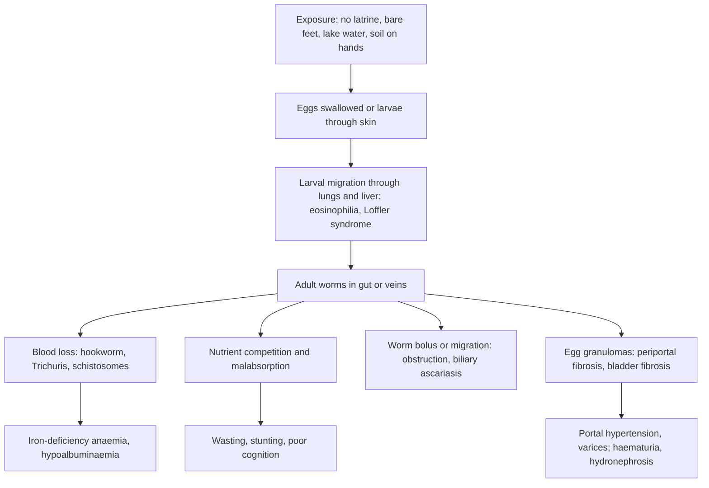

## 1. Definition

**Intestinal worms (helminths)** are parasitic worms that live in the human gut or, for schistosomes, in the veins around the gut and bladder. The big groups are:

- the **soil-transmitted helminths (STH)**: roundworm (*Ascaris*), whipworm (*Trichuris*), hookworms (*Necator*, *Ancylostoma*) and *Strongyloides*;
- **pinworm** (*Enterobius*);
- **tapeworms** (*Taenia*, *Hymenolepis*);
- **schistosomes** (bilharzia).

Most infections are light and silent. The harm comes from **heavy, repeated infection in growing children**: **iron-deficiency anaemia** (hookworm, whipworm, schistosomes), **malnutrition and stunting**, poor school performance, and sometimes **surgical emergencies** (a ball of roundworms blocking the bowel, worms in the bile duct) or a **fatal Strongyloides hyperinfection** in a child on steroids.

| Group | Worm (common name) | How it gets in | Where the adult lives | Size and lifespan |
|---|---|---|---|---|
| **STH** | *Ascaris lumbricoides* (roundworm) | Swallowed **eggs** (soil on hands, unwashed vegetables) | Small intestine | 15–35 cm; 1–2 years |
| **STH** | *Trichuris trichiura* (whipworm) | Swallowed eggs | **Caecum and colon** | 3–5 cm; 1–3 years |
| **STH** | *Necator americanus*, *Ancylostoma duodenale* (hookworms) | **Larvae penetrate bare skin** (*Ancylostoma* also swallowed) | Small intestine, attached to the mucosa | about 1 cm; years |
| **STH** | *Strongyloides stercoralis* (threadworm in some texts) | Larvae penetrate skin; **autoinfection** in the host | Small-intestinal mucosa | 2 mm; **lifelong** without treatment |
| Pinworm | *Enterobius vermicularis* (pinworm/threadworm) | Swallowed eggs (fingers after scratching, bedding) | Caecum; females lay eggs on the **perianal skin at night** | about 1 cm; weeks |
| Tapeworms | *Taenia saginata* (beef), *Taenia solium* (pork) | Undercooked meat containing **cysticerci** | Small intestine | metres; years |
| Tapeworms | *T. solium* eggs → **cysticercosis** | Swallowed **eggs** (faecal–oral, from a human carrier) | Larval cysts in **brain**, muscle, eye | |
| Tapeworms | *Hymenolepis nana* (dwarf tapeworm) | Swallowed eggs; autoinfection | Small intestine | 2–4 cm; common in young children |
| **Trematodes** | *Schistosoma mansoni* (intestinal), *S. haematobium* (urogenital) | **Cercariae penetrate skin** in fresh water with snails | **Mesenteric veins** (*mansoni*), **vesical plexus** (*haematobium*) | 1–2 cm; 3–10 years |

> [!PEARL]
> The one thing never to forget: **deworming is cheap and safe: albendazole 400 mg (200 mg under 2 years) every 6 months from 1 year.** But treating the child is only half the job. Without **latrines, handwashing, shoes and safe water**, reinfection returns within months.

## 2. Epidemiology

- **Global (WHO):** about **1.5 billion people** (24% of the world) have STH infections, with the highest prevalence in sub-Saharan Africa; over 600 million have *Strongyloides*. At least **254 million** people needed preventive treatment for schistosomiasis in 2024, about **94%** of them in Africa.
- **Uganda:**
  - STH infections are common wherever sanitation is poor; **hookworm** is the most widespread STH in many districts. Prevalence has fallen with twice-yearly deworming but rebounds where latrine coverage is low.
  - ***S. mansoni*** is highly endemic along the shores of **Lake Victoria, Lake Albert, Lake Kyoga and the Albert Nile** (fishing communities, e.g. Mayuge, Namayingo, Buliisa, Pakwach). Children who swim, fish, wash and fetch water are infected repeatedly. ***S. haematobium*** is found in a few foci in the east and north.
  - ***T. solium*** cysticercosis follows pig-keeping where pigs roam free and latrines are few; **neurocysticercosis** is an important cause of epilepsy in Ugandan children.
  - ***Strongyloides*** is under-recognised because routine wet preps miss it.

> [!UGANDA]
> **Deworming platforms in Uganda:** **Integrated Child Health Days (Child Days Plus) in April and October** give **albendazole and vitamin A** to children from 1 year (vitamin A from 6 months); **school-based deworming** gives albendazole, plus **praziquantel** in schistosomiasis-endemic districts (the national NTD control programme); **ANC** gives a single dose of **mebendazole or albendazole in the 2nd trimester**; **IMCI** (UCG 2023) says give albendazole or mebendazole at any sick-child visit if the child is over 1 year and has not been dewormed in the last 6 months. Stool microscopy (wet prep) is available at most HC IIIs; Kato-Katz and urine filtration are mainly used in surveys.

## 3. Aetiology and Risk Factors

**Routes of infection** (the basis of prevention)

| Route | Worms | Breaks the cycle |
|---|---|---|
| **Swallowed eggs** (faecal–oral, soil on hands, unwashed vegetables, bedding) | *Ascaris*, *Trichuris*, *Enterobius*, *T. solium* eggs (cysticercosis), *H. nana* | Latrines, handwashing, cut nails, wash vegetables |
| **Larvae through bare skin** | Hookworm, *Strongyloides* | Shoes, latrines |
| **Cercariae through skin in fresh water** | *S. mansoni*, *S. haematobium* | Avoid lake and slow-river water contact; safe water |
| **Undercooked meat** | *T. saginata* (beef), *T. solium* (pork) | Cook meat thoroughly; confine pigs |
| **Autoinfection** | *Strongyloides*, *H. nana*, *Enterobius* (re-swallowed eggs) | Treat fully; household treatment for pinworm |

**Who is at risk?**

- **Preschool and school-age children** (play in soil, put hands in mouths).
- Children who walk **barefoot**, live without a **latrine**, or **swim, fish, wash or fetch water** in lakes and slow rivers.
- Communities where **pigs roam free** and pork is eaten undercooked.
- Children with **HIV** (*Strongyloides*) and **malnutrition**.
- **Strongyloides hyperinfection**: children on **steroids**, with **HTLV-1**, malnutrition or transplant.

## 4. Pathophysiology

**Life cycles that explain the symptoms**

- **Ascaris**: egg swallowed → larva hatches in the small gut → through the gut wall → portal vein → liver → lungs (Löffler: cough, wheeze, eosinophils) → coughed up and swallowed → adult in the small gut.
- **Hookworm**: larva in soil → through bare skin (ground itch) → blood → lungs → swallowed → attaches to small-gut mucosa and sucks blood → eggs in stool → larvae in warm moist soil.
- **Strongyloides**: as hookworm, **plus** larvae hatch in the gut and re-enter through the gut wall or perianal skin (autoinfection) → infection lasts for decades; steroids or HTLV-1 → hyperinfection.
- **Schistosoma**: cercaria through skin in lake water → lungs → liver → adults pair in veins (*mansoni*: mesenteric; *haematobium*: bladder) → eggs lodge in the liver or bladder wall → granulomas → fibrosis.

**Mechanisms of disease**

| Worm | Mechanism | Clinical consequence |
|---|---|---|
| **Hookworm** | Each *Necator* worm takes about **0.03 mL** of blood a day (*Ancylostoma* about 0.15–0.2 mL); chronic gut blood and protein loss | **Iron-deficiency anaemia**, hypoalbuminaemia (oedema), poor growth, poor cognition |
| ***Ascaris*** | Larval migration through lungs; adults compete for nutrients and impair absorption (fat, vitamin A, lactose); worms tangle into a bolus or migrate when irritated (fever, drugs, anaesthesia) | Löffler syndrome; malnutrition; **intestinal obstruction, volvulus, intussusception**; **biliary ascariasis** (colic, cholangitis, pancreatitis, liver abscess); appendicitis |
| ***Trichuris*** | Anterior end threaded into the colonic mucosa → inflammation and bleeding | Dysentery-like **Trichuris dysentery syndrome**, **rectal prolapse**, anaemia, clubbing, stunting |
| ***Strongyloides*** | Autoinfection; with low cell-mediated immunity (**steroids**, HTLV-1, malnutrition, transplant) larvae multiply massively and carry gut bacteria through the bowel wall | Larva currens (fast-moving itchy rash), chronic diarrhoea; **hyperinfection/disseminated disease with Gram-negative sepsis and meningitis** (often fatal) |
| ***Enterobius*** | Females lay eggs on perianal skin at night | **Nocturnal perianal itch**, poor sleep, vulvovaginitis, rarely appendicitis |
| ***Taenia*** | Adult tapeworm in the gut | Usually mild: passing segments, epigastric discomfort |
| ***T. solium* eggs** | Larvae encyst in brain/muscle/eye; dying cysts provoke inflammation | **Neurocysticercosis**: seizures, headache, raised ICP |
| ***S. mansoni*** | Eggs trapped in the liver's portal tracts → granulomas → **periportal (Symmers' "pipe-stem") fibrosis** → **presinusoidal portal hypertension** with **preserved liver function** | Hepatosplenomegaly, varices, **haematemesis**, anaemia; in adolescents, "hepatosplenic schistosomiasis" |
| ***S. haematobium*** | Eggs in the bladder wall → granulomas, fibrosis, calcification | **Terminal haematuria**, dysuria, hydronephrosis, bladder cancer (adults), female genital schistosomiasis |

**Why eosinophilia?** Eosinophils fight helminths in the **tissues**. They rise during **larval migration** (Ascaris and hookworm in the lungs, Strongyloides, schistosomes, *Toxocara*) and are often **normal when adult worms simply sit in the gut lumen**. Unexplained eosinophilia in a Ugandan child = worms until proven otherwise.

**Feature links**

- Larvae through bare skin → ground itch on the feet; *Strongyloides* autoinfection → larva currens.
- Larvae through the lungs → Löffler syndrome: cough, wheeze, fleeting infiltrates, eosinophilia.
- Hookworm blood sucking → chronic gut blood loss → iron deficiency → pallor, fatigue, pica, poor school performance, flow murmur, heart failure if severe.
- Hookworm protein loss → hypoalbuminaemia → oedema.
- Ascaris nutrient competition → malnutrition, vitamin A deficiency, stunting.
- Ascaris bolus → colicky pain, bilious vomiting, distension, mobile "sausage" mass, absolute constipation.
- Ascaris migration into the bile or pancreatic duct → RUQ pain, jaundice, cholangitis, pancreatitis (epigastric pain to the back).
- *Trichuris* in the colonic mucosa → bloody mucoid diarrhoea, tenesmus → rectal prolapse; chronic disease → clubbing.
- *Strongyloides* hyperinfection → larvae carry gut bacteria → Gram-negative sepsis and meningitis.
- Pinworm eggs laid on perianal skin at night → nocturnal itch, poor sleep, excoriation, vulvovaginitis.
- *T. solium* cysts in the brain → seizures, headache, raised ICP.
- *S. mansoni* eggs in portal tracts → periportal fibrosis → presinusoidal portal hypertension → splenomegaly, varices, haematemesis, with normal liver function.
- *S. haematobium* eggs in the bladder wall → terminal haematuria, dysuria → fibrosis → hydronephrosis.

## 5. Classification / Staging

**By group and route**: STH, pinworm, tapeworms and trematodes (table in section 1); skin-penetrators versus swallowed eggs (section 3).

**Intensity of infection (WHO, by eggs per gram of stool, Kato-Katz)**

| Worm | Light | Moderate | **Heavy** |
|---|---|---|---|
| *Ascaris* | 1–4,999 | 5,000–49,999 | **≥50,000** |
| *Trichuris* | 1–999 | 1,000–9,999 | **≥10,000** |
| Hookworm | 1–1,999 | 2,000–3,999 | **≥4,000** |
| *S. mansoni* | 1–99 | 100–399 | **≥400** |
| *S. haematobium* | 1–49 eggs/10 mL urine | | **≥50 eggs/10 mL urine** |

Morbidity rises with the number of worms, which is why mass treatment that lowers worm loads works even though reinfection occurs.

**Community endemicity (sets the deworming frequency)**: STH prevalence ≥20% → yearly; ≥50% → twice yearly (WHO 2017). Schistosomiasis prevalence ≥10% → annual praziquantel from 2 years (WHO 2022).

## 6. Clinical Features

### History

| Question | Why it matters |
|---|---|
| Passed a worm (in stool, vomit, from the nose)? What did it look like? | Long pink worm = *Ascaris*; white flat segments = *Taenia*; tiny white threads around the anus = pinworm |
| Abdominal pain: colicky? vomiting? constipation? distension? | **Obstruction** from an *Ascaris* bolus |
| Right upper quadrant pain, jaundice, vomiting a worm | **Biliary ascariasis**, pancreatitis |
| Diarrhoea: bloody/mucoid, chronic? Rectal prolapse? | *Trichuris*, schistosomes, Strongyloides (also dysentery, IBD) |
| Night-time anal itch, poor sleep, vulval itch | **Pinworm** |
| Fatigue, pica (eating soil), breathlessness, poor school performance | **Anaemia** (hookworm); geophagia also exposes to eggs |
| Cough, wheeze 1–2 weeks after an itchy rash on the feet | Larval migration (Löffler, hookworm "ground itch") |
| Swimming/fishing/washing in the lake or river; where is home? school? | **Schistosomiasis** exposure |
| Blood at the end of urination | **S. haematobium** |
| Vomiting blood, big spleen | **S. mansoni portal hypertension** |
| Pork eating, pigs at home, seizures | **Cysticercosis** |
| Latrine at home? Shoes? Handwashing? Water source? | Exposure and reinfection risk |
| **Last deworming** (date, drug), vitamin A, Child Days, school | Need for treatment now |
| **Steroids** planned or current; HIV status; malnutrition | **Strongyloides hyperinfection** risk |
| Growth and feeding; diet; immunisation card | Worms worsen malnutrition and iron deficiency; integrate care |

### Examination

Follow the order of Hutchison's Clinical Methods (24th edition), adapted for children: observe first, examine the abdomen while the child is calm on the parent's lap, and leave the perianal inspection (distressing) to the end.

#### Introduction, consent and preparation

- Introduce yourself; consent from the parent and assent from the child; **hand hygiene**; a chaperone for the perianal inspection.
- **Position and exposure**: supine for the abdomen with the child relaxed (knees bent); expose from nipples to knees, preserving dignity.

#### General inspection (end of the bed)

- Well or unwell; distress (colic, vomiting); **pallor**; jaundice; wasting or **oedema** (hypoalbuminaemia from hookworm, or kwashiorkor).
- **Vital signs**: HR (tachycardia, flow murmur in anaemia), RR, temperature, CRT; hydration if vomiting.
- **Growth**: weight, height/length, **Z-scores**, **MUAC**; plot on the chart (stunting).

#### Hands, face and neck

| Sign | What it means |
|---|---|
| Palmar pallor, koilonychia | Iron-deficiency anaemia (hookworm, *Trichuris*, schistosomes) |
| **Clubbing** | Heavy *Trichuris* |
| Conjunctival pallor; jaundice | Anaemia; biliary ascariasis, cholangitis |
| Pale tongue | Anaemia |
| Raised JVP | Heart failure from severe anaemia |
| Subcutaneous nodules | Cysticercosis |

#### Abdomen (the system)

- **Inspection**: distension, **visible peristalsis** (obstruction).
- **Palpation**: tenderness and guarding (peritonitis, volvulus), **mobile "rope-like" or "sausage" mass** (worm bolus), RUQ tenderness (biliary), **hepatomegaly (left lobe) and splenomegaly** (*S. mansoni*: measure the spleen in cm below the costal margin).
- **Percussion**: shifting dullness (ascites in portal hypertension); tympanic distension (obstruction).
- **Auscultation**: bowel sounds (active or tinkling in obstruction; absent in peritonitis).

#### Completing the examination

- **Chest**: wheeze, crackles (Löffler); flow murmur, gallop (severe anaemia).
- **Skin**: ground itch on the feet, **larva currens** (fast-moving serpiginous rash around buttocks/trunk: Strongyloides), cutaneous larva migrans (slow-moving, dog/cat hookworms).
- **Neurology**: seizures, focal signs, papilloedema (neurocysticercosis).
- **Perianal, last**: excoriation (pinworm), **rectal prolapse** (*Trichuris*); look for worms.
- **Bedside tests**: HemoCue, urine dipstick (section 8).
- **Thank** the parent and child, re-dress, **wash hands**, and **summarise**.
- **Document negatives**: "no abdominal mass, no organomegaly, no rectal prolapse, no pallor, MUAC 14.5 cm".

### Red flags

> [!REDFLAG]
> - **Colicky pain, bilious vomiting, distension, absolute constipation**: intestinal obstruction (worm bolus, volvulus, intussusception)
> - **Peritonism, fever, shock**: perforation, gangrene, appendicitis
> - **Jaundice, RUQ pain, fever**: biliary ascariasis with cholangitis; **epigastric pain radiating to the back**: pancreatitis
> - **Haematemesis or melaena** with a big spleen: variceal bleeding from *S. mansoni*
> - **Severe pallor** (Hb <7 g/dL), heart failure, oedema
> - **A child on steroids (or about to start)** with diarrhoea, abdominal pain, cough or Gram-negative sepsis/meningitis: **Strongyloides hyperinfection**
> - New seizures in a pork-eating community: neurocysticercosis (image before antiparasitics)

### Thinking like a clinician

- **"Anaemic school child from a rural area"** → think **hookworm** (with malaria, poor diet and, at the lake, *S. mansoni*). Deworm **and** give iron, and check the response.
- **"Toddler vomiting worms with colicky pain and a mobile abdominal mass"** → **Ascaris bolus obstruction**. Do not give a standard anthelmintic dose as the first step; decompress and resuscitate first (section 9).
- **"Haematemesis with a huge spleen but normal liver function and no jaundice in a lakeside teenager"** → **presinusoidal portal hypertension from S. mansoni** (not cirrhosis).
- **"Terminal haematuria in a boy who swims in the river"** → **S. haematobium** (versus UTI, glomerulonephritis, stones). Check a midday urine.
- **"Steroids planned for nephrotic syndrome, asthma, TB meningitis or leukaemia"** → **treat empirically for Strongyloides** (ivermectin) first in endemic areas.
- **"Eosinophilia but stool microscopy negative"** → larval stage (too early for eggs), Strongyloides (needs special tests), schistosomes (eggs appear 5–8 weeks after exposure), *Toxocara*. Repeat stool, or treat empirically.
- **Common student mistakes**: treating anaemia with iron but not deworming (or the reverse); forgetting to repeat albendazole for pinworm and to treat the household; using single-dose albendazole for heavy *Trichuris*; giving ivermectin to a child under 15 kg; giving praziquantel/albendazole for suspected neurocysticercosis without imaging; forgetting Strongyloides before steroids.

> [!EXAM]
> Viva favourite: **"Why is Strongyloides different from the other STH?"** Answer: it can **complete its life cycle inside the host (autoinfection)**, so it persists for decades and can **multiply explosively** when immunity falls (**steroids, HTLV-1**), causing hyperinfection with Gram-negative sepsis and meningitis. It is **not detected by routine stool microscopy** (larvae, not eggs, and few of them) and **not treated by single-dose albendazole**; the drug of choice is **ivermectin**.

## 7. Differential Diagnoses

| Differential (by presentation) | Distinguishing clinical feature | Distinguishing investigation |
|---|---|---|
| **Iron-deficiency anaemia**: hookworm, *Trichuris*, schistosomes vs poor diet, malaria, HIV, sickle cell disease, blood loss | Rural, barefoot, lakeside exposure; pica | FBC/film, stool, RDT, sickling test |
| **Colicky pain and obstruction**: *Ascaris* bolus vs **intussusception**, volvulus, incarcerated hernia, adhesions, typhoid perforation | Worms vomited or passed; mobile mass; redcurrant-jelly stool in intussusception | Ultrasound (whirlpool vs target sign), X-ray |
| **Bloody diarrhoea / dysentery**: heavy *Trichuris*, *S. mansoni* vs *Shigella*, amoebiasis, *Campylobacter*, IBD | Rectal prolapse, clubbing with *Trichuris* | Stool microscopy and culture |
| **Rectal prolapse**: *Trichuris* vs chronic constipation, cystic fibrosis, malnutrition, chronic diarrhoea | Bloody mucoid stool, anaemia | Stool microscopy |
| **Haematuria**: *S. haematobium* vs **UTI**, post-streptococcal GN, stones, trauma, sickle nephropathy, Wilms tumour | **Terminal** haematuria with water contact; no dysuria or oedema | Urine microscopy (eggs vs RBC casts), dipstick, USS |
| **Hepatosplenomegaly**: *S. mansoni* vs **hyperreactive malarial splenomegaly**, visceral leishmaniasis (Karamoja/north-east), SCD, leukaemia/lymphoma, chronic hepatitis B, storage disease | Lakeside home, left-lobe liver, normal liver function | USS (periportal fibrosis), FBC/film, malaria tests, LFTs |
| **Perianal itch**: *Enterobius* vs poor hygiene, candida, scabies, sexual abuse (in girls with vulvovaginitis, ask sensitively) | Nocturnal itch, household affected | Sticky-tape test |
| **Cough, wheeze and eosinophilia**: Löffler (Ascaris/hookworm larvae), Strongyloides vs asthma, TB, tropical pulmonary eosinophilia | Transient, after a foot rash; no atopy | FBC, CXR, stool (later) |
| **Seizures**: neurocysticercosis vs febrile seizures, epilepsy, meningitis, cerebral malaria, TB | Pork-eating community, pigs at home | CT/MRI |

## 8. Clinical Workup

Key principles:

1. **You do not need a stool test to deworm.** In endemic areas, WHO and UCG treat **presumptively** (preventive chemotherapy) without individual diagnosis.
2. **Investigate the sick or atypical child**: anaemia not responding to treatment, chronic diarrhoea, haematuria, hepatosplenomegaly, eosinophilia, steroids planned, surgical signs.
3. **Know the blind spots of stool microscopy**: pinworm (use sticky tape), *Strongyloides* (larvae, few: use concentration/agar plate/serology), early infection (prepatent period), light infections (repeat 3 samples), *S. haematobium* (urine, not stool).

### Bedside

| Test | How | What it tells you | Available at |
|---|---|---|---|
| **HemoCue Hb** | Finger prick | Anaemia severity (hookworm, *Trichuris*, schisto) | HC III and above |
| **Sticky-tape (Scotch tape) test** | Press clear tape on the perianal skin **first thing in the morning before washing**, stick it on a slide; repeat on 3 mornings | Pinworm eggs (stool microscopy usually misses them) | HC III and above (slide read in the lab) |
| **Urine dipstick** | Midday urine | **Microscopic haematuria** strongly suggests *S. haematobium* in endemic areas | HC III and above |
| **Urine POC-CCA** | Urine cassette (survey tool) | *S. mansoni* antigen | NTD programme surveys |
| **Inspect any passed worm or segment** | Bring it in a container | Species identification | All levels |
| **Malaria RDT** | Finger prick | Co-existing cause of anaemia/fever | All levels |
| **MUAC, weight and height** | | Malnutrition linked to worms | All levels |

### Basic lab

| Test | When | Expected / abnormal finding | How it changes management | Available at |
|---|---|---|---|---|
| **Stool microscopy (direct wet mount)** | Symptomatic child; diarrhoea; anaemia | Eggs of *Ascaris*, hookworm, *Trichuris*, *Taenia*, *S. mansoni* (lateral spine); *Strongyloides* larvae (if heavy) | Species-specific treatment | **HC III and above** |
| **Urine microscopy (filtered, midday 10:00–14:00)** | Haematuria, endemic area | *S. haematobium* eggs (terminal spine) | Praziquantel | HC III and above (filtration mainly in surveys) |
| **Full blood count and film** | Anaemia, systemic symptoms | **Microcytic hypochromic anaemia**; **eosinophilia** (>0.5 × 10⁹/L) | Iron; supports tissue-migrating worms | HC IV and above |
| **HIV test** | Strongyloides, severe or recurrent infections | Positive | ART; Strongyloides risk | All levels |

### Imaging

| Test | When | Expected finding | How it changes management | Available at |
|---|---|---|---|---|
| **Abdominal ultrasound** | Pain, mass, jaundice, hepatosplenomegaly, haematuria | **Worm bolus** ("bundle", "whirlpool" or "railway-track" sign), **worms in the bile duct**, **periportal fibrosis** (thick echogenic portal tracts), splenomegaly, bladder wall thickening/polyps, hydronephrosis | Surgery vs conservative; schisto staging | Most hospitals and many HC IVs |
| **Plain abdominal X-ray (erect/supine)** | Obstruction | Dilated loops, air–fluid levels, **whorled worm mass** | Obstruction management | General Hospital and above |
| **CT/MRI brain** | Seizures with suspected neurocysticercosis | Cysts (with scolex), ring-enhancing lesions, calcifications | Antiparasitic and steroid decisions; neurology referral | Kampala and some RRHs |

### Specialised / referral-level

| Test | When | Expected / abnormal finding | How it changes management | Available at |
|---|---|---|---|---|
| **Formol-ether concentration, repeat stools (3 samples)** | Light infections, eosinophilia, Strongyloides suspected | Increases sensitivity | Detects missed infections | Hospital labs |
| **Kato-Katz** | Surveys; quantifying intensity | Eggs per gram | Heavy infection = more morbidity | Mainly research/NTD programme |
| **Agar-plate culture / Baermann technique** | Suspected Strongyloides | Larvae | Ivermectin | Referral labs |
| **Strongyloides serology** | Before immunosuppression, eosinophilia | Positive | Treat | Limited (private/referral labs) |
| **Serum albumin, LFTs** | Oedema, hepatosplenomegaly | Low albumin (hookworm); normal liver enzymes and synthetic function in *S. mansoni* fibrosis | Distinguishes schisto from cirrhosis | RRH/NRH |
| **Upper GI endoscopy** | Haematemesis | Oesophageal varices | Band ligation/sclerotherapy | Mulago, Lacor, some private and mission hospitals |
| **ERCP** | Persistent biliary ascariasis | Worm in the duct | Extraction | Mulago and private centres |

### Putting it together

**Model one-line summary**

> "A 9-year-old boy from Mayuge (Lake Victoria shore), weight 22 kg (weight-for-age Z −2.1, height-for-age Z −2.3: stunted), last dewormed 14 months ago, who swims and fishes daily, presenting with fatigue and pallor: Hb 6.8 g/dL (microcytic), hookworm and S. mansoni eggs on stool microscopy, spleen 4 cm, liver left lobe enlarged: polyparasitism with hookworm iron-deficiency anaemia and intestinal schistosomiasis with early hepatosplenic disease."

**Problem list**

1. Moderate–severe iron-deficiency anaemia.
2. Hookworm.
3. *S. mansoni* with hepatosplenomegaly (risk of portal hypertension).
4. Stunting.
5. Ongoing exposure (water contact, no shoes).

**Model case presentation (ward round)**

> "Master O, a 3-year-old boy from Wakiso, **weight 11.5 kg (weight-for-age Z −1.6), height 89 cm (height-for-age Z −1.3), MUAC 13.8 cm**, admitted 12 hours ago with 2 days of colicky abdominal pain, bilious vomiting and no stool, after vomiting a long pink worm at home. He has never been dewormed; the family uses a shared pit latrine and he plays barefoot. **Fully immunised for age** (card seen; MR2 given), last vitamin A 7 months ago; eating family foods; HIV status of mother negative (ANC).
> On admission: HR 140, RR 32, temperature 37.4 °C, CRT 2 s, mild dehydration, distended abdomen with a **mobile, non-tender sausage-shaped mass** in the periumbilical region, active bowel sounds, no guarding. Hb 9.8 g/dL, K⁺ 3.1 mmol/L. **Ultrasound: a bolus of worms in the jejunum ('whirlpool' appearance), no free fluid; X-ray: dilated loops with air–fluid levels.**
> **Assessment: partial small-bowel obstruction from an Ascaris bolus, with mild dehydration and hypokalaemia.**
> **Management so far:** NBM, NGT on free drainage (two worms came up), IV fluids with potassium, analgesia, surgical review (conservative for now).
> **Plan:** reassess abdomen 4-hourly for peritonism; anthelmintic per the surgeon once obstruction settles; deworm the household; WASH counselling; growth follow-up."

> [!EXAM]
> **Worked example 1: deworming doses by age and weight.**
> - 15-month-old (9 kg): **albendazole 200 mg** single dose (or mebendazole 250 mg).
> - 4-year-old (15 kg): **albendazole 400 mg** single dose (or mebendazole 500 mg). Praziquantel for *S. mansoni*: **40 mg/kg = 600 mg** (one 600 mg tablet). Ivermectin is avoided under 15 kg in most guidance; at exactly 15 kg give it only if needed and with senior advice.
> - 10-year-old (28 kg) with *Strongyloides*: **ivermectin 200 µg/kg = 5.6 mg** (≈ two 3 mg tablets = 6 mg) once daily for 1–2 days (CDC); UCG 2023 gives a single dose of 150 µg/kg (4.2 mg).

> [!EXAM]
> **Worked example 2: reading a FBC.**
> Hb 6.8 g/dL, MCV 58 fL, eosinophils 1.8 × 10⁹/L (18%), platelets 480 × 10⁹/L. **Interpretation:** microcytic anaemia (iron deficiency, with reactive thrombocytosis) **plus eosinophilia** (tissue-migrating helminths: hookworm larvae, schistosomes, Strongyloides). This fits hookworm and schistosomiasis; treat both, give iron, and recheck Hb in 4 weeks (expect a rise of about 1–2 g/dL per month with adequate iron).

## 9. Management

### Immediate / emergency

Most children with worms are seen in OPD and are stable. Use this for the sick ones:

1. **ETAT / ABCDE**: airway (vomiting child, aspiration of worms), breathing, **shock** (dehydration from vomiting, sepsis, bleeding varices), coma, convulsions.
2. **Surgical abdomen?** Distension, bilious vomiting, peritonism → **nil by mouth, NGT on free drainage, IV access, bloods, IV fluids, surgical review now**.
3. **Bleeding?** Haematemesis → two IV lines, **group and cross-match**, Hb, resuscitate, refer for endoscopy (portal hypertension below).
4. **Severe anaemia?** HemoCue; Hb <4 g/dL or decompensated → transfusion.
5. **Seizure?** Diazepam 0.5 mg/kg PR (max 10 mg), glucose check.

### Definitive

#### Routine deworming (preventive chemotherapy)

| Group | Drug and dose | Frequency |
|---|---|---|
| **Children 12–23 months** | **Albendazole 200 mg** single dose, or **mebendazole 250 mg** (UCG) | Every 6 months (UCG 2023) |
| **Children ≥2 years** | **Albendazole 400 mg** single dose, or **mebendazole 500 mg** single dose | Every 6 months (UCG); WHO: yearly if STH prevalence ≥20%, twice yearly if ≥50% |
| **Under 12 months** | Not routinely dewormed | Treat only a confirmed, symptomatic infection with senior advice |
| **Adolescent girls, women of reproductive age, pregnant women (2nd/3rd trimester)** | Albendazole 400 mg or mebendazole 500 mg | ANC (2nd trimester) and programmes |
| **Schistosomiasis-endemic communities** (prevalence ≥10%) | **Praziquantel 40 mg/kg** single dose, from **2 years** (WHO 2022) | **Annually** (WHO 2022); school-based in Uganda |

How to give it: **chewable tablets** can be crushed and mixed with water for young children; never force a whole tablet into a small child's mouth (choking risk); **praziquantel with food** (reduces nausea), and in MDA the dose is estimated with a **height-based "dose pole"**.

> [!NOTE]
> **The "worm wars".** A Cochrane review (Taylor-Robinson et al., 2019) found that **mass** deworming of all children in endemic areas produced **little or no average improvement** in weight, Hb, cognition or school attendance, while **treating children known to be infected** does improve weight and Hb. WHO and Uganda continue mass deworming because it is cheap and safe, heavily infected children (who benefit most) are hard to identify, and it reduces severe morbidity. For your viva: deworming is not a substitute for WASH, nutrition and iron.

#### Treatment of confirmed or symptomatic infections

- **Ascaris, hookworm**: single-dose albendazole (or mebendazole).
- **Trichuris** (symptomatic or heavy): albendazole for **3 days** (single dose cures poorly).
- **Pinworm**: single dose, **repeat after 2 weeks**, treat the **whole household**; cut nails, wash hands, change and wash bedding and underwear.
- **Strongyloides**: **ivermectin** (albendazole is the alternative); hyperinfection = stop or reduce steroids, treat Gram-negative sepsis/meningitis (ceftriaxone), ICU, refer.
- **Taenia, H. nana, schistosomiasis**: praziquantel at the species-specific dose.
- **Katayama fever** (acute schistosomiasis, non-immune child): praziquantel + prednisolone; repeat praziquantel after 6–8 weeks (immature worms are resistant). Rare in endemic children; seen in visitors.
- **Neurocysticercosis**: **specialist only**, after CT/MRI (UCG: refer); treating without imaging can provoke seizures and raised ICP.

Doses are in the drug table.

### Drug table

| Drug (indication) | Dose (paediatric; max) | Route | Frequency | Duration | Key cautions |
|---|---|---|---|---|---|
| **Albendazole** (routine; *Ascaris*, hookworm) | **200 mg** (12–23 months); **400 mg** (≥2 years) | Oral, chewed or crushed | Once | Single dose; routine every 6 months | Not routinely under 12 months; avoid in 1st trimester; worms may migrate out of mouth or nose (warn parents) |
| **Mebendazole** (routine; *Ascaris*, hookworm) | **250 mg** (1–2 years); **500 mg** (>2 years); or **100 mg** 12-hourly | Oral | Once, or 12-hourly | Single dose, or 3 days | As albendazole |
| **Albendazole** (*Trichuris*, symptomatic/heavy) | **400 mg** | Oral | **Once daily** | **3 days** (CDC) | Alternatively mebendazole 100 mg 12-hourly × 3 days; ivermectin 200 µg/kg × 3 days added in resistant cases |
| **Albendazole** (*Enterobius*) | **400 mg** (200 mg under 2) | Oral | Once | **Repeat after 2 weeks** | Treat the whole household |
| **Ivermectin** (*Strongyloides*, first line) | **200 µg/kg** (CDC); UCG 2023: 150–200 µg/kg | Oral, empty stomach | Once daily | **1–2 days** (CDC; UCG single dose) | Avoid **under 15 kg**, in pregnancy, and where *Loa loa* is endemic (not Uganda) |
| **Albendazole** (*Strongyloides*, alternative) | **400 mg** | Oral | **12-hourly** | **3 days** (UCG; CDC 7 days) | Use if < 15 kg |
| **Ivermectin** (*Strongyloides* hyperinfection) | **200 µg/kg** | Oral | Daily | Until stool/sputum negative for 2 weeks | Stop or reduce steroids; ceftriaxone for sepsis/meningitis; ICU; refer |
| **Praziquantel** (schistosomiasis, *mansoni* and *haematobium*) | **40 mg/kg** (UCG 2023; WHO) | Oral, with food | Once (can split into 2 doses 4–6 h apart) | Single dose; repeat in 4–6 weeks if symptoms persist | From **2 years**; abdominal pain, nausea, dizziness, urticaria (dying worms); arpraziquantel (dispersible) for 3 months–6 years being introduced |
| **Praziquantel** (*Taenia*) | **5–10 mg/kg** | Oral | Once | Single dose | Never for suspected cysticercosis without imaging |
| **Praziquantel** (*Hymenolepis nana*) | **25 mg/kg** | Oral | Once | Repeat after 10 days if needed | Autoinfection |
| **Niclosamide** (*Taenia*, UCG alternative) | **<2 years 500 mg; 2–6 years 1 g; >6 years 2 g** | Oral, chewed | Once | Single dose | Then bisacodyl 2 h later |
| **Prednisolone** (Katayama fever) | **1 mg/kg/day** | Oral | Daily | 5 days | With praziquantel; repeat praziquantel at 6–8 weeks |
| **Albendazole** (neurocysticercosis, specialist only) | **15 mg/kg/day** (± praziquantel) | Oral | Daily | Specialist | With steroids and antiepileptics, **after CT/MRI** |
| **Piperazine** (Ascaris obstruction, where available) | About **75 mg/kg** (max 3.5 g) | Oral/NG | Once daily | 2 days | Paralyses worms; per surgeon's protocol; then albendazole later |
| **Elemental iron** (+ folic acid) | **About 3 mg/kg/day** (WHO Pocket Book range 3–6 mg/kg/day; max about 200 mg/day) | Oral, between meals | Daily | **3 months** | Black stools; delay until acute malaria or severe infection treated |
| **Whole blood / packed cells** (Hb <4 g/dL or decompensated) | **20 mL/kg** whole blood (10 mL/kg packed cells) | IV | Over 3–4 h | Once | Slower and less in heart failure, with furosemide 1 mg/kg |
| **Diazepam** (seizure) | **0.5 mg/kg** (max 10 mg) | Rectal | Once; may repeat per seizure protocol | | Check glucose |

> [!DRUG]
> **Safety notes.** Albendazole and mebendazole: mild abdominal pain, rarely worm migration through the mouth or nose (frightening for parents; warn them); avoid in the **first trimester** of pregnancy. **Ivermectin**: avoid **under 15 kg**, in pregnancy, and where *Loa loa* is endemic (not Uganda). **Praziquantel**: now recommended from **2 years**; a paediatric formulation (**arpraziquantel**, dispersible) for children **3 months to 6 years** has been developed and is being introduced in African programmes; check whether your district stocks it.

> [!UGANDA]
> **UCG 2023 vs CDC/WHO.** UCG gives ivermectin **150 µg/kg as a single dose** (range 150–200) and albendazole for *Strongyloides* for 3 days; CDC uses **200 µg/kg for 1–2 days** and albendazole for 7 days. UCG deworms **every 6 months** regardless of prevalence; WHO 2017 sets the frequency by community prevalence (yearly ≥20%, twice yearly ≥50%). Quote UCG in Ugandan exams and name the international dose when asked.

### Referral criteria

| Level | Action | Refer up when |
|---|---|---|
| **VHT / HC II** | Routine deworming (albendazole/mebendazole), Child Days; counselling on WASH | Anaemia, abdominal pain with vomiting, haematuria, haematemesis → HC III/IV |
| **HC III** | Stool and urine microscopy, treatment of STH and pinworm, **Strongyloides (ivermectin)**, iron; praziquantel for tapeworm (UCG level HC3) | **Surgical abdomen** (refer urgently after NGT, IV fluids), severe anaemia needing transfusion, schistosomiasis with hepatosplenomegaly → HC IV / General Hospital |
| **HC IV / General Hospital** | **Praziquantel** (UCG level HC4 for schistosomiasis), USS, transfusion, surgery for obstruction in some HC IVs | Obstruction needing paediatric surgery, variceal bleeding, biliary ascariasis not settling, seizures with suspected neurocysticercosis, Strongyloides hyperinfection → RRH |
| **RRH / NRH** | Paediatric surgery, ERCP, endoscopy for varices (Mulago, Lacor), CT/MRI for neurocysticercosis, ICU, specialist care | n/a |

### Monitoring and follow-up

- **Anaemia**: recheck Hb at **4 weeks** (expect a rise of about 1–2 g/dL); no rise → poor adherence, ongoing blood loss, malaria, HIV, sickle cell disease, thalassaemia trait.
- **Obstruction**: reassess the abdomen **4-hourly** for peritonism; surgery if not resolving within 24–48 h.
- **Pinworm**: second dose at 2 weeks; household treated.
- **Schistosomiasis**: repeat praziquantel in 4–6 weeks if symptoms persist; follow spleen size and ultrasound in hepatosplenic disease.
- **Routine**: next deworming in 6 months; growth monitoring; vitamin A.

### Iron-deficiency anaemia from worms

1. **Deworm** (and treat schistosomiasis if present).
2. **Oral iron**: elemental iron **about 3 mg/kg/day** (WHO Pocket Book range 3–6 mg/kg/day; max about 200 mg/day) **for 3 months** (to refill stores), with **folic acid**; give between meals with fruit (vitamin C); warn about black stools. Delay iron until **after acute malaria or severe infection** is treated.
3. **Diet**: beans, green leafy vegetables, liver, small fish (mukene), eggs.
4. **Transfuse** only for **Hb <4 g/dL** or decompensation (heart failure, respiratory distress): whole blood 20 mL/kg (10 mL/kg packed cells) over 3–4 h; slowly (and less) if heart failure, with furosemide 1 mg/kg.
5. **Recheck Hb at 4 weeks**: expect a rise of about 1–2 g/dL.

### Ascaris intestinal obstruction (algorithm)

1. **Nil by mouth**, **NGT** on free drainage (worms may come up), **IV access**.
2. **Resuscitate**: correct dehydration and electrolytes (hypokalaemia), maintenance fluids.
3. **Bloods**: Hb, electrolytes, group and save; **abdominal USS and/or erect X-ray**.
4. **Surgical review early**.
5. **Partial obstruction, no peritonism** → **conservative** for 24–48 h: NGT, IV fluids, analgesia, hypertonic saline or gastrografin enema in some units. Many paediatric surgeons give the anthelmintic **only once the obstruction is settling**: classically **piperazine** (paralyses worms so they pass passively; about 75 mg/kg once daily for 2 days, max 3.5 g, where available), then albendazole later. Giving albendazole or mebendazole during complete obstruction may stimulate the worms and worsen the bolus. **Follow your surgeon's protocol.**
6. **Surgery (laparotomy)** if: **peritonitis, perforation, volvulus, intussusception, complete obstruction not resolving within 24–48 h, or gangrene**. Options: milking the worms into the colon, enterotomy, resection.
7. After recovery: deworm the child and the household; treat malnutrition; address sanitation.

### Biliary and pancreatic ascariasis

Conservative first: NBM, IV fluids, analgesia, antispasmodic, antibiotics if cholangitis (e.g. ceftriaxone + metronidazole), anthelmintic once able to take oral drugs (most worms leave the duct). **ERCP** extraction if symptoms persist or a dead worm remains in the duct (Mulago and private centres); surgery rarely.

### Schistosomal portal hypertension

1. **Acute variceal bleed**: ABC, two IV lines, **cross-match**, transfuse to Hb about 7–8 g/dL (avoid over-transfusion, which raises portal pressure), **vitamin K**, antibiotics (e.g. ceftriaxone), octreotide if available, **urgent referral for endoscopic band ligation or sclerotherapy** (Mulago, Lacor).
2. **Praziquantel 40 mg/kg** once stable (early periportal fibrosis can regress in children).
3. **Prevent rebleeding**: propranolol (specialist), repeat endoscopy; nutrition, iron.
4. Liver function is usually preserved (unlike cirrhosis), so outcomes after controlling bleeding are reasonable.

## 10. Complications

**Disease-related**

| Worm | Complications |
|---|---|
| **All STH (heavy, chronic)** | Iron-deficiency anaemia, **stunting**, wasting, poor cognition and school performance, vitamin A deficiency |
| ***Ascaris*** | **Intestinal obstruction**, volvulus, intussusception, perforation, **biliary ascariasis**, cholangitis, **pancreatitis**, liver abscess, appendicitis, aspiration of a migrating worm, Löffler pneumonitis |
| **Hookworm** | Severe anaemia, heart failure, hypoalbuminaemic oedema, growth and cognitive delay |
| ***Trichuris*** | Trichuris dysentery syndrome, **rectal prolapse**, anaemia, clubbing, stunting |
| ***Strongyloides*** | Chronic malabsorption; **hyperinfection/dissemination** with Gram-negative sepsis and meningitis (mortality often over 50%) |
| ***Enterobius*** | Excoriation and secondary bacterial infection, vulvovaginitis, UTI in girls, rarely appendicitis |
| ***Taenia solium*** | **Neurocysticercosis** (epilepsy, hydrocephalus, raised ICP), ocular and muscular cysticercosis |
| ***S. mansoni*** | Periportal fibrosis, **portal hypertension**, **variceal bleeding**, splenomegaly/hypersplenism, ascites, anaemia, stunting |
| ***S. haematobium*** | Haematuria, anaemia, bladder fibrosis/calcification, **hydronephrosis**, renal failure, female genital schistosomiasis (later HIV risk, infertility), **squamous cell bladder cancer** in adults |

**Treatment-related**

| Complication | Cause | Recognition and action |
|---|---|---|
| **Worse obstruction** | Albendazole/mebendazole during complete Ascaris obstruction | Decompress and resuscitate first; anthelmintic per surgeon |
| **Worm migration out of mouth or nose; aspiration** | Anthelmintic irritating worms | Warn parents; protect the airway in a vomiting child |
| **Seizures, raised ICP** | Antiparasitic treatment of neurocysticercosis without imaging and steroid cover | Image first; specialist only |
| **Strongyloides hyperinfection** | Steroids started without treating Strongyloides | Ivermectin before steroids in endemic areas |
| **Abdominal pain, nausea, dizziness, urticaria** | Praziquantel (dying worms) | Give with food; reassure |
| **Choking** | Whole tablet forced into a small child | Crush or chew |
| **Raised portal pressure, rebleeding** | Over-transfusion in variceal bleeding | Transfuse to Hb about 7–8 g/dL |

## 11. Prognosis

- Most light infections are cured by a single dose, but **reinfection within months** is the rule without WASH; morbidity tracks worm load, so regular treatment keeps it low.
- Anaemia from hookworm responds to deworming plus 3 months of iron (Hb rise about 1–2 g/dL per month).
- **Early periportal fibrosis from *S. mansoni* can regress in children** after praziquantel; established portal hypertension has reasonable outcomes once bleeding is controlled, because liver function is preserved.
- **Strongyloides hyperinfection** carries a mortality often over 50%.
- Chronic heavy infection in early childhood contributes to stunting and poorer cognition; how much mass deworming alone reverses this is debated (Cochrane 2019).

## 12. Prevention

| Measure | Why |
|---|---|
| **Latrines** used by everyone, including children (no open defecation) | Breaks every faecal–oral and soil cycle |
| **Handwashing with soap** after the toilet and before eating; cut nails | *Ascaris*, *Trichuris*, pinworm, *T. solium* eggs |
| **Wear shoes** | Hookworm, Strongyloides larvae enter through bare feet |
| **Wash and cook vegetables**; cook pork and beef thoroughly; confine pigs | *Ascaris*; tapeworms; cysticercosis |
| **Avoid swimming, bathing and washing in lakes and slow rivers**; use borehole or tap water; don't urinate or defecate in water | Schistosomiasis (UCG 2023) |
| **Regular deworming** (Child Days, schools, IMCI, ANC) | Keeps worm loads low |
| **Health education** in schools | Children drive transmission and can change habits |

## 13. Special Populations

- **Under 12 months**: not routinely dewormed; treat only a confirmed, symptomatic infection with senior advice.
- **Under 15 kg**: avoid ivermectin; use albendazole 400 mg 12-hourly for 3 days for *Strongyloides*.
- **Under 2 years**: praziquantel is now given from 2 years; arpraziquantel (3 months–6 years) where stocked.
- **Children about to start steroids** (nephrotic syndrome, asthma, TB meningitis, leukaemia): empirical ivermectin (or albendazole if < 15 kg) in endemic areas.
- **HIV, HTLV-1, malnutrition**: higher Strongyloides hyperinfection risk.
- **Adolescent girls and pregnant women**: deworm in the 2nd or 3rd trimester only; not in the first trimester; no ivermectin in pregnancy.
- **Non-immune visitors to lakes**: Katayama fever (praziquantel + prednisolone, repeat at 6–8 weeks).
- **Severe acute malnutrition**: deworm in the rehabilitation phase (see Malnutrition topic).

## 14. Key Points

### High-yield points

- **Albendazole 200 mg (12–23 months) / 400 mg (≥2 years) every 6 months** from 1 year.
- **No stool test needed to deworm** in endemic areas.
- **Hookworm = iron-deficiency anaemia**: deworm **and** give iron for 3 months.
- **Ascaris obstruction**: NBM, NGT, IV fluids, surgeon first; anthelmintic later.
- **Trichuris**: 3 days of albendazole.
- **Pinworm**: sticky tape; repeat at 2 weeks; treat the household.
- **Strongyloides**: autoinfection, missed by microscopy, **ivermectin**, treat before steroids.
- **Praziquantel 40 mg/kg** for schistosomiasis; image before treating cysticercosis.
- **Lakeside child with haematemesis and a big spleen** = *S. mansoni* portal hypertension with normal liver function.
- **Eosinophilia = tissue migration.**

### Numbers & doses

| Item | Value |
|---|---|
| Routine deworming | **Every 6 months from 1 year** (UCG); WHO yearly (≥20%) / twice yearly (≥50% prevalence) |
| Albendazole | **200 mg** (12–23 months); **400 mg** (≥2 years) single dose |
| Mebendazole | **250 mg** (1–2 years); **500 mg** (>2 years) single dose; or 100 mg 12-hourly × 3 days |
| *Trichuris* (heavy) | Albendazole 400 mg daily × **3 days** |
| Pinworm | Albendazole single dose, **repeat at 2 weeks**, treat household |
| Ivermectin (*Strongyloides*) | **200 µg/kg** once daily × 1–2 days (CDC); UCG 150 µg/kg single dose; **not under 15 kg** |
| Albendazole for *Strongyloides* (alternative) | 400 mg 12-hourly × 3 days (UCG) |
| Praziquantel | **40 mg/kg** schistosomes; **5–10 mg/kg** *Taenia*; **25 mg/kg** *H. nana*; from **2 years** |
| Niclosamide (*Taenia*) | <2 y **500 mg**; 2–6 y **1 g**; >6 y **2 g** |
| Iron | Elemental iron **~3 mg/kg/day** × **3 months** |
| Transfusion threshold | Hb **<4 g/dL** or decompensated |
| Blood loss per hookworm | *Necator* ~0.03 mL/day; *Ancylostoma* ~0.15–0.2 mL/day |
| Heavy intensity (eggs/g) | *Ascaris* ≥50,000; *Trichuris* ≥10,000; hookworm ≥4,000; *S. mansoni* ≥400 |
| *S. haematobium* urine | Collect **10:00–14:00** (midday); heavy ≥50 eggs/10 mL |
| Eosinophilia | >**0.5 × 10⁹/L** |
| Global burden | ~**1.5 billion** STH infections (24%); schisto PC needed by ~**254 million** (2024) |

### Exam traps

- **"Give albendazole to every child with Ascaris obstruction immediately."** Not as the first step: **decompress and resuscitate**; anthelmintic per the surgeon once the obstruction settles.
- **"A negative stool test excludes Strongyloides."** Wrong: routine microscopy misses it; use concentration, agar plate or serology, or treat empirically before steroids.
- **"Albendazole single dose clears whipworm."** Poor cure rates: give **3 days**.
- **"Ivermectin for a 10 kg toddler."** Avoid **under 15 kg**.
- **"Pinworm is diagnosed by stool microscopy."** Wrong: **sticky-tape test**; eggs are laid on the perianal skin.
- **"Haematemesis plus splenomegaly = cirrhosis."** In a lakeside child think **S. mansoni presinusoidal portal hypertension** with normal liver function.
- **"Treat neurocysticercosis with praziquantel at the HC IV."** Wrong: **image first**; treatment can trigger seizures and raised ICP (UCG: refer).
- **"Iron alone will correct this child's anaemia."** Not if hookworm keeps causing blood loss: **deworm too**.

### Questions seniors ask

**Viva questions**

1. *Routine deworming doses in Uganda?* Albendazole 200 mg (12–23 months) or 400 mg (≥2 years), or mebendazole 250/500 mg, every 6 months.
2. *Which worm causes iron-deficiency anaemia most?* Hookworm (blood-sucking; *Ancylostoma* more than *Necator*).
3. *How do you diagnose pinworm?* Sticky-tape test in the morning before washing.
4. *Which worm can cause disease decades after leaving an endemic area, and why?* *Strongyloides*, through autoinfection.
5. *Praziquantel dose for schistosomiasis?* 40 mg/kg single dose.
6. *Why is the liver function normal in S. mansoni portal hypertension?* The fibrosis is periportal (presinusoidal); hepatocytes are spared.
7. *What is Löffler syndrome?* Transient eosinophilic pneumonitis (cough, wheeze, fleeting infiltrates) during larval migration of *Ascaris* (or hookworm) through the lungs.

**On the ward round**

- **This child needs prednisolone for nephrotic syndrome. What will you do first about worms?** In an endemic area, give **ivermectin 200 µg/kg** (if ≥15 kg; albendazole 400 mg 12-hourly × 3 days if smaller) to prevent Strongyloides hyperinfection, plus routine deworming.
- **Why do we deworm without testing?** Prevalence is high, drugs are cheap and safe, and individual testing is costly and insensitive; WHO recommends preventive chemotherapy in endemic areas.
- **How does hookworm cause anaemia, and how will you treat it?** Chronic intestinal blood loss (each worm sucks blood) → iron deficiency; treat with albendazole and **iron 3 mg/kg/day for 3 months**, and recheck Hb at 4 weeks.
- **What does a 'whirlpool' on ultrasound mean in a vomiting toddler?** A bolus of *Ascaris* worms (or volvulus): obstruction; NBM, NGT, IV fluids, surgical review.
- **How would you distinguish S. haematobium haematuria from a UTI?** Terminal haematuria in a child with water contact, with eggs (terminal spine) in a midday urine and no pyuria/nitrites; UTI has dysuria, pyuria and positive culture.
- **Why is reinfection so common after deworming?** Drugs don't prevent reinfection; eggs persist in soil for months; without latrines, handwashing, shoes and safe water, children are reinfected within months, which is why treatment is repeated every 6 months.

### Mnemonics

- **Skin-penetrators: "SHS"**: **S**trongyloides, **H**ookworm, **S**chistosoma (shoes and avoiding lake water prevent them).
- **Swallowed eggs: "PATCH"**: **P**inworm, **A**scaris, **T**richuris, **C**ysticercosis (T. solium eggs), **H**ymenolepis.
- **Spines**: ***mansoni*** = **"M for Middle/lateral"** (lateral spine, mesenteric veins, in stool); ***haematobium*** = **"H for Head/terminal"** (terminal spine, bladder, in urine).
- **Albendazole "2-4"**: 200 mg under 2 years, 400 mg from 2 years.
- **Praziquantel "40 for flukes, 5–10 for tapes, 25 for dwarfs"**: 40 mg/kg schistosomes, 5–10 mg/kg *Taenia*, 25 mg/kg *H. nana*.
- **Pinworm "treat twice, treat the house"**: repeat at 2 weeks; all family members.

### OSCE tips

- **Counselling station on deworming**: explain **why** (anaemia, growth, school), the **dose** (chew/crush for small children), **side effects** (mild pain; worms may come out), **every 6 months**, and **WASH** messages (latrine, handwashing, shoes, boiled water, no swimming in the lake).
- **Data-interpretation station (egg pictures)**: *Ascaris* (round, mammillated shell), *Trichuris* (barrel/lemon shape with two polar plugs), hookworm (thin shell, segmented embryo), *S. mansoni* (**lateral spine**), *S. haematobium* (**terminal spine**), *Taenia* (radially striated shell), *Enterobius* (flattened on one side, D-shaped).
- **Abdominal examination station**: in Hutchison order, measure the spleen and left lobe of the liver, look for a mobile mass, and finish with perianal inspection with a chaperone.

## 15. References

1. Ministry of Health Uganda. Uganda Clinical Guidelines 2023 (sections 2.4.1 Intestinal worms, 2.4.1.1 Taeniasis, 2.4.6 Schistosomiasis; 17.3.8 routine deworming). Kampala: MoH; 2023. https://library.health.go.ug/uganda-clinical-guidelines-2023
2. World Health Organization. Preventive chemotherapy to control soil-transmitted helminth infections in at-risk population groups (guideline). Geneva: WHO; 2017. https://www.who.int/publications/i/item/9789241550116
3. World Health Organization. WHO guideline on control and elimination of human schistosomiasis. Geneva: WHO; 2022. https://www.who.int/publications/i/item/9789240041608
4. World Health Organization. Soil-transmitted helminth infections (fact sheet). https://www.who.int/news-room/fact-sheets/detail/soil-transmitted-helminth-infections
5. World Health Organization. Schistosomiasis (fact sheet). https://www.who.int/news-room/fact-sheets/detail/schistosomiasis
6. Centers for Disease Control and Prevention. Clinical care of soil-transmitted helminths. 2024. https://www.cdc.gov/sth/hcp/clinical-care/index.html
7. Centers for Disease Control and Prevention. Clinical care of Strongyloides. 2024. https://www.cdc.gov/strongyloides/hcp/clinical-care/index.html
8. Centers for Disease Control and Prevention. Clinical treatment of taeniasis. 2024. https://www.cdc.gov/taeniasis/hcp/clinical-care/index.html
9. Medscape (eMedicine). Ascariasis (overview). https://emedicine.medscape.com/article/212510-overview
10. Medscape (eMedicine). Strongyloidiasis (overview). https://emedicine.medscape.com/article/229312-overview
11. Taylor-Robinson DC, et al. Public health deworming programmes for soil-transmitted helminths in children living in endemic areas. Cochrane Database of Systematic Reviews. 2019. https://pubmed.ncbi.nlm.nih.gov/31508807/
12. World Health Organization. Pocket Book of Hospital Care for Children, 2nd edition. Geneva: WHO; 2013. https://www.who.int/publications/i/item/978-92-4-154837-3
13. Glynn M, Drake WM, editors. Hutchison's Clinical Methods: An Integrated Approach to Clinical Practice. 24th edition. Edinburgh: Elsevier; 2018.
