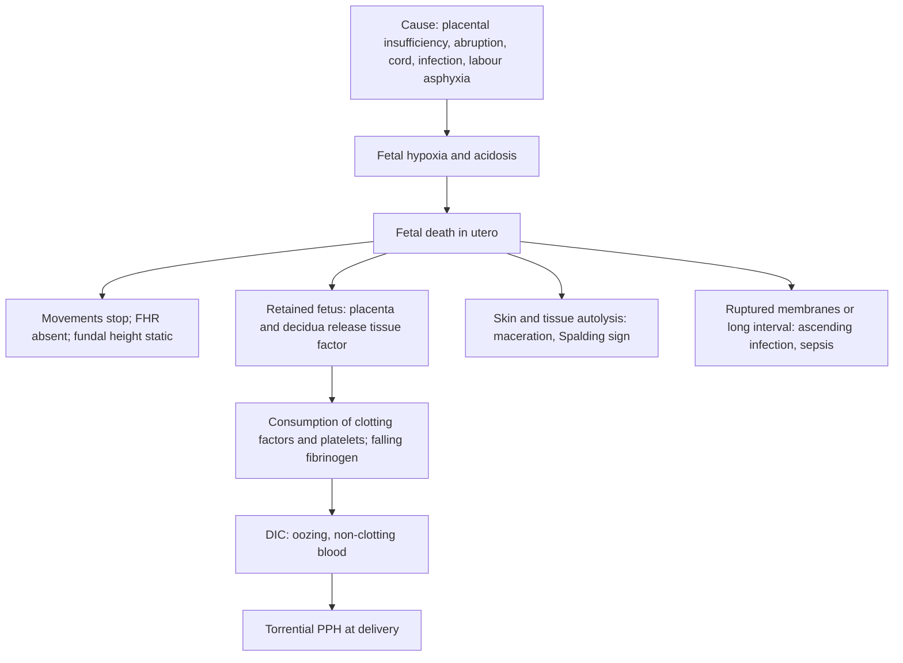

## 1. Definition

**Intrauterine fetal death (IUFD)** is the death of a fetus in the uterus after the gestation at which a loss is called an abortion. In **Uganda that is from 28 weeks**. WHO international comparisons use 28 weeks, and ICD uses 22 weeks or 500 g. A baby born with no signs of life after IUFD or intrapartum death is a **stillbirth**.

| Term | Meaning |
|---|---|
| **Intrauterine fetal death (IUFD) / fetal demise** | Fetal death in utero; the term is used for antepartum death |
| **Stillbirth** (WHO, for international comparison) | Baby born with no signs of life at **28 weeks or more** (or 1,000 g or more). Losses from 22–27 weeks are "early stillbirths" in some systems |
| **Uganda practice** | Loss **before 28 weeks = abortion**; **28 weeks or more = stillbirth** (recorded and reviewed in MPDSR) |
| **Antepartum stillbirth** | Death before labour began. Usually **macerated** |
| **Intrapartum stillbirth** | Death during labour. Usually **fresh** |
| **Fresh stillbirth (FSB)** | Skin intact, no peeling. Death probably within about **12 hours** before birth, usually intrapartum |
| **Macerated stillbirth (MSB)** | **Skin slippage and peeling, soft collapsing skull, red-brown discolouration.** Death more than about **12–24 hours** before birth |
| **Late IUFD** (RCOG) | Fetal death from 24 weeks onwards |

The mother is now the patient. **The dead fetus is not an emergency, but its causes (abruption, pre-eclampsia, sepsis, uterine rupture) and its complications (DIC, infection) can kill her.**

The core tasks:

1. **Confirm** the death.
2. **Break the news** well.
3. **Assess and stabilise** the mother.
4. **Plan delivery**, preferably vaginal.
5. **Find the cause.**
6. **Care for the bereaved family.**
7. **Prevent recurrence.**

## 2. Epidemiology

- The global burden is about **2 million stillbirths a year**, mostly in sub-Saharan Africa and South Asia. **About half of African stillbirths happen during labour**, so they are largely preventable with good intrapartum care.
- Uganda's stillbirth rate is estimated at roughly **15–20 per 1,000 total births** (UN IGME estimates). That is tens of thousands of stillbirths every year, several times the rate in high-income countries.
- **A large share of Ugandan stillbirths are fresh (intrapartum):**
  - delayed recognition of obstructed or prolonged labour;
  - poor fetal monitoring (the partograph or Labour Care Guide is not filled in);
  - delays in referral and in CS decisions;
  - uterine rupture.
- The **"three delays" model** explains many of them:
  - **delay in deciding to seek care**;
  - **delay in reaching care**;
  - **delay in receiving adequate care**.
- **Health-system realities:**
  - **ultrasound is at HC IV and above**, with variable sonographer skill;
  - **clotting tests (PT/APTT, fibrinogen) are only at hospitals**, so use the **bedside clotting test**;
  - **mifepristone may not be stocked** in public facilities; misoprostol is widely available;
  - **postmortem examination is rarely available or accepted**;
  - bereaved mothers are often nursed in open wards beside mothers with live babies.

> [!UGANDA]
> Every stillbirth should be **notified and reviewed** under Uganda's **Maternal and Perinatal Death Surveillance and Response (MPDSR)** system. Classify it (fresh vs macerated), identify the likely cause and the **avoidable factors / delays**, and act on them. Clerks can help by documenting carefully: FHR findings at admission, partograph entries, and timings.

## 3. Aetiology and Risk Factors

**Macerated stillbirths point to antenatal problems:**

- **hypertension and pre-eclampsia**;
- **malaria in pregnancy**;
- **syphilis**;
- **abruption**;
- diabetes;
- FGR (fetal growth restriction) from placental insufficiency;
- infection;
- congenital anomalies;
- post-term pregnancy;
- sickle cell disease;
- anaemia.

**Fresh stillbirths point to labour:** obstructed or prolonged labour, poor fetal monitoring, oxytocin misuse (excessive contractions), referral and CS delays, uterine rupture, cord prolapse.

**Causes grouped by mechanism**

| Mechanism | Examples |
|---|---|
| **Placental insufficiency** | Pre-eclampsia, chronic hypertension, SLE / antiphospholipid syndrome, smoking, malaria (placental sequestration of *P. falciparum*), sickle cell disease, post-term |
| **Acute placental separation** | **Abruption** (hypertension, trauma, cocaine) |
| **Cord accidents** | Cord prolapse, true knots, tight entanglement, velamentous cord |
| **Intrapartum asphyxia** | Obstructed or prolonged labour, excessive contractions (oxytocin misuse), **uterine rupture** |
| **Infection** | Syphilis, chorioamnionitis (e.g. GBS, *E. coli*, *Listeria*), malaria, CMV, parvovirus B19 (fetal anaemia, hydrops) |
| **Maternal metabolic** | **Diabetes**, **obstetric cholestasis**, thyroid disease |
| **Fetal** | Chromosomal and structural anomalies, hydrops (Rh isoimmunisation, parvovirus), twin–twin transfusion |
| **Unexplained** | Up to about a third after full investigation; often subtle placental pathology |

**Risk factors for DIC**: retention of the dead fetus for 4 weeks or more, abruption, sepsis.

**Risk factors for recurrence**: placental disease, diabetes and APS (higher); cord accidents (low).

## 4. Pathophysiology

### Why do fetuses die? The final common pathway is hypoxia

Most causes end in **fetal hypoxia and acidosis**, either **chronically** (the placenta fails slowly) or **acutely** (the oxygen supply is cut off suddenly).

| Mechanism | Why the fetus dies |
|---|---|
| **Placental insufficiency** | Poor spiral artery remodelling and placental infarcts reduce oxygen and nutrient transfer. The result is FGR, then decompensation and death |
| **Acute placental separation** | Loss of exchange surface → acute hypoxia. A 50% abruption is usually fatal to the fetus |
| **Cord accidents** | Blocked umbilical flow |
| **Intrapartum asphyxia** | Repeated contractions without recovery, or sudden loss of the placental bed |
| **Infection** | Direct fetal infection, placentitis, fetal anaemia and heart failure |
| **Maternal metabolic** | Diabetes: fetal hyperglycaemia → hyperinsulinaemia → increased O₂ demand, acidosis. Obstetric cholestasis: bile acids → fetal arrhythmia |
| **Fetal** | Incompatible with life, or heart failure |

### Why the retained dead fetus causes DIC

- After death, the placenta and decidua gradually release **thromboplastin (tissue factor)** into the maternal circulation.
- This triggers **low-grade consumption of clotting factors and platelets**, with **falling fibrinogen**: a chronic **consumptive coagulopathy (DIC)**.
- **Timing (RCOG):**
  - **around 10% of women develop DIC within 4 weeks** of fetal death;
  - **up to about 30% after 4 weeks**;
  - the risk is **higher still with abruption or sepsis**, where DIC can be acute and severe.
- DIC matters at delivery because the placental bed must stop bleeding by **contraction plus clotting**. With low fibrinogen and platelets, **PPH can be torrential**.

### Why the uterus needs less prostaglandin as gestation advances

- The **density of oxytocin and prostaglandin receptors in the myometrium increases** as pregnancy progresses, and the cervix softens.
- A dose of misoprostol that is safe at 16 weeks (e.g. 400 µg) can cause **hyperstimulation and uterine rupture** at 36 weeks. That is why misoprostol doses **fall as gestation rises** and fall further with a uterine scar.
- **Mifepristone** blocks progesterone, the hormone that keeps the uterus quiet. It **primes** the uterus and cervix and shortens the time from induction to delivery.

**Feature links**

- Fetal hypoxia and death → absent fetal movements → mother presents with "the baby has stopped moving".
- Chronic placental insufficiency → FGR → fundal height less than dates; reducing movements before death.
- No cardiac activity → absent FHS on Pinard or Doppler (suggestive only) → absent cardiac activity on real-time ultrasound (diagnostic).
- Death days ago → autolysis → maceration, soft collapsing skull, overlapping bones on VE and imaging (Spalding).
- Tissue factor release → consumptive coagulopathy → low platelets, prolonged PT/APTT, fibrinogen under 2 g/L, bleeding from drip sites and gums, haematuria, bedside clotting time over 7 minutes.
- Abruption → retroplacental bleeding → constant pain, woody-hard tender uterus, vaginal bleeding, shock, acute DIC.
- Pre-eclampsia (cause) → high BP, proteinuria, headache, epigastric pain; HELLP → low platelets, raised transaminases.
- Ruptured membranes or a long interval → ascending infection → fever, tachycardia, offensive liquor.
- Uterine rupture → scar pain, fetal parts easily felt, shock, labour that stops suddenly.
- Raised receptor density in late pregnancy → small misoprostol doses suffice → high doses cause hyperstimulation and rupture.

### Radiological and ultrasound signs of fetal death (useful for vivas)

- **Ultrasound:**
  - absent cardiac activity (the diagnostic sign);
  - later, overlapping skull bones, scalp oedema, collapsed or distorted body, absent movement.
- **Plain X-ray** (historical, but still asked):
  - **Spalding's sign:** overlapping of the skull bones, about **5–7 days** after death;
  - **Robert's sign:** gas in the fetal great vessels / heart, from about 12 hours;
  - **Deuel's halo sign:** a halo around the skull from subcutaneous oedema;
  - **hyperflexion or crumpling of the spine.**

## 5. Classification / Staging

**By timing of death**

| Type | Skin | Timing | Points to |
|---|---|---|---|
| **Fresh stillbirth** | Intact, no peeling | Within about 12 h of birth | Intrapartum death: quality of labour care |
| **Macerated stillbirth** | Slippage and peeling, soft skull, red-brown | More than about 12–24 h | Antepartum cause |

**Maceration grades** (roughly how long ago death occurred)

| Grade | Features | Approximate time since death |
|---|---|---|
| 0 | Reddish skin, no peeling | Under 8 hours |
| I | Skin slippage, early peeling | Over 8 hours |
| II | Extensive peeling, effusions (fluid in body cavities) | Days |
| III | Liver yellow-brown, turbid effusions, possible mummification | Over 1 week |

**By gestation (drives the induction regimen)**: 14–28 weeks (managed on the late-abortion pathway in Uganda), 27–28 weeks, over 28 weeks; and **scarred vs unscarred uterus** (section 9).

## 6. Clinical Features

### History

The usual story on a Ugandan ward: a woman arrives at the labour suite or ANC clinic saying **"the baby has stopped moving"**, and the midwife cannot find the fetal heart.

| Ask | Why it matters (what changes the plan) |
|---|---|
| **When did you last feel the baby move? Were movements reducing before that?** | Dates the death (longer retention = more DIC risk; maceration grade); reducing movements suggest chronic placental insufficiency |
| **Gestational age:** LMP, early scan, fundal height at booking | Decides the **misoprostol dose** and whether this is a stillbirth (28 weeks or more) or managed as a late abortion |
| **Abdominal pain, vaginal bleeding, a hard uterus** | **Abruption**, and with it the risk of DIC and shock: resuscitation, prompt delivery (ARM + oxytocin) |
| **Headache, visual disturbance, epigastric pain, swelling** | **Pre-eclampsia / HELLP**: MgSO₄, antihypertensives, and **no cabergoline** later |
| **Fever, offensive discharge, leaking liquor (how long?)** | **Chorioamnionitis / sepsis**: antibiotics and urgent delivery; ruptured membranes rule out expectant care |
| **Previous CS, myomectomy or uterine surgery; how many scars; classical?** | **A scar changes the induction plan**: lower misoprostol doses or Foley + oxytocin; hospital with theatre; CS considered only for classical or more than two scars |
| **Itching (palms and soles)** | **Obstetric cholestasis** |
| **Excessive thirst, known diabetes, big babies before** | Diabetes |
| **Malaria episodes, IPTp doses, bed-net use** | Malaria in pregnancy |
| **ANC card: syphilis, HIV, Hb, blood group, BP trend, IPTp doses** | Infectious and hypertensive causes; anti-D; eMTCT |
| **Trauma, domestic violence** | Abruption, and a safeguarding need |
| **Drugs, herbs (local oxytocics), alcohol, smoking** | Hyperstimulation or toxic causes |
| **Previous obstetric history:** stillbirths, FGR, pre-eclampsia | Recurrent causes; APS; next-pregnancy plan |
| **Blood group / Rhesus** | Anti-D; isoimmunisation as a cause |
| **Social:** who is with her, support at home, partner, religious and cultural wishes about the baby | Breaking the news, seeing the baby, bereavement care and burial plans |

### Examination

Follow the order of Hutchison's Clinical Methods (24th edition), adapted for the obstetric patient. If she is shocked, bleeding, fitting or febrile, the first-5-minutes assessment (section 9) comes first.

#### Introduction, consent and preparation

- **Introduction and identity**: introduce yourself; confirm her name, age and gestation.
- **Explanation and consent**: explain each step; gain consent; **offer a chaperone** and ensure privacy. Do not announce the death at this stage (section 9, Communication).
- **Hand hygiene** before and after.
- **Position and exposure**: semi-recumbent with a left lateral tilt (avoids aortocaval compression); expose the abdomen from the xiphisternum to the symphysis; cover the legs.

#### General inspection and vital signs

| Sign | What it means |
|---|---|
| Pallor | Anaemia, haemorrhage (abruption); baseline for PPH |
| Distress, pain, guarding | Abruption, rupture |
| Oedema (face, hands) | Pre-eclampsia |
| Jaundice | HELLP, cholestasis, haemolysis, sepsis |
| **Bruising, oozing from puncture sites or gums, haematuria** | **DIC** |

**Vital signs**: pulse, **BP**, **temperature**, respiratory rate, SpO₂; shock index (pulse ÷ systolic BP: **0.9 or more abnormal, 1.4 or more critical**). **Urine dipstick**: **protein** (pre-eclampsia), glucose (diabetes), nitrites (UTI).

#### Hands, face and neck

- **Hands**: pallor, capillary refill, cold peripheries (shock); scratch marks (cholestasis).
- **Face**: conjunctival pallor, scleral jaundice, facial oedema; bleeding gums (DIC).
- **Neck**: brief; thyroid if thyroid disease is suspected.
- **Reflexes** (brisk with clonus in severe pre-eclampsia) if hypertensive.

#### Obstetric abdominal examination

| Step | Finding | What it means |
|---|---|---|
| Inspection | Distension, scars (previous CS, myomectomy), fetal movements absent | A scar changes the induction plan |
| **Fundal height** | Often less than dates if death was days ago or FGR | Chronic placental insufficiency, death some days ago |
| **Lie** | Longitudinal, transverse | Transverse lie in labour may need CS |
| **Presentation** | Cephalic, breech | Plans delivery |
| **Engagement (fifths palpable)** | Fifths above the brim | Progress, obstruction |
| Palpation for tone | **Tenderness, woody-hard uterus** | **Abruption** |
| Palpation of the scar | **Scar tenderness**; fetal parts unusually easy to feel | **Uterine rupture** |
| **Auscultation of the fetal heart** (Pinard or Doppler) | Absent | **Suggestive only**; confirm by ultrasound |

#### Speculum and vaginal examination

Only if in labour, bleeding or membranes ruptured; **not** if praevia is possible until a scan has excluded it.

- liquor colour and smell; bleeding; **cord prolapse**;
- cervical dilation and the **Bishop score** (chooses misoprostol vs Foley vs ARM + oxytocin);
- **signs of maceration**: a soft, collapsing skull with overlapping bones.

#### Completing the examination

- **Point-of-care ultrasound** if trained (section 8), and arrange formal confirmation.
- **Thank** her, cover her, **wash hands**.
- **Summarise** findings (model presentation in section 8).

**Document:** BP, protein, temperature, fundal height, uterine tone and tenderness, scar status, Bishop score, and signs of bleeding.

### Red flags

> [!REDFLAG]
> - **BP 160/110 or more, proteinuria, headache or epigastric pain.** Severe pre-eclampsia / HELLP. Give MgSO₄ and antihypertensives and deliver.
> - **Constant abdominal pain, tense tender uterus, bleeding, shock.** **Abruption**: resuscitate and check for DIC.
> - **Fever, tachycardia, offensive liquor.** **Chorioamnionitis / sepsis**: antibiotics and delivery.
> - **Bleeding from drip sites, haematuria, bedside clotting time over 7 minutes, low platelets or fibrinogen.** **DIC**.
> - **Previous CS with scar tenderness, or fetal parts easily felt.** **Uterine rupture**: this is not a case for induction; laparotomy.
> - **Death undiagnosed or retained for 4 weeks or more.** Higher DIC risk.

### Thinking like a clinician

- **Confirm before you counsel.** A Pinard or hand-held Doppler that "cannot find the heart" can be wrong (obesity, polyhydramnios, operator error, a maternal pulse mistaken for the fetal heart rate). **Scan, and if possible have a second person confirm.** Only then break the news.
- **Fresh or macerated? The answer points you to the cause:**
  - **Fresh** means intrapartum death. Ask **what went wrong in labour**: the partograph or Labour Care Guide, FHR monitoring, referral delays, oxytocin use, obstructed labour or rupture.
  - **Macerated** means antenatal causes: hypertension, infection, diabetes, FGR, anomalies.
- **Is the mother safe to wait?** This is the key management fork:
  - **Urgent delivery:** pre-eclampsia, abruption, sepsis or ruptured membranes, DIC, maternal request.
  - **Otherwise:** expectant care is allowed. Most women prefer to deliver soon.
- **"Can we just do a caesarean?"** Families often ask. Explain gently that **a CS carries surgical risk now and scar risks in every future pregnancy** (uterine rupture, placenta accreta), with **no benefit to the baby**. In Uganda, a woman may not reach a CS-capable facility in her next labour, so **avoiding an unnecessary scar is lifesaving**.
- **Know the scar.** With a previous CS, use **lower misoprostol doses, a Foley catheter or oxytocin**, monitor closely for scar pain and bleeding, and deliver in a hospital with theatre. The risk of uterine rupture with induction in a scarred uterus is small but real.
- **A "normal" fibrinogen may not be normal.** Pregnancy raises it to 4–6 g/L, so 2.5 g/L is already falling.
- **Common student mistakes:**
  - Announcing fetal death after a Doppler alone.
  - Forgetting to check BP and urine.
  - Using a term-induction misoprostol dose at 20 weeks, or a 20-week dose at 38 weeks.
  - Giving oxytocin within 4 hours of misoprostol.
  - Forgetting the placenta and baby examination.
  - Forgetting anti-D and lactation suppression.
  - Talking about "the fetus" instead of **using the baby's name** if the parents have chosen one.

## 7. Differential Diagnoses

When fetal heart sounds cannot be heard:

| Differential | Distinguishing clinical feature | Distinguishing investigation |
|---|---|---|
| **IUFD** | Absent movements, fundal height static or reduced | **Ultrasound: no cardiac activity** |
| **Technical failure** (obesity, polyhydramnios, posterior position, anterior placenta, maternal pulse counted) | Mother still feels movements | Ultrasound shows a heartbeat |
| **Pseudocyesis / wrong dates** | No fetus | Negative hCG; ultrasound |
| **Molar pregnancy** | Uterus large for dates, no fetal parts, early pre-eclampsia, hyperemesis | Ultrasound snowstorm; very high hCG |
| **Abdominal pregnancy with fetal death** | Fetal parts superficial, uterus separate | Ultrasound |

**Differential causes of death** (keep in mind while working it up): abruption, pre-eclampsia, infection (syphilis, malaria, chorioamnionitis), diabetes, cholestasis, FGR / placental insufficiency, cord accident, anomaly, isoimmunisation, uterine rupture, unexplained.

## 8. Clinical Workup

Two parallel tracks: **confirm the death** (gently, without announcing it prematurely) and **make sure the mother is safe** (pre-eclampsia, abruption, sepsis, DIC, uterine rupture). Then **find the cause**.

### Bedside

| Test | Why / what it tells you | Expected finding | Available at |
|---|---|---|---|
| **Point-of-care ultrasound** | Confirms death | **Absent cardiac activity** over at least a few minutes of real-time scanning, ideally confirmed by a second operator. Also: presentation, placental site (praevia?), retroplacental clot, liquor volume, overlapping skull bones (Spalding), scalp oedema | HC IV and above (trained user) |
| **Bedside clotting test** | DIC screen everywhere | 2 mL of blood in a plain glass tube held in the hand: **no clot by 7 minutes**, or a clot that breaks down = coagulopathy. Repeat before and during induction if abnormal or at risk | All levels with a glass tube |
| **Urine dipstick** | Pre-eclampsia, diabetes, UTI | Protein, glucose, nitrites | All levels |
| **HemoCue / bedside Hb** | Anaemia; baseline for PPH | Low Hb | HC III and above |
| **Random blood sugar** | Diabetes as a cause | A very high RBS points to the cause | HC III and above (variable) |
| **mRDT** | Malaria | Positive: treat; a possible cause | All levels |
| **Rapid syphilis and HIV tests** | Infectious causes; eMTCT | Reactive: start **benzathine penicillin** on a reactive syphilis test | All levels |
| **Partograph / Labour Care Guide review** | Fresh stillbirth: where did monitoring or action fail? | Missed alerts, delays | Feeds the MPDSR review |

### Basic lab

| Test | When | Expected / abnormal finding | How it changes management | Available at |
|---|---|---|---|---|
| **FBC with platelets** | Everyone | Low Hb; **platelets under 100** (DIC, HELLP); raised WBC (sepsis) | Transfusion; blood products; urgent delivery | HC IV and above |
| **Group, Rhesus, crossmatch, antibody screen** | Everyone | Rh-negative; red cell antibodies | Blood ready for PPH; anti-D; isoimmunisation as a cause (hydrops) | HC IV and above |
| **Creatinine, LFTs, urate** | Hypertension, sepsis or suspected HELLP | Raised creatinine or transaminases | HELLP/pre-eclampsia management; gentamicin dosing | Some HC IVs; hospitals |
| **Syphilis serology** (RPR/VDRL + TPHA / rapid test) | Everyone | Positive | Common, treatable cause in Uganda; benzathine penicillin for her and her partner | RPR at hospitals; rapid test everywhere |
| **HIV test** | Everyone | Positive | Care and linkage | All levels |
| **Random blood sugar / HbA1c** (± OGTT at 6 weeks postnatally) | Everyone | Hyperglycaemia | Diabetes (overt or gestational) | HC IV and above (HbA1c at hospitals) |
| **Sickle cell test** (if unknown) | Status unknown | HbSS / HbSC | Placental vaso-occlusion as a cause | Hospitals |

### Imaging

| Test | When | Expected / abnormal finding | How it changes management | Available at |
|---|---|---|---|---|
| **Formal obstetric ultrasound** | Everyone to confirm; second operator where possible | No cardiac activity; Spalding's sign; placental position; abruption clot (often not seen) | Confirms the diagnosis; praevia changes the mode of delivery | HC IV and above |
| **Plain X-ray** | Historical; not needed | Spalding, Robert, Deuel signs (section 4) | None today | Hospitals |

### Specialised / referral-level

| Test | When | Expected / abnormal finding | How it changes management | Available at |
|---|---|---|---|---|
| **PT/APTT, fibrinogen** | Everyone, where available; **repeat twice weekly** if expectant beyond 48 h, and before and during induction if abnormal | Prolonged PT/APTT; **fibrinogen under 2 g/L** | DIC: correct with fresh whole blood, FFP, platelets or cryoprecipitate before and during delivery; avoid IM injections and spinal/epidural | Regional/national referral |
| **Kleihauer–Betke** | Rh-negative women and any suspected fetomaternal haemorrhage; **before delivery** | Fetal red cells in the maternal circulation | Large **fetomaternal haemorrhage** as a cause; sizes the **anti-D** dose | Referral hospitals only |
| **Blood cultures, HVS** | Febrile women | Organism | Antibiotic choice | Referral hospitals |
| **Bile acids and LFTs** | Itching | Raised | Obstetric cholestasis | Referral hospitals |
| **Thyroid function** | If indicated | Abnormal TSH | Thyroid disease | Referral hospitals |
| **Antiphospholipid antibodies** (lupus anticoagulant, anticardiolipin, anti-β2-GP1), about 6 weeks after delivery | Placental disease, recurrent loss | Positive | APS, which is treatable next time with aspirin and heparin | NRH, private labs |
| **Viral serology** (CMV, toxoplasma, parvovirus B19, rubella) | Hydrops or FGR | Recent infection | Infectious cause | Referral hospitals |
| **Examination of the baby**: weight, sex, maceration grade, **external anomalies**, photos (with consent), cord (knots, length, vessels) | Every stillbirth | Anomaly, FGR, cord cause | Available everywhere, and often the best "postmortem" in Uganda | All levels |
| **Placenta**: weight, **retroplacental clot**, infarcts, membranes, cord insertion; **histology** + swabs | Every stillbirth | Abruption, infarction, chorioamnionitis, malaria pigment | **The most informative single investigation** | Gross exam everywhere; histology at referral hospitals |
| **Postmortem** (full or limited, with consent), **karyotype / genetics** (placenta, cord or skin) | Anomalies, unexplained | Anomalies, genetic causes | Offer where available. Many families decline for cultural or religious reasons, and that is their right | NRH, rarely |

### Putting it together

**Model one-line summary**

> "A 27-year-old G2P1 at 32 weeks with absent fetal movements for 3 days; BP 150/100, **protein 2+**, afebrile, uterus soft and non-tender, no scar; **IUFD confirmed on ultrasound by two operators**, cephalic, fundal placenta; platelets 88 × 10⁹/L, **bedside clotting time 9 minutes**. **Working diagnosis: IUFD at 32 weeks with pre-eclampsia and evolving coagulopathy (DIC).**"

**Problem list**

1. IUFD at 32 weeks (confirmed).
2. Pre-eclampsia (BP 150/100, proteinuria): control BP; MgSO₄ if severe features develop; **no cabergoline**.
3. Coagulopathy: correct before and during delivery.
4. Cause to find (likely placental insufficiency from pre-eclampsia; syphilis, malaria, diabetes to exclude).
5. Bereavement, anti-D, contraception, follow-up.

**Plan:** crossmatch and fresh whole blood/FFP; induce **now** (not expectant) with **misoprostol 25 µg vaginally every 6 hours** (or 25 µg orally every 2 hours), oxytocin later (at least 4 hours after the last misoprostol); AMTSL with TXA ready; avoid IM injections and spinal while clotting is abnormal.

**Model case presentation (ward round)**

> "Mrs A, a 29-year-old G3P2, both previous babies alive and delivered vaginally, at 34 weeks by an early scan, presented with **absent fetal movements for 2 days**. She is **normotensive, BP 118/72, urine protein negative, afebrile**, with no abdominal pain or bleeding. Fundal height 31 cm; no FHS on Doppler. **Ultrasound, confirmed by 2 sonographers, shows no fetal cardiac activity with overlapping skull bones.** Hb 11.4 g/dL, platelets 210, **bedside clotting time 5 minutes**, RPR **positive**, TPHA pending, HIV negative, RBS 5.8 mmol/L, Rh-positive. **Impression: IUFD at 34 weeks, likely macerated, possibly due to syphilis.** Plan: she and her husband opted for induction today with **misoprostol 25 µg vaginally 6-hourly**, then oxytocin as needed; analgesia; examine the baby and placenta; send placenta for histology; **benzathine penicillin 2.4 MU IM weekly for 3 doses** (start now on the reactive test; do not wait for the TPHA) and partner treatment; **cabergoline 1 mg** after delivery; bereavement support; MPDSR review; follow-up at 6 weeks."

**Worked example 1: confirming IUFD properly**

- A midwife cannot find the FHR with a Doppler. A **maternal pulse of 110** can be mistaken for a fetal heart rate, and obesity or polyhydramnios can hide a live one.
- **Confirmation:** real-time ultrasound, looking at the **fetal heart for at least a few minutes**, with colour Doppler if available; **second operator** to confirm.
- Supporting (not diagnostic) findings: **Spalding's sign** (overlapping skull bones, about 5–7 days), scalp oedema, collapsed body, absent movement.
- Only then break the news, in private, with a warning shot and clear words.

**Worked example 2: interpreting a DIC screen**

| Result | Normal in pregnancy | Her value | Interpretation |
|---|---|---|---|
| Platelets | 150–400 × 10⁹/L | **88** | Low: DIC or HELLP |
| Fibrinogen | Rises to **4–6 g/L** | **1.6 g/L** | **Under 2 g/L = severe coagulopathy** (a "normal-looking" 2.5 g/L is already low for pregnancy) |
| PT / APTT | Unchanged or slightly shorter | Prolonged | Consumption of clotting factors |
| Bedside clotting test | Clots within 7 min | **No clot at 9 min** | Confirms coagulopathy where no lab exists |

**Action:** involve a senior and the blood bank; give **fresh whole blood or FFP (plus cryoprecipitate or platelets where available)**; deliver **vaginally** where possible (the fastest way to stop the tissue factor source is delivery); active third stage with **oxytocin 10 IU** and **TXA 1 g IV** if PPH; avoid IM injections, spinal or epidural; repeat the tests after delivery.

## 9. Management

### Immediate / emergency

**First 5 minutes: look for the four killers**

1. **Vitals:** pulse, **BP**, temperature, respiratory rate, SpO₂; shock index.
2. **ABCDE**, looking specifically for:
   - **A/B**: airway and breathing; fitting (eclampsia).
   - **C**: **constant pain, woody-hard tender uterus, bleeding, shock** = abruption → two large-bore cannulae, crossmatch, fluids, bedside clotting test. **Previous CS with scar pain, fetal parts easily felt, shock, or labour that has stopped suddenly** = uterine rupture → resuscitate, theatre. **Bleeding from drip sites, gums or urine** = DIC → bedside clotting test, blood (fresh whole blood is often what is available), senior now.
   - **D**: **BP 160/110 or more**, headache, visual symptoms, epigastric pain, or a fit = severe pre-eclampsia/eclampsia → **MgSO₄** loading dose and antihypertensive now.
   - **E**: **fever 38 °C or more, tachycardia, offensive liquor** = chorioamnionitis → **ampicillin 2 g IV + gentamicin 5 mg/kg IV** now.
3. **If stable,** she can go to a quiet, private space while you arrange the ultrasound. **Do not tell her "the baby has died" on the basis of a Pinard or Doppler.** Say you are "having difficulty hearing the heartbeat" and that a scan will check.

**Urgent situations (manage the complication first)**

| Complication | Immediate management |
|---|---|
| **Severe pre-eclampsia / eclampsia** | **MgSO₄** (Pritchard or Zuspan regimen), antihypertensives (**nifedipine 10–20 mg orally, or hydralazine 5 mg IV**, repeated to target), then deliver (see the pre-eclampsia topic) |
| **Abruption** | Resuscitate (2 large-bore lines, crystalloid, **blood**), check clotting, **ARM + oxytocin** to speed vaginal delivery (usually rapid); correct DIC with **fresh whole blood / FFP / platelets / cryoprecipitate** where available. CS if maternal condition deteriorates and delivery is not imminent |
| **Chorioamnionitis / sepsis** | **Ampicillin 2 g IV 6-hourly + gentamicin 5 mg/kg IV daily**, **plus metronidazole 500 mg IV 8-hourly** if delivery is by CS or there is endometritis; expedite delivery |
| **DIC** | Replace blood products; **fresh whole blood** is often the most available product in Uganda; deliver vaginally where possible; **tranexamic acid 1 g IV** for PPH; avoid IM injections and regional anaesthesia |
| **Uterine rupture** | Resuscitate; **laparotomy** (repair or hysterectomy) |

### Definitive

**Step-by-step overview**

1. **Confirm** fetal death by **ultrasound** (a second operator if possible).
2. **Break the news** in private, with her partner or companion present (below).
3. **Assess the mother** (history, exam, investigations). Stabilise any **pre-eclampsia, abruption, sepsis or DIC**.
4. **Decide timing:**
   - urgent delivery if there are complications;
   - otherwise her choice of **prompt induction (recommended by most)** or **expectant management**.
5. **Decide the mode:** **vaginal birth** unless there is a specific indication for CS.
6. **Induce** with a regimen matched to **gestation and any uterine scar**.
7. **Labour care:** analgesia, monitor the mother (not the fetus), anticipate PPH.
8. **After birth:** examine the baby and placenta, send tests, anti-D, lactation suppression, thromboprophylaxis assessment, contraception.
9. **Bereavement care** and **MPDSR notification / review**.
10. **Follow-up at about 6 weeks:** results, cause, plan for the next pregnancy.

#### Communication: breaking the news (SPIKES)

- **S**etting:
  - a private room; sit down;
  - her partner or companion present;
  - phone off; enough time.
- **P**erception: "What have you noticed about the baby's movements?"
- **I**nvitation: ask how much she wants to know now.
- **K**nowledge:
  - Give a warning shot: "I am afraid I have very sad news."
  - Then say it clearly: "**Your baby has died.** I could not see a heartbeat." Do not use euphemisms ("we've lost the heartbeat").
  - Pause and allow silence.
- **E**mpathy:
  - Acknowledge her feelings; tears are normal.
  - Do not blame her.
  - Offer the support of a chaplain or religious leader if she wants.
- **S**trategy / summary:
  - Explain the next steps simply: tests, the options for birth.
  - She does not need to decide everything today.
  - Offer to explain again later; information is often not retained in shock.

#### Expectant management

- Suitable when she is **well, membranes are intact**, and there is **no pre-eclampsia, infection, abruption or coagulopathy**.
- About **85–90% go into spontaneous labour within 2–3 weeks**.
- Many women find waiting distressing. RCOG advises that women who delay more than 48 hours should have **clotting (and FBC) checked twice weekly**, and be told to return with fever, bleeding, pain or leaking.
- A short delay of 24–48 hours at home to prepare, with family support, is reasonable.

> [!UGANDA]
> Long expectant management is rarely practical in Uganda: clotting tests are limited, women live far from facilities, and most families prefer early delivery. **Prompt induction in hospital is the usual approach.** Do it at a facility with **blood, theatre and oxytocin** (HC IV or hospital).

#### Mode of delivery

**Vaginal birth for most women.** Consider **caesarean section** only for:

- **major placenta praevia**;
- **transverse lie in labour / obstructed labour** that cannot be safely managed vaginally;
- **uterine rupture**;
- **previous classical CS** or more than two previous CS (individualise with a senior);
- **severe maternal compromise** where vaginal birth is not imminent (e.g. severe abruption with deteriorating mother, while correcting clotting);
- **maternal request after full counselling** (discouraged, but respect her autonomy).

> [!NOTE]
> Obstructed labour with a dead fetus: in some African centres, **destructive operations** (craniotomy, decapitation, embryotomy) by an experienced obstetrician are used to avoid a CS scar (and the rupture risk it carries in the next pregnancy). You need only know that they exist and what they are for.

#### Induction of labour: regimens by gestation

**Step 1 (if available): mifepristone 200 mg orally, once.** Then start misoprostol **24–48 hours later**. This shortens induction-to-delivery time and reduces the misoprostol needed.

**Step 2: misoprostol** (dose falls as gestation rises):

| Gestation | Regimen | Source / notes |
|---|---|---|
| **14–28 weeks** | **Misoprostol 400 µg sublingually or vaginally every 4–6 hours** (after mifepristone, or alone) | **WHO Abortion care guideline 2022** (IUFD 14–28 weeks). No fixed maximum number of doses; use clinical judgement |
| 13–26 weeks (alternative) | **Misoprostol 200 µg** vaginally, sublingually or buccally **every 4–6 hours** | FIGO misoprostol-only regimens |
| 18–26 weeks (alternative) | **Misoprostol 100 µg** vaginally **every 6 hours** (up to 4 doses) | Misoprostol-for-IUFD review regimen (more conservative) |
| **27–28 weeks** | **Misoprostol 100 µg** vaginally, sublingually or buccally **every 4 hours** | FIGO 2017/2023 |
| **Over 28 weeks (third trimester)** | **Misoprostol 25 µg vaginally every 6 hours**, **or 25 µg orally every 2 hours** (FIGO); **25–50 µg vaginally every 4 hours**, up to 6 doses (review regimens) | Doses like those used for term labour induction. **Stop misoprostol once in active labour** |
| **Previous CS (any gestation)** | **Lower doses, no dose escalation**; consider a **Foley catheter** (16–18 F, balloon 30–60 mL) for ripening, then **oxytocin** | Senior decision; hospital with theatre; watch for scar pain, bleeding, maternal tachycardia |

**Step 3: oxytocin**, once the cervix is favourable (**Bishop score 6 or more**) or membranes rupture, if contractions are inadequate:

- **WHO MCPC regimen:** **oxytocin 2.5 IU in 500 mL normal saline or Ringer's lactate** (5 mIU/mL), starting at **10 drops/min** (about 2.5 mIU/min) and **increasing by 10 drops/min every 30 minutes** until **3–4 contractions per 10 minutes, each lasting over 40 seconds**. Maximum 60 drops/min.
- If contractions are still inadequate at 60 drops/min, a higher concentration (5 IU in 500 mL) is used per protocol, except with a uterine scar.
- Many Ugandan units start with **5 IU in 500 mL**. Know your ward's protocol and **always count the contractions**.
- **Wait at least 4 hours after the last misoprostol dose** before starting oxytocin, to avoid hyperstimulation.

> [!DRUG]
> **Misoprostol tablets come as 200 µg.** For a 25 µg dose, you must divide it. Dissolve 1 × 200 µg tablet in 200 mL of water and give **25 mL orally** (= 25 µg; discard the unused solution after 24 hours), or use purpose-made 25 µg vaginal tablets where available. **Never give 200 µg to a woman in the third trimester**: the risk of hyperstimulation and uterine rupture is real, especially with a scar.

> [!UGANDA]
> Uganda Clinical Guidelines follow WHO/FIGO principles: misoprostol dose tailored to gestation, avoid high doses in the third trimester and in scarred uteri, and deliver at a facility able to do CS and transfuse. **Mifepristone is not consistently stocked in public facilities**, so misoprostol-alone regimens are usual. Check your hospital's protocol and write the **dose in micrograms with the route and interval** every time.

#### Care in labour

1. **One-to-one support.** A private room or area if possible, away from mothers with live babies. Allow a companion.
2. **Analgesia:**
   - **pethidine 50–100 mg IM** 4-hourly (or morphine), paracetamol;
   - **epidural** only if clotting and platelets are normal and she is not septic.
   - Fetal side-effects are no longer a concern, so give **generous analgesia**.
3. **Monitor the mother:** pulse, BP, temperature, contractions, **vaginal bleeding**, and **scar pain** (if previous CS). **No fetal monitoring is needed.** Use a partograph for progress.
4. **Avoid early ARM** where possible (ascending infection), except in abruption, where ARM speeds delivery.
5. **Active management of the third stage:** **oxytocin 10 IU IM**, controlled cord traction, uterine massage. Anticipate **PPH** (DIC, atony after a prolonged induction). Have blood crossmatched. Give **tranexamic acid 1 g IV** if PPH occurs.
6. **Examine the placenta**; send it for **histology** and swabs if possible.

### Drug table

| Drug | Dose (adult) | Route | Frequency | Duration | Key cautions |
|---|---|---|---|---|---|
| **Mifepristone** | 200 mg | Oral | Once | Then misoprostol 24–48 h later | Not consistently stocked in public facilities |
| **Misoprostol** 14–28 weeks | 400 µg (WHO) or 200 µg (FIGO, 13–26 weeks) | SL or vaginal (200 µg: also buccal) | Every 4–6 h | Until delivery; no fixed maximum (WHO) | Lower doses with a scar |
| **Misoprostol** 18–26 weeks (conservative) | 100 µg | Vaginal | Every 6 h | Up to 4 doses | Review regimen |
| **Misoprostol** 27–28 weeks | 100 µg | Vaginal, SL or buccal | Every 4 h | Until labour | FIGO 2017/2023 |
| **Misoprostol** over 28 weeks | 25 µg vaginal (or 25–50 µg vaginal 4-hourly, up to 6 doses) **or** 25 µg oral solution | Vaginal / oral | Vaginal 6-hourly; oral 2-hourly | Stop once in active labour | **Never 200 µg in the third trimester**; 25 µg oral = 1 × 200 µg tablet in 200 mL water, give 25 mL |
| **Oxytocin** (induction) | 2.5 IU in 500 mL NS or RL; start 10 drops/min, increase by 10 every 30 min | IV infusion | Continuous | To 3–4 contractions per 10 min | Max 60 drops/min; **wait 4 h after misoprostol**; higher concentration not with a scar |
| **Oxytocin** (third stage) | 10 IU | IM | Once | Once | Avoid IM if coagulopathic (use IV) [VERIFY: route in DIC per local protocol] |
| **Tranexamic acid** | 1 g | IV | Once (repeat per PPH protocol) | Once | For PPH |
| **Magnesium sulfate** | Pritchard or Zuspan regimen (see pre-eclampsia topic) | IM/IV or IV | Loading then maintenance | 24 h | Reflexes, RR, urine output |
| **Nifedipine** | 10–20 mg | Oral | Repeat to target | As needed | Severe hypertension |
| **Hydralazine** | 5 mg | IV | Repeat to target | As needed | Severe hypertension |
| **Ampicillin** | 2 g | IV | 6-hourly | Until delivered and afebrile | Chorioamnionitis |
| **Gentamicin** | 5 mg/kg | IV | Once daily | As above | Renal function |
| **Metronidazole** | 500 mg | IV | 8-hourly | As above | Add if CS or endometritis |
| **Pethidine** (or morphine) | 50–100 mg | IM | 4-hourly | In labour | Avoid IM if coagulopathic |
| **Paracetamol** | 1 g | Oral | 6-hourly | As needed | Max 4 g/day |
| **Benzathine penicillin** | 2.4 MU | IM | Weekly | 3 doses | Start on a reactive rapid test; treat the partner |
| **Anti-D immunoglobulin** | UK 500 IU (20 weeks or more) + Kleihauer to size; Ugandan stock vial usually 1,500 IU | IM | Once, within 72 h | Once | Rh-negative women |
| **Cabergoline** | 1 mg | Oral | Once, within 24 h of birth | Once | **Avoid in hypertension / pre-eclampsia**; bromocriptine not recommended |
| **LMWH** | Per local protocol | SC | Daily | If high VTE risk | Only if clotting normal and available |
| **Folic acid** (next pregnancy) | 400 µg (5 mg if diabetes, obesity, anti-epileptics or previous NTD) | Oral | Daily | Pre-conception to 12 weeks | |
| **Aspirin** (next pregnancy, placental disease) | 75–150 mg | Oral | Nightly | From 12 weeks | APS: add LMWH |

### Referral criteria

| Level | Role | Refer up when |
|---|---|---|
| **HC III** | Recognise absent FHS / movements; check BP, urine and temperature | **Refer** every case to HC IV or hospital for scan and induction; **urgently** if she is bleeding, hypertensive or febrile |
| **HC IV / General Hospital** | Ultrasound confirmation; bedside clotting test; **misoprostol induction** (not in the scarred uterus without a doctor); manage PPH; blood transfusion; CS for rare indications | Previous CS, DIC needing blood products, severe pre-eclampsia / HELLP, need for ICU → RRH |
| **Regional Referral Hospital** | Induction with a previous CS; DIC management with blood products; severe pre-eclampsia / HELLP; full investigations (histology, serology) | ICU, karyotype, specialist counselling → NRH |
| **National Referral Hospital** | ICU; karyotype, postmortem; specialist counselling | n/a |

Split between RRH and NRH adapted from the source notes, which grouped them together [VERIFY: against UCG 2023 levels of care].

### Monitoring and follow-up

- **In labour**: pulse, BP, temperature, contractions, vaginal bleeding, scar pain; partograph for progress; no fetal monitoring.
- **Expectant care beyond 48 h**: clotting and FBC **twice weekly**; return with fever, bleeding, pain or leaking.
- **Clotting** repeated before and during induction if abnormal, and after delivery.

**Follow-up (about 6 weeks)**

1. Review her physical recovery, BP, mood, and lactation.
2. **Discuss results** (what was found and what was not). A "no cause found" answer must also be explained honestly. Complete any delayed tests: **OGTT**, **antiphospholipid antibodies**, thrombophilia if indicated.
3. **Plan the next pregnancy:**
   - **folic acid 400 µg daily** pre-conception (5 mg if diabetes, obesity, anti-epileptics or previous NTD);
   - **book early** (in the first trimester) with a **dating scan**;
   - **treat the cause:**
     - diabetes: tight glucose control;
     - hypertension, pre-eclampsia or placental disease: **low-dose aspirin 75–150 mg nightly from 12 weeks**;
     - APS: **aspirin + LMWH**;
     - syphilis: treat her and her partner;
   - **IPTp-SP and an ITN** (insecticide-treated net);
   - **serial growth scans** from about 28 weeks where available;
   - **fetal movement awareness**;
   - a **planned birth** at a CS-capable facility, often **around 38–39 weeks** after discussion. Do not deliver earlier without an indication.
4. **Recurrence** depends on the cause: higher with placental disease, diabetes and APS; low with cord accidents. Most women go on to have a live baby.

### After the birth

| Action | Details |
|---|---|
| **Seeing and holding the baby** | **Offer, do not force.** Many parents value it. Wrap the baby, describe what they will see (skin changes), and allow time. Offer to name the baby and create memories (footprints, a lock of hair, a name tag, a photo), respecting cultural norms |
| **Examine and document** | Weight, sex, maceration grade, anomalies, cord and placenta findings. **Fresh vs macerated** |
| **Anti-D** | If Rh-negative: **anti-D 500 IU IM** (at 20 weeks or more) **within 72 hours**. Use the **Kleihauer** to decide whether more is needed. (Many Ugandan facilities lack anti-D: document and inform her) |
| **Lactation suppression** | **Cabergoline 1 mg orally, single dose, within 24 hours of birth**. **Avoid in hypertension / pre-eclampsia.** Where unavailable: a firm supportive bra, cold compresses, analgesia, avoid expressing or stimulation. Warn her that milk may come in on day 2–4. **Bromocriptine is not recommended** |
| **Thromboprophylaxis** | Assess VTE risk (CS, sepsis, prolonged immobility, obesity, pre-eclampsia): early mobilisation; LMWH if high risk and available |
| **Infection** | Antibiotics if chorioamnionitis was present |
| **Contraception** | Discuss. All methods are possible. Many couples want to wait before trying again; others want to conceive soon. Advise an interval of at least about 6 months to recover physically and emotionally, but respect their choice |
| **Documentation and MPDSR** | Birth and death notification; perinatal death review |
| **Burial** | Respect the family's wishes: many take the baby home for burial; others ask the hospital to bury. Explain the options without pressure |
| **Emotional care** | Screen for **depression, anxiety and PTSD**; involve the partner; offer counselling and peer or religious support. Warn about grief reactions and "anniversary" distress |

## 10. Complications

**Disease-related**

| Complication | Notes |
|---|---|
| **DIC / coagulopathy** | About 10% within 4 weeks, rising later; worse with abruption or sepsis. Monitor fibrinogen and platelets; blood products |
| **Infection / chorioamnionitis / sepsis** | Especially with ruptured membranes or a long interval; antibiotics and delivery |
| **Postpartum haemorrhage** | Atony and coagulopathy; active management of the third stage, TXA, blood |
| **Retained placenta** | More common in preterm IUFD; manual removal / MVA |
| **Psychological** | Grief, depression, anxiety, PTSD, relationship strain, stigma (some communities blame the mother) |
| **Rh isoimmunisation** | If anti-D is not given |
| **Future pregnancy** | Anxiety; recurrence of the underlying cause |

**Treatment-related**

| Complication | Notes |
|---|---|
| **Uterine rupture during induction** | Especially with a previous CS or high misoprostol doses; respect gestation-specific doses |
| **Hyperstimulation** | Oxytocin started within 4 h of misoprostol, or high third-trimester misoprostol doses |
| **PPH after prolonged induction** | Atony; active third stage |
| **CS scar complications** in future pregnancies | If a CS was done: rupture, placenta accreta, and risk if she cannot reach a CS-capable facility next time |
| **Haematoma at injection or spinal sites** | IM injections or regional anaesthesia given with coagulopathy |
| **Cabergoline in pre-eclampsia** | Worsens hypertension: avoid |

## 11. Prognosis

- **Maternal**: good with prompt recognition of pre-eclampsia, abruption, sepsis and DIC; most deaths come from these, not from the fetal death itself.
- **Expectant care**: about **85–90% labour spontaneously within 2–3 weeks**.
- **Recurrence** depends on the cause: higher with placental disease, diabetes and APS; low with cord accidents. **Most women go on to have a live baby.**
- **Unexplained** in up to about a third after full investigation.
- Psychological morbidity (depression, anxiety, PTSD) is common and needs follow-up.

## 12. Prevention

- **Antenatal (macerated stillbirth)**: detect and treat hypertension and pre-eclampsia, **syphilis**, **malaria** (IPTp-SP, ITN), diabetes, anaemia; monitor fetal growth; fetal movement awareness; avoid post-term pregnancy.
- **Intrapartum (fresh stillbirth)**: fill in the partograph or Labour Care Guide, monitor the fetal heart, recognise obstructed or prolonged labour early, use oxytocin carefully, avoid referral and CS delays (the **three delays**).
- **Next pregnancy**: folic acid, early booking with a dating scan, **aspirin 75–150 mg from 12 weeks** for placental disease, **aspirin + LMWH** for APS, tight glucose control, treat syphilis in both partners, serial growth scans, planned birth at a CS-capable facility around 38–39 weeks.
- **System**: MPDSR review of every stillbirth to identify and act on avoidable factors.

## 13. Special Populations

- **Previous caesarean section or uterine surgery**: lower misoprostol doses, no dose escalation; Foley catheter then oxytocin; no higher-concentration oxytocin; hospital with theatre; watch for scar pain, bleeding and maternal tachycardia. CS considered for a classical scar or more than two previous CS.
- **Rhesus-negative women**: Kleihauer before delivery; anti-D within 72 h; if anti-D is unavailable, document and inform her.
- **Pre-eclampsia / hypertension**: urgent delivery; MgSO₄ and antihypertensives; **no cabergoline**.
- **Coagulopathy**: no IM injections or spinal/epidural; correct with blood products; deliver vaginally where possible.
- **Gestation 14–28 weeks**: managed on the late-abortion pathway in Uganda with higher misoprostol doses (see also the *Abortion & post-abortion care* topic).
- **Reactive syphilis test**: start benzathine penicillin now and treat the partner.

## 14. Key Points

### High-yield points

- Confirm with **real-time ultrasound**, ideally by a second operator; never on Doppler alone.
- The mother is the patient: check **BP, bleeding, fever and clotting** first.
- DIC: about 10% within 4 weeks, up to about 30% after; worse with abruption or sepsis.
- Urgent delivery for pre-eclampsia, abruption, sepsis, ruptured membranes or DIC.
- **Vaginal birth** for most; CS adds risk now and in every future pregnancy.
- **Bigger baby, smaller dose** of misoprostol; never 200 µg in the third trimester.
- Wait **4 hours** after misoprostol before oxytocin.
- Fresh = intrapartum (labour care); macerated = antepartum cause.
- Examine the **baby and placenta**: the most informative cause-finding step in Uganda.
- Anti-D, cabergoline (not in pre-eclampsia), bereavement care, MPDSR and a 6-week review.

### Numbers & doses

| Item | Value |
|---|---|
| Stillbirth threshold (Uganda / WHO comparison) | **28 weeks** or more (ICD: 22 weeks or 500 g) |
| Fresh vs macerated | Fresh = death within about **12 h** (usually intrapartum); macerated = more than about 12–24 h |
| Spalding's sign | About **5–7 days** after death |
| DIC risk | About **10% within 4 weeks**; up to about **30%** after |
| Bedside clotting test | No clot by **7 minutes** = coagulopathy |
| Fibrinogen | Normal in pregnancy **4–6 g/L**; **under 2 g/L** = severe coagulopathy |
| Spontaneous labour if expectant | **85–90% within 2–3 weeks** |
| Clotting checks if expectant beyond 48 h | **Twice weekly** |
| Mifepristone | **200 mg orally** once, then misoprostol **24–48 h** later |
| Misoprostol 14–28 weeks | **400 µg** SL/vaginal every **4–6 h** (WHO) or **200 µg** every 4–6 h (FIGO) |
| Misoprostol 27–28 weeks | **100 µg** every **4 h** (FIGO) |
| Misoprostol over 28 weeks | **25 µg** vaginally every **6 h** or **25 µg** orally every **2 h** (FIGO) |
| 25 µg oral solution | 1 × 200 µg tablet in **200 mL** water → give **25 mL** |
| Oxytocin after misoprostol | Wait **at least 4 h** |
| Oxytocin (WHO MCPC) | 2.5 IU in 500 mL, start **10 drops/min**, increase by 10 every **30 min**, max **60 drops/min** |
| Anti-D (Rh-negative) | Within **72 h**: UK **500 IU** + Kleihauer; the Ugandan vial usually stocked is 1,500 IU |
| Cabergoline | **1 mg** orally once within **24 h** (not in pre-eclampsia) |
| Aspirin next pregnancy (placental disease) | **75–150 mg** nightly from **12 weeks** |
| Follow-up | About **6 weeks** |

### Exam traps

- **"No FHR on Doppler, so tell her the baby has died."** Wrong: confirm with **real-time ultrasound**, ideally by a second operator.
- **"The fetus is dead, so there is no hurry."** Wrong if she has **pre-eclampsia, abruption, sepsis, ruptured membranes or DIC**: these need urgent delivery.
- **"Do a CS to spare her labour."** Wrong: vaginal birth for most; a scar adds risk in every future pregnancy.
- **"Use 200 µg misoprostol at 36 weeks because the baby is dead anyway."** Wrong: dose **falls** with gestation; 25 µg in the third trimester; hyperstimulation and rupture risk.
- **"Start oxytocin an hour after misoprostol."** Wrong: wait **at least 4 hours**.
- **"Fibrinogen 2.5 g/L is normal."** Wrong in pregnancy: normal is 4–6 g/L, so 2.5 is already falling; under 2 is severe.
- **"Give cabergoline to every woman after stillbirth."** Wrong: **avoid in hypertension/pre-eclampsia**.
- **"Take the Kleihauer after delivery."** Wrong: take it **before delivery** to detect a fetomaternal haemorrhage as the cause.

### Questions seniors ask

**Viva questions**

1. *How do you confirm IUFD?* **Real-time ultrasound showing absent fetal cardiac activity**, ideally confirmed by a second operator.
2. *Why check clotting?* Retained dead fetus → tissue factor release → consumptive coagulopathy. About 10% within 4 weeks and more after. Also abruption and sepsis cause acute DIC.
3. *What is Spalding's sign?* Overlapping of the fetal skull bones on imaging after fetal death (about 5–7 days).
4. *Why do misoprostol doses fall with advancing gestation?* More myometrial receptors and greater uterine sensitivity, so the risk of hyperstimulation and rupture rises.
5. *Fresh vs macerated stillbirth: why does it matter?* Fresh suggests intrapartum death (quality of labour care); macerated suggests an antepartum cause.
6. *When is CS indicated for IUFD?* Rarely: major praevia, uterine rupture, obstructed labour or transverse lie not deliverable vaginally, more than two CS or a classical scar (individualised), severe maternal compromise.
7. *How do you suppress lactation?* Cabergoline 1 mg orally once within 24 hours (not in pre-eclampsia); otherwise supportive measures.
8. *What investigations should every stillbirth in Uganda have at minimum?* BP and urine, FBC and clotting, syphilis and HIV, malaria, glucose, blood group, **careful examination of the baby and the placenta**, and an MPDSR review.

**On the ward round**

- **How did you confirm the death?** Real-time ultrasound showing no cardiac activity, confirmed by a second operator; Doppler alone is not enough.
- **What four maternal conditions must you exclude at once?** Pre-eclampsia, abruption, sepsis/chorioamnionitis and DIC (plus uterine rupture if scarred).
- **What is your DIC screen?** Platelets, PT/APTT, fibrinogen where available, and a bedside clotting test everywhere; repeat twice weekly if expectant beyond 48 h.
- **Which misoprostol dose for this gestation?** 14–28 weeks: 400 µg (WHO) or 200 µg (FIGO) every 4–6 h; over 28 weeks: 25 µg vaginally 6-hourly or orally 2-hourly; lower with a scar.
- **Fresh or macerated, and why does it matter?** Fresh = intrapartum death (look at labour care and the partograph); macerated = antepartum cause.
- **What investigations would you send to find the cause?** Examination of the baby and placenta with histology, syphilis, HIV, malaria, glucose, Kleihauer (before delivery), bile acids and LFTs if itchy, antiphospholipid antibodies at 6 weeks; postmortem if accepted.
- **What does she need before discharge?** Anti-D if Rh-negative, lactation suppression, contraception discussion, bereavement support, MPDSR notification, and a 6-week appointment.

### Mnemonics

**Causes of IUFD: "PLACENTA-D"**

- **P**re-eclampsia / hypertension
- **L**abour complications (obstructed, ruptured uterus)
- **A**bruption
- **C**ord accidents
- **E**ndocrine (diabetes, thyroid, cholestasis)
- **N**o cause found (unexplained)
- **T**ORCH and other infections (syphilis, malaria, chorioamnionitis)
- **A**nomalies (chromosomal, structural)
- **D**isease of blood (isoimmunisation, APS, sickle cell)

**Maternal danger check before induction: "B-B-F-C"**: **B**P, **B**leeding / abruption, **F**ever, **C**lotting.

**Misoprostol by gestation: "Bigger baby, smaller dose"**

- 14–28 weeks: 400 (WHO) / 200 (FIGO) µg every 4–6 hours.
- 27–28 weeks: 100 µg.
- Over 28 weeks: 25 µg (every 6 hours vaginal, or every 2 hours oral).

**After-birth checklist: "BABIES"**

- **B**ereavement care (see, hold, name, memories)
- **A**nti-D
- **B**reasts (cabergoline)
- **I**nvestigations (baby, placenta, bloods)
- **E**xamine and document (fresh vs macerated), **E**MTCT / syphilis treatment
- **S**urveillance (MPDSR) and **S**ix-week follow-up

### OSCE tips

> [!EXAM]
> In OSCE communication stations ("break the news of IUFD"), examiners look for:
> - a **warning shot**;
> - **clear words ("has died")**;
> - **silence and empathy**;
> - **no blame**;
> - a **stepwise plan**;
> - an offer of **seeing and holding the baby**;
> - **checking her understanding**;
> - arranging **follow-up**.

- **Examination station**: perform the obstetric abdominal examination in order (inspection, fundal height, lie, presentation, engagement, auscultation), and say that absent heart sounds are only suggestive and that you would confirm by ultrasound.
- **Prescribing station**: write misoprostol **in micrograms with the route and interval**, matched to gestation and scar status.

## 15. References

1. Royal College of Obstetricians and Gynaecologists. Care of late intrauterine fetal death and stillbirth (Green-top Guideline No. 55). 2024. https://www.rcog.org.uk/guidance/browse-all-guidance/green-top-guidelines/care-of-late-intrauterine-fetal-death-and-stillbirth-green-top-guideline-no-55/
2. Royal College of Obstetricians and Gynaecologists. Late Intrauterine Fetal Death and Stillbirth (Green-top Guideline No. 55, 2010 edition PDF). https://www.rcog.org.uk/media/0fefdrk4/gtg_55.pdf
3. World Health Organization. Abortion care guideline: Intrauterine fetal demise (IUFD), Recommendations 32–33. 2022. https://srhr.org/abortioncare/chapter-3/abortion-3-4/intrauterine-fetal-demise-iufd-recommendations-32-33/
4. FIGO. Mifepristone & Misoprostol and Misoprostol-only Dosing Charts 2023. https://www.figo.org/figo-mifepristone-misoprostol-and-misoprostol-only-dosing-charts-2023
5. Morris JL et al. FIGO's updated recommendations for misoprostol used alone in gynecology and obstetrics. Int J Gynecol Obstet. 2017. https://obgyn.onlinelibrary.wiley.com/doi/full/10.1002/ijgo.12181
6. Gómez Ponce de León R, Wing DA. Misoprostol for intrauterine fetal death. Int J Gynecol Obstet. 2007. https://pubmed.ncbi.nlm.nih.gov/17961568/
7. American College of Obstetricians and Gynecologists. Management of Stillbirth (Obstetric Care Consensus No. 10). 2020. https://www.acog.org/clinical/clinical-guidance/obstetric-care-consensus/articles/2020/03/management-of-stillbirth
8. StatPearls. Stillbirth. NCBI Bookshelf. https://www.ncbi.nlm.nih.gov/books/NBK557533/
9. Investigation and management of stillbirth: a descriptive review of major guidelines. J Perinat Med. 2022. https://www.degruyterbrill.com/document/doi/10.1515/jpm-2021-0403/html?lang=en
10. Impact of fetal maceration grade on risk of maternal DIC after intrauterine fetal death. Scientific Reports. 2018. https://www.nature.com/articles/s41598-018-30687-0
11. Ministry of Health Uganda. Uganda Clinical Guidelines 2023. https://www.differentiatedservicedelivery.org/wp-content/uploads/UCG-2023-Publication-Final-PDF-Version-1.pdf
12. Glynn M, Drake WM, editors. Hutchison's Clinical Methods: An Integrated Approach to Clinical Practice. 24th edition. Edinburgh: Elsevier; 2018.
