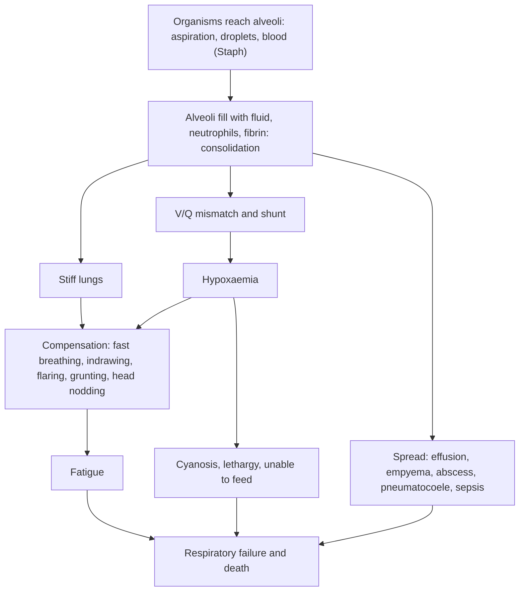

## 1. Definition

**Lower respiratory tract infections (LRTIs)** are infections below the larynx: **pneumonia** (infection of the lung parenchyma), **bronchiolitis** (viral inflammation of the small airways in infants), **bronchitis**, and the special cases of **pertussis**, **empyema**, **aspiration** and **HIV-related pneumonia** (PCP). Pneumonia is the **single largest infectious cause of death in children worldwide** (WHO fact sheet), and in Uganda it is one of the top three killers of under-fives, alongside malaria and neonatal conditions.

The WHO/IMCI approach was designed so that a health worker with a watch and a pair of eyes can save most of these children:

1. **Count** the breaths for a full minute, **look** for chest indrawing, **check** for danger signs, and **measure SpO₂**.
2. **Classify**: no pneumonia (cough or cold) / **pneumonia** (oral amoxicillin at home) / **severe pneumonia** (refer, oxygen, injectable antibiotics).
3. **Give oxygen** when SpO₂ is below 90%. Hypoxaemia is the strongest predictor of death, and oxygen is the most life-saving drug on the ward.
4. **Review at 48 hours** and think of the reasons for failure: Staph, TB, HIV/PCP, empyema, foreign body, heart failure, malnutrition.

> [!PEARL]
> The one thing never to forget: **put a pulse oximeter on every child with cough or difficult breathing.** Clinical signs miss about a third of hypoxaemic children, and a child with SpO₂ <90% is several times more likely to die. Oxygen is cheap; a missed reading is not.

| Term | Meaning |
|---|---|
| **Pneumonia** | Infection of the lung parenchyma (alveoli). Clinically (WHO): cough or difficult breathing **plus fast breathing and/or chest indrawing** |
| **Fast breathing** (WHO/IMCI) | **<2 months: ≥60/min; 2–11 months: ≥50/min; 12–59 months: ≥40/min**; ≥5 years: >30/min (UCG 2023) |
| **Lower chest wall indrawing** | The lower chest wall goes **in** when the child breathes **in** (not just the soft tissue between the ribs); must be present all the time and in a calm child |
| **General danger signs** (IMCI) | **Unable to drink or breastfeed, vomits everything, convulsions (now or in this illness), lethargic or unconscious** |
| **Hypoxaemia** | SpO₂ **<90%** at sea level (<87% above 2,500 m) |
| **Bronchiolitis** | Acute viral LRTI in infants <2 years: coryzal prodrome, then cough, tachypnoea or recession and wheeze and/or crackles (NICE NG9) |
| **Empyema** | Pus in the pleural space |
| **Pneumatocoele** | Thin-walled air cyst in the lung, typical of **staphylococcal** pneumonia |
| **Aspiration pneumonitis / pneumonia** | Lung injury from inhaled gastric contents, hydrocarbons (kerosene) or oropharyngeal secretions; infection may follow |
| **Pertussis (whooping cough)** | Toxin-mediated respiratory infection with *Bordetella pertussis*: paroxysmal cough with whoop, vomiting, apnoea in infants |

## 2. Epidemiology

- **Global**: pneumonia accounted for **14% of under-five deaths (740,180 children in 2019)** and 22% of deaths in children aged 1–5 years (WHO fact sheet 2022). Pneumonia and diarrhoea together cause **23% of under-five deaths, about 1.17 million a year** (WHO 2024 guideline).
- **Uganda**: one of the top three killers of under-fives, with malaria and neonatal conditions.
- **HIV-infected infants**: *Pneumocystis jirovecii* causes at least a quarter of pneumonia deaths (WHO).

**What is available**

| Level | Usually available | Often missing |
|---|---|---|
| **VHT (iCCM)** | Respiratory timer, **amoxicillin DT**, referral | Oximeter (some now have) |
| **HC III** | Amoxicillin DT, first-dose injectable (benzylpenicillin, gentamicin), paracetamol | Oxygen, oximeter (improving), X-ray |
| **HC IV / General Hospital** | Oxygen concentrators, pulse oximeters, ampicillin, gentamicin, ceftriaxone, cloxacillin, X-ray (some) | Reliable power for concentrators, blood culture, chest drains |
| **Regional / National Referral** | X-ray, ultrasound, blood culture, chest drains, bubble CPAP (Mulago, some RRHs), HDU | PICU and ventilators (very few beds) |

> [!UGANDA]
> Oxygen access has improved in Uganda through concentrators, cylinder plants at regional referral hospitals and **solar-powered oxygen** projects, but many wards still run out at night or during power cuts. Check the concentrator and the oximeter at the start of every shift, and **prioritise oxygen** for children with SpO₂ <90%. Bubble CPAP made from nasal prongs, tubing and a water bottle is used at Mulago and several regional hospitals for severe pneumonia and bronchiolitis.

## 3. Aetiology and Risk Factors

**Causes by age** (UCG 2023; WHO)

| Group | Organisms |
|---|---|
| **Neonates** | Group B streptococcus, *Klebsiella*, *E. coli*, *S. aureus*, *Chlamydia* |
| **Children <5 years** | *Streptococcus pneumoniae* (commonest bacterial), *Haemophilus influenzae*, *S. aureus*; viruses (**RSV** the commonest viral cause, influenza, measles, hMPV) |
| **≥5 years** | Pneumococcus, *Mycoplasma pneumoniae*, viruses |
| **HIV-infected infants** | *Pneumocystis jirovecii*, CMV, TB, Gram negatives |
| **Bronchiolitis** | RSV |
| **Pertussis** | *Bordetella pertussis* |
| **Staphylococcal pneumonia** | Follows measles, influenza, skin sepsis or pyomyositis |

**Risk factors**: malnutrition (wasting, stunting), HIV infection or exposure, no breastfeeding in the first 6 months, low birth weight, **indoor air pollution from charcoal and firewood**, crowding, parental smoking, missed vaccines (PCV, Hib, measles, pertussis), measles, sickle cell disease.

**Aspiration risk**: cerebral palsy, reduced consciousness, swallowing problems; toddlers eating groundnuts, beans or maize (foreign body); kerosene or paraffin stored in drink bottles.

## 4. Pathophysiology

**How pneumonia makes a child hypoxic**

1. Organisms reach the alveoli (aspiration of nasopharyngeal flora, inhaled droplets, or blood spread in Staph).
2. **Inflammation fills alveoli with fluid, neutrophils and fibrin** (consolidation).
3. **Ventilation–perfusion mismatch and shunt**: blood passes alveoli that are not ventilated → **hypoxaemia** (not corrected by breathing faster).
4. The child compensates by **breathing faster** (tachypnoea) and harder (**indrawing**, nasal flaring, grunting = breathing out against a partly closed glottis to keep alveoli open; head nodding = accessory neck muscles in an infant).
5. Fatigue, sepsis, dehydration, hypoglycaemia and **hypoxaemia** cause death; malnutrition and HIV blunt the signs (less fever, less tachypnoea).

**Why the signs work**

- **Fast breathing** is the most sensitive single sign of pneumonia; age-specific cut-offs account for normal infant rates.
- **Chest indrawing** reflects stiff (non-compliant) lungs pulling on a compliant chest wall; it marks more severe disease.
- **Crackles** come from fluid in small airways and alveoli; **bronchial breathing** from consolidation transmitting tracheal sounds; but auscultation in a crying infant is unreliable, which is why WHO relies on counting and looking.

**Bronchiolitis**: RSV infects the bronchiolar epithelium → **necrosis, oedema, mucus and cell debris plug the small airways** → air trapping (hyperinflation, wheeze) and atelectasis (crackles) → V/Q mismatch and hypoxaemia. Infants have tiny airways and are obligate nasal breathers, so a blocked nose worsens feeding and breathing. The illness **peaks on days 3–5** and cough resolves within 3 weeks in 90% (NICE NG9). β₂-agonists don't work because the problem is plugging, not smooth-muscle spasm.

**Pertussis**: *B. pertussis* attaches to ciliated epithelium and releases **pertussis toxin** (lymphocytosis, hypoglycaemia, impaired immune response) and tracheal cytotoxin (ciliary damage). Thick mucus and damaged cilia cause **paroxysms** of coughing; the inspiratory **whoop** is air rushing through a narrowed glottis after the paroxysm. Young infants may not whoop: they **stop breathing (apnoea) and go blue**.

**Staphylococcal pneumonia and empyema**: *S. aureus* produces toxins (e.g. Panton-Valentine leukocidin) that cause **necrosis**: abscesses, **pneumatocoeles**, **pneumothorax** and **empyema**. It often follows measles, influenza, skin sepsis or pyomyositis, and progresses fast.

**Hydrocarbon aspiration**: kerosene and paraffin have **low viscosity and surface tension**: tiny amounts spread over the airways, dissolve surfactant and cause chemical pneumonitis. Inducing vomiting gives the fluid a second chance to be aspirated.

**Feature links**

- Alveolar exudate → V/Q mismatch and shunt → hypoxaemia → low SpO₂, central cyanosis, restlessness, lethargy.
- Stiff, consolidated lungs → small tidal volume → fast breathing.
- Stiff lungs pulling on a compliant chest wall → lower chest wall indrawing.
- Expiration against a partly closed glottis to keep alveoli open → grunting.
- Accessory neck muscles in an infant → head nodding; increased work → nasal flaring.
- Work of breathing → cannot drink or breastfeed → dehydration, hypoglycaemia.
- Fluid in small airways → crackles; consolidation transmitting tracheal sounds → bronchial breathing, dullness.
- Pus in the pleural space → stony dullness, absent breath sounds, mediastinal shift, persistent fever.
- Staph necrosis → pneumatocoeles, abscess, pneumothorax (sudden deterioration, hyper-resonance).
- Bronchiolar plugging → air trapping → wheeze, hyperinflation; atelectasis → fine crackles.
- Blocked nose in an obligate nasal breather → poor feeding and worse distress.
- Pertussis toxin → lymphocytosis, hypoglycaemia; ciliary damage and thick mucus → paroxysms; air rushing through a narrowed glottis → whoop; raised intrathoracic pressure → post-tussive vomiting, subconjunctival haemorrhage; infant airway → apnoea and cyanosis.
- Pneumocystis interstitial inflammation → severe hypoxaemia with few crackles; interstitial "ground glass" on X-ray.
- Hydrocarbon dissolving surfactant → chemical pneumonitis → cough, fast breathing after ingestion.
- Hypoxaemia, sepsis and hyponatraemia (SIADH) → convulsions, reduced consciousness.
- Malnutrition and HIV → blunted fever and tachypnoea, so signs underestimate severity.

## 5. Classification / Staging

**WHO/IMCI classification of cough or difficult breathing (2–59 months; UCG 2023; WHO 2024 guideline)**

| Classification | Signs | Treatment |
|---|---|---|
| **Severe pneumonia (or very severe disease)** | Cough or difficult breathing + **any**: general danger sign; **central cyanosis or SpO₂ <90%**; **severe respiratory distress** (grunting, very severe chest indrawing, head nodding); (in UCG also: extrapulmonary features in malnourished or HIV-positive children) | **Admit or refer** after first dose of antibiotic; oxygen; **ampicillin (or benzylpenicillin) + gentamicin** |
| **Pneumonia** | **Fast breathing and/or chest indrawing**, no danger sign | **Oral amoxicillin 40 mg/kg twice daily for 5 days** (3 days for fast breathing alone in low-HIV areas); review in 2–3 days |
| **No pneumonia: cough or cold** | None of the above | Home care, soothing remedy, **no antibiotic**; cough >14 days → TB, asthma, pertussis |

> [!UGANDA]
> The **WHO 2024 guideline on pneumonia and diarrhoea in children up to 10 years** confirmed that **chest-indrawing pneumonia without danger signs** is treated with **oral amoxicillin for 5 days as an outpatient** (rather than injectable antibiotics in hospital), and allowed **3 or 5 days** for fast-breathing pneumonia (3 days only in **low-HIV** settings). Uganda's adult HIV prevalence is about 5%, so **5 days** remains standard (UCG 2023). Uganda's **integrated community case management (iCCM)** lets VHTs give amoxicillin dispersible tablets for fast-breathing pneumonia in children 2–59 months.

**Young infants (<2 months)**: UCG 2023: **consider every infant under 2 months with pneumonia as severe** (fast breathing ≥60, severe chest indrawing, grunting, not feeding, convulsions, drowsiness, apnoea, SpO₂ <90%) → admit, ampicillin + gentamicin. (WHO's 2015 possible serious bacterial infection guidance allows outpatient oral amoxicillin for **fast breathing alone in infants 7–59 days** when referral is impossible; know it exists, but in hospital practice we admit.)

**Pneumonia in children ≥5 years (UCG 2023)**

- **Moderate**: fever, chest pain, cough, RR >30, no chest indrawing → oral amoxicillin.
- **Severe**: plus chest indrawing, pulse >120, temperature >39.5 °C, danger signs, SpO₂ <90% → admit, IV benzylpenicillin or ampicillin (± gentamicin) or ceftriaxone.

**Bronchiolitis severity** (UCG; NICE): severe if **age <3 months**, RR >60–70, difficulty feeding (<50–75% of usual), **SpO₂ <92%**, apnoea, grunting, cyanosis, exhaustion.

**Pertussis stages**: catarrhal (1–2 weeks, most infectious) → paroxysmal (1–6 weeks) → convalescent (weeks to months, "100-day cough").

## 6. Clinical Features

### History

Each question has a reason.

- **Cough and its duration** → <14 days acute; **≥14 days**: TB, asthma, pertussis, foreign body, HIV lung disease. Also difficult or fast breathing, fever, grunting, chest pain.
- **Age** → <2 months = severe by definition (neonatal sepsis organisms); <2 years with coryza and wheeze = bronchiolitis.
- **Danger signs**: able to drink or breastfeed? vomiting everything? convulsions? sleepy? → any one = severe pneumonia.
- **Paroxysms, whoop, post-tussive vomiting, apnoea or cyanosis** → pertussis (macrolide, isolate, contacts).
- **Sudden choking** → foreign body; **ingestion** of kerosene, paraffin or other chemicals → hydrocarbon pneumonitis.
- **Recent measles, skin boils or pyomyositis** → Staph.
- **HIV**: mother's status, infant's PCR or antibody, cotrimoxazole, ART → PCP and TB risk; ART decisions. Recurrent pneumonias.
- **TB contact** → TB workup.
- **Growth and nutrition**: weight-for-height Z-score, MUAC, oedema, breastfeeding → SAM changes antibiotics and fluids.
- **Immunisation**: PCV ×3, pentavalent ×3 (Hib, pertussis), MR ×2; BCG scar → aetiology and catch-up.
- **Treatment so far**: antibiotics (which, how long?) → treatment-failure pathway; herbal medicines; "nebulisation" at a clinic.
- **Home**: cooking fuel, smokers, crowding, siblings ill → prevention advice.

### Examination

Follow the order of Hutchison's Clinical Methods (24th edition), adapted for children: **look before you touch**, count the breaths and listen to the chest while the child is calm on the mother's lap, and leave distressing parts (ears, throat) to last. In an emergency the ETAT assessment (section 9) comes first.

#### Introduction, consent and preparation

- Introduce yourself; confirm the child's name, age and the carer's relationship; explain; consent from the parent and assent from the child.
- **Hand hygiene**.
- **Position and exposure**: on the mother's lap, sitting up; expose the chest fully (you cannot see indrawing through clothes) in a warm room.

#### General inspection (end of the bed)

| Sign | Mechanism | What it means |
|---|---|---|
| Lethargic, unconscious, unable to drink | Hypoxaemia, sepsis | **Danger sign: severe pneumonia** |
| Central cyanosis (tongue, lips) | Hypoxaemia | Severe pneumonia; oxygen |
| Nasal flaring, grunting, **head nodding** | Increased work; keeping alveoli open | Severe respiratory distress |
| **Lower chest wall indrawing** | Stiff lungs on a compliant chest wall | Pneumonia (at least) |
| Paroxysms with whoop or apnoea | Pertussis | Admit infants |
| Kerosene smell | Hydrocarbon ingestion | Do not induce vomiting |
| Wasting, oedema | Malnutrition | SAM protocol; blunted signs |
| Measles rash, skin boils | Predisposition to Staph | Cloxacillin cover |

**Vital signs and growth**: **count the RR for 60 seconds** while the child is calm (on the mother's lap, not feeding, not crying; watch the abdomen in infants); **SpO₂** with an appropriately sized probe (finger or toe in infants), good waveform; temperature, HR, capillary refill, hydration; **weight, length or height, WHZ, MUAC, oedema**.

#### Hands, face and neck

- **Hands**: clubbing (bronchiectasis, chronic HIV lung disease, TB); pallor; cold peripheries and CRT >3 s (shock, uncommon in pneumonia).
- **Face and mouth**: central cyanosis; oral thrush and parotid swelling (HIV); subconjunctival haemorrhage (pertussis); measles rash, Koplik spots.
- **Neck**: lymphadenopathy (HIV, TB); trachea position (shift away from an effusion or tension pneumothorax, towards collapse); neck stiffness (meningitis).

#### Respiratory system

| Step | Sign | What it means |
|---|---|---|
| Inspection | Fast breathing for age; lower chest wall indrawing; asymmetry | Pneumonia; severity; effusion or pneumothorax |
| Palpation | Trachea deviated; reduced expansion on one side | Effusion, empyema, pneumothorax, collapse |
| Percussion | Dull | Consolidation |
| Percussion | **Stony dull** | Effusion or empyema |
| Percussion | Hyper-resonant one side | Pneumothorax |
| Auscultation | Bronchial breathing, focal crackles | Consolidation |
| Auscultation | Reduced or absent breath sounds | Effusion, empyema, collapse, foreign body |
| Auscultation | Fine crackles and wheeze under 2 years | Bronchiolitis |
| Auscultation | Wheeze | Viral wheeze or asthma: re-count after a bronchodilator |
| Auscultation | Clear chest between paroxysms | Pertussis |

#### Completing the examination

- **Heart**: murmur, gallop (heart failure: VSD, RHD, myocarditis; severe anaemia).
- **Abdomen**: liver size (heart failure), hepatosplenomegaly (HIV).
- **Skin**: boils, pyomyositis, measles rash; **BCG scar**; signs of SAM.
- **Fontanelle and neck stiffness**: meningitis.
- **Ears and throat, last**: otitis media.
- **Thank**, **wash hands**, **summarise** with the WHO classification and SpO₂.

| Document these positives | And these negatives |
|---|---|
| RR (counted for 60 s) and age cut-off | "No general danger signs" |
| Chest indrawing; grunting; head nodding | "No central cyanosis" |
| SpO₂ in air (and on oxygen) | "No wheeze" (or wheeze: re-count after bronchodilator) |
| Focal signs (dullness, bronchial breathing, crackles) | "No stony dullness; trachea central" |
| WHZ, MUAC, oedema, HIV status, vaccines | "No hepatomegaly or murmur" |

### Red flags

> [!REDFLAG]
> **Severe pneumonia, needs admission now:** any general danger sign (unable to drink or breastfeed, vomits everything, convulsions, lethargy or unconsciousness), **SpO₂ <90%** or central cyanosis, grunting, head nodding, very severe chest indrawing, RR ≥70, age <2 months, severe acute malnutrition, apnoea.

> [!REDFLAG]
> **Pneumonia that is not responding**: still febrile and breathless after 48 h on correct antibiotics, rising RR, new dullness (empyema), sudden worsening (pneumothorax), pneumatocoeles (Staph), very low SpO₂ out of proportion to signs in an HIV-exposed infant (PCP).

### Thinking like a clinician

- **Count, don't guess.** "Fast breathing" by impression is wrong half the time. Use the respiratory timer and a full minute.
- **Fever + fast breathing in Uganda = pneumonia and/or malaria.** Do an RDT on every febrile child; **treat both** if both are present. Severe malaria with acidosis also causes deep, fast breathing.
- **Wheeze changes the story.** Fast breathing with wheeze in an infant → bronchiolitis or viral wheeze; in an older child → asthma (give salbutamol and **re-count**: if fast breathing resolves, it was bronchospasm, not pneumonia). WHO advises a rapid-acting bronchodilator trial before classifying wheezing children with fast breathing.
- **The thin, HIV-exposed infant with severe hypoxaemia and few chest signs** has PCP until proven otherwise: high-dose cotrimoxazole + steroid, alongside standard antibiotics.
- **Staph clues**: measles, skin boils or pyomyositis, rapid deterioration, pneumatocoeles, empyema, pneumothorax.
- **Persistent fever and cough >2 weeks with weight loss** → TB (see the TB topic); **sudden onset in a toddler** → foreign body.
- **Basal crackles + hepatomegaly + murmur** → heart failure (VSD, RHD, myocarditis): fluids and diuretics, not just antibiotics.
- **SAM + pneumonia**: signs are blunted; treat as complicated SAM (antibiotics for all, careful fluids, F-75, warmth, glucose).
- **A child with danger signs is severe whatever the SpO₂.**

## 7. Differential Diagnoses

| Differential | Distinguishing clinical feature | Distinguishing investigation |
|---|---|---|
| **Pneumonia** | Fever, cough, fast breathing, indrawing, focal crackles or bronchial breathing | Clinical; SpO₂; CXR if severe |
| **Bronchiolitis** | <2 y, coryza then cough, fine crackles and wheeze, hyperinflation, little fever | Clinical |
| **Asthma / viral wheeze** | Recurrent wheeze, responds to bronchodilator, atopy | Bronchodilator trial |
| **Malaria** (severe, with acidosis) | Deep (acidotic) breathing, fever, pallor, prostration, clear chest | RDT or blood smear, lactate |
| **Heart failure** (VSD, PDA, RHD, cardiomyopathy, severe anaemia) | Hepatomegaly, gallop, murmur, poor feeding or sweating, oedema | CXR (cardiomegaly), Hb, echo |
| **Pulmonary TB** | Cough ≥2 weeks, weight loss, TB contact, non-response to antibiotics | Xpert, CXR, TST |
| **PCP (HIV)** | HIV-exposed or infected infant 2–6 months, severe hypoxaemia, few crackles, high LDH | HIV PCR or test; CXR interstitial |
| **Foreign body aspiration** | Sudden choking, unilateral signs | Inspiratory and expiratory CXR; bronchoscopy |
| **Pertussis** | Paroxysms, whoop, vomiting, apnoea; clear chest between bouts; lymphocytosis | Clinical; PCR (rare) |
| **Hydrocarbon aspiration** | Kerosene smell, cough after ingestion | History; CXR at 6 h |
| **Metabolic acidosis** (DKA, severe dehydration, salicylate) | Deep sighing breathing, clear chest | Glucose, ketones, gas |
| **Sepsis / meningitis** | Fast breathing from fever and acidosis; neck stiffness, bulging fontanelle | LP, blood culture |

## 8. Clinical Workup

"Available at" is the lowest level that usually offers the test [VERIFY: compiled from the source notes, not an MoH list].

### Bedside

| Test | Why / how | Expected finding | How it changes management | Available at |
|---|---|---|---|---|
| **Respiratory rate** (timer) | 60 s, calm child | Fast breathing by age | Classifies pneumonia | All levels, including VHT |
| **Pulse oximetry** | Right-sized probe; warm extremity; steady trace for 30–60 s | **<90% = severe pneumonia, give oxygen**; 90–93% = monitor closely | Oxygen, admission | HC IV and above; improving at HC III; some VHTs |
| **Malaria RDT** | Every febrile child | Positive | Co-treat malaria | All levels |
| **Random blood glucose** | Lethargic, not feeding, SAM | Hypoglycaemia | 10% dextrose 5 mL/kg | HC IV and above; variable at HC III |
| **Haemoglobin (HemoCue)** | Pallor, severe illness | Severe anaemia; heart failure from anaemia mimics pneumonia | Transfuse if Hb ≤4 g/dL, or 4–6 g/dL with respiratory distress, shock or impaired consciousness | HC III/IV and above [VERIFY] |
| **HIV rapid test / DNA PCR** | Status unknown; infants of positive mothers need PCR | Positive | PCP risk; ART; cotrimoxazole | Rapid test all levels; PCR sample referred (hub system) |
| **MUAC tape** | 6–59 months | <11.5 cm = SAM | SAM protocol | All levels |
| **Bronchodilator trial** | Wheeze + fast breathing: salbutamol 2 puffs via spacer or 2.5 mg nebulised, re-count after 15–20 min | Fast breathing resolves | Bronchospasm, not pneumonia | All levels with salbutamol |

### Basic lab

| Test | When | Expected / abnormal finding | How it changes management | Available at |
|---|---|---|---|---|
| **Full blood count** | Severe or complicated | Neutrophilia (bacterial); lymphocytosis >20 × 10⁹/L (pertussis); anaemia; low platelets | Supports diagnosis; transfusion | HC IV and above |
| **Urea, electrolytes** | Severe illness, IV fluids, SAM | Hyponatraemia (SIADH), AKI | Fluid restriction (about 2/3 maintenance if Na low) | General hospital and above [VERIFY] |
| **GeneXpert** (sputum, gastric aspirate, **stool**, NPA) | Cough ≥2 weeks, TB contact, HIV, not responding | MTB detected ± rifampicin resistance | TB treatment | HC IV and hospitals; samples referred from lower levels |

### Imaging

| Test | When | Expected finding | How it changes management | Available at |
|---|---|---|---|---|
| **Chest X-ray** | Severe pneumonia, not responding at 48 h, suspected complications (effusion, empyema, pneumothorax, pneumatocoeles), suspected TB or foreign body. **Not needed** for non-severe pneumonia | Lobar consolidation (pneumococcus); patchy bronchopneumonia; **pneumatocoeles, empyema** (Staph); hilar nodes, miliary pattern (TB); diffuse interstitial "ground glass" (PCP); hyperinflation (bronchiolitis) | Staph → cloxacillin; empyema → drain; TB → Xpert, treat; PCP → cotrimoxazole | HC IV (some), all hospitals |
| **Chest ultrasound** | Suspected effusion or empyema | Fluid, septations, size | Guides tap and drain site | RRH, NRH, some HC IVs |

### Specialised / referral-level

| Test | When | Expected finding | How it changes management | Available at |
|---|---|---|---|---|
| **Blood culture** | Severe pneumonia, before antibiotics if possible | Pneumococcus, Staph, *Klebsiella*, *Salmonella* | Tailors therapy; yield low | RRH, NRH only |
| **Pleural fluid** (diagnostic tap) | Effusion | Pus; pH <7.2, glucose low, LDH high (empyema); lymphocytes, high protein (TB); Gram stain, culture, **Xpert** | Chest drain for empyema; TB treatment | Hospitals with ultrasound |
| **Nasopharyngeal swab PCR** (RSV, pertussis, influenza) | Research and outbreaks, private hospitals | Viral or pertussis diagnosis | Isolation, macrolide for pertussis | Rarely available |
| **Blood gas** | Severe distress, CPAP, HDU | Rising pCO₂ | CPAP or ventilation | NRH, ICU |
| **Bronchoscopy** | Suspected foreign body | Object seen and removed | Definitive | NRH (Mulago ENT/surgery) |

### Putting it together

**Model one-line summary**

> "A 10-month-old girl weighing 7.2 kg (WHZ −1.5, MUAC 12.4 cm), fully immunised for age including PCV ×3, HIV-exposed with a negative DNA PCR at 6 weeks and still breastfeeding (repeat test due), with 3 days of cough and fever, now unable to breastfeed, RR 64, lower chest wall indrawing, grunting and SpO₂ 86% in air, malaria RDT negative: **severe pneumonia with hypoxaemia**."

**Problem list**

1. Severe pneumonia (danger sign + hypoxaemia).
2. Hypoxaemia: oxygen.
3. HIV-exposed infant, breastfeeding: repeat HIV test; consider PCP if hypoxaemia severe and test positive.
4. Moderate wasting risk (WHZ −1.5): monitor feeding.

**Working diagnosis**: *severe community-acquired pneumonia (likely pneumococcal) with hypoxaemia in an HIV-exposed infant.*

**Model case presentation (ward round)**

> "Namubiru is a 10-month-old girl from Nansana, weighing 7.2 kg (WHZ −1.5, MUAC 12.4 cm, no oedema), up to date with UNEPI vaccines for age including PCV and pentavalent ×3 and MR1 at 9 months, HIV-exposed with a negative DNA PCR at 6 weeks, still breastfeeding plus family foods. She presented with 3 days of cough and fever and was unable to breastfeed today. On arrival: lethargic but rousable, T 39.0 °C, RR 64 (counted for 60 s), HR 168, SpO₂ 86% in air, lower chest wall indrawing, grunting, bronchial breathing in the right upper zone; no wheeze, no hepatomegaly; malaria RDT negative; RBS 4.8 mmol/L. Classification: **severe pneumonia with hypoxaemia**. She is on oxygen 1 L/min via nasal prongs (SpO₂ 95%), IV ampicillin 360 mg 6-hourly and gentamicin 54 mg once daily, NG expressed breast milk, paracetamol. Plan: monitor RR, SpO₂ 3-hourly; repeat HIV test (rapid antibody at 9 months+, PCR if positive); review at 48 h for failure; CXR if not improving; nutritional follow-up."

> [!EXAM]
> **Worked example 1: classify three children with cough.**
> (a) 8 months, RR 56, no indrawing, feeding well, SpO₂ 96% → fast breathing (≥50) → **pneumonia** → amoxicillin 40 mg/kg twice daily × 5 days at home, review in 2–3 days.
> (b) 3 years, RR 38, lower chest wall indrawing, drinking, SpO₂ 94% → indrawing → **pneumonia** (WHO 2014/2024: outpatient oral amoxicillin 5 days, unless other risks such as SAM or HIV infection; many Ugandan clinicians still admit).
> (c) 18 months, RR 52, not able to drink, SpO₂ 88% → **severe pneumonia** → admit, oxygen, ampicillin + gentamicin.

> [!EXAM]
> **Worked example 2: the 48-hour review.** A 2-year-old (11 kg) on ampicillin + gentamicin for 48 h is still febrile (39.5 °C), RR 60, SpO₂ 89% on 1 L/min, with new stony dullness and absent breath sounds over the right base. CXR: right pleural effusion with a pneumatocoele in the left upper zone. **Interpretation**: treatment failure from **staphylococcal pneumonia with empyema**. Action: ultrasound-guided **diagnostic tap** (thick pus) → **chest drain**; switch to **cloxacillin 50 mg/kg (550 mg) 6-hourly + gentamicin 7.5 mg/kg once daily** for at least 3 weeks; increase oxygen; blood culture; HIV test; nutritional support.

## 9. Management

### Immediate / emergency

**First 5 minutes**

1. **ETAT triage**: Airway and Breathing emergency signs (obstructed breathing, **central cyanosis, severe respiratory distress**), circulation (cold hands + CRT >3 s + weak fast pulse), coma or convulsions, severe dehydration. If present → resuscitation area.
2. **Oxygen** for SpO₂ <90% or any emergency sign (target **≥94% during resuscitation**, then ≥90%).
3. **Position**: sitting up on the mother's lap; clear the nose with gentle suction.
4. **Check glucose** (lethargic, convulsing or not feeding): treat hypoglycaemia <2.5 mmol/L (or <3 mmol/L in SAM) with **10% dextrose 5 mL/kg IV** (or 50 mL of 10% dextrose or sugar water by NG if no IV).
5. **Convulsions**: diazepam 0.5 mg/kg rectally or 0.2–0.3 mg/kg IV (UCG 2023); look for meningitis and malaria.
6. **Weigh** the child; **first dose of antibiotics** without delay in severe pneumonia (before referral if you are at a lower level).
7. **Shock** is uncommon in pneumonia; if present (and no SAM), give 10–20 mL/kg Ringer's lactate or normal saline and reassess; think sepsis and dehydration.

**ABCDE summary**: **A** clear the nose, sit up; **B** SpO₂, oxygen, RR; **C** CRT, pulse, bolus only if shocked and not SAM; **D** AVPU, glucose, convulsions; **E** temperature, rash, skin sepsis, weight, MUAC.

**Choking (foreign body)**: effective cough → encourage coughing. Ineffective cough: infant – 5 back blows + 5 chest thrusts; child >1 y – 5 back blows + 5 abdominal thrusts; unconscious → CPR.

### Definitive

#### A. Pneumonia (non-severe): outpatient

1. **Oral amoxicillin dispersible tablets (250 mg) 40 mg/kg per dose twice daily for 5 days** (UCG 2023; WHO 2024 minimum 80 mg/kg/day):
   - 2–12 months (4–<10 kg): **250 mg (1 tab)** twice daily
   - 1–3 years (10–<14 kg): **500 mg (2 tabs)** twice daily
   - 3–5 years (14–19 kg): **750 mg (3 tabs)** twice daily
2. **Wheeze**: salbutamol inhaler with spacer 1–2 puffs (or more) 4–6-hourly until wheeze stops (UCG 2023).
3. **Fever**: paracetamol 15 mg/kg 6-hourly.
4. **Home care**: continue breastfeeding and feeding, extra fluids, clear the nose, keep warm (not overwrapped).
5. **Return immediately** if unable to drink or breastfeed, breathing faster or harder, becomes sicker, convulsions.
6. **Review after 2–3 days** (IMCI/UCG): better → complete course; same or worse → severe pathway (refer, injectable antibiotics, oxygen).

#### B. Severe pneumonia: inpatient (UCG 2023, WHO Pocket Book 2013)

1. **Admit**; refer from HC III/IV after the first dose of antibiotics (IM if no IV access).
2. **Oxygen** if SpO₂ <90% (section E).
3. **Antibiotics (first line)**: **ampicillin 50 mg/kg IV/IM 6-hourly** (or **benzylpenicillin 50,000 IU/kg IV/IM 6-hourly**) **plus gentamicin 7.5 mg/kg IV/IM once daily**, for **at least 5 days** (up to 10). Switch to oral amoxicillin 40 mg/kg twice daily when improving, to complete at least 5 days in total (UCG) (WHO: total 5–10 days).
4. **Second line** (no improvement after **48 h**, or very severe): **ceftriaxone 80 mg/kg IV/IM once daily** (UCG 2023; max 2 g), 7–10 days.
5. **Suspected Staph** (pneumatocoeles, empyema, skin sepsis, after measles, rapid deterioration): **cloxacillin 50 mg/kg IV/IM 6-hourly + gentamicin 7.5 mg/kg once daily**, for **at least 3 weeks** (UCG: 21 days).
6. **Last resort** if the above are unavailable: chloramphenicol 25 mg/kg IV 6-hourly (not in neonates <7 days or preterm).
7. **Supportive care**:
   - **Fluids**: encourage breastfeeding and oral fluids; NG feeds or IV fluids if unable to drink. Give **maintenance only** (Holliday–Segar), and consider restricting to about two-thirds of maintenance if very severe or hyponatraemic (SIADH). Avoid overload, especially in small and malnourished children (UCG).
   - **Fever**: paracetamol 15 mg/kg 6-hourly (UCG 10 mg/kg 4–6-hourly).
   - **Wheeze**: salbutamol 1–2 puffs (or more via spacer) 4–6-hourly.
   - **Gentle suction** of thick upper-airway secretions; **no chest physiotherapy** in acute pneumonia.
   - **Convulsions**: diazepam 0.5 mg/kg rectally or 0.2–0.3 mg/kg IV; if continuous, phenobarbital 15–20 mg/kg IV/IM loading (UCG lists 10–15 mg/kg IM), then 3–5 mg/kg/day.
   - **Glucose**: prevent hypoglycaemia (feeds; dextrose if not feeding).
8. **Treat co-existing conditions**: malaria (IV artesunate if severe), SAM (WHO 2023 SAM protocol), anaemia (transfuse if Hb ≤4 g/dL, or 4–6 g/dL with respiratory distress, shock or impaired consciousness), HIV (cotrimoxazole, ART).

#### C. Young infants (<2 months)

- **Admit all** (UCG 2023). Keep warm (skin-to-skin), breastfeed or expressed milk by NGT, prevent hypoglycaemia.
- **Ampicillin 50 mg/kg IV** (WHO: **12-hourly in week 1, 8-hourly in weeks 2–4**, 6-hourly from 1 month; UCG 2023 uses 6-hourly at all ages) **+ gentamicin** **5 mg/kg once daily** (term, first week of life) / **7.5 mg/kg once daily** (>7 days); LBW in week 1: **3 mg/kg** (WHO; UCG 4 mg/kg preterm).
- Severely ill: **ceftriaxone 100 mg/kg once daily** (UCG 2023) (avoid with calcium-containing IV fluids and in jaundiced neonates; cefotaxime preferred where available).
- Oxygen to keep SpO₂ **≥90%** (UCG: >94% for neonates with emergency signs).
- At least 5 days, and 3 days after the infant is well; **10 days** if septicaemia; **21 days** if meningitis (UCG).

#### D. Hypoxaemia and oxygen therapy (WHO 2016 oxygen therapy for children; UCG 2023)

**Who gets oxygen**

- **SpO₂ <90%** (at Ugandan altitudes; <87% above 2,500 m) → oxygen.
- **Emergency signs** (obstructed or absent breathing, severe respiratory distress, central cyanosis, shock, coma, convulsions) → oxygen during resuscitation to **SpO₂ ≥94%**.
- **No oximeter**: give oxygen if **central cyanosis, grunting, nasal flaring, head nodding, inability to drink or feed because of breathing difficulty, severe lower chest wall indrawing, RR ≥70, or depressed consciousness** (WHO 2016; WHO 2024 adds head nodding, nasal flaring, grunting or RR ≥20 above the age cut-off as signs of hypoxaemia).

**Delivery**

| Device | Flow | FiO₂ approx | Notes |
|---|---|---|---|
| **Nasal prongs** (preferred) | **0.5–1 L/min neonates; 1–2 L/min infants; 2–4 L/min older children** | 30–35% (at 1–2 L/min in infants) | Comfortable; child can feed; no humidification needed at these flows |
| **Nasal catheter** (8 Fr, inserted to the distance nose–inner eyebrow) | 0.5–2 L/min | 35–40% | Needs humidification if high flow; risk of gastric distension |
| **Face mask** | 5–10 L/min (≥5 to avoid CO₂ rebreathing) | 40–60% | Older children, emergencies |
| **Head box** | 2–3 L/min/kg | Variable | Neonates; wasteful, CO₂ build-up |
| **Bubble CPAP** | 5–10 cm H₂O via nasal prongs | – | Severe pneumonia or bronchiolitis not improving on standard oxygen (RRH, NRH) |

**Weaning**

- **Trial off oxygen daily** when stable: if SpO₂ stays **≥90% in room air for 10–15 minutes** (and the child is not distressed), stop and recheck after 1 h and then 3-hourly for the first day.
- Concentrators need constant power: keep a cylinder as back-up; use one concentrator with a flow splitter to treat several children only if each child's flow is measured.

> [!UGANDA]
> Uganda's 2023 guideline (UCG) says oxygen when **SpO₂ <90%** for children with pneumonia, and **>94%** for young infants with emergency signs. NICE uses 92% (bronchiolitis). For exams in Uganda: **<90% = give oxygen**.

#### E. Bronchiolitis (UCG 2023 5.2.1; NICE NG9)

1. **Diagnose**: <2 years (usually <1), coryza 1–3 days, then cough, fast breathing or recession, and wheeze and/or crackles. Worst on days 3–5.
2. **Assess severity** (section 5).
3. **Mild–moderate** (feeding, no hypoxaemia): home care, saline drops, small frequent feeds, paracetamol for fever, return if worse.
4. **Admit if severe**:
   - **Oxygen** to keep SpO₂ **≥90%** (WHO) / ≥92% (NICE): nasal prongs 1–2 L/min (UCG: humidified 1–2 L/min).
   - **Feeding**: small frequent breastfeeds; **NG or OG feeds** if not feeding adequately; IV fluids only if NG not tolerated (isotonic, about maintenance).
   - **Gentle nasal suction** if secretions block the nose.
   - **CPAP** if impending respiratory failure.
5. **What not to give** (NICE NG9): antibiotics (unless secondary bacterial infection), salbutamol, adrenaline, hypertonic saline, steroids, ipratropium, montelukast, chest physiotherapy.

> [!UGANDA]
> **UCG 2023 differs from NICE**: for severe bronchiolitis UCG suggests a **trial of salbutamol** (2 puffs via spacer every 30 min or 2.5 mg nebulised; **continue 6-hourly only if it helps, stop if no response**) and **nebulised adrenaline 1:1000, 1 mL in 2–4 mL saline, every 2–4 h**; it also lists total fluids of **150 mL/kg/24 h** plus losses. NICE NG9 and WHO recommend **no bronchodilators** and **no more than maintenance fluids** (overload and SIADH risk). On Kampala wards most consultants follow the supportive (NICE/WHO) approach and allow a single salbutamol trial in older infants with wheeze [VERIFY: current ward practice]. Check your unit's practice.

**Discharge**: SpO₂ ≥90–92% in air for 4 h (including sleep), feeding ≥75% of normal, clinically stable; counsel that cough may last 3 weeks.

#### F. Pertussis (UCG 2023 5.2.8)

1. **Recognise**: catarrhal stage (1–2 weeks, most infectious), **paroxysmal stage** (1–6 weeks: bouts of coughing ending in a **whoop**, **post-tussive vomiting**, subconjunctival haemorrhages; infants <6 months: **apnoea and cyanosis**, may not whoop), convalescent stage (weeks to months, "100-day cough").
2. **Admit** infants <6 months, any with apnoea, cyanosis, pneumonia, convulsions, dehydration or malnutrition.
3. **Antibiotics** (within 3 weeks of cough onset, UCG): **azithromycin** (preferred, especially <1 month) or **erythromycin 12.5 mg/kg 6-hourly** (UCG 10–15 mg/kg) for 7 days (UCG; 14 days classically). Reduces infectiousness; changes the course only if early.
4. **Supportive**: oxygen for cyanosis or apnoea (SpO₂ <90%), **gentle suction** of secretions after paroxysms, **small frequent feeds** (re-feed after vomiting), NG feeds if needed, monitor for apnoea (put near the nursing station).
5. **Do NOT give**: cough mixtures, sedatives, mucolytics, antihistamines (UCG: "useless in pertussis").
6. **Isolate** until 5 days of antibiotics.
7. **Contacts**: macrolide prophylaxis for household contacts (especially infants and pregnant women); complete DTP vaccination; DTP at 6, 10, 14 weeks (UNEPI). **Notifiable.**

#### G. Empyema and parapneumonic effusion

1. Suspect: **persistent fever** after 48–72 h of antibiotics, **stony dull percussion**, reduced or absent breath sounds, mediastinal shift.
2. **CXR + ultrasound**; **diagnostic tap** (pus, Gram stain, culture, **Xpert**, pH, glucose).
3. **Chest drain** (intercostal, 5th intercostal space mid-axillary line, underwater seal) for frank pus or large or complicated effusion; surgery (decortication) at NRH for loculated empyema not draining.
4. **Antibiotics**: **cloxacillin 50 mg/kg 6-hourly + gentamicin 7.5 mg/kg once daily** (Staph cover), or ceftriaxone if pneumococcal; continue **3–4 weeks** (IV until afebrile, then oral).
5. **Exclude TB** (lymphocytic exudate, TB contact, HIV).

#### H. HIV-related pneumonia

- **HIV-exposed or infected infant with severe pneumonia**: standard antibiotics **plus high-dose cotrimoxazole for PCP** (especially age 2–6 months, severe hypoxaemia, few chest signs) for **21 days**, **prednisolone** if hypoxaemic, then cotrimoxazole prophylaxis. Test (DNA PCR <18 months), and start **ART** within 2 weeks (not delayed by PCP; TB requires attention to timing).
- Consider **TB**, CMV, LIP, bronchiectasis in HIV-positive children with chronic or recurrent pneumonia.

#### I. Aspiration

| Situation | Management |
|---|---|
| **Kerosene, paraffin or hydrocarbon ingestion** | **Do not induce vomiting, no gastric lavage, no activated charcoal**. Remove contaminated clothes, wash skin. Oxygen if SpO₂ <90%. **Observe ≥6 hours**; CXR at 6 h if symptomatic. Antibiotics only if secondary bacterial pneumonia (fever after 24–48 h with new signs). |
| **Foreign body** (groundnut, bean, maize, bead) | Acute choking: first aid (Immediate / emergency). Later presentation (unilateral wheeze, recurrent pneumonia in one lobe) → inspiratory and expiratory CXR, **rigid bronchoscopy** (Mulago ENT/surgery). |
| **Aspiration pneumonia** (cerebral palsy, reduced consciousness, swallowing problems) | Ampicillin + gentamicin + **metronidazole**, or amoxicillin-clavulanate; positioning, feeding assessment, NG feeding. |

### Drug table

| Drug | Dose (per kg + max for children; adult) | Route | Frequency | Duration | Key cautions |
|---|---|---|---|---|---|
| **Amoxicillin DT** (non-severe pneumonia; step-down) | **40 mg/kg**, max 1 g/dose (by age: 1, 2 or 3 × 250 mg tabs); adult 500 mg–1 g 8-hourly [VERIFY] | Oral | **12-hourly** | **5 days** (3 days fast breathing only in low-HIV settings) | Dissolve in breast milk or water |
| **Ampicillin** (severe pneumonia, infants) | **50 mg/kg**, max 2 g/dose | IV/IM | **6-hourly** (12-hourly week 1, 8-hourly weeks 2–4, WHO) | ≥5 days | Switch to oral amoxicillin when improving |
| **Benzylpenicillin** (severe pneumonia, alternative) | **50,000 IU/kg**, max 2–4 MU/dose | IV/IM | 6-hourly | ≥5 days | – |
| **Gentamicin** (with ampicillin) | **7.5 mg/kg** (>1 week old); **5 mg/kg** (first week); LBW week 1 **3 mg/kg** (WHO; UCG 4 mg/kg preterm) | IV/IM | **Once daily** | ≥5 days | Renal and ototoxicity; avoid courses >7–10 days without levels |
| **Ceftriaxone** (second line; severely ill infants) | **80 mg/kg** (100 mg/kg in severely ill infants, UCG), max 2 g (4 g meningitis) | IV/IM | Once daily | 7–10 days | Not with IV calcium in neonates; avoid in jaundiced neonates (cefotaxime preferred); AWaRe Watch |
| **Cloxacillin** (Staph pneumonia, empyema) | **50 mg/kg** (25–50), max 2 g/dose | IV/IM then oral | **6-hourly** | **≥21 days** (3–4 weeks empyema) | With gentamicin |
| **Chloramphenicol** (if others unavailable) | **25 mg/kg** | IV | 6-hourly | 5–10 days | Not <7 days old or preterm (grey baby syndrome) |
| **Cotrimoxazole (high dose)** (PCP) | **120 mg/kg/day** of combined drug (= TMP 20 mg/kg/day) in 3–4 divided doses (UCG); WHO: TMP 8 mg/kg + SMX 40 mg/kg 8-hourly | Oral/IV | 6–8-hourly | **21 days**, then prophylaxis | Rash, marrow suppression |
| **Prednisolone** (PCP with hypoxaemia) | **2 mg/kg/day** in divided doses for 5 days then taper over 21 days (UCG; WHO 1–2 mg/kg/day for 1 week) | Oral | Divided doses | About 21 days total | – |
| **Azithromycin** (pertussis) | **<6 months: 10 mg/kg once daily × 5 days; ≥6 months: 10 mg/kg day 1 (max 500 mg), then 5 mg/kg days 2–5 (max 250 mg)** | Oral | Once daily | 5 days | Preferred in neonates (CDC); fewer GI effects |
| **Erythromycin** (pertussis, UCG first line; *Mycoplasma*) | **12.5 mg/kg** (UCG 10–15 mg/kg) | Oral | **6-hourly** | **7 days** (UCG) to 14 days | Avoid in <1 month (pyloric stenosis) |
| **Doxycycline** (*Mycoplasma* in **>8 y**) | 2 mg/kg, max 100 mg | Oral | 12-hourly | 7–10 days | Not <8 y |
| **Metronidazole** (aspiration pneumonia, lung abscess) | 7.5 mg/kg (UCG 12.5 mg/kg IV for lung abscess) | IV/oral | 8-hourly | With penicillin; lung abscess 4–6 weeks | – |
| **Paracetamol** (fever, pain) | 15 mg/kg (UCG 10 mg/kg 4–6-hourly), max 60 mg/kg/day; adult 1 g | Oral | 6-hourly | As needed | – |
| **Salbutamol** (wheeze) | 100 µg/puff, 2 puffs (or more) via spacer; or 2.5 mg nebulised | Inhaled | 4–6-hourly | Until wheeze stops | Re-count RR after a trial |
| **Diazepam** (convulsions) | 0.5 mg/kg rectally or 0.2–0.3 mg/kg IV | PR/IV | Once, repeat once if needed [VERIFY] | – | Respiratory depression; look for meningitis, malaria |
| **Phenobarbital** (continuing convulsions) | Load 15–20 mg/kg (UCG 10–15 mg/kg IM), then 3–5 mg/kg/day | IV/IM | Load, then daily | – | Respiratory depression |
| **10% dextrose** (hypoglycaemia) | 5 mL/kg | IV (or 50 mL by NG) | Once, recheck | – | Hypoglycaemia <2.5 mmol/L (<3 in SAM) |
| **Furosemide** (heart failure) | 1 mg/kg | IV/oral | [VERIFY: frequency] | – | Hypokalaemia |

> [!DRUG]
> **Gentamicin once daily** is standard: 7.5 mg/kg for children over 1 week old (UCG 2023), 5 mg/kg in the first week of life. Write the actual mg dose using today's weight, and avoid courses longer than 7–10 days without levels.

### Referral criteria

| Setting | What to do | Refer up when |
|---|---|---|
| **VHT (iCCM)** | Count RR with a timer; fast breathing (2–59 months) → amoxicillin DT 5 days | Any danger sign or chest indrawing → first dose amoxicillin and refer |
| **HC III** | Classify; pneumonia → amoxicillin 5 days | Severe → first dose IM ampicillin or benzylpenicillin + gentamicin, oxygen if available, refer with a referral note |
| **HC IV / General Hospital** | Admit severe pneumonia; oxygen; IV/IM ampicillin + gentamicin; ceftriaxone if failing; CXR if available | Empyema needing a drain; CPAP; failure despite second line → RRH |
| **RRH** | All above, chest drains, CPAP, blood cultures, Xpert, HDU | Ventilation, bronchoscopy, decortication → NRH |
| **NRH (Mulago)** | Bronchoscopy, surgery, PICU | n/a |

**Referral checklist**: first antibiotic dose given; oxygen during transfer; glucose checked; keep warm and breastfeeding; referral note with times and doses.

### Monitoring and follow-up

- **Inpatients** (UCG 2023): RR every 2 hours (more often if very sick), temperature 6-hourly, **SpO₂ at least every 3–6 hours** (UCG minimum 12-hourly; every 3 h while on oxygen is better practice), feeding, alertness, work of breathing.
- **On oxygen**: SpO₂ at least every **3 hours**; check prongs are in the nose, tubing unkinked, concentrator working.
- **Review at 48 hours** for treatment failure (mnemonic "STEP-HIV-F", section 14).
- **Outpatient pneumonia**: review at **2–3 days**.

### Discharge and prevention of recurrence

- Discharge when off oxygen ≥24 h, feeding well, afebrile, improving; complete antibiotics at home.
- **Before discharge**: check and **catch up vaccines** (PCV, pentavalent, MR), HIV status, nutrition (enrol in OTC or ITC if SAM or MAM), counsel on smoke, breastfeeding, handwashing, danger signs; follow up in 1–2 weeks.

## 10. Complications

**Disease-related**

| Complication | Clues | Action |
|---|---|---|
| **Hypoxaemia / respiratory failure** | SpO₂ <90%, exhaustion | Oxygen, CPAP, ICU |
| **Parapneumonic effusion / empyema** | Persistent fever, stony dullness | Tap, drain, prolonged antibiotics |
| **Lung abscess / pneumatocoeles** | Staph, cavities | Cloxacillin; most pneumatocoeles resolve |
| **Pneumothorax / pyopneumothorax** | Sudden deterioration, hyper-resonance | Needle decompression, chest drain |
| **Sepsis, meningitis** | Shock, neck stiffness, bulging fontanelle | LP, meningitic doses |
| **Hyponatraemia (SIADH)** | Seizures, lethargy | Fluid restriction, sodium correction |
| **Heart failure** | Hepatomegaly, gallop | Fluid restriction, furosemide 1 mg/kg |
| **Malnutrition, growth faltering** | Weight loss | Nutritional rehabilitation |
| **Pertussis complications** | New fever, apnoea, fits | Pneumonia, apnoea, convulsions, encephalopathy, malnutrition, dehydration, hernias, rectal prolapse, subconjunctival haemorrhage |
| **Long-term** | Bronchiectasis (after measles, pertussis, recurrent pneumonia), post-infectious bronchiolitis obliterans | Physiotherapy, specialist |

**Treatment-related**

| Complication | Cause | Recognition and action |
|---|---|---|
| Fluid overload, hyponatraemia | Excess IV fluids (and UCG's 150 mL/kg/day in bronchiolitis) | Maintenance or two-thirds maintenance; weigh, check sodium |
| Nephrotoxicity, ototoxicity | Gentamicin, prolonged courses | Once daily, ≤7–10 days without levels |
| Calcium precipitation; kernicterus risk | Ceftriaxone in neonates | No IV calcium; avoid in jaundiced neonates |
| Grey baby syndrome | Chloramphenicol in neonates | Not under 7 days or preterm |
| Pyloric stenosis | Erythromycin under 1 month | Use azithromycin |
| Rash, marrow suppression | High-dose cotrimoxazole | FBC; stop if severe rash |
| Gastric distension, nasal trauma | Nasal catheter oxygen | Prefer prongs |
| Aspiration | Inducing vomiting after kerosene | Never induce vomiting |
| Respiratory depression | Sedatives, cough mixtures in pertussis | Do not give |

## 11. Prognosis

- **Hypoxaemia** is the strongest predictor of death: a child with SpO₂ <90% is several times more likely to die.
- Most children with non-severe pneumonia recover on 5 days of oral amoxicillin.
- **Bronchiolitis** peaks on days 3–5; cough resolves within 3 weeks in 90% (NICE NG9).
- **Pertussis**: the convalescent stage lasts weeks to months ("100-day cough"); young infants are at greatest risk of apnoea and death.
- **Pneumatocoeles**: most resolve.
- **Long-term**: bronchiectasis after measles, pertussis or recurrent pneumonia; post-infectious bronchiolitis obliterans.
- Malnutrition and HIV blunt the signs and worsen the outcome.

## 12. Prevention

- **Exclusive breastfeeding** to 6 months.
- **Vaccines (UNEPI)**: **PCV and pentavalent (DTP-HepB-Hib) at 6, 10, 14 weeks; measles-rubella at 9 and 18 months**.
- **HIV**: cotrimoxazole prophylaxis for HIV-exposed infants; prevention of vertical transmission; early ART.
- **Nutrition and zinc**; treat malnutrition.
- **Clean air**: improved cookstoves, cook outside, no smoking indoors.
- **Handwashing**; reduce crowding.
- **Pertussis contacts**: macrolide prophylaxis (especially infants and pregnant women), complete DTP.
- **Safety**: store kerosene and paraffin out of reach and never in drink bottles [VERIFY: general safety advice, not in the source guidelines].

## 13. Special Populations

- **Young infants <2 months**: all pneumonia is severe; ampicillin dosing interval and gentamicin dose depend on age and birth weight; ceftriaxone cautions; oxygen target ≥90% (>94% with emergency signs).
- **Children ≥5 years**: fast breathing >30/min; UCG moderate vs severe categories; consider *Mycoplasma* (erythromycin; doxycycline only >8 y).
- **HIV-exposed or infected**: PCP (high-dose cotrimoxazole + prednisolone), TB, CMV, LIP; DNA PCR under 18 months; ART within 2 weeks.
- **Severe acute malnutrition**: signs blunted; antibiotics for all, careful fluids (no standard boluses), F-75, warmth, glucose (<3 mmol/L threshold); hypoglycaemia threshold higher.
- **Sickle cell disease**: risk factor for pneumonia [VERIFY: acute chest syndrome management not covered in source; see sickle cell topic].
- **Measles**: Staph pneumonia risk; vitamin A.
- **Cerebral palsy**: recurrent aspiration; add metronidazole.

## 14. Key Points

### High-yield points

- **Count for a full minute**: 60–50–40 cut-offs.
- **Pulse oximeter on every child with cough or difficult breathing**; SpO₂ <90% = oxygen.
- Pneumonia (fast breathing and/or indrawing, no danger sign): oral amoxicillin 40 mg/kg twice daily for 5 days.
- Severe pneumonia: oxygen + ampicillin or benzylpenicillin + gentamicin for at least 5 days.
- Every infant under 2 months with pneumonia is severe.
- Not better at 48 h: think Staph, TB, empyema, PCP, heart failure, wrong diagnosis, foreign body.
- Bronchiolitis: supportive care; no routine antibiotics or steroids.
- HIV-exposed infant with severe hypoxaemia and few signs: add high-dose cotrimoxazole and prednisolone.
- Kerosene: never induce vomiting; observe 6 h.
- Test every febrile child for malaria; treat both if both are present.

### Numbers & doses

| Item | Value |
|---|---|
| Fast breathing | **≥60** (<2 m), **≥50** (2–11 m), **≥40** (1–4 y), **>30** (≥5 y, UCG) |
| Hypoxaemia | SpO₂ **<90%** (oxygen); target **≥94%** with emergency signs |
| Severe tachypnoea | RR **≥70** |
| Amoxicillin (pneumonia) | **40 mg/kg 12-hourly × 5 days** (3 days fast breathing only, low-HIV areas) |
| Amoxicillin by age (250 mg DT) | 2–12 m: **1 tab**; 1–3 y: **2 tabs**; 3–5 y: **3 tabs** twice daily |
| Ampicillin | **50 mg/kg 6-hourly** IV/IM |
| Benzylpenicillin | **50,000 IU/kg 6-hourly** |
| Gentamicin | **7.5 mg/kg once daily** (5 mg/kg first week of life) |
| Ceftriaxone | **80 mg/kg once daily** (100 mg/kg sick infants) |
| Cloxacillin (Staph) | **50 mg/kg 6-hourly × ≥21 days** |
| Cotrimoxazole for PCP | **120 mg/kg/day** (TMP 20 mg/kg/day) in 3–4 doses × **21 days** |
| Erythromycin (pertussis) | **12.5 mg/kg 6-hourly** × 7 days (UCG; 14 classically) |
| Nasal prong flow | **0.5–1 L/min** neonates; **1–2 L/min** infants; **2–4 L/min** older |
| Wean oxygen | SpO₂ **≥90%** in air for **10–15 min** |
| Review | Outpatient pneumonia at **2–3 days**; inpatient failure at **48 h** |
| Hydrocarbon ingestion | Observe **≥6 h** |
| Hypoglycaemia | <2.5 mmol/L (<3 in SAM): **10% dextrose 5 mL/kg** |
| Transfuse | Hb **≤4 g/dL**, or 4–6 g/dL with distress, shock or impaired consciousness |

### Exam traps

- **"Crackles are needed to diagnose pneumonia."** No: WHO diagnosis is fast breathing and/or chest indrawing; auscultation is unreliable in infants.
- **"Chest indrawing = admit for IV antibiotics."** Since WHO 2014 (confirmed 2024), indrawing **without danger signs** can be treated with oral amoxicillin at home; admit if danger signs, SpO₂ <90%, SAM, age <2 months, or HIV-infected or unable to follow up.
- **"Cotrimoxazole for pneumonia."** No: amoxicillin is first line; cotrimoxazole is for PCP and prophylaxis.
- **"Salbutamol, steroids and antibiotics for bronchiolitis."** International guidance: supportive care only.
- **"Induce vomiting after kerosene ingestion."** Never.
- **"Ceftriaxone first for every admitted child."** First line is ampicillin or penicillin + gentamicin; ceftriaxone is second line (AWaRe Watch antibiotic).
- **"Normal SpO₂ means mild."** A child with danger signs is severe whatever the SpO₂.
- **"Fever + fast breathing = pneumonia, no need for an RDT."** Always test for malaria in Uganda.

### Questions seniors ask

**Viva questions**

1. *What are the WHO fast-breathing cut-offs?* <2 months ≥60; 2–11 months ≥50; 12–59 months ≥40 breaths/min.
2. *Name the general danger signs.* Unable to drink or breastfeed, vomits everything, convulsions, lethargic or unconscious.
3. *What is the first-line treatment of severe pneumonia?* Oxygen if SpO₂ <90%, ampicillin 50 mg/kg 6-hourly (or benzylpenicillin 50,000 IU/kg) + gentamicin 7.5 mg/kg once daily, at least 5 days.
4. *Which organisms cause pneumatocoeles?* *Staphylococcus aureus* (also *Klebsiella*); treat with cloxacillin + gentamicin for 3 weeks.
5. *When do you suspect PCP?* HIV-exposed or infected infant 2–6 months, severe hypoxaemia with few signs, not on cotrimoxazole prophylaxis.
6. *How do you wean oxygen?* Daily trial off when stable; stop if SpO₂ ≥90% in air for 10–15 min, then recheck.
7. *What is the treatment of bronchiolitis?* Supportive: oxygen, feeds (NG), nasal suction; no routine antibiotics or steroids.

**On the ward round**

- **How do you classify this child?** State the age, RR against the cut-off, chest indrawing, danger signs and SpO₂, then the WHO class: no pneumonia, pneumonia, or severe pneumonia.
- **Why ampicillin and gentamicin, not ceftriaxone, first?** They cover pneumococcus, *H. influenzae* and Gram negatives effectively, are Access antibiotics, cheaper and reduce resistance; ceftriaxone is reserved for failure or very sick infants.
- **The child is not better at 48 hours. What do you think about?** Staph (pneumatocoeles, empyema), wrong diagnosis (TB, PCP, heart failure, foreign body), complications (effusion, abscess), malaria, anaemia or SAM, poor adherence or dosing; do a CXR, HIV test, Xpert and switch to ceftriaxone or cloxacillin as appropriate.
- **When do you stop oxygen?** When the child is clinically stable and SpO₂ stays ≥90% in room air for 10–15 minutes on a daily trial off; recheck after an hour and overnight.
- **How would you manage pertussis in a 6-week-old?** Admit, oxygen and suction for apnoea or cyanosis, small frequent or NG feeds, azithromycin 10 mg/kg once daily for 5 days, isolate, treat household contacts, complete DTP doses.
- **How does HIV change your management of severe pneumonia?** Add high-dose cotrimoxazole for PCP (21 days) with prednisolone if hypoxaemic in infants, consider TB, start or optimise ART, and continue cotrimoxazole prophylaxis.
- **What prevents pneumonia in Uganda?** Exclusive breastfeeding, PCV, Hib, pertussis and measles vaccines, good nutrition and zinc, clean cooking fuel, handwashing, HIV prevention and early ART, cotrimoxazole for HIV-exposed infants.

### Mnemonics

- **Fast breathing "60–50–40"**: <2 months 60, 2–11 months 50, 1–5 years 40.
- **Danger signs "DVCL"**: can't **D**rink, **V**omits everything, **C**onvulsions, **L**ethargic or unconscious.
- **Hypoxaemia without an oximeter "CHIN-GRuNt"**: **C**yanosis, **H**ead nodding, **I**nability to feed, **N**asal flaring, **G**runting, **R**ate ≥70 (severe tachypnoea), u**N**conscious or lethargic.
- **Why is pneumonia not getting better? "STEP-HIV-F"**: **S**taph, **T**B, **E**mpyema, **P**CP, **H**eart failure, **I**nadequate dose or adherence, **V**irus or wrong diagnosis (bronchiolitis, asthma), **F**oreign body.
- **Pertussis stages "CPC"**: **C**atarrhal, **P**aroxysmal, **C**onvalescent.

### OSCE tips

- **Counting RR**: expose the chest, child calm (on mother's lap, not feeding), watch the abdomen in infants, count a **full minute** with a timer, state the age cut-off out loud.
- **Chest indrawing**: say "the lower chest wall goes in when the child breathes in" and check the child is calm (not crying, not feeding).
- **Oxygen station**: choose prongs size, set the flow by age, fix prongs with tape, check SpO₂ after 15 min, explain weaning.
- **Counselling a mother on amoxicillin**: dose with the tablet in breast milk or water, twice daily for 5 days even if better, return signs, follow-up in 2–3 days.

## 15. References

1. World Health Organization. Guideline on management of pneumonia and diarrhoea in children up to 10 years of age. Geneva: WHO; 2024. https://www.who.int/publications/i/item/9789240103412
2. Ministry of Health Uganda. Uganda Clinical Guidelines 2023 (5.2.1 Bronchiolitis; 5.2.8 Pertussis; 5.2.9 Pneumonia; 3.1.10.4 Pneumocystis pneumonia). Kampala: MoH; 2023. https://library.health.go.ug/uganda-clinical-guidelines-2023
3. World Health Organization. Pocket Book of Hospital Care for Children, 2nd edition. Geneva: WHO; 2013. https://www.who.int/publications/i/item/978-92-4-154837-3
4. World Health Organization. Pneumonia in children: fact sheet. 2022. https://www.who.int/news-room/fact-sheets/detail/pneumonia
5. National Institute for Health and Care Excellence. Bronchiolitis in children: diagnosis and management (NG9). https://www.nice.org.uk/guidance/ng9
6. The Royal Children's Hospital Melbourne. Bronchiolitis: Clinical Practice Guideline. https://www.rch.org.au/clinicalguide/guideline_index/Bronchiolitis/
7. Medscape (eMedicine). Pediatric Pneumonia. https://emedicine.medscape.com/article/967822-overview
8. Medscape (eMedicine). Bronchiolitis. https://emedicine.medscape.com/article/961963-overview
9. Medscape (eMedicine). Pertussis. https://emedicine.medscape.com/article/967268-overview
10. Glynn M, Drake WM, editors. Hutchison's Clinical Methods: An Integrated Approach to Clinical Practice. 24th edition. Edinburgh: Elsevier; 2018.
