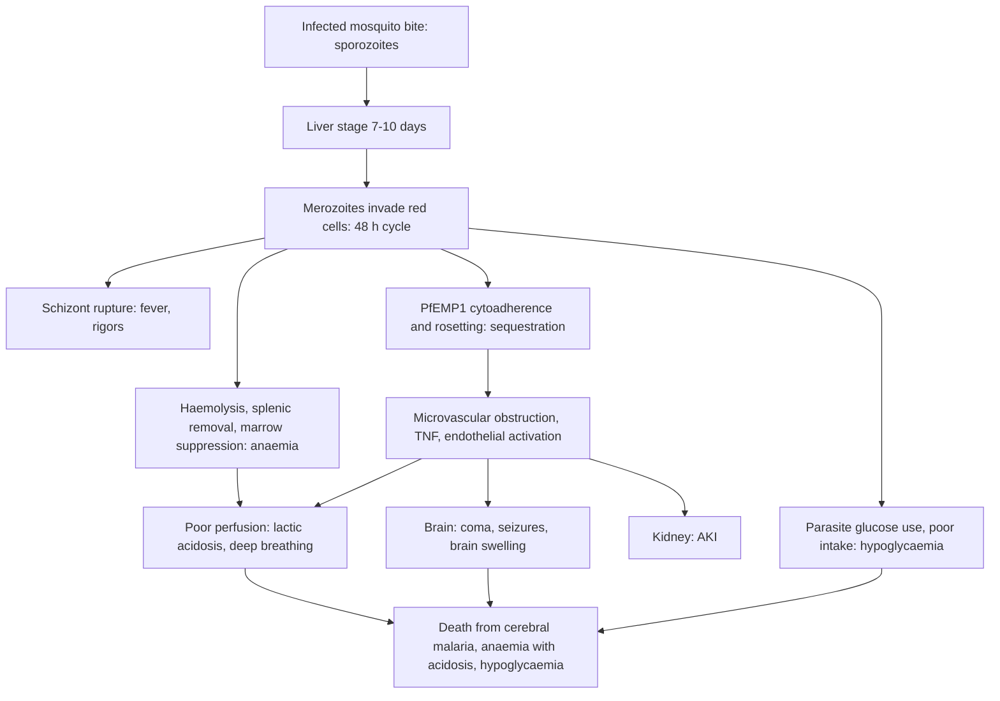

## 1. Definition

Malaria is an acute febrile illness caused by *Plasmodium* parasites carried by female *Anopheles* mosquitoes. In Uganda, **P. falciparum** causes almost all cases and almost all deaths. The Ministry of Health still calls malaria **the leading cause of illness and death in young children**. It fills paediatric wards at Mengo and Mulago and every HC IV in the country.

What you have to grasp is that malaria in a child is either **uncomplicated**, treated with a 3-day oral ACT at home, or **severe**, a medical emergency treated with **parenteral artesunate** plus management of each complication. A child can go from one to the other **within 24 hours**. Most deaths come from **cerebral malaria, severe anaemia with respiratory distress (acidosis), hypoglycaemia** and delays in referral.

> [!PEARL]
> The one thing never to forget: **in a sick febrile child, check three things in the first 5 minutes: consciousness (Blantyre score), blood glucose and Hb.** Then give the first dose of artesunate. Coma, hypoglycaemia and severe anaemia kill within hours, and all three can be treated.

| Term | Definition (UCG 2023 / WHO) |
|---|---|
| **Uncomplicated malaria** | Symptomatic malaria (fever ≥37.5 °C axillary or a history of fever) with a positive RDT or blood slide and **no** feature of severe malaria |
| **Severe malaria** | Asexual *P. falciparum* in blood **plus at least one** severe feature (section 5), with no other confirmed cause |
| **Cerebral malaria** | Unrousable coma (**Blantyre ≤2**, or unable to localise pain) with parasitaemia, lasting **>1 hour after a seizure**, with hypoglycaemia corrected and other causes (meningitis) excluded |
| **Severe malarial anaemia** | **Hb <5 g/dL** (packed cell volume <15%) with parasitaemia (UCG 2023; WHO adds parasite count >10,000/µL) |
| **Hyperparasitaemia** | Parasite density **>10%** of red cells, or >250,000/µL (UCG) |
| **Treatment failure** | Parasites return or persist after a full, correctly taken course (blood slide, not RDT) |

## 2. Epidemiology

- **Global (WHO 2025 fact sheet, 2024 data):** about **282 million cases and 610,000 deaths**; the WHO African Region carries **95%** of both, and **children under 5 account for about 75% of malaria deaths** in the region.
- **Uganda** is consistently among the countries with the highest number of cases worldwide. Transmission is **perennial and high** in most districts (West Nile, Acholi, Lango, Busoga, Karamoja, the east). It is lower and **epidemic-prone in the highlands** (Kabale, Kisoro, Kasese uplands), where older children with little immunity get severe disease.
- **Age**: in high-transmission areas, severe malaria hits the children with the least immunity: **6 months to 5 years**. Severe anaemia peaks at 6–24 months, cerebral malaria at 2–5 years. Babies under 6 months are partly protected by maternal antibody and fetal haemoglobin.

> [!UGANDA]
> **The care pathway in Uganda:** VHTs (iCCM) and HC IIs test with RDTs and give AL. They give **rectal artesunate before referral** for danger signs. HC IIIs give AL and IM/IV artesunate before referral and admit some cases. HC IVs and hospitals manage severe malaria with **IV artesunate, glucose, blood transfusion** (only where there is a blood bank supply) and monitoring. **Blood is the commonest missing resource** at HC IV level, and severe anaemia is often a reason to refer. Mengo, Mulago, Lacor and the regional referral hospitals (RRHs) have paediatric emergency units, the "Acute Care Unit" model.

> [!UGANDA]
> **Artemisinin partial resistance is in Uganda.** Parasites with **kelch13 mutations** (e.g. A675V, C469Y) and slow clearance after artesunate were documented in **northern Uganda** (Balikagala et al., NEJM 2021). The partner drug (lumefantrine, piperaquine) still cures most infections. In practice: **give the full 3-day course, give the partner drug properly with food, and use a blood slide to check that parasites are clearing in children who do not improve.**

## 3. Aetiology and Risk Factors

**Cause**: *Plasmodium falciparum* (almost all Ugandan cases and deaths); *P. vivax*, *P. ovale* (dormant liver hypnozoites, relapse, need primaquine) and *P. malariae* are uncommon. Vector: female *Anopheles* mosquitoes, biting mainly at night.

**Risk factors for severe disease**

| Risk factor | Why it matters |
|---|---|
| **Age 6 months–5 years** in high-transmission areas | Least acquired immunity |
| **Non-immune child** (highlands, or travel between highland and lowland) | Severe disease at any age; adult-type picture |
| **Sickle cell disease** | High mortality with malaria; crises and severe anaemia |
| **HIV** | More severe malaria, other infections |
| **Severe acute malnutrition** | Changes fluids, transfusion volume and glucose threshold |
| **No net** | Exposure |
| **Missed or incomplete ACT course** | Treatment failure, progression |
| **Herbal or "local" treatment first** | Delays care |
| Iron deficiency, hookworm | Worsen anaemia |
| G6PD deficiency + oxidant drugs | Haemoglobinuria |

## 4. Pathophysiology

**Life cycle in one paragraph.** An infected *Anopheles* injects **sporozoites**. These invade liver cells and multiply silently for about **7–10 days** (the incubation period is typically 10–15 days). Then **merozoites** burst into the blood and invade red cells: ring → trophozoite → **schizont**. Each 48-hour cycle ruptures red cells and releases new merozoites; the burst causes the fever. Some parasites become **gametocytes**, which infect the next mosquito. *P. vivax* and *P. ovale* leave dormant liver **hypnozoites** (relapse; need primaquine), but they are uncommon in Uganda.

**Why *P. falciparum* kills: sequestration**

- Infected red cells express **PfEMP1** on surface "knobs". They **stick to the endothelium** of small vessels (cytoadherence) and to uninfected cells (rosetting). Mature parasites therefore **hide in the brain, gut, kidney and placenta** and are not seen on the peripheral film. This is why the **peripheral parasite count can underestimate** the total burden.
- **Microvascular obstruction + inflammation (TNF) + endothelial activation** → reduced tissue perfusion → **lactic acidosis**, coma, renal injury.
- **Brain swelling** occurs in many children who die of cerebral malaria (shown on MRI in Malawian children). This is why **deep coma with abnormal posturing and irregular breathing** is so dangerous.

**Mechanisms of each complication**

| Complication | Mechanism | So you will… |
|---|---|---|
| **Anaemia** | Rupture of parasitised cells, **removal of uninfected cells** by the spleen, **bone-marrow suppression** (dyserythropoiesis); worse with iron deficiency, hookworm, HIV, sickle cell | Transfuse when Hb is very low or the child is decompensating; treat iron deficiency later |
| **Respiratory distress** | Mostly **metabolic acidosis** (lactate from poor perfusion and anaemia), not pneumonia | Correct anaemia and perfusion; the deep breathing settles after transfusion |
| **Hypoglycaemia** | Children have small glycogen stores, fast during illness, and parasites consume glucose; **quinine stimulates insulin release** | Check glucose on arrival, 4-hourly and after every seizure; feed by NGT |
| **Seizures** | Sequestration, fever, hypoglycaemia, hyponatraemia; may be subtle (eye deviation, twitching) | Treat seizures; look for subtle ones in a child who stays in coma |
| **Haemoglobinuria / blackwater** | Intravascular haemolysis (also G6PD deficiency + oxidant drugs) | Hydrate, check Hb and renal function |
| **Delayed haemolysis after artesunate (PADH)** | Red cells that had parasites "pitted" out by the spleen die 1–3 weeks later | Recheck Hb at about 7, 14 and 28 days after severe malaria |

**Why artesunate beats quinine.** Artemisinins kill **young ring stages** before they mature and sequester, so fewer parasites reach the microcirculation. In **AQUAMAT** (5,425 African children, Lancet 2010), artesunate reduced mortality from **10.9% to 8.5%** (a 22.5% relative reduction) and caused fewer convulsions, less deep coma and less hypoglycaemia than quinine.

**Feature links**

- Schizont rupture and cytokine release (TNF) → fever, rigors, headache, vomiting, anorexia.
- Red cell destruction + splenic clearance + marrow suppression → pallor, severe anaemia (Hb <5 g/dL), tachycardia, heart failure (gallop, enlarging liver).
- Anaemia + poor perfusion → lactic acidosis → deep (Kussmaul) breathing, nasal flaring, indrawing without crackles.
- Splenic hyperplasia → splenomegaly.
- Intravascular haemolysis → haemoglobinuria (dark, "Coca-Cola" urine with no red cells); haemolysis and liver dysfunction → jaundice.
- Cerebral sequestration + brain swelling → impaired consciousness, coma, abnormal posturing, irregular breathing, unequal pupils; retinal sequestration → malarial retinopathy.
- Sequestration, fever, hypoglycaemia, hyponatraemia → convulsions, including subtle seizures (eye deviation, twitching).
- Small glycogen stores + fasting + parasite consumption + quinine-induced insulin release → hypoglycaemia → drowsiness, seizures, coma.
- Reduced renal perfusion → oliguria (<0.3 mL/kg/h), raised creatinine.
- Endothelial activation, thrombocytopenia, DIC → bleeding from gums, nose, venepuncture sites.
- Hypovolaemia, sepsis (NTS) → shock: cold hands, CRT >3 s, weak fast pulse.
- Prostration → cannot sit or drink: a severe feature.
- Pitting of once-infected red cells after artesunate → delayed haemolysis 1–3 weeks later.

## 5. Classification / Staging

**Severe malaria features (UCG 2023, adapted for children)**. Any **one** feature with parasitaemia = severe malaria.

| Feature | Criterion |
|---|---|
| **Impaired consciousness / coma** | Blantyre score <3 = coma; confusion, drowsiness or abnormal behaviour = impaired consciousness |
| **Prostration** | Cannot sit unsupported (if normally able to), or cannot drink or breastfeed if too young to sit |
| **Multiple convulsions** | **≥2 convulsions in 24 h** |
| **Respiratory distress / acidosis** | Deep (Kussmaul) breathing, nasal flaring, chest indrawing; bicarbonate <15 mmol/L; lactate ≥5 mmol/L |
| **Severe anaemia** | Hb **<5 g/dL** |
| **Hypoglycaemia** | Glucose **<2.2 mmol/L** (40 mg/dL) in UCG; WHO Pocket Book treats below **2.5 mmol/L** (<3 mmol/L if severely malnourished) |
| **Shock (circulatory collapse)** | Cold peripheries, capillary refill >3 s, weak fast pulse; UCG cites systolic BP <50 mmHg in children |
| **Renal impairment** | Urine output <0.3 mL/kg/h (UCG: <12 mL/kg in 24 h) with raised creatinine |
| **Haemoglobinuria** | Dark ("Coca-Cola") urine with no red cells on microscopy |
| **Jaundice** | Clinical jaundice with parasitaemia |
| **Abnormal bleeding** | Gums, nose, venepuncture sites, haematemesis, melaena |
| **Pulmonary oedema** | Rare in children; more common in adults |
| **Hyperparasitaemia** | >10% |

Children have three main **syndromes**: **cerebral malaria**, **severe malarial anaemia** and **respiratory distress (metabolic acidosis)**. They often overlap, and the overlap carries the highest mortality.

**Blantyre coma scale (children too young to speak; max 5)**

| Domain | Response | Score |
|---|---|---|
| **Eye movement** | Watches or follows (e.g. mother's face) | 1 |
| | Fails to watch or follow | 0 |
| **Best motor response** (painful stimulus: firm pressure on sternum or nail bed) | Localises the pain | 2 |
| | Withdraws the limb | 1 |
| | Non-specific or absent response | 0 |
| **Best verbal response** | Cries appropriately with pain (or speaks, if verbal) | 2 |
| | Moan or abnormal cry | 1 |
| | No vocal response | 0 |

**Interpretation:** 5 = normal; 3–4 = impaired consciousness (still a severe feature); **≤2 = unrousable coma**. Record it on arrival and every 4 hours (more often if it falls). Use GCS for older children.

## 6. Clinical Features

### History

| Question | Why it matters |
|---|---|
| Fever: how long, pattern, rigors? | Malaria usually <7 days; fever >7 days → think typhoid, TB, UTI, abscess, HIV, leukaemia |
| **Convulsions? How many in 24 h, how long, focal?** | ≥2 in 24 h = severe malaria; a long or focal seizure → think meningitis or encephalitis as well |
| Level of activity: playing, drowsy, can't sit, can't drink or breastfeed? | **Prostration and inability to drink** are severe features (IMCI danger signs) |
| Vomiting everything? | Cannot take oral ACT → needs parenteral treatment |
| Dark urine, reduced urine, yellow eyes | Haemoglobinuria, AKI, jaundice |
| Fast or difficult breathing | Acidosis or pneumonia (check both) |
| **Treatment already given:** which antimalarial, dose, how many days, herbal remedies? | Partial treatment, incomplete course (failure); quinine within 12–24 h changes the quinine loading dose |
| Recent travel (highland child visiting the lowlands, or the reverse); where the child lives | Non-immune → severe disease at any age |
| **Sickle cell disease, HIV status (child and mother), cotrimoxazole, TB contact** | SCD → crises and severe anaemia; HIV → more severe malaria, other infections; other diagnoses |
| **Immunisation** (UNEPI card incl. malaria vaccine at 6, 7, 8, 18 months), **vitamin A, deworming**, **net use last night** | Prevention counselling; vaccine eligibility; missed doses |
| **Feeding and growth** (weight-for-age, MUAC), recent weight loss | SAM changes fluids (no boluses), transfusion volume (10 mL/kg) and the glucose threshold |
| Previous admissions, transfusions | Recurrent severe anaemia → post-discharge chemoprevention, look for SCD |

### Examination

**ETAT triage comes first** (section 9). Then follow the order of Hutchison's Clinical Methods (24th edition), adapted for children: observe first, leave distressing parts (fundoscopy, ears, throat) to last, and judge vital signs against age norms.

#### Introduction, consent and preparation

- Introduce yourself; confirm identity; explain; consent from the parent and assent from the child; **hand hygiene**; position on the parent's lap (recovery position if unconscious); expose as needed in a warm room.

#### General inspection (end of the bed)

| Sign | Mechanism | What it means |
|---|---|---|
| Prostrate, cannot sit or drink | Severe systemic illness | Severe malaria |
| Drowsy, unrousable, posturing | Cerebral sequestration, brain swelling | Cerebral malaria (after excluding glucose, seizures, meningitis) |
| **Deep (acidotic) breathing** | Lactic acidosis | Severe anaemia with acidosis: give blood |
| Subtle seizures (eye deviation, twitching) | Ongoing seizure activity | Treat; a reason for persistent coma |
| **Severe palmar pallor** (palms white) | Severe anaemia | IMCI sign of severe anaemia |
| Jaundice; bleeding | Haemolysis, liver dysfunction; DIC | Severe features |
| Wasting, bilateral pedal oedema | SAM (kwashiorkor) | SAM protocol |

**Vital signs and growth**: RR, HR, CRT, BP, SpO₂, temperature, **weight** (needed for every dose), MUAC; plot weight-for-age and height-for-age.

**Normal vital signs by age (guide; use the measured weight for every dose)**

| Age | Respiratory rate (/min) | IMCI "fast breathing" | Heart rate (/min) | Systolic BP (mmHg) |
|---|---|---|---|---|
| <2 months | 30–60 | **≥60** | 110–170 | 60–80 |
| 2–12 months | 30–40 | **≥50** | 110–160 | 70–90 |
| 1–5 years | 25–35 | **≥40** | 95–150 | 80–100 |
| 5–12 years | 20–25 | not defined by IMCI (use age norms) | 80–120 | 90–110 |

Quick lower limit of normal systolic BP for 1–10 years: **70 + (2 × age in years)**.

#### Hands, face and neck

- **Hands**: cold peripheries, CRT >3 s (shock); palmar pallor.
- **Face**: conjunctival and tongue pallor; scleral jaundice; bleeding gums; eyelid oedema (fluid overload).
- **Neck**: neck stiffness (meningitis); in infants, a bulging fontanelle.

#### The systems

- **Respiratory**: rate, **deep breathing**, indrawing, crackles (pneumonia vs acidosis), SpO₂.
- **Cardiovascular**: pulse, CRT, gallop, **liver size** (baseline for overload; hepatomegaly suggests heart failure or fluid overload).
- **Abdomen**: spleen (in cm below the costal margin; malaria or SCD sequestration), liver, bladder.
- **Neurological**: **Blantyre or GCS**, pupils, posturing (decorticate, decerebrate), tone, eye deviation, neck stiffness, fontanelle.

#### Completing the examination

- **Look for another focus**: chest, ears, throat, skin, joints, urine (colour, dipstick).
- **Retina, last**, if you can: malarial retinopathy supports cerebral malaria.
- **Thank**, **wash hands**, **summarise** with the severe features present.
- **Document negatives**: "no neck stiffness, fontanelle not bulging, chest clear, no jaundice".

### Red flags

> [!REDFLAG]
> - **Blantyre ≤2**, or a fall of 1 point or more; abnormal posturing; irregular breathing; unequal pupils (raised ICP)
> - **Deep (acidotic) breathing**, with pallor = severe anaemia with acidosis: transfuse urgently
> - **Glucose <2.5 mmol/L**, or any child in coma or convulsing whose glucose has not been measured
> - **Shock**: cold hands, CRT >3 s, weak fast pulse
> - Repeated convulsions, or a seizure lasting more than 5 minutes
> - **Haemoglobinuria**, anuria, jaundice with bleeding
> - SAM, sickle cell disease or a child under 6 months with malaria

### Thinking like a clinician

- **A positive RDT does not mean malaria is the whole story.** In high-transmission areas many children carry parasites. A child with a positive RDT and a stiff neck still needs an LP. One with a positive RDT and a high respiratory rate with crackles still needs pneumonia treatment. **Co-infection with non-typhoidal *Salmonella* bacteraemia** is common in African children with severe malaria, especially with anaemia, so a very sick child gets **antibiotics too**.
- **Coma + positive RDT** → correct glucose, stop seizures, then reassess after 1 hour. If coma persists, think cerebral malaria **and** meningitis: do an LP if it is safe, or give ceftriaxone if it is not.
- **Deep breathing + very pale** = **severe anaemia with acidosis**: the treatment is **blood**, not oxygen alone or a fluid bolus.
- **Fast breathing + crackles + fever** → may be pneumonia **or** acidosis; check the Hb and look for indrawing.
- **Fever back within 3 weeks of treatment** → RDT (HRP2) may still be positive from the old infection. Do a **blood slide**, and think of other causes.
- **Highland child or older child with severe malaria** → non-immune: more cerebral malaria, renal failure and jaundice (adult-type picture).
- **Common student mistakes**: treating fever as malaria without a test; forgetting the glucose; giving a bolus to a pale, breathless child; giving the IV artesunate dose for the wrong weight band (3 mg/kg under 20 kg); stopping after the parenteral doses without a full oral ACT; forgetting to recheck the Hb after discharge.

> [!EXAM]
> Viva favourite: **"This child has a positive RDT and is in coma. Is it cerebral malaria?"** Model answer: Not yet. Cerebral malaria is a diagnosis of exclusion: **correct hypoglycaemia, stop seizures and wait at least 1 hour** for the post-ictal state to pass, and **exclude meningitis** (LP if safe, or treat empirically). Only persistent unrousable coma (Blantyre ≤2) with parasitaemia and no other cause is cerebral malaria.

## 7. Differential Diagnoses

| Differential | Distinguishing clinical feature | Distinguishing investigation |
|---|---|---|
| **Bacterial meningitis** | Neck stiffness, bulging fontanelle, focal seizures, purpura; can coexist with a positive RDT | LP (CSF cells, Gram stain, glucose) |
| **Viral encephalitis** | Behaviour change, focal signs, seizures; negative or incidental malaria test | LP (lymphocytes, normal glucose) |
| **Septicaemia (incl. NTS)** | Shock, very high or low WBC, focus (skin, bone); malnourished or HIV | Blood culture, FBC |
| **Pneumonia** | Cough, fast breathing with indrawing, crackles, hypoxia | Clinical; chest X-ray |
| **Typhoid fever** | Fever >7 days, abdominal pain, relative bradycardia, rose spots rare | Blood culture (Widal unreliable) |
| **UTI** | Infant with fever and no focus, dysuria, smelly urine | Urine dipstick and culture |
| **Sickle cell crisis** | Known SCD, dactylitis, pain, sudden anaemia with big spleen (sequestration) | Sickling test, Hb trend, reticulocytes |
| **Hypoglycaemia from another cause / poisoning** | History of ingestion (e.g. organophosphates, kerosene), fasting | History, glucose |
| **Febrile convulsion** | 6 months–5 years, single brief generalised seizure, fully alert within 1 h | Clinical; malaria test still required |
| **Measles / other viral fever** | Rash, coryza, conjunctivitis | Clinical |
| **Leukaemia, HIV, TB** | Prolonged fever, weight loss, lymphadenopathy, bleeding | FBC and film, HIV test, TB workup |

## 8. Clinical Workup

1. **Never treat without a test** (UCG 2023), but **never delay parenteral artesunate in a child with danger signs** while waiting for a slide. A negative RDT with severe features and no other cause → UCG says treat as severe malaria **with antibiotics** and repeat the RDT in 12–24 h.
2. **RDT vs slide:** use the **blood slide** if the child has completed treatment and is still sick, returns within 3 weeks, or is RDT-negative with no other cause.
3. **Glucose and Hb are the two most useful tests in severe malaria**, and both can be done in minutes on the ward.

"Available at" is the lowest level that usually offers the test [VERIFY: compiled from the source notes, not an MoH list].

### Bedside

| Test | Why / how | Expected finding | How it changes management | Available at |
|---|---|---|---|---|
| **Malaria RDT (HRP2 or HRP2/pLDH)** | Every febrile child; finger prick; read at 15–20 min | Positive = *P. falciparum* antigen; stays positive 2–3 weeks after cure | Treat; slide if recent treatment | All levels, including VHT |
| **Blood glucose** (glucometer) | On arrival, after each seizure, 4-hourly in severe malaria (more often on quinine) | <2.5 mmol/L | Treat now with 10% dextrose | HC III and above [VERIFY] |
| **Hb / HemoCue** | Finger prick | <5 g/dL = severe malarial anaemia | Guides transfusion | HC III and above [VERIFY] |
| **Blantyre coma scale** | Section 5 | ≤2 = coma | Severity and trend | All levels (clinical) |
| **SpO₂** | Pulse oximeter | <90% | Oxygen | HC IV and above |
| **Urine colour, dipstick** | Inspect; dipstick blood + no RBCs on microscopy | Haemoglobinuria | Hydrate; check Hb, creatinine | HC III and above |
| **Bedside clotting test** | If bleeding | Prolonged | DIC: fresh whole blood, vitamin K | Hospitals |

### Basic lab

| Test | When | Expected / abnormal finding | How it changes management | Available at |
|---|---|---|---|---|
| **Thick and thin blood film** | All admissions; repeat at 24–48 h if not improving | Thick: parasites present; thin: species and **% parasitaemia**; >10% = hyperparasitaemia | Confirms diagnosis; falling count = response | HC III and above |
| **Full blood count** | Severe malaria | Low Hb, low platelets (common, rarely needs treatment), high WBC suggests bacterial co-infection | Transfusion, antibiotics | HC IV and above |
| **Group and cross-match** | Hb <6 g/dL or falling, bleeding | – | Transfusion | Hospitals and some HC IVs (UBTS supply) |
| **HIV test** | Every admitted child with unknown status | Positive | Cotrimoxazole, ART referral | All levels |
| **Sickling test** | Recurrent severe anaemia, family history, splenomegaly in an older child | Positive | SCD care, prophylaxis | Many hospitals |

### Imaging

| Test | When | Expected finding | How it changes management | Available at |
|---|---|---|---|---|
| **Chest X-ray** | Crackles, hypoxia | Consolidation (pneumonia) vs clear (acidosis) | Antibiotics | Hospitals |

### Specialised / referral-level

| Test | When | Expected finding | How it changes management | Available at |
|---|---|---|---|---|
| **Blood culture** | Severe malaria, especially with anaemia, shock or high WBC | NTS, *S. pneumoniae*, Gram-negatives | Antibiotic choice | RRH, NRH, Mengo, Lacor |
| **Lumbar puncture** | Coma or convulsions, especially with a negative test or coma >1 h after correcting glucose and seizures, if no contraindication | Normal CSF in cerebral malaria (opening pressure may be high) | Excludes meningitis; if not possible, give ceftriaxone | Hospitals |
| **Urea, creatinine, electrolytes** | Oliguria, dark urine, deep breathing, older child | Creatinine raised (AKI), sodium low | Fluids, furosemide, referral for dialysis | RRH, NRH |
| **Lactate / blood gas** | Deep breathing | Lactate ≥5 mmol/L, bicarbonate <15 | Severity; response to transfusion | NRH, teaching hospitals |
| **Hb electrophoresis** | Positive sickling test | HbSS | SCD care | Referral labs |

### Putting it together

**Model one-line summary**

> "A 3-year-old boy, 12 kg (weight-for-age Z between −1 and −2), fully immunised except for the malaria vaccine (not yet introduced in his district at his age), HIV negative, presented with 3 days of fever and three generalised convulsions today. He has severe malaria with impaired consciousness (Blantyre 2), hypoglycaemia (2.1 mmol/L, corrected) and moderate anaemia (Hb 6.8 g/dL), RDT positive, 4% parasitaemia, no neck stiffness."

**Problem list**

1. Severe *P. falciparum* malaria, cerebral malaria to be confirmed after glucose and seizures are corrected.
2. Hypoglycaemia.
3. Convulsions.
4. Anaemia, not yet requiring transfusion.
5. Meningitis not yet excluded.

**Model case presentation (ward round)**

> "Baby J, a 2-year-old girl from Mukono, **weight 9.8 kg (weight-for-age Z −1.5), height 84 cm (height-for-age Z −0.9), MUAC 13.5 cm**, admitted 18 hours ago with 3 days of high fever, vomiting and refusal to breastfeed. She is the third child; she is **fully immunised for age by card** (BCG scar present; she missed the malaria vaccine because the rollout reached her district after her 8-month visit). She is **still breastfeeding** with family foods three times a day. Mother is **HIV negative** (tested in ANC); the child was not tested. They own a net but did not use it last week.
> On admission she was **prostrate**, temperature 39.4 °C, RR 52 with deep breathing, HR 168, CRT 2 s, **severe palmar pallor**, spleen 3 cm, Blantyre 4. RDT positive, slide 3+ (5% parasitaemia), **Hb 4.1 g/dL**, glucose 3.8 mmol/L.
> **Assessment: severe malaria with severe anaemia and respiratory distress.** She received IV artesunate 3 mg/kg (30 mg) at 0 and 12 h (third dose due at 24 h), whole blood 20 mL/kg over 4 h, and paracetamol. Today she is alert, breathing normally, feeding, Hb 7.6 g/dL post-transfusion.
> **Plan:** third artesunate dose at 24 h, then DP for 3 days; monthly DP for 3 months (PDMC); HIV test; iron and deworming at follow-up after the infection settles; Hb at day 14–28; net counselling; refer for malaria vaccine catch-up if her district policy allows."

> [!EXAM]
> **Worked example 1: the artesunate dose.**
> A 2-year-old weighs **11 kg** (under 20 kg) → **3 mg/kg × 11 = 33 mg**. A 60 mg vial reconstituted with 1 mL bicarbonate, then 5 mL saline = **10 mg/mL** → give **3.3 mL IV over about 5 minutes** (round to 3.4 mL is acceptable). For IM use, dilute with 2 mL saline = **20 mg/mL** → **1.65 mL IM into the anterior thigh**.
> A 7-year-old weighs **22 kg** (20 kg or more) → **2.4 mg/kg × 22 = 52.8 mg** ≈ 53 mg → **5.3 mL** of the 10 mg/mL solution.
> Doses at **0, 12 and 24 h**, then daily until the child can take oral medication; then a full 3-day ACT.

> [!EXAM]
> **Worked example 2: hypoglycaemia and transfusion volumes.**
> Same 11 kg child, glucose **1.8 mmol/L**: 10% dextrose **5 mL/kg = 55 mL** IV over 5–7 min. If only 50% is available: take **11 mL of 50% dextrose + 44 mL water for injection** (1 + 4 mL/kg) = 55 mL of 10%. Recheck in 15–30 min, then run a dextrose-containing maintenance fluid or start NGT feeds.
> Hb **3.6 g/dL** with deep breathing → transfuse **whole blood 20 mL/kg = 220 mL over 3–4 h** (or packed cells 10–15 mL/kg = 110–165 mL). Recheck Hb after the transfusion; repeat if Hb remains <4 g/dL or the child is still decompensated.

## 9. Management

### Immediate / emergency

**First 5 minutes**

1. **Triage using ETAT**. Emergency signs: obstructed breathing, severe respiratory distress, central cyanosis, shock, **coma**, **convulsing**, severe dehydration. Any emergency sign → resuscitation room now.
2. **ABC**: open the airway, position (recovery position if unconscious), **oxygen** if SpO₂ <90% or severe respiratory distress, suction.
3. **Convulsing?** Diazepam 0.5 mg/kg rectally (or 0.2–0.3 mg/kg slow IV), max 10 mg.
4. **IV or IO access** and draw blood at once for: **glucose (bedside)**, **Hb/HemoCue**, RDT or blood slide, **group and cross-match**, blood culture if available.
5. **Glucose <2.5 mmol/L (or unknown in a comatose child)** → **10% dextrose 5 mL/kg IV**.
6. **Shock?** Bolus only for true shock (complications table).
7. **Blantyre score** and weight. Then the **first dose of IV artesunate** within the first hour.

**Severe malaria: the emergency algorithm**

1. **Triage, ABC, oxygen**, recovery position if unconscious; stop seizures.
2. **IV access**; bedside **glucose, Hb, RDT**; cross-match; blood culture.
3. **Correct hypoglycaemia** (10% dextrose 5 mL/kg).
4. **Give IV artesunate** (IM into the anterior thigh if IV access fails) within the first hour. Weigh the child first.
5. **Shock?** Treat shock; otherwise **no fluid bolus**.
6. **Hb ≤4 g/dL, or 4–6 g/dL with distress, coma or shock** → transfuse.
7. **Coma or convulsions** → LP if safe; if not done, **add ceftriaxone 100 mg/kg/day** (meningitis dose). Very sick or anaemic child → antibiotics for possible bacteraemia.
8. **NGT** if unconscious (feeds, prevent aspiration and hypoglycaemia); catheter if needed for urine output.
9. **Monitor** (Monitoring and follow-up).
10. **Switch to oral ACT** after at least 3 artesunate doses (24 h) once the child can take oral drugs; give the **full 3-day course**.
11. **Discharge plan**: Hb check, post-discharge chemoprevention, nets, vaccine, follow-up.

> [!REDFLAG]
> **Rectal artesunate is a bridge, not a cure.** In the CARAMAL project (Uganda, Nigeria and DRC), many children given rectal artesunate never completed referral or did not receive injectable treatment followed by an ACT, and outcomes were poor. Give it, **then make sure the child actually reaches a facility** that can give injectable artesunate and a full ACT.

**Managing complications**

| Complication | Action (doses per kg) |
|---|---|
| **Convulsions** | **Diazepam 0.5 mg/kg rectally** or **0.2–0.3 mg/kg slow IV** (max 10 mg). Repeat once after 10 min if still fitting. Still fitting → **phenobarbital 15 mg/kg** IV over 15–20 min or IM (UCG: 10–15 mg/kg), then maintenance 2.5–5 mg/kg/day. Check glucose. **No prophylactic anticonvulsants.** Watch breathing after benzodiazepines plus phenobarbital |
| **Hypoglycaemia** (<2.5 mmol/L; UCG severe criterion <2.2) | **10% dextrose 5 mL/kg IV** over 5–7 min (1 mL/kg 50% + 4 mL/kg water). Recheck at 15–30 min. Then dextrose-containing maintenance fluid (e.g. 5–10% dextrose in half-strength Darrow's or RL as available) or NGT feeds. **Never undiluted 50% dextrose** |
| **Severe anaemia** | Transfuse if **Hb ≤4 g/dL**, or **Hb 4–6 g/dL with respiratory distress, impaired consciousness, shock, heart failure or hyperparasitaemia**. **Whole blood 20 mL/kg** or **packed cells 10–15 mL/kg** over **3–4 h**. In **SAM: 10 mL/kg whole blood once**. Furosemide **1 mg/kg IV** only if signs of fluid overload. Recheck Hb after |
| **Shock** (cold hands, CRT >3 s, weak fast pulse) | UCG: **0.9% saline 20 mL/kg** fast; WHO ETAT 2016: **10–20 mL/kg** then reassess. In SAM: 15 mL/kg over 1 h of RL with 5% dextrose (or half-strength Darrow's). Look for sepsis or bleeding; give antibiotics. **No boluses for children who are not in shock** (FEAST) |
| **Acidosis (deep breathing)** | Treat the cause: transfuse if anaemic, correct hypovolaemia only if shocked, oxygen. Bicarbonate is not routinely used in children |
| **Hyperpyrexia** | **Paracetamol 15 mg/kg** every 6 h; tepid sponging, undress |
| **Coma** | Recovery position, airway, NGT, turn 2-hourly, eye care, catheter; exclude hypoglycaemia (if no response within 20 min think of another cause), meningitis; look for subtle seizures |
| **Renal impairment** (urine <0.3 mL/kg/h after rehydration) | Rule out dehydration or shock; furosemide challenge **1 mg/kg** IV (WHO Pocket Book: 2 mg/kg, doubled hourly to max 8 mg/kg); refer for **peritoneal dialysis** if no response |
| **Haemoglobinuria** | Hydrate, check Hb and creatinine, transfuse if needed; continue artesunate |
| **Bleeding** | Fresh whole blood, vitamin K; avoid IM injections if possible |
| **Possible bacteraemia / meningitis** | **Ceftriaxone 100 mg/kg once daily** (max 4 g) IV/IM (or 50 mg/kg 12-hourly) |

### Definitive

#### Uncomplicated malaria (OPD, HC II upwards)

1. **Confirm** with RDT or slide.
2. **First-line: artemether–lumefantrine (AL)** for all ages (UCG 2023). Give the first dose in clinic and watch the child for 30 minutes.
3. **Paracetamol 10–15 mg/kg** every 6 hours for fever (max 4 doses in 24 h).
4. **Counsel**: give each dose with **milk or a fatty meal** (lumefantrine absorption needs fat), finish all 6 doses, sleep under a net, **return at once** with any danger sign (can't drink, vomits everything, convulsion, drowsy, fast breathing) or if fever persists after 2–3 days.
5. **If the child vomits within 30 minutes**, repeat the full dose; between 30 and 60 minutes, repeat half the dose. Vomiting repeatedly → treat as severe (parenteral).

**Artemether–lumefantrine 20/120 mg tablets (UCG 2023)**

| Weight | Tablets per dose | Schedule | Total tablets |
|---|---|---|---|
| **5–14 kg** | **1** | 0 h, 8 h, then twice daily on days 2 and 3 (24, 36, 48, 60 h) | 6 |
| **15–24 kg** | **2** | as above | 12 |
| **25–34 kg** | **3** | as above | 18 |
| **≥35 kg** | **4** | as above | 24 |

Target dose: about **1.7 mg/kg artemether + 10 mg/kg lumefantrine** per dose. Dispersible tablets are available for young children.

> [!UGANDA]
> **Infants under 5 kg.** UCG 2023 lists AL as first line for "all patients including children under 4 months", using the 5–14 kg band. The **latest WHO Guidelines for malaria** (consolidated version updated in September 2026) add a recommendation on a **new artemether–lumefantrine formulation for infants under 5 kg** (a lower-strength dispersible tablet). Check whether it is stocked in your facility before you prescribe; on most Ugandan wards a small infant still gets AL 20/120 dispersible 1 tablet per dose under senior supervision.

#### Severe malaria: completing treatment

- **Parenteral artesunate** at 0, 12 and 24 h, then daily until the child can take oral drugs (minimum 3 doses); then a **full 3-day oral ACT**. Alternatives only if artesunate is unavailable: IM artemether, then IV quinine (drug table).

> [!UGANDA]
> **Completing treatment and post-discharge chemoprevention (UCG 2023):** discharge every child treated for severe malaria on **DHA–piperaquine (DP) for 3 days**, then review **monthly for 3 months** and give a monthly 3-day DP course (**post-discharge malaria chemoprevention, PDMC**). WHO recommends PDMC mainly for children admitted with **severe anaemia**; Uganda's guideline applies it to all severe malaria cases. Also **repeat the Hb before discharge and about 28 days later** (delayed haemolysis after artesunate).

#### Fluids and feeding

- **Maintenance (Holliday–Segar)**: **100 mL/kg/day for the first 10 kg + 50 mL/kg/day for the next 10 kg + 20 mL/kg/day for each kg above 20**. Example: 12 kg child = 1000 + 100 = **1100 mL/day (about 46 mL/h)**.
- Give **orally or by NGT** as soon as possible; IV fluids only while the child cannot feed. **Transfused blood counts towards the total.**
- The **most reliable sign of fluid overload** is an enlarging liver; others are basal crackles, gallop rhythm, eyelid oedema, raised JVP in older children.

### Drug table

| Drug | Dose (per kg + max for children; adult) | Route | Frequency | Duration | Key cautions |
|---|---|---|---|---|---|
| **Artemether–lumefantrine 20/120 mg** (uncomplicated, first line) | By weight: **5–14 kg 1 tab; 15–24 kg 2; 25–34 kg 3; ≥35 kg (and adults) 4** (≈1.7 mg/kg artemether + 10 mg/kg lumefantrine per dose) | Oral, with milk or fatty food | 0, 8, 24, 36, 48, 60 h | 3 days (6 doses) | Repeat full dose if vomited within 30 min, half dose at 30–60 min |
| **Artesunate + amodiaquine** (alternative) | AS **4 mg/kg** + AQ **10 mg base/kg** (UCG age bands: 0–11 months ½ tab of each; 1–6 years 1 tab; 7–13 years 2 tabs); AS 50 mg tab + AQ 153 mg base tab | Oral | Once daily | 3 days | First-line alternative |
| **Dihydroartemisinin–piperaquine 40/320 mg** (second line; completes severe malaria; PDMC) | DHA **4 mg/kg/day** + PPQ **18 mg/kg/day** (children under 25 kg need at least 2.5 mg/kg DHA and 20 mg/kg PPQ); UCG bands: 5–9.9 kg ½ tab; 10–20 kg 1; 20–40 kg 2 | Oral | Once daily | 3 days; PDMC monthly × 3 months | – |
| **Pyronaridine–artesunate** | UCG weight bands (granules 60/20 mg: 5–<8 kg 1 sachet; 8–<15 kg 2; 15–<20 kg 3; tablets 180/60 mg from 20 kg) | Oral | Once daily | 3 days | Newer option |
| **Quinine tablets** (300 mg salt) | **10 mg/kg salt** | Oral | Every 8 h | 7 days | Only if ACTs are unavailable; bitter, poor adherence |
| **Artesunate IV/IM** (severe, first line) | **3 mg/kg if <20 kg; 2.4 mg/kg if ≥20 kg** (adults 2.4 mg/kg) | IV over about 5 min (10 mg/mL) or IM anterior thigh (20 mg/mL) | 0, 12 and 24 h, then **every 24 h** | Until able to take oral drugs (minimum 3 doses); then a full 3-day ACT | Reconstitute each vial with the 1 mL **5% sodium bicarbonate** supplied, then saline or 5% dextrose (never water for injection); use within 1 hour; delayed haemolysis: recheck Hb |
| **Rectal artesunate** (pre-referral, under 6 years only) | About 10 mg/kg: **100 mg** (1 supp) for 4 months to <3 years (5–<14 kg); **200 mg** (2 supps) for 3 to <6 years (14–19 kg) | Rectal | Once | Single pre-referral dose | Hold the buttocks together for 10 min; repeat if expelled within 30 min; **refer immediately** |
| **Artemether** (if no artesunate) | **3.2 mg/kg** loading, then **1.6 mg/kg** | IM (anterior thigh, never buttock) | Loading, then every 24 h | Until oral possible, then full ACT | Erratic absorption; second choice |
| **Quinine dihydrochloride** (if no artemisinin) | **20 mg/kg salt loading** (WHO Pocket Book; omit if quinine or mefloquine in the last 12–24 h), then **10 mg/kg** | IV infusion in 5% dextrose (10 mL/kg) over 2–4 h (loading over 4 h); **never as a bolus** | Every 8 h | Until oral possible, then ACT or quinine tablets to complete 7 days | Causes **hypoglycaemia**, tinnitus, arrhythmia; check glucose 2–4-hourly |
| **10% dextrose** | **5 mL/kg** (= 1 mL/kg 50% + 4 mL/kg water) | IV over 5–7 min | Recheck 15–30 min | Then maintenance dextrose or feeds | Never undiluted 50% |
| **Diazepam** | 0.5 mg/kg PR or 0.2–0.3 mg/kg slow IV, **max 10 mg** | PR/IV | Repeat once after 10 min | – | Respiratory depression, especially with phenobarbital |
| **Phenobarbital** | **15 mg/kg** loading (UCG 10–15), then 2.5–5 mg/kg/day | IV over 15–20 min or IM | Load, then daily | – | No prophylactic use |
| **Paracetamol** | 10–15 mg/kg (max 4 doses in 24 h); adult 1 g | Oral | 6-hourly | While febrile | – |
| **Ceftriaxone** (possible meningitis or bacteraemia) | **100 mg/kg once daily** (max 4 g) or 50 mg/kg 12-hourly | IV/IM | Once daily | Per diagnosis | – |
| **Whole blood / packed cells** | **Whole blood 20 mL/kg** or **packed cells 10–15 mL/kg**; **SAM: 10 mL/kg whole blood** | IV | Over **3–4 h** | Repeat if Hb <4 g/dL or still decompensated | Fluid overload, transfusion reactions, transfusion-transmitted infection |
| **Furosemide** | **1 mg/kg** (WHO Pocket Book renal challenge: 2 mg/kg, doubled hourly to max 8 mg/kg) | IV | Once (overload or oliguria) | – | Only if overloaded |
| **0.9% saline** (true shock only) | **20 mL/kg** (UCG); 10–20 mL/kg then reassess (WHO ETAT 2016); SAM: 15 mL/kg over 1 h of RL with 5% dextrose | IV | Once, reassess | – | **No boluses without shock** (FEAST) |

### Referral criteria

| Setting | What to do | Refer up when |
|---|---|---|
| **VHT / HC II** | RDT; AL for uncomplicated malaria; keep the child warm, breastfeeding or sugar water to prevent hypoglycaemia | **Danger signs → rectal artesunate (under 6) + first dose of antibiotic if indicated + refer** |
| **HC III** | As above plus **IM/IV artesunate** before referral, glucose check and dextrose, diazepam; admit stable cases (prostration only) if able to monitor | Coma, convulsions, severe anaemia, shock, renal impairment → HC IV or hospital |
| **HC IV** | Full severe malaria care: IV artesunate, dextrose, anticonvulsants, ceftriaxone, **transfusion if blood available** | Blood unavailable, persistent coma, renal failure → hospital or RRH |
| **RRH / NRH (Mulago, Mengo, Lacor)** | HDU care, LP, cultures, electrolytes, dialysis (peritoneal at selected sites), repeated transfusions, ICU | n/a |

### Monitoring and follow-up

- **Severe malaria**: Blantyre or GCS (on arrival and every 4 hours, more often if falling), vital signs, **glucose 4-hourly** (more often on quinine or in coma) and after every seizure, urine output, **liver size**, Hb daily.
- **Parasite clearance**: repeat the blood film at 24–48 h if not improving (artemisinin partial resistance).
- **After discharge**: monthly review for 3 months with PDMC; **Hb at about 7, 14 and 28 days** (delayed haemolysis); HIV test if not done; iron and deworming once the infection settles.
- **Uncomplicated malaria**: return if fever persists after 2–3 days or any danger sign; if fever returns within 3 weeks, do a **blood slide**.

## 10. Complications

**Disease-related**

| System | Complications |
|---|---|
| **Neurological** | Cerebral malaria, status epilepticus, raised ICP and brain herniation, **neurological sequelae in about 10–20% of survivors of cerebral malaria** (hemiparesis, cortical blindness, ataxia, speech and behaviour problems), later **epilepsy** and learning difficulties |
| **Haematological** | Severe anaemia, thrombocytopenia, DIC, haemoglobinuria (blackwater) |
| **Metabolic** | Hypoglycaemia, lactic acidosis, hyponatraemia |
| **Renal** | Acute kidney injury (more common in older children) |
| **Respiratory** | Acidotic breathing, aspiration pneumonia (comatose child), pulmonary oedema (rare in children; fluid overload) |
| **Infective** | Bacteraemia (NTS), aspiration, hospital infections |
| **Chronic** | Iron deficiency, growth faltering, missed school; **hyperreactive malarial splenomegaly** in older children |

**Treatment-related**

| Complication | Cause | Recognition and action |
|---|---|---|
| Delayed haemolysis (PADH) | Artesunate (pitting) | Hb at 7, 14 and 28 days |
| Fluid overload, pulmonary oedema | Boluses or transfusion | Enlarging liver, crackles, gallop: furosemide 1 mg/kg; no boluses without shock |
| Hypoglycaemia, cinchonism (tinnitus), arrhythmia | Quinine | Glucose 2–4-hourly; never IV bolus |
| Transfusion reactions, transfusion-transmitted infection | Blood | Monitor during transfusion; transfuse only when indicated |
| Respiratory depression | Diazepam plus phenobarbital | Watch breathing; bag-valve-mask ready |
| Increased 48-hour mortality | Fluid boluses without shock (FEAST) | Maintenance only |

## 11. Prognosis

- **AQUAMAT**: mortality of severe malaria in African children **8.5% with artesunate vs 10.9% with quinine**.
- **FEAST**: boluses in febrile African children with impaired perfusion (not hypotensive shock) increased 48-hour mortality (about **10.6% vs 7.3%**).
- **Cerebral malaria**: **neurological sequelae in about 10–20% of survivors** (hemiparesis, cortical blindness, ataxia, speech and behaviour problems), later epilepsy and learning difficulties.
- The **overlap** of cerebral malaria, severe anaemia and respiratory distress carries the highest mortality.
- Most deaths come from cerebral malaria, severe anaemia with acidosis, hypoglycaemia and **delays in referral**.

## 12. Prevention

| Intervention | Details |
|---|---|
| **Long-lasting insecticidal nets (LLINs)** | Every child sleeps under a net every night; universal coverage campaigns plus ANC and EPI distribution. Newer dual-active-ingredient (e.g. chlorfenapyr) and PBO nets counter pyrethroid resistance |
| **Indoor residual spraying (IRS)** | Targeted districts (north and east) |
| **Malaria vaccine** | **Introduced into Uganda's routine schedule in April 2025** in 105 (later reported as 107) high-burden districts; **4 doses at 6, 7, 8 and 18 months**, 0.5 mL IM; the rollout will extend nationally. By January 2026, over 1 million children had received dose 1, 67% dose 2 and 47% dose 3 (MoH media brief) |
| **Seasonal malaria chemoprevention (SMC)** | **Karamoja** (seasonal transmission): monthly SP + amodiaquine for children 3–59 months during the rainy season |
| **Post-discharge chemoprevention (PDMC)** | Monthly DP for 3 months after severe malaria (UCG 2023) |
| **Chemoprophylaxis for special groups** | **Sickle cell disease** (UCG: SP; chloroquine 5 mg base/kg weekly as alternative; many clinics use other agents, check the SCD protocol); **HIV**: daily cotrimoxazole; non-immune visitors: mefloquine 5 mg/kg weekly |
| **IPTp for the mother** | SP monthly from 13 weeks (not with cotrimoxazole) protects the newborn's birth weight |
| **Environment** | Drain stagnant water, larviciding, screens, repellents in the evening |

**The two vaccines** (both WHO-recommended)

| | **RTS,S/AS01** (Mosquirix) | **R21/Matrix-M** |
|---|---|---|
| WHO recommendation | 2021 | October 2023 |
| Target | Circumsporozoite protein (pre-erythrocytic) | Same antigen, more antigen per dose, cheaper, larger supply |
| Efficacy | About **36%** against clinical malaria over 4 years with a booster (5–17 months at first dose, phase 3, Lancet 2015) | About **75%** in seasonal sites and **68%** in standard (perennial) sites over 12 months after 3 doses (phase 3, Lancet 2024) |
| Schedule | 4 doses from 5 months | 3 doses one month apart + a 4th dose about 12 months later |

> [!UGANDA]
> Uganda's schedule is **6, 7, 8 and 18 months**. The vaccine **does not replace nets, testing or ACTs**: a vaccinated child with fever still needs a malaria test the same day. WHO has been reviewing **3-dose versus 4-dose schedules in perennial transmission** (September 2026 guideline update); follow the UNEPI schedule your district uses.

## 13. Special Populations

- **Infants under 6 months**: partly protected by maternal antibody and fetal haemoglobin, but malaria is a red flag; **under 5 kg**: see the WHO 2026 infant AL formulation (Uganda callout in section 9).
- **Severe acute malnutrition**: hypoglycaemia threshold **<3 mmol/L**; **transfuse 10 mL/kg whole blood once**; shock fluid 15 mL/kg over 1 h of RL with 5% dextrose (or half-strength Darrow's); no standard boluses.
- **Sickle cell disease**: high mortality with malaria; sequestration and severe anaemia; chemoprophylaxis per SCD protocol.
- **HIV**: more severe malaria; daily cotrimoxazole is protective; IPTp SP not with cotrimoxazole in mothers.
- **Non-immune and older children** (highlands, travellers): adult-type disease with cerebral malaria, renal failure and jaundice; artesunate 2.4 mg/kg from 20 kg.
- **Children under 6 years at HC II or community level**: rectal artesunate pre-referral only.

## 14. Key Points

### High-yield points

- **Test before you treat**, but never delay artesunate in a child with danger signs.
- **First 5 minutes**: Blantyre, glucose, Hb; then artesunate.
- AL by weight band, 6 doses with fatty food.
- IV artesunate **3 mg/kg under 20 kg**, 2.4 mg/kg from 20 kg, at 0, 12, 24 h then daily, then a full ACT.
- Hypoglycaemia: **10% dextrose 5 mL/kg**; never undiluted 50%.
- Pale with deep breathing = anaemia with acidosis: **give blood**, not a bolus.
- **No fluid boluses** unless truly shocked (FEAST).
- Coma + positive RDT is not cerebral malaria until glucose, seizures and meningitis are dealt with.
- Very sick child with malaria: add antibiotics (NTS bacteraemia).
- Discharge after severe malaria: DP, PDMC for 3 months, Hb recheck, net and vaccine.

### Numbers & doses

| Item | Value |
|---|---|
| AL 20/120 mg | **5–14 kg 1 tab; 15–24 kg 2; 25–34 kg 3; ≥35 kg 4**; at **0, 8, 24, 36, 48, 60 h**, with fatty food |
| ASAQ | AS 4 mg/kg + AQ 10 mg/kg once daily × 3 days |
| DP | DHA 4 mg/kg + PPQ 18 mg/kg once daily × 3 days |
| IV/IM artesunate | **3 mg/kg (<20 kg); 2.4 mg/kg (≥20 kg)** at 0, 12, 24 h then daily; IV 10 mg/mL, IM 20 mg/mL |
| Rectal artesunate | **100 mg** (4 months–<3 years); **200 mg** (3–<6 years); single dose, then refer |
| IM artemether | 3.2 mg/kg loading, then 1.6 mg/kg daily |
| IV quinine | 20 mg/kg loading over 4 h, then 10 mg/kg 8-hourly over 2–4 h |
| Hypoglycaemia threshold | **<2.5 mmol/L** (WHO Pocket Book; <3 in SAM); UCG severe criterion <2.2 |
| 10% dextrose | **5 mL/kg** IV (= 1 mL/kg 50% + 4 mL/kg water) |
| Severe anaemia (UCG) | Hb **<5 g/dL** |
| Transfuse | Hb ≤4, or 4–6 with complications; **whole blood 20 mL/kg or packed cells 10–15 mL/kg over 3–4 h** |
| Diazepam | 0.5 mg/kg PR or 0.2–0.3 mg/kg IV (max 10 mg); repeat once |
| Phenobarbital | 15 mg/kg loading (UCG 10–15) |
| Paracetamol | 10–15 mg/kg 6-hourly |
| Ceftriaxone (meningitis cover) | 100 mg/kg once daily (max 4 g) |
| Blantyre scale | Max 5; **≤2 = coma** |
| Repeated convulsions | **≥2 in 24 h** |
| Hyperparasitaemia | **>10%** |
| RDT stays positive | **2–3 weeks** after cure (HRP2) |
| Maintenance fluids | 100/50/20 mL/kg/day |
| Malaria vaccine (Uganda) | **6, 7, 8, 18 months** (since April 2025) |
| AQUAMAT mortality | 8.5% artesunate vs 10.9% quinine |
| Lower limit systolic BP (1–10 y) | **70 + (2 × age)** mmHg |

### Exam traps

- **"RDT positive, so the coma is cerebral malaria."** Wrong: correct glucose, stop seizures, wait 1 hour, exclude meningitis.
- **"Give 2.4 mg/kg artesunate to every child."** Wrong: children **under 20 kg need 3 mg/kg**.
- **"The child is pale and breathing fast: give a 20 mL/kg saline bolus."** Wrong: this is acidosis from anaemia; **give blood**. Boluses only for true shock (FEAST).
- **"Stop after the IV doses once the child wakes up."** Wrong: always complete a **full 3-day oral ACT**.
- **"Fever 10 days after AL and the RDT is positive, so it's treatment failure."** Not necessarily: the **HRP2 RDT stays positive 2–3 weeks**; do a **blood slide**.
- **"Rectal artesunate treats severe malaria at the HC II."** Wrong: it is **pre-referral only** and only for children under 6.
- **"Give 50% dextrose IV push."** Wrong in children: dilute to **10%, 5 mL/kg**.
- **"The vaccine makes nets unnecessary."** Wrong: efficacy is partial; use every tool.

### Questions seniors ask

**Viva questions**

1. *Name five features of severe malaria in children.* Impaired consciousness or coma, prostration, ≥2 convulsions in 24 h, respiratory distress or acidosis, Hb <5 g/dL, glucose <2.2 mmol/L, shock, haemoglobinuria, jaundice, bleeding.
2. *Dose of IV artesunate?* 3 mg/kg under 20 kg; 2.4 mg/kg from 20 kg; at 0, 12, 24 h then daily; then full oral ACT.
3. *Why is artesunate preferred to quinine?* AQUAMAT: lower mortality (8.5% vs 10.9%), less hypoglycaemia, easier to give.
4. *What is the Blantyre coma scale?* Eyes (0–1), motor (0–2), verbal (0–2); ≤2 = coma.
5. *How do you treat hypoglycaemia?* 10% dextrose 5 mL/kg IV, recheck in 15–30 min, then maintenance dextrose or feeds.
6. *Which malaria vaccine schedule does Uganda use?* 4 doses at 6, 7, 8 and 18 months (introduced April 2025).
7. *Why is a fluid bolus dangerous in severe malaria?* FEAST: boluses in febrile African children with impaired perfusion (not hypotensive shock) **increased** 48-hour mortality (about 10.6% vs 7.3%).

**On the ward round**

- **What do you check first in a febrile child who is drowsy?** Airway and breathing, then glucose, Hb and the Blantyre score, while getting IV access and giving the first dose of artesunate.
- **This 15 kg child needs IV artesunate. What dose and how do you prepare it?** 3 mg/kg × 15 = 45 mg. Reconstitute a 60 mg vial with 1 mL 5% sodium bicarbonate, add 5 mL saline (10 mg/mL), give 4.5 mL IV over about 5 minutes; repeat at 12 and 24 h, then daily.
- **When will you transfuse?** Hb ≤4 g/dL, or 4–6 g/dL with respiratory distress, shock, impaired consciousness, heart failure or hyperparasitaemia: whole blood 20 mL/kg (or packed cells 10–15 mL/kg) over 3–4 h; 10 mL/kg in SAM.
- **Why don't you give a bolus to this breathless pale child?** The breathlessness is metabolic acidosis from anaemia, not hypovolaemia; FEAST showed boluses increased death in febrile African children with poor perfusion. Blood is the treatment.
- **The coma persists after glucose and diazepam. What next?** Recheck glucose, look for subtle seizures, examine for raised ICP; LP if safe, otherwise give ceftriaxone; continue artesunate; nurse in the recovery position with an NGT.
- **What will you do at discharge?** Complete DP, arrange monthly DP for 3 months (PDMC), check Hb at about 2–4 weeks for delayed haemolysis, HIV test if not done, iron and deworming once well, net and vaccine counselling, and explain danger signs.
- **Why does the child need antibiotics if the slide is positive?** Parasitaemia is common in well children in Uganda and bacteraemia (especially NTS) often coexists with severe malaria and anaemia; meningitis cannot be excluded without an LP.

### Mnemonics

- **Severe malaria in children: "CAPS HD"**: **C**onvulsions or Coma, **A**naemia (Hb <5) and **A**cidosis, **P**rostration, **S**hock, **H**ypoglycaemia and **H**aemoglobinuria, **D**istress (respiratory) and **D**ark urine or renal.
- **Artesunate "3 under 20"**: 3 mg/kg under 20 kg; 2.4 mg/kg from 20 kg; doses at **0-12-24** then daily.
- **AL bands "5-15-25-35 → 1-2-3-4"**: weight 5, 15, 25, 35 kg → 1, 2, 3, 4 tablets per dose.
- **Blantyre "1-2-2"**: eyes 1, motor 2, verbal 2 (max 5); "**2 or less, coma: assess for the rest**" (glucose, seizures, meningitis).
- **Dextrose "10 × 5"**: 10% dextrose, 5 mL/kg.
- **Transfusion "20 or 10"**: whole blood 20 mL/kg, packed cells 10 mL/kg (10 mL/kg whole blood if SAM).

### OSCE tips

- **ETAT station**: say "I will check the glucose" **before** anyone asks.
- **Blantyre station**: show the Blantyre score with a real stimulus (nail-bed pressure with a pen).
- **Dosing**: calculate doses aloud with the weight.
- **Counselling station**: explain AL with food, the 6-dose schedule using the blister pack, and the danger signs for return.

## 15. References

1. Ministry of Health Uganda. Uganda Clinical Guidelines 2023: National Guidelines for Management of Common Health Conditions (section 2.5.2 Malaria). Kampala: MoH; 2023. https://library.health.go.ug/uganda-clinical-guidelines-2023
2. World Health Organization. WHO Guidelines for malaria (consolidated, living guideline; latest version September 2026). https://www.who.int/publications/i/item/guidelines-for-malaria
3. World Health Organization. Pocket Book of Hospital Care for Children, 2nd edition (section 6.2 Malaria). Geneva: WHO; 2013. https://www.who.int/publications/i/item/978-92-4-154837-3
4. World Health Organization. Malaria fact sheet. 2025. https://www.who.int/news-room/fact-sheets/detail/malaria
5. Ministry of Health Uganda. Joint press release: Minister of Health flags off malaria vaccines to 105 districts. 2025. https://health.go.ug/download/joint-press-release-minister-flags-off-malaria-vaccine-to-105-districts
6. Ministry of Health Uganda. Media brief: Update on routine immunization and vaccine-preventable diseases in Uganda. 2026. https://health.go.ug/download/media-brief-on-routine-immunization-services-2026
7. Dondorp AM, et al. Artesunate versus quinine in the treatment of severe falciparum malaria in African children (AQUAMAT): an open-label, randomised trial. Lancet. 2010. https://pubmed.ncbi.nlm.nih.gov/21062666/
8. Maitland K, et al. Mortality after fluid bolus in African children with severe infection (FEAST). N Engl J Med. 2011. https://pubmed.ncbi.nlm.nih.gov/21615299/
9. Datoo MS, et al. Safety and efficacy of malaria vaccine candidate R21/Matrix-M in African children: a multicentre, double-blind, randomised, phase 3 trial. Lancet. 2024. https://pubmed.ncbi.nlm.nih.gov/38310910/
10. RTS,S Clinical Trials Partnership. Efficacy and safety of RTS,S/AS01 malaria vaccine with or without a booster dose in infants and children in Africa: final results of a phase 3 trial. Lancet. 2015. https://pubmed.ncbi.nlm.nih.gov/25913272/
11. Balikagala B, et al. Evidence of artemisinin-resistant malaria in Africa. N Engl J Med. 2021. https://pubmed.ncbi.nlm.nih.gov/34551228/
12. World Health Organization. WHO recommends R21/Matrix-M vaccine for malaria prevention in updated advice on immunization. 2023. https://www.who.int/news/item/02-10-2023-who-recommends-r21-matrix-m-vaccine-for-malaria-prevention-in-updated-advice-on-immunization
13. Medscape Reference. Artesunate (drug monograph: dosing). https://reference.medscape.com/drug/artesunate-342684
14. Medscape (eMedicine). Malaria: treatment and management. https://emedicine.medscape.com/article/221134-treatment
15. Glynn M, Drake WM, editors. Hutchison's Clinical Methods: An Integrated Approach to Clinical Practice. 24th edition. Edinburgh: Elsevier; 2018.
