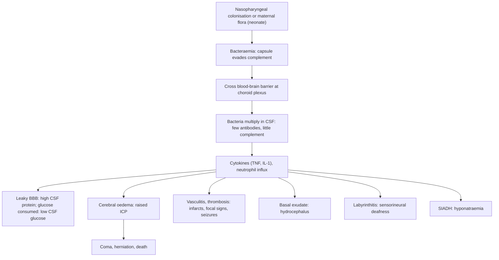

## 1. Definition

**Meningitis** is inflammation of the meninges (the membranes around the brain and spinal cord). **Bacterial meningitis** kills or disables a large proportion of affected children within days, even with antibiotics, and in Uganda it is a **notifiable disease** (UCG 2023).

Three ideas carry the whole topic:

1. **The signs depend on age.** A 5-year-old has headache, neck stiffness and photophobia. A 3-week-old has only fever (or a low temperature), poor feeding, irritability and perhaps a seizure.
2. **Antibiotics first, investigations second.** The LP is the key test, but treatment must start **within 1 hour** of arrival, and an unsafe LP can kill.
3. **Read the CSF like a detective.** Cell type, protein and glucose separate bacterial, viral, TB and cryptococcal meningitis, which need completely different treatments.

> [!PEARL]
> The one thing never to forget: **any febrile child with a convulsion, a bulging fontanelle, drowsiness or neck stiffness has meningitis until proven otherwise**. A positive malaria test does **not** exclude it.

| Term | Meaning |
|---|---|
| **Bacterial (pyogenic) meningitis** | Acute bacterial infection of the meninges; CSF neutrophilic with low glucose |
| **Neonatal meningitis** | Meningitis in the first 28 days; **early-onset** (first 72 h, maternal flora: GBS, *E. coli*) vs **late-onset** (after 72 h, environmental or nosocomial: *Klebsiella*, other Gram-negatives, *S. aureus*) |
| **Aseptic meningitis** | Meningeal inflammation with negative bacterial cultures: viral (enteroviruses, HSV, HIV, mumps), partially treated bacterial, TB, fungal, drugs |
| **Meningoencephalitis / encephalitis** | Brain parenchyma involved: altered behaviour, focal signs, seizures (HSV, other viruses) |
| **Tuberculous meningitis (TBM)** | Subacute (1–3 weeks) *M. tuberculosis* meningitis; basal exudate, hydrocephalus, cranial nerve palsies |
| **Cryptococcal meningitis** | *Cryptococcus neoformans* meningitis in severe immunosuppression (advanced HIV, CD4 <100); high CSF opening pressure |
| **Meningococcal disease** | *N. meningitidis* meningitis and/or septicaemia (purpuric rash, shock) |

## 2. Epidemiology

- **Vaccines have changed the picture.** **Hib** vaccine (part of the pentavalent DTP-HepB-Hib at 6, 10 and 14 weeks) and **PCV** (pneumococcal conjugate, 6, 10 and 14 weeks) have greatly reduced Hib meningitis and lowered pneumococcal meningitis. **Check the card**: an unvaccinated infant is at much higher risk.
- **Meningococcus**: northern and north-western Uganda (West Nile, Acholi, Karamoja) lie at the edge of the **African meningitis belt**, where epidemics of *N. meningitidis* occur in the hot dry season.
- **Case fatality** for bacterial meningitis in African children is high (often 20–40% for pneumococcal disease), and about a third of survivors have sequelae (hearing loss, epilepsy, developmental delay) [VERIFY: primary source for these figures].
- **TB and cryptococcal meningitis** follow the HIV epidemic: TBM peaks in children under 5 (often unvaccinated or with a household TB contact); cryptococcal meningitis is mainly seen in **older children and adolescents with advanced HIV**.

> [!UGANDA]
> **What is realistic.** HC IIIs and HC IVs cannot usually do CSF analysis. They must recognise meningitis, **give a pre-referral dose of ceftriaxone (100 mg/kg IM)**, treat seizures and hypoglycaemia, and refer (UCG 2023). At hospitals, LP is done on the ward. CSF cell count, Gram stain, protein, glucose and India ink/CrAg are usually available at RRH level. Culture and GeneXpert Ultra on CSF are available at Mulago, the RRH labs and some mission hospitals (Mengo, Lacor). **CT is rarely available urgently** outside Kampala and a few RRHs, so the decision about LP is clinical.

## 3. Aetiology and Risk Factors

**Organisms by age**

| Age | Common organisms | Uganda notes |
|---|---|---|
| **0–28 days** | **Group B streptococcus**, ***E. coli*, *Klebsiella*** and other Gram-negatives, *S. pneumoniae*, *Listeria* (rarely isolated in Africa), *S. aureus* | Late-onset Gram-negative infection (often resistant) is common in crowded neonatal units |
| **1–3 months** | Mixture of neonatal organisms and *S. pneumoniae*, Hib, *N. meningitidis* | Cover both groups |
| **3 months–5 years** | ***S. pneumoniae***, ***N. meningitidis***, Hib (much less since vaccination), **non-typhoidal *Salmonella*** | NTS meningitis: infants, malaria, HIV, SCD, malnutrition |
| **Over 5 years** | *S. pneumoniae*, *N. meningitidis* | Meningococcal epidemics in the dry season in the north |
| **HIV-positive / malnourished** | Pneumococcus, NTS, **TB**, ***Cryptococcus*** (older children and adolescents) | Ask for HIV status in every case |

**Risk factors**

| Risk factor | Why it matters |
|---|---|
| Missed pentavalent (Hib) or PCV doses | Hib and pneumococcal meningitis |
| No BCG; household TB contact | TBM |
| **HIV** (CD4 <100) | Cryptococcus, TB, NTS, pneumococcus |
| **Sickle cell disease**, asplenia | No splenic filtering of encapsulated organisms: pneumococcus, NTS |
| Malnutrition, malaria | NTS |
| **Neonatal**: maternal fever, PROM >18 h, maternal GBS, prematurity, LBW, birth asphyxia | Early-onset sepsis and meningitis |
| Ear discharge, sinusitis, head injury, CSF leak, VP shunt, dermal sinus | Pneumococcal source; recurrent meningitis |
| Living in the meningitis belt (north, north-west) in the dry season | Meningococcal epidemics |

## 4. Pathophysiology

1. **Colonisation** of the nasopharynx (pneumococcus, meningococcus, Hib) or, in neonates, exposure to maternal genital flora.
2. **Invasion into the blood** (bacteraemia). Polysaccharide **capsules** help organisms evade complement and phagocytosis, which is why **capsular conjugate vaccines** work and why **asplenia and SCD** (no splenic filtering) increase risk.
3. **Crossing the blood–brain barrier** at the choroid plexus; CSF has few antibodies and little complement, so bacteria multiply freely.
4. **Inflammation**: bacterial cell-wall products trigger cytokines (TNF, IL-1). Neutrophils pour in, the blood–brain barrier leaks (**protein rises**), bacteria and neutrophils consume glucose and CSF transport is impaired (**glucose falls**).
5. **Damage**: **vasogenic, cytotoxic and interstitial cerebral oedema** → **raised intracranial pressure**; **vasculitis and thrombosis** → infarcts (focal signs, seizures); exudate around the base and aqueduct → **hydrocephalus**; inflammation around the cochlea (labyrinthitis) → **sensorineural deafness**; inappropriate ADH secretion → **hyponatraemia**.
6. **Why dexamethasone might help:** antibiotic-induced lysis of bacteria releases more inflammatory material in the first hours; a steroid given **with or before** the first antibiotic damps this burst. That is why timing matters and why it helps most where the inflammation-driven damage (hearing loss with Hib and pneumococcus) dominates.

**Feature links**

- Bacteraemia and cytokines → fever (or hypothermia in neonates), lethargy, poor feeding, vomiting.
- Meningeal inflammation stretched by movement → headache, neck stiffness, Kernig's and Brudzinski's signs, photophobia (older children); infants lack these, so → irritability, high-pitched cry, being worse when handled.
- Cerebral oedema and hydrocephalus → raised ICP → bulging fontanelle, vomiting, falling GCS, unequal or sluggish pupils, posturing, **Cushing triad** (hypertension, bradycardia, irregular breathing), papilloedema (uncommon early).
- Cortical irritation, infarcts, hyponatraemia, hypoglycaemia → seizures (focal or generalised).
- Vasculitis and venous thrombosis → focal limb weakness, hemiparesis.
- Basal exudate around cranial nerves → palsies of III, IV, VI, VII (especially TBM).
- Meningococcal endotoxin, capillary leak and DIC → non-blanching petechiae and purpura, shock, bleeding.
- Neonatal brainstem immaturity and sepsis → apnoea.
- Labyrinthitis → sensorineural hearing loss.
- Excess ADH → hyponatraemia (Na <130 mmol/L) → worsening drowsiness and seizures.
- Subdural fluid collection → persistent fever, enlarging head circumference.
- Cryptococcal polysaccharide blocking CSF absorption → very high opening pressure with few cells → headache, visual loss.

## 5. Classification / Staging

**By organism and course**: acute bacterial (hours to days); viral (aseptic); subacute TB or cryptococcal (1–3 weeks); see the definitions in section 1.

**Neonatal**: **early-onset** (first 72 h) vs **late-onset** (after 72 h).

**TB meningitis (MRC / BMRC staging)**

| Stage | Criteria |
|---|---|
| **I** | Alert, GCS 15, no focal signs |
| **II** | GCS 11–14 or focal signs (e.g. cranial nerve palsy) |
| **III** | GCS ≤10 |

Outcome worsens with stage.

**Contraindications to LP** (a practical "classification" of when not to tap): raised ICP, shock or respiratory failure, active seizures, bleeding risk, local skin infection (mnemonic "SPIRAL", section 14).

## 6. Clinical Features

### History

| Question | Why it matters |
|---|---|
| Duration of fever and illness (hours vs 1–3 weeks)? | Acute (hours–days) = bacterial or viral; **subacute (over 1 week)** = TB or cryptococcal |
| Convulsions: number, focal or generalised, duration? | Focal or prolonged seizures, or seizures outside the 6 months–5 years age range, are not "simple febrile convulsions" |
| Irritability, high-pitched cry, refusing feeds, vomiting, drowsiness, apnoea? | The main signs in infants |
| Headache, neck pain, photophobia (older child) | Classic meningism |
| **Rash** (purpuric, spreading) | Meningococcal septicaemia: give ceftriaxone **now** |
| **Antibiotics already taken** | Partially treated meningitis: CSF culture often negative, cells still raised; rely on cells, protein, glucose and PCR |
| **Immunisation card**: pentavalent (Hib), PCV, BCG scar | Unvaccinated = higher risk of Hib or pneumococcus; no BCG raises TBM concern; catch-up later |
| **TB contact** in the household, weight loss, chronic cough | TBM |
| **HIV status** (child and mother), on ART? CD4, viral load? Cotrimoxazole? | Crypto, TB, NTS; ART timing |
| Ear discharge, sinus pain, head injury, CSF leak, VP shunt | Pneumococcal source; recurrent meningitis |
| **Neonate**: maternal fever, PROM >18 h, GBS, preterm, LBW, birth asphyxia | Early-onset sepsis and meningitis risk |
| Sickle cell disease, malnutrition | Pneumococcus or NTS; altered fluid and antibiotic plans |
| Similar cases in the village or school (dry season, north) | Meningococcal epidemic: contact prophylaxis, notification |
| Development and head growth before the illness | Baseline for later sequelae |

### Examination

**ETAT comes first** (airway, breathing, circulation including **shock** in meningococcal sepsis, coma, convulsions, glucose). Then follow the order of Hutchison's Clinical Methods (24th edition), adapted for children: observe first, feel the fontanelle with the baby **upright and calm**, and leave distressing parts (meningism tests, fundi, ears, throat) to last.

#### Introduction, consent and preparation

- Introduce yourself; confirm identity; explain; consent from the parent and assent from the child; **hand hygiene**; position on the parent's lap (recovery position if unconscious); undress fully to see the whole skin in a warm room.

#### General inspection (end of the bed)

| Sign | Mechanism | What it means |
|---|---|---|
| Drowsy, irritable, high-pitched cry, worse when handled | Meningeal irritation, raised ICP | Meningitis until proven otherwise |
| Posturing (decorticate, decerebrate), irregular breathing | Raised ICP, herniation | **Do not do an LP** |
| Seizure activity | Cortical irritation | Treat; not a simple febrile convulsion if focal or prolonged |
| **Non-blanching petechiae or purpura** (glass test; check the whole body including soles) | Meningococcal DIC | Ceftriaxone now; treat shock |
| Apnoea (neonate) | Brainstem, sepsis | Red flag |
| Wasting, oedema | Malnutrition | NTS risk; fluid plan |

**Vital signs and growth**: vital signs for age, temperature, SpO₂, **BP and heart rate together** (hypertension + bradycardia + irregular breathing = **Cushing triad**, late raised ICP); weight, length, MUAC, oedema, Z-scores; **head circumference** (baseline for hydrocephalus and subdural effusion).

#### Hands, face and neck

- **Hands**: cold peripheries, CRT >3 s (shock).
- **Face**: jaundice (affects antibiotic choice in neonates), pallor, oral thrush (HIV).
- **Fontanelle** (sitting quietly, not crying): **bulging** = raised ICP.
- **Neck**: lymph nodes (HIV, TB); **neck stiffness** (chin cannot touch chest).

#### Nervous system

- **Conscious level**: AVPU, Blantyre or GCS.
- **Meningism** (older than about 1 year): **neck stiffness**, **Kernig's sign** (pain or resistance on extending the knee with the hip flexed), **Brudzinski's sign** (neck flexion causes hip and knee flexion). Absent in up to half of infants.
- **Pupils**: size, symmetry, reaction.
- **Cranial nerves**: VI palsy in TBM, III, VII.
- **Limbs**: focal weakness, tone, reflexes, posturing.

#### Completing the examination

- **Sources**: ears (otitis media, mastoiditis), sinuses, chest, skin, **spine (dermal sinus in recurrent meningitis)**.
- **Systemic**: heart, abdomen (spleen; hepatosplenomegaly in HIV), lymph nodes, **BCG scar**.
- **Fundi, last**: papilloedema is uncommon early.
- **Thank**, **wash hands**, **summarise**.
- **Document negatives**: "no petechiae, fontanelle soft, no focal neurology, pupils equal and reactive".

### Red flags

> [!REDFLAG]
> - **Purpuric or spreading petechial rash** with fever = meningococcal disease: **ceftriaxone immediately**, treat shock
> - **Shock** (cold hands, CRT >3 s, weak fast pulse)
> - **Signs of raised ICP**: falling conscious level (GCS ≤9 or Blantyre ≤2), unequal or sluggish pupils, decorticate or decerebrate posturing, focal signs, **bradycardia with hypertension**, irregular breathing, bulging fontanelle in a drowsy infant
> - Prolonged or repeated seizures
> - **Apnoea** in a neonate
> - Hypoglycaemia; hyponatraemia (Na <130 mmol/L)

### Thinking like a clinician

- **"Positive RDT + seizure + drowsy"** → both malaria and meningitis are possible. If the LP is safe, do it; if not, **treat both** (artesunate + ceftriaxone).
- **"Febrile convulsion" or meningitis?** A simple febrile convulsion is a **single, brief (<15 min), generalised** seizure in a child **6 months–5 years**, who is **fully alert within an hour**. Anything else (focal, prolonged, repeated, slow recovery, age under 6 months, partly treated with antibiotics, signs of meningism) → **LP**. Under 12 months, signs are unreliable, so the threshold for LP is low.
- **Subacute illness, cranial nerve palsy, weight loss, TB contact** → **TBM** until proven otherwise; don't wait for a positive culture.
- **HIV-positive adolescent with 2 weeks of headache and few signs** → **cryptococcal meningitis**: do serum and CSF CrAg and measure opening pressure.
- **"The CSF is clear, so it can't be meningitis."** Wrong: early bacterial, TB, crypto and viral CSF can all be clear. Send it.
- **Common student mistakes**: waiting for the LP before antibiotics; doing an LP on a shocked or deeply comatose child; forgetting glucose (blood glucose **just before LP** for the ratio); calling a neonate "well" because there is no neck stiffness; forgetting the hearing test and head circumference; giving ceftriaxone with calcium-containing fluid in a neonate.

> [!EXAM]
> Viva favourite: **"When would you NOT do a lumbar puncture?"** Answer by category: **raised ICP** (GCS ≤9 or falling, unequal or fixed pupils, posturing, focal signs, papilloedema, Cushing triad), **cardiorespiratory instability** (shock, respiratory failure), **ongoing seizures**, **bleeding risk** (extensive purpura, platelets low, DIC), and **local infection** at the LP site. In each case, **treat first** and do the LP when it becomes safe.

## 7. Differential Diagnoses

| Differential | Distinguishing clinical feature | Distinguishing investigation |
|---|---|---|
| **Cerebral malaria** | Coma with parasitaemia, normal CSF, retinopathy; may coexist | RDT or slide, LP |
| **Simple febrile convulsion** | 6 months–5 years, single brief generalised seizure, fully alert within 1 h, no meningism | Clinical; LP if any doubt (especially under 12 months) |
| **Viral encephalitis (HSV)** | Behaviour change, focal seizures, reduced consciousness, lymphocytic CSF with RBCs | CSF PCR (rarely available), MRI or EEG; start aciclovir if suspected and available |
| **TB meningitis** | Subacute, TB contact, weight loss, cranial nerve palsies, hydrocephalus | CSF (lymphocytes, high protein, very low glucose), Xpert, CXR |
| **Cryptococcal meningitis** | HIV with low CD4, headache over 1–2 weeks, few signs, high opening pressure | Serum and CSF CrAg, India ink |
| **Brain abscess / subdural empyema** | Focal signs, persistent fever, sinusitis or otitis, cyanotic heart disease | CT or MRI (LP contraindicated) |
| **Sepsis without meningitis** | Shock, no meningism; LP normal | Blood culture, LP when stable |
| **Pneumonia with meningismus** | Upper-lobe pneumonia can cause neck stiffness | Chest examination, CXR; CSF normal |
| **Hypoglycaemia, poisoning, Reye-type encephalopathy** | History, no fever or meningism | Glucose, toxicology history |
| **Intracranial haemorrhage** (trauma, vitamin K deficiency in infants) | Sudden onset, pallor, bulging fontanelle, history of no vitamin K | Cranial US or CT, clotting |
| **Retropharyngeal abscess, cervical lymphadenitis** | Neck pain or stiffness, drooling | ENT examination, lateral neck X-ray |

## 8. Clinical Workup

**Core principles**

1. **Blood culture and glucose before antibiotics**, but never delay antibiotics for them.
2. **LP before antibiotics only if it is safe and quick.** CSF cells, protein and glucose are not much affected by antibiotics given in the previous few hours (within about 24 h); culture is.
3. **Always request the CSF basics together**: cell count and differential, protein, glucose (with paired blood glucose), Gram stain, culture; add **CrAg or India ink** and **Xpert Ultra or ZN** when the history suggests HIV or TB.
4. **Repeat the LP** after 48–72 h if the child is not improving, the organism is unusual (Gram-negative in a neonate) or resistant, or fever persists.

"Available at" is the lowest level that usually offers the test [VERIFY: compiled from the source notes, not an MoH list].

### Bedside

| Test | Why / how | Expected finding | How it changes management | Available at |
|---|---|---|---|---|
| **Blood glucose** | Glucometer **just before LP** | Hypoglycaemia; needed for the CSF:blood glucose ratio | Treat hypoglycaemia; interpret CSF | HC III and above [VERIFY] |
| **Malaria RDT** | Finger prick | Co-infection; does not exclude meningitis | Artesunate as well | All levels |
| **CSF appearance** | Hold the tube against print | Turbid (bacterial), cobweb clot on standing (TB), blood-stained (traumatic tap or haemorrhage) | First clue | Wherever an LP is done |
| **CSF glucose by glucometer / urine dipstick on CSF** | If the lab is closed: dipstick for leucocytes and glucose | Rough guide only | Send to the lab | Wherever an LP is done |
| **Serum CrAg lateral flow assay** | Finger-prick or serum; HIV-positive children with headache | Positive in cryptococcal disease (often before meningitis) | LP; antifungal treatment | HIV clinics, HC IV and above [VERIFY] |
| **Opening pressure** (manometer) | Child lying on the side, relaxed | Normal <20 cm H₂O; >25 cm H₂O in crypto | Therapeutic LP | Hospitals with manometers |
| **SpO₂, Hb (HemoCue)** | Hypoxia, anaemia | Low | Oxygen; transfusion | HC IV and above |

### Basic lab

| Test | When | Expected / abnormal finding | How it changes management | Available at |
|---|---|---|---|---|
| **CSF cell count and differential** | Every LP | Neutrophils (bacterial), lymphocytes (viral, TB, crypto) | Diagnosis; repeat LP if not improving | RRH, NRH and many general hospitals |
| **CSF protein and glucose** (with paired blood glucose) | Every LP | Protein >1 g/L, ratio <0.4 in bacterial; very low glucose in TB | Diagnosis | RRH, NRH and many general hospitals |
| **CSF Gram stain** | Every LP | Gram-positive diplococci (pneumococcus), Gram-negative diplococci (meningococcus), Gram-negative rods (Hib, *E. coli*, *Klebsiella*, NTS) | Guides antibiotic choice; negative in up to 60% | RRH level |
| **CSF India ink, CrAg** | HIV-positive, subacute, lymphocytic CSF | Encapsulated yeasts; CrAg positive (CrAg is more sensitive) | Cryptococcal treatment | Most RRHs |
| **CSF GeneXpert MTB/RIF Ultra, ZN stain** | Suspected TBM | MTB detected (sensitivity moderate; negative does not exclude) | Start TB treatment; rifampicin resistance | GeneXpert at most HC IVs and hospitals (via hub transport) |
| **FBC, CRP** | All | High WBC or neutrophils, low platelets (meningococcal DIC) | Supports bacterial cause; LP safety (platelets) | HC IV and above |
| **Electrolytes (Na), urea, creatinine** | All admitted | **Hyponatraemia** (SIADH), AKI | Fluid plan | General hospital and above [VERIFY] |
| **HIV test, CD4** | All with unknown status | Positive; CD4 <100 → crypto | ART, crypto, TB plan | All levels (test); CD4 via hub |

### Imaging

| Test | When | Expected finding | How it changes management | Available at |
|---|---|---|---|---|
| **Chest X-ray** | Suspected TB, pneumonia | Miliary pattern, hilar nodes | Supports TBM | Hospitals |
| **Cranial ultrasound** (open fontanelle) | Infants with enlarging head, persistent fever, focal signs | Ventriculomegaly, subdural effusion, abscess | Neurosurgical referral | Most hospitals |
| **CT / MRI brain** | Focal signs, suspected abscess or empyema, hydrocephalus, TBM complications, before LP if raised ICP is suspected (but treat first) | Hydrocephalus, infarcts, basal enhancement (TBM), abscess | Neurosurgery (VP shunt at Mulago, CURE Mbale) | Kampala and some RRHs |

### Specialised / referral-level

| Test | When | Expected finding | How it changes management | Available at |
|---|---|---|---|---|
| **CSF culture and sensitivity** | Every LP, ideally before antibiotics | Organism + resistance (e.g. ESBL Gram-negatives in neonates) | Change antibiotic; duration | RRH, NRH, Mengo, Lacor |
| **Blood culture** | All, before antibiotics if possible | Positive in many bacterial cases | Organism when LP not possible | RRH, NRH, mission hospitals |
| **CSF PCR / latex agglutination** | Prior antibiotics, culture negative | Pneumococcal, meningococcal, Hib antigen or DNA | Organism-specific duration; surveillance | National reference labs (UVRI, CPHL) |
| **Audiology (OAE/ABR)** | All survivors of bacterial meningitis | Sensorineural hearing loss | Hearing aids, cochlear implant referral, school support | Mulago, Mengo ENT |

### Putting it together

**CSF interpretation table**

| | Appearance | WBC (/µL) | Main cell | Protein (g/L) | Glucose (CSF:blood) | Extra |
|---|---|---|---|---|---|---|
| **Normal, over 1 month** | Clear | **0–5** | Lymphocytes (no neutrophils) | **<0.4** | **≥0.6** (≥2.5 mmol/L) | Opening pressure <20 cm H₂O |
| **Normal, neonate** | Clear or slightly yellow | **up to about 20** | Lymphocytes (a few neutrophils possible) | **up to 1.0** (higher in preterms) | ≥0.6 | |
| **Bacterial** | **Turbid** | **100–10,000+** (may be low very early or in overwhelming sepsis) | **Neutrophils** | **>1.0** | **<0.4** (glucose often <1.5 mmol/L) | Gram stain, culture, antigen |
| **Partially treated bacterial** | Clear or turbid | Raised | Neutrophils or mixed | Raised | Low or normal | **Culture often negative** |
| **Viral** | Clear | **10–1,000** | **Lymphocytes** (neutrophils in the first 24–48 h) | 0.4–1.0 | **Normal** | Child usually less sick |
| **TB** | Clear, **cobweb clot** on standing | **50–500** (up to 1,000) | **Lymphocytes** (neutrophils early) | **1–5 (high)** | **<0.3, very low** | ZN rarely positive; Xpert Ultra |
| **Cryptococcal** | Clear | Often **<50** (may be near 0 in advanced HIV) | Lymphocytes | Normal to mildly raised | Normal to low | **India ink, CrAg positive; high opening pressure** |
| **Cerebral malaria** | Clear | Normal | | Normal | Normal | Opening pressure may be raised |

**Model one-line summary**

> "An 8-month-old boy, 7.6 kg (weight-for-age Z −1.2), with incomplete immunisation (no PCV3 or pentavalent 3), presenting with 2 days of fever, irritability, refusal to breastfeed and one focal seizure, with a bulging fontanelle and turbid CSF showing 2,400 WBC/µL (90% neutrophils), protein 2.1 g/L and CSF:blood glucose 0.15, Gram-positive diplococci: acute bacterial (likely pneumococcal) meningitis."

**Problem list**

1. Acute bacterial meningitis, probably pneumococcal.
2. Focal seizure (resolved).
3. Mild hyponatraemia (Na 132 mmol/L): watch for SIADH.
4. Incomplete immunisation (pentavalent 3, PCV3 missed).
5. Risk of hearing loss and neurodevelopmental sequelae.

**Model case presentation (ward round)**

> "Baby K is an 8-month-old boy from Wakiso, **weight 7.6 kg (weight-for-age Z −1.2), length 68 cm (length-for-age Z −0.8), MUAC 13.4 cm**, admitted yesterday with 2 days of fever, irritability, refusal to breastfeed and a single focal seizure of the left arm lasting 10 minutes. He received **BCG, OPV0–3, pentavalent 1–2 and PCV 1–2** but missed the 14-week visit; measles-rubella is due at 9 months. He is **exclusively breastfed with porridge started at 6 months**. Mother is **HIV negative** (tested in this pregnancy). No TB contact.
> On admission: temperature 39.1 °C, RR 44, HR 168, CRT 2 s, SpO₂ 96%, **bulging fontanelle**, irritable, no rash, pupils equal and reactive, no focal deficit after the seizure. RDT negative, glucose 4.6 mmol/L. **CSF turbid: WBC 2,400/µL (90% neutrophils), protein 2.1 g/L, glucose 0.8 mmol/L (blood 5.2; ratio 0.15), Gram-positive diplococci.**
> **Assessment: acute bacterial meningitis, probably pneumococcal, in a partially vaccinated infant.** On **ceftriaxone 100 mg/kg (760 mg) IV once daily**, day 2; no further seizures; feeding by breast and cup. Sodium 132 mmol/L.
> **Plan:** ceftriaxone for 10–14 days; maintenance fluids with daily sodium; head circumference daily (today 44 cm); culture and sensitivity pending; notify; **hearing test before discharge**; catch up pentavalent 3 and PCV 3; developmental follow-up."

> [!EXAM]
> **Worked example 1: the CSF glucose ratio and a traumatic tap.**
> A 3-year-old's CSF glucose is **2.4 mmol/L** while the blood glucose taken just before the LP is **8.0 mmol/L** (he got dextrose in the ambulance). The absolute CSF glucose looks "almost normal", but the **ratio is 2.4 ÷ 8.0 = 0.3**, which is **low**: bacterial or TB until proven otherwise. That's why you measure blood glucose immediately before the LP.
> A second sample is blood-stained: **RBC 50,000/µL, WBC 120/µL**. A rough rule allows about **1 WBC per 500–1,000 RBC** (so about 50–100 WBC are explained by blood), but correction formulas are unreliable: if the child looks unwell, **treat as meningitis** and send for culture.

> [!EXAM]
> **Worked example 2: telling TB from bacterial.**
> A 4-year-old with 12 days of fever, vomiting and a right **VI nerve palsy**: CSF clear, WBC **280/µL (80% lymphocytes)**, protein **2.8 g/L**, glucose ratio **0.2**, Gram stain negative. Lymphocytes + very high protein + very low glucose + subacute course + cranial nerve palsy = **TB meningitis**. Start TB treatment and steroids today; do not wait for Xpert or culture.

## 9. Management

### Immediate / emergency

**First 5 minutes**

1. **ETAT triage** → emergency signs (airway, breathing, shock, coma, convulsions) to the resuscitation room.
2. **Airway and oxygen**; recovery position if unconscious; stop seizures (**diazepam 0.5 mg/kg PR or 0.2–0.3 mg/kg IV**, max 10 mg).
3. **IV or IO access**: blood for **glucose (bedside), blood culture, FBC, malaria RDT, electrolytes**, cross-match if pale or bleeding.
4. **Treat hypoglycaemia** (10% dextrose 5 mL/kg; 2 mL/kg in neonates).
5. **Shock** → 10–20 mL/kg crystalloid and reassess, repeat once (not in SAM); inotropes only in HDU or ICU.
6. **Decide on LP now or later** (contraindications in section 6). If it will delay treatment → **give ceftriaxone now** (and dexamethasone if your unit uses it) and do the LP when safe.
7. **Antibiotic within 1 hour** of arrival.

**Emergency algorithm (any age)**

1. **ABC, oxygen, stop seizures, check glucose.**
2. **Shock?** Crystalloid 10–20 mL/kg, reassess, repeat once.
3. **Is LP safe now?** If yes and it adds no delay, do it; if not, go straight to step 4.
4. **Give the first dose of antibiotic within 1 hour** (dexamethasone first or together if indicated).
5. **Supportive care**: head up 30°, head in midline, fever control, maintenance fluids, NGT feeds if drowsy, monitor GCS or Blantyre, pupils, BP, HR, RR, Na, glucose.
6. **Review at 24–48 h** with CSF and blood culture results; narrow antibiotics; decide duration.
7. **Notify** (district surveillance focal person) and give **contact prophylaxis** for meningococcal disease and Hib.
8. **Before discharge**: neurological and **hearing assessment**, head circumference, development plan, immunisation catch-up, HIV and TB follow-up.

### Definitive

#### Empirical antibiotics, infants over 1 month and children (UCG 2023 / WHO Pocket Book)

- **First line: ceftriaxone 100 mg/kg/day** IV or deep IM, once daily or 50 mg/kg 12-hourly, max 4 g/day, **10–14 days** empirically (UCG). Same dose as pre-referral; good CSF penetration.
- **Alternatives**: cefotaxime 50 mg/kg 6-hourly; or **chloramphenicol 25 mg/kg 6-hourly** (not under 1 month) **plus ampicillin 50 mg/kg 6-hourly or benzylpenicillin 100,000 IU/kg 6-hourly** (WHO Pocket Book) for 10 days. Doses and cautions in the drug table.

**Organism-specific (when culture or Gram stain is known)**

| Organism | Treatment (UCG 2023 / NICE NG240) | Duration |
|---|---|---|
| *S. pneumoniae* | Ceftriaxone 100 mg/kg/day; or benzylpenicillin 100,000 IU/kg 4-hourly if sensitive | **10–14 days** (UCG; up to 21 if severe); NICE 10 days |
| *N. meningitidis* | Ceftriaxone, or benzylpenicillin 100,000–150,000 IU/kg 6-hourly, or chloramphenicol | **5–7 days** (NICE 5 days; UCG up to 14) |
| Hib | Ceftriaxone; switch to chloramphenicol or ampicillin only if the isolate is sensitive | **10 days** |
| GBS | Ceftriaxone or cefotaxime (or benzylpenicillin + gentamicin) | **14 days** (NICE); UCG neonatal 21 days |
| Gram-negative bacilli (*E. coli*, *Klebsiella*, NTS) | Cefotaxime or ceftriaxone if sensitive; **meropenem** (40 mg/kg 8-hourly) for ESBL | **At least 21 days** |
| *Listeria* | Ampicillin or amoxicillin IV | **21 days** |

> [!DRUG]
> **Ceftriaxone safety:** do **not** give it at the same time as (or in the same line as) **calcium-containing fluids** (Ringer's lactate, Hartmann's, calcium gluconate) in neonates (fatal precipitates; MHRA/NICE 2024), and avoid it in **jaundiced or preterm neonates** (it displaces bilirubin). Use **cefotaxime** in neonates where possible.

#### Neonatal meningitis (UCG 2023 / WHO Pocket Book)

1. **Supportive care**: keep warm (skin-to-skin or KMC if stable, warmer if not), prevent hypoglycaemia (breastfeed or expressed milk by NGT, or IV 10% dextrose maintenance 60 mL/kg/day on day 1 rising by 20 mL/kg/day), oxygen if SpO₂ <92% (UCG), treat seizures with **phenobarbital 20 mg/kg** IV loading (WHO Pocket Book; UCG 10–15 mg/kg), avoid paracetamol for fever (UCG: undress, control the environment).
2. **Antibiotics for 21 days** (UCG; GBS may be 14 days per NICE):

| Drug | Dose | Route | Frequency | Notes |
|---|---|---|---|---|
| **Ampicillin** | **50–100 mg/kg** per dose (use the higher dose for meningitis) | IV | **12-hourly in week 1; 8-hourly from day 7** | Covers GBS, *Listeria*, *Enterococcus* |
| **plus Gentamicin** | **5 mg/kg** (term) or **3 mg/kg** (LBW or preterm) in week 1; **7.5 mg/kg** after week 1 (WHO Pocket Book) | IV/IM | **24-hourly** | UCG 2023 lists 2.5 mg/kg 12-hourly; check levels and renal function if prolonged. Consistent with the neonatal-resuscitation topic |
| **or Cefotaxime** (preferred where resistance or Gram-negative meningitis) | **50 mg/kg** | IV | 12-hourly (week 1), 8-hourly (weeks 2–4) | Add ampicillin to cover *Listeria* and GBS empirically |
| **Benzylpenicillin** (GBS confirmed) | 50,000–100,000 IU/kg (<7 days) every 8 h; 100,000–150,000 IU/kg every 4–6 h (older) | IV | As stated | Plus gentamicin |

3. **Monitor**: temperature, feeding, weight, glucose, **head circumference daily**, fontanelle, seizures; repeat LP if Gram-negative or not improving.
4. **Before discharge**: hearing screen, cranial ultrasound if any concern, neurodevelopmental follow-up, BCG, OPV and HepB if missed.

#### Dexamethasone: the controversy

| | Evidence and guidance |
|---|---|
| **Rationale** | Dampens the inflammatory burst when antibiotics lyse bacteria; reduces **hearing loss** (especially Hib) |
| **Dose** | **0.15 mg/kg IV 6-hourly for 4 days** (2–4 days; max 10 mg per dose); first dose **with or 10–20 min before** the first antibiotic; not if more than about 12 h after antibiotics started (NICE; RCH Melbourne prefers within 4 h) |
| **NICE NG240 (2024)** | Give IV dexamethasone to children **over 3 months** with strongly suspected or confirmed bacterial meningitis; **infection specialist advice for 28 days to 3 months**; continue only if the organism is **pneumococcus or Hib**; stop for others |
| **Cochrane (2015)** | Steroids reduced hearing loss and neurological sequelae overall, but the benefit was seen in **high-income countries**; **no benefit in low-income countries** |
| **African trial data** | A large randomised trial in **Malawian children** found **no benefit** of dexamethasone on mortality or sequelae; late presentation, HIV, malnutrition and pre-treatment probably explain this [VERIFY: add the trial citation] |
| **WHO Pocket Book (2013)** | Insufficient evidence for routine use in developing countries **except in TB meningitis**. **Do not use** in **neonates**, presumed **cerebral malaria**, presumed **viral encephalitis**, or where antibiotic resistance is suspected and steroids may mask failure |
| **UCG 2023** | **Not mentioned** in the meningitis section |

> [!UGANDA]
> **What Ugandan wards actually do:** most units **do not give dexamethasone routinely** to young children with bacterial meningitis, in line with the WHO Pocket Book and UCG, because most children present late, many have HIV, malnutrition or malaria, and African trials showed no benefit. Some consultants give it to **older children with suspected pneumococcal or Hib meningitis who present early and are HIV-negative**, mirroring NICE. **Always** give steroids in **TB meningitis**. Ask your consultant which policy the unit follows and say so in your presentation.

#### Supportive care

| Problem | Management |
|---|---|
| **Seizures** | Diazepam 0.5 mg/kg PR or 0.2–0.3 mg/kg IV (max 10 mg), repeat once; **phenobarbital 15–20 mg/kg** IV loading (UCG 10–15 mg/kg), or phenytoin 15–20 mg/kg IV over 20 min; maintenance phenobarbital 5 mg/kg/day |
| **Fever / pain** | Paracetamol 15 mg/kg 6-hourly (not in neonates per UCG) |
| **Fluids** | **Full maintenance** (100/50/20 mL/kg/day), isotonic (0.9% saline with 5% dextrose or equivalent), ideally via NGT feeds when safe. **Restrict to about two-thirds** only if there is **SIADH** (Na <130 mmol/L, no dehydration) or signs of raised ICP; never restrict in shock or dehydration (WHO; Cochrane 2016. NICE NG29 and some wards restrict high-ADH states to 2/3 routinely, as in *Fluids & Electrolytes*) |
| **Raised ICP** | Head up 30°, neutral neck, treat seizures, fever and hypoglycaemia, avoid hypotonic fluids, ensure oxygenation; consider **mannitol 0.25–0.5 g/kg IV** over 20–30 min (or 3% saline 3–5 mL/kg) as a temporary measure (NICE: osmotic agents, not glycerol); paediatric critical care advice |
| **Hyponatraemia** | Usually SIADH: fluid adjustment; if Na <120 or seizures, 3% saline 2–3 mL/kg over 10–20 min |
| **Nutrition** | NGT feeds if drowsy; breastfeeding continues |
| **Nursing** | Turn 2-hourly, eye care, bladder care, monitor GCS or Blantyre, pupils, vitals 1–4-hourly, head circumference daily in infants |

#### Meningococcal disease: extra points

- **Septicaemia ± meningitis**: purpuric rash, shock, DIC. **Ceftriaxone immediately** (pre-hospital IM if transfer is delayed), aggressive shock management (repeated boluses, inotropes in ICU), correct glucose, calcium and potassium, transfuse platelets or FFP for active bleeding.
- **Epidemic setting** (WHO Pocket Book): single-dose **ceftriaxone 100 mg/kg IM** (repeat if not improving at 24 h), 5 days for children 2 months–5 years and at least 7 days under 2 months.
- **Notify immediately**; **contact prophylaxis** (table below); the index case also needs carriage eradication if treated with penicillin or chloramphenicol only.

| Prophylaxis (close and household contacts, especially under 5) | Dose |
|---|---|
| **Ciprofloxacin** (UCG first choice) | Child **<12 years: 10 mg/kg** single oral dose (max 500 mg); ≥12 years: 500 mg |
| **Ceftriaxone** (e.g. pregnancy) | UCG: child <12 years **150 mg IM** single dose (BNFC 125 mg); ≥12 years 250 mg |
| **Rifampicin** (meningococcal) | **10 mg/kg** (5 mg/kg under 1 month) **12-hourly for 2 days**, max 600 mg/dose |
| **Rifampicin** (Hib household with an unvaccinated child under 4) | **20 mg/kg once daily for 4 days**, max 600 mg |

#### TB meningitis (UCG 2023; WHO 2022)

1. **Start treatment on clinical and CSF grounds**; mortality and disability rise with every day of delay.
2. **Regimen**: UCG 2023: **2RHZE / 10RH** (12 months in total). The **WHO 2022 consolidated TB guidelines for children and adolescents** also recommend a **6-month intensive regimen (6HRZEto: isoniazid, rifampicin, pyrazinamide and ethionamide, at higher doses)** as an alternative for bacteriologically confirmed or clinically diagnosed TBM without suspected drug resistance. Follow your unit's TB programme for which regimen is stocked.
3. **Standard child doses** (WHO): **isoniazid 10 mg/kg** (7–15; max 300 mg), **rifampicin 15 mg/kg** (10–20; max 600 mg), **pyrazinamide 35 mg/kg** (30–40), **ethambutol 20 mg/kg** (15–25), given as child-friendly fixed-dose combinations by weight band.
4. **Steroids for all**: **dexamethasone 0.6 mg/kg/day** (WHO Pocket Book) or **prednisolone 2 mg/kg/day** (max 60 mg) for **4 weeks**, then taper over 2–4 weeks.
5. **Hydrocephalus**: cranial US or CT; neurosurgical referral for a VP shunt (Mulago, CURE Children's Hospital Mbale).
6. **HIV**: start ART **4–8 weeks** after TB treatment begins (TBM: delay to avoid IRIS), cotrimoxazole, pyridoxine with isoniazid.
7. **Contact tracing** and TB preventive therapy for household children.

#### Cryptococcal meningitis (HIV)

- Mostly in **older children and adolescents** with advanced HIV (CD4 <100 or <15% in younger children). Screen with **serum CrAg**.
- **Induction (WHO 2022 recommendation for adults, adolescents and children)**: **single high-dose liposomal amphotericin B 10 mg/kg IV** + **flucytosine 100 mg/kg/day** (in 4 doses) + **fluconazole 12 mg/kg/day** (max 800 mg) for **14 days**. Alternative: amphotericin B deoxycholate 1 mg/kg/day + flucytosine for 7 days, then fluconazole.
- **Consolidation**: fluconazole **6–12 mg/kg/day** (max 800 mg) for 8 weeks; **maintenance** 6 mg/kg/day (max 200 mg) until immune recovery.
- **Raised pressure**: **therapeutic LPs** (remove CSF until the opening pressure is halved or below 20 cm H₂O), repeat daily while symptomatic. No steroids, no acetazolamide, no mannitol for crypto.
- **ART timing**: **delay ART 4–6 weeks** after starting antifungal treatment (UCG flowchart; COAT trial showed higher mortality with early ART).
- UCG 2023 says **refer to hospital**. Flucytosine and liposomal amphotericin are mainly at national and regional referral hospitals.

> [!UGANDA]
> At HC IV level: if serum CrAg is positive and the child has headache or other signs, **refer for LP**. If CrAg is positive with no signs and LP is not possible, the UCG flowchart gives **pre-emptive fluconazole** (adult doses in UCG; children 12 mg/kg/day, check with the ART clinic). Do not start ART immediately in a child with suspected cryptococcal meningitis.

### Drug table

| Drug | Dose (per kg + max for children; adult) | Route | Frequency | Duration | Key cautions |
|---|---|---|---|---|---|
| **Ceftriaxone** (first line >1 month; pre-referral) | **100 mg/kg/day**, **max 4 g/day**; adult 2 g 12-hourly [VERIFY] | IV (slow over 3–5 min, or infusion) or deep IM | **Once daily**, or **50 mg/kg 12-hourly** | **10–14 days** empirically (UCG) | Never with calcium-containing fluids in neonates; avoid in jaundiced or preterm neonates |
| **Cefotaxime** (alternative; preferred in neonates) | **50 mg/kg**, max 12 g/day | IV | **6-hourly** (children); neonates 12-hourly week 1, 8-hourly weeks 2–4 | 7–14 days (21 neonatal) | – |
| **Chloramphenicol** (if no ceftriaxone, or sensitive) | **25 mg/kg**, max 1 g/dose | IV/IM (oral once improving) | **6-hourly** | 10–14 days | **Not under 1 month** (grey baby syndrome); bone-marrow suppression |
| **Ampicillin** | Children (with chloramphenicol, WHO Pocket Book): **50 mg/kg** 6-hourly; neonates: **50–100 mg/kg** 12-hourly week 1, 8-hourly after | IV/IM | As stated | 10 days; neonates 21 days | Covers *Listeria*, GBS |
| **Benzylpenicillin** | **100,000 IU/kg (60 mg/kg)** 6-hourly (with chloramphenicol); pneumococcus 100,000 IU/kg 4-hourly; meningococcus 100,000–150,000 IU/kg 6-hourly; neonatal GBS doses above | IV/IM | As stated | Per organism | Only if sensitive |
| **Gentamicin** (neonates) | **5 mg/kg** (term) / **3 mg/kg** (LBW, preterm) week 1; **7.5 mg/kg** after (WHO Pocket Book); UCG 2.5 mg/kg 12-hourly | IV/IM | **24-hourly** | With ampicillin, 21 days | Levels and renal function if prolonged |
| **Meropenem** (ESBL Gram-negatives) | **40 mg/kg** | IV | 8-hourly | ≥21 days | Reserve antibiotic |
| **Dexamethasone** (bacterial, selected) | **0.15 mg/kg**, max 10 mg/dose | IV | **6-hourly** | **4 days** (2–4) | With or before first antibiotic; not in neonates, cerebral malaria, viral encephalitis |
| **Dexamethasone** (TBM) | **0.6 mg/kg/day** | IV/oral | Daily (divided) [VERIFY] | 4 weeks, then taper over 2–4 weeks | – |
| **Prednisolone** (TBM) | **2 mg/kg/day**, max 60 mg | Oral | Once daily | 4 weeks, then taper over 2–4 weeks | – |
| **Isoniazid / rifampicin / pyrazinamide / ethambutol** (TBM) | **10 / 15 / 35 / 20 mg/kg** (max H 300 mg, R 600 mg) as FDCs by weight band | Oral | Once daily | 2RHZE/10RH (12 months) or 6HRZEto (6 months) | Pyridoxine with isoniazid; rifampicin interactions with ART |
| **Liposomal amphotericin B** (crypto induction) | **10 mg/kg** single dose | IV | Once | Day 1 | Nephrotoxicity, hypokalaemia |
| **Flucytosine** (crypto) | **100 mg/kg/day** in 4 doses | Oral | 6-hourly | 14 days | Marrow suppression |
| **Fluconazole** (crypto) | Induction **12 mg/kg/day** (max 800 mg); consolidation 6–12 mg/kg/day (max 800 mg) 8 weeks; maintenance 6 mg/kg/day (max 200 mg) | Oral/IV | Once daily | Until immune recovery | Interactions |
| **Ciprofloxacin** (meningococcal contacts) | **10 mg/kg** (max 500 mg); ≥12 years and adults 500 mg | Oral | Once | Single dose | – |
| **Ceftriaxone** (meningococcal contacts) | <12 years **150 mg** (UCG; BNFC 125 mg); ≥12 years and adults 250 mg | IM | Once | Single dose | Choice in pregnancy |
| **Rifampicin** (contacts) | Meningococcal: **10 mg/kg** (5 mg/kg <1 month) 12-hourly × 2 days, max 600 mg; Hib: **20 mg/kg** daily × 4 days, max 600 mg | Oral | As stated | 2 days / 4 days | Orange secretions; interactions |
| **Diazepam** | 0.5 mg/kg PR or 0.2–0.3 mg/kg IV, max 10 mg | PR/IV | Repeat once | – | Respiratory depression |
| **Phenobarbital** | **15–20 mg/kg** IV loading (UCG 10–15 mg/kg); neonates 20 mg/kg; maintenance 5 mg/kg/day | IV | Load, then daily | – | Respiratory depression |
| **Phenytoin** | 15–20 mg/kg | IV over 20 min | Load | – | Arrhythmia; cardiac monitoring [VERIFY] |
| **Mannitol** (raised ICP) | **0.25–0.5 g/kg** | IV over 20–30 min | As needed | Temporary | Not in crypto; critical care advice |
| **3% saline** | Raised ICP: 3–5 mL/kg; hyponatraemia with Na <120 or seizures: 2–3 mL/kg over 10–20 min | IV | As needed | – | Recheck sodium |
| **10% dextrose** | 5 mL/kg (2 mL/kg in neonates) | IV | Once, recheck | – | – |
| **Paracetamol** | 15 mg/kg; adult 1 g | Oral | 6-hourly | While febrile | Not in neonates (UCG) |

### Referral criteria

| Setting | Action | Refer up when |
|---|---|---|
| **HC II/III** | Recognise (IMCI danger signs, stiff neck, bulging fontanelle), **ceftriaxone 100 mg/kg IM (or IV) pre-referral**, diazepam for seizures, glucose (or sugar water), keep warm | Every suspected case → refer with a note |
| **HC IV** | As above plus IV access, maintenance fluids, oxygen; LP if trained and safe (send CSF with the patient or to the hub lab); continue ceftriaxone | Complicated cases, no CSF analysis, crypto or TBM suspicion → general hospital or RRH |
| **General hospital / RRH** | LP, CSF analysis, blood culture, full course of antibiotics, seizure care, Xpert, CrAg, cranial US; notification | ICU, CT or MRI, neurosurgery, audiology → NRH or CURE Mbale |
| **NRH (Mulago) / CURE Mbale** | ICU, CT or MRI, neurosurgery (VP shunt, abscess drainage), audiology, rehabilitation | n/a |

### Monitoring and follow-up

- **Ward**: GCS or Blantyre, pupils, vitals 1–4-hourly; **sodium daily**; glucose; fluid balance; **head circumference daily** in infants; seizures.
- **Review at 24–48 h** with culture results; **repeat LP** at 48–72 h if not improving, unusual or resistant organism, or persistent fever.
- **Fever returning or head enlarging** → subdural effusion or empyema, hydrocephalus, abscess (also phlebitis, drug fever, nosocomial infection): cranial ultrasound or CT, repeat LP.
- **After discharge**: **audiology within 4 weeks** of recovery (preferably before discharge), developmental assessment, head circumference, seizure follow-up, immunisation catch-up (Hib, PCV), HIV and TB care where relevant.

## 10. Complications

**Disease-related**

| Timing | Complications |
|---|---|
| **Acute** | Septic shock, DIC (meningococcal), **raised ICP and herniation**, seizures and status epilepticus, **SIADH and hyponatraemia**, hypoglycaemia, aspiration, cerebral infarction (vasculitis, venous sinus thrombosis) |
| **Subacute** | **Subdural effusion** (common in infants, especially Hib or pneumococcal: persistent fever, enlarging head, bulging fontanelle; usually resolves), **subdural empyema**, **brain abscess**, **hydrocephalus** (communicating or obstructive), **ventriculitis** (neonates), cranial nerve palsies (III, IV, VI, VII), persistent or recurrent fever (drug fever, phlebitis, nosocomial infection, abscess) |
| **Long-term** | **Sensorineural hearing loss** (most frequent; up to a third after pneumococcal meningitis; bilateral profound in a few percent), **epilepsy**, **cerebral palsy and motor deficits**, cortical blindness, **developmental delay and learning difficulties**, behavioural problems; after meningococcal septicaemia: skin scars, amputations, bone growth problems |

**Treatment-related**

| Complication | Cause | Recognition and action |
|---|---|---|
| Fatal calcium precipitates; bilirubin displacement | Ceftriaxone in neonates | Cefotaxime; no calcium in the same line |
| Grey baby syndrome; marrow suppression | Chloramphenicol | Not under 1 month; FBC |
| Nephrotoxicity, ototoxicity | Gentamicin (adds to hearing risk) | Levels and renal function if prolonged |
| Herniation | LP with raised ICP | Respect contraindications |
| Fluid overload or worsening hyponatraemia | Hypotonic or excess fluids | Isotonic maintenance; restrict only for SIADH |
| Masked treatment failure | Steroids where resistance is suspected | Follow WHO restrictions |
| Phlebitis, drug fever, nosocomial infection | IV lines, prolonged antibiotics | Causes of recurrent fever |
| IRIS, higher mortality | Early ART in crypto or TBM | Delay ART (crypto 4–6 weeks; TBM 4–8 weeks) |

> [!PEARL]
> **Hearing loss is silent.** NICE NG240 says offer **audiology within 4 weeks of the child being well enough** (preferably before discharge). Severe bilateral loss after pneumococcal meningitis can be followed by **cochlear ossification**, which makes implants harder later, so early testing matters.

## 11. Prognosis

- **Case fatality** for bacterial meningitis in African children is high (often **20–40%** for pneumococcal disease), and **about a third of survivors have sequelae** (hearing loss, epilepsy, developmental delay) [VERIFY: same source query as section 2].
- **Hearing loss** is the commonest sequela: up to a third after pneumococcal meningitis.
- **TB meningitis**: outcome worsens with MRC stage; mortality and disability rise with every day of delay.
- **Cryptococcal meningitis**: early ART increases mortality (COAT trial).
- Late presentation, HIV, malnutrition and pre-treatment worsen outcomes in Africa.

## 12. Prevention

- **Vaccines (UNEPI)**: **pentavalent (Hib)** and **PCV** at **6, 10 and 14 weeks**; **BCG** at birth (protects against TBM). Catch up missed doses before discharge.
- **Meningococcal vaccination** in epidemic campaigns in the meningitis belt [VERIFY: current Uganda MenAfriVac/MenFive programme status].
- **Contact prophylaxis**: meningococcal (ciprofloxacin, ceftriaxone or rifampicin) and Hib (rifampicin 20 mg/kg for 4 days); **notify** every case.
- **Neonatal**: manage maternal fever, PROM and GBS risk; infection prevention in neonatal units.
- **HIV**: early ART; serum CrAg screening in advanced HIV with pre-emptive fluconazole.
- **TB**: contact tracing and TB preventive therapy for household children.
- **Recurrent meningitis**: look for and repair a dermal sinus, CSF leak or other anatomical cause.

## 13. Special Populations

- **Neonates**: no neck stiffness; ampicillin + gentamicin or cefotaxime for 21 days; avoid ceftriaxone if jaundiced, preterm or on calcium-containing fluids; no chloramphenicol; no dexamethasone; no paracetamol for fever (UCG); dextrose 2 mL/kg for hypoglycaemia; phenobarbital 20 mg/kg.
- **Infants 1–3 months**: cover neonatal and older-child organisms; dexamethasone only with infection specialist advice (NICE).
- **Infants under 12 months**: signs unreliable; low threshold for LP; LP at L4/5 (the cord ends lower).
- **HIV-positive**: think crypto, TB, NTS; serum CrAg; delay ART (crypto 4–6 weeks; TBM 4–8 weeks).
- **Sickle cell disease and asplenia**: pneumococcus and NTS.
- **Severe acute malnutrition**: no standard shock boluses; NTS risk.
- **Malaria-endemic settings**: a positive RDT does not exclude meningitis; treat both if LP is unsafe; no dexamethasone in presumed cerebral malaria.
- **Pregnant adolescent contacts**: ceftriaxone for meningococcal prophylaxis.

## 14. Key Points

### High-yield points

- Any febrile child with a convulsion, bulging fontanelle, drowsiness or neck stiffness has meningitis until proven otherwise.
- Infants rarely have neck stiffness.
- **Antibiotics within 1 hour**; never let the LP delay them.
- Know the LP contraindications ("SPIRAL").
- Ceftriaxone 100 mg/kg/day (max 4 g) for 10–14 days over 1 month; ampicillin + gentamicin or cefotaxime for 21 days in neonates.
- Measure blood glucose just before the LP; read the CSF:blood ratio.
- Lymphocytes + very high protein + very low glucose + subacute course = TBM: treat with RHZE and steroids.
- Dexamethasone: NICE over 3 months, with or before the first antibiotic; not routine in WHO or UCG; always in TBM.
- Notify; give meningococcal and Hib contact prophylaxis.
- Hearing test within 4 weeks for every survivor.

### Numbers & doses

| Item | Value |
|---|---|
| Antibiotic timing | **Within 1 hour** of arrival (NICE NG240) |
| Ceftriaxone | **100 mg/kg/day** IV/IM once daily or 50 mg/kg 12-hourly; **max 4 g/day**; 10–14 days (UCG) |
| Cefotaxime | **50 mg/kg 6-hourly** (children); 12-hourly → 8-hourly in neonates |
| Chloramphenicol | **25 mg/kg 6-hourly** (max 1 g/dose); not under 1 month |
| Neonatal ampicillin | **50–100 mg/kg** 12-hourly (week 1), 8-hourly after |
| Neonatal gentamicin | **5 mg/kg** daily (term), **3 mg/kg** (LBW or preterm) in week 1; UCG 2.5 mg/kg 12-hourly |
| Neonatal duration | **21 days** (UCG); GBS 14 days (NICE) |
| Duration by organism | Meningococcus 5–7 d; Hib 10 d; pneumococcus 10–14 d; GBS 14 d; Gram-negative and *Listeria* 21 d |
| Dexamethasone | **0.15 mg/kg 6-hourly × 4 days**, first dose with or before antibiotic; NICE: over 3 months |
| TBM steroids | Dexamethasone 0.6 mg/kg/day or prednisolone 2 mg/kg/day (max 60 mg) × 4 weeks, then taper |
| Normal CSF (over 1 month) | WBC **≤5**, protein **<0.4 g/L**, glucose ratio **≥0.6** |
| Normal CSF (neonate) | WBC **up to ~20**, protein **up to 1.0 g/L** |
| Bacterial CSF | Neutrophils **100–10,000**, protein **>1 g/L**, ratio **<0.4** (glucose <1.5 mmol/L) |
| Opening pressure | Normal **<20 cm H₂O**; crypto often >25 → therapeutic LP |
| Diazepam | 0.5 mg/kg PR / 0.2–0.3 mg/kg IV, max 10 mg |
| Phenobarbital | 15–20 mg/kg IV loading |
| Mannitol | 0.25–0.5 g/kg IV over 20–30 min |
| Meningococcal prophylaxis | Ciprofloxacin **10 mg/kg** once (max 500 mg); rifampicin **10 mg/kg** 12-hourly × 2 days |
| Hib prophylaxis | Rifampicin **20 mg/kg** daily × 4 days (max 600 mg) |
| Crypto induction | L-AmB **10 mg/kg** once + flucytosine **100 mg/kg/day** + fluconazole **12 mg/kg/day** × 14 days |
| ART after crypto | Delay **4–6 weeks** |
| Audiology | Within **4 weeks** of recovery |
| LP level | **L3/4 or L4/5** (L4/5 in infants) |

### Exam traps

- **"No neck stiffness, so not meningitis"** in a 4-month-old. Wrong: infants often lack meningism; look at the fontanelle and behaviour.
- **"Do the LP first, then start antibiotics"** in a shocked or deeply comatose child. Wrong: **resuscitate and treat**, tap later.
- **"Positive RDT explains the seizure."** Wrong: do an LP (if safe) or cover meningitis.
- **"CSF is clear, so meningitis is excluded."** Wrong: send cells, protein, glucose, CrAg and Xpert.
- **"Give dexamethasone to every child with meningitis."** Wrong: never in neonates or cerebral malaria; not routine in low-income settings; always in **TBM**.
- **"Ceftriaxone with Ringer's lactate in a neonate."** Wrong: calcium precipitates; use cefotaxime.
- **"Start ART immediately in cryptococcal meningitis."** Wrong: wait **4–6 weeks**.
- **"Chloramphenicol is fine for neonates."** Wrong: grey baby syndrome.

### Questions seniors ask

**Viva questions**

1. *Signs of meningitis in an infant?* Fever or hypothermia, irritability, high-pitched cry, poor feeding, vomiting, lethargy, seizures, apnoea, bulging fontanelle (late); neck stiffness often absent.
2. *Contraindications to LP?* Raised ICP signs, shock or respiratory failure, uncontrolled seizures, bleeding risk or extensive purpura, skin infection at the site.
3. *Empirical antibiotic for a 2-year-old?* Ceftriaxone 100 mg/kg/day IV (once daily or 12-hourly), max 4 g/day.
4. *And for a 10-day-old?* Ampicillin + gentamicin (or ampicillin + cefotaxime), 21 days.
5. *CSF in TB meningitis?* Lymphocytes 50–500, protein 1–5 g/L, very low glucose, cobweb clot.
6. *When do you give dexamethasone?* NICE: over 3 months, with or before the first antibiotic, 0.15 mg/kg 6-hourly × 4 days; WHO and UCG do not recommend routine use in low-income settings; always in TBM.
7. *Most common long-term complication?* Sensorineural hearing loss.

**On the ward round**

- **Why do you check the blood glucose just before the LP?** To calculate the CSF:blood glucose ratio; a CSF glucose that looks normal can be low relative to a high blood glucose (after dextrose).
- **This child had amoxicillin for 3 days before admission. How will that change the CSF?** Cells, protein and glucose stay abnormal, but Gram stain and culture are often negative; rely on the cell pattern and antigen or PCR tests and give a full course.
- **Would you give dexamethasone to this 8-month-old in Kampala?** Explain both sides: NICE would give it with the first antibiotic to a child over 3 months; WHO Pocket Book and UCG do not recommend routine use because African trials showed no benefit; follow the unit policy. If it is given, it must be with or before the first antibiotic dose.
- **The fever returns on day 7 and the head is getting bigger. What do you think?** Subdural effusion or empyema, hydrocephalus, or abscess (also phlebitis, drug fever, nosocomial infection). Measure the head circumference, do a cranial ultrasound (open fontanelle) or CT, and repeat the LP if needed.
- **How do you differentiate TB from bacterial meningitis at the bedside?** TBM: subacute course (over a week), TB contact, weight loss, cranial nerve palsy, hydrocephalus, lymphocytic CSF with very high protein and very low glucose. Bacterial: acute, neutrophilic, turbid.
- **Who needs prophylaxis after a meningococcal case?** Household and close contacts (especially under 5s) and anyone exposed to the patient's oral secretions: ciprofloxacin single dose (or ceftriaxone, rifampicin); the index case needs eradication if not treated with ceftriaxone.
- **What follow-up will you arrange?** Hearing test within 4 weeks, developmental assessment, head circumference, seizure follow-up, immunisation catch-up (Hib, PCV), and HIV and TB care where relevant.

### Mnemonics

- **LP contraindications: "SPIRAL"**: **S**hock, **P**latelets low or purpura, **I**CP raised (falling GCS, pupils, posturing, focal signs), **R**espiratory failure, **A**ctive seizures, **L**ocal skin infection.
- **CSF: "Bacteria eat sugar, TB eats more"**: bacterial = neutrophils + low glucose; TB = lymphocytes + very low glucose + very high protein; viral = lymphocytes + normal glucose.
- **Neonatal organisms: "GEL"**: **G**BS, ***E**. coli*, ***L**isteria*.
- **Older child: "PNH"**: **P**neumococcus, ***N**. meningitidis*, ***H**aemophilus*.
- **Dexamethasone "0.15 × 4 × 4"**: 0.15 mg/kg, 4 times a day, for 4 days, only with the first antibiotic.
- **Ceftriaxone "100, 4, no calcium"**: 100 mg/kg/day, max 4 g, never with calcium in neonates.

### OSCE tips

- **LP station**: consent, position (lateral, knees to chest, held by an assistant), landmark (**L3/4 or L4/5**, intercristal line; in infants the cord ends lower, so use L4/5), aseptic technique, needle with stylet, measure opening pressure, collect 3 tubes (micro, biochemistry, extra), note the time and blood glucose.
- **Neurological examination in an infant**: always say "I would measure the head circumference and feel the fontanelle with the baby upright and calm."
- **Rash station**: do the glass test and check the whole body, including the soles.

## 15. References

1. Ministry of Health Uganda. Uganda Clinical Guidelines 2023 (sections 2.1.5 Meningitis, 2.1.5.1 Neonatal meningitis, 2.1.5.2–3 Cryptococcal and TB meningitis; 3.1.10.2 Cryptococcal meningitis). Kampala: MoH; 2023. https://library.health.go.ug/uganda-clinical-guidelines-2023
2. World Health Organization. Pocket Book of Hospital Care for Children, 2nd edition (section 6.3 Meningitis). Geneva: WHO; 2013. https://www.who.int/publications/i/item/978-92-4-154837-3
3. NICE. Meningitis (bacterial) and meningococcal disease: recognition, diagnosis and management (NG240). 2024. https://www.nice.org.uk/guidance/ng240
4. Medscape (eMedicine). Pediatric bacterial meningitis (overview, workup, treatment). https://emedicine.medscape.com/article/961497-overview
5. Royal Children's Hospital Melbourne. CSF interpretation (clinical practice guideline). 2024. https://www.rch.org.au/clinicalguide/guideline_index/CSF_interpretation/
6. Royal Children's Hospital Melbourne. Meningitis and encephalitis (clinical practice guideline). 2024. https://www.rch.org.au/clinicalguide/guideline_index/Meningitis_encephalitis/
7. Brouwer MC, et al. Corticosteroids for acute bacterial meningitis (Cochrane review). Cochrane Database Syst Rev. 2015. https://pubmed.ncbi.nlm.nih.gov/26362566/
8. World Health Organization. Meningitis fact sheet. https://www.who.int/news-room/fact-sheets/detail/meningitis
9. Glynn M, Drake WM, editors. Hutchison's Clinical Methods: An Integrated Approach to Clinical Practice. 24th edition. Edinburgh: Elsevier; 2018.
