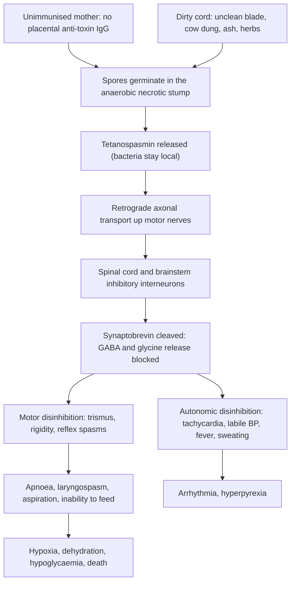

## 1. Definition

**Neonatal tetanus** (tetanus neonatorum) is generalised tetanus in a baby in the first 28 days of life. It happens when **spores of *Clostridium tetani*** contaminate the **umbilical stump** (cut with an unsterile razor or reed, or dressed with cow dung, ash, soil or herbs) in a baby whose **mother has no protective antibodies** because she was not immunised with **tetanus toxoid (TT/Td)**.

The story is classic: a baby who **sucked and cried normally for the first 2 days**, then on day 3–14 **stops sucking** (jaw spasm, trismus), cries excessively, becomes **stiff**, and develops **painful spasms** triggered by touch, noise or light, while remaining **fully conscious**.

| Term | Definition |
|---|---|
| **Neonatal tetanus (WHO surveillance definition, confirmed case)** | Illness in an infant with **normal ability to suck and cry in the first 2 days**, who **loses this ability between days 3 and 28** and **becomes rigid or has spasms** |
| **Suspected case** | Any neonatal death between 3 and 28 days of unknown cause, or any illness reported as tetanus in the first month, where the infant fed normally after birth |
| **Maternal tetanus** | Tetanus during pregnancy or within 6 weeks after the end of pregnancy (birth or abortion) |
| **Incubation period** | Time from spore entry to first symptom: usually **3–14 days** in neonates (often 5–7) |
| **Period of onset** | Time from first symptom to first spasm; **<48 h = severe** |
| **MNT elimination** | Fewer than **1 case per 1,000 live births in every district** per year (WHO target) |

Other forms of tetanus (for comparison): generalised (commonest overall), localised (spasm near the wound), cephalic (cranial nerves, from head wounds or otitis).

> [!PEARL]
> The one thing never to forget: **every case of neonatal tetanus is a failure of prevention**. When you admit one, also vaccinate the mother, report the case, and ask how the cord was cut and dressed.

## 2. Epidemiology

- **Global**: WHO reports that in **2021 just over 7,700 newborns died of neonatal tetanus**, an **84% reduction since 2000** (about 46,900 deaths), mainly due to immunisation of women with tetanus-toxoid-containing vaccine (TTCV) and clean birth practices. Disruption of immunisation services (for example during COVID-19) caused resurgence in some places.
- **Why it matters in Uganda**: neonatal tetanus is almost **100% preventable** with maternal Td and clean cord care, yet cases still occur after home births and harmful cord practices, especially in hard-to-reach districts. Without intensive care it is usually fatal; with good nursing, sedation and antitoxin, many babies survive.
- **Uganda status**: Td is given at ANC (first contact) and in the UNEPI schedule for girls and women of childbearing age. Uganda was validated by WHO as having achieved maternal and neonatal tetanus (MNT) elimination (2011), which must be sustained through Td coverage, facility births and clean cord care. Sporadic cases still present to regional and national referral hospitals.
- **Notifiable**: neonatal tetanus is a **notifiable disease** (UCG 2023). Notify the district surveillance focal person; every case triggers a case investigation (mother's Td history, place of birth, cord practices) and a community response.

**Services by level of care** [VERIFY: compiled from the source notes, not an MoH equipment list]

| Level | Usually available | Often missing |
|---|---|---|
| **HC III / HC IV** | Diazepam, benzylpenicillin, metronidazole (oral, sometimes IV), Td vaccine, pentavalent vaccine | TIG, oxygen and pulse oximetry at HC III, staff for continuous observation |
| **General Hospital** | TIG or equine antitoxin (variable), IV metronidazole, diazepam, chlorpromazine, NGT, IV fluids, oxygen concentrator | Neonatal ICU, ventilation |
| **RRH** | All the above, neonatal unit, blood culture at some, chest X-ray | Neonatal ventilation at most |
| **NRH (Mulago) and a few private hospitals** | Neonatal ventilation (limited beds), full laboratory | **ICU ventilation** for neonates is rare outside Kampala |

## 3. Aetiology and Risk Factors

**Organism**: *Clostridium tetani*, an anaerobic, spore-forming Gram-positive bacillus found in **soil and animal faeces**. Spores survive for years and resist boiling and many antiseptics.

**Portal of entry**: the **necrotic umbilical stump** (an ideal low-oxygen environment); rarely circumcision wounds, ear piercing or scarification.

**Risk factors**

| Mother (no antibodies) | Birth and cord (spore exposure) | Context |
|---|---|---|
| Unimmunised or incompletely immunised mother | **Home or roadside birth**, unskilled attendant | Rural residence, poverty |
| No ANC; first pregnancy without Td2 before delivery | **Unclean cutting instrument** (used razor blade, reed, knife) | Hard-to-reach districts |
| Teenage mother | Unclean cord tie | Cultural practices |
| Previous baby who died at 1–2 weeks (likely tetanus) | **Substances on the cord**: cow dung, ash, mud, herbs, ghee, powder | Disrupted immunisation services |

## 4. Pathophysiology

**Causal chain**

1. **Spores** of *C. tetani* enter the **necrotic umbilical stump**, an ideal low-oxygen environment.
2. Spores germinate and the bacteria produce **tetanospasmin** (and tetanolysin). The bacteria stay local; the **toxin** causes the disease.
3. Tetanospasmin binds to **motor nerve terminals** and travels by **retrograde axonal transport** to the **spinal cord and brainstem**.
4. In the central nervous system it is taken up by **inhibitory interneurons** and cleaves **synaptobrevin**, blocking the release of the inhibitory neurotransmitters **GABA and glycine**.
5. Without inhibition, motor neurons fire excessively → **rigidity** and **reflex spasms**. The shortest nerves (cranial: jaw, face) are affected first → **trismus**, **risus sardonicus**, then neck, back (**opisthotonus**), abdomen and limbs.
6. **Autonomic** disinhibition → tachycardia, labile blood pressure, sweating, hyperpyrexia, arrhythmias.
7. **Toxin binding is irreversible**: recovery needs **new nerve terminal sprouting**, which takes **3–6 weeks**. Antitoxin only neutralises **unbound** toxin, so give it **early**.
8. **Why the mother matters**: maternal IgG antibodies from TT/Td cross the placenta and neutralise toxin in the baby. That is why maternal immunisation prevents neonatal tetanus.
9. **Why the disease does not protect**: the amount of toxin that causes disease is too small to induce immunity, so survivors must be vaccinated.

**Feature links**

- Shortest motor pathways (cranial nerves) disinhibited first → masseter spasm → **trismus** → baby cannot suck (the first symptom the mother notices).
- Facial muscle spasm → **risus sardonicus** (fixed grimace), wrinkled forehead, pursed lips ("carp mouth").
- Paraspinal muscle spasm → **opisthotonus**.
- Abdominal wall rigidity → **board-like abdomen**.
- Limb flexor and extensor co-contraction → **clenched fists**, flexed arms, extended legs, dorsiflexed toes.
- Loss of reflex inhibition → **spasms provoked by touch, noise, light, injection**.
- Toxin spares the cortex → baby is **conscious and alert between spasms** (and feels pain).
- Spasm of laryngeal and respiratory muscles → **apnoea, laryngospasm, cyanosis**.
- Trismus and pharyngeal spasm → secretions pool → **aspiration pneumonia**.
- Cannot suck → **dehydration, hypoglycaemia, weight loss**.
- Autonomic storm → **tachycardia >180/min, labile BP, sweating, fever**.
- Muscle activity of repeated spasms → **fever** (even without infection), exhaustion, rarely **vertebral fractures**.
- Hypoxia during spasms → later **developmental delay or cerebral palsy** in some survivors.
- Irreversible toxin binding → **slow recovery over 3–6 weeks**, regardless of antitoxin.

## 5. Classification / Staging

There is no single bedside staging score in UCG 2023. Classify by **case definition** (section 1) and by **severity markers**, which also predict prognosis.

| Marker | Milder | Severe |
|---|---|---|
| **Incubation period** | ≥7 days | **<7 days** |
| **Period of onset** (first symptom to first spasm) | ≥48 h | **<48 h** |
| **Spasms** | Infrequent, short, only on handling | **Frequent, prolonged, spontaneous**, with cyanosis or apnoea |
| **Autonomic features** | Absent | **Fever, tachycardia >180, labile BP** |
| **Baby** | Term, normal weight | **Preterm or LBW** |

For the ward, record a **spasm chart** (spasms per hour, duration, cyanosis or apnoea) every shift: it is your working severity score and guides sedation.

## 6. Clinical Features

### History

Ask the mother gently: she may feel blamed. Each question has a reason.

| Question | Why it matters |
|---|---|
| **Age now and day symptoms began** | Onset day 3–28 fits; shorter incubation (<7 days) = worse prognosis |
| **Did the baby suck and cry normally in the first 2 days?** | Key part of the WHO case definition (separates from HIE and congenital problems) |
| **When did the baby stop sucking? First spasm when?** | Period of onset <48 h = severe |
| **Place of birth, who delivered, what was used to cut and tie the cord** | Unclean birth is the source |
| **What was applied to the cord?** (cow dung, ash, herbs, ghee, powder) | Source of spores |
| **Mother's Td/TT doses and timing (Td card), ANC attendance** | Unprotected mother; plan her vaccination |
| **Previous babies who died at 1–2 weeks** | Suggests previous tetanus in an unimmunised mother |
| **Feeding since onset**: any fluids, how given? Urine output | Dehydration, hypoglycaemia, aspiration risk |
| **Breathing pauses, colour change during spasms** | Apnoea, laryngospasm: life-threatening |
| **Fever, convulsions with loss of consciousness, jaundice** | Points to sepsis, meningitis or other diagnoses |
| **Maternal HIV status, syphilis** | Other risks; prophylaxis |
| **Baby's immunisations (BCG, OPV0)** | Usually missed after home birth; give before discharge |

### Examination

Follow Hutchison's Clinical Methods (24th edition) order adapted for the neonate, but **observe first, touch later**: handling triggers spasms. If spasms are ongoing, **sedate first** (section 9) and cluster the examination about 30 minutes after the sedative dose.

#### Introduction, consent and preparation

- Introduce yourself to the mother; confirm the baby's name, age in days and sex; explain that you will look first and touch as little as possible; gain consent.
- **Hand hygiene** before touching the baby.
- **Position and exposure**: examine in the cot or on a warm surface in a **quiet, dim** area; expose only the part you are examining and re-cover quickly (avoid hypothermia and stimulation).

#### General inspection (end of the cot, before touching)

| Sign | Mechanism | What it means |
|---|---|---|
| Posture: clenched fists, flexed arms, extended legs, dorsiflexed toes | Generalised rigidity from loss of inhibition | Generalised tetanus |
| Spasms (count frequency and duration; note cyanosis or apnoea) | Reflex motor discharge | Severity; titrate sedation |
| **Alert, anxious face between spasms** | Cortex spared | **Key difference from seizures and meningitis** |
| Opisthotonus during spasms | Paraspinal spasm | Generalised tetanus (also kernicterus: check jaundice) |
| Colour: cyanosis, jaundice, pallor | Apnoea or laryngospasm; kernicterus; sepsis | Danger signs |
| Hydration and nutrition: sunken fontanelle and eyes, dry mouth, wasting | Unable to suck | Dehydration, weight loss |

**Vital signs and growth**: temperature (fever from spasms or infection; or hypothermia), HR (tachycardia, autonomic instability), RR (count a full minute), SpO₂, BP if possible, capillary refill; **weight** daily (dehydration, fluid calculation), compared with birth weight if known.

#### Hands, face and neck

- **Hands**: clenched fists; peripheral cyanosis; capillary refill.
- **Face**: **risus sardonicus** (fixed grimace), wrinkled forehead, pursed lips ("carp mouth").
- **Mouth: trismus**: the mouth cannot open; baby cannot suck. Try to insert a finger or spatula gently (**spatula test**: the baby bites down reflexively in tetanus instead of gagging). Do this last and only once: it provokes spasms.
- **Neck**: neck stiffness from generalised rigidity (does not by itself mean meningitis).

#### Nervous and musculoskeletal system

- **Inspection**: posture, spontaneous spasms, opisthotonus.
- **Palpation (tone)**: **generalised rigidity**, **board-like abdomen**, stiff limbs; spasms provoked by touch, noise, light or injection.
- **Level of consciousness**: **alert between spasms**.
- **Fontanelle**: normal (bulging suggests meningitis; sunken suggests dehydration).

#### Completing the examination

- **Umbilicus**: dirty, infected or septic stump (it may look normal by the time of presentation); flare of redness around the stump (omphalitis).
- **Chest**: crackles of **aspiration pneumonia**; signs of sepsis.
- **Skin**: jaundice, pressure areas, injection sites.
- **Thank** the mother, re-cover the baby, **hand hygiene**, and **summarise** with a severity assessment and plan (model presentation in section 8).
- Document the **spasm frequency** each shift to guide sedation.

### Red flags

> [!REDFLAG]
> - **Apnoea, cyanosis or laryngospasm** during spasms
> - **Very frequent or prolonged spasms** despite sedation
> - **Short incubation (<7 days)** or **period of onset <48 h**
> - **Fever, tachycardia >180, labile BP** (autonomic instability)
> - **Aspiration pneumonia**, sepsis
> - **Over-sedation**: no spontaneous breathing, floppy, SpO₂ falling after diazepam
> - **Hypoglycaemia, hypothermia, dehydration** from not feeding

### Thinking like a clinician

- **Conscious baby + spasms + trismus + onset day 3–14 + dirty cord = tetanus.** A baby with seizures from meningitis or hypoglycaemia has altered consciousness between episodes; the tetanus baby looks anxious and alert.
- **"Could suck at birth, cannot suck now"** separates tetanus from HIE (abnormal from birth) and from congenital problems.
- **Do not do things that provoke spasms** without sedation (LP, NGT insertion, IV line, examination): sedate first and cluster procedures.
- **The biggest killers are apnoea, aspiration and exhaustion**, not the toxin itself. Good nursing saves lives.
- **Sedation is a balance**: enough to stop spasms, not so much that the baby stops breathing. Know where the bag and mask are.
- **Always ask about the mother's Td** and vaccinate her before she leaves.
- **If X then think Y**: opisthotonus with deep jaundice → kernicterus; jitteriness with carpopedal spasm and no trismus → hypocalcaemia; bulging fontanelle with drowsiness → meningitis; abnormal from birth after a difficult labour → HIE.
- **Common student mistakes**: treating the "convulsions" with phenobarbital alone; bottle-feeding a baby with trismus; giving TIG and vaccine into the same limb; forgetting to notify and to vaccinate the mother.

## 7. Differential Diagnoses

| Differential | Distinguishing clinical feature | Distinguishing investigation |
|---|---|---|
| **Neonatal sepsis / meningitis** | Fever or hypothermia, lethargy, **reduced consciousness**, bulging fontanelle, seizures not triggered by touch | Blood culture, LP (abnormal CSF) |
| **Hypocalcaemia (neonatal tetany)** | Jitteriness, carpopedal spasm, seizures; often infant of a diabetic mother, preterm or asphyxiated; **no trismus** | Serum calcium |
| **Hypoglycaemia** | Jittery, lethargic, seizures; **responds to glucose** | Glucose |
| **HIE seizures** | **Abnormal from birth** after a difficult delivery; altered consciousness | History, Sarnat staging |
| **Kernicterus** | **Deep jaundice**, opisthotonus, high-pitched cry, lethargy | Bilirubin |
| **Neonatal abstinence / drug withdrawal** | Maternal drug use; jittery, hypertonia, poor feeding, sneezing | History |
| **Congenital neuromuscular or structural problems** | Present from birth; no spasms | Clinical, imaging |

Neonatal tetanus itself: normal suck days 1–2, then trismus, rigidity, spasms provoked by stimuli, **conscious** between spasms, dirty cord; the diagnosis is clinical.

## 8. Clinical Workup

**No test is diagnostic: tetanus is a clinical diagnosis.** Treat on clinical grounds. Tests look for complications and mimics. "Available at" is the lowest level that usually offers the test [VERIFY: availability compiled from the source notes].

### Bedside

| Test | Why | Expected finding | Available at |
|---|---|---|---|
| **Glucose** | Hypoglycaemia from not feeding (mimic and complication) | Low if not fed; normal in tetanus itself | HC III and above (glucometer) |
| **Temperature** | Fever (spasms, infection) or hypothermia | Often mildly raised from muscle activity | All levels |
| **SpO₂** | Hypoxaemia during spasms or apnoea; over-sedation | Falls during spasms | HC IV and above; often missing at HC III |
| **Weight** | Dehydration; fluid and drug calculation | Weight loss | All levels |
| **Spasm chart** | Number and duration of spasms per hour to titrate sedation | Falling count with effective sedation | All levels |

### Basic lab

| Test | When | Expected / abnormal finding | How it changes management | Available at |
|---|---|---|---|---|
| **FBC** | Baseline, suspected sepsis | Often normal; leucocytosis if secondary infection | Antibiotic choice | HC IV and above |

### Imaging

| Test | When | Expected / abnormal finding | How it changes management | Available at |
|---|---|---|---|---|
| **Chest X-ray** | Suspected aspiration pneumonia | Consolidation | Antibiotics, oxygen | Most hospitals |

### Specialised / referral-level

| Test | When | Expected / abnormal finding | How it changes management | Available at |
|---|---|---|---|---|
| **Blood culture** | Fever, umbilical sepsis | Secondary bacterial sepsis (*S. aureus*, Gram-negatives) | Add or adjust antibiotics | Referral hospitals |
| **Electrolytes, calcium** | Doubt about the diagnosis | Hypocalcaemia (tetany mimic) | Calcium gluconate | Referral hospitals |
| **Lumbar puncture** (after sedation) | Only if meningitis cannot be excluded clinically | **Normal CSF** in tetanus | Meningitis needs 21 days of antibiotics | Hospital |
| **Wound swab culture** | Rarely useful | *C. tetani* is hard to grow and may be present without disease | Not used to diagnose | Limited |

### Putting it together

**Model one-line summary**

> "A **9-day-old** male born at **home in Kayunga** by a traditional birth attendant, cord cut with a **used razor blade** and dressed with **cow dung**, who **sucked well until day 6**, then **stopped sucking**, and since day 7 has **generalised spasms** triggered by touch with **trismus, risus sardonicus and opisthotonus**, alert between spasms. Mother is a **19-year-old primigravida** who attended ANC once and received **one dose of Td**. Weight 2.8 kg, T 38.0 °C, HR 172, SpO₂ 92% in air."

**Assessment**: **neonatal tetanus**, incubation 6 days and period of onset about 24 h (**severe**), with possible omphalitis; risks of apnoea, aspiration and dehydration.

**Problem list**

1. Neonatal tetanus with frequent spasms.
2. Source: infected umbilical stump.
3. Feeding and hydration.
4. Risk of apnoea and aspiration.
5. Unprotected mother.
6. Notification and community follow-up.

**Model case presentation (ward round)**

> "**Baby Kato**, a **10-day-old** male, weight **2.9 kg** (birth weight not known; home birth), **admitted yesterday with neonatal tetanus**. He breastfed normally until **day 6**, then stopped sucking; spasms began on **day 7**. The cord was cut with a **razor blade** and **cow dung** was applied. Mother is 20, had **one dose of Td** in this pregnancy, **HIV-negative** at ANC, RPR negative. He has had no BCG or OPV0.
>
> On examination he has **trismus, risus sardonicus, clenched fists and opisthotonic spasms** provoked by touch, **alert between spasms**; T 37.8 °C, HR 168, RR 52, SpO₂ 95% in 1 L/min oxygen; umbilicus moist with surrounding redness 0.5 cm.
>
> He has received **TIG 500 IU IM in two sites**, the **first pentavalent dose**, **metronidazole 43.5 mg loading then 22 mg 12-hourly**, and is on **diazepam 0.6 mg IV 2-hourly** alternating with **chlorpromazine 3 mg 8-hourly by NGT**. Spasms have reduced from **12 to 5 per hour**. He is on IV fluids at 120 mL/kg/day and started **EBM 5 mL 2-hourly** by NGT today.
>
> **Problems:** severe neonatal tetanus (incubation 6 days, onset to spasm 1 day); umbilical infection; feeding; risk of apnoea and aspiration; unimmunised mother. **Plan:** continue sedation titrated to spasms, cluster care, advance NGT feeds, monitor SpO₂ and apnoea, **Td for the mother today**, **notify** the district surveillance officer."

**Worked example: doses for a 2.8 kg, 9-day-old baby (UCG doses)**

> [!DRUG]
> TIG **500 IU IM** (250 IU into each thigh, separate from the vaccine site); first pentavalent (DTP-containing) dose in another site; **metronidazole 42 mg IV** over 60 min, then **21 mg IV 12-hourly**; **diazepam 0.56 mg IV** (or **1.4 mg rectally**) every 1–4 h as needed; **chlorpromazine 2.8 mg via NGT 8-hourly**.

## 9. Management

**The five pillars**

1. **Airway, breathing and spasm control** (sedation, suction, oxygen, ventilation if available).
2. **Neutralise unbound toxin** (TIG or antitoxin, as early as possible).
3. **Remove the source** (metronidazole; clean and debride the stump).
4. **Supportive and nursing care** (quiet dark room, fluids, NGT feeding, temperature, skin, eyes, monitoring).
5. **Prevention**: vaccinate the baby (and complete the schedule) and the **mother**, **notify**, and educate.

### Immediate / emergency

**First 5 minutes (ABCDE)**

- **A**: suction the mouth gently; position on the side.
- **B**: oxygen if cyanosed or SpO₂ <90%; **bag-mask ventilation** if apnoeic.
- **C**: HR, capillary refill; **IV access after sedation**; start IV fluids.
- **D**: **stop the spasm**: **diazepam 0.5 mg/kg rectally** or **0.2 mg/kg IV** (UCG) if spasms are ongoing; watch breathing. **Glucose** (when sedated).
- **E**: temperature; **quiet, dark, cool corner or room**; minimal handling.
- **Call for help**; plan TIG, metronidazole and nursing.
- **At HC III/IV**: sedate, give the first dose of antibiotic (metronidazole or benzylpenicillin) and TIG if available, and **refer immediately** to hospital (UCG: "Refer to hospital immediately") with the mother.

### Definitive

- **Neutralise toxin**: TIG 500 IU IM in two sites, as early as possible.
- **Remove the source**: metronidazole (first line) for the UCG course; clean and **debride** the stump; chlorhexidine; nothing else on the cord.
- **Control spasms**: diazepam titrated to the spasm chart, with chlorpromazine via NGT to reduce the total benzodiazepine dose; phenobarbital as an alternative or adjunct.
- **Vaccinate**: first DTP-containing dose at diagnosis in a different limb; mother's Td before she leaves.
- **Supportive care**: the nursing bundle below is the most important part.

### Drug table

| Drug | Dose (per kg; neonate) | Route | Frequency | Duration | Key cautions |
|---|---|---|---|---|---|
| **Human tetanus immunoglobulin (TIG)** | **500 IU** (fixed dose) | **IM**, divided between **at least 2 sites**, away from the vaccine site | **Once** | Single dose | Neutralises unbound toxin only: give as early as possible. Intrathecal TIG has been studied in neonatal tetanus but is **not routine** |
| **Equine tetanus antitoxin (ATS)** (if TIG unavailable) | **5,000 IU** (WHO and older protocols; check local product) [VERIFY: dose against product insert and current UCG] | IM (or IV per product) | Once | Single dose | Test dose and **adrenaline ready** (anaphylaxis, serum sickness) |
| **DTP-containing vaccine** (UCG: "1st dose of DPT"; in Uganda the pentavalent DTP-HepB-Hib) | Standard dose | IM, **different limb** from TIG | At diagnosis | Continue the routine schedule | Disease does **not** confer immunity |
| **Metronidazole** (first line) | **Loading 15 mg/kg** over 60 min, then **7.5 mg/kg** | IV (oral or NGT when possible) | **Every 12 h if <4 weeks old**; **every 8 h if >4 weeks** | UCG 2023 lists a **14-day** course (many references use 7–10 days) | Preferred over penicillin |
| **Benzylpenicillin** (second line) | **100,000 IU/kg** | IV/IM | **Every 12 h** | **10–14 days** (UCG) | Metronidazole is preferred (penicillin is a GABA antagonist) |
| **Diazepam** (spasm control) | **0.2 mg/kg IV** or **0.5 mg/kg rectal** | IV / rectal | **Every 1–4 h** as needed (UCG) | Taper slowly over weeks as spasms settle | Titrate to spasms; **apnoea**, hypotension; some units use a continuous infusion with monitoring |
| **Chlorpromazine** (adjunct) | **1 mg/kg** | Oral via **NGT** | **Every 8 h** (UCG) | Until spasms settle | Often alternated with diazepam to reduce total benzodiazepine dose; hypotension |
| **Phenobarbital** (alternative or adjunct sedative) | Loading **20 mg/kg**, then **5 mg/kg/day** | IV / IM / NGT | Daily | Per local protocol | Additive respiratory depression |
| **Magnesium sulfate** | Specialist or ICU use only | IV | Infusion | n/a | Reduces spasms and autonomic instability in adults; limited neonatal evidence |
| **Cloxacillin + gentamicin** | Cloxacillin **50 mg/kg** + gentamicin **5 mg/kg** (7.5 mg/kg after week 1) | IV | Cloxacillin 6-hourly; gentamicin once daily | Per response | Only if **omphalitis with flare** or secondary sepsis |
| **Oxygen** | To SpO₂ >90% | Nasal prongs | As needed | During spasms and apnoea | Bag and mask at the bedside |
| **Td (mother)** | 0.5 mL | IM | Today, then complete the 5-dose schedule | 5 doses | Give before she leaves the ward |

> [!UGANDA]
> UCG 2023 places neonatal tetanus management at **hospital level (H)** and ventilation at **regional/national referral level (RR)**. If TIG is out of stock, use equine antitoxin with anaphylaxis precautions, or IV immunoglobulin (which contains tetanus antitoxin) where available. Do not delay sedation, metronidazole and nursing while you look for TIG. Metronidazole course: UCG 14 days versus 7–10 days in many international references; follow UCG in Ugandan practice and exams.

### Referral criteria

| Level | What to do | Refer up when |
|---|---|---|
| **Community / VHT** | Recognise a baby who stops sucking with stiffness after day 2 | Immediately, with the mother |
| **HC III / HC IV** | Sedate (diazepam rectal or IV), first dose of metronidazole or benzylpenicillin, TIG if available, keep warm, suction | **Every case**: "Refer to hospital immediately" (UCG) with the mother |
| **General Hospital** (UCG level H) | Full five-pillar management, nursing bundle, NGT feeds | Recurrent apnoea, uncontrollable spasms despite maximal sedation, need for ventilation → RRH |
| **RRH** | All the above; neonatal unit; ventilation in some | Ventilation unavailable → NRH |
| **NRH (Mulago) and a few private hospitals** | Neonatal ventilation, ICU | n/a |

**Referral checklist**: sedated before transfer; airway suctioned; a health worker who can bag-ventilate travels with the baby; mother accompanies (breast milk, history, Td); referral note with drug doses and times.

### Monitoring and follow-up

- **Monitoring chart**: spasms per hour, sedation doses, RR, HR, SpO₂, temperature, intake and output, weight daily.
- **Observe breathing continuously after diazepam**; bag and mask at the bedside.
- **Wean sedation slowly** over 2–4 weeks as spasms reduce; the baby may stay rigid for weeks; full recovery of sucking may take 2–4 weeks.
- **Discharge** when sucking well, no spasms and gaining weight; give BCG and OPV0 if not given and continue the UNEPI schedule.
- **Follow-up**: immunisation clinic for the remaining DTP-containing doses; developmental follow-up for survivors with hypoxic episodes (risk of developmental delay or cerebral palsy); mother's remaining Td doses at ANC or the immunisation clinic.

### Nursing care (the most important part)

1. **Environment**: a **quiet, dark, cool** room or corner (UCG); cover the cot; no radios; restrict visitors (but keep the mother close).
2. **Minimal handling**: **cluster care** (feeds, observations, injections, turning) **about 30 minutes after a sedative dose** (UCG: suction and turn 30 min after sedative).
3. **Airway**: keep a **mucus extractor or suction** at the bedside; suction the mouth as needed; position on the side.
4. **Breathing**: oxygen and pulse oximetry; **bag and mask at the bedside** for apnoea; observe breathing continuously after diazepam.
5. **Fluids** (UCG): **start with IV fluids** (UCG: half-strength saline with 5% dextrose; follow neonatal fluid volumes by weight and day of life, for example 120–150 mL/kg/day after the first days), then **NGT feeds of expressed breast milk from 24 h after admission, in small frequent feeds**; reduce IV as feeds increase.
6. **Mother expresses breast milk** every 3 h to keep lactation going; she can do gentle care when sedation allows.
7. **Temperature**: monitor 4-hourly; treat fever by environmental measures; avoid hypothermia.
8. **Cord care**: clean and **debride** the stump; chlorhexidine; nothing else.
9. **Skin, eyes, mouth**: turn 2–3-hourly (pressure areas), eye lubrication if lids do not close, mouth care.
10. **Monitoring chart** as above.

### Public health actions

- **Notify** every case (and any neonatal death on day 3–28 of unknown cause) to the district surveillance focal person.
- **Case investigation**: mother's Td history, place of birth, birth attendant, cord practices.
- **Community response**: Td catch-up for women of childbearing age in the area; education on clean delivery and cord care.

## 10. Complications

**Disease-related**

| Acute | Later |
|---|---|
| **Apnoea, laryngospasm, respiratory failure** (main cause of death) | Most survivors recover fully |
| Aspiration pneumonia | Some have **neurological sequelae** from hypoxia during spasms (developmental delay, cerebral palsy) |
| Hypoglycaemia, dehydration, malnutrition | Recurrence possible without immunisation |
| Secondary sepsis (umbilical, line, hospital-acquired) | Family grief; future pregnancies at risk if the mother is not vaccinated |
| Autonomic instability: tachycardia, hyperthermia, arrhythmia | |
| Fractures (vertebral) from violent spasms (rare) | |
| Death: high case fatality, especially with short incubation and no ventilation | |

**Treatment-related**

| Complication | Cause | Recognition and action |
|---|---|---|
| **Over-sedation, apnoea** | Diazepam, phenobarbital, chlorpromazine (additive) | No spontaneous breathing, floppy, SpO₂ falling: bag-mask ventilate; reduce or space doses |
| **Hypotension** | Diazepam, chlorpromazine | BP monitoring; reduce dose |
| **Anaphylaxis, serum sickness** | Equine antitoxin | Test dose; adrenaline ready |
| **Aspiration** | Feeding by bottle or cup with trismus | IV fluids first, then NGT EBM |
| **Line infection, hospital-acquired sepsis** | Prolonged IV access | Asepsis; remove lines when feeds established |

## 11. Prognosis

- **Poor prognostic features**: incubation **<7 days**, period of onset **<48 h**, frequent severe spasms, fever, tachycardia, LBW or prematurity, apnoea, no access to ventilation.
- Without intensive care the disease is usually fatal; with good nursing, sedation and antitoxin, many babies survive.
- Recovery is slow (**3–6 weeks**, the time to sprout new nerve terminals); sucking returns over 2–4 weeks.
- Most survivors recover fully; some have neurological sequelae from hypoxia during spasms.
- Survival does **not** give immunity.

## 12. Prevention

| Level | Action |
|---|---|
| **Mother (now)** | Give **Td** before discharge (start or continue the 5-dose schedule) |
| **Women of childbearing age** | **Td1** at first contact; **Td2** at least 4 weeks later; **Td3** 6 months later; **Td4** 1 year later; **Td5** 1 year later (lifelong protection). Give **Td2 at least 2 weeks before delivery** |
| **Childhood** | DTP-containing vaccine (pentavalent) at **6, 10 and 14 weeks** (UNEPI), plus boosters per the current national schedule so that girls arrive at childbearing age protected |
| **Birth** | Facility delivery or a skilled attendant; the "**cleans**": clean hands, clean perineum, clean delivery surface, **clean blade**, **clean cord tie**, **clean cord care** |
| **Cord care** | **Chlorhexidine 7.1% digluconate gel daily for 7 days** (UCG), keep dry and clean, **nothing else on the stump** |
| **Surveillance** | **Notify** every case (and any neonatal death on day 3–28 of unknown cause), case investigation, community Td response |

> [!UGANDA]
> Uganda's ANC Td schedule is the same one in your Obs & Gyn quick reference (Td1 at first contact, Td2 4 weeks later, Td3 6 months later, Td4 and Td5 a year apart). When you see a mother with a tetanus baby, give her **Td today** and explain that she needs the remaining doses to protect future babies.

## 13. Special Populations

- **Preterm and LBW babies**: worse prognosis; more prone to apnoea with sedatives, hypoglycaemia and hypothermia; use preterm fluid volumes and monitor SpO₂ continuously.
- **Infants older than 4 weeks**: metronidazole interval changes to **every 8 h** (UCG).
- **HIV-exposed infants**: continue PMTCT prophylaxis and early infant diagnosis as per the national schedule; no change to tetanus treatment.
- **The mother**: she may herself be at risk (maternal tetanus up to 6 weeks after birth or abortion); examine her if she has jaw stiffness or a septic perineal wound, and vaccinate her.

## 14. Key Points

### High-yield points

- WHO case definition: normal suck and cry for 2 days, then loss of suck between days 3 and 28, with rigidity or spasms.
- Conscious baby + trismus + spasms provoked by touch + dirty cord = tetanus.
- Diagnosis is clinical; CSF is normal.
- TIG 500 IU IM in two sites, away from the vaccine.
- Metronidazole first line; benzylpenicillin second line.
- Diazepam plus chlorpromazine, titrated to a spasm chart; bag and mask at the bedside.
- Quiet, dark, cool room; cluster care 30 minutes after sedation.
- IV fluids first, then NGT expressed breast milk from 24 h.
- Notify; vaccinate the baby and the mother.
- Prevention: maternal Td and the six cleans, chlorhexidine on the cord.

### Numbers & doses

| Item | Value |
|---|---|
| Case definition | Normal suck days **1–2**; lost between days **3–28**; rigidity or spasms |
| Usual onset (UCG) | **3–14 days** |
| Poor prognosis | Incubation **<7 days**; onset-to-spasm **<48 h** |
| TIG | **500 IU IM** in **2 sites** (UCG) |
| Equine antitoxin | **5,000 IU** (if TIG unavailable; anaphylaxis precautions) |
| Metronidazole | **15 mg/kg** load over 60 min, then **7.5 mg/kg 12-hourly** (<4 weeks) |
| Benzylpenicillin (second line) | **100,000 IU/kg 12-hourly** for **10–14 days** |
| Diazepam | **0.2 mg/kg IV** or **0.5 mg/kg rectal** every **1–4 h** |
| Chlorpromazine | **1 mg/kg 8-hourly** via NGT |
| NGT feeds | EBM from **24 h** after admission, small and frequent |
| Recovery time | **3–6 weeks** (new nerve terminals) |
| Td schedule | Td1 first contact; Td2 **+4 weeks**; Td3 **+6 months**; Td4 **+1 year**; Td5 **+1 year** |
| Protection at birth | **Td2 at least 2 weeks before delivery** |
| Global deaths | About **7,700 in 2021**, down **84%** since 2000 (WHO) |
| Notifiable? | **Yes** (UCG 2023) |

### Exam traps

- **"Baby with spasms on day 7: treat as neonatal seizures with phenobarbital only."** → Think **tetanus** if the baby is conscious, has trismus and spasms provoked by touch; give TIG, metronidazole, sedation.
- **"Do an LP and insert an NGT straight away."** → Sedate first and cluster procedures; stimulation triggers spasms and apnoea.
- **"Penicillin is the antibiotic of choice."** → **Metronidazole** is first line (UCG); penicillin is second line.
- **"The baby survived, so he is now immune."** → No. Give DTP-containing vaccine and complete the schedule.
- **"Treat the baby and discharge the mother."** → Give the **mother Td**, notify, and educate about cord care.
- **"Inject TIG into the same limb as the vaccine."** → Use **different sites**.
- **"Feed by bottle as soon as he is admitted."** → He cannot suck and may aspirate: IV fluids first, then **NGT EBM** from 24 h.

### Questions seniors ask

**Viva questions**

1. *What is the WHO case definition?* Normal suck and cry in the first 2 days, then loss of ability to suck between days 3 and 28, with rigidity or spasms.
2. *How does tetanus toxin cause spasms?* It travels retrogradely to the CNS and blocks release of GABA and glycine from inhibitory interneurons.
3. *Why is the baby conscious?* The toxin affects inhibitory motor pathways, not the cortex.
4. *What is the dose of TIG?* 500 IU IM, divided into two sites, away from the vaccine (UCG).
5. *Why metronidazole rather than penicillin?* Equal or better activity against *C. tetani*, and penicillin is a GABA antagonist; metronidazole is associated with lower mortality.
6. *How would you prevent neonatal tetanus?* Maternal Td (5 doses; Td2 at least 2 weeks before delivery), clean delivery, clean cord care with chlorhexidine.
7. *Does surviving tetanus give immunity?* No. Vaccinate the baby and complete the schedule.

**On the ward round**

1. **"How do you know this is tetanus and not meningitis?"** Normal suck days 1–2, trismus, spasms triggered by stimuli, alert between spasms, normal fontanelle; meningitis has reduced consciousness, fever, bulging fontanelle.
2. **"What were the incubation period and period of onset?"** Give the days and hours; short = severe.
3. **"What has he received, and in what dose?"** TIG 500 IU, metronidazole mg/kg, diazepam mg/kg and frequency.
4. **"How are you titrating sedation?"** By spasm frequency and breathing; bag and mask at the bedside.
5. **"How is he being fed?"** IV fluids then NGT EBM; mother expressing.
6. **"What about the mother?"** Td today and the full schedule; ANC for future pregnancies.
7. **"Who have you told?"** Notified district surveillance; case investigation.

### Mnemonics

**Clinical features: "STIFF"**

- **S**pasms provoked by touch, light, noise
- **T**rismus (cannot suck)
- **I**ntact consciousness
- **F**ists clenched, face grimacing (risus sardonicus)
- **F**ourth day onwards (days 3–28) after a normal start

**Treatment: "TIG-MET-DIAZ-DARK-Td"**: TIG, metronidazole, diazepam, dark quiet room, Td for mother (and DTP for baby).

**Six cleans of delivery**: hands, perineum, surface, blade, tie, cord care.

### OSCE tips

- Expect a **counselling station** on cord care or Td for a pregnant woman, or a **spot diagnosis** from a picture of opisthotonus or risus sardonicus.
- In a history station, always ask: "**Could the baby suck after birth?**", "**What was used to cut the cord, and what was put on it?**", "**How many tetanus injections did you get?**"
- In an examination station, say that you would **observe before touching**, sedate before procedures, and examine the mouth last.

## 15. References

1. Ministry of Health Uganda. Uganda Clinical Guidelines 2023 (2.1.8 Tetanus; 2.1.8.1 Neonatal tetanus; 16.5.4 Newborn hygiene). Kampala: MoH; 2023. https://library.health.go.ug/uganda-clinical-guidelines-2023
2. World Health Organization. Tetanus: fact sheet. 2024. https://www.who.int/news-room/fact-sheets/detail/tetanus
3. Medscape eMedicine. Tetanus: background, pathophysiology, etiology. 2024. https://emedicine.medscape.com/article/229594-overview
4. Medscape eMedicine. Tetanus treatment and management. 2024. https://emedicine.medscape.com/article/229594-treatment
5. MSD Manual Professional Edition. Tetanus. 2024. https://www.msdmanuals.com/professional/infectious-diseases/anaerobic-bacteria/tetanus
6. World Health Organization. Pocket Book of Hospital Care for Children, 2nd edition (differential diagnosis of convulsions in the young infant). Geneva: WHO; 2013. https://www.who.int/publications/i/item/978-92-4-154837-3
7. Glynn M, Drake WM, editors. Hutchison's Clinical Methods: An Integrated Approach to Clinical Practice. 24th edition. Edinburgh: Elsevier; 2018.
