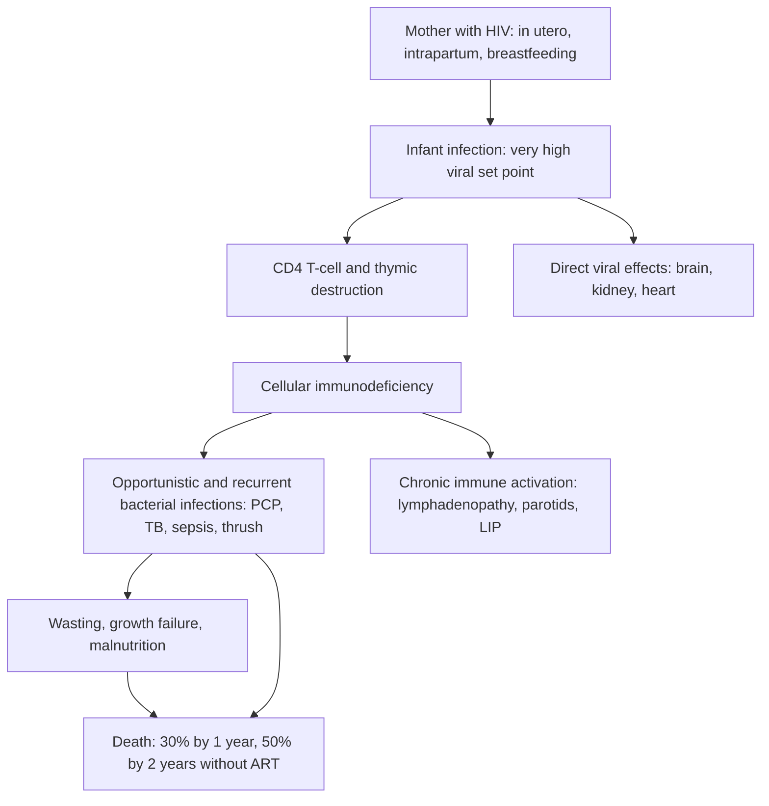
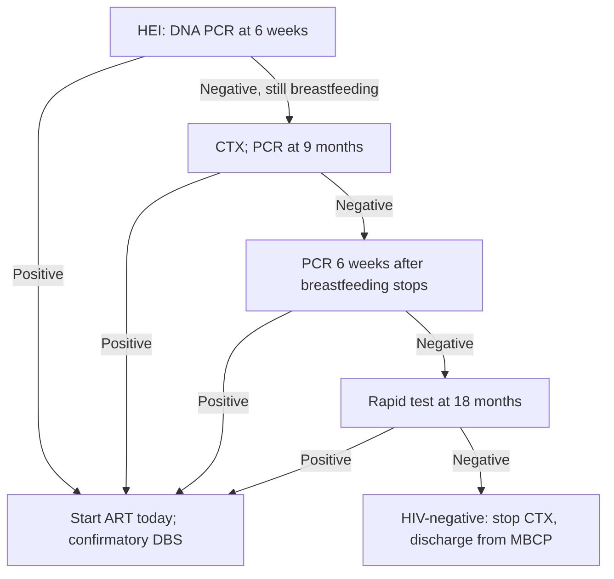

## 1. Definition

**Paediatric HIV** is HIV infection in children under 15 years. About **90%** is **vertical** (mother-to-child): in utero, during birth or through breastfeeding. The rest comes from **sexual abuse**, adolescent sexual activity, unsafe injections or (rarely now) transfusion.

HIV runs **much faster in infants than in adults**. Without treatment about **30% die by age 1 and 50% by age 2** (UCG 2023).

| Term | Meaning |
|---|---|
| **HIV-exposed infant (HEI)** | Infant born to a mother with HIV, until infection is excluded after breastfeeding ends (final rapid test at 18 months or later) |
| **EID** | Early infant diagnosis by virological testing (DNA PCR on DBS, or point-of-care) |
| **Virological test** | Detects the virus itself (DNA PCR, RNA viral load). The only valid test for diagnosis under 18 months |
| **Serological test** | Detects antibodies (rapid tests). Valid for diagnosis from **18 months**, once maternal antibody has gone and the child has stopped breastfeeding for at least 6 weeks |
| **Presumptive severe HIV disease** | Clinical diagnosis in an antibody-positive infant under 18 months when PCR is not yet available (criteria in section 5) |
| **Advanced HIV disease (AHD)** | WHO: **all children under 5 years** with HIV (at presentation or re-engagement), or CD4 <200 cells/µL (≥5 years), or WHO stage 3 or 4 |
| **Viral suppression (Uganda)** | VL **≤200 copies/mL**. Low-level viraemia 201–999. Non-suppressed **≥1000** |
| **Virological failure** | Two consecutive VLs **>1000 copies/mL** 3–6 months apart, despite intensive adherence support, after at least 6 months on ART |
| **Perinatally acquired HIV (PHIV)** | Infection acquired from the mother; many such children are now adolescents |

The whole programme rests on four things:

1. **Find them early.** Early infant diagnosis (**EID**) by **DNA PCR**, plus testing every sick, malnourished or TB-affected child whose status is unknown.
2. **Treat at once.** ART on the **same day** for every positive child (test and treat), with **DTG-based** regimens dosed by **weight band**.
3. **Prevent the killers.** **Co-trimoxazole**, TB preventive therapy, immunisation, nets, nutrition.
4. **Keep them suppressed.** Adherence, viral load monitoring, age-appropriate **disclosure**, and an **adolescent** service that keeps teenagers in care.

> [!PEARL]
> The one thing never to forget: **every child admitted to a Ugandan ward needs a known HIV status.** If it isn't documented, test the child (and the mother). A severely malnourished, TB-infected or "pneumonia not responding" infant who turns out to be HIV-positive is the classic missed diagnosis.

## 2. Epidemiology

- Uganda has roughly **1.4 million** people living with HIV; children under 15 are a small but stubborn fraction, around **80,000–90,000** (UNAIDS estimates) [VERIFY: current UNAIDS figure]. Paediatric ART coverage and viral suppression **lag behind adults**. Children are the group most often **unsuppressed**, and adolescents are the group most often **lost to follow-up**.
- **New infant infections** come mainly from mothers who **seroconvert in pregnancy or breastfeeding**, mothers who **drop out of care**, and **unsuppressed** mothers (see *HIV in Pregnancy*). Final MTCT (including breastfeeding) has fallen to the mid single digits.
- **Prevalence among sick children is far higher than in the community.** HIV is common among children admitted with **SAM, TB and recurrent pneumonia**, which is why UCG says to test every child with these.
- **Commonest killers** of untreated children: **PCP, severe bacterial pneumonia, sepsis, diarrhoea, TB and malnutrition**.
- **Services**: ART clinics at HC III and above, **mother–baby care points** (MBCP) for HEI up to 18 months, **POC EID** at many HC IVs and hospitals, otherwise DBS goes via the **hub system** to CPHL. Specialist paediatric HIV care is at **Baylor-Uganda (Mulago)**, IDI, regional Centres of Excellence and mission hospitals such as Mengo.
- **Adolescents**: "Young people's" clinics, **Operation Triple Zero (OTZ)** clubs (zero missed appointments, zero missed drugs, zero viral load), **Y+ peer supporters** and the **Ariel/Children's clubs**.

> [!UGANDA]
> In practice the barriers on a Ugandan ward are: **pDTG stock-outs** (children left on LPV/r or NVP regimens), **orphanhood** and grandparents as caregivers, school boarding (doses missed, stigma), **non-disclosure** to the child, and **weight-band doses not updated** as the child grows. Always weigh the child and check the dose against the current band at every visit.

## 3. Aetiology and Risk Factors

**Cause**: human immunodeficiency virus (HIV-1 in almost all Ugandan children), a retrovirus that infects CD4 T cells.

**Routes of infection in children**

| Route | Share / timing | Notes |
|---|---|---|
| **In utero** | About a quarter of vertical transmission | Infant PCR may already be positive at birth |
| **Intrapartum** | About half of non-breastfeeding transmission | Prolonged rupture of membranes and high maternal VL raise the risk |
| **Breastfeeding** | Risk continues for as long as the baby breastfeeds and the mother's VL is detectable | Why EID continues until 6 weeks after weaning |
| **Sexual abuse; adolescent sexual activity** | The main non-vertical routes | Ask in every child whose mother is HIV-negative |
| **Unsafe injections, transfusion** | Rare now | Screened blood |

Without any intervention, total MTCT is **15–45%** in breastfeeding populations.

**Risk factors for vertical transmission (the "high-risk infant")**

- Mother **diagnosed late** (third trimester or while breastfeeding), or **seroconverted** in pregnancy or breastfeeding.
- Mother on ART **<4 weeks** before delivery, or **VL >1000** in the 4 weeks before delivery; mother who has **dropped out of care**.
- **Mixed feeding** in the first 6 months.
- **Missed or incomplete infant prophylaxis.**

**Risk factors for rapid progression and death in an infected child**: infancy, no ART, no co-trimoxazole, malnutrition, TB, late diagnosis, poor adherence (caregiver change, orphanhood, non-disclosure).

## 4. Pathophysiology

**Infection and injury.** HIV infects CD4 T cells, macrophages and dendritic cells and destroys CD4 cells. In infants it seeds a **thymus that is still building the T-cell repertoire**, and the immune system has not yet met common pathogens.

**Why infants progress fast.** A very high viral set point (maternal antibody gives poor control), destruction of CD4 cells in a thymus still producing T cells, and an immature immune system. About **one in five** untreated infants are "rapid progressors" who die in the first year; most others progress over several years. A few (long-term non-progressors) present as adolescents with stunting, LIP, chronic lung disease or delayed puberty.

**CD4 count varies with age.** Infants normally have much higher counts than adults. Use **CD4 percentage** under 5 years (severe immunosuppression: <25% under 12 months, <20% at 12–35 months, <15% at 36–59 months) and absolute counts from 5 years (<200 cells/µL).

**Feature links**

- Loss of CD4 cells → failure of T-cell defence against *Pneumocystis* → PCP at 2–6 months: severe hypoxia with a fairly clear chest.
- Loss of T-cell control of *Candida* → oral thrush after 6 weeks; oesophageal candida → painful swallowing, refusal to feed.
- Poor cell-mediated immunity → TB (pulmonary, lymph node, disseminated, meningitis).
- B-cell dysregulation with poor specific antibody → recurrent bacterial pneumonia, sepsis, otitis, meningitis.
- Chronic immune activation and lymphoid hyperplasia → persistent generalised lymphadenopathy, hepatosplenomegaly, bilateral painless parotid enlargement, LIP (with clubbing).
- Recurrent infection + diarrhoea + raised metabolic demand + poor intake → faltering growth, stunting, SAM, delayed puberty.
- Virus in the developing brain → HIV encephalopathy: lost or delayed milestones, microcephaly, spastic diplegia.
- Chronic inflammation and marrow suppression → anaemia, neutropenia, thrombocytopenia.
- Virus and immune complexes in the kidney and heart → HIV nephropathy (oedema, proteinuria), cardiomyopathy.
- Loss of immune surveillance of oncogenic viruses (HHV-8, EBV) → Kaposi sarcoma, lymphoma.
- Rapid immune recovery on ART → inflammatory response to hidden pathogens → IRIS 2–12 weeks after starting ART.

**Why DTG?** Dolutegravir is an **integrase inhibitor** with a **high genetic barrier to resistance**, fast viral load reduction, good tolerability and a palatable once-daily dispersible tablet. Many Ugandan infants were exposed to **NVP** prophylaxis or to mothers with NNRTI resistance, so NNRTI-based regimens (NVP, EFV) fail more often. **LPV/r** works but tastes terrible and the syrup needs refrigeration.

**Why co-trimoxazole?** It prevents **PCP** (peak age 2–6 months, often the first sign of HIV), bacterial pneumonia, sepsis, toxoplasmosis, isosporiasis and **malaria**. It cuts mortality in HIV-positive children even on ART.

## 5. Classification / Staging

**WHO clinical staging for children (2007, still in use)**

| Stage | Typical conditions (all "unexplained", i.e. no other cause) |
|---|---|
| **1** | Asymptomatic; persistent generalised lymphadenopathy |
| **2** | Persistent hepatosplenomegaly; papular pruritic eruptions; extensive warts or molluscum; fungal nail infection; recurrent oral ulcers; lineal gingival erythema; **parotid enlargement**; herpes zoster; recurrent or chronic URTI (otitis, sinusitis, tonsillitis) |
| **3** | **Moderate malnutrition** not responding to treatment; persistent diarrhoea ≥14 days; persistent fever >1 month; **persistent oral candidiasis (after 6 weeks of age)**; oral hairy leukoplakia; acute necrotising gingivitis; **lymph-node TB; pulmonary TB**; severe recurrent bacterial pneumonia; **symptomatic lymphoid interstitial pneumonitis (LIP)**; chronic HIV lung disease (bronchiectasis); anaemia <8 g/dL, neutropenia <0.5 × 10⁹/L, platelets <50 × 10⁹/L |
| **4** | **Severe wasting, stunting or SAM** not responding to treatment; **PCP**; recurrent severe bacterial infections (not pneumonia: empyema, pyomyositis, bone/joint infection, meningitis); chronic HSV (>1 month); **oesophageal candidiasis**; **extrapulmonary TB**; **Kaposi sarcoma**; CMV (onset after 1 month); CNS toxoplasmosis (after 1 month); **HIV encephalopathy**; **cryptococcal meningitis**; disseminated NTM; chronic cryptosporidiosis or isosporiasis; lymphoma; HIV nephropathy or cardiomyopathy; acquired recto-vaginal fistula |

> [!EXAM]
> Oral thrush is **stage 3 only after 6 weeks of age** (thrush in a newborn is common and normal). Thrush **in the oesophagus** (pain on swallowing, refusing feeds) is **stage 4**.

**Immunological classification (severe immunosuppression)**

| Age | Severe immunosuppression |
|---|---|
| <12 months | CD4 **<25%** |
| 12–35 months | CD4 **<20%** |
| 36–59 months | CD4 **<15%** |
| ≥5 years | CD4 **<200 cells/µL** |

**Advanced HIV disease**: all children under 5 years, or CD4 <200 cells/µL (≥5 years), or WHO stage 3 or 4.

**Presumptive severe HIV disease** (antibody-positive infant under 18 months, PCR result not yet back): oral thrush + severe pneumonia or severe sepsis, **or** any AIDS-defining illness (PCP, oesophageal candida, cryptococcal meningitis, severe wasting). Start ART and confirm by PCR.

**Viral load categories (Uganda)**: ≤200 copies/mL suppressed; 201–999 low-level viraemia; ≥1000 non-suppressed.

## 6. Clinical Features

### History

| Ask | Why it matters |
|---|---|
| **Mother's HIV status, when diagnosed, ART, last viral load** | Defines exposure and risk; a mother diagnosed late or unsuppressed = high-risk infant |
| **Infant prophylaxis** (NVP ± AZT) and how long | Missed prophylaxis raises risk; NVP exposure affects regimen choice |
| **Feeding**: exclusive breastfeeding? mixed? still breastfeeding? when stopped? | Ongoing exposure; mixed feeding in the first 6 months raises transmission; decides timing of the next PCR |
| **Previous PCR / rapid test results and dates** (check the HEI card and register) | Where the child sits on the EID algorithm |
| **Co-trimoxazole started at 6 weeks?** | Missed CTX is common; PCP risk |
| **Symptoms**: fever, cough, breathing difficulty, diarrhoea, poor feeding, **painful swallowing**, headache, convulsions, rash | Staging and OIs (painful swallowing = oesophageal candida, stage 4) |
| **Infections**: recurrent pneumonia, diarrhoea ≥14 days, ear discharge, thrush, skin rash, fever >1 month | WHO staging and OI risk |
| **Growth**: weight trajectory on the child health card | Faltering growth is often the earliest sign |
| **TB contact** or symptoms (cough, fever, poor weight gain, night sweats) | TB is the commonest OI; changes ART dosing and timing |
| **Development**: milestones lost or delayed | **HIV encephalopathy** (stage 4) |
| **If on ART**: regimen, dose, who gives it, missed doses, vomiting, how stored, school/boarding, who knows, VL history | Adherence is the main reason for failure; failure versus new illness |
| **Disclosure**: does the child know? does anyone else know? | Plan the disclosure process; adolescent risk |
| **Adolescents (HEADSSS)**: home, education, activities, drugs, sexuality, suicide/depression, safety | Sexual risk, mental health, abuse, transition |
| **Immunisation** status and vitamin A | BCG and live vaccines in symptomatic HIV; catch-up |
| **Siblings and other family members tested?** | Index-client testing ("Know Your Child's Status") |

### Examination

Follow the order of Hutchison's Clinical Methods (24th edition), adapted for children: observe first, examine the chest while the child is quiet, and leave the mouth and ears to last. In a sick child the ETAT/ABCDE assessment (section 9) comes first.

**Introduction and preparation**

- Introduce yourself; confirm the child's name, age and the caregiver's relationship (often a grandparent).
- Explain the examination; consent from the caregiver and assent from the child. Be discreet about HIV status in front of others.
- Hand hygiene.
- Position and exposure: on the caregiver's lap; undress fully but keep the child warm; adolescents examined with a chaperone and privacy.

**General inspection from the end of the bed**

- Well or unwell; **danger signs** (lethargy, unable to drink, convulsions, severe respiratory distress).
- Colour: pallor, cyanosis; hydration.
- **Nutrition**: visible wasting, oedema (SAM or HIV nephropathy), sparse hair.
- Behaviour and development (head control, sitting, interaction): encephalopathy.
- **Vitals**: RR (fast breathing ≥60 under 2 months, ≥50 at 2–11 months, ≥40 at 1–5 years), HR, **SpO₂**, temperature, capillary refill.
- **Growth**: weight, length/height, **MUAC** and **head circumference**, plotted as **Z-scores**. Stunting is very common; microcephaly suggests encephalopathy.

**Hands, face and neck**

| Sign | What it means |
|---|---|
| Clubbing | LIP, bronchiectasis |
| Fungal nail infection (fingers and toes) | Stage 2 |
| Pallor of palms and conjunctivae | Anaemia (HIV, malaria, AZT) |
| **Bilateral painless parotid enlargement** | Think **LIP** (stage 2) |
| **Mouth (examine last in a young child)**: **thrush**, angular cheilitis, gingivitis, lineal gingival erythema, ulcers, **hairy leukoplakia** (adolescents), Kaposi lesions on the palate | Thrush after 6 weeks = stage 3; Kaposi = stage 4 |
| **Persistent generalised lymphadenopathy** (cervical, axillary, inguinal) | Stage 1; large, hard, progressive nodes → TB or lymphoma |
| Neck stiffness, bulging fontanelle | Cryptococcal or TB meningitis |

**Skin**: papular pruritic eruption, seborrhoeic dermatitis, extensive molluscum or warts, herpes zoster or its scars, scabies, Kaposi nodules, **drug rash** (abacavir hypersensitivity, NVP, co-trimoxazole), BCG scar.

**Systems**

- **Respiratory**: inspection (RR, chest indrawing, nasal flaring), palpation, percussion (dull: consolidation or effusion), auscultation (crackles, bronchial breathing, wheeze). A **hypoxic infant with a relatively clear chest** = PCP until proven otherwise.
- **Cardiovascular**: gallop, murmur, hepatomegaly (cardiomyopathy).
- **Abdomen**: hepatosplenomegaly, ascites, oedema.
- **Neurological and development**: milestones, tone (spastic diplegia in encephalopathy), reflexes, neck stiffness, fontanelle.
- **Adolescents**: Tanner stage (puberty is often delayed), signs of STI, pregnancy.
- **Ears last**: ear discharge (chronic suppurative otitis media).

**Complete the examination**: plot growth, check the HEI or ART card, thank the caregiver and child, wash hands, and summarise (model presentation in section 8).

**Document negatives**: "no thrush, no lymphadenopathy, no hepatosplenomegaly, no signs of meningism".

### Red flags

> [!REDFLAG]
> - **Danger signs (IMCI/ETAT)**: unable to drink or breastfeed, vomits everything, convulsions, lethargy or unconsciousness, plus SpO₂ <90%, severe respiratory distress, shock.
> - **Severe pneumonia in an infant aged 2–6 months** who is HIV-exposed: add **high-dose co-trimoxazole for PCP** to the antibiotics.
> - **Headache, vomiting, confusion or neck stiffness** in an older child or adolescent on ART: **cryptococcal meningitis** or TB meningitis.
> - **Rash with fever, abdominal pain or breathing difficulty within 6 weeks of starting abacavir**: hypersensitivity. Stop it and **never re-challenge**.
> - **Clinical deterioration 2–12 weeks after starting ART**: IRIS (often unmasked TB). Do not stop ART.
> - **SAM** (MUAC <11.5 cm, W/H <−3 Z or oedema) in an HIV-positive child: high mortality; treat the SAM, start ART within 2 weeks once stable.
> - **Teenager who has stopped coming**: high risk of AHD, depression, pregnancy, death.

### Thinking like a clinician

- **"Positive rapid test at 9 months" does not mean infected.** It means **exposed**. Do a DNA PCR. Conversely, a **negative** rapid test from 9 months in a child who is **not breastfeeding** makes infection very unlikely.
- **"PCR negative at 6 weeks, so the child is negative."** Only if the child **never breastfed**. If still breastfeeding, the child stays exposed: CTX, next PCR at 9 months, and 6 weeks after weaning.
- **If an infant fails to thrive, has persistent thrush after 6 weeks, or recurrent pneumonia, test for HIV even if a previous PCR was negative.** UCG says do a PCR any time an exposed child becomes symptomatic.
- **Malnutrition + HIV + TB travel together.** Screen every malnourished child for both.
- **On ART but not suppressed? Think adherence first** (taste, vomiting, caregiver change, school, stigma, the child secretly spitting out tablets), **then dosing** (weight band out of date), **then interactions** (rifampicin, carbamazepine, antacids), **then resistance**.
- **A child "on ART for years" with a new stage 3/4 illness** after 6 months on effective ART = **clinical failure** (or IRIS if just started). Check a viral load.
- **Do not delay ART for CD4 or "readiness" in an infant.** Same-day ART is the default; the exceptions are **TB meningitis and cryptococcal meningitis**, where ART is deferred 4–6 weeks.
- **If the infant is 2–6 months old, breathless and hypoxic but the chest sounds nearly clear, think PCP**, and give high-dose co-trimoxazole with the antibiotics.
- **Common student mistakes**: reading a positive rapid test under 18 months as infection; forgetting that breastfeeding keeps the baby exposed; swapping pDTG for DTG 50 mg mg-for-mg; not re-weighing and re-banding the dose; stopping co-trimoxazole once ART starts.

## 7. Differential Diagnoses

When an HIV-exposed or HIV-positive child presents with the "HIV look" (wasting, recurrent infections, lymphadenopathy), think about these:

| Differential | Distinguishing clinical feature | Distinguishing investigation |
|---|---|---|
| **TB (pulmonary/disseminated)** | Contact history, fever >2 weeks, weight loss, hilar nodes, no response to antibiotics | GeneXpert (sputum/gastric/stool), CXR, TB-LAM |
| **SAM without HIV** | Dietary history, oedema, responds to F-75/F-100/RUTF | HIV test is negative |
| **PCP vs bacterial pneumonia** | PCP: 2–6 months, little fever, severe hypoxia, clear-ish chest, no response to 48 h antibiotics | SpO₂, CXR (ground glass), LDH |
| **LIP vs miliary TB** | LIP: older child (>2 y), clubbing, parotids, slow course, well despite CXR | CXR pattern, Xpert, trial of antibiotics |
| **Congenital infection (CMV, syphilis, toxoplasmosis)** | Hepatosplenomegaly, rash, jaundice from birth | Maternal RPR, infant serology |
| **Primary immunodeficiency** | Family history, recurrent infections, HIV PCR negative | Immunoglobulins (referral) |
| **Malignancy (lymphoma, leukaemia, Kaposi)** | Lymph nodes that are big, hard and progressive; cytopenias | FBC/film, biopsy |
| **Chronic suppurative lung disease after measles/pertussis** | History of the infection, clubbing | CXR, HIV test |

## 8. Clinical Workup

Diagnosis depends on age: **virological (DNA PCR) under 18 months, serological (rapid tests) from 18 months**. Treat emergencies first; never delay ART for tests other than those that change its timing (TB meningitis, cryptococcal meningitis).

### Bedside

Facility levels in these tables are compiled from the source notes [VERIFY: against the MoH test menu by level].

| Test | Why | Expected / abnormal finding | Facility level |
|---|---|---|---|
| **HIV rapid test** (child ≥18 months; or mother; or infant to establish exposure) | Diagnosis ≥18 months; exposure under 18 months | Positive ≥18 months (and not breastfed for 6 weeks) = infected; under 18 months = exposed only | HC II and above |
| **POC EID (DNA PCR)** where available | Same-day infant diagnosis | Positive = infected (send a confirmatory sample) | Many HC IVs and hospitals |
| **RBS** | Hypoglycaemia in the sick or malnourished child | <3.0 mmol/L (UCG); WHO <2.5 (<3.0 in SAM): 10% dextrose 5 mL/kg | All levels with a glucometer |
| **Hb (HemoCue)** | Anaemia (HIV, malaria, AZT) | <8 g/dL = stage 3 | HC III and above |
| **Malaria RDT** | Fever; CTX reduces but does not abolish malaria | Positive: treat malaria | All levels |
| **SpO₂** | PCP, pneumonia | <90%: oxygen; very low with clear chest = PCP | HC IV and above |
| **Urine TB-LAM** | Advanced disease or seriously ill (WHO); UCG lists CD4 <200 | Positive: start TB treatment | HC III/IV and above |
| **Serum/plasma CrAg** (adolescents with CD4 <200) | Pre-emptive fluconazole before cryptococcal meningitis develops | Positive: LP, then pre-emptive or full treatment | HC IV and above |
| **Weight, height, MUAC, Z-scores** | Dose band; malnutrition; staging | MUAC <11.5 cm = SAM | All levels |

### Basic lab

| Test | When | Expected / abnormal finding | How it changes management | Availability |
|---|---|---|---|---|
| **DNA PCR (DBS)** | HEI at 6 weeks, 9 months, 6 weeks after weaning; any symptomatic HEI | Positive = infected (send a confirmatory sample) | Start ART **today**; do not wait for the confirmatory result | DBS from HC II via hub to CPHL (days–weeks) |
| **Rapid antibody tests** (Determine → Stat-Pak → SD Bioline tie-breaker per national algorithm) | Diagnosis ≥18 months; final test at 18 months | Positive = infected (≥18 months and not breastfed for 6 weeks) | Start ART | HC II and above |
| **CD4 count / %** | Baseline; suspected treatment failure | Low = AHD | AHD package: CrAg, TB-LAM, closer follow-up | HC IV and above (POC CD4) |
| **Viral load (DBS or plasma)** | 6 and 12 months on ART, then every 6 months (0–19 y) | ≤200 suppressed; 201–999 LLV; ≥1000 non-suppressed | IAC, repeat VL, HIVDR test, switch | DBS from HC II via hub; results take weeks |
| **FBC** | Baseline; on AZT; anaemia | Anaemia, neutropenia (AZT, CTX), thrombocytopenia | Change AZT; investigate; staging | HC IV and above |
| **Creatinine / urinalysis** | Adolescents on TDF; oedema | Proteinuria, raised creatinine | TDF contraindicated if CrCl <60 mL/min (UCG) | Hospital |
| **HBsAg** | Adolescents before TDF | Positive: HBV co-infection | Regimen choice (keep TDF + 3TC) | HC IV and above |
| **GeneXpert (sputum, gastric aspirate, stool)** | TB symptoms | MTB detected ± RIF resistance | TB treatment; DTG twice daily | HC IV and hospitals; samples referred from lower levels |

### Imaging

| Test | When | Expected finding | How it changes management | Availability |
|---|---|---|---|---|
| **Chest X-ray** | Pneumonia not responding, suspected TB, LIP | **PCP**: bilateral ground glass; **LIP**: reticulonodular + hilar nodes; **TB**: hilar nodes, consolidation, miliary | Directs treatment | District/regional hospitals |

### Specialised / referral-level

| Test | When | Expected finding | How it changes management | Availability |
|---|---|---|---|---|
| **HIV drug resistance (genotype)** | Two non-suppressed VLs on a DTG or PI regimen; mother failing at baby's diagnosis | Mutations | Choose 2nd/3rd-line regimen | CPHL via hub |
| **Lumbar puncture with CrAg and India ink, TB Xpert** | Headache, meningism, confusion | CrAg positive; high opening pressure | Cryptococcal or TB meningitis protocol; defer ART | Hospital |
| **LDH** | Suspected PCP | Raised | Supports PCP | RRH, NRH |
| **Immunoglobulins** | HIV-negative child with recurrent infections | Low | Primary immunodeficiency referral | NRH |
| **Biopsy** (node, skin) | Hard progressive nodes, skin nodules | TB, lymphoma, Kaposi sarcoma | Specific treatment | RRH, NRH |

**Investigation summary**

| Test | What you are looking for | Why |
|---|---|---|
| DNA PCR / rapid tests (age-appropriate) | Infection | Diagnosis, start ART |
| CD4 (% under 5 years) | Degree of immunosuppression | AHD, OI risk |
| Viral load | Treatment response | Detects failure early |
| FBC | Anaemia, neutropenia, thrombocytopenia | Staging, AZT/CTX toxicity |
| GeneXpert, CXR, TB-LAM | TB | TB treatment and ART dosing |
| CrAg (adolescents, CD4 <200), LP if symptoms | Cryptococcus | Pre-emptive fluconazole or treatment |
| HBsAg (adolescents before TDF), creatinine | HBV, kidney function | Regimen choice |
| Growth (Z-scores), development | Malnutrition, encephalopathy | Nutrition support, staging |

### Putting it together

**Model one-liner**

> "Baby A, an 8-month-old HIV-exposed boy, weight 5.9 kg (WAZ −2.6, MUAC 11.8 cm), mixed-fed, whose mother was diagnosed in the third trimester and is not suppressed, presents with 3 days of fast breathing and oral thrush; he has severe pneumonia (SpO₂ 86%) and moderate acute malnutrition. His 6-week PCR was never collected."

**Problem list**

1. Severe pneumonia with hypoxaemia, likely bacterial ± PCP.
2. Presumptive severe HIV disease.
3. MAM/faltering growth.
4. Missed EID and CTX.
5. Unsuppressed mother.

**Worked interpretation: the EID algorithm**

- 6-week PCR **negative**, baby **exclusively breastfed and still breastfeeding** → still exposed. Continue CTX, NVP as prescribed, **PCR at 9 months**.
- 9-month PCR **negative**, still breastfeeding → **PCR 6 weeks after complete cessation of breastfeeding**, then **rapid test at 18 months**.
- Rapid test at 18 months **negative** and not breastfed for 6 weeks → **HIV-negative**: stop CTX and discharge from the MBCP.
- Any **positive PCR** → "HIV-positive": start ART the same day, send a **confirmatory** DBS (and an HIVDR sample if the mother is failing).

**Model case presentation (ward round)**

> "Akello is a 2-year-4-month-old girl from Mukono, brought by her grandmother, admitted with 2 weeks of cough and fever and 3 days of fast breathing. She weighs 8.6 kg (WAZ −2.9), height 80 cm (HAZ −2.8), WHZ −1.9, MUAC 12.2 cm. Her mother died last year; Akello was diagnosed HIV-positive at 14 months and is on ABC/3TC 120/60 two tablets plus pDTG 10 mg two tablets daily, but the grandmother says doses are 'sometimes missed' since she started at nursery. Her last VL 4 months ago was 3,200 copies/mL. She is fully immunised for age except MR2 (due at 18 months, missed) and was breastfed until 9 months. She has a TB contact (uncle with cough). On examination: RR 52, SpO₂ 92%, no danger signs, oral thrush, generalised lymphadenopathy, bilateral parotid enlargement and hepatomegaly 3 cm. My working diagnosis is pneumonia with suspected TB, in a child with WHO stage 3 HIV who is not suppressed, likely from poor adherence, with moderate wasting and stunting. Plan: Xpert on gastric aspirate and stool, CXR, urine TB-LAM, CD4 and FBC, amoxicillin, nutrition referral, and intensive adherence counselling with the grandmother; her ART dose band is correct for 8.6 kg."

## 9. Management

### Immediate / emergency

**First 5 minutes**

1. **ETAT triage**: emergency signs (Airway/Breathing, Circulation, Coma, Convulsions, severe Dehydration). Treat these first, whatever the HIV status.
2. Vitals with age-appropriate norms: RR (fast breathing ≥60 under 2 months, ≥50 at 2–11 months, ≥40 at 1–5 years), HR, SpO₂, temperature, **RBS**, capillary refill.
3. **Weigh** the child now: every drug in this topic is dosed by weight.

**ABCDE**

- **A/B**: oxygen if SpO₂ <90%. If an HIV-exposed infant aged 2–6 months has **severe pneumonia**: start ampicillin + gentamicin **and** high-dose co-trimoxazole for PCP at once (plus prednisolone if hypoxic).
- **C**: treat shock per ETAT (care in SAM: follow the SAM fluid protocol).
- **D**: treat convulsions; treat hypoglycaemia (**10% dextrose 5 mL/kg IV**). Headache, confusion or neck stiffness: LP for cryptococcal and TB meningitis.
- **E**: temperature; rash (drug reaction: abacavir, NVP, co-trimoxazole); malaria RDT.

### Definitive

#### A. Care of the HIV-exposed infant (mother–baby care point, up to 18 months)

1. **ARV prophylaxis**, started within 6 hours of birth (see *HIV in Pregnancy*):
   - **Low risk**: **NVP** once daily for **6 weeks**.
   - **High risk** (mother on ART <4 weeks before delivery, VL >1000 in the 4 weeks before delivery, or diagnosed in the 3rd trimester or while breastfeeding): **AZT + NVP for 6 weeks, then NVP alone for 6 more weeks** (12 weeks in total), per the 2022 consolidated guidelines.
   - **Baby first seen after 6 weeks** (UCG 2023): take a PCR, give a **first-line paediatric ART regimen for 6 weeks**; if the PCR is negative, follow with NVP for 6 weeks; if positive, continue ART.
2. **DNA PCR** at 6 weeks, 9 months and 6 weeks after weaning; rapid test at 18 months (algorithm in section 8).
3. **Co-trimoxazole from 6 weeks** until infection is excluded and breastfeeding has stopped.
4. **Immunise** per UNEPI (see *Immunisation*). Give BCG at birth; do **not** give BCG later to a child with **symptomatic HIV**.
5. **Feeding**: exclusive breastfeeding for 6 months, then complementary foods, with breastfeeding continued to **12 months** or beyond while the mother is suppressed on ART. **Never mix-feed** under 6 months.
6. **Visits** synchronised with immunisation: 6, 10, 14 weeks, then 5, 6, 9, 12, 15 and 18 months (UCG 2023). Weigh, plot, screen for TB and illness every visit.

> [!UGANDA]
> High-risk infant prophylaxis: the **2022 consolidated guidelines** give **AZT + NVP for 6 weeks, then NVP for 6 weeks**; **UCG 2023** lists **NVP alone for 12 weeks**. Follow your unit's protocol.

#### B. Diagnosis made: starting ART

**Principles (UCG 2023)**: test and treat everyone; **same-day ART** after counselling the caregiver (if not ready, within **7 days** for children); screen for TB and cryptococcal disease first, because ART is **deferred** in TB meningitis and cryptococcal meningitis.

Before starting:

1. Confirm the diagnosis (but **do not wait** for the confirmatory PCR to start).
2. Weigh, measure, stage (WHO), screen for TB (symptoms ± Xpert), check CD4 (to identify AHD), FBC.
3. Identify the **treatment supporter** (usually the mother or a grandparent) and teach how to disperse and give the tablets.
4. Plan disclosure (age-appropriate).

**Recommended first-line regimens (Uganda 2022 consolidated guidelines / UCG 2023)**

| Group | Preferred | Alternatives |
|---|---|---|
| **Neonates (<4 weeks)** | **AZT + 3TC + NVP** (or RAL-based where available) [VERIFY: current neonatal option] | Switch to ABC + 3TC + DTG once ≥4 weeks and ≥3 kg |
| **Children ≥4 weeks and <20 kg** | **ABC + 3TC + DTG** (pDTG 10 mg dispersible, or ABC/3TC/DTG 60/30/5 mg dispersible FDC) | If DTG not tolerated or not available: **ABC + 3TC + LPV/r** granules/pellets; if LPV/r not tolerated: ABC + 3TC + EFV (only >3 years and >10 kg); if ABC contraindicated: AZT + 3TC + DTG (or LPV/r) |
| **Children 20 to <30 kg** | **ABC + 3TC + DTG** (DTG 50 mg film-coated tablet) | If DTG contraindicated: ABC + 3TC + LPV/r tablets; if ABC contraindicated: TAF/FTC/DTG (>6 years and >25 kg) or AZT + 3TC + DTG |
| **Adolescents ≥30 kg** | **TDF + 3TC + DTG (TLD)** one tablet daily | TAF/FTC/DTG; ABC/3TC + DTG if TDF contraindicated (renal disease, CrCl <60) |

> [!DRUG]
> **Abacavir hypersensitivity** (fever, rash, GI or respiratory symptoms, usually in the first 6 weeks): stop ABC and **never restart it**; the reaction on re-challenge can be fatal. HLA-B*5701 is rare in African children, but the reaction can still occur.

**Weight-band dosing (UCG 2023 dosing tables; once daily unless stated)**

| Formulation | 3.0–5.9 kg | 6.0–9.9 kg | 10.0–13.9 kg | 14.0–19.9 kg | 20.0–24.9 kg | 25.0–34.9 kg |
|---|---|---|---|---|---|---|
| **ABC/3TC 120/60 mg** dispersible, once daily | 1 | 1.5 | 2 | 2.5 | 3 | Use 600/300 |
| **ABC/3TC 600/300 mg**, once daily | – | – | – | – | – | **1** |
| **pDTG 10 mg** dispersible, once daily | 1 per UCG table (FDA/WHO: **5 mg = ½ tab**) [VERIFY: current MoH dosing chart] | **1.5** (15 mg) | **2** (20 mg) | **2.5** (25 mg) | **3** (30 mg) | Use 50 mg |
| **DTG 50 mg** film-coated, once daily | – | – | – | – | **1** | **1** |
| **ABC/3TC/DTG 60/30/5 mg** dispersible, once daily | 2 | 3 | 4 | 5 | 6 | – |
| **AZT/3TC 60/30 mg**, **twice daily** | 1 + 1 | 1.5 + 1.5 | 2 + 2 | 2.5 + 2.5 | 3 + 3 | AZT/3TC 300/150 1 + 1 |
| **LPV/r 40/10 mg** pellets/granules, **twice daily** | 2 + 2 | 3 + 3 | 4 + 4 | 5 + 5 | 6 + 6 | – |
| **LPV/r 100/25 mg** tablets, **twice daily** | – | – | 2 + 1 | 2 + 2 | 2 + 2 | Use 200/50: 2 + 1 |
| **EFV 200 mg**, at night (>3 y, >10 kg) | – | – | 1 | 1.5 | 1.5 | 2 |

How the doses relate to mg/kg: DTG works out at roughly **1.5–2.5 mg/kg/day** (max **50 mg** once daily, or 50 mg twice daily with rifampicin); ABC about **16 mg/kg/day** (max **600 mg**/day); 3TC about **8 mg/kg/day** (max **300 mg**/day); AZT about **180–240 mg/m² twice daily** (max **300 mg** per dose). Use the **band**, not a calculation, on the ward.

> [!DRUG]
> **pDTG 10 mg dispersible and DTG 50 mg film-coated tablets are not bioequivalent.** 30 mg of pDTG equals 50 mg of the film-coated tablet. Never substitute mg for mg. Disperse pDTG in 5 mL of clean water (up to 3 tablets) or 10 mL (4–6 tablets) and give at once.

> [!DRUG]
> **DTG interactions**: give **twice daily** with **rifampicin** (same weight-band dose, morning and evening) and continue for 2 weeks after rifampicin ends. Give DTG **2 hours before or 6 hours after** antacids, iron, calcium or zinc, unless taken together with food. Avoid with carbamazepine, phenytoin and phenobarbital (UCG lists these as contraindications: use another antiepileptic such as levetiracetam or valproate).

#### C. Co-trimoxazole prophylaxis (CPT)

| Weight (UCG 2023 / WHO bands) | Daily dose (SMX/TMP) | Practical form |
|---|---|---|
| **<5 kg** (usually 6 weeks–6 months) | **120 mg** (TMP about 4 mg/kg) | 2.5 mL of 240 mg/5 mL syrup or ½ × 240 mg dispersible |
| **5–14.9 kg** | **240 mg** | 5 mL syrup or ½ × 480 mg tablet |
| **15–29.9 kg** | **480 mg** | 1 × 480 mg tablet |
| **≥30 kg** | **960 mg** | 1 × 960 mg or 2 × 480 mg |

Oral, **once daily**; for HEI, from **6 weeks until HIV is excluded** after breastfeeding ends; for HIV-positive children, **for life** (UCG 2023). If CTX is contraindicated (severe sulfa reaction), give **dapsone 2 mg/kg once daily (max 100 mg)**. CTX reduces malaria but does not abolish it: a febrile child on CTX still needs a malaria test.

#### D. TB preventive therapy and TB co-treatment

- **Exclude TB disease** first (symptom screen ± Xpert/CXR).
- **Isoniazid 10 mg/kg (range 7–15) once daily, max 300 mg, plus pyridoxine, for 6 months** for HEI or HIV-positive children with TB contact (UCG 2023). Older children and adolescents may receive rifapentine-based short courses (3HP) per the current national TPT guidance [VERIFY: eligibility and age limits].
- **Child with TB and HIV**: start TB treatment first, then **ART within 2 weeks** (as soon as TB drugs are tolerated); **TB meningitis: wait 4–8 weeks**. On rifampicin, **DTG twice daily**; for LPV/r, add extra ritonavir ("super-boosting") to a 1:1 ratio; NVP must not be given with rifampicin. (Under the WHO 2022 TB guidelines, children with non-severe TB can receive the 4-month regimen; see *Childhood TB*.)

#### E. Opportunistic infections

- **PCP**: high-dose co-trimoxazole (IV preferred) three times daily for 21 days + prednisolone if SpO₂ <90% or severe distress; then back to prophylaxis for life. Pentamidine if severe sulfa reaction.
- **Oral thrush**: nystatin; miconazole gel if it fails. **Oesophageal candidiasis**: fluconazole.
- **Cryptococcal meningitis**: WHO 2022 induction (single high-dose liposomal amphotericin + flucytosine + fluconazole), then consolidation and maintenance fluconazole; therapeutic LPs; defer ART 4–6 weeks.
- **CrAg positive without meningitis** (adolescents): pre-emptive fluconazole after an LP if possible.
- **Symptomatic, hypoxic LIP**: prednisolone, after ruling out TB.

All doses are in the drug table below.

> [!UGANDA]
> Cryptococcal meningitis: the WHO 2022 single high-dose liposomal amphotericin regimen was proven in the AMBITION-cm trial, largely run in Uganda. Where L-AmB is not available, the older regimen is used: **amphotericin B deoxycholate 1 mg/kg/day + flucytosine for 1 week, then fluconazole 12 mg/kg/day for 1 week**, followed by consolidation. Do **therapeutic LPs** for raised pressure. **Defer ART 4–6 weeks** after starting antifungals.

### Drug table

ARV doses are by weight band (table above); this table covers prophylaxis and OI treatment.

| Drug | Dose (per kg + max for children; adult) | Route | Frequency | Duration | Key cautions |
|---|---|---|---|---|---|
| **Nevirapine** syrup 10 mg/mL (prophylaxis, UCG 2023) | Birth–6 weeks: **10 mg (1 mL)** if 2.0–2.49 kg; **15 mg (1.5 mL)** if ≥2.5 kg. 6–12 weeks: **20 mg (2 mL)** | Oral | Once daily | 6 weeks (12 if high-risk) | Start within 6 hours of birth; never with rifampicin |
| **Zidovudine** syrup 10 mg/mL (high-risk prophylaxis) | ≥2.5 kg: **15 mg (1.5 mL)** (about 4 mg/kg); 2.0–2.49 kg: 10 mg (1 mL) | Oral | **Twice** daily | 6 weeks | Anaemia, neutropenia |
| **Co-trimoxazole** (prophylaxis) | <5 kg **120 mg**; 5–14.9 kg **240 mg**; 15–29.9 kg **480 mg**; ≥30 kg and adult **960 mg** | Oral | Once daily | HEI: from 6 weeks until HIV excluded; HIV-positive: for life | Rash (Stevens–Johnson), neutropenia; still test for malaria |
| **Dapsone** (if CTX contraindicated) | **2 mg/kg**, max 100 mg | Oral | Once daily | As for CTX | Haemolysis in G6PD deficiency |
| **Co-trimoxazole, high dose (PCP)** | **TMP 8 mg/kg + SMX 40 mg/kg** per dose (WHO Pocket Book 2013) | IV (preferred) or oral | **Three times daily** | **21 days** | Then back to prophylaxis for life |
| **Prednisolone (PCP)** | **1–2 mg/kg/day**, max 40–60 mg/day | Oral | Once daily | 1 week (then taper) | If SpO₂ <90% or severe distress |
| **Pentamidine (PCP)** | 4 mg/kg | IV infusion | Once daily | 21 days | For severe sulfa reaction |
| **Nystatin** 100,000 U/mL (oral thrush) | 1–2 mL | Oral | Four times daily | 7 days | Miconazole gel if it fails |
| **Fluconazole** (oesophageal candidiasis) | **3–6 mg/kg**, max 400 mg | Oral | Once daily | 7 days (Pocket Book), 14–21 days in severe disease | Hepatotoxicity; interactions |
| **Liposomal amphotericin B** (cryptococcal meningitis, WHO 2022) | **10 mg/kg single dose** | IV | Once | Day 1 | Where available (regional/national referral) |
| **Flucytosine** (cryptococcal meningitis) | **100 mg/kg/day** in 4 divided doses | Oral | 6-hourly | 14 days | Marrow suppression |
| **Fluconazole** (cryptococcal induction) | **12 mg/kg/day**, max 800 mg | Oral | Once daily | 14 days | With L-AmB + flucytosine |
| **Fluconazole** (cryptococcal consolidation) | 6–12 mg/kg/day, max 800 mg | Oral | Once daily | 8 weeks | |
| **Fluconazole** (cryptococcal maintenance) | 6 mg/kg/day, max 200 mg | Oral | Once daily | Until immune recovery | |
| **Fluconazole** (CrAg positive, no meningitis; adolescents) | 12 mg/kg/day for 2 weeks, then 6 mg/kg/day for 8 weeks, then maintenance; max 800 mg/day, then 400 mg/day | Oral | Once daily | 10 weeks, then maintenance | Do an LP first if possible |
| **Prednisolone (LIP**, symptomatic, hypoxic) | **1–2 mg/kg/day** | Oral | Once daily | 2 weeks, taper over 2–4 weeks | Rule out TB first |
| **Isoniazid** (TPT) | **10 mg/kg** (range 7–15), max 300 mg | Oral | Once daily | 6 months | Add pyridoxine; exclude TB disease first |
| **10% dextrose** (hypoglycaemia) | 5 mL/kg | IV | Once, recheck glucose | As needed | Then feed |

### Referral criteria

[VERIFY: level split compiled from the source notes and services described above, not an MoH list]

| Level | What to do | Refer up when |
|---|---|---|
| **HC II / HC III** | HIV testing, HEI care at the MBCP, DBS collection, CTX, ART initiation and refills (ART clinics at HC III and above), adherence counselling | Danger signs, severe pneumonia, SAM, suspected TB in a child who cannot produce a sample, any child failing ART → HC IV |
| **HC IV / General Hospital** | POC EID and CD4, GeneXpert, admission for pneumonia and PCP, SAM care, TB-LAM, CrAg | Suspected meningitis without LP, failed first line needing a resistance test, no response to PCP treatment, needs L-AmB → RRH |
| **RRH (Centres of Excellence)** | LP, cryptococcal and TB meningitis care, chest X-ray, second-line ART, HDU | Third-line ART, complex resistance, malignancy (Kaposi, lymphoma), cardiomyopathy or nephropathy → NRH |
| **NRH (Mulago), Baylor-Uganda, IDI** | Specialist paediatric and adolescent HIV care, third line, oncology | n/a |

### Monitoring and follow-up

1. **Every visit**: weight → **re-check the dose band**; adherence (pill count, caregiver report), side-effects, TB screen, development, school, disclosure progress.
2. **Viral load**: at **6 months and 12 months** after starting ART, then **every 6 months** until 19 years.
3. **VL ≥1000** (or 201–999 on repeat): **intensive adherence counselling** (3 sessions, one a month, using the "3 Cs" good-score target >95%), address barriers, check doses and interactions, **repeat VL** after IAC (3 months).
4. **Still ≥1000 on a DTG or PI regimen** → **HIV drug resistance test**, then switch guided by the result.
5. **Failing an NNRTI regimen** → switch to DTG without waiting for a second VL (do IAC alongside).
6. **Second line (UCG 2023)**: failing **ABC + 3TC + DTG** → **AZT + 3TC + DRV/r** (alternative AZT + 3TC + LPV/r); failing **AZT + 3TC + DTG** → ABC + 3TC + DRV/r. Third line only via specialist centres with resistance testing.
7. **New positive PCR**: review in **2 weeks** after starting ART.

### Disclosure, adherence and adolescents

**Disclosure** is planned with the caregiver and done in stages:

| Stage | Age (guide) | What the child knows |
|---|---|---|
| **Non-disclosure** | Under about 5 years | "You take medicine to stay strong." |
| **Partial disclosure** | About **6–8 years** (school age) | "There are germs in your blood; the medicine keeps them asleep and makes your soldiers strong." The word "HIV" is not yet used |
| **Full disclosure** | About **10–12 years**, and **before adolescence/sexual debut** | Names HIV, how it is transmitted, that it is lifelong but controllable, who to tell and who not to |
| **Post-disclosure support** | Ongoing | Peer groups (OTZ, teen clubs), counselling, check understanding |

Signs that a child is ready: asks why they take medicine, asks about blood tests, can keep a secret, cognitive maturity. **Delayed disclosure** is linked to poor adherence, depression and onward transmission in adolescence.

**Adolescents (10–19 years)** need:

- A **youth-friendly** clinic (separate day, peer supporters, flexible hours).
- **HEADSSS** psychosocial screening, **depression screening** (PHQ-9/PHQ-A), substance use, **sexual and reproductive health**: condoms, contraception (note EFV reduces implant efficacy; DTG has no such interaction), PrEP for partners, **HPV vaccination** (girls with HIV get **2 doses**, unlike the single dose for others).
- **Confidentiality** (see *Professionalism & Ethics*), **transition** to adult care at about 19–24 years, planned not abrupt.
- **Switch to TLD** at ≥30 kg; once-daily single tablet helps adherence.

## 10. Complications

**Disease-related**

- **Opportunistic infections**: PCP, TB, cryptococcal and TB meningitis, oesophageal candida, CMV, cryptosporidiosis.
- **Malnutrition and stunting**; delayed puberty.
- **Neurological**: HIV encephalopathy, developmental delay, cognitive and school problems.
- **Chronic lung disease**: LIP, bronchiectasis, post-TB lung disease.
- **Cardiac and renal**: cardiomyopathy, HIV-associated nephropathy.
- **Malignancy**: Kaposi sarcoma, non-Hodgkin and Burkitt lymphoma.
- **Psychosocial**: orphanhood, stigma, depression, suicide, school drop-out, abuse.

**Treatment-related**

| Complication | Cause | Recognition and action |
|---|---|---|
| Hypersensitivity | Abacavir | Fever, rash, GI or respiratory symptoms in the first 6 weeks: stop, **never re-challenge** |
| Anaemia, neutropenia | AZT (also CTX) | FBC; switch AZT |
| Rash, hepatitis | NVP | Stop; check liver function |
| CNS effects (dreams, dizziness) | EFV | Give at night; switch to DTG |
| Insomnia, headache, modest weight gain | DTG | Usually mild; give in the morning if insomnia |
| Renal toxicity, bone loss | TDF (adolescents) | Creatinine, urinalysis; avoid if CrCl <60 |
| Diarrhoea, dyslipidaemia | LPV/r | Supportive; switch if intolerable |
| IRIS (unmasking TB, cryptococcus) | Immune recovery after starting ART | Deterioration 2–12 weeks after ART: treat the OI, **do not stop ART** |
| Treatment failure and drug resistance | Poor adherence, wrong dose, interactions | VL, IAC, resistance test, switch |

## 11. Prognosis

- **Untreated**: about **30% die by 1 year and 50% by 2 years** (UCG 2023); about one in five infants are rapid progressors who die in the first year.
- **On early ART with suppression**: children grow, go to school and survive into adulthood; the risk shifts to adherence, adolescence and loss to follow-up.
- **Poor prognostic features**: late diagnosis, SAM, TB, cryptococcal meningitis, unsuppressed VL, non-disclosure and a disengaged adolescent.
- Long-term survivors may have stunting, chronic lung disease (LIP, bronchiectasis, post-TB) and cognitive problems.

## 12. Prevention

- **Primary (prevent infection)**: prevention of mother-to-child transmission (see *HIV in Pregnancy*): maternal testing and retesting, suppressed mothers, infant prophylaxis, exclusive breastfeeding (never mixed feeding under 6 months); prevention and recognition of sexual abuse; adolescent sexual health (condoms, PrEP for partners).
- **Secondary (find early)**: EID at 6 weeks, 9 months and 6 weeks after weaning; test every sick, malnourished or TB-affected child of unknown status; index-client testing of siblings ("Know Your Child's Status").
- **Tertiary (prevent the killers)**: same-day ART, co-trimoxazole, TB preventive therapy, immunisation, insecticide-treated nets, nutrition, viral load monitoring, disclosure and adolescent support.

## 13. Special Populations

- **Neonates (<4 weeks)**: AZT + 3TC + NVP (or RAL-based) until ≥4 weeks and ≥3 kg, then ABC + 3TC + DTG [VERIFY: current neonatal option].
- **Baby first seen after 6 weeks**: PCR plus first-line ART for 6 weeks (section 9).
- **TB co-infection**: TB treatment first, ART within 2 weeks; DTG twice daily on rifampicin; super-boost LPV/r; no NVP.
- **TB meningitis and cryptococcal meningitis**: defer ART (4–8 weeks and 4–6 weeks).
- **Severe acute malnutrition**: high mortality; treat SAM, start ART within 2 weeks once stable; screen for TB.
- **Epilepsy**: avoid carbamazepine, phenytoin and phenobarbital with DTG; use levetiracetam or valproate.
- **Adolescents**: TLD at ≥30 kg; HEADSSS, depression, contraception (EFV reduces implant efficacy), pregnancy, HPV 2 doses for girls with HIV, transition.
- **Immunisation in HIV**: no BCG if symptomatic HIV and missed at birth; avoid yellow fever in symptomatic HIV; give measles–rubella even if symptomatic.

## 14. Key Points

### High-yield points

- Under 18 months, **DNA PCR** diagnoses HIV; a positive rapid test shows **exposure** only.
- EID **6 weeks → 9 months → 6 weeks after weaning → rapid test at 18 months**.
- Any positive PCR: **ART the same day**, confirmatory sample at the same time.
- **ABC + 3TC + DTG** from 4 weeks and 3 kg; DTG 50 mg from 20 kg; TLD from 30 kg; **dose by weight band, re-weigh every visit**.
- **DTG twice daily with rifampicin**, continued 2 weeks after rifampicin stops.
- **Co-trimoxazole** from 6 weeks for every HEI; for life in HIV-positive children.
- **PCP**: infant 2–6 months, hypoxic with a clear-ish chest: high-dose CTX for 21 days + prednisolone.
- **Defer ART** in cryptococcal and TB meningitis; otherwise never delay.
- VL at 6 and 12 months, then 6-monthly: ≤200 / 201–999 / ≥1000.
- **Every admitted child needs a known HIV status.**

### Numbers & doses

| Item | Value |
|---|---|
| Untreated infant mortality | **30% by 1 year, 50% by 2 years** (UCG 2023) |
| Diagnostic test under 18 months | **DNA PCR** (virological) |
| EID schedule | PCR **6 weeks**, **9 months**, **6 weeks after weaning**; rapid test **18 months** |
| NVP prophylaxis | **10 mg** (2.0–2.49 kg) / **15 mg** (≥2.5 kg) daily to 6 weeks; **20 mg** daily 6–12 weeks |
| High-risk infant | **AZT + NVP 6 weeks, then NVP 6 weeks** (12 weeks) |
| First line ≥4 weeks, ≥3 kg | **ABC + 3TC + DTG** |
| DTG 50 mg film-coated | From **20 kg**; TLD from **30 kg** |
| pDTG 10 mg dispersible | 6–9.9 kg **1.5**; 10–13.9 kg **2**; 14–19.9 kg **2.5**; 20–24.9 kg **3** tabs; 3–5.9 kg ½ tab (FDA/WHO) or 1 (UCG table) |
| ABC/3TC 120/60 | 3–5.9 **1**; 6–9.9 **1.5**; 10–13.9 **2**; 14–19.9 **2.5**; 20–24.9 **3**; ≥25 kg 600/300 ×1 |
| DTG + rifampicin | **Twice daily**, until 2 weeks after rifampicin ends |
| CTX prophylaxis (once daily) | <5 kg **120 mg**; 5–14.9 **240 mg**; 15–29.9 **480 mg**; ≥30 **960 mg** |
| Dapsone (CTX alternative) | **2 mg/kg** daily, max **100 mg** |
| PCP treatment | **TMP 8 mg/kg** (as CTX) **8-hourly for 21 days** + prednisolone **1–2 mg/kg/day** if hypoxic |
| INH preventive therapy | **10 mg/kg** (max 300 mg) daily for **6 months** + pyridoxine |
| VL schedule (0–19 y) | **6 and 12 months**, then **every 6 months** |
| Uganda VL thresholds | **≤200** suppressed; **201–999** LLV; **≥1000** non-suppressed |
| Virological failure | **2 VLs >1000**, 3–6 months apart, after IAC, ≥6 months on ART |
| Severe immunosuppression (CD4%) | <25% (<12 m); <20% (12–35 m); <15% (36–59 m); <200 cells (≥5 y) |
| AHD | **All children <5 years**, or CD4 <200, or stage 3/4 |
| Disclosure | Partial **6–8 y**; full **10–12 y** |

### Exam traps

- **"Rapid test positive at 12 months = HIV-infected."** Wrong: it shows exposure; do a **DNA PCR**.
- **"PCR negative at 6 weeks, discharge."** Wrong if the baby is **breastfeeding**: the baby is still exposed.
- **"Wait for the confirmatory PCR before starting ART."** Wrong: start the **same day** and send the confirmatory sample at the same time.
- **"Start ART today" in cryptococcal meningitis.** Wrong: defer **4–6 weeks** (early ART raised mortality in trials).
- **"Swap pDTG 30 mg for DTG 50 mg mg-for-mg."** They are not bioequivalent; follow the table.
- **"Re-challenge abacavir after the rash settles."** Never: the re-challenge reaction can be fatal.
- **"Stop co-trimoxazole once the child is on ART."** In Uganda HIV-positive children continue CTX **for life** (UCG 2023).
- **"Oral thrush in a 2-week-old = stage 3."** Thrush counts only **after 6 weeks**.

### Questions seniors ask

**Viva questions**

1. *Why can't you use a rapid test at 6 weeks?* Maternal IgG crosses the placenta and persists for up to 18 months; a positive result shows exposure only.
2. *What is the EID schedule?* PCR at 6 weeks, 9 months, 6 weeks after weaning; rapid test at 18 months.
3. *Preferred first-line for a 12 kg child?* ABC/3TC 120/60 two tablets + pDTG 10 mg two tablets (20 mg), once daily.
4. *When do you defer ART?* Cryptococcal meningitis (4–6 weeks) and TB meningitis (4–8 weeks); otherwise same day.
5. *How do you dose DTG with rifampicin?* Same band dose, twice daily, continued for 2 weeks after rifampicin stops.
6. *What are the components of HEI care?* Prophylaxis, EID, CTX, immunisation, feeding counselling, growth monitoring, TB screening, mother's care.
7. *What is LIP and how does it differ from miliary TB?* A lymphocytic infiltrate of the lungs in older HIV-positive children; clubbing, parotid swelling, well child, reticulonodular CXR; TB has fever, wasting and contact.

**On the ward round**

- **This 7-month-old's mother is HIV-positive and the baby had a negative PCR at 6 weeks. She is still breastfeeding. What now?** Continue CTX, check she completed prophylaxis, do the next PCR at 9 months and 6 weeks after breastfeeding stops, then a rapid test at 18 months; and check the mother's viral load.
- **The PCR is positive. What do you do today?** Counsel the caregiver, start ABC/3TC + pDTG by weight band, send a confirmatory DBS (plus an HIVDR sample if the mother is failing), screen for TB, give CTX, book review in 2 weeks.
- **Why do children fail ART more than adults?** They depend on a caregiver; the medicines taste bad; doses go out of date as they grow; there is non-disclosure, stigma at school and boarding; and earlier NNRTI exposure (resistance).
- **How would you manage a non-suppressed VL of 4,500 in a 10-year-old on ABC/3TC/DTG?** Three monthly IAC sessions exploring barriers (disclosure, school, caregiver), check the dose for weight and interactions, repeat VL; if still ≥1000, send a resistance test and switch per result (likely AZT + 3TC + DRV/r).
- **How do you recognise PCP clinically?** An infant aged 2–6 months, severe tachypnoea and hypoxaemia, little fever, a chest that sounds better than the saturation suggests, no response to first-line antibiotics; CXR shows bilateral ground glass.
- **When do you tell a child they have HIV?** Gradually: partial disclosure from about 6–8 years, full disclosure by 10–12 years, planned with the caregiver and done before adolescence, followed by peer support.
- **Which vaccines are different in a child with HIV?** No BCG if the child has symptomatic HIV and missed it at birth; avoid yellow fever in symptomatic HIV; give measles–rubella even if symptomatic; HPV is 2 doses for girls with HIV.

### Mnemonics

- **EID "6–9–6–18"**: PCR at **6** weeks, **9** months, **6** weeks after weaning; rapid test at **18** months.
- **pDTG bands "½–1½–2–2½–3"** for 3–6–10–14–20 kg (the ½ for 3–5.9 kg follows the FDA/WHO label; UCG prints 1). **ABC/3TC "1–1½–2–2½–3"** for the same bands.
- **CTX "120–240–480–960"** for <5, 5–15, 15–30, >30 kg.
- **HEI care "PEACE-FM"**: **P**rophylaxis, **E**ID, **A**ntibiotic (CTX), **C**are of mother, **E**PI (immunise), **F**eeding counselling, **M**onitor growth.
- **Defer ART in "the two Ms"**: crypto **M**eningitis and TB **M**eningitis.
- **Failure checklist "A-D-I-R"**: **A**dherence, **D**ose (band out of date?), **I**nteractions, **R**esistance.

### OSCE tips

- In a counselling station, **use the caregiver's words**, check understanding with **teach-back**, demonstrate dispersing pDTG, and always ask **"Who else in the family has been tested?"**
- In an examination station, plot growth as Z-scores, look for thrush, parotids, nodes and hepatosplenomegaly, and present with a WHO stage.

### Presenting this tutorial

**Edith presents: Week 2, Tuesday, 08:00–09:30, Dr Mawanda.** Aim for **20–25 minutes** of talk and **10 minutes** of questions.

**Suggested structure (about 12 slides or a whiteboard plan)**

1. **Hook (1 min)**: a short case: "A 4-month-old HIV-exposed baby, SpO₂ 82%, chest almost clear. What is killing him?" (PCP). Return to it at the end.
2. **Objectives (30 s)**: diagnose HIV in infants; start and dose ART; prevent OIs; keep children and adolescents in care.
3. **Burden and why children are different (2 min)**: vertical transmission routes; 30% die by 1 year untreated.
4. **Diagnosis (4 min)**: draw the **EID algorithm** on the board (6 weeks → 9 months → 6 weeks after weaning → 18 months). Explain why antibodies mislead. Include presumptive severe HIV disease.
5. **WHO staging (2 min)**: one example per stage; highlight the thrush-after-6-weeks and oesophageal-candida traps.
6. **ART (5 min)**: the regimen table by age/weight; the weight-band table for ABC/3TC and pDTG; DTG with rifampicin; ABC hypersensitivity.
7. **Prophylaxis (2 min)**: CTX bands; TPT; immunisation (no BCG in symptomatic HIV; MR even if symptomatic).
8. **OIs (3 min)**: PCP, TB, cryptococcal meningitis, thrush: recognition and doses.
9. **Monitoring and failure (2 min)**: VL schedule, Uganda thresholds (≤200 / 201–999 / ≥1000), IAC, switch.
10. **Disclosure and adolescents (2 min)**: stages of disclosure, OTZ, HEADSSS, transition.
11. **Back to the hook case (1 min)**: management of PCP.
12. **Take-home messages (30 s)**: five bullets (see High-yield points).

**Delivery tips**

- Bring a **real HEI card** and a **dosing chart** from the ART clinic if you can; consultants love local tools.
- Prepare answers for the questions consultants usually ask: *What if the mother refuses to test the baby? What if the PCR result never comes back? How do you dose DTG with rifampicin? What do you do when the child weighs 19.8 kg?* (Use the current band; re-weigh at every visit and move up when the next band is reached.)
- Say where Uganda differs from WHO (NVP-alone vs AZT + NVP for high-risk infants; suppression threshold 200 vs 50/1000), and that you checked the **UCG 2023** and **2022 consolidated guidelines**.
- End with **one MCQ to the audience**: it keeps the room awake.

## 15. References

1. Ministry of Health Uganda. Uganda Clinical Guidelines 2023: National Guidelines for Management of Common Health Conditions (Chapter 3: HIV/AIDS). Kampala: MoH; 2023. https://library.health.go.ug/sites/default/files/resources/Uganda%20Clinical%20Guidelines%202023.pdf
2. Ministry of Health Uganda. Consolidated Guidelines for the Prevention and Treatment of HIV and AIDS in Uganda. November 2022. https://dsduganda.com/wp-content/uploads/2023/05/Consolidated-HIV-and-AIDS-Guidelines-20230516.pdf
3. World Health Organization. Consolidated guidelines on HIV prevention, testing, treatment, service delivery and monitoring: recommendations for a public health approach. Geneva: WHO; 2021. https://www.who.int/publications/i/item/9789240031593
4. World Health Organization. Pocket Book of Hospital Care for Children, 2nd edition (Chapter 8: HIV/AIDS). Geneva: WHO; 2013. https://www.who.int/publications/i/item/978-92-4-154837-3
5. Medscape Drugs & Diseases. Tivicay, Tivicay PD (dolutegravir): dosing, indications, interactions. https://reference.medscape.com/drug/tivicay-tivicay-pd-dolutegravir-999861
6. Medscape (eMedicine). Pediatric HIV Infection. https://emedicine.medscape.com/article/965086-overview
7. MSD Manual Professional Edition. Human Immunodeficiency Virus (HIV) Infection in Infants and Children. https://www.msdmanuals.com/professional/pediatrics/human-immunodeficiency-virus-hiv-infection-in-infants-and-children/human-immunodeficiency-virus-hiv-infection-in-infants-and-children
8. Glynn M, Drake WM, editors. Hutchison's Clinical Methods: An Integrated Approach to Clinical Practice. 24th edition. Edinburgh: Elsevier; 2018.
