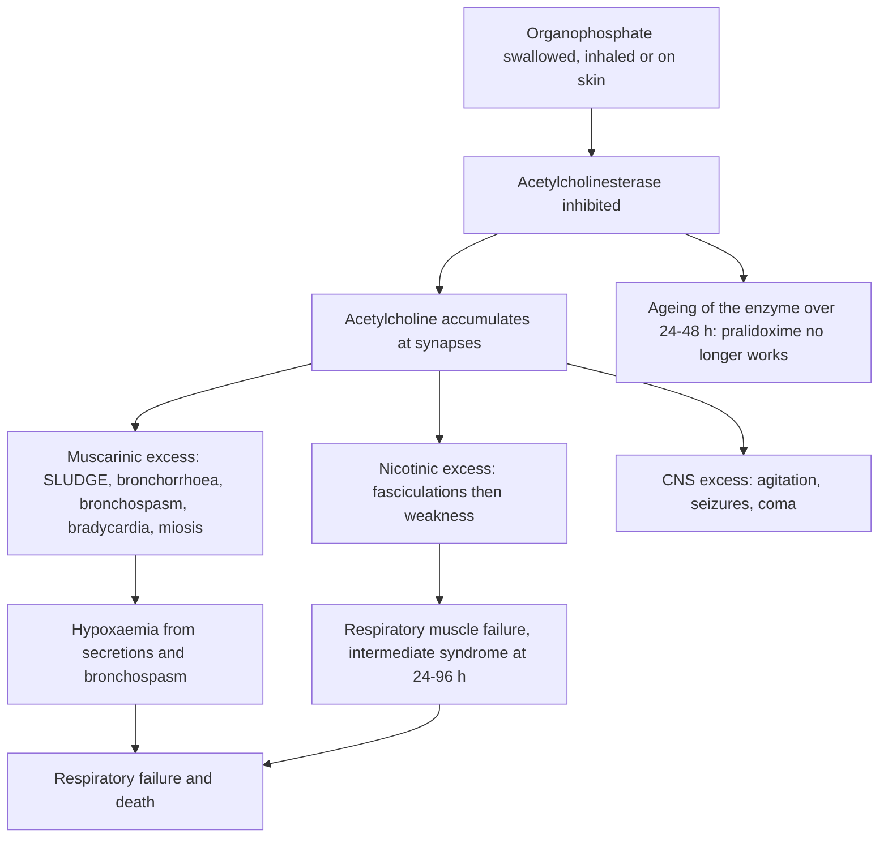

## 1. Definition

**Poisoning** is the harmful effect of a substance swallowed, inhaled, injected or absorbed through the skin, in a dose that causes harm. In children it is usually **accidental** (a toddler exploring at 1–4 years, a dosing error by a caregiver); in adolescents it is often **intentional** (self-harm) or recreational (alcohol, drugs). **Envenoming** (snakebite) is managed on the same principles.

| Term | Meaning |
|---|---|
| **Poisoning** | Exposure to a substance in a dose that causes harm |
| **Toxidrome** | A cluster of signs typical of a class of poison (e.g. cholinergic, anticholinergic, opioid, sympathomimetic) |
| **Decontamination** | Reducing absorption: skin/eye washing, activated charcoal, gastric lavage, whole-bowel irrigation |
| **Antidote** | A drug that reverses or blocks the poison (e.g. atropine, acetylcysteine, deferoxamine, naloxone, antivenom) |
| **Enhanced elimination** | Increasing removal of an absorbed poison (multiple-dose charcoal, urinary alkalinisation, dialysis) |
| **"One pill can kill"** | Drugs that are dangerous to a toddler in a single adult tablet: sulphonylureas, calcium-channel blockers, tricyclic antidepressants, opioids (including codeine), clonidine, chloroquine/quinine, methyl salicylate oil, camphor |

Most poisoned children recover with good **supportive care**. Few need an antidote, and **many traditional "first aid" measures cause more harm than the poison** (salt water to induce vomiting, milk forced into a drowsy child, paraffin "to neutralise").

> [!PEARL]
> The one thing never to forget: **ABC and glucose first, then think before you decontaminate.** Vomiting must never be induced, and charcoal or lavage after paraffin or corrosives can kill.

## 2. Epidemiology

- Poisoning causes a meaningful share of paediatric emergency admissions, peaking at **1–4 years** (mobile, curious, put everything in the mouth) with a second peak in **adolescence** (intentional).
- **Paraffin** used for lamps and stoves is the classic childhood poison in Ugandan homes: stored in **soda or water bottles** and placed on the floor.
- **Organophosphates** (e.g. chlorpyrifos, dimethoate, diazinon in dips and sprays) and **carbamates** are widely sold in unlabelled containers; children are exposed by ingestion, contaminated food, or skin contact (sprayed clothing, bedding, or treatment for lice and scabies with farm chemicals).
- **Caustic soda** (sodium hydroxide) used in home soap-making is a well-recognised cause of **oesophageal strictures** in Ugandan children, seen months later with dysphagia and wasting.
- **Snakebite**: most bites are by non-venomous snakes, and over half of bites by venomous species are "dry" (UCG 2023). Puff adders (cytotoxic), cobras and mambas (neurotoxic), and the boomslang and vine snake (haemotoxic) are the important ones. Antivenom is scarce and expensive and is mostly held at regional and national referral hospitals.
- **Herbal medicines** are often given to children (enemas, oral "cleansing" mixtures) and can cause vomiting, diarrhoea, dehydration, liver and kidney injury.

> [!UGANDA]
> Practical realities: **activated charcoal** is in the essential medicines list but is often out of stock at lower levels; **atropine** is usually available (it is used in theatre), **pralidoxime** much less so; **acetylcysteine** and **deferoxamine** are mainly at regional and national referral hospitals; **paracetamol levels** are rarely measurable outside Mulago and private labs. Polyvalent **antivenom** is held at some RRHs and Mulago. Decide early whether to **refer**, and phone ahead.

## 3. Aetiology and Risk Factors

**Common poisons in Ugandan children**: **paraffin (kerosene)** kept in soda bottles, **organophosphate and carbamate pesticides** used on farms and against fleas, ticks and bedbugs, **household chemicals** (caustic soda for soap-making, bleach, toilet cleaners, battery acid), **adult medicines** (paracetamol, iron, antimalarials, diabetes tablets, antiepileptics, ARVs), **alcohol** (sachets, local brew), **herbal medicines**, **rat poison** (warfarin-type), **carbon monoxide** (charcoal stove in a closed room) and **snakebite**.

**Risk factors**

| Factor | Why |
|---|---|
| **Age 1–4 years** | Mobile, curious, mouthing |
| **Unsafe storage**: on the floor, in soda or water bottles, unlabelled containers | Looks like a drink; no warning |
| **Poor supervision**, siblings as carers | Unwitnessed ingestion |
| **Adult medicines in the home** (ANC iron and folate, diabetes, antiepileptics, ARVs) | "One pill can kill" drugs; iron is common after pregnancy |
| **Farming households** | Pesticides, dips and sprays; contaminated clothing |
| **Home soap-making** | Caustic soda |
| **Dosing errors by caregivers** (paracetamol syrups, codeine syrups, herbal mixtures) | Repeated supratherapeutic ingestion |
| **Adolescence**: low mood, school or relationship stress, abuse | Intentional overdose, often multiple drugs (assume paracetamol) |
| **Rural living, walking barefoot at night, sleeping on the floor** | Snakebite |
| **Previous poisoning** | Marker of an unsafe environment |

## 4. Pathophysiology

### Why decontamination can harm

- **Induced vomiting** does not remove much of the poison, delays charcoal, and risks **aspiration**, especially of hydrocarbons, which have low viscosity and surface tension and spread across the lungs causing **chemical pneumonitis**. Salt-water emetics can cause fatal **hypernatraemia**.
- **Corrosives** burn on the way down; vomiting burns the oesophagus a **second time** and can cause perforation.
- **Activated charcoal** adsorbs many drugs in the gut, but it does **not bind** small ionised or metallic molecules: **iron, lithium, potassium, alcohols (ethanol, methanol), hydrocarbons, acids and alkalis**. It is risky if the child is drowsy (aspiration) and is most useful **within 1 hour** (up to 2 hours per UCG; longer for slow-release drugs).

### Mechanisms of the key poisons

| Poison | Mechanism | Consequence |
|---|---|---|
| **Paraffin/kerosene** | Aspiration of low-viscosity hydrocarbon → destroys surfactant, inflames alveoli; CNS depression if absorbed | Cough, tachypnoea, hypoxaemia, fever (chemical), pneumatocoeles; drowsiness, seizures |
| **Organophosphates** | **Irreversibly** inhibit acetylcholinesterase ("ageing" over 24–48 h) → acetylcholine excess at muscarinic, nicotinic and CNS synapses | Cholinergic crisis, then weakness, respiratory failure; intermediate syndrome at 24–96 h |
| **Carbamates** | **Reversibly** inhibit acetylcholinesterase | Similar but shorter-lived; less CNS toxicity |
| **Paracetamol** | Excess saturates glucuronidation/sulphation → more NAPQI → glutathione depleted → hepatocyte necrosis (zone 3) | Liver failure at 72–96 h; acetylcysteine replaces glutathione |
| **Iron** | Direct corrosion of GI mucosa; free iron in blood → mitochondrial toxicity, vasodilatation, capillary leak | Vomiting/haematemesis, shock, metabolic acidosis, liver failure, later pyloric stricture |
| **Ethanol** | CNS depressant; **blocks hepatic gluconeogenesis** | Coma, hypoglycaemia, hypothermia (children are very sensitive) |
| **Methanol** | Metabolised to formic acid | Severe acidosis, blindness, death after a latent period of 12–24 h |
| **Caustics** | Alkalis → liquefactive necrosis (deep, oesophagus); acids → coagulative necrosis (stomach) | Burns, perforation, stricture, later oesophageal cancer risk |
| **Snake venom** | Cytotoxic (local necrosis), neurotoxic (post-synaptic or pre-synaptic blockade → paralysis), haemotoxic (consumptive coagulopathy) | Swelling, paralysis, bleeding, shock, AKI |

### Feature links

- Muscarinic acetylcholine excess → salivation, lacrimation, urination, defecation, vomiting, sweating, bronchorrhoea, bronchospasm, bradycardia, pinpoint pupils.
- Nicotinic excess at the neuromuscular junction → fasciculations → weakness → respiratory failure; same mechanism later → intermediate syndrome.
- Atropine blocks muscarinic receptors only → dries the chest but does not reverse weakness (pralidoxime does, before ageing).
- Too much atropine → anticholinergic picture: hot, delirious, ileus, urinary retention.
- Hydrocarbon aspiration → surfactant loss and alveolitis → cough, tachypnoea, crackles, low SpO₂, chemical fever in the first 24–48 h, pneumatocoeles.
- Hydrocarbon absorption → CNS depression → drowsiness, seizures.
- NAPQI accumulation → zone 3 necrosis → raised ALT at 24 h, liver failure at 72–96 h (jaundice, INR, hypoglycaemia, encephalopathy).
- Iron corrosion of the gut → vomiting, haematemesis, later pyloric stricture; free iron → capillary leak and mitochondrial poisoning → shock, metabolic acidosis, liver failure.
- Ethanol blocking gluconeogenesis → hypoglycaemia → coma, seizures; vasodilatation → hypothermia.
- Methanol → formic acid → raised anion gap acidosis, deep breathing, blindness after a latent period.
- Salicylate → respiratory centre stimulation plus metabolic acidosis → deep, fast breathing, vomiting, tinnitus, fever.
- Alkali liquefactive necrosis → drooling, stridor, refusal to swallow → perforation → healing by fibrosis → stricture at 2–6 weeks.
- Cytotoxic venom → local swelling, blistering, necrosis, compartment syndrome; haemotoxic venom → consumptive coagulopathy → non-clotting blood, bleeding gums; neurotoxic venom → ptosis, bulbar palsy, respiratory paralysis.
- Opioids → mu-receptor agonism → pinpoint pupils, slow breathing, coma.
- Anticholinergics → hot, dry, flushed, dilated pupils, delirium, urinary retention, tachycardia.

## 5. Classification / Staging

**Common toxidromes**

| Toxidrome | Signs | Examples |
|---|---|---|
| **Cholinergic** | **SLUDGE** (Salivation, Lacrimation, Urination, Defecation, GI upset, Emesis) + **killer Bs** (Bradycardia, Bronchorrhoea, Bronchospasm), **miosis**, sweating, fasciculations, weakness, seizures | Organophosphates, carbamates |
| **Anticholinergic** | "Hot as a hare, dry as a bone, red as a beet, blind as a bat, mad as a hatter": fever, dry skin, flushing, **dilated pupils**, delirium, urinary retention, tachycardia | Antihistamines, Datura (jimsonweed) seeds, tricyclics |
| **Opioid** | **Pinpoint pupils**, coma, slow breathing | Codeine cough syrups, morphine, tramadol |
| **Sympathomimetic** | Agitation, tachycardia, hypertension, hyperthermia, dilated pupils, **sweating** | Amphetamines, khat (older children), salbutamol overdose |
| **Sedative-hypnotic** | Drowsiness, ataxia, slurred speech, respiratory depression, normal pupils | Phenobarbital, diazepam, alcohol |
| **Salicylate** | Vomiting, tinnitus, **deep fast breathing**, fever, mixed acid–base disturbance | Aspirin, methyl salicylate (oil of wintergreen) |

**Severity by dose**

| Poison | Threshold |
|---|---|
| Paracetamol (single acute) | **≥150 mg/kg** toxic (UCG: ≥200 mg/kg if <6 years); repeated supratherapeutic ≥150 mg/kg/24 h |
| Iron (elemental) | **<20 mg/kg**: usually GI upset only; **20–60 mg/kg**: possible systemic toxicity; **>60 mg/kg**: serious toxicity likely |
| Serum iron (4–6 h) | **>60 µmol/L** moderate; **>90 µmol/L (500 µg/dL)** severe |

**Snakebite by venom type**: cytotoxic (puff adder: local swelling and necrosis), neurotoxic (cobras, mambas: paralysis), haemotoxic (boomslang, vine snake: bleeding); **dry bite** = no envenoming (no signs at 6–8 h).

**Caustic burns** are graded at endoscopy (Zargar): grade 1–2a → feed early; severe (2b and above) → NG/gastrostomy feeding and high stricture risk.

## 6. Clinical Features

### History

The "**5 Ws**": **Who** (age, weight), **What** (the substance; bring the container, tablet strip, plant, the snake if killed), **When** (time of exposure), **How much** (maximum possible: count missing tablets, measure the bottle), **Why/how** (accident, error, self-harm, abuse).

| Question | Why it matters |
|---|---|
| Exact substance, brand and strength (container, label, tablet strength) | Toxicity depends on the dose per kg; e.g. ferrous sulphate 200 mg = 60–65 mg elemental iron; look up the active ingredient |
| Maximum amount possibly taken | Assume the worst: all missing tablets, a mouthful = about 5–10 mL in a toddler, 15 mL in an older child |
| Time since ingestion | Decides whether charcoal helps (<1–2 h), when to take paracetamol levels (4 h), and when symptoms are expected |
| Symptoms since: vomiting, cough/choking, drowsiness, convulsions, drooling, pain on swallowing, vomiting blood | Aspiration, CNS toxicity, corrosive injury, iron |
| "First aid" already given: salt water, milk, herbs, induced vomiting, oil | Complications and aspiration risk |
| Other children exposed? | Siblings may also be poisoned: examine them too |
| Weight, past medical history, HIV status, current medicines in the home | Dosing; chronic illness affects risk |
| Immunisation (tetanus) | Snakebite and burns need tetanus prophylaxis |
| Social history: supervision, storage, previous poisoning, adolescent mood and stressors | Prevention, **safeguarding** (abuse or neglect), **self-harm assessment** |

### Examination

In a poisoned child the **ETAT/ABCDE assessment comes first** (section 9). Once the child is stable, complete the examination in the order of Hutchison's Clinical Methods (24th edition), adapted for children.

#### Introduction, consent and preparation

- Introduce yourself, confirm the child's identity and the carer's relationship; explain and gain consent (assent from an older child).
- **Protect yourself**: gloves and apron for organophosphates and caustics; **hand hygiene**.
- **Position and exposure**: remove contaminated clothing (bag it), keep the child warm; drowsy children in the recovery position.

#### General inspection (end of the bed)

- Conscious level (**AVPU/GCS**), distress, seizures, posture.
- **Smell**: paraffin, alcohol, "garlic" or chemical smell (organophosphates), acetone.
- Colour (cyanosis, pallor), sweating or dry flushed skin, drooling, secretions.
- **Vitals**: RR, **SpO₂**, HR, BP, CRT, **temperature** (hypothermia with alcohol; fever with anticholinergics, salicylate, chemical pneumonitis), **glucose**.
- **Weight** (for mg/kg calculations) and nutrition.

#### Hands, face and neck

- **Hands and skin**: sweating (cholinergic, sympathomimetic) vs dry and flushed (anticholinergic); fasciculations; **fang marks, swelling, bruising, blistering** (snakebite; mark and time the edge of the swelling).
- **Eyes and pupils**: pinpoint (opioids, organophosphates), dilated (anticholinergics, sympathomimetics); **ptosis** (neurotoxic snakebite, OP weakness); lacrimation; chemical or venom in the eyes.
- **Mouth**: burns, ulcers, **drooling** (caustics); salivation (OP); bleeding gums (haemotoxic venom).
- **Neck**: **stridor**, hoarseness (caustic airway oedema); neck flexor weakness (intermediate syndrome).

#### Systems

- **Respiratory**: work of breathing; deep acidotic breathing (salicylate, methanol, iron); crackles and wheeze (hydrocarbon pneumonitis, organophosphate bronchorrhoea).
- **Cardiovascular**: bradycardia (OP), tachycardia (anticholinergics, salbutamol), arrhythmia (tricyclics), shock (iron, envenoming).
- **Abdomen**: tenderness (iron, caustics), hepatomegaly or liver tenderness (late paracetamol), bowel sounds (absent in atropine toxicity), **bladder** (retention in anticholinergic or atropine toxicity).
- **Neurological**: fasciculations, weakness, ptosis, bulbar palsy (organophosphate, neurotoxic snakebite), ataxia, seizures.

#### Completing the examination

Examine any other exposed children; reassess ABC; thank the family, **hand hygiene**, summarise and document.

| Document these positives | And these negatives |
|---|---|
| Time of exposure and time seen | "No burns to lips, mouth or pharynx" |
| RR, SpO₂, HR, BP, temperature, GCS/AVPU, pupils | "Chest clear; no crackles or wheeze" |
| Toxidrome features present | "No fasciculations or weakness" |
| For snakebite: extent of swelling (mark and time it), clotting test | "No ptosis; no bleeding from gums or venepuncture sites" |

### Red flags

> [!REDFLAG]
> - Reduced consciousness, seizures, respiratory distress or SpO₂ <94%.
> - **Drooling, stridor, inability to swallow** after a caustic ingestion (airway and oesophageal burns).
> - **Bronchorrhoea and bradycardia** (organophosphate): atropine now.
> - **Shock, haematemesis, metabolic acidosis** after iron.
> - Paracetamol ingestion **≥150 mg/kg**, or unknown amount with a delay over 8 hours.
> - **Ptosis, difficulty swallowing, weakness** after a snakebite (neurotoxicity can progress to respiratory paralysis); **bleeding gums or non-clotting blood** (haemotoxicity).
> - A "**one pill can kill**" drug (sulphonylurea, calcium-channel blocker, tricyclic, opioid).
> - **Intentional ingestion** in an adolescent (risk of repeat; possible multiple drugs).
> - Call your senior immediately for: coma, seizures, respiratory failure, shock, cholinergic crisis, caustic ingestion with drooling/stridor, iron >60 mg/kg or symptomatic, paracetamol ≥150 mg/kg, any envenomed snakebite, or intentional ingestion.

### Thinking like a clinician

- **Treat the patient, not the poison.** ABC, glucose and seizure control first; most children survive with supportive care.
- **Assume the worst-case dose** and calculate mg/kg.
- **A well child now may not stay well**: paracetamol, iron, sulphonylureas, modified-release drugs and methanol have **delayed toxicity**. Observe for the right time.
- **A child "who drank paraffin" and is coughing** has aspirated; a child who swallowed paraffin without coughing or choking is unlikely to develop pneumonitis but still needs 6 hours of observation.
- **Organophosphate poisoning can look like pneumonia or gastroenteritis** (secretions, crackles, diarrhoea, vomiting): look at the **pupils** and the **heart rate**, and smell the child.
- **Unexplained coma in a toddler**: hypoglycaemia (alcohol, sulphonylurea), opioids (codeine syrup), sedatives, organophosphates, carbon monoxide (charcoal stove in a closed room), and of course cerebral malaria and meningitis.
- **The atropine target is a dry chest**, not big pupils or a fast heart.
- **Children get the adult antivenom dose**: the dose neutralises the venom injected, not the body weight.
- **Common student mistakes**: inducing vomiting; giving charcoal after paraffin or to a drowsy child; giving iron poisoning charcoal; under-dosing atropine (OP needs large, escalating doses); stopping observation too early; forgetting siblings and prevention counselling; missing intentional overdose in adolescents.

> [!EXAM]
> Viva favourite: **"A toddler swallowed paraffin 30 minutes ago and is coughing. What will you do?"** ABC and SpO₂; **do not induce vomiting, no lavage, no charcoal**; remove soaked clothes and wash skin; oxygen if SpO₂ <94%/<90%; observe at least 6 hours; chest X-ray if symptomatic; no routine antibiotics or steroids; counsel on storage.

## 7. Differential Diagnoses

Poisoning mimics common illnesses, and common illnesses can be blamed on poisoning.

| Differential | Distinguishing clinical feature | Distinguishing investigation |
|---|---|---|
| **Coma**: cerebral malaria, meningitis, hypoglycaemia, head injury, DKA (vs alcohol, opioids, sedatives, OP, CO, sulphonylurea) | Fever, neck stiffness, trauma, Kussmaul breathing vs smell, pupils, history of access | Glucose, mRDT, LP when safe |
| **Seizures**: febrile convulsion, malaria, meningitis, epilepsy (vs OP, tricyclics, isoniazid, hypoglycaemic agents, kerosene, camphor) | Fever; known epilepsy vs toxidrome | Glucose, mRDT |
| **Respiratory distress**: pneumonia, asthma, bronchiolitis, foreign body (vs hydrocarbon aspiration, OP bronchorrhoea, salicylate acidotic breathing) | Paraffin smell, pinpoint pupils and bradycardia, deep breathing without chest signs | SpO₂, CXR, pupils |
| **Vomiting and diarrhoea**: gastroenteritis (vs iron, OP, herbal mixtures, mushrooms, food poisoning) | Haematemesis (iron), cholinergic signs, herbal history | History, glucose, Hb, abdominal X-ray (iron tablets) |
| **Bleeding**: sepsis/DIC, ITP, leukaemia, haemophilia (vs snakebite, warfarin-type rat poison) | Bite, swelling; rat poison in the home | 20WBCT, platelets, INR |
| **Painful swollen limb after a bite**: cellulitis, abscess, fracture, insect sting (vs cytotoxic snakebite) | Fang marks, rapid spread, blistering | Clotting test |
| **Stridor and drooling**: croup, epiglottitis, foreign body (vs caustic ingestion) | Mouth burns, history of caustic soda or bleach | Clinical; endoscopy |

## 8. Clinical Workup

Diagnosis is usually from the history, the container and the toxidrome. Tests confirm severity and guide antidotes; never delay ABC, glucose or an indicated antidote for a test.

### Bedside

| Test | When / how | Expected finding | How it changes management | Available at |
|---|---|---|---|---|
| **Glucose** | Every drowsy child; alcohol, sulphonylureas, salicylate, iron, severe poisoning | Low | 10% dextrose 5 mL/kg | All levels with a glucometer |
| **SpO₂** | Hydrocarbon, OP, opioid, neurotoxic snakebite | <94% | Oxygen; admission | HC IV and above |
| **20-minute whole-blood clotting test (20WBCT)** | Every snakebite on arrival and every 4–6 h: 2 mL blood in a clean, dry **glass** tube, undisturbed 20 min, then tipped once | **Not clotted = coagulopathy** (UCG 2023 describes observing after 30 minutes) [VERIFY: UCG 20 vs 30 minute reading] | Antivenom; repeat 6 h after antivenom | All levels |
| **Urine dipstick** | Snakebite, salicylate | Blood (haemolysis, myoglobin), ketones | AKI care; fluids | All levels |
| **ECG** | Tricyclics, calcium-channel blockers, OP | Bradycardia, QT prolongation, broad QRS | Bicarbonate (tricyclics); monitoring | Hospitals |
| **Haemoglobin** | Bleeding after snakebite or iron | Low | Transfusion | HC IV and above |
| **Dose calculation** | Every ingestion | mg/kg (paracetamol, elemental iron) | Decides treatment | All levels |

### Basic lab

| Test | When | Expected / abnormal finding | How it changes management | Available at |
|---|---|---|---|---|
| LFTs (ALT/AST), INR, creatinine | Paracetamol, iron, herbal, snakebite | ALT >1000 IU/L, INR rising, AKI | Continue NAC; refer for liver/renal care | RRH/national referral |
| PT/INR, platelets, fibrinogen | Snakebite, rat poison | Prolonged, low | Antivenom; vitamin K for warfarin-type rat poison | Hospitals |
| Electrolytes, creatinine | Iron, salicylate, methanol, severe poisoning, snakebite | Acidosis, AKI, potassium shifts | Bicarbonate, fluids, dialysis | General hospital and above |

### Imaging

| Test | When | Expected / abnormal finding | How it changes management | Available at |
|---|---|---|---|---|
| Chest X-ray | Hydrocarbon ingestion with symptoms, or at 6 h | Perihilar/basal infiltrates (may lag 2–8 h), pneumatocoeles | Oxygen, admission | Hospitals |
| Abdominal X-ray | Iron (tablets radio-opaque), button batteries | Tablets in stomach/intestine; battery position | Whole-bowel irrigation; urgent endoscopy for batteries in oesophagus | Hospitals |
| Chest/abdominal X-ray | Caustic ingestion with suspected perforation | Free air, mediastinal air | Surgery | Hospitals |

### Specialised / referral-level

| Test | When | Expected / abnormal finding | How it changes management | Available at |
|---|---|---|---|---|
| Serum paracetamol (4 h or later) | Paracetamol ingestion | Above the treatment line (UK **100 mg/L at 4 h**; US 150 mg/L) | Acetylcysteine | Mulago/private labs; often not available, so treat on dose |
| Serum iron (4–6 h) | Iron ingestion >20 mg/kg | >60 µmol/L moderate; >90 µmol/L severe | Deferoxamine | Rare |
| Blood gas | Iron, salicylate, methanol, severe poisoning | Metabolic acidosis, raised anion gap | Bicarbonate, antidote, dialysis | Mulago, some RRHs |
| Plasma cholinesterase / RBC acetylcholinesterase | Uncertain OP diagnosis | Low | Confirms diagnosis (does not guide initial treatment) | Rarely available |
| Upper GI endoscopy | Caustic ingestion with symptoms | Grade of burns (Zargar) | Feeding plan, stricture risk | Mulago and a few RRHs/private |
| Drug/alcohol screen | Unknown ingestion | Positive | Rarely changes acute care | Rarely available |

### Putting it together

**Model one-line summary**: "A 2-year-old boy, 12 kg, who swallowed an unknown amount of paraffin from a soda bottle 1 hour ago, now with cough, RR 52 and SpO₂ 91% in air; **hydrocarbon aspiration pneumonitis**, no CNS toxicity."

**Problem list** (model case below)

1. Paraffin ingestion with aspiration pneumonitis, hypoxaemic.
2. Aspiration risk worsened by induced vomiting (salt water).
3. Low-grade fever: likely chemical, observe.
4. Unsafe storage at home: prevention counselling.

**Model case presentation**

> "Master T.O., a **22-month-old boy** from Nateete, **weight 11 kg** (weight-for-age Z-score −0.5, MUAC 14.0 cm), brought at 16:30 by his mother **45 minutes after drinking paraffin** from a soda bottle kept on the kitchen floor. He **coughed and choked immediately** and vomited once at home after the neighbour gave salt water. On arrival: alert, RR **54**, mild subcostal recession, SpO₂ **92% in air**, scattered crackles at the right base, temperature 37.9 °C, glucose 5.2 mmol/L. **Fully immunised for age** (child health card), **breastfeeding plus family foods**, **mother HIV-negative** this year; no previous poisoning. **Assessment: paraffin ingestion with aspiration pneumonitis (worsened by induced vomiting).** **Plan**: oxygen by nasal prongs to SpO₂ ≥94%, nil by mouth while distressed then cup feeds, maintenance IV fluids if not drinking, chest X-ray, observe RR and SpO₂ hourly, no charcoal, no antibiotics unless fever persists beyond 48 hours or he deteriorates, and **counsel on safe storage** (never in soda bottles) and on not inducing vomiting."

> [!NOTE]
> **Worked example: is this iron ingestion dangerous?** A 3-year-old (14 kg) ate up to 10 tablets of ferrous sulphate 200 mg from her mother's ANC supply. Elemental iron per tablet ≈ 60–65 mg → up to **650 mg** ÷ 14 kg = **46 mg/kg**. This is a **potentially moderate–severe ingestion** (>40 mg/kg). She vomited twice and is now quiet. **Action**: admit, IV access, glucose, abdominal X-ray (count tablets), serum iron at 4–6 h if possible, blood gas; **no charcoal**; if she develops shock, acidosis, lethargy or repeated vomiting/haematemesis, start **deferoxamine 15 mg/kg/h** and refer.

> [!NOTE]
> **Worked example: paracetamol by dose.** A 4-year-old (16 kg) drank most of a 100 mL bottle of paracetamol syrup 120 mg/5 mL 3 hours ago. Maximum dose = 100 ÷ 5 × 120 = **2,400 mg** ÷ 16 kg = **150 mg/kg**. UCG says treat ≥150 mg/kg (≥200 mg/kg if under 6), so this is borderline; with no level available and a full bottle missing, **start IV acetylcysteine** within 8 hours, check LFTs/INR at baseline and at the end of the infusion.

## 9. Management

### Immediate / emergency

**First 5 minutes (any poisoned child)**

1. **Protect yourself** (gloves and apron for organophosphates, caustics).
2. **ETAT ABCD**: open and clear the airway (suction secretions), oxygen to SpO₂ ≥94% if emergency signs, IV access, treat shock (10–20 mL/kg crystalloid).
3. **Glucose**: check; if low or unmeasurable in a drowsy child, **10% dextrose 5 mL/kg**.
4. **Convulsions**: diazepam 0.5 mg/kg rectally or 0.2 mg/kg IV (max 10 mg).
5. **Decontaminate the skin/eyes** if exposed (remove clothes, wash with soap and water; irrigate eyes for 10–15 minutes).
6. **Life-saving antidote** if the toxidrome is obvious: **atropine** (cholinergic crisis), **naloxone** (opioid with respiratory depression), **adrenaline** (anaphylaxis to antivenom).
7. **Identify the poison**: container, label, smell, toxidrome; call senior.

**General algorithm**

1. ABC + glucose + seizures (ETAT); protect yourself.
2. Identify: what, how much (mg/kg), when, symptoms.
3. Decontaminate **only if benefit > risk**: skin and eyes always; charcoal 1 g/kg if <1–2 h, airway safe and a charcoal-binding poison; **no** emesis; **no** charcoal or lavage for hydrocarbons, corrosives, iron, alcohol.
4. Antidote if indicated (drug table).
5. Supportive care: O₂, fluids, glucose, warmth, observation for the right time.
6. Prevention counselling; safeguarding; psychosocial review if intentional.

**Decontamination rules**

| Method | Use | Do NOT use |
|---|---|---|
| **Remove clothes, wash skin with soap and water** | OP, carbamates, hydrocarbons on skin, caustics on skin | Always do it; staff wear gloves |
| **Eye irrigation** 10–15 min with water/saline | Caustics, spitting-cobra venom, chemicals | Always do it |
| **Activated charcoal** | Most drugs within **1 hour** (UCG up to 2 h; longer for slow-release/anticholinergic) | **Drowsy or unprotected airway; hydrocarbons; corrosives; iron, lithium, alcohols; bowel obstruction** |
| **Gastric lavage** | Rarely: life-threatening ingestion <1 h, protected airway, experienced staff (24–28 Fr orogastric tube, 10 mL/kg saline aliquots) | Corrosives, hydrocarbons, drowsy child without intubation |
| **Induced vomiting** | **Never** (no salt water, no ipecac, no fingers) | Never |
| **Whole-bowel irrigation** (PEG solution) | Iron, slow-release drugs, packets (specialist) | Obstruction, perforation, unstable child |
| **Water or milk sips** | Caustic ingestion **only** if the child is alert and can swallow, immediately after exposure (WHO) | Drooling, stridor, vomiting, reduced consciousness |

> [!UGANDA]
> UCG 2023 still lists **gastric lavage** for some ingestions (e.g. organophosphates up to 6 hours, paracetamol within 2 hours); current toxicology practice (WHO Pocket Book, AACT/EAPCCT) restricts lavage to life-threatening ingestions within about 1 hour by experienced staff with a protected airway. Discuss with your senior before attempting it. UCG and WHO also differ on the **atropine starting dose** (UCG 0.05 mg/kg; WHO 0.02 mg/kg) and on **charcoal dosing** (UCG 0.5–1 g/kg; WHO ≤1 year 1 g/kg, 1–12 years 25–50 g).

### Definitive

#### Paraffin (kerosene) and other hydrocarbons

1. ABC; remove soaked clothes and wash the skin.
2. **Do not induce vomiting, do not lavage, do not give charcoal, do not give milk or oil.**
3. **Oxygen** if SpO₂ <94% with distress (<90% if stable); position of comfort; nil by mouth if distressed.
4. **Observe at least 6 hours** with RR and SpO₂.
   - **Asymptomatic at 6 hours** (no cough, normal RR and SpO₂, normal chest X-ray if done): discharge with advice to return if cough or fast breathing develops; review in 24 h.
   - **Symptomatic**: admit; chest X-ray (changes may appear 2–8 h after ingestion); oxygen; IV fluids at maintenance if not drinking.
5. **Fever** in the first 24–48 h is usually chemical; **antibiotics** only if fever persists beyond 48 h, a new infiltrate develops, or the child deteriorates (secondary bacterial pneumonia).
6. **Steroids**: no benefit.
7. Severe cases (ARDS, pneumothorax) need CPAP or ventilation at national referral level.

#### Organophosphates and carbamates

1. **Protect staff** (gloves, apron). **Remove all clothes**, wash skin and hair with soap and water, irrigate eyes. Bag the clothes.
2. **Airway**: suction secretions; oxygen; recovery position; bag-mask ventilation if weak or apnoeic (respiratory failure is the killer).
3. **Atropine** early, without waiting for oxygen saturation to improve: **0.02 mg/kg IV** (UCG: 0.05 mg/kg), **doubling every 5 minutes** until **atropinisation**:
   - clear chest on auscultation (no wheeze or crackles from secretions)
   - heart rate normal for age (above about 80 in older children, higher in infants)
   - dry axillae
   - pupils no longer pinpoint
   - adequate blood pressure

   Then an **infusion** (10–20% of the total loading dose per hour), titrated hourly; reduce slowly over 24–48 h.
4. **Pralidoxime** 25–50 mg/kg IV over 30 min, then 10–20 mg/kg/h if muscle weakness/fasciculations or moderate–severe poisoning (UCG: only if not responding to adequate atropine; most useful within 24 h).
5. **Seizures**: diazepam.
6. **Charcoal** 1 g/kg if ingested within 1–2 h and the airway is safe (most pesticides are in hydrocarbon solvents, so aspiration is a risk; **never induce vomiting**).
7. **Monitor for days**: **intermediate syndrome** (24–96 h): weakness of neck flexors, proximal limbs, cranial nerves and **respiratory muscles**, even after the cholinergic crisis has settled; delayed neuropathy at 2–3 weeks.

> [!DRUG]
> **Atropine toxicity vs under-atropinisation**: if the child is hot, delirious, with absent bowel sounds and a full bladder, **stop** the infusion for 30 minutes and restart at 70–80% of the rate. If secretions and bradycardia return, **increase**. Dilated pupils and tachycardia alone are not the targets; a **dry chest** is.

#### Paracetamol

1. Calculate the dose in mg/kg (assume the worst). **Single acute ingestion ≥150 mg/kg** (UCG: ≥200 mg/kg if <6 years; liquid ingestions in toddlers rarely reach toxicity) or **unknown amount** → treat.
2. **Charcoal 1 g/kg** if within 1 hour (UCG: within 2 hours; repeated doses listed but not routine in WHO/UK practice).
3. **Paracetamol level at 4 hours** (or as soon as possible after 4 h) and LFTs/INR/creatinine; plot on the nomogram (UK treatment line **100 mg/L at 4 h**; US 150 mg/L).
4. **Acetylcysteine IV** (21-hour, three-bag regimen) if above the line, if level unavailable and dose toxic, if **>8 hours** since ingestion with a toxic dose (start immediately, don't wait for the level), if **staggered** ingestion, or if LFTs are abnormal. **Nearly 100% protective when started within 8 hours.**
5. At the end of NAC: repeat ALT/INR; continue NAC if ALT is rising or INR >1.3; refer liver failure (encephalopathy, INR >3, acidosis, hypoglycaemia, AKI).
6. **Repeated supratherapeutic ingestion** (≥150 mg/kg/24 h, Medscape): treat if ALT is raised or the level is detectable.

#### Iron

1. Calculate **elemental iron** in mg/kg: ferrous sulphate 200 mg ≈ 60–65 mg; ferrous fumarate 200 mg ≈ 65 mg; ferrous gluconate 300 mg ≈ 35 mg. **Prenatal iron + folate tablets** (common in Ugandan homes) contain about 60 mg elemental iron.
2. **<20 mg/kg**: usually only GI upset; observe 6 hours at home or clinic if asymptomatic. **20–60 mg/kg**: possible systemic toxicity; admit and observe. **>60 mg/kg**: serious toxicity likely.
3. **No charcoal.** Abdominal X-ray for tablets; **whole-bowel irrigation** (PEG) if many tablets are seen (specialist); lavage is of limited value.
4. **Supportive**: IV fluids for hypovolaemia (GI losses, capillary leak), glucose, correct acidosis.
5. **Deferoxamine 15 mg/kg/h IV** if shock, metabolic acidosis, altered consciousness, persistent vomiting/haematemesis, or serum iron >90 µmol/L; reduce after 4–6 h, total ≤80 mg/kg/24 h (WHO), usually stop within 24 h (lung toxicity with prolonged infusion).
6. A child **asymptomatic at 6 hours** is very unlikely to develop severe toxicity.
7. Watch for **hepatic failure** (2–4 days) and **pyloric/duodenal stricture** (2–6 weeks).

#### Alcohol (ethanol) and methanol

1. ABC, recovery position, protect from aspiration.
2. **Glucose**: check; **10% dextrose 5 mL/kg**, then a dextrose infusion until eating (UCG; children are very prone to hypoglycaemia).
3. **Warm** the child (hypothermia).
4. Observe until fully awake; exclude head injury and other drugs.
5. **Methanol** (suspect crude/illegal brew, several people affected, visual symptoms, severe acidosis after a latent period): refer urgently; UCG lists **oral ethanol 40% (e.g. waragi) 1.5–2 mL/kg loading** then 0.3 mL/kg/h as the antidote where fomepizole is unavailable, plus bicarbonate and dialysis.
6. Social history: who gave the alcohol, supervision, adolescent drinking; counselling.

#### Snakebite

1. **First aid** (UCG 2023): reassure, keep still, lie on the side, remove rings and tight items, **immobilise the limb with a splint**; for likely **neurotoxic** bites a firm crepe bandage from the fingers/toes upwards (WHO Pocket Book). **No tourniquet, no cutting, no sucking, no herbs, no attempt to kill the snake** (but bring it if already dead).
2. **Hospital**: ABC; IV access in the **unbitten** limb; **20WBCT** on arrival and every 4–6 hours; mark the edge of the swelling with the time; analgesia with **paracetamol** (avoid NSAIDs); **tetanus** prophylaxis; avoid IM injections.
3. **Observe at least 12–24 hours**; no signs at 6–8 hours suggests a dry bite (UCG).
4. **Antivenom indications** (UCG/WHO): **systemic envenoming** (neurotoxicity: ptosis, bulbar palsy, respiratory weakness; coagulopathy: non-clotting blood, bleeding; shock) or **rapidly spreading local swelling** (hand/foot within 1 h, elbow/knee within 3 h, groin/chest at any time, more than half the limb, or significant head/neck swelling).
5. **Giving antivenom**: polyvalent (Africa) antivenom; **children get the same dose as adults** (venom load is the same); dilute in 2–3 volumes of 0.9% saline and give IV over 1 hour, slowly at first; **adrenaline 1:1000 drawn up** (0.01 mL/kg IM) with chlorphenamine and hydrocortisone at hand. Repeat after 6 hours if blood still does not clot, or after 1–2 hours if neurotoxicity or bleeding worsens.
6. **Neurotoxicity**: airway and ventilation (bag-mask by relays if no ventilator), **atropine followed by neostigmine** (anticholinesterase trial) can reverse post-synaptic (cobra) paralysis.
7. **Local necrosis**: surgical review, debridement once demarcated, fasciotomy only if compartment syndrome is proven; antibiotics only if infected.
8. **Spitting cobra venom in the eyes**: irrigate with plenty of water, cover; ophthalmology review.

#### Caustics (corrosives)

1. **Airway first**: stridor, drooling, hoarseness → senior and anaesthetist; intubation may be difficult (oedema).
2. **No emesis, no neutralisation** (acids with alkalis or vice versa produce heat), **no charcoal, no lavage**.
3. If alert, swallowing and **seen within minutes**: small sips of water or milk (WHO); otherwise **nil by mouth**.
4. IV fluids, analgesia (morphine 0.05–0.1 mg/kg IV), PPI/H2 blocker (e.g. omeprazole 1 mg/kg daily).
5. **Endoscopy within 12–24 hours** (not after 48–72 h, when the wall is weakest) if symptomatic (drooling, vomiting, stridor, refusal to swallow, burns in the mouth); grade the burns; mild (grade 1–2a) → feed early; severe → NG/gastrostomy feeding.
6. Chest/abdominal X-ray if perforation suspected (mediastinitis, peritonitis).
7. **Steroids** are not routinely recommended; antibiotics only for perforation or infection.
8. **Follow up** for **oesophageal stricture** (dysphagia 2–6 weeks later) → serial dilatation at Mulago or refer; growth monitoring; nutrition.
9. **Button batteries**: an emergency of their own (oesophageal burns within 2 hours): X-ray and urgent endoscopic removal.

#### Intentional ingestion (adolescents)

Ask about co-ingestants (**assume paracetamol** and check a level where possible), monitor, and arrange a **psychosocial/psychiatric assessment before discharge**; involve the family and ensure safety at home (remove access to medicines and pesticides).

### Drug table

| Drug | Dose (per kg + max for children; adult) | Route | Frequency | Duration | Key cautions |
|---|---|---|---|---|---|
| **Activated charcoal** (charcoal-binding drug, <1–2 h, safe airway) | **1 g/kg** (UCG: 0.5–1 g/kg; WHO: ≤1 y 1 g/kg; 1–12 y 25–50 g); max 50 g/dose | Oral or NG, mixed with 8–10 volumes of water | Once; multiple-dose 0.5–1 g/kg every 4 h for phenobarbital, carbamazepine, quinine, salicylates | As indicated | Not for hydrocarbons, corrosives, iron, lithium, alcohols, drowsy child |
| **Atropine** (OP/carbamate cholinergic crisis) | **0.02 mg/kg** (WHO Pocket Book; max 2 mg per dose); UCG 2023: **0.05 mg/kg** | IV (IM if no IV) | **Double every 5 minutes** until atropinised; then infusion of 10–20% of the total loading dose per hour (UCG 0.05 mg/kg/h) | Reduce slowly over 24–48 h | Toxicity: delirium, fever, ileus, urinary retention |
| **Pralidoxime** (OP with weakness/fasciculations, moderate–severe) | **25–50 mg/kg** (max 2 g) | IV over 30 min | Then **10–20 mg/kg/h** infusion (or repeat bolus 6–12-hourly) | Until recovery | Most useful within 24–48 h (before ageing); not routinely for carbamates |
| **Diazepam** (seizures) | **0.2 mg/kg IV** or **0.5 mg/kg rectal**; max 10 mg/dose | IV/rectal | Repeat once after 10 min | Acute | Respiratory depression |
| **Acetylcysteine (NAC) IV** (paracetamol) | **150 mg/kg over 1 h**, then **50 mg/kg over 4 h**, then **100 mg/kg over 16 h** (total 300 mg/kg in 21 h); max 15 g, 5 g, 10 g for the three bags (UCG) | IV in 5% dextrose (for <20 kg: 3 mL/kg, 7 mL/kg, 14 mL/kg respectively, WHO) | Continuous | 21 h; continue if late, ALT rising or INR raised | Anaphylactoid reactions: slow or pause, antihistamine, restart |
| **Acetylcysteine oral** (if IV unavailable) | **140 mg/kg** load, then **70 mg/kg** | Oral/NG | 4-hourly | × 17 doses (72 h) | Vomiting common; give antiemetic |
| **Deferoxamine** (iron with shock, acidosis, coma, severe symptoms, or high serum iron) | **15 mg/kg/h**; max **80 mg/kg/24 h** (WHO), max 6 g/day | IV infusion in 0.9% saline or 5% dextrose | Continuous; reduce after 4–6 h (WHO) | Usually ≤24 h | "Vin rosé" urine; hypotension if too fast; lung toxicity if prolonged; contraindicated in anuria (UCG) |
| **10% dextrose** (alcohol, sulphonylurea, salicylate, hypoglycaemia) | **5 mL/kg** | IV | Then 5–10% dextrose infusion | Until eating | Recheck glucose at 30 min |
| **Naloxone** (opioid with respiratory depression: codeine syrups, tramadol, morphine) | **0.01 mg/kg** (10 µg/kg), increase to **0.1 mg/kg** if no response (UCG) | IV/IM | Repeat every 2–3 min; infusion if needed | Until opioid effect wears off | Aim to restore breathing, not full consciousness; short acting |
| **Vitamin K (phytomenadione)** (warfarin-type rat poison with bleeding or raised INR) | **0.3 mg/kg** (max 10 mg; UCG adult 5 mg) | Slow IV | Daily | Long-acting rodenticides may need weeks | FFP if active bleeding |
| **Polyvalent antivenom** (envenoming) | **Same dose as adults** (per package insert) | IV over 1 h in 2–3 volumes of 0.9% saline | Repeat after 6 h if blood still non-clotting; sooner if worsening neurotoxicity or bleeding | Until clotting restored | Have adrenaline drawn up |
| **Adrenaline 1:1000** (antivenom reaction/anaphylaxis) | **0.01 mL/kg** (0.15 mL for small children, WHO); max 0.5 mL | IM thigh | Every 5 min if needed | Acute | |
| **Neostigmine** (post-synaptic neurotoxic snakebite, after atropine) | Per specialist protocol [VERIFY: paediatric dose not given in the source notes] | IV | Trial | Acute | Give atropine first |
| **Sodium bicarbonate** (salicylate urinary alkalinisation; tricyclic cardiotoxicity) | **1 mmol/kg** (UCG bolus 1–2 mEq/kg) | IV | Then infusion to keep urine pH 7.5–8 | Until toxicity resolves | Monitor potassium |
| **Ethanol 40% (e.g. waragi)** (methanol, where fomepizole unavailable) | **1.5–2 mL/kg** loading, then **0.3 mL/kg/h** (UCG) | Oral/NG | Continuous | Until methanol cleared | Hypoglycaemia, sedation; refer |
| **Morphine** (caustic burns pain) | **0.05–0.1 mg/kg** | IV | As needed | Short | Respiratory depression |
| **Omeprazole** (caustic injury) | **1 mg/kg** | Oral/IV | Daily | Per endoscopy findings | |
| **Paracetamol** (snakebite pain) | 15 mg/kg | Oral | 6-hourly | Short | Avoid NSAIDs in snakebite |

### Referral criteria

| Level | What to do | Refer up when |
|---|---|---|
| **Home/community (first aid)** | Take the child and container to a health facility; do not induce vomiting; wash skin; for caustics, sips of water if alert; immobilise snakebitten limbs | Always seek care |
| **HC II/III** | ABC, glucose, diazepam, skin decontamination, charcoal if indicated and safe, atropine for OP crisis, oxygen if available | **All symptomatic children, paracetamol/iron overdoses and snakebites**, with a note |
| **HC IV / General Hospital** | As above plus observation for hydrocarbons, IV fluids, atropine infusion, 20WBCT, NAC if stocked | Need for antivenom, NAC, deferoxamine, pralidoxime, endoscopy, ventilation |
| **RRH / National Referral (Mulago)** | NAC, deferoxamine, pralidoxime, antivenom, endoscopy, ICU/ventilation, dialysis | Liver failure, ARDS, oesophageal dilatation |

Phone ahead before transfer and send the container or tablet strip with the child.

### Monitoring and follow-up

- **Observation times**: paraffin **≥6 h**; iron **6 h** (asymptomatic at 6 h → very unlikely to develop severe toxicity); snakebite **12–24 h** (20WBCT every 4–6 h; mark swelling); OP for **days** (intermediate syndrome 24–96 h); paracetamol until NAC complete and ALT/INR checked; alcohol until fully awake and glucose stable.
- **OP**: hourly chest, HR, axillae, pupils, BP, bowel sounds and bladder while titrating atropine; neck flexor strength and breathing for intermediate syndrome.
- **Hydrocarbon**: RR and SpO₂ hourly; temperature (fever beyond 48 h → secondary infection).
- **Paracetamol**: ALT/INR at the end of NAC; continue if ALT rising or INR >1.3.
- **Caustics**: follow up for **dysphagia at 2–6 weeks** (stricture); growth.
- **Iron**: pyloric stricture at 2–6 weeks.
- **Snakebite**: wound, function, contractures.
- **Before discharge**: prevention counselling for every family; safeguarding concerns addressed; psychosocial assessment after intentional ingestion.

## 10. Complications

**Disease-related**

| Poison | Complications |
|---|---|
| Paraffin | Aspiration pneumonitis, ARDS, pneumatocoeles, pneumothorax, secondary bacterial pneumonia, seizures |
| Organophosphates | Respiratory failure, aspiration, intermediate syndrome (24–96 h), delayed polyneuropathy (2–3 weeks) |
| Paracetamol | Acute liver failure (72–96 h), AKI, hypoglycaemia, death |
| Iron | Shock, metabolic acidosis, liver failure, gastric outlet/pyloric stricture (2–6 weeks) |
| Alcohol | Hypoglycaemia, hypothermia, aspiration, seizures |
| Methanol | Severe acidosis, blindness, death |
| Snakebite | Local necrosis, compartment syndrome, amputation, bleeding (including intracranial), respiratory paralysis, AKI, contractures |
| Caustics | Airway oedema, perforation, mediastinitis, **oesophageal stricture**, malnutrition, later oesophageal carcinoma |

**Treatment-related**

- **Induced vomiting** (traditional first aid): aspiration; salt-water emetics → fatal hypernatraemia; second burn in caustic ingestion.
- **Charcoal**: aspiration in a drowsy child.
- **Lavage**: aspiration, oesophageal injury.
- **Atropine toxicity**: hyperthermia, delirium, ileus, urinary retention.
- **Acetylcysteine**: anaphylactoid reactions.
- **Deferoxamine**: hypotension if infused too fast; lung toxicity if prolonged beyond 24 h.
- **Antivenom reactions**: anaphylaxis (adrenaline drawn up), later serum sickness.
- **Naloxone**: short action, so opioid effect can return.

## 11. Prognosis

- **Most poisoned children recover with good supportive care**; few need an antidote.
- **Paraffin**: most recover; asymptomatic children at 6 hours can go home.
- **Paracetamol**: acetylcysteine is **nearly 100% protective when started within 8 hours**; delay increases the risk of liver failure.
- **Iron**: a child asymptomatic at 6 hours is very unlikely to develop severe toxicity.
- **Organophosphates**: outcome depends on early airway care and adequate atropine; pralidoxime only helps before ageing (24–48 h).
- **Caustics**: long-term morbidity from oesophageal stricture (dysphagia, wasting) and later carcinoma risk.
- **Snakebite**: most bites are dry or by non-venomous snakes; envenomed children risk necrosis, amputation and disability.
- **Adolescent self-harm** carries a risk of repeat attempts; follow-up with psychosocial support matters as much as the antidote.

## 12. Prevention

Counsel every family:

- **Store** medicines, paraffin, pesticides and chemicals **locked away and out of reach** (above 1.5 m), in **original labelled containers**; **never in soda or water bottles**.
- Buy pesticides only in labelled containers; never decant into food containers; keep children away during spraying.
- **Child-resistant containers** and blister packs.
- Do not call medicines "sweets"; supervise children when adults take medicines.
- Dispose of old medicines safely.
- **First aid**: never induce vomiting; take the child and the container to the health facility.
- **Snakebite**: clear bush around houses, wear shoes at night, use a torch, sleep under a net on a raised bed.
- **Carbon monoxide**: never use a charcoal stove in a closed room.
- **Adolescents**: ask about mood, school, relationships, abuse; involve counsellors.

## 13. Special Populations

- **Toddlers (1–4 years)**: "one pill can kill" drugs; very prone to **hypoglycaemia** with alcohol; liquid paracetamol ingestions rarely reach toxicity.
- **Adolescents**: intentional, often multiple drugs; assume paracetamol; psychosocial assessment, safeguarding and family involvement before discharge.
- **Suspected abuse or neglect** (repeated poisoning, unexplained ingestion in an infant who cannot walk): safeguarding referral.
- **Snakebite in children**: the **same antivenom dose as adults**, because the venom load is the same; higher venom-to-body-mass ratio means faster systemic effects.
- **Pregnant adolescents** with poisoning: treat the mother; most antidotes (NAC, antivenom, atropine) are still indicated.

## 14. Key Points

### High-yield points

- ABC and glucose first, then think before you decontaminate.
- **Never induce vomiting**; no charcoal or lavage after paraffin or corrosives.
- Charcoal does not bind iron, lithium, alcohols, hydrocarbons, acids and alkalis.
- Paraffin: observe at least 6 hours; no routine antibiotics or steroids.
- OP: atropine doubling every 5 minutes until the **chest is dry**.
- Paracetamol ≥150 mg/kg: NAC, nearly 100% protective within 8 hours.
- Iron: calculate **elemental** iron; deferoxamine for systemic toxicity.
- Snakebite: immobilise, 20WBCT, **adult antivenom dose** with adrenaline ready.
- Caustics: airway, no neutralisation, endoscopy within 12–24 h, watch for stricture.
- Counsel every family: never store paraffin or pesticides in soda bottles.

### Numbers & doses

| Item | Value |
|---|---|
| Activated charcoal | **1 g/kg** (UCG 0.5–1 g/kg; max 50 g), within 1–2 h, safe airway |
| Paraffin observation | **≥6 hours** |
| Atropine (OP) | **0.02 mg/kg** IV (WHO; UCG 0.05 mg/kg), **double every 5 min** until chest dry |
| Pralidoxime | **25–50 mg/kg** IV over 30 min (max 2 g), then **10–20 mg/kg/h** |
| Paracetamol toxic dose | **≥150 mg/kg** (UCG ≥200 mg/kg if <6 y) |
| Paracetamol treatment line | **100 mg/L at 4 h** (UK) |
| NAC IV | **150 mg/kg/1 h → 50 mg/kg/4 h → 100 mg/kg/16 h** |
| NAC oral | 140 mg/kg, then 70 mg/kg 4-hourly × 17 |
| Iron toxicity | **<20 mg/kg** mild; **>60 mg/kg** severe (elemental) |
| Ferrous sulphate 200 mg | **≈60–65 mg elemental iron** |
| Deferoxamine | **15 mg/kg/h IV**, max 80 mg/kg/24 h, usually ≤24 h |
| Naloxone | **0.01 mg/kg**, up to 0.1 mg/kg |
| 10% dextrose | **5 mL/kg** |
| Diazepam | **0.5 mg/kg rectal** or **0.2 mg/kg IV** (max 10 mg) |
| 20WBCT | Non-clotting at 20 min = coagulopathy |
| Antivenom | **Adult dose** for children; repeat after 6 h if still non-clotting |
| Adrenaline (antivenom reaction) | **0.01 mL/kg of 1:1000 IM**, max 0.5 mL |
| Caustic endoscopy | Within **12–24 h** (avoid 48–72 h) |
| OP intermediate syndrome | **24–96 h** |

### Exam traps

- **"Give salt water or milk to make the child vomit."** Wrong: never induce vomiting.
- **"Activated charcoal for paraffin."** Wrong: aspiration risk and no binding.
- **"Charcoal for iron tablets."** Wrong: iron is not adsorbed; use X-ray, bowel irrigation, deferoxamine.
- **"Atropine 0.6 mg once for OP."** Wrong: escalating, **doubling** doses until the chest is dry; children may need large totals.
- **"Paracetamol level at 1 hour to decide NAC."** Wrong: levels before **4 hours** are uninterpretable; if >8 h, start NAC first.
- **"Smaller antivenom dose for a small child."** Wrong: **same dose** as adults.
- **"Neutralise the alkali with vinegar."** Wrong: the reaction generates heat and worsens burns.
- **"Routine antibiotics and steroids for kerosene pneumonitis."** Wrong: supportive care; antibiotics only for secondary infection.

### Questions seniors ask

**Viva questions**

1. *Why never induce vomiting?* It removes little poison, delays definitive care and causes aspiration (hydrocarbons) and re-exposure of the oesophagus (corrosives); salt-water emetics can cause fatal hypernatraemia.
2. *Name five poisons charcoal does not bind.* Iron, lithium, alcohols (ethanol, methanol), hydrocarbons (paraffin, petrol), acids and alkalis.
3. *What are the endpoints of atropinisation?* Clear chest, heart rate normal for age, dry axillae, pupils no longer pinpoint, adequate BP.
4. *When is paracetamol toxic in a child?* ≥150 mg/kg (UCG: ≥200 mg/kg if under 6 years) as a single acute ingestion.
5. *What is the antivenom dose for a child?* The same as for an adult, because the dose neutralises the venom injected, not the body weight.
6. *What is the elemental iron in a 200 mg ferrous sulphate tablet?* About 60–65 mg.
7. *How long do you observe a child after paraffin ingestion?* At least 6 hours; discharge if asymptomatic with normal RR, SpO₂ and chest.

**On the ward round**

- **What would you do in the first 5 minutes for any poisoned child?** ABC (with self-protection), glucose, seizure control, skin/eye decontamination, then identify the poison and decide on charcoal and antidotes.
- **When would you give activated charcoal?** Within 1–2 hours of a charcoal-binding poison in a child with a safe airway; not for hydrocarbons, corrosives, iron, lithium or alcohol, and not in a drowsy child.
- **How do you know you have given enough atropine?** The chest is clear on auscultation, the heart rate is normal for age, the skin is dry, the pupils are no longer pinpoint, and BP is adequate.
- **This toddler drank paraffin and is well at 6 hours. Can he go home?** Yes, if RR and SpO₂ are normal and there is no cough or chest signs (and a normal chest X-ray if one was done); advise return if cough or fast breathing develops, and counsel on storage.
- **When would you start acetylcysteine before getting a level?** If more than 8 hours have passed since a potentially toxic ingestion, if the dose is ≥150 mg/kg and a level will not be available, for staggered ingestions, or if LFTs are abnormal.
- **What are the indications for antivenom?** Systemic envenoming (neurotoxicity, non-clotting blood or bleeding, shock) or rapidly spreading local swelling (more than half the limb, or beyond the wrist/ankle within hours).
- **A teenager has taken an overdose. What else must you do?** Ask about co-ingestants (assume paracetamol), monitor, and arrange a psychosocial/psychiatric assessment before discharge; involve the family and ensure safety.

### Mnemonics

- **"Don't make them vomit" list = "PCB"**: **P**etroleum products, **C**orrosives, **B**rain depressed (drowsy child).
- **Charcoal doesn't bind "PHAILS"**: **P**esticides in hydrocarbon solvents (careful), **H**ydrocarbons, **A**cids/alkalis and **A**lcohols, **I**ron, **L**ithium, **S**olvents.
- **Cholinergic = "SLUDGE + killer Bs"**: Salivation, Lacrimation, Urination, Defecation, GI upset, Emesis; Bradycardia, Bronchorrhoea, Bronchospasm.
- **"Dry the chest"**: the atropine target is a dry chest, not big pupils.
- **NAC "150-50-100 over 1-4-16"**.
- **Iron "20-60"**: <20 mg/kg safe, >60 mg/kg dangerous.
- **Snakebite first aid "RIGHT"**: **R**eassure, **I**mmobilise, **G**et to hospital, **T**ell the health worker the symptoms (no Herbs, no tourniquet).
- **History "5 Ws"**: Who, What, When, How much, Why/how.

### OSCE tips

- In a counselling station, start with empathy (parents feel guilty), then give **specific, practical** prevention advice and first-aid dos and don'ts.
- In a history station, ask the **5 Ws** and always ask about **other children** and **intent** (adolescents).
- Show dose calculations: elemental iron mg/kg, paracetamol mg/kg.
- In an examination station, say aloud: pupils, skin moisture, secretions, heart rate, smell, mouth, chest and neurology.

## 15. References

1. Ministry of Health Uganda. Uganda Clinical Guidelines 2023: section 1.3 Poisoning (general management, organophosphates, paraffin, aspirin, paracetamol, iron, CO, opioids, warfarin, methanol, alcohol) and 1.2.1.1 Snakebites. Kampala: MoH; 2023. https://library.health.go.ug/uganda-clinical-guidelines-2023
2. World Health Organization. Pocket Book of Hospital Care for Children, 2nd edition (sections 1.6 Poisoning and 1.9 Common causes of envenoming). Geneva: WHO; 2013. https://www.who.int/publications/i/item/978-92-4-154837-3
3. World Health Organization. Snakebite envenoming (fact sheet). 2023. https://www.who.int/news-room/fact-sheets/detail/snakebite-envenoming
4. Medscape (eMedicine). Organophosphate Toxicity: Treatment & Management. 2024. https://emedicine.medscape.com/article/167726-treatment
5. Medscape (eMedicine). Acetaminophen Toxicity: Treatment & Management. 2024. https://emedicine.medscape.com/article/820200-treatment
6. Medscape (eMedicine). Iron Toxicity: Practice Essentials and Treatment. 2024. https://emedicine.medscape.com/article/815213-overview
7. Medscape (eMedicine). Hydrocarbon Toxicity: Treatment & Management. 2024. https://emedicine.medscape.com/article/821143-treatment
8. Medscape Reference. Pralidoxime (Protopam) dosing, pediatric. 2024. https://reference.medscape.com/drug/protopam-2pam-antidote-pralidoxime-343744
9. Glynn M, Drake WM, editors. Hutchison's Clinical Methods: An Integrated Approach to Clinical Practice. 24th edition. Edinburgh: Elsevier; 2018.
