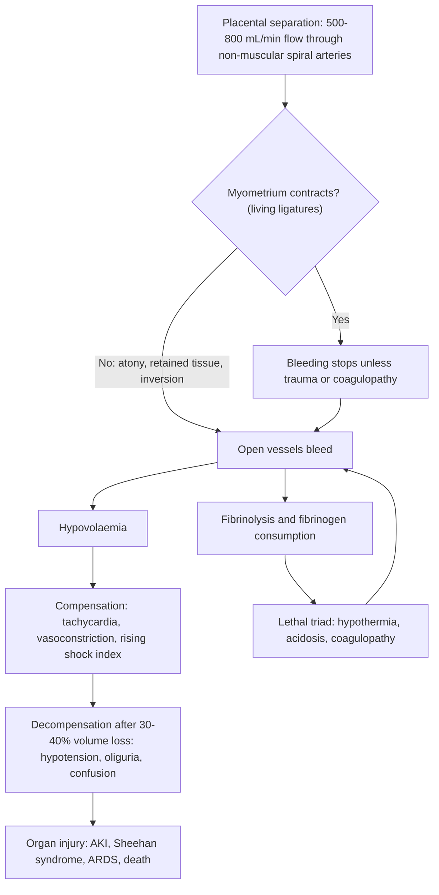

## 1. Definition

**Postpartum haemorrhage (PPH)** is excessive bleeding from the genital tract after birth. It is the **number-one direct cause of maternal death in Uganda** and worldwide. Most of these deaths happen **within 24 hours of birth, often within the first 2 hours**, and **most are preventable**.

| Term | Definition |
|---|---|
| **Primary PPH** | Blood loss **≥500 mL** from the genital tract within **24 hours** of birth (any route). The WHO/FIGO/ICM **2025** guideline adds: diagnose PPH at **≥300 mL plus any abnormal vital sign** (e.g. tachycardia, hypotension) |
| **Severe / major PPH** | **≥1000 mL** (RCOG: moderate 1000–2000 mL; severe >2000 mL). Minor = 500–1000 mL |
| **PPH after caesarean** | Classically ≥1000 mL; but treat **any bleeding that threatens haemodynamic stability** as PPH |
| **Clinical definition** | Any blood loss enough to cause haemodynamic instability. A small, anaemic woman (Hb 8 g/dL) may collapse after "only" 400 mL |
| **Secondary PPH** | Abnormal or excessive bleeding from **24 hours to 12 weeks** after birth |
| **Refractory PPH** | Bleeding that continues despite first-line uterotonics and the first-response bundle |
| **Retained placenta** | Placenta not delivered within **30 minutes** of birth with active management (WHO; UK uses 60 minutes) |

The modern approach, in the **WHO 2023 recommendations** and the **WHO/FIGO/ICM 2025 consolidated PPH guideline**, rests on two ideas:

1. **Detect early**: *measure* blood loss (calibrated drape) instead of guessing, and act at **300 mL if vital signs are abnormal**.
2. **Treat as a bundle**: give the **E-MOTIVE** first-response bundle all at once and quickly, not one drug at a time waiting to see what works.

> [!PEARL]
> The one thing never to forget: **a woman who bleeds after delivery can die within 2 hours.** Call for help early, measure, massage, give oxytocin **and** tranexamic acid, run fluids, look for the cause (4 Ts), and escalate. Don't wait for her blood pressure to fall.

## 2. Epidemiology

- Globally PPH affects millions of women every year. It is the single largest cause of maternal death, most of it in sub-Saharan Africa and South Asia.
- **Uganda:** the MMR fell from **336 per 100,000 live births (UDHS 2016) to 189 (UDHS 2022)**. That is still far above the SDG target of <70. **Haemorrhage remains the leading direct cause** of maternal death in MPDSR reports, together with hypertensive disorders, sepsis and abortion complications.
- Ugandan studies report PPH (≥500 mL) in about **9% of births**, with severe PPH (≥1000 mL) in about 1%. That is probably an underestimate, because blood loss is estimated by eye.

> [!UGANDA]
> The realities on a Ugandan labour ward matter. **Blood** is often unavailable at HC IVs and even at regional referral hospitals (RRHs), where it comes from the Uganda Blood Transfusion Service. **Oxytocin quality** suffers when the cold chain fails (hence interest in **heat-stable carbetocin**). Many women are **anaemic** before they bleed. Night-time deliveries are covered by one midwife. Referral from HC III to HC IV to RRH can take hours. Your management must work with what is on the shelf: oxytocin, misoprostol, ergometrine, TXA, IV fluids, a Foley catheter and a condom, and your hands.

## 3. Aetiology and Risk Factors

### Causes: the 4 Ts

| T | Approx. share | Examples |
|---|---|---|
| **Tone** (atony) | ~70% | Overdistension (twins, polyhydramnios, macrosomia), prolonged or precipitate labour, prolonged oxytocin augmentation, chorioamnionitis, grand multiparity, fibroids, MgSO₄, general anaesthesia, full bladder |
| **Trauma** | ~20% | Perineal, vaginal and cervical tears, episiotomy extension, uterine rupture, uterine inversion, broad-ligament haematoma, CS extensions |
| **Tissue** | ~10% | Retained placenta, retained cotyledon or membranes, placenta accreta spectrum (PAS), clots in the cavity |
| **Thrombin** | <1% | DIC (abruption, amniotic fluid embolism, sepsis, IUFD, severe pre-eclampsia/HELLP), anticoagulants, inherited bleeding disorders, **dilutional coagulopathy after large transfusion** |

**Secondary PPH causes**: **endometritis** (most common), **retained products**, subinvolution of the placental site, rarely trophoblastic disease (GTN) or arteriovenous malformation.

### Risk factors

**Two-thirds of PPH happens in women with no risk factor**, so prepare for every birth.

| Antenatal | Intrapartum |
|---|---|
| Previous PPH (strongest), grand multiparity (≥5), multiple pregnancy, polyhydramnios, macrosomia, anaemia (Hb <9 g/dL), placenta praevia/PAS, abruption, pre-eclampsia, fibroids, obesity, maternal age >35, previous CS | Prolonged labour (1st or 2nd stage), prolonged oxytocin use, induction, chorioamnionitis/fever, instrumental birth, CS (especially emergency), episiotomy, retained placenta, general anaesthesia, precipitate labour |

## 4. Pathophysiology

**Why the placental bed bleeds so much**

- At term, **uterine blood flow is 500–800 mL/min** (about 10–15% of cardiac output). The spiral arteries have been converted by trophoblast into **wide, low-resistance, non-muscular channels**. They **cannot constrict themselves**.
- After the placenta separates, bleeding is stopped mainly by **mechanical compression**. The criss-cross (interlacing) fibres of the myometrium contract and kink the vessels running between them. These are the **"living ligatures"**, and they explain why **uterine tone is everything**. Clotting and local thrombosis are secondary.
- **So:** a soft, "boggy" uterus = open vessels = torrential bleeding (tone). A well-contracted uterus that still bleeds must be bleeding from **somewhere else** (trauma or thrombin), or something is preventing contraction (**tissue**: a retained cotyledon holds the uterus open).

**How the body compensates, and why that fools us**

- Pregnancy increases blood volume by about **40–50%** (roughly 1.5 L extra). A healthy woman at term can lose **1000 mL with only mild tachycardia**. Young women hold their blood pressure through vasoconstriction until very late.
- **Hypotension is a late sign** (often after 30–40% of blood volume is lost). **Tachycardia, pallor, cool peripheries, restlessness, reduced urine output and a rising shock index** come first.
- **Shock index (SI) = heart rate ÷ systolic BP.** Normal postpartum SI is 0.7–0.9. **SI ≥0.9** should prompt concern and **SI ≥1.4** means urgent action and transfer.

**The lethal triad.** Continued bleeding leads to **hypothermia** (cold fluids, exposure), **acidosis** (hypoperfusion) and **coagulopathy** (consumption plus dilution with crystalloid). Each worsens the others. Fibrinogen falls first in obstetric haemorrhage, and **fibrinogen <2 g/L predicts progression to severe PPH**. This is why we warm fluids, limit crystalloid, give **tranexamic acid early** (to block fibrinolysis before clots dissolve), and transfuse blood and clotting factors rather than litres of saline.

**Why tranexamic acid must be early.** TXA blocks plasminogen activation (antifibrinolytic). Fibrinolysis rises sharply within minutes to hours of birth and bleeding. In the **WOMAN trial** (20,060 women), TXA **reduced death from bleeding by about 30% when given within 3 hours**. Given later there was no benefit. Every 15 minutes of delay reduces its benefit.

**Feature links**

- Atonic myometrium → open spiral arteries → heavy bleeding with clots, soft boggy fundus above the umbilicus.
- Massage → contraction → fundus firms and bleeding slows (confirms tone as the cause).
- Retained cotyledon or clots → uterus cannot stay contracted → fundus that firms then relaxes again and again.
- Tear in cervix or vagina → bleeding independent of tone → bright red trickle with a firm uterus.
- Bleeding into tissue planes → vulval, vaginal or broad-ligament haematoma → severe perineal or rectal pain, unexplained tachycardia, little external blood.
- Uterine rupture → bleeding into the abdomen → abdominal pain, peritonism, easily felt fetal parts, shock greater than visible loss.
- Inverted fundus → traction on peritoneum and ovaries (vagal) → profound shock with bradycardia, fundus not palpable, mass in the vagina.
- Volume loss → sympathetic drive → tachycardia, pallor, sweating, cool peripheries, capillary refill >2 s, rising shock index.
- Reduced renal perfusion → oliguria (<30 mL/h) → acute tubular necrosis if prolonged.
- Reduced cerebral perfusion → restlessness, then confusion and drowsiness (late).
- Fibrinogen consumption and dilution → coagulopathy → no clot at 7 minutes, oozing from cannula sites, the episiotomy and gums.
- Pituitary hypoperfusion (enlarged in pregnancy) → Sheehan syndrome → failed lactation, amenorrhoea.
- Acute whole-blood loss without time for haemodilution → first Hb looks near-normal despite a large bleed.

## 5. Classification / Staging

**By timing**: primary (≤24 h) versus secondary (24 h to 12 weeks) (section 1).

**By volume**: minor 500–1000 mL; major ≥1000 mL (RCOG subdivides into moderate 1000–2000 mL and severe >2000 mL). WHO/FIGO/ICM 2025: PPH is diagnosed at ≥300 mL plus any abnormal vital sign.

**By cause**: the 4 Ts (section 3).

**By haemodynamic compromise: shock index**

| Shock index (HR ÷ SBP) | Meaning |
|---|---|
| 0.7–0.9 | Normal postpartum |
| **≥0.9** | Abnormal: concern, look for ongoing bleeding |
| **≥1.4** | Urgent: senior at the bedside, blood, theatre or transfer |
| **≥1.7** | Critical |

**Rule of 30** (quick reference): a fall in systolic BP of about 30 mmHg with a rise in pulse of about 30/min suggests loss of roughly **30% of blood volume** (moderate shock). See worked example 1, section 8.

## 6. Clinical Features

### History

In the acute setting, history is taken **while** resuscitation happens, from the woman, the midwife, the partograph and the file. Each item changes the plan.

| Question | Why it matters |
|---|---|
| **Time of birth** | Still within 3 h? TXA works only then; also tells you whether this is primary or secondary PPH |
| **Mode of birth**: SVD, vacuum, CS, fundal pressure | Instrumental = tear; CS = intra-abdominal bleeding; fundal pressure or cord traction on an unseparated placenta = inversion |
| **Was AMTSL given? Which drug, when?** | No prophylactic oxytocin makes atony more likely; you also need the total uterotonic dose so far |
| **Placenta out? Complete?** | Retained or incomplete placenta = tissue; plan MRP |
| **Labour**: length, oxytocin augmentation, fever or chorioamnionitis, precipitate birth | Prolonged or augmented labour and chorioamnionitis → atony; fever → sepsis-related atony and DIC |
| **Baby**: weight, twins, polyhydramnios, stillbirth | Overdistension → atony; IUFD or abruption → DIC |
| **Parity and uterine history**: grand multipara, previous PPH, previous CS or myomectomy | Atony, rupture; previous CS + praevia → accreta |
| **Blood pressure, pre-eclampsia, heart disease** | **No ergometrine**; HELLP → low platelets (thrombin) |
| **Asthma** | **No carboprost** (bronchospasm) |
| **Antenatal Hb, blood group, HIV status** | Anaemic women decompensate early; plan transfusion; Rh status for anti-D |
| **Known bleeding disorder, anticoagulant, abruption, IUFD** | Thrombin cause |
| **Symptoms**: dizziness, thirst, breathlessness, confusion | Hypovolaemia; confusion = late, severe shock |
| **Severe perineal or rectal pain** | Expanding haematoma |
| **Abdominal pain** | Rupture; post-CS bleeding |

### Examination

Follow the order of Hutchison's Clinical Methods (24th edition), adapted to the postpartum emergency. In an actively bleeding woman the **hand on the fundus and the ABCDE** (section 9) come first; this sequence is completed by the team while the bundle runs.

#### Introduction, consent and preparation

- Introduce yourself, confirm her identity, explain briefly what you are doing and why, and gain verbal consent (consent for the genital-tract examination and any procedure; a chaperone is present).
- **Hand hygiene**; sterile gloves for the genital-tract examination.
- **Position and exposure**: lie flat (legs raised if shocked); expose the abdomen and perineum; **good light**, an assistant and a speculum or retractors for the genital tract; keep her warm and her dignity covered.

#### General inspection (end of the bed)

| Sign | Mechanism | What it means |
|---|---|---|
| Restlessness, air hunger | Hypoperfusion, hypoxia | Significant hypovolaemia |
| Confusion, drowsiness (AVPU/GCS) | Cerebral hypoperfusion | Late, severe shock |
| Pallor, sweating | Anaemia; sympathetic drive | Blood loss; low reserve |
| Blood in the drape, on the bed and floor | Ongoing loss | Read the drape, weigh the linen |

**Vital signs** every 5–15 min: pulse (rate and volume), BP, RR, SpO₂, temperature, **shock index**, **urine output** via catheter (target **≥30 mL/h**).

#### Hands, face and neck

| Sign | Mechanism | What it means |
|---|---|---|
| Cold, clammy peripheries; capillary refill >2 s | Peripheral vasoconstriction | Compensated shock |
| Oozing from cannula sites, gums; petechiae | Consumptive coagulopathy | DIC |
| Conjunctival pallor | Anaemia | Pre-existing anaemia or acute loss |

#### Abdomen (postpartum)

- **Inspection**: distension (post-CS intra-abdominal bleeding, rupture), scars (previous CS).
- **Palpation of the fundus**: height, consistency (**soft and above the umbilicus** = atony; firm and central = look elsewhere), deviated (full bladder), does it relax again after massage (tissue)?
- Tenderness, guarding, distension, free fluid, easily felt fetal parts or a scar → rupture; post-CS bleeding.
- **Fundus not palpable + shock out of proportion to bleeding** → **uterine inversion**.

#### Blood loss: measure it

Read the **calibrated drape**, weigh pads and linen (1 g ≈ 1 mL), count soaked swabs; look under the woman and on the floor.

#### Genital tract

- In good light with a speculum and an assistant: perineum and episiotomy; vaginal walls and fornices; **all four quadrants of the cervix** (walk sponge forceps around it).
- Vulval or paravaginal swelling, severe pain, bluish tense mass = **haematoma**; rectal examination if a haematoma is suspected.
- A mass in the vagina or at the introitus = **inversion** (or a fibroid polyp, much rarer).

#### Placenta and membranes

Lay the placenta out: complete? Missing cotyledons, ragged membranes, vessels running off the edge to a torn edge (**succenturiate lobe**)?

#### Clotting

**Bedside clotting test** (WHO): 2 mL in a small dry glass tube held warm in your fist; tilt at 4 min, then every minute; **no clot by 7 minutes**, or a soft clot that breaks up, = coagulopathy. (Some units use the 20-minute whole-blood clotting test instead.) Oozing from drip sites also suggests coagulopathy.

#### Completing the examination

Thank her, cover her, hand hygiene, and **summarise** findings to the team with the measured loss, shock index, likely T(s) and the plan.

| Document these positives | And these negatives |
|---|---|
| Measured loss (drape + weighed pads) and the time | "Placenta and membranes complete" |
| Fundal height and tone after massage | "Cervix inspected all round, no tear" |
| Shock index and urine output | "No haematoma, no inversion" |
| Site and degree of any tear | "Blood clots in the clotting test" |

### Red flags

> [!REDFLAG]
> - Pulse >100–110, SBP <90–100 mmHg, **shock index ≥0.9** (≥1.4 = critical)
> - Restlessness, confusion, air hunger, oliguria (<30 mL/h)
> - Bleeding continuing after the first uterotonic, or a uterus that keeps relaxing
> - **Shock out of proportion to visible bleeding**: think concealed bleeding (uterine rupture, broad-ligament or vulval haematoma, intra-abdominal bleeding after CS) or **uterine inversion**
> - Blood that doesn't clot, oozing from cannula sites: DIC
> - Severe perineal or rectal pain after delivery: expanding haematoma

> [!REDFLAG]
> Call the most senior person available **immediately** if: shock index ≥1.4, SBP <90 mmHg, confusion or drowsiness, loss ≥1000 mL, blood that does not clot, or shock out of proportion to what you can see (think rupture, inversion, concealed haematoma, intra-abdominal bleeding after CS).

### Thinking like a clinician

- **"Is the uterus hard?"** is the first branching question. Soft → Tone (massage, oxytocics, empty bladder, check for tissue). Hard but still bleeding → Trauma (inspect genital tract) or Thrombin (clotting test).
- **Bright red trickle with a well-contracted uterus** = a tear until proven otherwise, usually cervical or high vaginal. Clamp and suture; a second uterotonic won't fix it.
- **Uterus contracts then relaxes again and again** → think **retained tissue** (placenta incomplete) or overdistension/infection. Explore the uterus.
- **The fundus can't be felt, the woman is in profound shock (partly neurogenic, with bradycardia) and there is a mass in the vagina** → **uterine inversion**. Replace it immediately, before the cervix clamps down. **Stop the oxytocin until it is replaced.**
- **Previous CS + prolonged labour + sudden collapse** → uterine rupture: laparotomy, not another uterotonic.
- **After CS**: rising pulse, abdominal distension, falling Hb with little vaginal loss → intra-abdominal bleeding; return to theatre.
- **Anaemic woman**: her "500 mL" is someone else's 1500 mL. Treat the woman, not the number.
- **Common student mistakes**: underestimating loss by eye; waiting for hypotension; giving drugs one at a time; forgetting to catheterise; forgetting TXA; giving ergometrine to a hypertensive woman; forgetting to examine the placenta and the cervix; not documenting times.

> [!EXAM]
> Examiners love this: **"The uterus is well contracted but she is still bleeding. What will you do?"** Answer: inspect the genital tract under good light for trauma (cervical and vaginal tears, haematoma), check the placenta for completeness, do a bedside clotting test, and continue resuscitation.

## 7. Differential Diagnoses

These are differentials for the **cause** of bleeding (and for shock after delivery).

| Differential | Distinguishing clinical feature | Distinguishing investigation |
|---|---|---|
| Uterine atony | Soft, boggy, large uterus above umbilicus; bleeding with clots; improves with massage | Palpation; response to massage/oxytocin |
| Genital-tract trauma | Uterus firm; continuous bright-red bleeding; instrumental or precipitate birth | Speculum examination in good light (± EUA) |
| Retained placenta / tissue | Placenta not delivered or incomplete; uterus relaxes repeatedly | Inspect placenta; manual exploration; ultrasound if available |
| Uterine rupture | Previous CS/obstructed labour; abdominal pain, shock > visible loss, fetal parts easily felt, haematuria | Clinical; laparotomy |
| Uterine inversion | Fundus not palpable abdominally; mass at introitus/in vagina; severe pain; shock with bradycardia | Clinical; immediate replacement |
| Coagulopathy / DIC | Non-clotting blood, oozing from sites; abruption, IUFD, AFE, sepsis, HELLP | Bedside clotting test, platelets, PT/APTT, fibrinogen |
| Vulval/vaginal/broad-ligament haematoma | Severe pain, rectal pressure, unexplained tachycardia, swelling; little external blood | Examination; ultrasound; drainage |
| Amniotic fluid embolism | Sudden collapse, hypoxia, hypotension, seizure, then DIC | Clinical diagnosis; ICU |
| Other shock (sepsis, PE, cardiac) | Fever, chest pain, dyspnoea; uterus fine and little bleeding | Clinical picture; ECG, etc. |

## 8. Clinical Workup

In PPH the workup and the treatment happen **at the same time**. You never finish the history before you touch the uterus. Three principles:

1. **Send bloods while you resuscitate**; never delay treatment for a result. The first cannula gives you Hb, group and cross-match and the clotting-test tube.
2. **Bedside tests beat the lab at night**: the calibrated drape, weighed pads, shock index, HemoCue, the bedside clotting test and hourly urine output can all be done at a HC IV.
3. **Repeat, don't rely on one value**: the first Hb underestimates loss, and a normal first clotting test can become abnormal after a further litre of bleeding. Repeat Hb after resuscitation and at 24 h, and repeat clotting tests if loss exceeds about 1000 mL or bleeding continues.

### Bedside

| Test | How / why | Expected finding and what it changes | Available at |
|---|---|---|---|
| **Calibrated drape reading** | Read the level every 5–15 min; note the time | Objective loss; **the trigger for the bundle** (≥500 mL, or ≥300 mL with abnormal vitals) | HC III and above (where supplied) |
| **Weigh pads, linen and swabs** | Weigh soaked items and subtract the weight of the same items dry; **1 g ≈ 1 mL** | Adds the loss the drape missed (after the drape is removed, on the floor, in the bed) | All levels with a scale |
| **Shock index** | HR ÷ SBP, repeated with each set of vitals | Rising SI = ongoing bleeding even if BP is "normal" | All levels |
| **HemoCue / point-of-care Hb** | Finger-prick or venous sample | Baseline only; the **first Hb underestimates the loss** | HC III/IV and above |
| **Bedside clotting test** | 2 mL venous blood in a clean, dry **glass** tube; hold it warm, tilt at 4 min then every minute (WHO MCPC); some units read at 20 min instead | No clot by 7 min, or a clot that breaks up = coagulopathy (DIC) → blood products, fresh whole blood | All levels |
| **Hourly urine output** | Foley catheter to a urometer or measured bag | <30 mL/h = under-resuscitated or AKI | All levels |
| **Point-of-care ultrasound** (if skilled) | Uterine cavity, abdomen | Retained products/clots in the cavity; free fluid (rupture, post-CS bleeding) | HC IV and above with a skilled operator |
| **Urine dipstick for protein**, BP | Undiagnosed pre-eclampsia? | Proteinuria + hypertension → avoid ergometrine; think HELLP | All levels |
| **Malaria RDT, temperature** | Secondary PPH, fever | Co-existing malaria, sepsis | All levels |

### Basic lab

| Test | When / why | Expected / abnormal finding → management | Available at |
|---|---|---|---|
| **Group and cross-match** | Every PPH, with the first cannula | Blood group; 2–4 compatible units → transfuse early in major PPH | **HC IV**: only where there is a blood fridge and a supply from the regional blood bank (UBTS); otherwise refer. **RRH/NRH**: usually available, but stocks run out |
| **Full blood count** | Baseline, then after resuscitation and at 24 h | Hb (baseline often low from antenatal anaemia); platelets <75 × 10⁹/L abnormal → transfusion and platelet decisions; Hb at 24 h guides iron versus transfusion | Most HC IVs and hospitals |
| **Urea, creatinine, electrolytes** | Major PPH, oliguria | Creatinine rising above ~80–90 µmol/L; high K⁺ → AKI: fluid balance, avoid nephrotoxins (gentamicin dose), renal review | RRH/NRH |
| **LFTs** | Hypertensive woman, low platelets | Raised ALT/AST (with low platelets, haemolysis) → HELLP: coagulopathy, MgSO₄, no ergometrine | RRH/NRH |

### Imaging

| Test | When / why | Expected finding → management | Available at |
|---|---|---|---|
| **Ultrasound (formal)** | Retained tissue suspected; secondary PPH; post-CS | Echogenic mass in the cavity; free fluid; haematoma → evacuation versus laparotomy versus expectant | Most HC IVs and all hospitals, if a sonographer is on site |

### Specialised / referral-level

| Test | When / why | Expected / abnormal finding → management | Available at |
|---|---|---|---|
| **PT/INR, APTT** | Major PPH (≥1000 mL), abnormal clotting test, abruption, IUFD, sepsis, HELLP | Prolonged (>1.5 × normal) → FFP 15 mL/kg | **Mainly RRH/NRH/private hospitals**; often not at night |
| **Fibrinogen** | As above | **<2 g/L = severe coagulopathy** and predicts progression (normal in late pregnancy 4–6 g/L) → cryoprecipitate (or fresh whole blood if no components) | **NRH and some private hospitals only** |
| **Lactate / blood gas** | Severe shock, HDU/ICU | Lactate >4 mmol/L, base deficit → severity of shock; response to resuscitation | NRH/ICU only |
| **Blood cultures, HVS** | Secondary PPH or fever | Organisms and sensitivities → tailor antibiotics | RRH/NRH (culture capacity limited) |
| **β-hCG** | Secondary PPH that persists after evacuation | Raised or plateauing → suspect gestational trophoblastic neoplasia; send tissue for histology | HC IV (qualitative) to RRH/NRH (quantitative) [VERIFY: quantitative β-hCG availability by level] |

> [!UGANDA]
> At most HC IVs you will have the **drape, a scale, a HemoCue, a glass tube and your hands**, and often no coagulation lab. That is enough to diagnose PPH, grade shock, find the cause (4 Ts) and detect coagulopathy. What you often **cannot** do is transfuse components or operate at night, so the workup must end in a clear decision: **manage here or refer now** (with NASG, tamponade, oxytocin running and an escort).

### Putting it together

**Model one-line summary**

> "A 32-year-old para 5, 40 minutes after SVD of a 4.1 kg baby following an augmented labour, with primary PPH of 900 mL (drape plus pads), shock index 1.2, a soft uterus that firms with massage, a complete placenta and a second-degree tear: atonic PPH with a minor trauma component, haemodynamically compensated."

**Problem list**

1. Primary PPH (900 mL and still being measured), cause mainly **Tone**, plus **Trauma** (tear).
2. Hypovolaemia (SI 1.2), on the bundle.
3. Pre-existing anaemia (antenatal Hb 9.5 g/dL) → low reserve.
4. Risk of coagulopathy (continue clotting tests if loss exceeds 1000 mL).

**Working diagnosis**: *primary atonic PPH with a second-degree perineal tear, compensated hypovolaemic shock.*

**Model case presentation (ward round)**

> "Mrs N, a 32-year-old para 5 at 39 weeks, delivered a 4.1 kg baby by SVD 40 minutes ago after a 16-hour oxytocin-augmented labour. She developed primary PPH from uterine atony, with measured loss of 900 mL on the calibrated drape. Her pulse was 118, BP 96/60, shock index 1.2. The E-MOTIVE bundle was started at 10:05: massage, oxytocin 10 IU IV plus infusion, TXA 1 g IV, 1 L Ringer's, catheterised, and genital tract inspected (second-degree tear repaired, placenta complete). The uterus is now firm, pulse 100, BP 110/70, urine output 40 mL/h. Hb 8.1 g/dL; 2 units cross-matched. Plan: continue the oxytocin infusion, 15-minute observations, transfuse 1 unit, repeat Hb at 24 h, oral iron, and document as severe PPH for review."

> [!EXAM]
> **Worked example 1: shock index and blood-loss estimation.**
> The drape reads **650 mL** when it is removed. After that, four soaked pads and a draw sheet weigh **620 g**; the same items dry weigh **120 g**. Extra loss = 620 − 120 = **500 g ≈ 500 mL**. **Total ≈ 1150 mL = severe PPH.**
> Pulse 126, BP 90/60 → **SI = 126 ÷ 90 = 1.4** → urgent: second cannula, blood now, senior at the bedside, prepare theatre. The eye estimate in the notes said "about 500 mL": a classic underestimate.
> Her admission BP was 120/80 with pulse 86: SBP has fallen by 30 mmHg and pulse has risen by 40. By the **Rule of 30** she has lost roughly **30% of her blood volume** (moderate shock), which fits the weighed total.

> [!EXAM]
> **Worked example 2: the first Hb and the clotting test.**
> Thirty minutes after a 1500 mL PPH following abruption with IUFD, her Hb is **9.8 g/dL** (antenatal 11.2). This does **not** mean the loss was small: she has lost whole blood and there has been no time for haemodilution, so the Hb falls further over hours (and with crystalloid). Treat the **clinical picture and the measured loss**, not the first Hb.
> The bedside clotting test shows **no clot at 7 minutes**. Later labs: platelets **62 × 10⁹/L**, PT prolonged, fibrinogen **1.3 g/L**. Interpretation: **DIC** from abruption plus consumption. Action: TXA (if within 3 h), red cells plus **FFP 15 mL/kg**, **cryoprecipitate** (fibrinogen <2 g/L), **platelets** (<75 × 10⁹/L); fresh whole blood if components are not available; keep her warm; ensure the uterus is empty and contracted.

## 9. Management

### Immediate / emergency

**Diagnose early.** Calibrated drape reading **≥500 mL**, or **≥300 mL plus abnormal vital signs or clinical concern** (WHO/FIGO/ICM 2025), or any bleeding with a woman who looks unwell, triggers the bundle. Start all components **together, within 15 minutes**.

**First 5 minutes**

1. **Recognise and name it.** Say out loud: "This is PPH. Time is 10:05."
2. **Call for help**: second midwife, the most senior clinician, anaesthetic officer; alert theatre and the blood bank. Assign roles (one on the uterus, one on IV and drugs, one on airway and observations, one scribe/timekeeper).
3. **Hand on the fundus at once.** Soft and high → start **massage** now. This is both the first examination and the first treatment.

**ABCDE**

- **A**: airway and conscious level.
- **B**: RR, SpO₂; **oxygen** 6–8 L/min by mask.
- **C**: pulse, BP, **shock index** (**≥0.9 abnormal, ≥1.4 urgent, ≥1.7 critical**). Lie flat, raise legs. **Two large-bore cannulae (14–16G)**; from the first draw blood for **Hb, group and cross-match**, and fill a **dry glass tube for the bedside clotting test**. Catheterise.
- **D**: AVPU; glucose if drowsy.
- **E**: temperature; **keep her warm**; look at the drape, the bed and the floor.

**The E-MOTIVE bundle: emergency algorithm (vaginal birth, any facility)**

1. **Call for help** and note the time (above).
2. **ABC**: lie flat, raise legs; oxygen; keep warm.
3. **Two large-bore IV cannulae**; bloods and clotting test.
4. **M: uterine Massage**. Rub the fundus firmly to stimulate a contraction and expel clots. Continue until firm.
5. **O: Oxytocin** 10 IU IV slowly (or IM), then an infusion (drug table).
6. **T: Tranexamic acid 1 g IV over 10 minutes** (within 3 hours of birth). Repeat 1 g after 30 minutes if bleeding continues.
7. **I: IV fluids**: warmed crystalloid (Ringer's lactate or normal saline). Give a 500 mL–1 L bolus quickly, then reassess. Avoid more than about 2 L of crystalloid before blood; start **blood** as soon as available.
8. **Empty the bladder** (Foley catheter, left in to measure urine output hourly).
9. **V: Vaginal/genital-tract Examination**. Is the placenta out and complete? Look for tears (repair them), haematoma or inversion.
10. **E: Escalate** if bleeding continues despite the bundle. Move to second-line drugs, bimanual compression, tamponade, theatre, and **refer early** from a HC III/IV that cannot operate or transfuse.
11. **Monitor** pulse, BP, RR, SpO₂ and blood loss every 15 minutes; urine hourly; **document** drug times and volumes.

> [!NOTE]
> Why a bundle? In the **E-MOTIVE trial** (210,132 vaginal births, 78 hospitals in Kenya, Nigeria, South Africa and Tanzania), the calibrated drape plus the bundle **reduced the composite of severe PPH (≥1000 mL), laparotomy for bleeding or maternal death from bleeding from 4.3% to 1.6% (RR 0.40)**. Treatment was started early and together instead of sequentially after each "wait and see". WHO adopted it in 2023.

### Definitive

#### Escalation: bleeding continues after the bundle

Work through these **in parallel**, not one by one, while someone prepares theatre and blood.

**1. Bimanual uterine compression** (buys time)

- One gloved fist in the anterior vaginal fornix pushes against the anterior uterine wall. The other hand, on the abdomen, presses the fundus down and forward onto the fist. The uterus is compressed between the two hands.
- Maintain firm pressure for at least 5–10 minutes (up to 20–30), until bleeding stops or help arrives.
- **External aortic compression** (fist pressed just above and left of the umbilicus onto the aorta until the femoral pulse disappears) is a temporising alternative, especially during transfer.

**2. Uterine balloon tamponade (UBT)**: for **atonic** PPH not responding to uterotonics.

- The WHO (2021) recommends UBT **where standard PPH care, including surgery and blood, is accessible**. In practice in Uganda the **condom catheter** is widely used as a bridge to theatre or during referral.
- **Condom catheter**: tie a condom over a Foley catheter (or use a purpose-made balloon). Insert it into the uterine cavity past the cervix. Fill with **300–500 mL** warm saline through a giving set until bleeding stops, and pack the vagina with gauze to hold it in. Continue the **oxytocin infusion**, give **prophylactic antibiotics** (e.g. ampicillin 2 g IV single dose, or a cephalosporin), catheterise the bladder, monitor closely. Deflate gradually and remove after **6–24 hours** (usually 12–24 h), with theatre and blood ready.
- **Tamponade test**: if bleeding stops, the tamponade is working. If bleeding continues through or around the balloon, go straight to laparotomy.

**3. Non-pneumatic anti-shock garment (NASG)**: neoprene segments wrapped from the ankles upwards to the abdomen. They compress the lower body and pelvis, squeezing blood back to the heart, brain and lungs and reducing pelvic bleeding. It is a **first-aid device to buy time**, particularly for **transfer from HC III/IV to hospital**. Apply ankle segments first; remove only when stable (SBP ≥90 and pulse <100, blood running), **from the ankles upwards**, one segment at a time, rechecking BP after each (a drop of 20 mmHg or a pulse rise of 20 means reapply).

**4. Transfuse**: whole blood or packed red cells as soon as possible. In major haemorrhage give **FFP** (15 mL/kg) when more than about 4 units of red cells have been given or clotting is abnormal, **cryoprecipitate** if fibrinogen is <2 g/L, and **platelets** if <75 × 10⁹/L (availability at RRH/NRH). Aim for Hb >8 g/dL once bleeding is controlled.

**5. Surgery** (laparotomy, at CEmONC level), from the most conservative step upward:

| Step | What / how | Why |
|---|---|---|
| **Exploration** | Evacuate clots, check for rupture, repair lacerations | Finds the trauma you missed |
| **B-Lynch compression suture** | Absorbable suture (e.g. No. 1 or 2 chromic/polyglactin on a large needle) that "braces" the uterus over the fundus; test first with bimanual compression (if that stops bleeding, B-Lynch will too) | Mechanically compresses an atonic uterus while preserving fertility |
| **Bilateral uterine artery ligation** (O'Leary stitch) | Ligate the ascending branches at the level of the lower segment, including some myometrium | The uterine arteries carry about 90% of uterine blood; cuts pulse pressure |
| **Utero-ovarian / internal iliac ligation** | Specialist procedures | Further devascularisation |
| **Subtotal (or total) hysterectomy** | **Decide early**; don't wait until she is in DIC | Life-saving. Subtotal is faster and safer in an unstable woman; total is needed if the lower segment or cervix bleeds (praevia/PAS, cervical tears) |

> [!EXAM]
> "When would you do a hysterectomy?" Answer: when **conservative measures have failed** and the mother's life is at risk, **before** she becomes moribund. A living mother without a uterus is better than a dead mother with one. Get consent early (from the woman or her next of kin) and involve a senior.

#### Cause-specific management

**Trauma**

- **Perineal/vaginal tears**: repair in good light with analgesia (lidocaine 1%). Secure the **apex first** (start the stitch 1 cm above it), because retracted vessels keep bleeding.
- **Cervical tears**: sponge forceps on either side, suture from the apex. Refer if you cannot see the apex.
- **Vulval/vaginal haematoma**: small (<5 cm) and not expanding → ice, analgesia, observe. Large or expanding → incise, evacuate, ligate bleeders, pack; catheterise.
- **Uterine rupture**: resuscitate, then **laparotomy**: repair (if clean tear and she wants more children) or hysterectomy; inspect the bladder.
- **Uterine inversion**: call for help, **stop oxytocin**, treat shock, and **replace immediately**. **Johnson manoeuvre**: push the fundus back through the cervix with the palm, the part that came out last going in first; don't remove the placenta first if still attached. If that fails, use **O'Sullivan hydrostatic** replacement (warm saline into the vagina with the introitus sealed by hand or a ventouse cup), or surgical correction (Huntington, Haultain). **After replacement, give oxytocin** and hold the uterus in place until it contracts. Give antibiotics.

**Tissue: retained placenta**

1. If the placenta has not delivered **30 minutes** after birth: empty the bladder, **oxytocin 10 IU IV/IM** (if not already given as part of AMTSL, or a repeat), and repeat **CCT**. **Don't give ergometrine** (tetanic contraction can trap the placenta).
2. If still retained, or if bleeding: **manual removal of placenta (MRP)** under analgesia or anaesthesia (ketamine, spinal or pethidine + diazepam). Give **single-dose prophylactic antibiotics** (e.g. ampicillin 2 g IV, or cefazolin 2 g IV). The hand follows the cord into the uterus and finds the cleavage plane with the ulnar edge of the fingers while the other hand steadies the fundus. Remove it whole, check it, re-explore, and follow with an oxytocin infusion.
3. If there is **no cleavage plane**, suspect **placenta accreta spectrum**. Stop, don't pull pieces out, and call a senior. Laparotomy or hysterectomy may be needed.
4. **Retained fragments**: manual exploration or **MVA / blunt curettage** with a large curette (the soft postpartum uterus perforates easily).

**Thrombin (coagulopathy)**

- Treat the cause (deliver an abruption, treat sepsis), give **TXA**, fresh whole blood (contains clotting factors and platelets, useful where components are unavailable), FFP, cryoprecipitate and platelets. Keep her **warm**; correct calcium and acidosis.

### Drug table

> [!DRUG]
> Confirm the dose on your unit protocol. These are the WHO / Uganda regimens.

| Drug | Dose (adult) | Route | Frequency | Duration / max | Key cautions |
|---|---|---|---|---|---|
| **Oxytocin** (treatment, first line) | **10 IU**, then infusion **20 IU in 1 L** NS/RL at **60 drops/min**; maintenance 20 IU in 1 L at **40 drops/min** | IV slowly or IM; infusion IV | Bolus once, then continuous | Continue for at least 2–6 h after bleeding stops. **No more than 3 L of oxytocin-containing fluid** (water intoxication) | Rapid IV bolus → hypotension. Very safe otherwise. Some Ugandan units use 20–40 IU in 1 L; follow your unit |
| **Misoprostol** (treatment) | **800 µg** (4 × 200 µg) | **Sublingual** | Single dose | Once | Use if oxytocin unavailable or as an add-on. Shivering and fever (up to 40 °C) are common and harmless; don't mistake them for sepsis. Slower onset than oxytocin |
| **Ergometrine** (ergonovine) | **0.2 mg** | IM, or IV **slowly** | Repeat 0.2 mg IM after 15 min, then 0.2 mg every 4 h | **Max 5 doses (1 mg) in 24 h** | **Contraindicated in hypertension, pre-eclampsia, heart disease**, retained placenta (and an undelivered second twin). Causes vomiting and severe hypertension; can cause stroke or eclampsia |
| **Carboprost** (15-methyl PGF2α) | **0.25 mg** | **Deep IM** (or intramyometrial by specialist) | Every 15 min | **Max 8 doses (2 mg)** | **Contraindicated in asthma** (bronchospasm). Diarrhoea, vomiting, fever. Expensive and rarely stocked in Uganda |
| **Tranexamic acid** | **1 g** (10 mL of 100 mg/mL) | IV over **10 min** (1 mL/min) | Second 1 g if bleeding continues after 30 min or restarts within 24 h | Give **within 3 h of birth** | For **all causes** of PPH (tone, trauma, tissue). Too-fast injection causes hypotension |
| **Oxytocin** (AMTSL, first choice) | **10 IU** | IM or slow IV | Once, within 1 min of birth | Single dose | Store 2–8 °C; loses potency in heat |
| **Heat-stable carbetocin** | **100 µg** | IM or IV | Single dose | Once | Non-inferior to oxytocin (CHAMPION trial, which included Uganda). Use where oxytocin quality can't be assured. **For prevention only, not treatment** |
| **Misoprostol** (prevention) | **400–600 µg** (Uganda community: 600 µg = 3 × 200 µg) | Oral | Once, immediately after the baby is born | Once | Where injectables are not available (home births, community distribution); never before the birth |
| Ergometrine / oxytocin-ergometrine (prevention) | 0.2 mg IM / 5 IU + 0.5 mg IM | IM | Once | Once | Only if no hypertension; more side effects |
| Tranexamic acid at CS | 1 g IV in some units for high-risk women | IV | Once | Once | Not routine for all births; follow local protocol |
| **Ampicillin** (MRP, tamponade prophylaxis) | **2 g** | IV | Single dose | Once | Or cefazolin 2 g IV, or a cephalosporin |
| **Ampicillin + gentamicin + metronidazole** (secondary PPH with infection) | Ampicillin **2 g** 6-hourly; gentamicin **5 mg/kg** once daily; metronidazole **500 mg** 8-hourly | IV | As stated | Until afebrile 48 h, then oral amoxicillin + metronidazole to complete 7 days | Or local regimen (e.g. ceftriaxone + metronidazole); adjust gentamicin in AKI |
| **FFP** | **15 mL/kg** | IV | After ~4 units red cells or abnormal clotting | As needed | RRH/NRH |
| **Cryoprecipitate** | Per local protocol [VERIFY: unit dose not stated in source] | IV | If fibrinogen <2 g/L | As needed | NRH and some private hospitals |
| **Platelets** | Per local protocol | IV | If <75 × 10⁹/L with active bleeding | As needed | RRH/NRH |
| **Ferrous sulphate + folic acid** | Ferrous sulphate 200 mg + folic acid | Oral | Daily [VERIFY: frequency] | Until Hb restored | IV iron at referral level; transfuse if symptomatic or Hb <7 g/dL |
| **Lidocaine 1%** | Local infiltration | Local | Once | For repair | Analgesia for tear repair |

> [!PEARL]
> **Carbetocin is for prevention only.** It is not a treatment drug for established PPH. And there is no point giving IV ergometrine to a woman whose BP is 160/110. If you remember nothing else about contraindications: **"Ergometrine: not for the hypertensive heart; carboprost: not for the wheezy chest."**

### Referral criteria

| Level | What to do | Refer up when |
|---|---|---|
| **HC II / community** | Misoprostol 600 µg orally for prevention; uterine massage | Any bleeding after birth: refer urgently |
| **HC III (BEmONC)** | AMTSL; full E-MOTIVE bundle (massage, oxytocin, TXA, fluids, genital examination, repair tears); MRP; MVA for fragments; bimanual compression; condom tamponade and NASG | **Early**: as soon as bleeding is not controlled by the bundle, or she needs blood or theatre → HC IV/hospital |
| **HC IV / General Hospital (CEmONC)** | All of the above **plus** blood transfusion, theatre: laparotomy, B-Lynch, uterine artery ligation, hysterectomy | Needs blood components, HDU/ICU, PAS surgery → RRH |
| **RRH / NRH (e.g. Mulago-Kawempe, Mengo)** | Blood components (FFP, cryo, platelets), HDU/ICU, specialist surgery for PAS, interventional options where available | n/a |

**How to refer**: IV oxytocin running, NASG on and/or tamponade in place, a health worker escort who can do bimanual compression, a referral note with times and doses, and a phone call ahead.

### Monitoring and follow-up

- During the bundle: pulse, BP, RR, SpO₂ and blood loss **every 15 minutes**; urine hourly; document drug times and volumes.
- After the bleeding stops: continue the oxytocin infusion for several hours. Vital signs, fundus and loss every 15 min for 2 hours, then half-hourly and hourly; fluid balance chart; urine output.
- **Hb check at 24 h**; **treat anaemia** (ferrous sulphate 200 mg + folic acid; IV iron at referral level; transfusion if symptomatic or Hb <7 g/dL).
- **Thromboprophylaxis** once bleeding is controlled (massive PPH is a VTE risk).
- **Debrief** the woman and family; explain the risk next pregnancy (recurrence about 15%); document well and plan her next delivery at a CEmONC facility.
- Watch for **Sheehan's syndrome** (failure of lactation, amenorrhoea, fatigue after major PPH).
- **Near-miss audit or MPDSR** review if there was a death.

### Prevention at every birth (AMTSL)

**Active management of the third stage of labour (AMTSL)**, per WHO:

1. **Exclude a second baby** (palpate the abdomen).
2. **Oxytocin 10 IU IM** (or IV slowly) **within 1 minute of birth**. This is the **most important component**.
3. **Delayed cord clamping** (1–3 minutes) unless the baby needs resuscitation.
4. **Controlled cord traction (CCT)** with counter-traction above the pubis, only during a contraction, by a skilled attendant. It is optional where attendants are not skilled.
5. **Assess uterine tone** abdominally **every 15 minutes for 2 hours** (sustained continuous massage is no longer recommended if oxytocin was given, but tone checks are).
6. **Examine the placenta and membranes** for completeness, and the genital tract for tears.
7. **Measure blood loss objectively** (calibrated drape placed under the buttocks after birth, WHO 2023).

> [!UGANDA]
> In Uganda, **oxytocin 10 IU IM** is standard AMTSL at every facility. **Misoprostol 600 µg orally** (3 × 200 µg tablets) has been distributed for women who may deliver at home, to be taken immediately after the baby is born, and never before. Heat-stable carbetocin has been introduced in some humanitarian settings. At caesarean, oxytocin is given IV **slowly** (a rapid bolus causes hypotension).

### Secondary PPH (24 h to 12 weeks)

1. Assess and resuscitate as for primary PPH. Most secondary PPH is modest, but it can be massive.
2. **Investigations**: FBC, blood culture and high vaginal swab, pelvic ultrasound (retained products), **β-hCG if bleeding persists** (to exclude GTN), malaria test if febrile.
3. **Antibiotics** if infection is suspected: **ampicillin 2 g IV 6-hourly + gentamicin 5 mg/kg IV once daily + metronidazole 500 mg IV 8-hourly** until afebrile for 48 hours, then oral amoxicillin plus metronidazole to complete 7 days (or local regimen, e.g. ceftriaxone + metronidazole).
4. **Uterotonics**: oxytocin infusion, misoprostol 800 µg SL, or ergometrine if no hypertension.
5. **Evacuation of retained products** by an experienced person (MVA or gentle curettage), **after antibiotics have started** (the infected uterus perforates easily).
6. Persistent bleeding: surgical options as above.

## 10. Complications

**Disease-related**

| Timing | Complication |
|---|---|
| Immediate | Hypovolaemic shock, death, DIC, cardiac arrest |
| Organ damage | **Acute kidney injury** (ATN, cortical necrosis), ARDS, **Sheehan's syndrome** (pituitary necrosis → failed lactation, amenorrhoea, hypothyroidism, adrenal insufficiency) |
| Later | Severe anaemia, fatigue, failure of breastfeeding, **VTE**, post-traumatic stress and depression |

**Treatment-related**

| Complication | Cause |
|---|---|
| Loss of fertility | Hysterectomy |
| Bladder/ureteric injury | Laparotomy, devascularisation, hysterectomy |
| Infection | MRP, tamponade, curettage |
| Dilutional coagulopathy; fluid overload, pulmonary oedema | Large volumes of crystalloid |
| Water intoxication | Oxytocin (>3 L of oxytocin-containing fluid) |
| Transfusion reactions | Blood products |
| Hypertensive crisis, stroke, eclampsia | Ergometrine in a hypertensive woman |
| Bronchospasm | Carboprost in asthma |
| Shivering, fever | Misoprostol (harmless) |
| Asherman's syndrome | Curettage |
| Uterine perforation | Curettage of the soft postpartum or infected uterus |

## 11. Prognosis

- With early detection and the bundle, most PPH is controlled without surgery; E-MOTIVE cut the composite of severe PPH, laparotomy for bleeding or death from bleeding from 4.3% to 1.6%.
- Death follows delay: late recognition (eye estimates, waiting for hypotension), drugs given one at a time, late TXA, no blood, late referral.
- **Recurrence in the next pregnancy is about 15%**.
- After major PPH, watch for Sheehan's syndrome, persisting anaemia, VTE and psychological sequelae.

## 12. Prevention

- **Antenatal**: treat anaemia (iron + folic acid; Hb target ≥11 g/dL), identify high-risk women (previous PPH, praevia, grand multipara, twins), **birth preparedness** (deliver in a CEmONC facility, identify blood donors, transport money).
- **Intrapartum**: partograph to avoid prolonged labour; judicious augmentation.
- **Third stage**: **AMTSL at every birth** (section 9) with a calibrated drape and 15-minute tone checks for 2 hours.
- **Community**: misoprostol 600 µg orally for women who may deliver at home.
- **After PPH**: plan the next delivery at a CEmONC facility.

## 13. Special Populations

- **Pre-eclampsia / hypertension**: **no ergometrine or Syntometrine**; use oxytocin, then misoprostol 800 µg SL (carboprost if available and she is not asthmatic). Think HELLP and low platelets. MgSO₄ itself contributes to atony.
- **Asthma**: **no carboprost**.
- **Heart disease**: avoid ergometrine; give oxytocin slowly; careful fluids.
- **Anaemia** (Hb 8 g/dL): decompensates after "only" 400 mL; transfuse earlier.
- **After caesarean**: think intra-abdominal bleeding; return to theatre.
- **Rh-negative**: anti-D as per protocol.
- **Previous CS with praevia**: anticipate placenta accreta spectrum; deliver at a hospital with blood and a senior surgeon.

## 14. Key Points

### High-yield points

- Primary PPH: ≥500 mL in 24 h, or ≥300 mL plus any abnormal vital sign (WHO/FIGO/ICM 2025); severe ≥1000 mL; secondary 24 h to 12 weeks.
- Measure, don't guess: calibrated drape and weighed pads; the eye underestimates by 30–50%.
- Shock index ≥0.9 abnormal, ≥1.4 urgent; hypotension is late.
- Start the whole E-MOTIVE bundle together: massage, oxytocin, TXA, IV fluids, genital-tract examination, escalate.
- TXA 1 g IV over 10 min within 3 h of birth: "1-10-3-30".
- Firm uterus still bleeding → trauma or thrombin, not another uterotonic.
- Ergometrine: not for the hypertensive heart; carboprost: not for the wheezy chest; carbetocin is for prevention only.
- Retained placenta at 30 min: empty bladder, oxytocin, CCT, then MRP with antibiotic cover; never ergometrine.
- Inversion: stop oxytocin, replace immediately, then oxytocin.
- Decide on hysterectomy early, before DIC.

### Numbers & doses

| Item | Value |
|---|---|
| Primary PPH | **≥500 mL within 24 h** of birth; or **≥300 mL + any abnormal vital sign** (WHO/FIGO/ICM 2025) |
| Severe / major PPH | **≥1000 mL** (RCOG: 1000–2000 moderate, >2000 severe) |
| Secondary PPH | **24 h to 12 weeks** after birth |
| Retained placenta | Not delivered **30 min** after birth (WHO; UK 60 min) |
| AMTSL uterotonic | **Oxytocin 10 IU IM** within **1 min** of birth; tone checks **every 15 min for 2 h** |
| Treatment oxytocin | **10 IU IV slowly/IM**, then **20 IU in 1 L at 60 drops/min**, maintenance **40 drops/min**; max **3 L** oxytocin-containing fluid |
| Tranexamic acid | **1 g IV over 10 min**, within **3 h**; repeat 1 g after **30 min** if still bleeding ("1-10-3-30") |
| Misoprostol | Prevention **600 µg orally** (400–600 µg); treatment **800 µg sublingual** |
| Ergometrine | **0.2 mg IM/slow IV**, repeat after 15 min then 4-hourly; **max 1 mg (5 doses)/24 h** |
| Carboprost | **0.25 mg deep IM** every 15 min; **max 2 mg (8 doses)** |
| Carbetocin (heat-stable) | **100 µg IM/IV**, prevention only |
| Shock index (HR ÷ SBP) | Normal 0.7–0.9; **≥0.9 abnormal; ≥1.4 urgent; ≥1.7 critical** |
| Pad weighing | **1 g ≈ 1 mL** (subtract dry weight) |
| Clotting test | 2 mL in a dry glass tube; **no clot by 7 min** = coagulopathy (WHO) |
| Fibrinogen | Normal at term 4–6 g/L; **<2 g/L** = severe coagulopathy → cryoprecipitate |
| Platelets | Transfuse if **<75 × 10⁹/L** in active bleeding |
| FFP | **15 mL/kg** after about 4 units of red cells or with abnormal clotting |
| Urine output target | **≥30 mL/h** |
| Crystalloid before blood | Avoid more than about **2 L** |
| Balloon tamponade | **300–500 mL** warm saline; remove after **6–24 h** |
| NASG removal | When **SBP ≥90 and pulse <100**, ankles first; reapply if SBP falls 20 or pulse rises 20 |
| Recurrence next pregnancy | About **15%** |

### Exam traps

- **"Wait until the drape reaches 500 mL."** Wrong if vital signs are abnormal: at **≥300 mL plus an abnormal vital sign**, it is already PPH.
- **"BP is normal, so the loss is small."** Hypotension is late; look at the **pulse and shock index**.
- **"Give a second uterotonic"** for a **firm** uterus that keeps bleeding. Wrong: find the **tear** or check **clotting**.
- **"Give drugs one at a time and wait to see."** Wrong: the E-MOTIVE bundle is given **together**.
- **"TXA helps whenever it is given."** Wrong: only within **3 h** of birth.
- **Ergometrine for retained placenta** (traps it) or for a hypertensive woman (stroke, eclampsia). Give oxytocin.
- **"Hb 10 at 30 minutes, so no transfusion needed."** The first Hb underestimates acute loss.
- **Oxytocin before replacing an inverted uterus.** Replace first, then give oxytocin.
- **"Carbetocin for established PPH."** It is for prevention only.
- **"Couvelaire uterus = hysterectomy."** No; the uterus usually contracts.

### Questions seniors ask

**Viva questions**

1. *Define PPH.* ≥500 mL within 24 h of birth; severe ≥1000 mL. WHO 2025: act at ≥300 mL with abnormal vital signs. Secondary: 24 h–12 weeks.
2. *What are the components of AMTSL?* Uterotonic within 1 min (oxytocin 10 IU IM), CCT, and uterine tone assessment (plus delayed cord clamping and examining the placenta).
3. *Name the components of the E-MOTIVE bundle.* Massage, Oxytocics, TXA, IV fluids, Examination, Escalation, triggered by objective measurement with a calibrated drape.
4. *Why is TXA time-critical?* Fibrinolysis peaks early; benefit is seen only within 3 h and falls by about 10% for every 15 minutes' delay.
5. *Contraindications to ergometrine?* Hypertension/pre-eclampsia, cardiac disease, retained placenta (and a second twin undelivered).
6. *What is a Couvelaire uterus, and is it an indication for hysterectomy?* Blood extravasated into the myometrium from abruption. **No**; the uterus usually contracts.
7. *How do you manage uterine inversion?* Call help, stop uterotonics, resuscitate, immediate manual replacement (Johnson), then oxytocin.

**On the ward round**

- **What is your first action when the midwife calls "PPH"?** Call for help and note the time, put a hand on the fundus and massage, and start the bundle together while assessing ABC and the shock index.
- **The uterus is firm but she is still bleeding. What now?** Inspect the genital tract in good light (cervix all round, vagina, perineum), check the placenta is complete, and do a bedside clotting test; continue resuscitation and give TXA if within 3 h.
- **How do you measure blood loss here?** Calibrated drape under the buttocks from birth, then weigh pads and linen (1 g ≈ 1 mL, minus dry weight); visual estimates are 30–50% too low.
- **Why give TXA even for atony?** Fibrinolysis rises quickly after birth for every cause of PPH; WOMAN showed about a 30% reduction in death from bleeding when given within 3 h.
- **Which uterotonic would you avoid in this woman with pre-eclampsia, and what would you use?** Avoid ergometrine (and Syntometrine); use oxytocin, then misoprostol 800 µg SL (carboprost if available and she is not asthmatic).
- **Her Hb is 9.8 g/dL after a 1.5 L bleed. Is she fine?** No. The first Hb has not equilibrated; repeat it after resuscitation and at 24 h, and transfuse on clinical grounds and measured loss.
- **When would you refer from a HC III, and how?** As soon as bleeding is not controlled by the bundle, or she needs blood or theatre: with IV oxytocin running, NASG and/or tamponade, a health worker who can do bimanual compression, a referral note, and a phone call ahead.
- **When would you do a hysterectomy?** When conservative measures fail and her life is at risk, decided early by a senior, before she is moribund in DIC.

### Mnemonics

- **4 Ts**: **T**one, **T**rauma, **T**issue, **T**hrombin (70/20/10/1).
- **E-MOTIVE** (E is for early detection): **M**assage, **O**xytocics, **T**ranexamic acid, **I**V fluids, **V**aginal (genital-tract) examination, **E**scalation.
- **HAEMOSTASIS** (the classic RCOG escalation ladder): **H**elp and hands on the uterus, **A**ssess and resuscitate, **E**stablish aetiology / ecbolics, **M**assage, **O**xytocin infusion / prostaglandins, **S**hift to theatre (EUA, bimanual compression), **T**amponade (balloon), **A**pply compression sutures (B-Lynch), **S**ystematic pelvic devascularisation, **I**nterventional radiology, **S**ubtotal or total hysterectomy.
- **"Ergo: no BP, no heart; carbo: no wheeze."**
- **TXA "1-10-3-30"**: **1** g, over **10** minutes, within **3** hours, repeat after **30** minutes if still bleeding.

### OSCE tips

- On the PPH drill station, **say "I will call for help" first**, state the time, assign roles, verbalise ABC, and use the E-MOTIVE sequence out loud.
- Demonstrate **bimanual compression** correctly (fist in the anterior fornix, other hand pressing the fundus down and forward).
- Always **check the placenta**, and say you will inspect the cervix all round in good light.
- Mention **documentation** (times, doses, measured loss) and **debrief**.

## 15. References

1. Ministry of Health Uganda. Uganda Clinical Guidelines 2023: National Guidelines for Management of Common Health Conditions. Kampala: MoH; 2023. https://library.health.go.ug/uganda-clinical-guidelines-2023
2. Ministry of Health Uganda. Essential Maternal and Newborn Clinical Care Guidelines for Uganda. Kampala: MoH; 2022. https://library.health.go.ug/sites/default/files/resources/Essential%20Maternal%20Newborn%20Care%20Guidelines%202022%20V3.pdf
3. World Health Organization. WHO recommendations on the assessment of postpartum blood loss and use of a treatment bundle for postpartum haemorrhage. Geneva: WHO; 2023. https://www.who.int/publications/i/item/9789240085398
4. WHO, FIGO, ICM. Consolidated guidelines for the prevention, diagnosis and treatment of postpartum haemorrhage: executive summary. 2025. https://www.ncbi.nlm.nih.gov/books/NBK619236/
5. World Health Organization. Global health agencies issue new recommendations to help end deaths from postpartum haemorrhage (news release). 2025. https://www.who.int/news/item/05-10-2025-global-health-agencies-issue-new-recommendations-to-help-end-deaths-from-postpartum-haemorrhage
6. Gallos I, et al. Randomized trial of early detection and treatment of postpartum hemorrhage (E-MOTIVE). N Engl J Med. 2023. https://www.nejm.org/doi/full/10.1056/NEJMoa2303966
7. WOMAN Trial Collaborators. Effect of early tranexamic acid administration on mortality, hysterectomy, and other morbidities in women with post-partum haemorrhage (WOMAN). Lancet. 2017. https://www.thelancet.com/journals/lancet/article/PIIS0140-6736(17)30638-4/fulltext
8. Widmer M, et al. Heat-stable carbetocin versus oxytocin to prevent hemorrhage after vaginal birth (CHAMPION). N Engl J Med. 2018. https://www.nejm.org/doi/full/10.1056/nejmoa1805489
9. World Health Organization. WHO recommendations: uterotonics for the prevention of postpartum haemorrhage. 2018. https://apps.who.int/iris/bitstream/handle/10665/277276/9789241550420-eng.pdf
10. World Health Organization. WHO recommendation on uterine balloon tamponade for the treatment of postpartum haemorrhage. 2021. https://www.ncbi.nlm.nih.gov/books/NBK569828/
11. Royal College of Obstetricians and Gynaecologists. Prevention and Management of Postpartum Haemorrhage (Green-top Guideline No. 52). 2016. https://www.rcog.org.uk/guidance/browse-all-guidance/green-top-guidelines/prevention-and-management-of-postpartum-haemorrhage-green-top-guideline-no-52/
12. Escobar MF, et al. FIGO recommendations on the management of postpartum hemorrhage 2022. Int J Gynecol Obstet. 2022. https://pmc.ncbi.nlm.nih.gov/articles/PMC9313855/
13. FIGO Safe Motherhood and Newborn Health Committee. Non-pneumatic anti-shock garment to stabilize women with hypovolemic shock secondary to obstetric hemorrhage. Int J Gynecol Obstet. 2015. https://obgyn.onlinelibrary.wiley.com/doi/full/10.1016/j.ijgo.2014.10.014
14. World Federation of Societies of Anaesthesiologists. Preventing and treating postpartum haemorrhage: uterotonics and tranexamic acid (Anaesthesia Tutorial of the Week). https://resources.wfsahq.org/atotw/preventing-and-treating-postpartum-haemorrhage-uterotonics-and-tranexamic-acid/
15. Ononge S, et al. Incidence and risk factors for postpartum hemorrhage in Uganda. Reprod Health. 2016. https://pmc.ncbi.nlm.nih.gov/articles/PMC4832492/
16. Severe postpartum haemorrhage at a large referral hospital in Uganda: a prospective observational pilot study. PLOS One. 2025. https://journals.plos.org/plosone/article?id=10.1371%2Fjournal.pone.0331512
17. Glynn M, Drake WM, editors. Hutchison's Clinical Methods: An Integrated Approach to Clinical Practice. 24th edition. Edinburgh: Elsevier; 2018.
