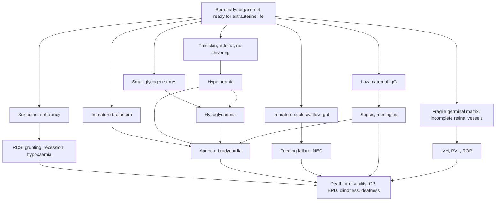

## 1. Definition

A **preterm** baby is born before **37 completed weeks** of gestation. A **low birth weight (LBW)** baby weighs **less than 2,500 g** at birth, whatever the gestation. In Uganda most LBW babies are preterm, but many are **small-for-gestational-age (SGA)** term babies who grew poorly in utero.

| Term | Definition |
|---|---|
| **Preterm** | Born **before 37 completed weeks** (before 259 days) |
| Extremely preterm | **<28 weeks** |
| Very preterm | **28 to <32 weeks** |
| Moderate to late preterm | **32 to <37 weeks** (late preterm = 34 to 36+6) |
| **Low birth weight (LBW)** | Birth weight **<2,500 g** |
| **Very low birth weight (VLBW)** | **<1,500 g** |
| **Extremely low birth weight (ELBW)** | **<1,000 g** |
| **Small for gestational age (SGA)** | Birth weight **below the 10th centile** for gestation and sex (INTERGROWTH-21st or Fenton charts) |
| Appropriate for GA (AGA) | 10th–90th centile |
| Large for GA (LGA) | Above the 90th centile (think maternal diabetes) |
| **Corrected (adjusted) age** | Chronological age minus weeks born early; use it for growth and development until **2 years** |
| **Postmenstrual age (PMA)** | Gestational age at birth + chronological age (used for ROP screening and caffeine decisions) |
| **Apnoea** | Cessation of breathing for **≥20 seconds**, or shorter with **bradycardia (HR <100)** or desaturation or cyanosis |

> [!EXAM]
> "Is every LBW baby preterm?" No. A 2.1 kg baby at 39 weeks is LBW but **term and SGA**. Always state both **gestation** and **weight-for-gestation** (for example "32 weeks, 1.45 kg, AGA").

> [!PEARL]
> The one thing never to forget: a small baby's four killers are **cold, hunger (hypoglycaemia), infection and breathing problems**. On every ward round, ask about each one: temperature, feeds and glucose, signs of sepsis, and apnoea or respiratory distress.

## 2. Epidemiology

- **Global**: WHO estimates **13.4 million babies were born preterm in 2020** (about **1 in 10**), and **prematurity is the leading cause of death in children under 5** worldwide. Sub-Saharan Africa and South Asia carry most of the burden and most of the deaths.
- **Uganda**: prematurity, intrapartum-related events (asphyxia) and infection are the three leading causes of neonatal death, and small babies are over-represented in all three. Small babies who survive the first week remain at risk of infection, poor growth and neurodevelopmental problems.
- **The good news**: the interventions that save small babies are **simple and cheap**: **warmth (Kangaroo Mother Care)**, **breast milk**, **clean hands and cord care**, **early recognition and treatment of infection**, **safe oxygen and bubble CPAP**, and **caffeine**. The WHO 2022 recommendations put **immediate KMC** and **family involvement** at the centre of care.
- The biggest gains come from things you can do anywhere: keeping the baby warm, starting breast milk on day 1, hand-washing, and referring very small babies **before** they are cold and hypoglycaemic.

**Services by level of care** [VERIFY: compiled from the source notes, not an MoH equipment list]

| Level | Usually available | Often missing |
|---|---|---|
| **HC III** | KMC, cup feeding, EBM, first-dose antibiotics, chlorhexidine, vitamin K | Oxygen, pulse oximeter, IV infusions for neonates |
| **HC IV** | Many now have a **KMC unit** and newborn unit with oxygen | CPAP, caffeine, phototherapy at some |
| **General Hospital / RRH** | Newborn unit, oxygen, **bubble CPAP** at many RRHs, phototherapy, blood culture at some | Surfactant, ventilation, ROP screening |
| **NRH and PNFP hospitals (Mulago/Kawempe, Mengo, Nsambya, Lubaga)** | Bubble CPAP, caffeine, cranial ultrasound; **surfactant**, mechanical ventilation and **ROP laser** in a few centres (mainly Kampala) | Human milk banks (the first opened at Nsambya in 2021) |

> [!UGANDA]
> UCG 2023 asks HC III/IV to look after babies **1.5–2.5 kg** or "up to 1 month early" (extra care, KMC, cup feeding) and to **refer urgently** babies **<1.5 kg or <32 weeks** to hospital, ensuring extra warmth (KMC) during transfer. In practice, Kampala hospitals receive many very small babies from district facilities; a well-warmed baby with a glucose check and a first dose of antibiotics travels much better.

## 3. Aetiology and Risk Factors

**Causes of preterm birth** you will see at Mengo, Mulago and Kawempe

| Spontaneous | Provider-initiated (iatrogenic) | Background risk factors |
|---|---|---|
| Spontaneous preterm labour, often with infection: **UTI, malaria, chorioamnionitis** | **Pre-eclampsia** (delivery for the mother's sake) | **Teenage pregnancy** |
| **PPROM** | APH (abruption, praevia) | Poor ANC |
| **Multiple pregnancy** | Fetal compromise | Maternal HIV |
| Cervical insufficiency | | Severe anaemia, malnutrition |

**Causes of SGA (growth restriction)**: maternal malnutrition, **malaria**, **hypertension**, **HIV**, smoking, **twins**, placental insufficiency, congenital infection or anomaly.

## 4. Pathophysiology

**Why small babies get into trouble**

| Problem | Why it happens | What you do about it |
|---|---|---|
| **Hypothermia** | Large surface area for weight, thin skin (high evaporative loss), little brown fat and subcutaneous fat, cannot shiver, extended posture | Dry, skin-to-skin/KMC, hat, warm room (≥25 °C), delay bathing |
| **Hypoglycaemia** | Small glycogen and fat stores (laid down in the third trimester), high brain-to-body ratio, delayed feeds, cold and sepsis use glucose | Early feeds (within 1 h), 2–3-hourly feeds, glucose checks, IV 10% dextrose if needed |
| **Respiratory distress syndrome (RDS)** | **Surfactant deficiency** (type II pneumocytes mature from about 24 weeks, adequate from about 34–35 weeks); alveoli collapse at end-expiration, so the work of breathing rises and oxygenation falls | Antenatal steroids, CPAP, oxygen, surfactant where available |
| **Apnoea of prematurity** | Immature brainstem respiratory control; worse with cold, sepsis, hypoglycaemia, anaemia, reflux, feeding | Caffeine, gentle stimulation, monitor, treat the cause |
| **Feeding problems** | Suck–swallow–breathe coordination matures at about **32–34 weeks**; small stomach; slow gut motility | NGT or cup feeds of expressed breast milk, slow advancement |
| **Necrotising enterocolitis (NEC)** | Immature gut mucosa + formula + ischaemia + bacterial overgrowth | Breast milk, cautious advancement, stop feeds if distension |
| **Infection** | Low transplacental IgG (mostly crosses after 32 weeks), thin skin, invasive procedures, long admission | Hand hygiene, KMC, breast milk, minimal lines |
| **Jaundice** | Immature liver conjugation, shorter red cell life, slower gut transit | Lower phototherapy thresholds |
| **Intraventricular haemorrhage (IVH)** | Fragile germinal matrix vessels (<32 weeks), fluctuating blood pressure | Gentle handling, avoid rapid boluses and hypercapnia |
| **Retinopathy of prematurity (ROP)** | Retinal vessels are incomplete; high or fluctuating oxygen drives abnormal vessel growth | Target SpO₂ **90–95%**, screen at-risk babies |
| **Anaemia of prematurity** | Low iron stores, blood sampling, low erythropoietin | Iron from 2 weeks, minimise sampling, transfuse if symptomatic |
| **Metabolic bone disease** | Calcium and phosphate are mostly transferred in the third trimester | Breast milk, vitamin D, mineral supplements in VLBW |

**Feature links**

- Thin, shiny, red skin with lanugo, soft ear cartilage, few sole creases, little breast tissue → **immaturity** (Ballard score).
- Wasted, dry peeling skin, loose skin folds, "old man" face, good sole creases → **SGA (growth restriction)**.
- Surface area, evaporation, no shivering → **cold peripheries, low axillary temperature**.
- Low glycogen and high brain demand → **jitteriness, lethargy, apnoea, seizures** (hypoglycaemia).
- Surfactant deficiency → alveolar collapse → **grunting** (expiration against a closed glottis), **recession, tachypnoea, cyanosis** within 4 h of birth, worsening over 24–48 h.
- Immature respiratory control → **apnoea with bradycardia and desaturation**, starting day 1–3.
- Immature suck → **poor or uncoordinated feeding**; gut ischaemia and formula → **distension, bilious aspirates, blood in stool** (NEC).
- Low IgG and invasive care → **temperature instability, lethargy, new apnoea, feed intolerance** (sepsis).
- Germinal matrix bleed → **bulging fontanelle, falling Hb, seizures** (IVH).
- High or fluctuating oxygen → **ROP** → blindness.
- Low iron and erythropoietin → **pallor, tachycardia, poor weight gain, apnoea** (anaemia).

> [!NOTE]
> Antenatal **dexamethasone** (6 mg IM 12-hourly × 4 doses to the mother) induces surfactant production and reduces RDS, IVH, NEC and death when given under the WHO 2022 conditions (24–34 weeks, accurate dating, birth likely within 7 days, no maternal infection, adequate newborn care). See the Preterm Labour, PROM & PPROM topic.

## 5. Classification / Staging

**By gestation**: extremely preterm (<28 weeks), very preterm (28 to <32), moderate to late preterm (32 to <37; late preterm 34 to 36+6).

**By birth weight**: LBW (<2,500 g), VLBW (<1,500 g), ELBW (<1,000 g).

**By weight-for-gestation**: SGA (<10th centile), AGA (10th–90th), LGA (>90th).

**Two kinds of small baby** (they behave differently)

| Feature | Preterm AGA | Term SGA (growth-restricted) |
|---|---|---|
| Appearance | Thin, shiny, red skin, lanugo, soft ear cartilage, few sole creases, little breast tissue | Wasted, dry peeling skin, loose skin folds, "old man" face, alert, good sole creases |
| Main problems | RDS, apnoea, poor suck, hypothermia, NEC, IVH, jaundice, ROP | **Hypoglycaemia** (low glycogen), **polycythaemia**, hypothermia, asphyxia, meconium aspiration |
| Feeding | Often cannot suck; NGT or cup | Usually sucks well; hungry |

**Temperature (axillary, WHO)**

| Temperature | Classification | Action |
|---|---|---|
| 36.5–37.5 °C | Normal | Continue KMC or warm care |
| 36.0–36.4 °C | Cold stress (mild) | Skin-to-skin/KMC, warm room, cover head, recheck in 1 h |
| 32.0–35.9 °C | Moderate hypothermia | KMC or incubator/radiant warmer, check glucose, feed, look for sepsis |
| <32 °C | Severe hypothermia | Rapid rewarming (incubator or radiant warmer), IV 10% dextrose, antibiotics, oxygen, monitor closely |

**Admission thresholds**: admit to the special care unit every baby **<2.0 kg or <35 weeks** (WHO); refer from HC III/IV every baby **<1.5 kg or <32 weeks** (UCG 2023).

## 6. Clinical Features

### History

| Question | Why it matters |
|---|---|
| **Gestation: LNMP, early scan, fundal height or Ballard score?** | Decides expected problems (<32 weeks: RDS, apnoea, IVH, ROP; 34–36: feeding and jaundice) and the caffeine and ROP plan |
| **Birth weight and current weight** | Classifies LBW/VLBW; percentage weight loss guides feeds |
| **Antenatal steroids? How many doses, when? MgSO₄?** | A full course >24 h before birth lowers RDS risk; MgSO₄ <32 weeks is neuroprotective |
| **Why was the baby born early?** PPROM, fever, foul liquor, pre-eclampsia, APH, twins | PPROM >18 h, maternal fever >38 °C or foul liquor = **sepsis risk** (antibiotics for at least 48 h, then reassess); pre-eclampsia → SGA, hypoglycaemia, neutropenia |
| **Resuscitation at birth? Apgar** | Asphyxia adds HIE, hypoglycaemia, feeding problems |
| **Maternal HIV status, last viral load, syphilis, HBsAg, blood group** | Decides NVP or AZT + NVP prophylaxis, syphilis treatment, HepB birth dose; jaundice risk |
| **Feeding**: breastfeeding, cup, NGT? Volume and frequency? Any other fluids? | Under-feeding causes hypoglycaemia; prelacteal feeds and formula raise NEC and infection risk |
| **Temperature**: how kept warm? KMC hours? | Hypothermia is the commonest, most preventable problem |
| **Apnoeas, colour change, "stops breathing"?** | Apnoea of prematurity versus sepsis, hypoglycaemia, seizure |
| **Urine and stool passed?** | Hydration, gut function (NEC, obstruction) |
| **Twin?** | Other twin's condition; discharge both together (UCG) |
| **Immunisation**: BCG, OPV0 (HepB birth dose where available) | WHO: small babies get scheduled vaccines at birth or by discharge |
| **Mother's health and support; distance from facility** | KMC needs a well mother or a family member; who will help at home? |

### Examination

Follow Hutchison's Clinical Methods (24th edition) order adapted for the small newborn: **minimal handling**, keep the baby warm throughout (examine in the incubator, under a radiant warmer or in KMC position where possible), and observe before you touch.

#### Introduction, consent and preparation

- Introduce yourself to the mother; confirm the baby's name, age in days, gestation and sex; explain and gain consent.
- **Hand hygiene** before and after every touch.
- **Position and exposure**: warm room (≥25 °C); expose only what you need, briefly; return the baby to KMC afterwards.

#### General inspection (before touching)

| Sign | Mechanism | What it means |
|---|---|---|
| Activity, cry, posture (extended in very preterm) | Maturity, illness | Lethargy = sepsis, hypoglycaemia, IVH |
| Colour: pink, pale, blue, yellow, mottled | Anaemia, hypoxaemia, jaundice, poor perfusion | Act on each |
| Grunting, nasal flaring, intercostal or subcostal recession, tachypnoea | Surfactant deficiency, pneumonia | RDS (Silverman-Andersen score if your unit uses it) |
| Apnoea or periodic breathing | Immature control, sepsis | Apnoea chart |
| Skin maturity: thin, shiny, lanugo versus dry, peeling, loose folds | Preterm versus SGA | Classify |
| Dysmorphism | Syndromes, congenital infection | Cause of SGA |

**Vital signs and growth**: temperature (axillary; **low-reading thermometer**), RR (normal 30–60/min; count a full minute), HR (100–160/min), SpO₂, capillary refill. **Weigh** (naked, same scale), **length**, **head circumference**; plot on a preterm chart (INTERGROWTH-21st or Fenton); classify AGA or SGA; percentage weight loss from birth.

#### Hands, face and neck

- **Hands**: perfusion, capillary refill, palmar creases.
- **Face**: jaundice (blanch over the nose or sternum), pallor, central cyanosis; ear cartilage (maturity).
- **Head**: fontanelle (bulging = IVH or meningitis; sunken = dehydration), sutures, head circumference.

#### The systems

- **Respiratory**: inspection (recession, flaring), auscultation (air entry; asymmetry suggests pneumothorax).
- **Cardiovascular**: murmur (PDA), femoral pulses, perfusion.
- **Abdomen**: distension, tenderness, visible loops, discoloration, bowel sounds (NEC); cord (chlorhexidine, signs of infection).
- **Skin**: jaundice, pustules, pressure areas.
- **Neurology**: tone, posture, activity, suck, fontanelle (IVH, meningitis).
- **Maturity**: **Ballard** features (skin, lanugo, plantar creases, breast bud, ear, genitalia; posture, square window, scarf sign). See the Examination of the Newborn topic.

#### Completing the examination

- **Thank** the mother, return the baby to KMC or the incubator, **hand hygiene**, and **summarise**: gestation, weight-for-gestation, temperature, respiratory support, feeds, glucose, sepsis risk.
- **Document negatives**: "no grunting, no apnoeas in 24 h, abdomen soft, no jaundice".

### Red flags

> [!REDFLAG]
> - Temperature **<35.5 °C** or >37.5 °C, or a baby who stays cold despite KMC
> - **Apnoea** (pause >20 s, or shorter with bradycardia or cyanosis), especially recurrent or new after day 3 (think sepsis)
> - **Grunting, severe chest indrawing, SpO₂ <90%**, or rising oxygen need
> - **Not feeding**, vomiting, **abdominal distension, bilious aspirates, blood in stool** (NEC)
> - **Lethargy, floppy, convulsions**, bulging fontanelle
> - **Jaundice on day 1** or yellow palms and soles
> - **Glucose <2.6 mmol/L**, especially if recurrent
> - Weight loss **>10–15%** or no weight gain after day 7–10

### Thinking like a clinician

- **A sick preterm baby has sepsis until proven otherwise.** Apnoea, temperature instability, feed intolerance and lethargy are non-specific. Check glucose and temperature, then start **ampicillin + gentamicin** after a blood culture where possible.
- **New apnoea after the first few days, in a baby who was stable, is not "just prematurity".** Think sepsis, NEC, meningitis, hypoglycaemia, anaemia, IVH.
- **Respiratory distress in a preterm baby**: within 4 h of birth and worsening over 24–48 h = **RDS**; with maternal fever or PPROM = **pneumonia or sepsis** (cannot be separated clinically, so treat both); in a late preterm born by CS without labour = **transient tachypnoea**; sudden collapse on CPAP = **pneumothorax**.
- **An SGA term baby is a different animal**: feed early and check glucose; he is at risk of hypoglycaemia and polycythaemia, not RDS.
- **Do not chase weight before warmth.** A cold baby does not gain weight and does not tolerate feeds. Fix temperature first.
- **Count fluids as total fluids** (IV + feeds). Students often add full IV fluids on top of feeds and drown the baby.
- **Oxygen is a drug.** Use a pulse oximeter, target **90–95%**, wean as soon as possible.

## 7. Differential Diagnoses

**The small baby with respiratory distress**

| Differential | Distinguishing clinical feature | Distinguishing investigation |
|---|---|---|
| **RDS** | Preterm, onset within 4 h, worsening over 24–48 h, grunting | CXR: ground-glass, air bronchograms |
| **Transient tachypnoea of the newborn** | Late preterm or term, CS without labour, mild, improves in 24–72 h | CXR: fluid in fissures, hyperinflation |
| **Pneumonia / sepsis** | PPROM, maternal fever, foul liquor; temperature instability | Culture, CRP, FBC; CXR patchy |
| **Pneumothorax** | Sudden deterioration (often on CPAP), asymmetric chest | Transillumination, CXR |
| **Congenital heart disease** | Cyanosis out of proportion to distress, murmur, poor pulses | Pre- and post-ductal SpO₂, echocardiography |
| **Hypothermia / hypoglycaemia** | Cold, jittery, tachypnoea that settles with warmth or glucose | Temperature, glucose |

**The small baby with apnoea**: apnoea of prematurity (a diagnosis of exclusion, <34 weeks, starts day 1–3), sepsis or meningitis, hypoglycaemia, hypothermia or hyperthermia, seizures, IVH, NEC, anaemia, reflux or feeding, maternal drugs (MgSO₄, opioids).

**Preterm versus SGA**: plot weight against gestation (INTERGROWTH-21st or Fenton); <10th centile = SGA; check maturity with Ballard.

## 8. Clinical Workup

"Available at" is the lowest level that usually offers the test [VERIFY: availability compiled from the source notes].

### Bedside

| Test | Why | Expected / abnormal finding | Available at |
|---|---|---|---|
| **Glucose (glucometer)** | Commonest treatable cause of lethargy, apnoea, seizures | <2.6 mmol/L = treat; check at 1–2 h of age, then before feeds 3–6-hourly until stable on feeds | HC III and above |
| **Temperature** (low-reading thermometer) | Drives apnoea, hypoglycaemia, acidosis | Hypothermia grade | All levels |
| **Pulse oximetry** | Oxygen decisions | Target 90–95% on oxygen; <90% in air = oxygen | HC IV and above |
| **Weight** daily (same scale) | Fluid and feed decisions | Losses up to 10–15% in VLBW in week 1; regain birth weight by 10–14 days (later in VLBW); then about **15 g/kg/day** | All levels |
| **Gastric aspirate** before feeds (if NGT) | Feed tolerance | Bilious or more than half the previous feed = feed intolerance (think NEC or sepsis) | All levels |
| **Transcutaneous bilirubin** (if available) | Jaundice screening | Above gestation-specific threshold → serum | Some hospitals |
| **HemoCue Hb / PCV** | Anaemia or polycythaemia | Anaemia (<10–12 g/dL symptomatic); polycythaemia in SGA (venous PCV >65%) | HC IV and above |
| **Ballard score** | Gestation when dates are unknown | Gestation in weeks | All levels |

### Basic lab

| Test | When | Expected / abnormal finding | How it changes management | Available at |
|---|---|---|---|---|
| **FBC** | Suspected sepsis, pallor, SGA | WBC <5 or >20 × 10⁹/L, platelets <100, Hb, PCV | Supports sepsis; transfusion; partial exchange for polycythaemia | HC IV and above |
| **Serum bilirubin** | Visible jaundice, especially day 1 or preterm | Compare with gestation-specific thresholds | Phototherapy or exchange | Referral hospitals |
| **CRP** | Sepsis work-up | >10 mg/L at 18–24 h supports infection | Two normal CRPs help stop antibiotics at 36–48 h | Referral hospitals, private labs |
| **Blood culture** | Before antibiotics in any suspected sepsis | Organism and sensitivities (*Klebsiella*, *S. aureus*, *E. coli* common) | Narrow or change antibiotics; duration | Regional and national referral, Mengo, Nsambya |
| **Electrolytes, calcium** | VLBW on IV fluids, seizures | Hypo- or hypernatraemia, hypocalcaemia | Adjust fluids; calcium gluconate | Referral hospitals |

### Imaging

| Test | When | Expected / abnormal finding | How it changes management | Available at |
|---|---|---|---|---|
| **Chest X-ray** | Respiratory distress | RDS: ground-glass, air bronchograms, low volumes; pneumothorax; pneumonia | CPAP or surfactant; chest drain | Most hospitals |
| **Abdominal X-ray** | Suspected NEC | Pneumatosis intestinalis, portal gas, free air | Nil by mouth, antibiotics, surgical referral | Most hospitals |
| **Cranial ultrasound** | <32 weeks, seizures, falling Hb | IVH, PVL | Prognosis, follow-up | Kampala tertiary centres |

### Specialised / referral-level

| Test | When | Expected / abnormal finding | How it changes management | Available at |
|---|---|---|---|---|
| **Lumbar puncture** | Sepsis with seizures, bulging fontanelle, or positive culture | Raised WBC, low glucose | Meningitis = 21 days IV antibiotics | Hospital |
| **ROP eye examination** | At-risk babies (section 9) | Stage, zone, plus disease | Laser or anti-VEGF | Few centres (Kampala) |
| **Hearing screen** | After jaundice, gentamicin, meningitis | Hearing loss | Early intervention | Referral centres [VERIFY: availability] |

### Putting it together

**Model one-line summary**

> "Baby girl of Nakato, day 3 of life, born at **32 weeks** (by early scan) to a 19-year-old para 1 after preterm labour with **ROM for 20 hours**; mother received 2 doses of dexamethasone. Birth weight **1.45 kg** (VLBW, AGA), today **1.38 kg** (5% loss). She is in KMC, temperature 36.6 °C, RR 58 with mild recession on bubble CPAP 5 cm H₂O in 25% oxygen, SpO₂ 93%, had two apnoeas yesterday, and is on EBM 4 mL 2-hourly by NGT plus IV 10% dextrose. Mother HIV-negative at ANC, syphilis negative; BCG and OPV0 given."

**Problem list**

1. VLBW very preterm infant.
2. RDS on CPAP.
3. Apnoea of prematurity versus sepsis.
4. Risk of early-onset sepsis (ROM 20 h) on ampicillin + gentamicin, culture pending.
5. Establishing enteral feeds.
6. Thermal care in KMC.
7. Jaundice and ROP screening plans.
8. Family support.

**Model case presentation (ward round)**

> "This is **Baby Nakato**, a **9-day-old** female born at **31+2 weeks** by early scan, now **32+4 weeks PMA**. Birth weight **1.30 kg (VLBW, AGA)**, today **1.27 kg**, having regained 40 g in the last 3 days. She was born after preterm labour with **ROM for 22 hours**; mother had **one dose of dexamethasone**. She needed **bag-mask ventilation for 1 minute**, Apgar 5 and 8.
>
> She had **RDS**, treated with **bubble CPAP for 4 days**, now in **room air** with SpO₂ 95%. She is on **caffeine citrate 5 mg/kg daily**, last apnoea 3 days ago. Blood culture grew nothing; she completed **5 days of ampicillin and gentamicin**. She is on **EBM 150 mL/kg/day by NGT**, 24 mL 3-hourly, with some cup feeds, no aspirates. She is in **KMC 20 h/day**, temperature 36.6–37.2 °C. Phototherapy for 2 days for jaundice, now stopped.
>
> Mother is **HIV-negative** (retested in labour), RPR negative. **BCG and OPV0 given.** Weight-for-age on the INTERGROWTH chart is on the 25th centile.
>
> **Assessment:** a stable, growing VLBW very preterm infant; problems: (1) feeding progression; (2) apnoea of prematurity on caffeine; (3) needs ROP screening at 4 weeks; (4) anaemia and bone health supplementation; (5) discharge planning with KMC at home.
>
> **Plan:** advance to cup feeds, start iron at 2 weeks and vitamin D, continue caffeine to 34–35 weeks PMA, ROP referral, check Hb weekly, discharge when criteria met."

**Worked example 1: feeds.** A 1.6 kg baby on day 3 needs **120 mL/kg/day × 1.6 = 192 mL/day**. Given 2-hourly (12 feeds) that is **16 mL per feed**; 3-hourly (8 feeds) **24 mL per feed**. If she is also on IV fluids, subtract the feed volume from the total: for example feeds 10 mL × 12 = 120 mL, so IV = 192 − 120 = **72 mL/day = 3 mL/h**.

**Worked example 2: feeds on day 4.** A 1.6 kg baby on day 4: 150 mL/kg/day = 240 mL/day = **30 mL 3-hourly**.

**Worked example 3: WHO feed volumes.** A 1 kg baby on 150–180 mL/kg/day = **19–23 mL 3-hourly**; a 1.5 kg baby = **28–34 mL 3-hourly**.

## 9. Management

### Immediate / emergency

**At birth and in the first 5 minutes**

1. **At birth**: dry, keep warm, assess breathing; resuscitate per HBB (size **0** mask for small babies; room air or 21–30% oxygen below 35 weeks). Delayed cord clamping (at least 1 min) if breathing.
2. **Temperature** now. If <36.5 °C, start **skin-to-skin/KMC** (or incubator or radiant warmer) and recheck in 30–60 min.
3. **Breathing**: count RR, look for grunting and recession, check **SpO₂**. If distressed: oxygen by nasal prongs to SpO₂ **90–95%**, consider **bubble CPAP**.
4. **Glucose**: check at **1–2 h of age** (or now if unwell). If <**2.6 mmol/L**: feed or give **10% dextrose 2 mL/kg IV**.
5. **Danger signs** (not feeding, convulsions, lethargy, temperature <35.5 °C or >37.5 °C, RR >60, severe indrawing, cyanosis, apnoea): admit, IV access, **antibiotics**, call for senior help.
6. **<1.5 kg or <32 weeks at HC III/IV**: stabilise (warmth, glucose or feed, first antibiotic dose if indicated) and **refer in KMC** with a note.

**Emergency flow for the small baby on admission (ABCDE)**

1. **Warm (E first in a small baby)**: KMC or incubator or radiant warmer; hat, socks; room ≥25 °C.
2. **Airway and breathing**: position, gentle suction only if needed; oxygen by nasal prongs (0.5–1 L/min) to SpO₂ 90–95%; **bubble CPAP** for RDS (start 5–6 cm H₂O, up to 7–8).
3. **Circulation**: CRT, HR; IV access (peripheral or umbilical vein).
4. **Glucose**: if <2.6 mmol/L give **10% dextrose 2 mL/kg IV** over 5 min, then maintenance; recheck in 30 min.
5. **Antibiotics** if any sepsis risk or danger sign: **ampicillin + gentamicin**.
6. **Vitamin K** if not given; **chlorhexidine** cord care; **tetracycline eye ointment** if not given.
7. **Feeds**: start EBM as early as possible (day 1), even small volumes.
8. **Caffeine** for babies <34 weeks with apnoea (and to consider for prevention).
9. **Document and communicate**: weight, plan, family counselling.

### Definitive

#### Thermal care and Kangaroo Mother Care

**How to do KMC** (WHO 2022)

1. Baby naked except nappy, hat and socks, placed **upright, skin-to-skin between the mother's breasts**, head turned to one side, slightly extended.
2. Secure with a binder or wrap; cover mother and baby with her clothes or a blanket.
3. Continue **day and night** (at least **8–24 h/day**, as many hours as possible); fathers and relatives can take turns.
4. Start **immediately after birth** (iKMC) once the baby can tolerate handling; WHO 2022 now recommends this even for babies still needing oxygen or CPAP where the unit can support it.
5. Breastfeed in the KMC position; monitor temperature 4–6-hourly at first.
6. Mother sleeps propped up at 15–30 degrees.

KMC = continuous skin-to-skin contact plus exclusive breastfeeding plus early discharge with follow-up.

> [!PEARL]
> KMC reduces mortality, hypothermia, sepsis and length of stay and improves breastfeeding and bonding. It is not a "second-best incubator"; for stable small babies it is **better** than an incubator.

#### Feeding the small baby

**Method by maturity (approximate)**

| Gestation / weight | Usual feeding method |
|---|---|
| ≥34 weeks / usually ≥2.0 kg | **Breastfeed** directly; support positioning |
| 32–34 weeks / about 1.5–2.0 kg | Breast + **cup or paladai** with expressed breast milk (EBM) |
| <32 weeks / below about 1.5 kg | **Nasogastric or orogastric tube** EBM ± IV fluids; move to cup or breast as suck matures |
| Very sick, distended abdomen, shocked, frequent seizures | **Nil by mouth**, IV fluids; trophic feeds once stable |

**Fluid and feed volumes (total = IV + enteral) (WHO Pocket Book 2013)**

| Day of life | Total fluids (mL/kg/day) |
|---|---|
| Day 1 | **60** |
| Day 2 | **90** |
| Day 3 | **120** |
| Day 4 onwards | **150** (up to **180** after some days if tolerating feeds) |

- Give feeds **every 2–3 hours** (8–12 feeds a day).
- **<1.5 kg**: on day 1 start **10 mL/kg/day** EBM (or 2–4 mL every 2 h by NGT if well) with the remaining ~50 mL/kg/day as IV 10% dextrose. Increase feeds by **1–2 mL per feed per day** (Pocket Book) or **up to 30 mL/kg/day** (WHO 2022). Aim for full enteral feeds within **5–7 days** so the drip can come out.
- **IV fluid**: 10% dextrose for the first 2 days, then a sodium-containing solution (for example 10% dextrose with 0.18% saline, or half-strength Darrow's per unit protocol). **Do not exceed 100 mL/kg/day IV** unless dehydrated or under phototherapy or a radiant heater (Pocket Book). Use a burette; check hourly.
- Add **10–20%** to fluids under phototherapy or radiant warmers.
- **Feed intolerance**: vomiting, distension, aspirates more than half of the feed or bilious → reduce or stop feeds, examine for NEC and sepsis.
- **Milk**: **mother's own milk** first; **donor human milk** if not available (where a milk bank exists); **preterm formula** only if neither (WHO 2022). Help the mother express by hand within 1 h of birth and every 2–3 h (8 times a day) to build supply.
- Weight gain target after regaining birth weight: about **15–20 g/kg/day**.

> [!UGANDA]
> Uganda has few human milk banks (the first opened at Nsambya in 2021), so in most units **mother's own EBM** is the norm, with formula used reluctantly when the mother is very ill or absent. Expressing support (privacy, a chair, a clean cup, praise) is a real clinical intervention.

#### Apnoea of prematurity and caffeine

- Common below **34 weeks**, especially below 30 weeks; typically starts day 1–3 and resolves by **34–37 weeks PMA**.
- Immediate response: **gentle stimulation** (rub the back or soles); if no breathing, **bag-mask ventilation**; check glucose and temperature; consider sepsis.
- Monitor with a pulse oximeter with the alarm on, or an apnoea monitor.
- **Caffeine citrate** (first choice) until **34–35 weeks PMA** and **5–7 days apnoea-free** (WHO: 4–5 days after apnoea stops); **aminophylline** if caffeine is unavailable (drug table).
- WHO 2022: caffeine is **recommended for treatment** of apnoea in preterm infants, **for extubation** below 34 weeks, and **may be considered for prevention** of apnoea below 34 weeks.

#### Respiratory distress syndrome and CPAP

1. **Minimal handling**, thermal care, nil by mouth or trophic feeds initially; IV fluids.
2. **Oxygen** by nasal prongs to keep SpO₂ **90–95%** (not higher).
3. **Bubble CPAP** (WHO 2022 strong recommendation for RDS; may be considered immediately after birth for babies <32 weeks): start **5–6 cm H₂O**, FiO₂ to target SpO₂, nasal prongs of the right size, NGT on free drainage for air, protect the nasal septum.
4. **Antibiotics** (ampicillin + gentamicin) because pneumonia cannot be excluded; stop at 48 h if culture negative and baby well.
5. **Surfactant** (via ETT, or less-invasive methods) where available, usually if FiO₂ needs to exceed about 0.30–0.40 on CPAP.
6. **Escalate** if apnoea, rising FiO₂ above 0.4–0.6, worsening work of breathing, or pneumothorax: refer for ventilation where possible.
7. Expect improvement after **48–72 h** as the baby makes surfactant.

> [!UGANDA]
> Bubble CPAP made from locally available materials is used in many Ugandan units. The main dangers are **unblended 100% oxygen** (ROP, lung injury) and **nasal trauma**. Use an oxygen blender or air-oxygen mixing and a pulse oximeter.

#### Infection prevention and treatment

- **Hand hygiene** before and after every touch; mothers and visitors too. KMC and breast milk reduce infection.
- **Chlorhexidine 7.1% digluconate** to the cord (Uganda policy) and nothing else.
- Antibiotics for risk factors or signs (drug table; see also Common Neonatal Disorders): stop at 48 h if well and cultures negative; 7–10 days for sepsis.

#### Jaundice in the preterm

Preterm babies get jaundice more often, later (peak day 5–7), and it becomes dangerous at lower bilirubin levels. Use **gestation-specific thresholds** (NICE CG98 graphs; WHO Pocket Book: lower thresholds "for preterm below 35 weeks or any risk factor"). Phototherapy for any visible jaundice on day 1. See Common Neonatal Disorders.

#### Supplements and routine care

| Supplement | Dose | Route | When / duration |
|---|---|---|---|
| **Vitamin K** | **0.5 mg** (Uganda/local); WHO **0.4 mg/kg** (max 1 mg) for preterm; 1 mg term | IM | Once at birth |
| **Vitamin D** | **400 IU** | Oral | Daily once on full feeds (WHO 2022: may be considered) |
| **Iron (ferrous sulphate, elemental iron)** | **2–4 mg/kg/day elemental iron** | Oral | From **2 weeks** (or when on full feeds) until **6 months** (WHO) |
| **Multivitamins / calcium and phosphate** | Per unit protocol (Pocket Book: Ca 120–140 mg/kg, P 60–90 mg/kg/day for VLBW) | Oral | Once on full feeds |
| **Folic acid** | Per unit protocol | Oral | Commonly given in Ugandan units |
| **Emollient / topical oil** | Thin layer (WHO 2022: may be considered) | Skin | Daily |
| **Probiotics** | WHO 2022: may be considered for human-milk-fed babies <32 weeks | Oral | Where a quality product is available |

**Immunisation**: give **BCG and OPV0 at birth or before discharge** regardless of weight (WHO: small babies receive scheduled vaccines on time by chronological age), then the UNEPI schedule from **6 weeks chronological age** (not corrected age).

#### Retinopathy of prematurity (ROP)

- **Who to screen**: international criteria are **<31–32 weeks or <1.5 kg**. In LMICs (including Uganda) babies up to **34 weeks or 2.0 kg** develop severe ROP when oxygen is unmonitored, so many programmes use **wider criteria**, plus any baby who had **unmonitored oxygen**.
- **When**: first examination at **4 weeks after birth or 31 weeks PMA, whichever is later**, then 1–2-weekly until vessels mature.
- **Prevention**: **SpO₂ 90–95%**, blenders, avoid fluctuations, good nutrition, treat sepsis.
- **Treatment**: laser photocoagulation or intravitreal anti-VEGF for treatment-requiring ROP, ideally within 48–72 h of diagnosis.

> [!UGANDA]
> ROP screening in Uganda is limited to a few Kampala centres and outreach programmes. If you are in a unit without screening, **write the plan in the discharge summary** ("ROP screen due at 4 weeks") and refer the baby to the nearest eye unit.

### Drug table

| Drug | Dose (per kg; neonate) | Route | Frequency | Duration | Key cautions |
|---|---|---|---|---|---|
| **10% dextrose** | **2 mL/kg** bolus over 5 min for glucose <2.6 mmol/L; infusion per total fluid table | IV | Bolus then continuous | Until on full feeds | Max about 100 mL/kg/day IV unless dehydrated or under phototherapy; recheck glucose in 30 min |
| **Caffeine citrate** (first choice) | Loading **20 mg/kg**; maintenance **5 mg/kg** (may increase by 5 mg/kg steps to max **20 mg/kg/day**; many units use 5–10 mg/kg/day) | Oral or IV over 30 min | Maintenance **once daily**, starting 24 h after the load | Until **34–35 weeks PMA** and **5–7 days apnoea-free** | Tachycardia (>180), jitteriness, feed intolerance. 20 mg caffeine citrate = 10 mg caffeine base |
| **Aminophylline** (if caffeine unavailable) | Loading **6 mg/kg** IV over 20 min; maintenance **2.5 mg/kg** (week 1), 4 mg/kg (weeks 2–4) | IV / oral | **12-hourly** | As caffeine | Narrower safety margin: tachycardia, vomiting, seizures |
| **Ampicillin** | **50 mg/kg** (100 mg/kg/dose if meningitis) | IV / IM | **12-hourly** in week 1; **8-hourly** weeks 2–4 | Stop at 48 h if well and culture-negative; 7–10 days for sepsis; 21 days meningitis | With gentamicin |
| **Gentamicin** | **3 mg/kg** (LBW, WHO; UCG 4 mg/kg preterm); **5 mg/kg** (≥2.5 kg) in week 1; **7.5 mg/kg** weeks 2–4 | IV / IM | **Once daily** (every 24 h; some units 36–48-hourly below 30 weeks) | As ampicillin | Nephrotoxic, ototoxic; hearing follow-up |
| **Oxygen** | Nasal prongs 0.5–1 L/min, or via CPAP | Inhaled | Continuous | Wean as soon as possible | Target SpO₂ **90–95%**; blend with air; hyperoxia → ROP |
| **Bubble CPAP** | Start **5–6 cm H₂O** (up to 7–8) | Nasal prongs | Continuous | Usually 48–72 h or more for RDS | Nasal trauma, pneumothorax, gastric distension (NGT on free drainage) |
| **Surfactant** | Per product | Endotracheal or less-invasive | Usually once, may repeat | n/a | Few centres; if FiO₂ >0.30–0.40 on CPAP |
| **Vitamin K** | **0.5 mg** (local); WHO **0.4 mg/kg**, max 1 mg | IM | Once | At birth | |
| **Vitamin D** | **400 IU** | Oral | Daily | Once on full feeds | |
| **Iron (elemental)** | **2–4 mg/kg/day** | Oral | Daily | **2 weeks to 6 months** | Constipation, dark stools |
| **Dexamethasone (to the mother)** | **6 mg** | IM | 12-hourly × 4 doses | One course | Only under WHO 2022 conditions (24–34 weeks, accurate dating, birth likely within 7 days, no maternal infection, adequate newborn care) |

### Referral criteria

| Level | What to do | Refer up when |
|---|---|---|
| **Home / VHT** | KMC, exclusive breastfeeding, recognise danger signs | Any danger sign; baby not feeding or cold despite KMC |
| **HC III / HC IV** (UCG: babies 1.5–2.5 kg or up to 1 month early) | Extra care, KMC, cup feeding, glucose check, first-dose antibiotics if indicated | **<1.5 kg or <32 weeks**: refer urgently in KMC with a note (UCG 2023); any danger sign; respiratory distress needing oxygen or CPAP |
| **General Hospital / RRH** (WHO: admit every baby <2.0 kg or <35 weeks) | SCBU, oxygen, bubble CPAP, IV fluids, caffeine, phototherapy, antibiotics | Rising FiO₂ (>0.4–0.6) on CPAP, recurrent apnoea, pneumothorax, NEC needing surgery, need for surfactant or ventilation → NRH or tertiary |
| **NRH and tertiary (Kampala)** | Surfactant, ventilation, cranial ultrasound, ROP screening and laser, paediatric surgery | n/a |

### Monitoring and follow-up

- **Ward monitoring**: temperature 4–6-hourly in KMC at first; RR, HR, SpO₂ (alarm on); apnoea chart; glucose before feeds 3–6-hourly until stable; daily weight; gastric aspirates; intake and output; jaundice; Hb weekly in VLBW.
- **Discharge criteria (WHO/UCG)**:
  - No danger signs or signs of infection.
  - **Feeding well** on breast (or cup), gaining weight on **3 consecutive days**.
  - Temperature normal in KMC or cot for **3 consecutive days**.
  - **Mother confident** to care for the baby (KMC, feeding, danger signs).
  - Vaccines due given; HIV prophylaxis plan clear.
- **Follow-up**:
  - **Weekly** weight and feeding review until **3 kg** (WHO); continue KMC at home until the baby wriggles out (usually around 2.5 kg or 40 weeks PMA).
  - **Growth** on preterm charts then WHO charts using **corrected age** to 2 years; weight-for-age, length-for-age, weight-for-length Z-scores.
  - **Development** (corrected age): cerebral palsy, hearing (especially after jaundice, gentamicin, meningitis), vision (ROP, squint).
  - **Anaemia**: Hb at 6–8 weeks; continue iron.
  - **Immunisation** on chronological age.
  - Teach **danger signs**: not feeding, cold, fast or difficult breathing, apnoea, convulsions, yellow palms and soles, fever.

## 10. Complications

**Disease-related**

| Short-term | Long-term |
|---|---|
| Hypothermia, hypoglycaemia | Cerebral palsy, cognitive and learning difficulties |
| RDS, pneumothorax, apnoea | **Bronchopulmonary dysplasia** (oxygen need at 36 weeks PMA) |
| Sepsis, meningitis | **ROP** → blindness |
| NEC, feeding intolerance | Hearing loss |
| Jaundice, kernicterus | Growth faltering, metabolic bone disease |
| IVH, PVL | Anaemia of prematurity |
| PDA | Behavioural problems, re-admissions |
| Electrolyte imbalance | Family stress, maternal depression |

**Treatment-related**

| Complication | Cause | Recognition and action |
|---|---|---|
| **ROP, lung injury** | Unblended or unmonitored oxygen | SpO₂ 90–95%; blender; screen |
| **Fluid overload** | Full IV fluids on top of feeds | Count total fluids; IV = total − feeds |
| **Nasal septum injury, pneumothorax** | CPAP | Correct prongs, nasal care; sudden deterioration → transilluminate, CXR |
| **NEC** | Formula, rapid feed advancement | Breast milk; cautious advancement; stop feeds if distension |
| **Tachycardia, jitteriness, feed intolerance** | Caffeine or aminophylline | Reduce dose; aminophylline has a narrower margin (seizures) |
| **Ototoxicity, nephrotoxicity** | Gentamicin | Correct dose and interval; hearing follow-up |
| **IVH** | Rapid boluses, hypercapnia, rough handling | Gentle handling; avoid rapid boluses |
| **Hospital-acquired infection** | Lines, long stay | Hand hygiene; KMC; early enteral feeds so the drip can come out |

## 11. Prognosis

- Survival rises steeply with gestation and birth weight; in Uganda, very preterm and VLBW babies have high mortality, mostly from hypothermia, infection, RDS and feeding failure [VERIFY: local survival figures by gestation].
- Most deaths are preventable with KMC, breast milk, infection prevention, caffeine and CPAP.
- Long-term risks rise as gestation falls: cerebral palsy, cognitive and learning difficulties, BPD, ROP and blindness, hearing loss, growth faltering.
- Use **corrected age** to judge growth and development until 2 years; many preterm children catch up.

## 12. Prevention

- **Prevent preterm birth**: good ANC, treat UTI and malaria (IPTp), manage pre-eclampsia, family planning (avoid teenage pregnancy and short intervals), nutrition, HIV care. See Preterm Labour, PROM & PPROM.
- **Improve outcome when preterm birth is likely**: antenatal **dexamethasone** under WHO 2022 conditions; **MgSO₄** for neuroprotection <32 weeks; antibiotics for PPROM; deliver or transfer in utero to a facility with newborn care.
- **Prevent complications after birth**: immediate KMC, breast milk from day 1, hand hygiene, chlorhexidine cord care, SpO₂ 90–95%, caffeine, CPAP.
- **Prevent late harm**: ROP screening, hearing screening, developmental follow-up, iron and vitamin D.

## 13. Special Populations

- **Term SGA babies**: feed early and check glucose; risk of hypoglycaemia and polycythaemia (venous PCV >65%), not RDS.
- **Twins**: check the other twin; discharge both together (UCG).
- **HIV-exposed small babies**: NVP or AZT + NVP prophylaxis according to the mother's viral load; give by NGT if unable to suck.
- **Babies of mothers with pre-eclampsia**: SGA, hypoglycaemia, neutropenia.
- **Very preterm (<32 weeks) and VLBW**: IVH, ROP screening, caffeine, metabolic bone disease supplements, slower feed advancement.

## 14. Key Points

### High-yield points

- State gestation **and** weight-for-gestation: preterm, SGA, or both.
- The four killers: cold, hunger (hypoglycaemia), infection, breathing problems.
- Immediate KMC for all stable small babies, 8–24 h a day.
- Temperature 36.5–37.5 °C; room ≥25 °C.
- Total fluids 60/90/120/150 mL/kg/day; IV = total − feeds.
- Mother's own milk first; start EBM on day 1.
- Caffeine citrate 20 mg/kg load, then 5 mg/kg daily.
- Bubble CPAP 5–6 cm H₂O for RDS; SpO₂ 90–95%.
- A sick preterm baby has sepsis until proven otherwise.
- Vaccinate by chronological age.
- Discharge: feeding, 3 days of weight gain and normal temperature, confident mother; weekly review until 3 kg.

### Numbers & doses

| Item | Value |
|---|---|
| Preterm | **<37 completed weeks**; very preterm 28–32; extremely preterm <28 |
| LBW / VLBW / ELBW | **<2,500 / 1,500 / 1,000 g** |
| Admit to SCBU (WHO) | **<2.0 kg or <35 weeks** |
| Refer from HC III/IV (UCG) | **<1.5 kg or <32 weeks** |
| Normal temperature | **36.5–37.5 °C** (moderate hypothermia 32.0–35.9; severe <32) |
| Room temperature | **≥25 °C** |
| KMC | **8–24 h/day**, start **as soon as possible after birth** (WHO 2022) |
| Total fluids | **60 / 90 / 120 / 150** mL/kg/day on days 1/2/3/4+; up to 180 |
| Max IV fluids | About **100 mL/kg/day** (unless dehydrated, phototherapy or radiant heater) |
| VLBW feeds day 1 | **10 mL/kg/day** EBM (or 2–4 mL 2-hourly); advance up to **30 mL/kg/day** |
| Glucose threshold | Treat **<2.6 mmol/L**: **10% dextrose 2 mL/kg IV** |
| Caffeine citrate | **20 mg/kg** load, **5 mg/kg/day** maintenance (max 20) |
| Aminophylline | **6 mg/kg** load, **2.5 mg/kg 12-hourly** (week 1) |
| SpO₂ target | **90–95%** |
| CPAP starting pressure | **5–6 cm H₂O** (up to 7–8) |
| Iron | **2–4 mg/kg/day** from **2 weeks to 6 months** |
| Vitamin D | **400 IU/day** |
| Vitamin K (preterm) | **0.5 mg IM** (WHO 0.4 mg/kg, max 1 mg) |
| Weight gain target | **15–20 g/kg/day** |
| ROP first screen | **4 weeks after birth or 31 weeks PMA**, whichever is later |
| Discharge | Feeding well, weight gain **3 days**, temperature normal **3 days**, mother confident |
| Follow-up | **Weekly until 3 kg**; corrected age for growth and development to 2 years |

### Exam traps

- **"Put the cold small baby in a bath of warm water or under a bulb."** → Wrong. Use **KMC** or an incubator or radiant warmer; do not bathe small babies.
- **"A 1.4 kg baby should go to the incubator; KMC is for when he is bigger."** → Wrong. WHO 2022: **immediate KMC** for all stable small babies; it reduces death.
- **"Give IV fluids at 150 mL/kg/day plus full feeds."** → Wrong. Count **total** fluids; IV = total − feeds.
- **"Keep SpO₂ at 100% to be safe."** → Wrong. Target **90–95%**; hyperoxia causes **ROP** and lung injury.
- **"Apnoea on day 6 in a stable 30-weeker is just prematurity; increase caffeine."** → Wrong. **Rule out sepsis** (and NEC, hypoglycaemia, anaemia) first.
- **"Give formula because the mother's milk has not come in."** → Wrong. Colostrum is enough in small volumes; help her **express**; formula only when no mother's or donor milk.
- **"Vaccinate preterm babies at their corrected age."** → Wrong. Use **chronological age**; give BCG and OPV0 before discharge.
- **"SGA term baby: watch for RDS."** → The bigger risk is **hypoglycaemia** (and polycythaemia).

### Questions seniors ask

**Viva questions**

1. *Define LBW, VLBW and ELBW.* <2,500 g, <1,500 g, <1,000 g at birth.
2. *Why do preterm babies get cold?* Large surface-area-to-weight ratio, thin skin with high evaporative loss, little brown and subcutaneous fat, extended posture, cannot shiver.
3. *What is KMC and who should get it?* Continuous skin-to-skin contact plus exclusive breastfeeding plus early discharge with follow-up. WHO 2022: all preterm and LBW babies, started as soon as possible after birth, 8–24 h a day.
4. *How much milk does a 1.6 kg baby need on day 4?* 150 mL/kg/day = 240 mL/day = 30 mL 3-hourly.
5. *What is the caffeine regimen?* Caffeine citrate 20 mg/kg load, then 5 mg/kg daily (up to 20 mg/kg/day) from 24 h later, until about 34–35 weeks PMA and 5–7 days apnoea-free.
6. *What SpO₂ do you target in a preterm baby?* 90–95%.
7. *Name four signs of NEC.* Abdominal distension, feed intolerance or bilious aspirates, blood in stool, abdominal wall discoloration; plus apnoea, lethargy, temperature instability.
8. *When can a small baby go home?* Feeding well, gaining weight for 3 days, temperature stable for 3 days, no danger signs, mother confident.

**On the ward round**

1. **"Is this baby preterm, SGA, or both?"** Plot weight against gestation (INTERGROWTH-21st or Fenton); <10th centile = SGA.
2. **"What is his temperature and how are we keeping him warm?"** Give the number and the method (KMC hours or incubator).
3. **"What are his total fluids in mL/kg/day, and how are they split?"** For example "120 mL/kg/day: 60 enteral, 60 IV".
4. **"When will you stop caffeine?"** About 34–35 weeks PMA and 5–7 days apnoea-free.
5. **"Why is he on antibiotics, and when will you stop?"** Risk factor or sign; stop at 48 h if well and culture negative; 7–10 days if sepsis.
6. **"Does he need ROP screening?"** Yes if <32 weeks or <1.5 kg (wider in LMICs) or unmonitored oxygen; first examination at 4 weeks or 31 weeks PMA.
7. **"What will you tell the mother before discharge?"** KMC, exclusive breastfeeding, danger signs, weekly weighing, immunisation, follow-up for eyes, hearing, development.

### Mnemonics

**Problems of prematurity: "TIRED BABY"**

- **T**emperature (hypothermia)
- **I**nfection
- **R**espiratory (RDS, apnoea, BPD)
- **E**yes (ROP)
- **D**igestive (feeding, NEC)
- **B**rain (IVH, PVL)
- **A**naemia
- **B**ilirubin (jaundice)
- **Y**our sugar (hypoglycaemia)

**Fluids: "60-90-120-150"** (day 1-2-3-4, mL/kg/day).

**KMC: "Skin, Sling, Suckle, Stay"**: skin-to-skin, secure binder, breastfeed in position, stay day and night.

### OSCE tips

- **Counselling a mother on KMC** is a common OSCE station: introduce, explain why (warmth, breastfeeding, infection, bonding), demonstrate position and binder, how long, sleeping position, danger signs, hygiene, who can help, check understanding.
- **Calculating feeds** is a favourite: show your working (weight × mL/kg/day ÷ number of feeds).
- **Examination station**: keep the baby warm, plot weight on a preterm chart, state gestation and weight-for-gestation, and do a Ballard score if dates are uncertain.

## 15. References

1. World Health Organization. WHO recommendations for care of the preterm or low-birth-weight infant. Geneva: WHO; 2022. https://www.who.int/publications/i/item/9789240058262
2. World Health Organization. Pocket Book of Hospital Care for Children: guidelines for the management of common childhood illnesses, 2nd edition (Chapter 3: Problems of the neonate and young infant). Geneva: WHO; 2013. https://www.who.int/publications/i/item/978-92-4-154837-3
3. Ministry of Health Uganda. Uganda Clinical Guidelines 2023 (16.5.3 Extra care of small babies; 17.1 Sick newborn). Kampala: MoH; 2023. https://library.health.go.ug/uganda-clinical-guidelines-2023
4. World Health Organization. Preterm birth: fact sheet. 2023. https://www.who.int/news-room/fact-sheets/detail/preterm-birth
5. Medscape eMedicine. Apnea of prematurity treatment and management. 2024. https://emedicine.medscape.com/article/974971-treatment
6. Medscape eMedicine. Respiratory distress syndrome treatment and management. 2024. https://emedicine.medscape.com/article/976034-treatment
7. Medscape eMedicine. Retinopathy of prematurity: background, etiology, pathophysiology. 2024. https://emedicine.medscape.com/article/976220-overview
8. Glynn M, Drake WM, editors. Hutchison's Clinical Methods: An Integrated Approach to Clinical Practice. 24th edition. Edinburgh: Elsevier; 2018.
