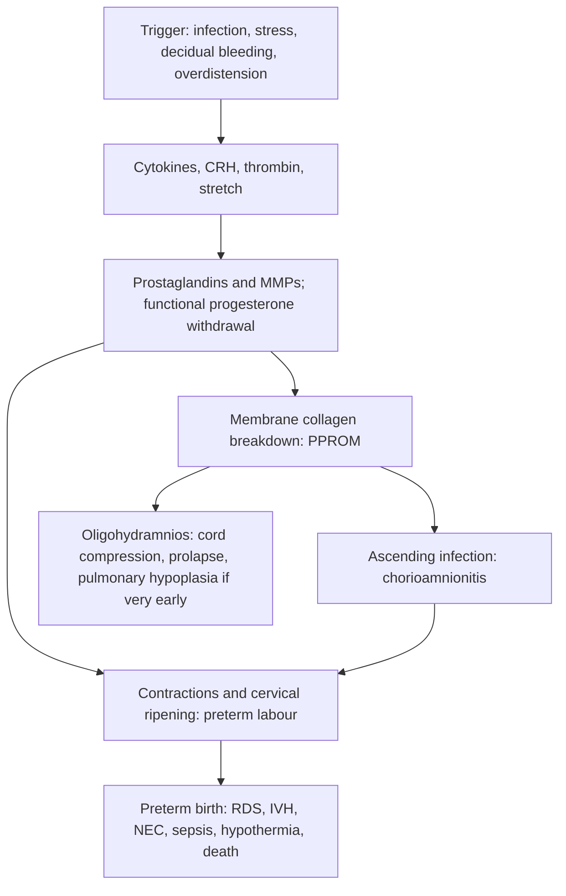

## 1. Definition

**Preterm birth** is birth after viability and before **37 completed weeks** (before 37+0).

| Term | Definition |
|---|---|
| **Preterm birth** | Birth after viability and before **37+0 weeks** |
| **Threatened preterm labour** | Regular painful contractions before 37 weeks **without** progressive cervical change |
| **Established preterm labour** | Regular contractions **with** progressive cervical change (effacement and dilatation; often ≥2–4 cm) before 37 weeks |
| **PROM** (prelabour rupture of membranes) | Rupture of membranes **before the onset of labour** at **≥37 weeks** |
| **PPROM** (preterm PROM) | Rupture of membranes before labour **and before 37 weeks** |
| Prolonged rupture of membranes | Membranes ruptured **>18 hours** before delivery (a risk factor for neonatal GBS/sepsis; UK uses >24 h) |
| **Latency period** | Time from rupture of membranes to onset of labour |
| **Chorioamnionitis** (intra-amniotic infection) | Infection of the membranes, amniotic fluid, placenta and/or fetus |
| **Low birth weight (LBW)** | <2,500 g (VLBW <1,500 g; ELBW <1,000 g); may be preterm, small for gestational age, or both |
| **Cervical insufficiency** | Painless second-trimester cervical dilatation (classically 16–24 weeks) from a structurally weak cervix; a separate mechanism from preterm labour |

Gestational subgroups are in section 5.

**The core idea.** Most of what we do in threatened preterm labour is **for the baby**: we cannot reliably stop labour, but we can **prepare** the baby with **steroids** (lungs, brain, gut), **MgSO₄** (brain), **antibiotics** (infection) and **birth in the right place** (a facility with newborn care). **Infection is the enemy and the most common cause**: if there is chorioamnionitis, the baby must come out, whatever the gestation. And **when membranes might have ruptured, do a sterile speculum examination, not a digital vaginal examination**: every finger in the vagina shortens the time to labour and adds infection.

> [!UGANDA]
> **Viability** in Uganda: the MoH and UCG define abortion as pregnancy loss **before 28 weeks**, and most Ugandan hospitals regard 28 weeks as the threshold for active obstetric intervention for the fetus. National referral hospitals and private NICUs (Mulago/Kawempe, Mengo, Nsambya) now resuscitate babies from about **26 weeks** and sometimes earlier. WHO recommends steroids from **24 weeks** only where the newborn can receive adequate care, so the gestation at which you act depends on **your facility**. Always ask your senior, "What is our threshold here?"

## 2. Epidemiology

- Preterm birth is the **commonest cause of death in newborns and children under 5** worldwide. Globally about **1 in 10 babies is born preterm** (around 13 million per year). Sub-Saharan Africa and South Asia carry most of the burden and most of the deaths.
- In Uganda the preterm birth rate is estimated at roughly **12–14%**, and **neonatal mortality is about 22 per 1,000 live births** (UDHS 2022). Prematurity (with birth asphyxia and sepsis) is one of the three big killers.
- **Three routes to preterm birth**: **spontaneous preterm labour** (about 45%), **PPROM** (about 30%) and **provider-initiated (iatrogenic) preterm birth** (about 25%, e.g. severe pre-eclampsia, APH).
- Survival depends dramatically on where a baby is born. A 32-week baby in a high-income country almost always survives; in low-resource settings many die from **hypothermia, hypoglycaemia, infection, feeding problems and respiratory distress**, most of which are preventable with **thermal care, KMC, breast milk, infection prevention and CPAP**.
- **Antenatal corticosteroids** are cheap (dexamethasone costs a few hundred shillings) but under-used. The WHO **ACTION-I** trial (which included sites in low-resource countries) showed dexamethasone reduces neonatal death when given to women 26–34 weeks with **accurate dating and adequate newborn care**, whereas the earlier ACT trial showed harm when steroids were given broadly in settings with poor gestational dating and weak newborn care. This is why WHO attaches conditions.

> [!UGANDA]
> Realities in Uganda: many women do not know their LNMP and have no early scan; **fundal height alone overestimates or underestimates gestation**, so wrongly giving steroids to a term baby is a real risk. Many HC IVs lack a newborn unit, CPAP and continuous oxygen, so **in-utero transfer** (sending the mother before birth) is often the most valuable single act. KMC units now exist at most regional referral hospitals and many HC IVs.

## 3. Aetiology and Risk Factors

**Triggers by pathway** (details in section 4)

- **Infection / inflammation** (the commonest, especially <32 weeks): bacterial vaginosis, UTI/asymptomatic bacteriuria, **malaria**, STIs (gonorrhoea, chlamydia, trichomonas), chorioamnionitis, pyelonephritis, periodontal disease, HIV.
- **Maternal/fetal stress**: physical or psychological stress, pre-eclampsia, FGR, heavy manual work.
- **Decidual haemorrhage**: abruption, APH, threatened miscarriage earlier in pregnancy.
- **Uterine overdistension**: **twins/multiples**, polyhydramnios, uterine anomalies.
- **Cervical insufficiency**: previous cone biopsy/LLETZ, repeated dilatation (D&Cs), obstetric trauma, congenital.
- **Membrane weakening (PPROM)**: infection-driven collagen breakdown, smoking, bleeding, polyhydramnios, invasive procedures.

**Risk factors**

| Non-modifiable | Modifiable |
|---|---|
| **Previous preterm birth or second-trimester loss** (the strongest; recurrence about 15–30%) | UTI, asymptomatic bacteriuria, malaria, BV, STIs |
| Multiple pregnancy, uterine anomaly | Smoking, alcohol |
| Cervical surgery (LLETZ, cone), repeated D&Cs | Heavy manual work, stress, IPV |
| Age <18 | Short birth interval (<24 months), anaemia, poor nutrition |
| Medical disease: HIV, sickle cell, diabetes, heart disease | Pre-eclampsia (iatrogenic preterm birth) |

## 4. Pathophysiology

### Four pathways to spontaneous preterm labour

Term labour is a controlled inflammatory process. Preterm labour is the same process switched on too early by one of four triggers:

| Pathway | Mechanism |
|---|---|
| **1. Infection / inflammation** | Bacteria ascend from the vagina, stimulating cytokines (IL-1, IL-6, TNF-α) → **prostaglandins** (contractions, cervical ripening) and **matrix metalloproteinases** (weaken the membranes → PPROM) |
| **2. Maternal/fetal stress** | Activation of the **HPA axis** → placental **CRH** → ↑ oestrogen and prostaglandins |
| **3. Decidual haemorrhage** | **Thrombin** is a powerful uterotonic and activates MMPs |
| **4. Uterine overdistension** | Stretch ↑ **gap junctions** (connexin-43) and **oxytocin receptors** |

All four converge on a **functional progesterone withdrawal**, rising prostaglandins and a ripening cervix.

**Cervical insufficiency** is a separate mechanism: the cervix painlessly dilates in the **second trimester** (classically 16–24 weeks) because it is structurally weak. It is managed by **cerclage** or progesterone.

### Why the membranes rupture early

The chorioamniotic membranes weaken with **collagen breakdown** (by infection-driven MMPs), apoptosis and stretching. Smoking, bleeding, polyhydramnios and invasive procedures also contribute. After rupture, **ascending infection** is the main danger. That is why we **avoid digital examinations** and give **erythromycin**.

### Why prolonged pregnancy after PPROM helps and when it harms

Each week gained in utero before 34 weeks reduces prematurity complications. But the longer the latency, the higher the risk of **chorioamnionitis, abruption, cord prolapse/compression** and, if very early (<24 weeks), **pulmonary hypoplasia** and limb contractures from oligohydramnios. The art of PPROM management is balancing these.

**Feature links**

- Prostaglandins → regular painful contractions → progressive cervical change (established labour).
- MMPs → membrane rupture → gush then continuous trickle of clear, musty fluid → pooling on speculum, nitrazine blue, ferning, low liquor on scan.
- Ascending infection → maternal pulse rises, then fever ≥38°C → fetal tachycardia >160 → uterine tenderness → foul or purulent liquor → raised WBC.
- Infected uterus → contracts poorly → PPH after delivery.
- Decidual haemorrhage → vaginal bleeding with constant pain → abruption (tocolysis contraindicated).
- Overdistension → fundal height large for dates (twins, polyhydramnios).
- Loss of liquor → cord compression → variable decelerations, bradycardia; cord prolapse (with malpresentation).
- Very early PPROM → oligohydramnios → pulmonary hypoplasia and limb contractures.
- Weak cervix → painless mid-trimester dilatation (cervical insufficiency), not preterm labour.
- Surfactant deficiency in the preterm lung → RDS; immature germinal matrix → IVH; immature gut → NEC.

### Why antenatal corticosteroids work

Dexamethasone and betamethasone cross the placenta and:

- **Mature the lungs**: induce type II pneumocytes to produce **surfactant**, thin the alveolar walls and increase lung compliance → less **respiratory distress syndrome (RDS)**.
- Mature other organs: less **intraventricular haemorrhage (IVH)**, **necrotising enterocolitis (NEC)** and neonatal death.
- Benefit starts after about **24 hours** and peaks at **48 hours to 7 days** after the first dose. **Even an incomplete course helps**, so never withhold the first dose because "she will deliver soon".
- Risks: **neonatal hypoglycaemia** (especially late preterm), maternal hyperglycaemia (monitor diabetics), and possible harm if the baby turns out to be term or if the mother is infected. That is why the WHO conditions exist.

### Why MgSO₄ protects the fetal brain

Magnesium stabilises neuronal membranes, blocks **NMDA glutamate receptors** (reducing excitotoxic injury) and reduces inflammatory cytokines and free radicals. Given before birth under 32 weeks, it reduces **cerebral palsy by about a third** (number needed to treat about 63 below 32 weeks, fewer at earlier gestations).

### Why tocolysis does not improve outcomes by itself

Tocolytics delay delivery by **48 hours to 7 days** in some women but have **never been shown on their own to reduce neonatal death or morbidity**. Their only purpose is to **buy time** for steroids to act and for transfer to a facility with newborn care.

## 5. Classification / Staging

**By gestation**

| Category | Gestation |
|---|---|
| Extremely preterm | <28 weeks |
| Very preterm | 28 to <32 weeks |
| Moderate preterm | 32 to <34 weeks |
| Late preterm | 34+0 to 36+6 weeks |

**By route**: spontaneous preterm labour (about 45%), PPROM (about 30%), provider-initiated (about 25%).

**By stage of labour**: threatened (no cervical change) vs established (progressive cervical change).

**By membrane status**: intact; PPROM (<37 weeks); PROM (≥37 weeks); prolonged ROM (>18 h).

**Gestation thresholds that change management**: steroids **24 (Uganda usually 28) to 34 weeks**; MgSO₄ **<32 weeks**; tocolysis **<34 weeks**; PPROM delivery **34 or 37 weeks** (section 9).

## 6. Clinical Features

### History

Every woman who presents before 37 weeks with pains or "water" is worked up to answer five questions, in this order: **Is she (or the baby) in danger now? Are the membranes ruptured? Is she really in labour? Is there infection? How many weeks is she, and can this facility care for a baby of that gestation?**

| Ask | Why it matters (what answer changes the plan) |
|---|---|
| **Dating**: LNMP (certain? regular cycles? contraception?), **earliest ultrasound**, fundal height at booking | Everything (steroids, tocolysis, MgSO₄, place of birth) depends on accurate GA. An early scan (<24 weeks) beats LNMP; fundal height alone is unreliable |
| **Pains**: when started, how often, how long, how strong, regular? Radiating to the back? | Regular painful contractions (≥4 in 20 min or ≥8 in 60 min is one classic cut-off) suggest real labour; irregular painless tightenings = Braxton Hicks |
| **Fluid**: time of the gush (to calculate **hours since ROM**), amount (gush vs trickle), continuous or intermittent, colour (clear, bloody, meconium, green/foul), smell | PPROM vs urine/discharge. Hours since ROM → >18 h = GBS prophylaxis; meconium or foul fluid → fetal compromise/infection |
| **Fever, chills, rigors, foul-smelling discharge, abdominal pain/tenderness** | **Chorioamnionitis**: changes everything (no tocolysis, deliver) |
| **Dysuria, frequency, loin pain** | UTI/pyelonephritis, a common trigger → urine test and treat |
| **Malaria symptoms** (fever, headache, joint pains), IPTp doses, net use | Malaria is a trigger in Uganda → mRDT and treat |
| **Vaginal bleeding** (amount, painful or painless) | Abruption or placenta praevia (**no VE** until praevia is excluded) |
| **Fetal movements** | Fetal well-being, IUFD |
| **Previous preterm birth or second-trimester loss** (and whether it was painless) | The **strongest risk factor** (recurrence about 15–30%); painless = cervical insufficiency |
| Cervical surgery (LLETZ, cone), repeated D&Cs | Cervical insufficiency |
| **Twins, polyhydramnios** known on scan | Overdistension; changes delivery planning |
| **Headache, visual symptoms, known high BP** | Pre-eclampsia → may need iatrogenic delivery; **caution with nifedipine tocolysis on top of antihypertensive nifedipine** |
| **Heart disease, diabetes, HIV (ART, viral load), sickle cell** | Nifedipine safety, steroid glucose monitoring, eMTCT plan, neonatal plan |
| Vaginal discharge, STIs, sexual history | BV, gonorrhoea, chlamydia, trichomonas |
| **Allergies** (penicillin, erythromycin) | Antibiotic choice (clindamycin if penicillin-allergic for GBS) |
| **Drugs given at the referring unit** (steroid dose times, nifedipine, antibiotics) | Avoid duplicating or missing doses |
| Social: age <18, heavy manual work, smoking, alcohol, IPV, **distance from home, support, finances** | Risk factors; referral logistics; expectant PPROM management and KMC need a long admission |

### Examination

Follow the order of Hutchison's Clinical Methods (24th edition), adapted for the obstetric patient. If she is septic, bleeding or birth is imminent, the first-5-minutes assessment (section 9) comes first.

#### Introduction, consent and preparation

- **Introduction and identity**: introduce yourself; confirm her name, age and gestation.
- **Explanation and consent**: explain each step, especially the speculum; gain consent; **offer a chaperone**; privacy.
- **Hand hygiene**; **sterile gloves** for the speculum.
- **Position and exposure**: semi-recumbent with a left lateral tilt for the abdomen; for the speculum, let her **lie down for 20–30 minutes first** so fluid can pool.

#### General inspection and vital signs

- **Temperature** (≥38.0°C), **pulse** (>100 = maternal tachycardia, infection or dehydration; a rising pulse often precedes fever in chorioamnionitis), **BP** (pre-eclampsia), RR, SpO₂.
- Pallor, dehydration, signs of sepsis (RR ≥22, confusion, SBP ≤100), distress with contractions.

#### Hands, face and neck

- **Hands**: capillary refill, warm or cold peripheries (sepsis), pallor.
- **Face**: conjunctival pallor; flushing (fever, or nifedipine if already given).
- **Neck**: brief.
- **Renal angles**: tenderness (pyelonephritis).

#### Obstetric abdominal examination

| Step | Finding | What it means |
|---|---|---|
| Inspection | Distension, scars, visible contractions | Overdistension; previous CS |
| **Fundal height** | Large for dates | Twins, polyhydramnios |
| **Fundal height** | Small for dates | FGR or wrong dates |
| Palpation for tone | **Uterine tenderness between contractions** | Chorioamnionitis or abruption |
| **Contractions** | Palpate for 10 minutes: frequency, duration, strength | True labour vs Braxton Hicks |
| **Lie and presentation** | Breech (common preterm), transverse | Mode of birth; cord prolapse risk after PPROM |
| **Engagement** (fifths palpable) | Fifths above the brim | Progress |
| Liquor volume | Reduced after PPROM | Supports PPROM |
| **Auscultation of the fetal heart** (full minute, after a contraction) | **>160 bpm** | Fetal tachycardia: early sign of chorioamnionitis |
| Auscultation | Bradycardia or decelerations after ROM | Cord compression or prolapse: look now |

#### Sterile speculum examination (the key examination when ROM is suspected)

- Sterile gloves, sterile Cusco speculum, warm sterile water only (no lubricant or antiseptic in the vagina: both upset the nitrazine test).
- Look for: **pooling** of liquor in the posterior fornix; fluid from the os on **coughing (cough/Valsalva test)**: diagnostic of ruptured membranes.
- Colour (clear, blood-stained, meconium, pus) and smell of liquor.
- **Visual estimate of cervical dilatation**; **cord or fetal parts** prolapsing into the vagina.
- Take **swabs**: high vaginal and endocervical (and low vaginal + rectal for GBS where culture is available). Test fluid with **nitrazine** and make a **fern slide**.

#### Digital vaginal examination

- **Do it** (with care) when membranes are intact (or she is clearly in **established labour**) and there is no bleeding: dilatation, effacement, station, presentation. **Repeat after 2–4 hours** to show cervical change. This decides tocolysis and steroids.
- **Do not do it** in PPROM confirmed or suspected that is **not in labour**.
- **Do not do it** with bleeding until placenta praevia is excluded by ultrasound.

#### Completing the examination

- Bedside tests (section 8); point-of-care ultrasound.
- **Thank** her, cover her, **wash hands**.
- **Summarise** (model presentation in section 8).

**Document the key negatives**: "afebrile, pulse 84, uterus non-tender, liquor clear and non-offensive, FHR 140, no cord seen, cervix visually closed".

### Red flags

> [!REDFLAG]
> - **Maternal fever ≥38°C, maternal tachycardia, fetal tachycardia >160, uterine tenderness, foul-smelling liquor** → chorioamnionitis: deliver and treat
> - **Vaginal bleeding with pain** → abruption (tocolysis contraindicated)
> - **Cord prolapse** or cord seen/felt at the introitus → obstetric emergency (PPROM with malpresentation raises the risk)
> - **Abnormal FHR** (bradycardia, decelerations) → cord compression or infection
> - **Severe pre-eclampsia** → iatrogenic delivery, and no nifedipine tocolysis on top of antihypertensive nifedipine without senior input
> - Signs of **sepsis**: hypotension, confusion, RR ≥22 → resuscitate and treat as maternal sepsis
> - **Advanced dilatation** (≥6 cm) → delivery is imminent: prioritise MgSO₄, neonatal team, and the place of birth

> [!REDFLAG]
> The two things that must not happen in the first 5 minutes: a **digital VE in suspected PPROM** that is not in labour, and a **digital VE with bleeding** before praevia is excluded.

### Thinking like a clinician

- **Your first question is "Is this true preterm labour?"** Up to **70% of women with threatened preterm labour do not deliver within 7 days**. Overdiagnosis leads to unnecessary steroids, tocolytics and transfers. Look for **cervical change** (serial examinations 2–4 hours apart), and use transvaginal cervical length (<15 mm = high risk; >15 mm = low risk) or fetal fibronectin where available.
- **Your second question is "Why is she in preterm labour?"** Look for a trigger you can treat: **UTI, malaria, pyelonephritis, chorioamnionitis, abruption, multiple pregnancy, polyhydramnios**.
- **Your third question is "Is it safe to prolong the pregnancy?"** If there is **chorioamnionitis, abruption, fetal distress, severe pre-eclampsia, IUFD or a lethal anomaly**, the answer is no: **deliver**.
- **Your fourth question is "Where should this baby be born?"** If your facility cannot care for a 30-week baby, **transfer the mother now** (with the first steroid dose and nifedipine) rather than the baby later.
- **Painless dilatation in the mid-trimester** = cervical insufficiency, not preterm labour.
- **PPROM does not equal chorioamnionitis**, but it can become it any hour. Check temperature and pulse **4-hourly**, FHR, uterine tenderness and liquor colour/smell every shift. A rising maternal pulse or fetal heart rate is often the **first** sign, before fever.
- **Leaking "water" may be urine** (stress incontinence is common in late pregnancy) or heavy discharge. Confirm with a speculum.
- **Steroids for the wrong baby**: if GA is uncertain and fundal height suggests 34+ weeks, steroids may harm (neonatal hypoglycaemia) without benefit. **Get an ultrasound** if possible (EFW and biometry) before giving them.
- **Common student mistakes**: doing a digital VE in PPROM; giving tocolysis to a woman with fever; forgetting the neonatal team; forgetting GBS prophylaxis in labour; giving co-amoxiclav; not calculating the GA correctly; forgetting to check steroids were actually given (look at the drug chart).

## 7. Differential Diagnoses

**Of "contractions" before 37 weeks**

| Differential | Distinguishing clinical feature | Distinguishing investigation |
|---|---|---|
| **Established preterm labour** | Regular painful contractions + progressive cervical change | Serial VE (or cervical length) |
| Threatened preterm labour / Braxton Hicks | Irregular, often painless, no cervical change; settle with rest and hydration | Repeat VE after 2–4 h |
| **Placental abruption** | Constant pain, tender hard uterus, bleeding (may be concealed), fetal distress, hypertension | Clinical; ultrasound (retroplacental clot is not always visible) |
| UTI / pyelonephritis | Dysuria, loin pain, fever; uterine irritability | Urinalysis, urine culture |
| **Malaria** | Fever, rigors, headache, contractions | mRDT, blood smear |
| Chorioamnionitis | Fever, uterine tenderness, fetal tachycardia, foul liquor | Clinical diagnosis; WBC, CRP |
| Cervical insufficiency | Painless mid-trimester dilatation, bulging membranes | Speculum; cervical length |
| Appendicitis, red degeneration of a fibroid, ovarian torsion | Localised pain and tenderness, fever | Ultrasound, WBC |
| Constipation / gastroenteritis | Colicky pain, bowel symptoms | Clinical |

**Of "leaking fluid" in pregnancy**

| Differential | Distinguishing clinical feature | Distinguishing investigation |
|---|---|---|
| **Ruptured membranes (PROM/PPROM)** | Gush then continuous trickle, clear fluid, musty smell | Sterile speculum: pooling, cough test, nitrazine/fern |
| Urinary incontinence | Leak with coughing/laughing, smells of urine, small amounts | Speculum shows no pooling; nitrazine usually negative |
| Leucorrhoea / vaginal infection | Thick white or offensive discharge, itching | Wet mount, HVS |
| Show (mucus plug) | Blood-stained mucus, often with early labour | Speculum |
| Vesicovaginal fistula (rare in pregnancy) | Continuous leak, history of prior obstructed labour | Dye test |

## 8. Clinical Workup

### Bedside

| Test | How / what to look for | What it changes | Available at |
|---|---|---|---|
| **Sterile speculum: pooling / cough test** | Liquor pooling or leaking from the os | **Confirms ROM** (the most useful test; may be negative with a small leak). No pooling after 20–30 min lying + cough = ROM unlikely (consider a pad test or repeat) | All levels with a speculum |
| **Nitrazine paper** | Vaginal pH normally **4.5–6.0** (paper stays **yellow**); amniotic fluid pH **7.0–7.5** turns it **blue** | Supports ROM. **False positive**: blood, semen, urine, BV, trichomonas, antiseptics. **False negative**: small leak, long-standing ROM with little fluid | HC III (sometimes) and above |
| **Fern test** | Swab from the posterior fornix spread on a clean slide, **air-dry for about 10 minutes**, look under low-power microscope for a **fern (arborisation)** pattern (sodium chloride crystals, oestrogen effect) | Supports ROM. **False positive**: cervical mucus, fingerprints; **false negative**: blood, too little fluid, poor drying | Where there is a microscope |
| **Pad test** | Clean pad for 1–2 h: wet, clear, musty-smelling fluid = liquor; smells of urine = urine | Useful when the speculum is equivocal | All levels |
| **Temperature and pulse chart** | **4-hourly** in PPROM; any rise | Early chorioamnionitis | All levels |
| **FHR** (Pinard/Doppler) ± CTG | Baseline >160, reduced variability, variable decelerations (cord compression after ROM) | Infection → deliver; cord compression → assess for prolapse | All levels (CTG at hospitals) |
| **Urine dipstick** | Nitrites, leucocytes (UTI); protein (pre-eclampsia); glucose | Treat UTI; recognise PE | All levels |
| **mRDT** | Positive | Treat malaria (a treatable trigger) | All levels |
| **RBS** | Baseline, especially in diabetics before steroids | Steroids raise glucose for up to 5 days | HC III and above (variable) |
| **Hb (HemoCue)** | Anaemia | Optimise before delivery; cross-match | HC III and above |
| **Point-of-care ultrasound** | Number of fetuses, presentation, viability, liquor (**single deepest pocket <2 cm** or AFI <5 cm = oligohydramnios), placental site, biometry | Presentation and praevia before VE; GA support; low liquor supports PPROM (normal liquor does not exclude it; low liquor has other causes: FGR, renal anomalies) | HC IV and above |
| **Contraction count** | Frequency over 10 min, repeated | With serial VE, confirms labour | All levels |

> [!UGANDA]
> At HC III you usually have a **speculum, nitrazine paper (sometimes), a thermometer, a Pinard/Doppler, a dipstick and an mRDT**. That is enough to diagnose PPROM or chorioamnionitis, give the first dose of dexamethasone, erythromycin or ampicillin + gentamicin, and refer. Ultrasound and FBC are usually at HC IV; cervical length, CRP, cultures and fibronectin are mostly at regional and national referral hospitals (Mengo, Mulago/Kawempe, Nsambya) or private labs.

### Basic lab

| Test | When | Expected / abnormal finding | How it changes management | Available at |
|---|---|---|---|---|
| **Full blood count** | Admission; **twice weekly** in expectant PPROM | WBC **>15 × 10⁹/L** (a rising trend matters more than one value); anaemia | Supports chorioamnionitis. **Steroids raise WBC for about 72 h**, so interpret with the drug chart | HC IV and hospitals |
| **Urinalysis, urine microscopy, culture** | Every admission | Pyuria, bacteria, organism and sensitivities | Treat UTI/asymptomatic bacteriuria | Microscopy HC IV; culture at referral hospitals |
| **mRDT / blood smear** | Every admission (fever or not) | Parasites | Treat malaria | All levels |
| **HIV, syphilis, HBsAg status** | If unknown or due for retest | Positive | eMTCT plan, infant prophylaxis, neonatal team | All levels (rapid tests) |
| **Blood group & cross-match** | Planned delivery, bleeding, CS | | Ready for APH/PPH/CS | HC IV with blood bank upward |

### Imaging

| Test | When | Expected / abnormal finding | How it changes management | Available at |
|---|---|---|---|---|
| **Obstetric ultrasound** (biometry, EFW, presentation, liquor, placenta, number, anomalies) | Every admission; **growth and liquor every 2 weeks** in expectant PPROM | EFW and biometry consistent with dates; oligohydramnios; breech; praevia; lethal anomaly | **Confirms GA before steroids** (biometry is less accurate late in pregnancy; an early scan is best); presentation → mode of birth; EFW → place of birth | HC IV (often) and all hospitals |
| **Transvaginal cervical length** | Symptomatic, **intact membranes** only, 24–34 weeks | **<15 mm** = high risk of birth within 7 days; **>15 mm** = low risk (thresholds of 15–30 mm are used in different guidelines) | ≥15 mm → avoid unnecessary steroids/tocolysis/transfer. **Never in PPROM** | Regional/national referral, private |

### Specialised / referral-level

| Test | When | Expected / abnormal finding | How it changes management | Available at |
|---|---|---|---|---|
| **CRP** | Expectant PPROM, twice weekly where available | Rising trend | Supports infection; not diagnostic alone | Regional/national referral, private |
| **Fetal fibronectin** | Intact membranes, 24–34 weeks, no recent sex/VE/bleeding | **Negative = under 1% delivered within 7 days** | High negative predictive value; mostly used in the UK | Rarely available |
| **HVS / endocervical swab (Gram stain, culture)** | At speculum | Gonorrhoea, BV, trichomonas, GBS | Targeted antibiotics | Culture at referral hospitals |
| **Low vaginal + rectal swab for GBS culture** | Where culture exists | GBS carriage | Intrapartum prophylaxis (Uganda uses a **risk-based** approach instead) | Rare in Uganda |
| **Blood cultures** | Fever ≥38°C or suspected sepsis | Organism | Tailor antibiotics after delivery | Regional/national referral |
| **CTG** | Viable fetus in suspected labour or chorioamnionitis | Fetal tachycardia, reduced variability, decelerations | Fetal compromise → deliver | Referral hospitals, some HC IVs |
| **Amniotic protein tests** (IGFBP-1 / Actim PROM, PAMG-1 / AmniSure) | Equivocal ROM | Positive | Confirms ROM when the speculum is doubtful; accurate but rarely affordable | Private only |

**Surveillance schedule during expectant management**

| Situation | Maternal | Fetal |
|---|---|---|
| Threatened preterm labour, intact membranes | Vital signs 4-hourly; **repeat VE after 2–4 h** to look for cervical change; urine and mRDT results reviewed | FHR each assessment |
| PPROM, expectant | **Temperature and pulse 4-hourly**; pad colour and smell **daily**; uterine tenderness each review; **FBC ± CRP twice weekly** where available | **FHR 4-hourly**; fetal movements; **growth and liquor scan every 2 weeks** |
| On nifedipine tocolysis | **BP and pulse before each dose** (withhold if BP <90/50) | FHR |
| On MgSO₄ neuroprotection | RR, patellar reflexes, urine output **hourly** | Continuous or frequent FHR |
| After steroids in a diabetic | Blood glucose **4-hourly** for up to 5 days | |

### Putting it together

**Model one-line summary**

> "A 22-year-old G2P1 at **30+4 weeks by a 12-week scan** with **PPROM of 14 hours**, confirmed by pooling on sterile speculum, **no clinical chorioamnionitis** (T 36.9°C, pulse 86, uterus non-tender, liquor clear, FHR 142), not contracting, singleton cephalic, EFW 1.5 kg. On dexamethasone (2 of 4 doses) and erythromycin day 1."

**Problem list**

1. Diagnosis: PPROM / preterm labour (threatened or established) / PROM at term; hours since ROM.
2. Gestational age and how reliable it is.
3. Infection status: chorioamnionitis yes/no; triggers (UTI, malaria, BV).
4. Fetal status: FHR, presentation, EFW, liquor, number of fetuses.
5. Interventions and their times: steroids (dose number), MgSO₄ (<32 weeks), tocolysis (hour of 48), antibiotics (day of 10).
6. Place and timing of birth; neonatal team informed; KMC counselling.

**Working diagnosis**: name the syndrome, the gestation and the infection status, e.g. "PPROM at 30+4 weeks without chorioamnionitis" or "established preterm labour at 32 weeks with suspected pyelonephritis".

**Model case presentation (ward round)**

> "Mrs K.S., a 24-year-old G2P1 at 31+2 weeks by a 14-week scan, admitted 18 hours ago with **PPROM**, confirmed on sterile speculum by pooling of clear liquor. No contractions. She is afebrile (36.8°C), pulse 88, uterus non-tender, liquor clear and non-offensive, FHR 144. WBC 11, CRP 8. Ultrasound: singleton cephalic, EFW 1.7 kg, single deepest pocket 2.5 cm. She has had **3 of 4 doses of dexamethasone** and is on **erythromycin 250 mg 6-hourly** (day 1 of 10). **Plan**: complete steroids, continue erythromycin for 10 days, 4-hourly temperature, pulse and FHR, daily pad check, FBC/CRP twice weekly, MgSO₄ if she labours before 32 weeks, and GBS prophylaxis in labour. Plan delivery at 34 weeks per unit protocol, sooner if chorioamnionitis. NICU informed; KMC counselling given."

**Worked example 1: is it really ruptured membranes?** A woman at 33 weeks reports "water" since last night.

| Finding | Result | Interpretation |
|---|---|---|
| Speculum after lying 30 min | No obvious pooling; small amount of fluid on **cough** from the os | Positive cough test: supports ROM |
| Nitrazine | Blue | Supports ROM, but she had **blood-stained discharge** (possible false positive) |
| Fern | Clear ferning | Supports ROM (blood would tend to give a **false negative**, so a positive fern is reassuring) |
| Ultrasound | Single deepest pocket 1.8 cm | Oligohydramnios supports ROM |

**Reading it:** three independent tests agree → **PPROM**. If only the nitrazine were positive (with blood present) and there was no pooling or ferning, you would call it **"ROM not confirmed"**, do a pad test and review, rather than start a 10-day antibiotic course and steroids.

**Worked example 2: is this chorioamnionitis?** PPROM at 31 weeks, day 3. Steroids completed yesterday.

| Finding | Result |
|---|---|
| Temperature | 38.3°C (and 38.1°C 30 min later) |
| Maternal pulse | 112/min |
| FHR | 170 bpm baseline |
| Uterus | Mildly tender between contractions |
| Liquor | Slightly offensive |
| WBC | 18 × 10⁹/L |

**Reading it:** **fever ≥38°C plus maternal tachycardia, fetal tachycardia, uterine tenderness and offensive liquor** = clinical chorioamnionitis by any definition. The WBC of 18 alone would be hard to interpret after steroids (they raise WBC for about 72 h), which is why the **clinical signs decide**. **Action:** ampicillin 2 g IV 6-hourly + gentamicin 5 mg/kg IV daily (+ metronidazole if CS), paracetamol, stop any tocolysis, **MgSO₄ neuroprotection** (<32 weeks), **deliver** (induce with oxytocin; CS only for obstetric indications), neonatal team for sepsis screen and antibiotics, watch for PPH.

> [!NOTE]
> Definitions of chorioamnionitis vary. These notes use **fever ≥38°C plus at least one of** maternal tachycardia >100, fetal tachycardia >160, uterine tenderness, foul-smelling liquor, or WBC >15 × 10⁹/L. The older Gibbs criteria need fever plus **two** of these; the US "Triple I" definition uses fever plus fetal tachycardia, WBC or purulent fluid. In a viva, give the criteria your unit uses and say that the clinical picture, not one number, makes the diagnosis.

**Worked example 3: should she get steroids?**

- LNMP uncertain, fundal height 35 cm, no scan, contracting 3 in 10 min, cervix 4 cm → **scan first** if at all possible (biometry, EFW). If EFW is about 2.6 kg and biometry suggests 35–36 weeks → **no steroids, no tocolysis**; prepare for a late preterm baby. If the scan suggests 31 weeks → dexamethasone 6 mg IM 12-hourly × 4, MgSO₄ if birth is expected within 24 h, consider nifedipine to allow steroids/transfer.
- 29 weeks by a 10-week scan, temperature 38.4°C, tender uterus → **no tocolysis**; antibiotics and **deliver**. Give MgSO₄ (<32 weeks); give the first steroid dose only if it does not delay delivery (WHO lists maternal infection as a reason not to give ACS, so follow your senior and unit protocol).

## 9. Management

### Immediate / emergency

**First 5 minutes (ABCDE plus the obstetric checks)**

1. **A/B/C – vital signs**: temperature, pulse, BP, RR, SpO₂. **Fever ≥38°C, maternal pulse >100 or FHR >160** → think **chorioamnionitis/sepsis** from the start. If signs of sepsis (RR ≥22, confusion, SBP ≤100): IV access, fluids, oxygen, antibiotics within the hour.
2. **Fetal heart**: present? Rate? **Bradycardia or decelerations after membrane rupture → feel/look for a cord prolapse** (cord at the introitus is an emergency: knee-chest position, push the presenting part up, fill the bladder, call for CS).
3. **Bleeding?** If yes, **no digital VE** until placenta praevia is excluded; think abruption (tocolysis is contraindicated).
4. **Is birth imminent?** Watch her: bearing down, visible presenting part, show. If so, call the **neonatal team/most skilled newborn resuscitator**, prepare a warm room, bag-mask (preterm size), and do not transfer in active second stage.
5. **Start what cannot wait**: if GA is reasonably **24 (Uganda: usually 28) to 34 weeks** and birth is likely within 7 days with no infection → **dexamethasone 6 mg IM** now (first dose). If birth is expected within 24 h **<32 weeks** → MgSO₄ neuroprotection. If PPROM → erythromycin. If chorioamnionitis → ampicillin + gentamicin and plan delivery.
6. **Decide on place of birth early.** If your unit cannot look after a baby of this gestation, arrange **in-utero transfer** now (first steroid dose ± nifedipine given, escort, notes with drug times).

### Definitive

**Principles: what we are trying to do**

1. **Confirm** the diagnosis and the **gestational age**.
2. **Exclude contraindications** to prolonging pregnancy (chorioamnionitis, abruption, fetal distress, severe PE, IUFD, lethal anomaly).
3. **Optimise the baby**: corticosteroids (24–34 weeks), MgSO₄ (<32 weeks), antibiotics (PPROM, GBS).
4. **Buy time if needed**: tocolysis (nifedipine) for up to 48 h to complete steroids or transfer.
5. **Decide place, timing and mode of birth**, and prepare the neonatal team.

#### Antenatal corticosteroids (ACS)

**WHO 2022 recommendation:** ACS are recommended for women with a **high likelihood of preterm birth from 24 to 34 weeks** when **all** of the following are true:

1. Gestational age can be **accurately assessed**.
2. Preterm birth is considered **imminent** (likely within **7 days**, including within 24 hours).
3. There is **no clinical evidence of maternal infection**.
4. **Adequate childbirth care** is available (recognition and safe management of preterm labour and birth).
5. The preterm newborn can receive **adequate care** if needed (resuscitation, thermal care, **KMC**, feeding support, infection treatment, safe oxygen and **CPAP**).

This applies to spontaneous preterm labour, **PPROM**, APH, hypertensive disorders, FGR, multiple pregnancy and diabetes (with glucose monitoring). WHO does **not** currently recommend routine ACS **after 34 weeks** (small respiratory benefit, more neonatal hypoglycaemia, no mortality benefit), outside research or specific senior decisions (e.g. elective caesarean at 34–36 weeks in some high-resource guidelines).

- **Give the first dose even if birth seems imminent.** A partial course still gives some benefit.
- **Repeat course**: WHO allows **one** repeat course if preterm birth did not occur within **7 days** of the first course and the woman is again at high risk of birth in the next 7 days (still <34 weeks).
- **Diabetes**: expect hyperglycaemia for up to 5 days; monitor glucose 4-hourly and adjust insulin.
- **HIV**: not a contraindication.
- **Chorioamnionitis**: do **not delay delivery** to give steroids.

> [!UGANDA]
> Uganda practice follows WHO: **dexamethasone 6 mg IM 12-hourly × 4**. Many Ugandan units restrict ACS to **28–34 weeks** (the local threshold of viability and newborn care), extending down to about 26 weeks at centres with a NICU (e.g. Mengo, Kawempe/Mulago, Nsambya). If the gestation is uncertain, get an **ultrasound** first; do not give steroids on fundal height alone when it measures ≥34 cm.

#### Tocolysis

**Purpose:** to delay birth by **48 hours** to complete ACS and/or to **transfer** the mother in utero. It does not by itself improve newborn outcomes.

**WHO 2022** makes a conditional recommendation for **nifedipine** as the tocolytic for women 24–34 weeks with a high likelihood of preterm birth (with the same conditions as for ACS). Other agents are **not** recommended: **betamimetics** (salbutamol, terbutaline, ritodrine: cause maternal tachycardia, pulmonary oedema and hyperglycaemia, and are more dangerous than they are useful) and **MgSO₄ for tocolysis** (ineffective as a tocolytic). **Maintenance tocolysis** beyond 48 hours has no proven benefit.

**Contraindications to tocolysis**

| Maternal | Fetal |
|---|---|
| **Chorioamnionitis** / maternal infection or fever | **Fetal distress** / abnormal FHR |
| **Antepartum haemorrhage** (abruption; significant bleeding) | **Intrauterine fetal death** |
| **Severe pre-eclampsia/eclampsia** | **Lethal congenital anomaly** |
| Maternal cardiac disease, hypotension | GA **≥34 weeks** (the benefit is gone) |
| Advanced labour (cervix ≥4–6 cm per local protocol) | Severe FGR (deliver instead) |
| **PPROM** is a relative contraindication (most guidelines do not tocolyse; may be used briefly for steroids/transfer if no infection) | |

#### MgSO₄ for fetal neuroprotection

- **Indication**: women at risk of imminent preterm birth **before 32 weeks** (WHO); NICE: offer from 24+0 to 29+6 weeks, consider from 30+0 to 33+6 weeks. Give when birth is expected within **24 hours** (established labour or planned delivery), ideally **within 4 hours** before birth.
- **Regimen**: **4 g IV over 20–30 minutes**, then **1 g/hour IV infusion until birth or for a maximum of 24 hours**.
- **Where infusion pumps are not available**, units use their eclampsia protocol (e.g. Pritchard loading). Follow local protocol and seniors.
- **Monitor** exactly as for eclampsia: RR ≥16, reflexes present, urine ≥30 mL/h; **calcium gluconate** at the bedside.
- **Do not delay urgent delivery** (e.g. for fetal distress) to give MgSO₄.
- Tell the neonatal team (the baby may be hypotonic).

#### Antibiotics

| Situation | Antibiotic | Dose | Duration |
|---|---|---|---|
| **PPROM** (no chorioamnionitis) | **Erythromycin** | **250 mg orally every 6 hours** | **10 days** or until established labour (whichever is sooner) |
| PPROM (erythromycin unavailable or not tolerated) | Oral amoxicillin or a penicillin, per local protocol (**not** co-amoxiclav) | e.g. amoxicillin 500 mg every 8 hours | 7–10 days |
| **Preterm labour with intact membranes** and no infection | **No routine antibiotics** | | ORACLE II showed no benefit and a possible increase in cerebral palsy |
| **GBS prophylaxis in labour** (preterm labour, known GBS carrier, previous baby with GBS, maternal fever, ROM >18 h) | **Benzylpenicillin** | **3 g (5 MU) IV loading**, then **1.5 g (2.5–3 MU) IV every 4 hours** | Until delivery |
| | or **Ampicillin** | **2 g IV loading**, then **1 g IV every 4 hours** | Until delivery |
| | Penicillin allergy: **Clindamycin** | **900 mg IV every 8 hours** | Until delivery |
| **Chorioamnionitis** | **Ampicillin 2 g IV every 6 hours** + **gentamicin 5 mg/kg IV once daily** (+ **metronidazole 500 mg IV every 8 hours** if caesarean, or per UCG) | | Deliver. After **vaginal birth**, stop antibiotics (or continue per UCG if still febrile). After **caesarean**, continue until **48 hours fever-free** |

> [!DRUG]
> **Avoid co-amoxiclav (amoxicillin-clavulanate) in PPROM.** The ORACLE I trial found an increased risk of **necrotising enterocolitis** in the babies. Erythromycin prolonged pregnancy and reduced neonatal morbidity.

> [!UGANDA]
> Universal GBS screening is **not** done in Uganda. Use a **risk-based approach**: give intrapartum penicillin/ampicillin to women in preterm labour, with membranes ruptured >18 hours, with intrapartum fever, or with a previous baby affected by GBS.

#### Threatened / established preterm labour with intact membranes: step by step

1. **Assess** mother (vital signs, infection, bleeding) and fetus (FHR, ultrasound for GA, presentation, EFW).
2. **Confirm labour**: VE (if no bleeding) and repeat in 2–4 h. Look for and treat a **cause** (UTI, malaria).
3. If **not in labour** (no cervical change): reassure, treat triggers, observe 6–12 h, discharge with advice on danger signs. No steroids unless high likelihood of birth within 7 days.
4. If **in preterm labour, 24 (28) to 34 weeks, no contraindications**:
   - **Dexamethasone 6 mg IM** now, then 12-hourly × 4.
   - **Nifedipine** tocolysis for up to 48 h if the cervix is not advanced and steroids or transfer are needed.
   - **MgSO₄ neuroprotection** if <32 weeks and birth is expected within 24 hours.
   - **In-utero transfer** to a facility with a newborn unit if needed (send with a referral note, steroid and tocolysis times, and an escort).
5. If **34–36+6 weeks**: no tocolysis and generally no steroids (per WHO); allow labour to progress; prepare the neonatal team; GBS prophylaxis.
6. **In labour**: GBS prophylaxis; continuous or frequent FHR monitoring; **no routine episiotomy or forceps "to protect the head"**; vacuum is avoided **<34 weeks** (risk of intracranial haemorrhage); breech presentation is common, so discuss mode.
7. **Birth**: experienced attendant and neonatal team present; **delayed cord clamping** (at least 30–60 seconds, if the baby does not need resuscitation) reduces IVH and the need for transfusion; dry, wrap, **skin-to-skin**, warm room (25–28°C), early breastfeeding.

#### PPROM: step by step

1. **Confirm** with a sterile speculum (pooling, cough test ± nitrazine/fern). **No digital VE** unless in labour.
2. **Assess for chorioamnionitis**: temperature, pulse, uterine tenderness, liquor smell/colour, FHR, WBC/CRP.
3. **Ultrasound**: GA, presentation, liquor, EFW.
4. If **chorioamnionitis, abruption, fetal distress, cord prolapse or established labour** → **deliver** (with antibiotics, MgSO₄ if <32 weeks, and steroids if time allows, but never delay for them).
5. If **no complications**:
   - **Erythromycin 250 mg orally 6-hourly for 10 days.**
   - **Dexamethasone 6 mg IM 12-hourly × 4** if 24 (28) to 34 weeks.
   - **No tocolysis** routinely.
   - **Expectant management** in hospital: temperature, pulse and FHR **4-hourly**; check pads for colour and smell daily; FBC/CRP twice weekly (where available); fetal movements; growth scans every 2 weeks.
   - **Plan timing of delivery** (below).
   - **MgSO₄** if <32 weeks when labour starts or delivery is planned.
   - **GBS prophylaxis** once in labour.
6. **Mode of birth**: vaginal unless usual obstetric indications (e.g. breech with <32 weeks may favour CS, per senior discussion).

**Timing of delivery in PPROM**

| Gestation | Plan |
|---|---|
| **<24 weeks** (and in Uganda <26–28 weeks at most facilities) | Very poor prognosis (pulmonary hypoplasia, infection, extreme prematurity). Counsel; most women opt for delivery. Individualise with a senior |
| **24 (28) to 33+6 weeks** | Expectant management with erythromycin and steroids; deliver if infection, abruption, fetal distress or labour |
| **34+0 to 36+6 weeks** | **RCOG (PPROMT trial)**: expectant management until **37+0 weeks** if no infection, as early birth increases neonatal respiratory problems and caesarean rates. **ACOG**: delivery at **34 weeks** is recommended |
| **≥37 weeks (PROM)** | **Induce labour** (oxytocin, or misoprostol if cervix unfavourable) rather than prolonged waiting; many units wait up to 24 hours for spontaneous labour at most |

> [!UGANDA]
> In many Ugandan units, women with PPROM are **delivered at about 34 weeks** rather than waiting to 37 weeks. The reasons are the difficulty of close infection surveillance on crowded wards, limited laboratory monitoring, and the relatively good survival of 34-week babies with KMC. RCOG advises waiting until 37 weeks only when surveillance is good. Know your unit's policy and explain both positions in a viva.

#### PROM at term (≥37 weeks)

1. Confirm by sterile speculum. Avoid VE until in labour or induction is planned.
2. Check for chorioamnionitis, meconium, presentation and FHR.
3. **Induce labour** promptly (WHO recommends induction; the TERMPROM trial showed less maternal infection and neonatal admission with induction): **oxytocin** infusion if the cervix is favourable; **misoprostol 25 µg** (vaginal every 6 h or oral every 2 h) if unfavourable and no previous CS.
4. **Antibiotics**: GBS prophylaxis if ROM >18 hours, fever, or known GBS. Routine antibiotics for all PROM at term are not recommended by WHO (UCG may advise antibiotics if ROM >18–24 h; follow local protocol).
5. Deliver immediately (with antibiotics) if chorioamnionitis.

#### Chorioamnionitis: step by step

**Diagnosis** (clinical): **maternal fever ≥38°C** plus ≥1 of: **maternal tachycardia >100**, **fetal tachycardia >160**, **uterine tenderness**, **foul-smelling or purulent liquor**, maternal WBC >15 × 10⁹/L.

1. **Resuscitate** if septic (IV fluids, oxygen; screen with qSOFA: RR ≥22, altered mentation, SBP ≤100).
2. **Antibiotics immediately**: **ampicillin 2 g IV every 6 hours + gentamicin 5 mg/kg IV once daily** (+ **metronidazole 500 mg IV every 8 hours**, especially if caesarean).
3. **Paracetamol 1 g** orally/IV for fever (maternal fever worsens fetal hypoxia).
4. **Deliver**, regardless of gestation: **induce/augment** with oxytocin (vaginal preferred); caesarean only for obstetric indications. **No tocolysis.** Do not delay delivery for steroids.
5. Inform the **neonatal team**: the baby needs a sepsis screen and antibiotics.
6. Watch for **PPH** (an infected uterus contracts poorly) and **sepsis**.
7. Continue antibiotics after CS until 48 h afebrile; after vaginal birth, review.

### Drug table

| Drug | Dose (adult) | Route | Frequency | Duration | Key cautions |
|---|---|---|---|---|---|
| **Dexamethasone** (first choice in Uganda; cheap and available) | **6 mg** | **IM** | **Every 12 hours** | **4 doses** (total 24 mg); one repeat course if ≥7 days later and still <34 weeks | Neonatal hypoglycaemia; maternal hyperglycaemia (glucose 4-hourly for 5 days in diabetics); raises WBC for about 72 h; not with maternal infection (do not delay delivery) |
| **Betamethasone** (where available) | **12 mg** | IM | **Every 24 hours** | **2 doses** (total 24 mg) | As dexamethasone |
| **Nifedipine** (immediate-release) | **20 mg loading**, then **10–20 mg** | Oral | Every 6–8 hours | Up to **48 hours** | Check BP and pulse before each dose; withhold if BP <90/50. Keep total daily dose modest (side effects rise sharply above about 60 mg/day): headache, flushing, hypotension, tachycardia. **Do not combine** with MgSO₄ tocolysis; caution if already on antihypertensive nifedipine |
| Indomethacin (specialist use, <32 weeks) | 50–100 mg loading, then 25 mg | Oral/rectal | 6-hourly | Max 48 h | **Premature closure of ductus arteriosus** and oligohydramnios; avoid after 32 weeks |
| Atosiban (oxytocin antagonist) | IV regimen | IV | Infusion | 48 h | Few side effects but expensive; not available in Ugandan public facilities |
| **Magnesium sulfate** (neuroprotection) | **4 g** over 20–30 min, then **1 g/h** | IV | Infusion | Until birth or max **24 h** | RR ≥16, reflexes present, urine ≥30 mL/h; calcium gluconate at the bedside; where no pump, eclampsia protocol per local guidance |
| **Erythromycin** | **250 mg** | Oral | 6-hourly | **10 days** or until established labour | First choice in PPROM |
| Amoxicillin (PPROM alternative) | 500 mg | Oral | 8-hourly | 7–10 days | **Not co-amoxiclav** (NEC) |
| **Benzylpenicillin** (GBS) | **3 g (5 MU)** loading, then **1.5 g (2.5–3 MU)** | IV | 4-hourly | Until delivery | Risk-based use in Uganda |
| **Ampicillin** (GBS) | **2 g** loading, then **1 g** | IV | 4-hourly | Until delivery | |
| **Clindamycin** (GBS, penicillin allergy) | **900 mg** | IV | 8-hourly | Until delivery | |
| **Ampicillin** (chorioamnionitis) | **2 g** | IV | 6-hourly | Until delivery; after CS until 48 h fever-free | |
| **Gentamicin** (chorioamnionitis) | **5 mg/kg** | IV | Once daily | As above | Renal function |
| **Metronidazole** (chorioamnionitis) | **500 mg** | IV | 8-hourly | As above | Add if caesarean, or per UCG |
| **Paracetamol** | **1 g** | Oral/IV | 6-hourly | While febrile | Maternal fever worsens fetal hypoxia |
| **Misoprostol** (term PROM, unfavourable cervix) | **25 µg** | Vaginal / oral | Vaginal 6-hourly; oral 2-hourly | Until in labour | **Not with a previous CS** |
| **Oxytocin** (term PROM, chorioamnionitis) | Per local induction protocol | IV infusion | Titrated | Until delivery | Count contractions |
| **Vaginal progesterone** (prevention) | **200 mg** | Vaginal | At night | From diagnosis to **34 weeks** | Short cervix ≤25 mm and/or previous preterm birth |

### Referral criteria

| Level | Actions | Refer up when |
|---|---|---|
| **HC II/III** | Identify, check vital signs and FHR, do a sterile speculum if trained; **give the first dose of dexamethasone 6 mg IM** (if GA reasonably 28–34 weeks), **nifedipine 20 mg** if contracting without contraindications, **erythromycin** if PPROM, **ampicillin + gentamicin** if chorioamnionitis | Every suspected preterm labour, PPROM or chorioamnionitis: **refer in utero** with notes and an escort |
| **HC IV / General Hospital** | Full ACS course, nifedipine, MgSO₄, antibiotics, induction/CS, KMC, basic newborn care (oxygen) | Very preterm (<32 weeks) babies/mothers → a centre with NICU/CPAP where possible |
| **Regional Referral Hospital** | NICU (CPAP, surfactant at some), MgSO₄ infusions, expectant management of early PPROM, ultrasound and Doppler, KMC unit | Extremely preterm or complex cases beyond the unit's NICU capacity → NRH |
| **National Referral Hospital** (Mulago/Kawempe) and large PNFP hospitals (Mengo, Nsambya) | NICU from about 26 weeks, surfactant, full investigations | n/a |

Split between RRH and NRH adapted from the source notes, which grouped them together [VERIFY: against UCG 2023 levels of care].

**In-utero transfer checklist**: first steroid dose given (time noted), nifedipine if indicated, antibiotics if PPROM or chorioamnionitis, referral note with drug times, an escort, and not in active second stage.

### Monitoring and follow-up

- Surveillance schedule during expectant management: section 8.
- **Check the drug chart**: were the steroids actually given, and how many doses?
- **Before discharge after threatened preterm labour**: danger signs (fever, foul discharge, pain, leaking, bleeding, reduced movements).
- **Next pregnancy**: early booking and dating scan, prevention strategies below.

### Care of the preterm baby (what obstetric students must know)

| Intervention | Details |
|---|---|
| Delayed cord clamping | ≥30–60 seconds if the baby does not need resuscitation |
| Thermal care | Warm delivery room, dry and wrap, hat, **skin-to-skin** |
| **Kangaroo mother care (KMC)** | WHO 2022: **start KMC immediately after birth** (even before stabilisation) for babies <2.0 kg, **8–24 hours a day** (continuous if possible). The iKMC trial showed **~25% fewer deaths** in babies 1.0–1.8 kg. KMC includes skin-to-skin contact, exclusive breastfeeding and early discharge with follow-up |
| Feeding | Early **breast milk** (expressed by cup, or nasogastric tube if <32 weeks) |
| Respiratory support | Oxygen by nasal prongs, **bubble CPAP** for RDS (available at many Ugandan regional hospitals) |
| Infection | Antibiotics (ampicillin + gentamicin) if risk factors (PPROM, chorioamnionitis, maternal fever) |
| Other | Vitamin K, chlorhexidine cord care per protocol, hypoglycaemia checks, jaundice monitoring, ROP screening for very preterm babies |

## 10. Complications

**Disease-related**

| Maternal | Neonatal |
|---|---|
| **Chorioamnionitis**, endometritis, **puerperal sepsis** | **RDS** (surfactant deficiency), transient tachypnoea |
| Placental abruption (after PPROM) | **Intraventricular haemorrhage**, periventricular leukomalacia, **cerebral palsy** |
| Cord prolapse, malpresentation, operative delivery | **NEC**, feeding intolerance |
| PPH (infected, tired uterus) | **Neonatal sepsis** (GBS, *E. coli*) |
| Psychological distress, postnatal depression | **Hypothermia, hypoglycaemia, jaundice** |
| | **Pulmonary hypoplasia** and limb deformities (PPROM <24 weeks) |
| | Long-term: developmental delay, learning difficulties |

**Treatment-related**

| Complication | Cause | Action |
|---|---|---|
| Hypotension, headache, flushing, tachycardia | Nifedipine | BP before each dose; withhold if BP <90/50 |
| Maternal hyperglycaemia; neonatal hypoglycaemia | Steroids | Glucose monitoring; neonatal glucose checks |
| MgSO₄ toxicity (loss of reflexes, respiratory depression) | MgSO₄ | Hourly RR, reflexes, urine; calcium gluconate |
| Pulmonary oedema, tachycardia, hyperglycaemia | Betamimetics | Do not use |
| NEC | Co-amoxiclav in PPROM | Use erythromycin |
| Ductus closure, oligohydramnios | Indomethacin after 32 weeks | Avoid after 32 weeks |
| Retinopathy of prematurity, BPD | Neonatal oxygen | Safe oxygen, ROP screening |
| Intracranial haemorrhage | Vacuum <34 weeks | Avoid |

## 11. Prognosis

- **Threatened preterm labour**: up to **70% do not deliver within 7 days**.
- **Neonatal survival** depends dramatically on gestation and on where the baby is born; in Uganda NICU centres resuscitate from about 26 weeks.
- **Steroids** reduce RDS, IVH, NEC and neonatal death when the WHO conditions are met; **MgSO₄** reduces cerebral palsy by about a third (<32 weeks); **KMC** reduces deaths by ~25% in babies 1.0–1.8 kg.
- **PPROM <24 weeks**: very poor prognosis (pulmonary hypoplasia, infection, extreme prematurity).
- **Recurrence**: previous preterm birth carries a recurrence risk of about 15–30%.
- Long-term: developmental delay and learning difficulties in survivors of very preterm birth.

## 12. Prevention

| Strategy | Who | Details |
|---|---|---|
| **Vaginal progesterone** | Short cervix (≤25 mm) at 16–24 weeks, and/or previous spontaneous preterm birth | **200 mg vaginally at night** from diagnosis until **34 weeks** |
| **Cervical cerclage** | History-indicated: ≥3 previous second-trimester losses or preterm births. Ultrasound-indicated: previous preterm birth/mid-trimester loss + cervix ≤25 mm before 24 weeks. Rescue: dilated cervix with intact membranes | McDonald (purse-string) at 12–14 weeks for history-indicated; remove at **36–37 weeks** or in labour |
| **Treat infections** | All | Screen and treat **asymptomatic bacteriuria**, syphilis; **IPTp-SP** monthly from 13 weeks; ITNs |
| Low-dose aspirin | Women at risk of pre-eclampsia | Reduces iatrogenic preterm birth |
| Stop smoking, nutrition, birth spacing (≥24 months), manage anaemia | All | |

> [!NOTE]
> 17-hydroxyprogesterone caproate (17-OHPC) injections are no longer recommended (withdrawn in the USA in 2023 after the PROLONG trial showed no benefit).

**Preventing death once preterm birth happens**: steroids, MgSO₄, in-utero transfer, delayed cord clamping, thermal care, KMC, breast milk, infection prevention and CPAP.

## 13. Special Populations

- **Diabetes**: steroids cause hyperglycaemia for up to 5 days; glucose 4-hourly and adjust insulin.
- **Pre-eclampsia on nifedipine**: no nifedipine tocolysis on top of antihypertensive nifedipine without senior input; severe PE is a contraindication to tocolysis.
- **Maternal cardiac disease**: tocolysis contraindicated; avoid betamimetics.
- **HIV**: not a contraindication to steroids; eMTCT plan and infant prophylaxis; neonatal team.
- **Penicillin allergy**: clindamycin 900 mg IV 8-hourly for GBS prophylaxis.
- **Previous caesarean section**: no misoprostol for term PROM induction.
- **Multiple pregnancy, polyhydramnios**: overdistension trigger; steroids apply; plan delivery (see the *Multiple pregnancy* topic).
- **Uncertain gestation**: scan before steroids; do not give steroids on fundal height alone when it measures ≥34 cm.
- **Very early PPROM (<24 weeks, or <26–28 weeks at most Ugandan facilities)**: individualise with a senior; counsel about the poor prognosis.

## 14. Key Points

### High-yield points

- **Sterile speculum, not fingers**, when membranes may have ruptured.
- Confirm **GA** by the earliest scan before steroids.
- Steroids **24–34 weeks** (Uganda 28–34) when the WHO conditions are met; give the first dose even if birth is near.
- Tocolysis only buys **48 h**; nifedipine; never with infection, bleeding or fetal distress.
- **MgSO₄ under 32 weeks** for neuroprotection.
- PPROM: **erythromycin**, not co-amoxiclav.
- Chorioamnionitis: antibiotics and **deliver**, whatever the gestation.
- A rising maternal pulse or FHR often precedes fever.
- Risk-based **GBS prophylaxis** in labour.
- **In-utero transfer** and **KMC** save lives.

### Numbers & doses

| Item | Value |
|---|---|
| Preterm | **<37+0 weeks**; extremely <28, very 28–<32, moderate 32–<34, late 34–36+6 |
| Viability / abortion cut-off (Uganda) | **28 weeks** (NICU centres act from about 26) |
| Prolonged ROM | **>18 h** (UK >24 h) → GBS prophylaxis |
| Vaginal pH / amniotic fluid pH | **4.5–6.0** / **7.0–7.5** (nitrazine blue) |
| Oligohydramnios | Single deepest pocket **<2 cm** or AFI **<5 cm** |
| Cervical length (intact membranes) | **<15 mm** high risk; **>15 mm** low risk of birth in 7 days |
| Fetal fibronectin negative | **<1%** birth within 7 days |
| Dexamethasone | **6 mg IM 12-hourly × 4** (24 mg) |
| Betamethasone | **12 mg IM 24-hourly × 2** |
| Steroid window | **24–34 weeks** (Uganda usually 28–34); benefit from **24 h**, peak **48 h–7 days**; one repeat course if ≥7 days later |
| Nifedipine tocolysis | **20 mg orally**, then **10–20 mg every 6–8 h** for up to **48 h**; withhold if BP <90/50 (local daily maximum varies) |
| MgSO₄ neuroprotection | **<32 weeks**: **4 g IV over 20–30 min**, then **1 g/h** until birth or max 24 h |
| Erythromycin (PPROM) | **250 mg orally 6-hourly × 10 days** (or until labour) |
| GBS prophylaxis | Benzylpenicillin **3 g IV**, then **1.5 g 4-hourly**; or ampicillin **2 g**, then **1 g 4-hourly**; clindamycin **900 mg 8-hourly** if allergic |
| Chorioamnionitis | Ampicillin **2 g IV 6-hourly** + gentamicin **5 mg/kg IV daily** (+ metronidazole 500 mg IV 8-hourly if CS) |
| Chorioamnionitis thresholds | Fever **≥38°C**; maternal pulse **>100**; FHR **>160**; WBC **>15 × 10⁹/L** |
| Steroid effect on WBC | Raised for about **72 h** |
| PPROM delivery | RCOG: **37+0** if no infection; ACOG: **34**; many Ugandan units: **about 34** |
| Term PROM | **Induce** (oxytocin, or misoprostol 25 µg if unfavourable) |
| Vaginal progesterone (prevention) | **200 mg at night** to 34 weeks (short cervix ≤25 mm or previous preterm birth) |
| Cerclage removal | **36–37 weeks** or in labour |
| KMC | Babies **<2.0 kg**, start **immediately**, 8–24 h/day |
| Delayed cord clamping | At least **30–60 s** if the baby does not need resuscitation |

### Exam traps

- **"Do a VE to see how dilated she is"** in suspected PPROM. Wrong: **sterile speculum**; no digital VE unless she is in labour.
- **"Nitrazine positive, so membranes are ruptured."** Not on its own: blood, semen, urine, BV and antiseptics cause false positives. Look for **pooling** first.
- **"Give co-amoxiclav for PPROM."** Wrong: **erythromycin** (co-amoxiclav increased NEC in ORACLE I).
- **"Give antibiotics to every woman in preterm labour."** Wrong: not with intact membranes and no infection (ORACLE II); do give **intrapartum GBS prophylaxis**.
- **"Tocolyse to prevent preterm birth."** Wrong: tocolysis only buys **48 h** for steroids or transfer; it does not improve outcome alone and is contraindicated with infection, bleeding or fetal distress.
- **"Salbutamol is the tocolytic."** Wrong: betamimetics are **not recommended** (pulmonary oedema, tachycardia); use **nifedipine**.
- **"Raised WBC after steroids = chorioamnionitis."** Not necessarily: steroids raise WBC for about 72 h; use the clinical signs (fever, tachycardia, tenderness, liquor).
- **"Steroids at 36 weeks by fundal height."** Wrong: outside the window and dating is uncertain; **scan first**.

### Questions seniors ask

**On the ward round**

1. **How do you confirm PPROM?** History, then a **sterile speculum** after 20–30 min lying: pooling or cough test; supported by nitrazine, fern and low liquor on scan. No digital VE.
2. **What are the signs of chorioamnionitis, and which comes first?** Fever ≥38°C with maternal or fetal tachycardia, uterine tenderness, foul liquor, WBC >15. A **rising maternal pulse or FHR** often comes before fever.
3. **What are the WHO conditions for steroids?** 24–34 weeks with **accurate GA**, birth likely within **7 days**, **no maternal infection**, adequate childbirth care and adequate newborn care.
4. **Why erythromycin and not co-amoxiclav?** Erythromycin prolonged pregnancy and reduced neonatal morbidity (ORACLE I); co-amoxiclav increased **NEC**.
5. **She is 30 weeks, 3 cm, contracting and afebrile. Your plan?** Dexamethasone 6 mg IM now (×4), nifedipine 20 mg for up to 48 h if no contraindication, MgSO₄ if birth is expected within 24 h, GBS prophylaxis in labour, neonatal team, **in-utero transfer** if no newborn unit.
6. **When would you deliver a woman with PPROM?** Immediately for chorioamnionitis, abruption, fetal distress, cord prolapse or labour; otherwise at about 34 weeks (many Ugandan units, ACOG) or 37 weeks (RCOG, if surveillance is good).
7. **How do you tell true preterm labour from threatened preterm labour?** **Progressive cervical change** on serial VE 2–4 hours apart (or cervical length <15 mm / positive fibronectin where available); up to 70% of threatened cases do not deliver within 7 days.
8. **Why does in-utero transfer matter?** The mother is the best incubator: babies transferred before birth do better than those transferred after, so move the mother (with steroids started) to a unit with newborn care.

**Viva questions**

1. **Why avoid digital VE in PPROM?** It introduces vaginal organisms into the uterus, increasing chorioamnionitis, and shortens the latency period. A sterile speculum gives the information needed.
2. **What are the WHO conditions for giving ACS?** GA 24–34 weeks and accurate; birth likely within 7 days; no maternal infection; adequate childbirth care; adequate preterm newborn care.
3. **Dexamethasone regimen?** 6 mg IM every 12 hours × 4 doses.
4. **Which antibiotic in PPROM, and which to avoid?** Erythromycin 250 mg 6-hourly × 10 days; avoid co-amoxiclav (NEC).
5. **Contraindications to tocolysis?** Chorioamnionitis, APH/abruption, fetal distress, IUFD, lethal anomaly, severe PE, maternal cardiac disease, GA ≥34 weeks, advanced labour.
6. **What is the purpose of tocolysis?** To delay birth for 48 h so that steroids can act and/or in-utero transfer can happen; it does not improve outcomes on its own.
7. **When is MgSO₄ given for neuroprotection?** Imminent birth before 32 weeks; 4 g IV then 1 g/h until birth or 24 h. It reduces cerebral palsy.
8. **How is chorioamnionitis diagnosed and managed?** Fever + maternal/fetal tachycardia, uterine tenderness, foul liquor; ampicillin + gentamicin (± metronidazole), deliver regardless of gestation.
9. **What is the principle of the nitrazine test, and its false positives?** Amniotic fluid is alkaline (pH 7–7.5) and turns nitrazine paper blue; false positives with blood, semen, urine, BV, antiseptics.
10. **What is KMC?** Continuous skin-to-skin contact of the baby on the mother's chest plus exclusive breastfeeding; start immediately for babies <2.0 kg; reduces mortality, hypothermia and sepsis.

### Mnemonics

> [!EXAM]
> **"24–34–37"**: steroids from **24** to **34** weeks; preterm means before **37**.

- **Dexamethasone "6-12-4"**: **6** mg, every **12** hours, **4** doses. **Betamethasone "12-24-2"**: **12** mg, every **24** hours, **2** doses.
- **PPROM management "SAFE"**: **S**peculum not fingers; **A**ntibiotics (erythromycin); **F**etal lung steroids; **E**xpectant management with **E**ye on infection.
- **Tocolysis contraindications "BIRDS"**: **B**leeding, **I**nfection (chorioamnionitis), **R**uptured membranes (relative), **D**istressed or **D**ead fetus, **S**evere pre-eclampsia.
- **Chorioamnionitis signs "FEVER-T"**: **F**ever, **E**levated WBC, fetal/maternal **V**ital signs up (tachycardia), **E**ffluent foul-smelling, uterine **R**igidity/tenderness, **T**reat and deliver.
- **"MAG under 32, steroids under 34"**.

### OSCE tips

- **Sterile speculum station**: consent, chaperone, sterile gloves, Cusco speculum with warm sterile water (no lubricant gel, which alters nitrazine), inspect for pooling, cough test, take swabs, nitrazine/fern, and **say "I would not perform a digital examination"**.
- **Counselling station (PPROM at 30 weeks)**: explain what happened, the risks (infection, prematurity, cord problems), the plan (steroids, antibiotics, monitoring), danger signs (fever, foul discharge, pain, reduced movements), and meet the NICU team, introducing KMC.
- **Drug chart station**: write dexamethasone 6 mg IM 12-hourly × 4 with times; erythromycin 250 mg PO 6-hourly × 10 days; nifedipine 20 mg PO stat then 10–20 mg 6–8-hourly for 48 h.

## 15. References

1. World Health Organization. WHO recommendations on antenatal corticosteroids for improving preterm birth outcomes. 2022. https://www.who.int/publications/i/item/9789240057296
2. NCBI Bookshelf. Recommendations and supporting evidence: WHO recommendations on antenatal corticosteroids for improving preterm birth outcomes. 2022. https://www.ncbi.nlm.nih.gov/books/NBK585362/
3. NCBI Bookshelf. Type and regimen of antenatal corticosteroids: WHO recommendations. 2022. https://www.ncbi.nlm.nih.gov/books/NBK585372/
4. World Health Organization. WHO recommendation on tocolytic therapy for improving preterm birth outcomes. 2022. https://www.who.int/publications/i/item/9789240057227
5. Updated WHO recommendations on antenatal corticosteroids and tocolytic therapy for improving preterm birth outcomes. The Lancet Global Health. 2022. https://www.thelancet.com/journals/langlo/article/PIIS2214-109X(22)00434-X/fulltext
6. Royal College of Obstetricians and Gynaecologists. Care of Women Presenting with Suspected Preterm Prelabour Rupture of Membranes from 24+0 Weeks of Gestation (Green-top Guideline No. 73). 2019. https://www.rcog.org.uk/guidance/browse-all-guidance/green-top-guidelines/care-of-women-presenting-with-suspected-preterm-prelabour-rupture-of-membranes-from-24plus0-weeks-of-gestation-green-top-guideline-no-73/
7. NICE. Preterm labour and birth (NG25). 2015. https://www.nice.org.uk/guidance/ng25/resources/preterm-labour-and-birth-pdf-1837333576645
8. American College of Obstetricians and Gynecologists. Antenatal Corticosteroid Therapy for Fetal Maturation (Committee Opinion). 2017. https://www.acog.org/clinical/clinical-guidance/committee-opinion/articles/2017/08/antenatal-corticosteroid-therapy-for-fetal-maturation
9. The WHO ACTION-III Trial: protocol of a trial of antenatal corticosteroids for women at high probability of late preterm birth in low-resource countries. 2024. https://pmc.ncbi.nlm.nih.gov/articles/PMC11010373/
10. Ministry of Health Uganda. Uganda Clinical Guidelines 2023. https://library.health.go.ug/sites/default/files/resources/Uganda%20Clinical%20Guidelines%202023.pdf
11. Ministry of Health Uganda. Essential Maternal and Newborn Clinical Care Guidelines for Uganda. 2021. https://library.health.go.ug/sites/default/files/resources/Essential%20Maternal%20and%20Newborn%20Clinical%20Care%20Guidelines%20for%20Uganda%20_October%202021.pdf
12. World Health Organization. WHO recommendations for care of the preterm or low-birth-weight infant (including immediate kangaroo mother care). 2022.
13. Glynn M, Drake WM, editors. Hutchison's Clinical Methods: An Integrated Approach to Clinical Practice. 24th edition. Edinburgh: Elsevier; 2018.
