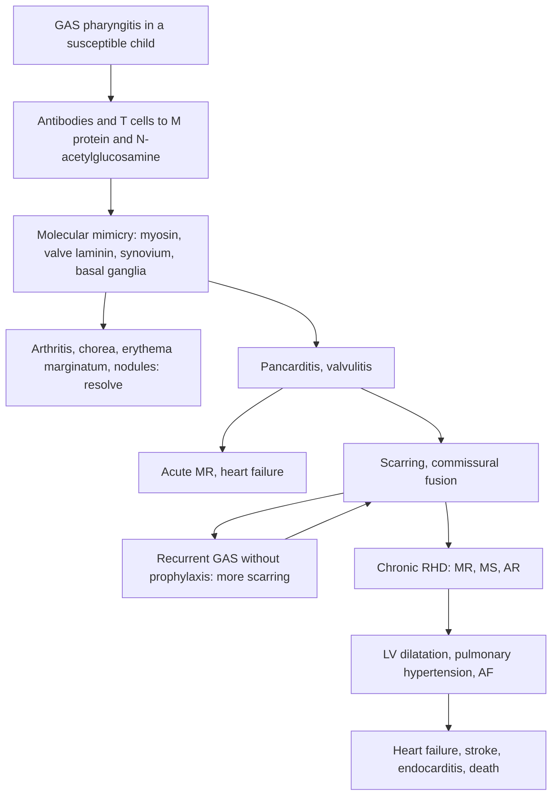

## 1. Definition

**Acute rheumatic fever (ARF)** is an **autoimmune inflammatory illness** that follows an untreated **group A *Streptococcus* (GAS, *Streptococcus pyogenes*) throat infection** (and possibly skin infection) by about **2–4 weeks**. It mainly affects **children aged 5–15 years**. It causes **migratory arthritis, carditis, chorea, skin rash and nodules**. The joints, brain and skin recover completely, but the **heart valves may scar permanently**. This is **rheumatic heart disease (RHD)**.

| Term | Meaning |
|---|---|
| **Acute rheumatic fever** | Diagnosed by the 2015 revised Jones criteria (AHA; endorsed by WHO 2024): evidence of preceding GAS infection + 2 major, or 1 major + 2 minor (section 5) |
| **Recurrent ARF** | A new episode in a child with previous ARF or RHD; can be diagnosed with 2 major, 1 major + 2 minor, or **3 minor** criteria |
| **Rheumatic heart disease** | Permanent valve damage (mainly mitral, then aortic) after one or more episodes of ARF |
| **Subclinical carditis** | No murmur, but **pathological mitral or aortic regurgitation on Doppler echocardiography**; counts as carditis (major criterion) since 2015 |
| **Latent RHD** | Valve changes found by **echo screening** in an asymptomatic child who never had recognised ARF (World Heart Federation criteria) |

The disease is **preventable at three levels**:

1. **Primordial**: housing, less crowding, nutrition.
2. **Primary**: treat GAS sore throats with penicillin.
3. **Secondary**: **benzathine penicillin G (BPG) injections every 4 weeks** for years after ARF or RHD diagnosis. This is the single most important intervention you will prescribe.

> [!PEARL]
> The one thing never to forget: **ARF "licks the joints but bites the heart."** The arthritis is dramatic and goes away; the carditis is often silent and stays. Every child with ARF or RHD needs an **echocardiogram** and **monthly BPG**, and a missed injection is a chance for a recurrence that damages the valves further.

## 2. Epidemiology

- **Global**: RHD is the **most common acquired heart disease in people under 25** worldwide (WHO: about **55 million affected, 360,000 deaths a year**), almost all in low- and middle-income countries.
- **Age**: first episode usually at **5–15 years** (UCG: 3–15). Rare under 3. Recurrences can continue into adulthood.
- **Uganda**: a **high-risk setting**. Echocardiographic school screening studies (Kampala, Gulu, Lira and others) found latent RHD in roughly **1.5–3% of school-age children** [VERIFY: district figures]. Most of these children had never been diagnosed with ARF, because ARF often presents as "joint pains" treated at drug shops. Many Ugandan children are first diagnosed when they already have **heart failure from severe mitral or aortic valve disease**.
- **Services**: the **Uganda Heart Institute (UHI) at Mulago** is the national referral centre for echo, catheter interventions (e.g. balloon mitral valvotomy) and open-heart surgery. **RHD clinics** run at several regional referral hospitals (e.g. **Lira, Gulu, Mbarara**) [VERIFY: current list], linked to a national **RHD registry**. Many children still need surgery abroad, funded by charities.
- **BPG supply**: global stock-outs of benzathine penicillin have affected Uganda. Families travel monthly for injections, so **adherence** is a major problem.
- **Pregnancy**: girls with RHD later face high risks in pregnancy (see the obstetrics topic on cardiac disease in pregnancy). WHO 2024 supports **echo screening in antenatal care** in high-risk settings.

## 3. Aetiology and Risk Factors

- **Cause**: an autoimmune response to **GAS pharyngitis** (or possibly impetigo or infected scabies) in a genetically susceptible child.
- **Risk factors**: **overcrowding** (school dormitories, shared beds), poverty, poor access to treatment of sore throat, undernutrition, genetic susceptibility (HLA types; familial clustering), female sex for RHD.
- **Risk factors for recurrence and progression**: missed BPG injections (stock-outs, distance, painful injections), repeated GAS exposure in crowded households and boarding schools.
- **Precipitants of heart failure in established RHD**: **ARF recurrence**, infection (pneumonia, **infective endocarditis**), anaemia, atrial fibrillation (AF), pregnancy, stopping medication.

## 4. Pathophysiology

**From sore throat to scarred valve**

1. **GAS pharyngitis** (or possibly impetigo) in a genetically susceptible child.
2. **Molecular mimicry**: antibodies and T cells against streptococcal **M protein** and **N-acetylglucosamine** (cell wall carbohydrate) **cross-react** with human proteins: **cardiac myosin**, **laminin and keratin on valve endothelium**, **joint synovium**, and **basal ganglia neurons** (lysoganglioside, tubulin).
3. After a **latent period of 2–4 weeks** (1–5 weeks), inflammation appears in joints, heart, skin and brain. **Chorea** has a longer latency (**1–6 months**), so ASO may have normalised by then.
4. **Carditis is a pancarditis** (endocardium, myocardium, pericardium), but **valvulitis** causes the lasting damage. **Aschoff bodies** (granulomas with Anitschkow "caterpillar" cells) are the histological hallmark.
5. **Repeated attacks** cause more scarring: leaflet thickening, **commissural fusion**, chordal shortening and fusion, leading to **regurgitation** (early, in children) and then **stenosis** (later, but can be severe in African adolescents: "juvenile mitral stenosis").

**Valve involvement**: **mitral (~65–70%)** > **mitral + aortic (~25%)** > aortic alone > tricuspid (rarely isolated, usually functional from pulmonary hypertension). Pulmonary valve almost never.

**Why the heart fails**

- **Acute carditis**: severe MR (valvulitis + annular dilatation + chordal elongation) → volume overload → left atrial and pulmonary venous congestion → **pulmonary oedema**. Myocarditis contributes less than once thought.
- **Chronic RHD**: MR → left ventricular dilatation; MS → raised left atrial pressure → **pulmonary hypertension**, **atrial fibrillation**, right heart failure; AR → LV volume overload, wide pulse pressure.

**Feature links**

- Synovial cross-reaction → **migratory, exquisitely painful large-joint arthritis** that heals without damage and responds dramatically to NSAIDs.
- Basal ganglia cross-reaction (long latency) → **Sydenham chorea**, emotional lability, with ASO often already normal.
- Skin inflammation → **erythema marginatum**; connective tissue granulomas → **subcutaneous nodules** (usually with carditis).
- Valvulitis with annular dilatation → **apical pansystolic murmur** (MR); high flow across the inflamed mitral valve → **Carey Coombs mid-diastolic murmur**.
- Pericardial inflammation → **pericardial rub**, effusion, low ECG voltages.
- Myocardial and conduction tissue inflammation → **tachycardia out of proportion to fever** (persisting in sleep), **prolonged PR**, heart block.
- Volume overload from MR or AR → **LV dilatation**, displaced apex, gallop, **pulmonary oedema**.
- Aortic regurgitation → **collapsing pulse**, wide pulse pressure, early diastolic murmur.
- Mitral stenosis → raised LA pressure → **loud S1, opening snap, mid-diastolic rumble**, **haemoptysis**, pulmonary hypertension, **AF** → **stroke and emboli**.
- Damaged valves → bacteraemia seeds them → **infective endocarditis** (fever, changing murmur, splinters, haematuria, splenomegaly).
- Systemic inflammation → **fever, raised ESR and CRP**, anaemia of inflammation, leucocytosis.

## 5. Classification / Staging

**The 2015 revised Jones criteria (AHA; endorsed by WHO 2024)**

First decide whether the child comes from a **low-risk** population (ARF incidence ≤2 per 100,000 school-aged children per year, or all-age RHD prevalence ≤1 per 1,000) or a **moderate/high-risk** population (everyone else). **Ugandan children are moderate/high risk.**

| | Low-risk populations | **Moderate/high-risk (Uganda)** |
|---|---|---|
| **Major** | Carditis (clinical and/or subclinical), **polyarthritis only**, chorea, erythema marginatum, subcutaneous nodules | Carditis (clinical and/or subclinical), **monoarthritis or polyarthritis, and/or polyarthralgia** (if other causes excluded), chorea, erythema marginatum, subcutaneous nodules |
| **Minor** | Polyarthralgia, fever **≥38.5 °C**, **ESR ≥60 mm/h** and/or CRP ≥3.0 mg/dL, prolonged PR (age-adjusted, unless carditis is a major criterion) | **Monoarthralgia**, fever **≥38.0 °C**, **ESR ≥30 mm/h** and/or **CRP ≥3.0 mg/dL (30 mg/L)**, prolonged PR (age-adjusted, unless carditis is a major criterion) |

**Diagnosis**

| Situation | Requirement |
|---|---|
| **Initial ARF** | Evidence of preceding GAS infection + **2 major** or **1 major + 2 minor** |
| **Recurrent ARF** | Evidence of preceding GAS infection + **2 major**, **1 major + 2 minor**, or **3 minor** |
| **Sydenham chorea** or **indolent carditis** | Can be diagnosed **alone**, without other criteria or GAS evidence (they appear months after the infection) |

**Evidence of preceding GAS infection**: raised or rising **antistreptolysin O (ASO)** titre or **anti-DNase B**; positive **throat culture**; positive **rapid GAS antigen test**; recent scarlet fever (WHO Pocket Book).

> [!UGANDA]
> **UCG 2023** prints a simplified Jones table: evidence of strep infection + 2 major or 1 major + 2 minor (polyarthritis listed as major, ESR/CRP and PR prolongation as minor). For exams and the ward, use the **2015 high-risk version**, which the **WHO 2024 guideline** endorses ("the Jones criteria should be used"). It lets you count **monoarthritis and polyarthralgia** as major, which matters because many Ugandan children have already had NSAIDs or herbal remedies before arthritis becomes "poly".

**Subclinical carditis and latent RHD (echo criteria)**

- **Latent RHD** is defined by the **World Heart Federation (WHF) criteria** (2012, updated 2023), and **WHO 2024** recommends prophylaxis for children meeting minimum criteria.
- **Pathological MR on Doppler (WHF)**: seen in **2 views**, jet length **≥2 cm** in at least one view, peak velocity **≥3 m/s**, and **pansystolic** in at least one envelope.
- **Pathological AR**: 2 views, jet **≥1 cm**, velocity ≥3 m/s, **pandiastolic**.

**Heart failure severity**

- **Infants and young children**: modified **Ross** classification (feeding, sweating, tachypnoea, growth).
- **Older children**: **NYHA class I–IV** (I: no limitation; II: symptoms on ordinary activity; III: symptoms on less than ordinary activity; IV: symptoms at rest).

**Age-adjusted upper limit of the PR interval**: 3–12 years **0.16 s**; 12–16 years **0.18 s**; ≥17 years **0.20 s**.

## 6. Clinical Features

### History

| Ask about | Why it matters |
|---|---|
| **Sore throat 2–4 weeks ago** (or skin sores 2–6 weeks ago), treatment received, scarlet fever, skin sores/scabies | Preceding GAS; many children recall nothing (only ~⅔ do) |
| **Joint pain**: which joints, **migratory** (one gets better as another flares), swelling, **exquisitely painful**, prior NSAIDs/aspirin, response to painkillers | Classic ARF arthritis is migratory, large joints, very painful, and responds dramatically to NSAIDs (which also mask the migration) |
| **Fever** | Minor criterion |
| **Breathlessness, orthopnoea, cough, chest pain, palpitations, swelling of feet/face, reduced exercise tolerance** (NYHA) | Carditis, heart failure, pericarditis, AF |
| **Clumsiness, dropping things, handwriting deteriorating, school performance, emotional lability, "restlessness" noticed by teachers** | **Sydenham chorea** |
| **Rash, painless lumps** | Erythema marginatum, nodules |
| **Previous ARF, known RHD, BPG card** (when last, how many missed) | Recurrence; adherence |
| **Penicillin allergy history** (what exactly happened) | Most "allergies" are not true allergy; WHO 2024 advice on test doses |
| **Current medicines** (aspirin, warfarin) | Toxicity, interactions, INR |
| **Family history** of RHD, household crowding, school (boarding?) | Risk and household screening |
| **Feeding, weight loss, growth, immunisation, HIV status** | Nutrition and comorbidity; heart failure causes poor growth |
| **Menarche and sexual activity** (adolescent girls) | Pregnancy risk with RHD; contraception counselling; warfarin teratogenicity |

### Examination

Follow the order of Hutchison's Clinical Methods (24th edition), adapted for children. In heart failure the ABCDE assessment (section 9) comes first. See also the paediatric cardiovascular examination topic.

#### Introduction, consent and preparation

- Introduce yourself; confirm the child's name, age and the carer's relationship.
- Explain; consent from the parent and assent from the child.
- **Hand hygiene**.
- Position: **sitting at 45°** (upright if orthopnoeic); expose the chest, keeping an adolescent girl's dignity (chaperone).

#### General inspection (end of the bed)

- Comfortable or distressed; **posture** (sitting up = orthopnoea); breathlessness at rest.
- **Pallor** (anaemia worsens failure); cyanosis; oedema.
- **Involuntary, purposeless, jerky movements** of the face and hands (chorea); emotional lability.
- Nutrition and growth: weight, height, Z-scores.
- **Vital signs**: HR (**tachycardia out of proportion to fever**, persistent in sleep), rhythm, RR, BP (wide pulse pressure in AR), SpO₂, temperature.

#### Hands, face and neck

- **Hands**: clubbing, **splinter haemorrhages**, **Osler nodes**, **Janeway lesions** (endocarditis); peripheral cyanosis; **chorea signs**: **milkmaid's grip** (squeezes and releases rhythmically), **pronator sign** (arms held up turn palms outward), **spooning** of outstretched hands, hypotonia.
- **Pulse**: rate, rhythm (AF in chronic MS), volume and character (**collapsing** in AR).
- **Face**: pallor, conjunctival petechiae, **darting tongue** ("jack-in-the-box"), dental hygiene (endocarditis risk).
- **Neck**: **JVP**, carotid pulsation (AR).

#### Joints and skin

- **Joints**: swelling, warmth, redness, **severe tenderness out of proportion**, limited movement; usually knees, ankles, elbows, wrists. Examine each large joint.
- **Skin**: **erythema marginatum** (pink rings with pale centres on the trunk and proximal limbs, non-itchy, evanescent; hard to see on dark skin), **subcutaneous nodules** (painless, pea-sized, over extensor surfaces, occiput and spine; usually with carditis).

#### Cardiovascular system

- **Inspection**: precordial bulge, visible apex.
- **Palpation**: **apex position and character** (displaced in LV dilatation), heaves (RV heave in pulmonary hypertension), thrills.
- **Auscultation**: each **murmur by timing, site, grade, radiation**; **pericardial rub**; gallop.

| Murmur | Lesion | Where and how |
|---|---|---|
| **Apical pansystolic, radiating to the axilla** | **Mitral regurgitation** (commonest in children) | Diaphragm; louder lying on the left side |
| **Apical mid-diastolic (Carey Coombs)** | **Acute mitral valvulitis** (high flow across an inflamed valve) | Bell, left lateral position; no opening snap |
| **Apical low-pitched mid-diastolic rumble with presystolic accentuation, loud S1, opening snap** | **Mitral stenosis** (chronic) | Bell, left lateral position, after exercise |
| **Early diastolic decrescendo, left sternal edge** | **Aortic regurgitation** | Diaphragm, sitting forward in held expiration |
| **Pericardial friction rub** | Pericarditis | Scratchy, varies with position |

#### Completing the examination

- **Lungs**: basal crackles, effusion.
- **Abdomen**: liver size (congestion), **splenomegaly** (endocarditis).
- Peripheral oedema; **urine dipstick** (haematuria in endocarditis); **fundi** (Roth spots).
- Neurological: chorea signs; ask the child to write or draw a spiral.
- Throat last.
- Thank, re-dress, **hand hygiene**, summarise with Jones criteria counted and heart failure graded.

### Red flags

> [!REDFLAG]
> - **Heart failure**: tachypnoea, orthopnoea, tachycardia, gallop, hepatomegaly, raised JVP, oedema.
> - **New AF or embolic event** (stroke): anticoagulation and urgent cardiology review.
> - **Fever + changing murmur + splinter haemorrhages/haematuria/splenomegaly** in a child with RHD: **infective endocarditis**. Take 3 blood cultures before antibiotics.
> - **Syncope, chest pain on exertion**: severe aortic stenosis or pulmonary hypertension.
> - **Severe MS with haemoptysis or pulmonary oedema**: urgent referral to UHI (balloon valvotomy or surgery).
> - **Pregnancy in an adolescent with RHD**: high-risk; refer.

### Thinking like a clinician

- **"Joint pains" in a Ugandan school child**: think ARF, but also **sickle cell crisis**, **septic arthritis** (single hot joint, very unwell, needs aspiration), **reactive arthritis**, **juvenile idiopathic arthritis**, **leukaemia** (bone pain, cytopenias), **post-streptococcal reactive arthritis** (non-migratory, poor response to NSAIDs). A dramatic response to aspirin within 1–3 days supports ARF.
- **Arthritis that does not respond** to NSAIDs within 72 hours → rethink.
- **Tachycardia at rest and in sleep, out of proportion to fever** → think carditis even before a murmur appears.
- **Every ARF patient needs an echo**: about a third or more of "no carditis" cases have subclinical carditis, which changes prophylaxis duration.
- **A girl with clumsiness and emotional changes** whose teacher thinks she is "playing the fool" may have **Sydenham chorea**. ASO may be normal by then.
- **Infective endocarditis versus ARF recurrence** in a known RHD child with fever: both give fever, raised CRP and a changing murmur. Always do **blood cultures** before antibiotics.
- **Student mistake**: forgetting to **give BPG at diagnosis** and to **book the next injection**. The prescription is incomplete without a prophylaxis card and a date.

## 7. Differential Diagnoses

| Differential | Distinguishing clinical feature | Distinguishing investigation |
|---|---|---|
| **Septic arthritis** | Single hot joint, very unwell, cannot bear weight, not migratory | Joint aspiration, blood culture |
| **Sickle cell crisis** | Known SCD, bone pain, dactylitis, anaemia, jaundice | Hb electrophoresis, FBC |
| **Post-streptococcal reactive arthritis** | Arthritis within 10 days of GAS, non-migratory, poor response to NSAIDs, no carditis | Clinical; echo normal (some still give prophylaxis) |
| **Juvenile idiopathic arthritis** | Arthritis >6 weeks, morning stiffness, uveitis, salmon rash (systemic JIA) | Clinical; ANA, RF |
| **Leukaemia** | Bone pain, pallor, bruising, organomegaly | FBC and film |
| **Infective endocarditis** | Known valve disease, fever, embolic phenomena | Blood cultures, echo |
| **Viral myocarditis / dilated cardiomyopathy** | Heart failure without valvulitis, no joint signs | Echo: poor LV function |
| **Congenital heart disease (VSD, congenital MR)** | Murmur from infancy, failure to thrive from early life | Echo |
| **Lyme disease, SLE, HSP** | Rare here; rash, renal involvement | Specific tests |
| **Other chorea**: drugs, SLE, Huntington, Wilson | Family history, drug history | Clinical, specific tests |

## 8. Clinical Workup

"Available at" is the lowest level that usually offers the test [VERIFY: availability compiled from the source notes, not an MoH list].

### Bedside

| Test | Why | Expected finding | Available at |
|---|---|---|---|
| **ECG** | Minor criterion; rhythm | PR prolongation (above the age limit), heart block, AF, LVH/LA enlargement, low voltages (pericardial effusion) | General Hospital and above |
| Urine dipstick | Endocarditis; coexisting PSGN | Haematuria (endocarditis); protein (PSGN can coexist) | All levels |
| HemoCue Hb | Anaemia worsens failure | Low Hb | HC III and above (variable) |
| Rapid GAS antigen test (if available) | Current GAS pharyngitis | Positive | Rarely available |
| **Handheld or point-of-care echo** | WHO 2024 supports **handheld echocardiography** for diagnosing RF carditis and RHD where standard echo is unavailable | Valve regurgitation, thickening | Screening programmes, RHD clinics |

### Basic lab

| Test | When | Expected / abnormal finding | How it changes management | Available at |
|---|---|---|---|---|
| **ESR, CRP** | Every suspected ARF; repeat every 1–2 weeks | ESR ≥30 mm/h or CRP ≥30 mg/L (high-risk thresholds); falling with treatment | Minor criterion; guides duration of anti-inflammatory therapy and bed rest | Most hospitals |
| **ASO titre** | Every suspected ARF | Raised (above age-specific upper limit; often >200–300 IU/mL in school children) or **rising on repeat after 10–14 days**; peaks 3–6 weeks after infection | Evidence of GAS | Hospitals |
| **FBC** | All | Anaemia (of inflammation), leucocytosis | Treat anaemia; exclude leukaemia (cytopenias, blasts) | HC IV and above |
| **U&E, creatinine** | Before ACE inhibitors and diuretics, and during | Rising creatinine, low or high K⁺ | Dose adjustments | Creatinine at hospitals; K⁺ at RRH/NRH |

### Imaging

| Test | When | Expected / abnormal finding | How it changes management | Available at |
|---|---|---|---|---|
| **Echocardiography with Doppler** | **Every suspected ARF and all known RHD** | Pathological MR/AR (WHF), valve thickening, chordal changes, pericardial effusion, LV dilatation and function, MS gradient, pulmonary pressure | Confirms carditis (including subclinical), stages RHD, decides prophylaxis duration and referral for intervention | UHI, RRHs with cardiac clinics, private centres; handheld echo in programmes |
| **Chest X-ray** | Heart failure, chest symptoms | Cardiomegaly, pulmonary venous congestion, LA enlargement (double right heart border, splayed carina), effusion | Severity; alternative diagnoses | Some HC IVs; all hospitals |

### Specialised / referral-level

| Test | When | Expected / abnormal finding | How it changes management | Available at |
|---|---|---|---|---|
| **Anti-DNase B** | Late presentation, after skin infection | Raised (stays raised longer than ASO) | Evidence of GAS | Referral labs |
| **Throat swab culture** | Before antibiotics | GAS (positive in only ~10–25% by the time ARF appears) | Evidence of GAS | RRH/NRH |
| **Blood cultures (× 3)** | Fever in known RHD, suspected endocarditis | Viridans streptococci, *Staph aureus*, HACEK | Endocarditis: 4–6 weeks IV antibiotics | RRH/NRH |
| **INR** | On warfarin | Target 2–3 (AF), 2.5–3.5 (mechanical mitral valve) | Dose adjustment | Limited availability outside referral centres |
| Salicylate level | High-dose aspirin with tinnitus, vomiting, hyperventilation | Toxic level | Reduce dose or switch to naproxen | Rarely available |

**Summary**: ESR/CRP (inflammation; minor criterion), ASO/anti-DNase B/throat culture (recent GAS; required except for chorea or indolent carditis), ECG (prolonged PR, AF, block), echo (carditis, valve damage; staging and duration of prophylaxis), CXR (heart failure), FBC (anaemia, leukaemia), blood cultures (endocarditis in known RHD with fever).

### Putting it together

**Model one-liner**: "A 12-year-old girl from a boarding school in Lira with **migratory polyarthritis** of the knees and ankles for 10 days, fever 38.4 °C, a **new apical pansystolic murmur** radiating to the axilla, **ESR 78**, **ASO 640 IU/mL** and echo showing **moderate pathological MR**: **initial acute rheumatic fever with carditis** (2 major + 2 minor criteria with GAS evidence)."

**Problem list**

1. Initial acute rheumatic fever (migratory polyarthritis, carditis).
2. Moderate mitral regurgitation; heart failure status (NYHA class).
3. Need for GAS eradication and secondary prophylaxis.
4. Household and school crowding; adherence planning.

**Model case presentation (ward round)**

> "**Akello is an 11-year-old girl weighing 27 kg** (weight-for-age Z −1.2, height-for-age Z −0.6, BMI-for-age Z −1.3) from a boarding primary school in Lira. She is **immunised per UNEPI**, eats 3 meals a day at school, and is **HIV-negative**. She presents with **2 weeks of joint pains that moved from the right knee to the left ankle and then the right elbow**, with fever, after a sore throat about 3 weeks ago for which she got no treatment. She has had **exertional breathlessness for 4 days**. On examination: temperature 38.3 °C, HR 128 (also 120 while asleep), RR 30, BP 98/56, SpO₂ 96%. Her left ankle is swollen, warm and very tender. There is an **apical grade 3/6 pansystolic murmur radiating to the axilla** and a soft apical mid-diastolic murmur, no gallop, and the liver is 2 cm. **ESR 85 mm/h, CRP 96 mg/L, ASO 800 IU/mL, PR interval 0.18 s.** Echo shows **moderate MR with thickened anterior mitral leaflet tips**. Using the 2015 high-risk Jones criteria she has **2 major criteria** (polyarthritis, carditis) and **2 minor criteria** (fever, raised ESR/CRP; the long PR does not count because carditis is already a major criterion), with GAS evidence (ASO): **initial ARF with moderate carditis**. Plan: **BPG 0.6 MU IM today** (she is under 30 kg), **aspirin 80–100 mg/kg/day in 3–4 doses** (or naproxen), monitor for heart failure, register for **4-weekly BPG for at least 10 years or until age 25** (UCG; lifelong if residual disease), and counsel the family."

**Worked example: applying Jones (high-risk)**

| Child | Findings | Major | Minor | GAS evidence | Verdict |
|---|---|---|---|---|---|
| A, 9 y | Swollen painful right knee (monoarthritis), fever 38.2, CRP 60 mg/L, ASO high | Monoarthritis (1) | Fever, CRP (2) | Yes | **Initial ARF** (1 major + 2 minor) |
| B, 11 y | Polyarthralgia, ESR 45, PR 0.20 s; echo normal; ASO high | Polyarthralgia (1) | ESR, PR (2) | Yes | **ARF** (high-risk rules), if other causes excluded |
| C, 10 y | Jerky movements, emotional lability, ASO normal, echo shows mild MR | Chorea (alone is enough) + subclinical carditis | None needed | Not required | **ARF (chorea) with carditis** |
| D, 14 y, known RHD | Fever 38.3, monoarthralgia, ESR 50; ASO high | 0 | 3 | Yes | **Recurrent ARF** (3 minor allowed for recurrence) |

## 9. Management

### Immediate / emergency

**First 5 minutes (ABCDE)**

1. **A and B**: respiratory distress, SpO₂; sit the child up if orthopnoeic; **oxygen** if SpO₂ <90% (or <94% with emergency signs) (WHO: aim >90%).
2. **C**: HR (age-adjusted), rhythm, BP, CRT, liver size, JVP. **Signs of heart failure** → start **furosemide 1 mg/kg IV** (WHO); restrict IV fluids.
3. **D**: conscious level; glucose if unwell.
4. **E**: temperature, **Hb (HemoCue)** (anaemia worsens failure).
5. **ECG** if the pulse is irregular or very fast (AF, heart block).
6. If fever + known RHD + new embolic signs or splinters: **blood cultures × 3 before antibiotics** (endocarditis).

**Heart failure: general measures**: sit up (semi-recumbent), oxygen if SpO₂ <90% or distressed, restrict IV fluids, salt restriction, treat fever and anaemia (transfuse packed cells slowly with furosemide if Hb <7–8 g/dL; WHO Pocket Book says transfuse if Hb <8 g/dL in rheumatic heart failure), treat infection, weigh daily.

### Definitive

**Acute rheumatic fever: step by step**

1. **Admit** (UCG: HC IV and above; WHO: admit) for diagnosis, echo and education. Bed rest while inflammation and failure are active; then **gradual mobilisation** as CRP falls and symptoms settle (strict prolonged bed rest is no longer advised).
2. **Eradicate GAS now**, even if the throat swab is negative, with **one dose of BPG**, which also counts as the **first prophylactic dose**.
3. **Treat arthritis and fever** with aspirin or naproxen (do not start before the diagnosis is clear, if possible, because they hide the migratory pattern; paracetamol is fine while you observe).
4. **Echo** for every child.
5. **Treat heart failure** if present (drug table).
6. **Treat chorea** if disabling (calm environment; valproate or carbamazepine).
7. **Start secondary prophylaxis**, give the family a **BPG card**, book the next injection, and register the child in the **RHD register/clinic**.
8. **Educate**: what ARF is, why injections every 4 weeks matter, signs of heart failure, dental care, contraception and pregnancy planning for girls.

> [!DRUG]
> **BPG technique**: use the **correct dose for weight**, warm the vial to room temperature, inject **slowly (over 2–3 minutes)** deep IM, and consider **lidocaine as diluent** (WHO 2024 conditional recommendation) to reduce pain. Applying pressure or ice beforehand and distraction help. Observe the child for **15–30 minutes** afterwards. Children with **severe valve disease** (severe MS/AR, pulmonary hypertension, poor LV function) can collapse after a **vasovagal** reaction to the painful injection, which is often mistaken for anaphylaxis: give it **lying down**, with an experienced clinician nearby, or discuss oral prophylaxis with cardiology.

### Drug table

| Drug | Dose (paediatric per kg, max; adult) | Route | Frequency | Duration | Key cautions |
|---|---|---|---|---|---|
| **Benzathine penicillin G** (eradication and prophylaxis) | **0.6 MU (600,000 IU) if <30 kg; 1.2 MU if ≥30 kg** (UCG 2023; AHA cut-off 27 kg); adult 1.2 MU | **Deep IM** (gluteal or lateral thigh) | Single dose; then **every 4 weeks** (3 weeks if breakthrough) | Prophylaxis duration table below | Preferred; counts as first prophylactic dose; give lying down in severe valve disease; lidocaine diluent |
| or **Penicillin V** (eradication) | **Child 250 mg** (UCG lists 125 mg/dose for young children; 500 mg if ≥30 kg) | Oral | 6–12-hourly (UCG 6-hourly) | **10 days** | Adherence for 10 days is poor |
| or **Amoxicillin** (eradication, sore throat) | **50 mg/kg once daily (max 1 g)** | Oral | Once daily | **10 days** | Good alternative (AHA) |
| Penicillin allergy: **erythromycin** | 10–12.5 mg/kg (max 500 mg) | Oral | 6-hourly | 10 days | Or **azithromycin** 12 mg/kg once daily (max 500 mg) for 5 days |
| **Aspirin** (arthritis, fever) | **UCG 2023: 80–100 mg/kg/day in 3 doses** (WHO Pocket Book: 20 mg/kg 6-hourly for 1–2 weeks, then 15 mg/kg 6-hourly for 3–6 more weeks); **max about 4 g/day** | Oral, with food | 6–8-hourly | Until joints settle and CRP falls (usually **2–6 weeks**; UCG 4–8 weeks), then taper | Toxicity: tinnitus, vomiting, hyperventilation; check salicylate level if available. Reye syndrome risk with influenza/varicella. UCG adds an antacid |
| or **Naproxen** | **10–20 mg/kg/day in 2 doses (max 1 g/day)** | Oral | 12-hourly | As above | Preferred in some guidelines (Australia 2020): fewer side effects, twice daily |
| or **Ibuprofen** | 10 mg/kg (max 400–600 mg) | Oral | 8-hourly | As above | Alternative |
| **Prednisolone** (severe carditis / heart failure; optional, specialist) | **1–2 mg/kg/day (max 60–80 mg)** (WHO Pocket Book: 1 mg/kg/day for 1 week in severe heart failure) | Oral | Once daily | 1–3 weeks, then **taper by ~25% per week** | Weak evidence; WHO 2024 makes **no recommendation** for or against anti-inflammatories to prevent RHD. Overlap with aspirin during taper to avoid rebound |
| **Sodium valproate** (disabling chorea) | **10–20 mg/kg/day** (UCG), up to 30 mg/kg/day in 2–3 doses | Oral | 8–12-hourly | Until controlled for several weeks, then taper | Or **carbamazepine** 7–20 mg/kg/day in 2–3 doses. Haloperidol is an alternative (extrapyramidal effects). Calm environment |
| **Furosemide** (acute failure) | **1 mg/kg**; if no response in 2 h, **2 mg/kg** (WHO Pocket Book). UCG acute: 0.5–1.5 mg/kg/dose; max **6 mg/kg/day** (UCG) | IV (faster) or oral | 6–12-hourly as needed, then 1–2 mg/kg once daily maintenance | While congested | Monitor K⁺, urine output, weight |
| **Spironolactone** | **1–3 mg/kg/day** (UCG 1.5–3 mg/kg/day); max 100 mg/day | Oral | Once or twice daily | Long term | K⁺-sparing; check K⁺ with ACE inhibitor |
| **Potassium chloride** (furosemide alone >5 days, or with digoxin) | **3–5 mmol/kg/day** (WHO Pocket Book) | Oral | Divided | While on furosemide alone | Not needed if on spironolactone or ACE inhibitor |
| **Enalapril** | Start **0.05–0.1 mg/kg/day**, titrate over 2 weeks to **0.5 mg/kg/day** (UCG range 0.1–1 mg/kg/day); max **20 mg/day** in children (40 mg adults) | Oral | Once or twice daily | Long term | For MR/AR with LV dilatation. **Avoid in severe AS/MS-dominant disease with low BP.** Check creatinine and K⁺. Teratogenic |
| or **Captopril** | **0.1–0.3 mg/kg/dose** (start low), titrate; max 6 mg/kg/day (max 150 mg/day) | Oral | 8-hourly | Long term | Test dose with BP monitoring |
| **Digoxin** (AF with fast rate, or poor LV function) | Loading **15 µg/kg** oral, then **5 µg/kg** starting 6 h later (WHO Pocket Book); maintenance **5 µg/kg**; max **250 µg per dose** | Oral | Maintenance **12-hourly** | Long term | Toxic with hypokalaemia; check pulse before each dose (hold if bradycardic); no loading if already on digoxin |
| **Carvedilol** (stable chronic failure, specialist) | 0.05 mg/kg titrated to 0.35 mg/kg (UCG); max 25 mg/dose | Oral | 12-hourly | Long term | Only when euvolaemic and stable |
| **Warfarin** (AF, LA thrombus, mechanical valve, prior embolism) | Specialist dosing | Oral | Daily | INR 2–3 (AF); 2.5–3.5 (mechanical mitral) | INR monitoring is difficult outside referral centres; drug interactions; teratogenic in the first trimester |
| **Amoxicillin** (endocarditis prophylaxis, highest-risk only) | **50 mg/kg (max 2 g)** | Oral | Once, 30–60 min before the procedure | Single dose | Clindamycin 20 mg/kg (max 600 mg) or azithromycin 15 mg/kg (max 500 mg) if allergic or already on long-term penicillin |

> [!UGANDA]
> At HC IV/general hospital level you can start **furosemide, spironolactone, an ACE inhibitor (enalapril or captopril), BPG and digoxin** (UCG levels of care HC4/H). **Echo, warfarin monitoring and referral for intervention** happen at RRH cardiac clinics and the **Uganda Heart Institute**. Refer any child with severe valve disease, heart failure despite treatment, AF, or suspected endocarditis.

### Referral criteria

| Level | What to do | Refer up when |
|---|---|---|
| **HC III** | Treat GAS sore throat (BPG or amoxicillin); give monthly BPG to registered children; recognise heart failure | Suspected ARF, heart failure, new murmur → HC IV or hospital |
| **HC IV / General Hospital** | Admit ARF; BPG; aspirin or naproxen; furosemide, spironolactone, ACE inhibitor, digoxin; ECG, ESR, ASO | Echo needed, heart failure not controlled, AF, suspected endocarditis → RRH |
| **RRH (cardiac / RHD clinic)** | Echo, warfarin and INR, blood cultures, register | Moderate–severe valve disease, need for valvotomy or surgery, uncontrolled failure, pregnancy with RHD → UHI |
| **NRH: Uganda Heart Institute** | Balloon mitral valvotomy, valve repair or replacement, specialist follow-up | Surgery abroad where needed |

Level split adapted from UCG 2023 levels of care [VERIFY: UCG level codes].

**Refer to UHI**: moderate–severe valve disease, heart failure not controlled, AF or embolism, suspected endocarditis, need for valvotomy or surgery, pregnancy with RHD.

### Monitoring and follow-up

- **In hospital**: HR (including asleep), RR, temperature, weight daily; joints; signs of failure; **ESR/CRP every 1–2 weeks**; K⁺ and creatinine on diuretics and ACE inhibitors.
- **Aspirin**: watch for tinnitus, vomiting, hyperventilation; taper when joints settle and CRP falls.
- **After discharge**: **BPG every 4 weeks** with the card checked at every visit; trace defaulters; periodic echo; INR on warfarin; growth.
- **Latent RHD on prophylaxis**: re-echo at 2 years and decide (GOAL).

### Secondary prophylaxis (the most important step)

| Regimen | Dose | Frequency | Notes |
|---|---|---|---|
| **Benzathine penicillin G (first line; WHO 2024 strong recommendation)** | **0.6 MU if <30 kg; 1.2 MU if ≥30 kg** (UCG 2023) | **Every 4 weeks** (WHO, UCG, AHA); **every 3 weeks** if breakthrough ARF on 4-weekly dosing or very high-risk (AHA) | About **10 times more effective** than oral penicillin for preventing recurrence (Cochrane). Keep a card; trace defaulters |
| **Penicillin V** (if injections not possible) | **250 mg** (UCG child 125–250 mg; adolescents 500 mg) | **12-hourly**, daily | Less effective; adherence is hard. WHO 2024: acceptable alternative |
| **Erythromycin** (true penicillin allergy) | **250 mg** (UCG child: 10 mg/kg) | **12-hourly** | For anaphylaxis or severe allergy history. WHO 2024: for mild allergy history, consider an **oral penicillin test dose** before BPG; **routine skin testing is not recommended** in those without allergy history |

**Duration of prophylaxis**

| Category | UCG 2023 | AHA/ACC 2020 |
|---|---|---|
| ARF **without carditis** | 5 years or until age **18–21** | 5 years or until age 21, **whichever is longer** |
| ARF **with carditis but no residual valve disease** | 10 years or until age **25** | 10 years or until age 21, whichever is longer |
| ARF **with carditis and residual valve disease** (RHD) | Until age **40–45 or for life** | 10 years or until age 40, whichever is longer (sometimes lifelong) |
| **Latent / screen-detected RHD** (children) | Not covered | WHO 2024: give prophylaxis (GOAL: 4-weekly BPG; re-echo at 2 years and decide) |
| After valve surgery | For life (UCG: RHD prophylaxis for life) | Continue per category above |

> [!EXAM]
> **GOAL trial** (Beaton et al., *NEJM* 2022; Ugandan children aged 5–17 with **latent RHD**): BPG every 4 weeks for 2 years reduced echo progression from **8.2% to 0.8%**. It is the evidence behind WHO 2024's recommendation to give prophylaxis to children with screen-detected RHD.

**Improving adherence**: pain reduction (lidocaine, slow injection), reminder systems, cards, community health worker tracing, giving injections close to home, and education of the child and school.

### Infective endocarditis prevention and dental care

- **Good dental hygiene** and regular dental review matter more than antibiotic prophylaxis.
- **AHA**: antibiotic prophylaxis before dental procedures that manipulate the gums is now advised only for the **highest-risk** patients: **prosthetic valves or prosthetic material for valve repair, previous endocarditis**, certain congenital heart disease and transplant valvulopathy. Uncomplicated RHD alone is no longer an indication (AHA), though some programmes in endemic countries still give it.
- Regimen: **amoxicillin 50 mg/kg (max 2 g) orally 30–60 minutes before** the procedure (clindamycin 20 mg/kg, max 600 mg, or azithromycin 15 mg/kg, max 500 mg, if allergic). **Note**: a child on long-term penicillin prophylaxis may carry penicillin-resistant mouth streptococci, so the AHA suggests a non-penicillin agent (clindamycin or azithromycin) for these children (specialist advice).

### Interventions for chronic RHD (UHI)

| Lesion | Intervention |
|---|---|
| **Severe MS** with pliable valve | **Percutaneous balloon mitral valvotomy** |
| **Severe MR/AR** with symptoms or LV dilatation/dysfunction | **Valve repair** (preferred in children) or **replacement** (mechanical needs lifelong warfarin; bioprosthetic valves degenerate fast in the young) |
| Any surgery | Continue BPG prophylaxis; anticoagulation clinic; family planning (warfarin is teratogenic) |

## 10. Complications

**Disease-related**

| Acute | Chronic |
|---|---|
| Heart failure, pulmonary oedema | **Chronic RHD**: MR, MS, AR, AS, mixed lesions |
| Pericardial effusion (tamponade rare) | Atrial fibrillation, stroke and systemic emboli |
| Heart block | Pulmonary hypertension, right heart failure |
| Death from fulminant carditis (rare) | **Infective endocarditis** |
| Disabling chorea, emotional disturbance (usually resolves in weeks to months) | Recurrence of ARF with further valve damage |
| | High maternal mortality in pregnancy; growth failure; school absence; premature death |

**Treatment-related**

| Complication | Cause | Recognition and action |
|---|---|---|
| Vasovagal collapse (mistaken for anaphylaxis) | Painful BPG injection in severe valve disease | Give lying down, observe 15–30 min, experienced clinician nearby |
| Salicylate toxicity; Reye syndrome | High-dose aspirin | Tinnitus, vomiting, hyperventilation: reduce dose or switch to naproxen; avoid in influenza/varicella |
| Rebound inflammation | Stopping prednisolone abruptly | Taper by ~25% per week with aspirin overlap |
| Hypokalaemia, digoxin toxicity | Furosemide without K⁺ sparing; digoxin | Check K⁺; add KCl or spironolactone; check pulse before digoxin |
| Hypotension, rising creatinine, hyperkalaemia | ACE inhibitor (especially in MS-dominant disease) | Start low, check creatinine and K⁺; avoid in severe AS/MS with low BP |
| Bleeding; fetal harm | Warfarin | INR monitoring; contraception and pregnancy planning |
| Extrapyramidal effects | Haloperidol for chorea | Prefer valproate or carbamazepine |

## 11. Prognosis

- The **joints, brain and skin recover completely**; **chorea** usually resolves in weeks to months.
- **Carditis** determines the outcome: mild regurgitation may regress with strict secondary prophylaxis; **each recurrence adds scarring**.
- **Latent RHD** progresses in about 8% over 2 years without prophylaxis and under 1% with 4-weekly BPG (GOAL).
- Chronic RHD leads to heart failure, AF, stroke, endocarditis, high maternal mortality in pregnancy and premature death, especially when diagnosed late with severe valve disease.

## 12. Prevention

- **Primordial**: better housing, less crowding (school dormitories, shared beds), nutrition, health education in schools.
- **Primary (the sore throat)**: **WHO 2024**: treat **confirmed GAS pharyngitis** with antibiotics (strong); in **moderate/high-risk settings without testing**, treat **clinically suspected GAS pharyngitis in children and adolescents** (strong); **penicillin (IM or oral)** is first line. In Uganda: **BPG single dose** (0.6 MU <30 kg, 1.2 MU ≥30 kg) or **amoxicillin 50 mg/kg once daily (max 1 g) for 10 days** or penicillin V for 10 days. Treat household contacts with sore throats.
- **Secondary**: **BPG every 4 weeks** for the full duration (section 9); RHD register and defaulter tracing.
- **Screening**: WHO 2024 supports **echo screening of children 5–19** in high-prevalence settings, prophylaxis for screen-detected RHD, and **echo screening in antenatal care**.
- **Tertiary**: heart failure treatment, anticoagulation, endocarditis prevention and dental care, timely valvotomy or surgery, family planning.

## 13. Special Populations

- **Adolescent girls with RHD**: pregnancy is high-risk (high maternal mortality); contraception counselling; **warfarin is teratogenic** in the first trimester; ACE inhibitors are teratogenic; refer any pregnancy to a high-risk clinic.
- **Severe valve disease (severe MS/AR, pulmonary hypertension, poor LV function)**: give BPG **lying down** with an experienced clinician nearby; avoid ACE inhibitors in MS-dominant disease with low BP.
- **Penicillin allergy**: most "allergies" are not true allergy; WHO 2024: oral penicillin test dose for mild histories; erythromycin for true anaphylaxis.
- **Children on long-term penicillin needing dental procedures**: use clindamycin or azithromycin for endocarditis prophylaxis (resistant mouth streptococci).
- **Under 3 years**: ARF is rare; think congenital heart disease or viral myocarditis first.

## 14. Key Points

### High-yield points

- ARF "**licks the joints but bites the heart**".
- Ugandan children are **high-risk**: monoarthritis or polyarthralgia can be major; fever ≥38.0 °C and ESR ≥30 are minor.
- **Chorea alone** (or indolent carditis) is enough to diagnose ARF.
- **Echo every child with ARF**: subclinical carditis counts and lengthens prophylaxis.
- **BPG at diagnosis** (0.6 MU <30 kg, 1.2 MU ≥30 kg) is also the first prophylactic dose.
- **BPG every 4 weeks** is the most important intervention; oral penicillin is about 10 times less effective.
- Prophylaxis **"5–10–40"** (UCG: 18–21, 25, 40–45 or life).
- **GOAL trial**: progression 8.2% → 0.8% with BPG in latent RHD.
- Mitral regurgitation is the commonest lesion in children; Carey Coombs = acute valvulitis.
- Fever in a child with RHD: **3 blood cultures before antibiotics**.

### Numbers & doses

| Item | Value |
|---|---|
| Latent period after GAS pharyngitis | 2–4 weeks (chorea 1–6 months) |
| Peak age | 5–15 years |
| High-risk minor thresholds | Fever ≥38.0 °C; ESR ≥30 mm/h; CRP ≥3.0 mg/dL (30 mg/L) |
| Low-risk minor thresholds | Fever ≥38.5 °C; ESR ≥60 mm/h |
| PR upper limit (3–12 y / 12–16 y / ≥17 y) | 0.16 / 0.18 / 0.20 s |
| WHF pathological MR | 2 views, jet ≥2 cm, ≥3 m/s, pansystolic |
| BPG dose (UCG) | 0.6 MU <30 kg; 1.2 MU ≥30 kg, deep IM |
| BPG frequency | Every 4 weeks (3 weeks if breakthrough) |
| Amoxicillin for GAS sore throat | 50 mg/kg once daily (max 1 g) × 10 days |
| Aspirin (UCG) | 80–100 mg/kg/day in 3 doses |
| Naproxen | 10–20 mg/kg/day in 2 doses (max 1 g/day) |
| Prednisolone (severe carditis) | 1–2 mg/kg/day (max 60–80 mg), taper |
| Furosemide (WHO) | 1 mg/kg, then 2 mg/kg if no response |
| Enalapril | Start 0.05–0.1 mg/kg/day; up to 0.5 mg/kg/day (max 20 mg) |
| Digoxin (WHO) | Load 15 µg/kg; maintain 5 µg/kg 12-hourly (max 250 µg/dose) |
| INR targets | 2–3 (AF); 2.5–3.5 (mechanical mitral) |
| GOAL trial progression | 0.8% (BPG) vs 8.2% (none) at 2 years |
| WHO global burden | ~55 million with RHD; ~360,000 deaths/year |

### Exam traps

- **Trap**: Requiring polyarthritis for a Ugandan child. **Right**: in high-risk populations monoarthritis and polyarthralgia can count as major.
- **Trap**: "ASO is normal, so it can't be ARF" in a child with chorea. **Right**: chorea alone is diagnostic.
- **Trap**: Starting aspirin before the diagnosis is clear. **Right**: NSAIDs mask migratory arthritis; use paracetamol while observing (if the child is stable).
- **Trap**: Treating ARF and forgetting secondary prophylaxis. **Right**: give BPG at diagnosis and book the next one in 4 weeks.
- **Trap**: "Oral penicillin is as good as BPG." **Right**: BPG is about 10 times more effective; oral is a fallback.
- **Trap**: Labelling a fainting child after BPG as anaphylaxis. **Right**: in severe valve disease it is often vasovagal; give BPG lying down and observe.
- **Trap**: Giving ACE inhibitors to a hypotensive child with severe mitral stenosis. **Right**: MS needs rate control and diuretics, then mechanical relief.
- **Trap**: Counting a long PR as a minor criterion when carditis is already a major criterion. **Right**: it does not count twice.

### Questions seniors ask

**Viva questions**

1. **What changed in the 2015 Jones criteria?** Stratification into low-risk and moderate/high-risk populations; **subclinical carditis on echo** counts as major; in high-risk populations **monoarthritis and polyarthralgia** count as major, with lower fever (≥38.0) and ESR (≥30) thresholds for minor criteria; **3 minor** can diagnose recurrence.
2. **Why is ASO often normal in chorea?** Chorea appears 1–6 months after GAS infection, when ASO has fallen; chorea alone is diagnostic.
3. **Which valve is most often affected and how does it present in children?** The mitral valve, usually as **regurgitation** (apical pansystolic murmur to the axilla).
4. **What is the most effective intervention to prevent RHD progression?** Regular **BPG every 4 weeks** (secondary prophylaxis).
5. **How long do you give prophylaxis to a child with carditis that resolved?** UCG: 10 years or until age 25; AHA: 10 years or until 21, whichever is longer.
6. **What is a Carey Coombs murmur?** A soft apical mid-diastolic murmur from high flow across an inflamed mitral valve in acute carditis (not true stenosis).

**On the ward round**

1. **What is the evidence of streptococcal infection you accept?** Raised/rising ASO or anti-DNase B, positive throat culture or rapid antigen test, recent scarlet fever.
2. **Why do we echo every child with ARF?** To detect **subclinical carditis**, which is a major criterion and lengthens prophylaxis.
3. **How does molecular mimicry explain ARF?** Antibodies to streptococcal M protein and N-acetylglucosamine cross-react with cardiac myosin, valve laminin, synovium and basal ganglia.
4. **What did WHO's 2024 guideline add?** Endorses Jones criteria; handheld echo for diagnosis; echo screening of children 5–19 in high-prevalence settings; prophylaxis for screen-detected RHD; BPG first line; oral penicillin acceptable alternative; lidocaine diluent; adherence support; no recommendation on anti-inflammatories.
5. **When do you refer to the Uganda Heart Institute?** Moderate–severe valve disease, heart failure not controlled, AF or embolism, suspected endocarditis, need for valvotomy or surgery, pregnancy with RHD.
6. **How would you improve adherence to BPG?** Pain reduction (lidocaine, slow injection), reminder systems, cards, community health worker tracing, giving injections close to home, and education of the child and school.

### Mnemonics

- **Major criteria "J♥NES"**: **J**oints, ♥ (carditis), **N**odules, **E**rythema marginatum, **S**ydenham chorea.
- **Minor criteria "CAFE PAL"** (classic): **C**RP, **A**rthralgia, **F**ever, **E**SR, **P**rolonged PR, **A**SO (supporting evidence, not a minor criterion), **L**eucocytosis (WHO Pocket Book lists it). Know that the 2015 version uses fever, arthralgia, ESR/CRP and PR.
- **"Licks the joints, bites the heart"** (Lasègue).
- **Prophylaxis duration "5–10–40"**: no carditis 5 years; carditis without residual disease 10 years; residual valve disease until about 40 (or for life).
- **BPG "30 kg divides 0.6 and 1.2"** (UCG).

### OSCE tips

- **Chorea station**: demonstrate **milkmaid's grip, pronator sign, darting tongue** and ask the child to write or draw a spiral.
- **Counselling station on BPG**: explain why, how often, how long, what to do if a dose is missed, pain relief, and that **the injection protects the heart**.
- **Cardiovascular station**: present each murmur by timing, site, grade and radiation, name the lesion, and state the heart failure class and the prophylaxis plan.

## 15. References

1. Ministry of Health Uganda. Uganda Clinical Guidelines 2023: sections 4.1.3 Heart Failure, 4.1.9 Rheumatic Fever, 4.1.10 Rheumatic Heart Disease. Kampala: MoH; 2023. https://library.health.go.ug/uganda-clinical-guidelines-2023
2. World Health Organization. WHO guideline on the prevention and diagnosis of rheumatic fever and rheumatic heart disease. Geneva: WHO; 2024. https://www.who.int/publications/i/item/9789240100077
3. Gewitz MH, et al. Revision of the Jones Criteria for the diagnosis of acute rheumatic fever in the era of Doppler echocardiography: a scientific statement from the American Heart Association. Circulation 2015;131:1806-18. https://pubmed.ncbi.nlm.nih.gov/25908771/
4. Beaton A, et al. Secondary Antibiotic Prophylaxis for Latent Rheumatic Heart Disease (GOAL trial). N Engl J Med 2022;386:230-240. https://pubmed.ncbi.nlm.nih.gov/34767321/
5. 2023 World Heart Federation guidelines for the echocardiographic diagnosis of rheumatic heart disease. Nature Reviews Cardiology 2024. https://pubmed.ncbi.nlm.nih.gov/37914787/
6. World Health Organization. Pocket book of hospital care for children, 2nd edition (sections 4.8 Heart failure, 4.9 Rheumatic heart disease, 6.11 Rheumatic fever). Geneva: WHO; 2013. https://www.who.int/publications/i/item/978-92-4-154837-3
7. Medscape (eMedicine). Acute Rheumatic Fever Treatment & Management. 2025. https://emedicine.medscape.com/article/333103-treatment
8. Centers for Disease Control and Prevention. Clinical Guidance for Acute Rheumatic Fever. 2025. https://www.cdc.gov/group-a-strep/hcp/clinical-guidance/acute-rheumatic-fever.html
9. World Health Organization. Rheumatic heart disease: fact sheet. 2025. https://www.who.int/news-room/fact-sheets/detail/rheumatic-heart-disease
10. Glynn M, Drake WM, editors. Hutchison's Clinical Methods: An Integrated Approach to Clinical Practice. 24th edition. Edinburgh: Elsevier; 2018.
