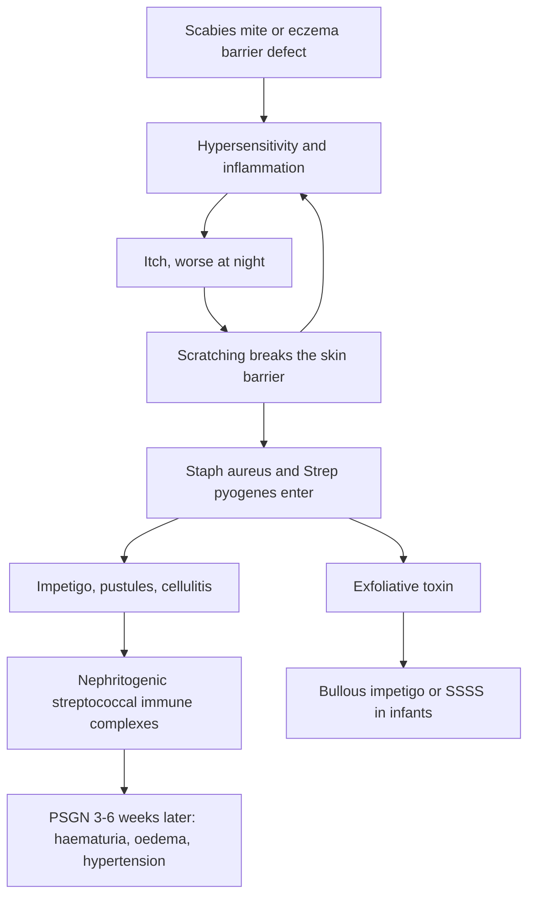

## 1. Definition

This topic covers the **common skin diseases of childhood** in Uganda: **infestations** (scabies, lice, jiggers), **superficial fungal infections** (tinea capitis, corporis, versicolor, candida), **bacterial skin infections** (impetigo, cellulitis, staphylococcal scalded skin syndrome), **viral lesions** (molluscum contagiosum), **inflammatory and allergic disease** (atopic eczema, urticaria, papular urticaria), and the skin conditions that are **emergencies or windows to serious disease** (Stevens–Johnson syndrome/toxic epidermal necrolysis, HIV-related skin disease, kwashiorkor dermatosis).

Most skin disease is **not dangerous but is miserable**: itching ruins sleep and schooling, scratching causes secondary infection, and stigma is real. A few skin conditions are **emergencies** or **windows to serious disease**:

- **Stevens–Johnson syndrome / toxic epidermal necrolysis (SJS/TEN)**: a drug reaction that can kill.
- **Eczema herpeticum**, **staphylococcal scalded skin**, **purpura/petechiae with fever** (meningococcaemia), **anaphylaxis** (urticaria with airway or circulation problems).
- **HIV-related skin disease**: often the first sign of HIV in a child.
- **Kwashiorkor dermatosis**: a sign of severe acute malnutrition.
- **Impetigo and infected scabies** can trigger **post-streptococcal glomerulonephritis** (and possibly rheumatic fever).

### Describing skin lesions (the language of dermatology)

| Term | Meaning | Examples |
|---|---|---|
| **Macule** | Flat, colour change, <1 cm | Measles rash (early), vitiligo, café-au-lait spot |
| **Patch** | Flat, >1 cm | Pityriasis versicolor, large café-au-lait |
| **Papule** | Raised, solid, <0.5–1 cm | Scabies, molluscum, papular urticaria |
| **Plaque** | Raised, flat-topped, >1 cm | Psoriasis, chronic eczema, tinea corporis |
| **Nodule** | Solid, deep, >1 cm | Scabies nodules, erythema nodosum |
| **Vesicle** | Fluid-filled, <0.5 cm | Chickenpox, herpes, eczema (acute) |
| **Bulla** | Fluid-filled, >0.5 cm | Bullous impetigo, SJS/TEN, burns |
| **Pustule** | Pus-filled | Infected scabies, folliculitis |
| **Wheal** | Transient, oedematous, itchy plaque (<24 h) | Urticaria |
| **Crust** | Dried exudate | Impetigo (honey-coloured) |
| **Scale** | Flakes of keratin | Tinea, eczema, psoriasis |
| **Erosion / ulcer** | Partial / full-thickness loss of epidermis (and dermis) | SJS, eczema herpeticum / ecthyma, Buruli ulcer |
| **Excoriation** | Scratch mark | Any itchy condition |
| **Lichenification** | Thickened skin with exaggerated markings from rubbing | Chronic atopic eczema |
| **Petechiae / purpura** | Non-blanching red-purple spots, <2 mm / larger | Meningococcaemia, ITP, leukaemia, dengue |

**A useful order for presenting a rash ("SCALE")**: **S**ite and distribution → **C**olour → **A**rrangement (linear, annular, grouped, dermatomal) → **L**esion type (primary, then secondary) → **E**xtras (mucosae, nails, hair, nodes, systemic features).

> [!PEARL]
> The one thing never to forget: **describe the rash properly, then look at the whole child**: mucous membranes, temperature, nutrition, HIV status and the drug history. A rash with **mucosal erosions and a new drug** is SJS until proven otherwise.

## 2. Epidemiology

- Skin complaints are among the **commonest reasons children attend outpatient clinics** in Uganda; in schools and crowded homes some conditions (scabies, tinea capitis) affect a large share of children.
- Surveys of school children in Uganda and East Africa consistently find **tinea capitis, scabies, impetigo and pediculosis** among the commonest conditions, often in the same child. **Tinea capitis** is very common in primary-school children (spread by shared combs, hats and barbers' clippers).
- **Scabies** spreads in crowded homes, boarding schools, prisons, refugee settlements and institutions; WHO added scabies to the neglected tropical diseases list in **2017** and supports **mass drug administration with ivermectin** where prevalence is high. Infected scabies is a leading driver of **impetigo** and **post-streptococcal glomerulonephritis** in tropical countries.
- **Papular urticaria** (insect-bite hypersensitivity from mosquitoes, fleas, bedbugs) is very common in young children.
- **Atopic eczema** is rising in urban Uganda.
- **HIV**: skin disease affects most children living with HIV at some point; **papular pruritic eruption (PPE)** is a WHO clinical stage 2 condition and should prompt HIV testing.
- **SJS/TEN**: risk is much higher in people with HIV; in Uganda, cotrimoxazole prophylaxis, nevirapine (still used for infant prophylaxis), anti-TB drugs and anticonvulsants are the main triggers.

> [!UGANDA]
> What is on the shelf at HC II–IV: **benzyl benzoate 25%** (permethrin is less often available and more expensive), **ivermectin** (in NTD programmes and some pharmacies), **Whitfield's ointment** (benzoic + salicylic acid), **clotrimazole/miconazole cream**, **griseofulvin tablets**, **gentian violet 0.5%**, **chlorhexidine**, **betamethasone 0.1% and hydrocortisone 1% creams**, **petroleum jelly (Vaseline)**, **chlorphenamine, cetirizine, promethazine**, **cloxacillin and erythromycin**, **calamine lotion**. Terbinafine tablets, mupirocin and permethrin are mostly in private pharmacies and hospitals. Dermatology services are concentrated at Mulago and a few regional referral hospitals.

## 3. Aetiology and Risk Factors

| Condition | Cause | Risk factors |
|---|---|---|
| **Scabies** | *Sarcoptes scabiei* mite | Crowding, shared beds, boarding schools, institutions, refugee settlements; **crusted scabies** with HIV, malnutrition, steroids, disability |
| **Tinea capitis / corporis** | Dermatophytes (*Trichophyton, Microsporum*) | School age, shared combs, hats and barbers' clippers; steroid creams (tinea incognito); HIV (extensive disease) |
| **Pityriasis versicolor** | *Malassezia* yeast | Adolescents, heat and sweating |
| **Candidiasis** | *Candida* | Nappy occlusion, antibiotics, HIV, diabetes |
| **Impetigo, cellulitis, SSSS** | *Staph aureus*, *Strep pyogenes* | Broken skin: scabies, eczema, insect bites; crowding, poor water access |
| **Molluscum contagiosum** | Poxvirus | Contact, autoinoculation; **HIV** (extensive, giant lesions) |
| **Atopic eczema** | Barrier defect (filaggrin) plus type 2 inflammation | Family or personal atopy (asthma, hay fever), urban living, soaps, heat, wool and synthetic clothes, dust |
| **Urticaria** | Mast-cell histamine release | **Viral infections** (commonest acute trigger), foods, drugs, insect bites, worms |
| **Papular urticaria** | Hypersensitivity to insect bites | No bed net, bedbugs, fleas |
| **SJS/TEN** | Cytotoxic drug reaction | **Cotrimoxazole, nevirapine, anticonvulsants** (carbamazepine, phenytoin, phenobarbital, lamotrigine), **anti-TB drugs**, NSAIDs, allopurinol; **HIV**, HLA types, slow drug metabolism |
| **Kwashiorkor dermatosis** | Protein, zinc and essential fatty-acid deficiency | Severe acute malnutrition |
| **PSGN** | Nephritogenic group A streptococcus | Streptococcal impetigo, infected scabies |

## 4. Pathophysiology

- **Skin barrier**: the stratum corneum keeps water in and irritants and microbes out. In **atopic eczema**, filaggrin and other barrier defects cause dry, leaky skin, allowing allergens and *Staph aureus* in, which drives type 2 (Th2) inflammation and itch; scratching damages the barrier further (**itch–scratch cycle**). This is why **emollients are the foundation** of treatment and why soap makes eczema worse.
- **Scabies**: the female mite burrows into the stratum corneum and lays eggs. The **itch is a delayed hypersensitivity reaction** to mites, eggs and faeces, which is why it starts **3–6 weeks after first infestation** (1–3 days on re-infestation) and **persists for 2–4 weeks after successful treatment**. In immunosuppression (HIV, malnutrition, steroids) thousands of mites cause **crusted (Norwegian) scabies**, which is highly contagious.
- **Dermatophytes** digest keratin in skin, hair and nails. In **tinea capitis** they invade the **hair shaft and follicle**, out of reach of creams; hence oral treatment. An intense inflammatory reaction produces a boggy, pustular **kerion** (not an abscess: don't incise).
- **Impetigo**: *Staph aureus* (and *Strep pyogenes*) infect the superficial epidermis, often on top of scabies, eczema or insect bites. **Bullous impetigo** is caused by staphylococcal **exfoliative toxin**, which splits the epidermis; the same toxin circulating causes **staphylococcal scalded skin syndrome (SSSS)** in infants.
- **Post-streptococcal glomerulonephritis (PSGN)**: immune complexes from nephritogenic strains of group A streptococcus deposit in glomeruli, causing haematuria, oedema, hypertension and oliguria **3–6 weeks after a skin infection** (1–2 weeks after a throat infection).
- **Urticaria**: mast cells release histamine → leaky dermal vessels → wheals.
- **SJS/TEN**: a cytotoxic T-cell reaction to a drug causes widespread **keratinocyte death** (via granulysin and Fas ligand), so the epidermis peels off like a burn.
- **Kwashiorkor dermatosis**: protein, zinc and essential fatty-acid deficiency and oxidative stress damage the epidermis: hyperpigmented patches that crack and peel ("flaky paint"), leaving raw, easily infected skin.

**Feature links**

- Hypersensitivity to mites, eggs and faeces → intense itch, worse at night when the skin is warm → excoriations and sleep loss.
- Mite burrowing in thin skin → burrows in finger webs, wrists, axillae, umbilicus, genitals; in infants palms, soles, face and scalp.
- Delayed hypersensitivity → itch starts 3–6 weeks after infestation and lasts 2–4 weeks after cure.
- Immunosuppression → uncontrolled mite numbers → thick crusts with little itch (crusted scabies).
- Filaggrin defect → dry, leaky skin → itch → scratching → lichenification (chronic eczema).
- Barrier breach with *Staph aureus* → weeping, crusting, pustules (infected eczema).
- Herpes simplex on eczematous skin → clustered punched-out erosions and fever (eczema herpeticum).
- Dermatophyte in the hair shaft → broken hairs, black dots, patchy hair loss, scale; intense host reaction → kerion; destroyed follicles → scarring alopecia.
- Dermatophyte spreading outward → annular plaque with an active scaly edge and central clearing.
- Steroid on tinea → suppressed inflammation, unchecked fungus → large, atypical rash (tinea incognito).
- Exfoliative toxin → epidermal split → flaccid bullae (local) or widespread tender peeling with positive Nikolsky (SSSS); mucosa spared.
- Group A streptococcal immune complexes → glomerular inflammation → dark urine, facial oedema, hypertension, oliguria.
- Histamine → leaky dermal vessels → wheals (<24 h); deeper oedema → angioedema; systemic release → anaphylaxis.
- Drug-specific cytotoxic T cells → keratinocyte death → dusky, painful skin, blisters, positive Nikolsky (TEN), mucosal erosions → fluid loss, sepsis, eye scarring.
- Protein and zinc deficiency → flaky-paint dermatosis, raw skin → infection and hypothermia.

## 5. Classification / Staging

**Classification of common childhood skin disease**

| Group | Conditions in this topic |
|---|---|
| **Infestations** | Scabies (also pediculosis, tungiasis/jiggers) |
| **Fungal** | Tinea capitis, corporis, pedis, unguium; pityriasis versicolor; candidiasis |
| **Bacterial** | Impetigo (non-bullous, bullous), ecthyma, folliculitis, boils, cellulitis, staphylococcal scalded skin syndrome |
| **Viral** | Molluscum contagiosum, warts, herpes simplex/zoster, chickenpox, measles |
| **Inflammatory / allergic** | Atopic eczema, seborrhoeic dermatitis, contact dermatitis, urticaria, papular urticaria |
| **Drug reactions** | Fixed drug eruption, morbilliform rash, **SJS/TEN**, DRESS |
| **Nutritional** | Kwashiorkor dermatosis ("flaky paint"), pellagra, zinc deficiency |
| **HIV-related** | Papular pruritic eruption, extensive molluscum/warts, zoster, seborrhoeic dermatitis, severe fungal infections, Kaposi sarcoma, drug eruptions |

**SJS/TEN by body surface area with detachment**

| Category | Body surface area with detachment |
|---|---|
| **SJS** | **<10%** |
| **SJS/TEN overlap** | **10–30%** |
| **TEN** | **>30%** |

All have **mucosal involvement** (usually two or more sites: mouth, eyes, genitals) and are most often **drug-induced** (onset typically **4–28 days** after starting the drug).

**Atopic eczema severity (NICE CG57 stepped care; UCG 2023)**

| Severity | What you see |
|---|---|
| **Mild** | Dry skin, occasional itch, small areas of redness |
| **Moderate** | Dry skin, frequent itch, redness ± excoriation and localised thickening |
| **Severe** | Widespread dryness, incessant itch, redness, excoriation, extensive thickening, bleeding, oozing, cracking |

**Impetigo**: **localised** (<5 lesions, well child) versus **widespread** (>5 lesions, bullous, fever or nodes): this decides topical versus oral treatment.

**Urticaria**: **acute** (<6 weeks) versus **chronic** (>6 weeks).

**HIV-related skin disease** is staged by WHO: **stage 2** includes papular pruritic eruption, extensive molluscum, extensive wart virus infection, fungal nail infections, herpes zoster, recurrent oral ulcers, lineal gingival erythema, angular cheilitis; **stage 4** includes Kaposi sarcoma and chronic herpes simplex >1 month.

## 6. Clinical Features

### History

| Question | Why it matters |
|---|---|
| **Onset, duration, where it started, how it spread** | Acute (urticaria, drug reaction, viral) vs chronic (eczema, tinea) |
| **Itch?** Worse at night? | Severe nocturnal itch = scabies; itch is the hallmark of eczema and urticaria |
| **Others at home or school with itch or rash** | Scabies, tinea capitis, impetigo spread in households and schools |
| **New medicines in the last 1–8 weeks** (cotrimoxazole, nevirapine, anticonvulsants, anti-TB, antibiotics, herbal) | Drug eruption, SJS/TEN, DRESS |
| **Fever, malaise, sore eyes or mouth, pain** | SJS, measles, chickenpox, sepsis, eczema herpeticum |
| **Personal or family history of eczema, asthma, hay fever** | Atopy |
| **Soaps, creams, herbs, bleaching or steroid creams used** | Contact dermatitis, tinea incognito, steroid damage |
| **Insect exposure** (bedbugs, fleas, mosquitoes, no net) | Papular urticaria |
| **HIV status (child and mother), cotrimoxazole/ART** | HIV-related skin disease; drug reactions |
| **Feeding, weight loss, swelling of feet** | Kwashiorkor dermatosis |
| **Urine colour, facial swelling** (recent impetigo/scabies) | PSGN |
| **Immunisation** (measles) | Measles rash and complications |
| **Previous treatment and response** | Resistance, wrong diagnosis, poor adherence, re-infestation |
| **Effect on sleep, school, family** | Severity and impact |

### Examination

Follow the order of Hutchison's Clinical Methods (24th edition), adapted for children. Skin examination is mainly **inspection in good light and palpation**; percussion and auscultation apply only to the systemic examination.

#### Introduction, consent and preparation

- Introduce yourself; confirm the child's name and age and the carer's relationship.
- Explain; consent from the parent and **assent from the child**; offer a chaperone, especially for genital examination of older children.
- **Hand hygiene**; gloves for weeping, crusted or blistering lesions and suspected scabies.
- **Position and exposure**: undress the child fully in stages, with the mother present, in **good natural light**; keep the child warm.

#### General inspection (end of the bed)

- Well or unwell; distress, itch and scratching; colour (pallor, jaundice); hydration.
- **Vitals**: temperature, HR, RR, BP (especially with recent impetigo or scabies, PSGN).
- **Nutrition and growth**: weight, height, **MUAC, oedema** (kwashiorkor); plot Z-scores.
- **Signs of HIV**: oral thrush, parotid enlargement, lymphadenopathy, wasting.

#### Hands, face and neck

- **Hands**: **finger webs** and sides of fingers, wrists (burrows); nails (dystrophy in fungal infection or psoriasis; nails cut short or not).
- **Face**: **mouth and lips** (erosions in SJS, thrush), **eyes** (conjunctivitis in SJS, measles), perioral peeling (SSSS), facial oedema (PSGN, angioedema).
- **Neck**: lymph nodes (occipital and posterior cervical in tinea capitis; regional nodes in infected lesions).

#### The skin

1. **Inspection of the whole skin**: **distribution** (flexures, extensor surfaces, sun-exposed, nappy area, palms and soles, scalp, finger webs, genitals); **primary lesion and secondary changes** (vocabulary in section 1); colour; arrangement.
2. **Palpation**: texture and thickness (lichenification, nodules), tenderness and warmth (cellulitis, SSSS, TEN), **blanching** (press with a glass slide: non-blanching = petechiae/purpura).
3. **Nikolsky sign**: gentle sideways pressure on normal-looking skin shears off the epidermis = SSSS or TEN.
4. **Signs of infection**: crusts, pus, cellulitis, lymphangitis, fever.

#### Completing the examination

- **Hair and scalp**: scaling, broken hairs, black dots, kerion (tinea capitis); nits (lice).
- **Genitals** (with consent and chaperone): scabies papules and nodules; mucosal erosions in SJS.
- **Systemic**: hepatosplenomegaly, lymphadenopathy (HIV, leukaemia), chest.
- **Blood pressure and urine dipstick** in any child with recent impetigo/scabies and oedema or dark urine (PSGN).
- Thank the child and parent, help them dress, **hand hygiene**, summarise using **SCALE**.

| Document these positives | And these negatives |
|---|---|
| Distribution and lesion type ("excoriated papules and burrows in the finger webs, wrists and periumbilical area") | "Mucous membranes normal" |
| Secondary infection (crusts, pustules), lymph nodes | "No fever; no purpura" |
| Scalp: scale, broken hairs, kerion | "Nikolsky sign negative" |
| Nutrition: weight, MUAC, oedema | "No oedema; BP normal; urine dipstick negative for blood" |

### Red flags

> [!REDFLAG]
> - **Mucosal erosions + blisters/dusky skin + fever** after a new drug = **SJS/TEN**: stop the drug, admit.
> - **Fever + non-blanching petechiae/purpura** = meningococcaemia/sepsis: ETAT, antibiotics now.
> - **Eczema that suddenly becomes painful with clustered punched-out erosions and fever** = eczema herpeticum: IV/oral aciclovir.
> - **Infant with fever, tender red skin, and peeling around the mouth and flexures** (positive Nikolsky, mucosa spared) = SSSS: IV cloxacillin/flucloxacillin.
> - **Urticaria with lip/tongue swelling, stridor, wheeze or shock** = anaphylaxis: IM adrenaline.
> - **Haematuria, oedema, hypertension** weeks after skin sores = PSGN.
> - **Crusted, thick, scaly scabies** in an HIV-positive or malnourished child = crusted scabies: isolate, oral + topical treatment.
> - **Flaky-paint skin with oedema** = kwashiorkor: SAM protocol.
> - Call your senior for: SJS/TEN, SSSS, eczema herpeticum, a febrile child with purpura, anaphylaxis, or a rash in an immunocompromised child that is spreading quickly.

### Thinking like a clinician

- **Itch is the key branch point.** Itchy: scabies, eczema, urticaria/papular urticaria, tinea, PPE, lice. Not very itchy: impetigo, molluscum, viral exanthems, pityriasis versicolor, drug eruptions (variable).
- **"Is anyone else at home itching?"** If yes, think **scabies** and treat everyone.
- **Scaly patch on the scalp with hair loss in a school child = tinea capitis** until proven otherwise; topicals alone fail.
- **Ring-shaped rash treated with a steroid cream that got bigger and less typical** = **tinea incognito**.
- **Impetigo in a child with scabies**: treat both, otherwise the impetigo recurs.
- **A child on cotrimoxazole for HIV with fever and mouth sores** has SJS until proven otherwise; stop cotrimoxazole and never restart it.
- **Extensive molluscum, giant molluscum, or herpes zoster in a young child** → **test for HIV**.
- **Persistent oral thrush beyond infancy** → HIV test.
- **Common student mistakes**: describing the rash vaguely ("a rash on the body"); not examining the mouth and eyes; treating only the child with scabies, not the household; topical antifungals for tinea capitis; potent steroids on the face or on fungal infections; antihistamines without emollients in eczema; missing a drug history.

> [!EXAM]
> Viva favourite: **"Why do children with scabies keep itching after treatment?"** The itch is a hypersensitivity reaction to dead mites and their products and can last **2–4 weeks** after successful treatment. Persistent itch with **new burrows** after 4 weeks, or itching household members, means treatment failure or re-infestation.

## 7. Differential Diagnoses

**The itchy child**

| Differential | Distinguishing clinical feature | Distinguishing investigation |
|---|---|---|
| **Scabies** | Night itch, burrows, finger webs, wrists, genitals, family affected; infants: palms, soles, scalp | Clinical; mite scraping |
| **Atopic eczema** | Dry skin; infants: face and extensor; children: flexures (elbows, knees, neck); chronic and relapsing; atopy | Clinical |
| **Papular urticaria** | Grouped itchy papules on exposed skin (legs, arms), central punctum, new crops after bites; no burrows, family members less affected | Clinical |
| **Papular pruritic eruption (HIV)** | Symmetrical, very itchy papules on limbs and trunk, hyperpigmented scars | HIV test |
| **Tinea corporis** | Annular scaly plaque with active edge | KOH |
| **Pediculosis** | Scalp itch, nits on hair shafts | Look for lice/nits |
| **Onchocerciasis** (endemic foci) | Chronic itchy papular dermatitis, depigmentation ("leopard skin"), nodules, eye disease | Skin snip |

**The blistering or peeling child**

| Differential | Distinguishing clinical feature | Distinguishing investigation |
|---|---|---|
| **SJS/TEN** | Drug history, dusky target-like lesions, blisters, **mucosal erosions (≥2 sites)**, Nikolsky positive in TEN | Clinical ± biopsy |
| **SSSS** | Infants, fever, tender erythema, superficial peeling around mouth and flexures, **mucosa spared** | Clinical; swab from focus |
| **Bullous impetigo** | Localised flaccid bullae with collarette of scale, well child | Swab |
| **Chickenpox** | Crops of vesicles in different stages, central distribution, mild mucosal | Clinical |
| **Eczema herpeticum** | Punched-out, clustered erosions on eczema, fever | Clinical (Tzanck/PCR) |
| **Burns (including scalds, abuse)** | History, pattern | History; safeguarding |

**The scaly scalp**

| Differential | Distinguishing clinical feature | Distinguishing investigation |
|---|---|---|
| **Tinea capitis** | Patchy hair loss, broken hairs, black dots, scale, lymph nodes, kerion | KOH of hairs, Wood's lamp |
| **Seborrhoeic dermatitis** | Infants (cradle cap) or adolescents; greasy yellow scale; no hair loss | Clinical |
| **Atopic eczema** | Other eczema sites, itch | Clinical |
| **Psoriasis** | Thick silvery plaques at hairline, nails pitted | Clinical |
| **Traction alopecia** | Tight braiding, hair loss at margins | History |

**Tinea versus eczema**: tinea is annular with an active scaly edge and central clearing, often single or few and asymmetrical; eczema is ill-defined without central clearing and usually symmetrical in flexures.

## 8. Clinical Workup

Most skin diagnoses are clinical. Tests confirm fungus before weeks of oral treatment, look for HIV, and screen for complications.

### Bedside

| Test | When / how | Expected finding | How it changes management | Available at |
|---|---|---|---|---|
| **Skin scraping with 10–20% KOH** | Scale from the active edge, or plucked hairs | Fungal hyphae/spores; "spaghetti and meatballs" in versicolor | Confirms fungal; oral vs topical | HC IV and hospitals with microscopy |
| **Burrow scraping with mineral oil / dermatoscopy** | Doubtful or crusted scabies | Mites, eggs, faeces (scybala) | Confirms; usually a clinical diagnosis | Hospitals |
| **Wood's lamp** | Tinea capitis | Green fluorescence of *Microsporum* (most *Trichophyton* do not fluoresce) | Supports diagnosis; griseofulvin best for *Microsporum* | Some hospitals |
| **Nikolsky sign** | Blistering or tender skin | Epidermis shears off = SSSS or TEN | Admit | All levels |
| **Urine dipstick and BP** | Oedema or dark urine after skin infection | Haematuria, proteinuria, hypertension | PSGN management | All levels |
| **Glucose** | Recurrent boils or candida | Raised (diabetes) | Diabetes work-up | All levels with a glucometer |
| **Rapid HIV test** | Any HIV clue, SJS, severe or recurrent infection | Positive | ART, cotrimoxazole (unless sulfa reaction), staging | All levels |

### Basic lab

| Test | When | Expected / abnormal finding | How it changes management | Available at |
|---|---|---|---|---|
| Pus swab Gram stain/culture | Severe impetigo, abscess, SSSS | *S. aureus* (MRSA?), *S. pyogenes* | Antibiotic choice | Hospitals |
| FBC, eosinophils, stool microscopy | Chronic urticaria, prurigo | Eosinophilia, helminths | Deworm | Hospitals |
| FBC, electrolytes, albumin, blood culture | SJS/TEN | Fluid/electrolyte loss, low albumin, sepsis | Fluids, antibiotics if infected | Hospitals |

### Imaging

Not applicable: skin disease in children is diagnosed clinically and with bedside microscopy; imaging is used only for complications (e.g. renal ultrasound in complicated nephritis), covered in the relevant topics.

### Specialised / referral-level

| Test | When | Expected / abnormal finding | How it changes management | Available at |
|---|---|---|---|---|
| Fungal culture (Sabouraud's) | Treatment failure, outbreaks | Species | Griseofulvin vs terbinafine | National/teaching labs |
| Urinalysis, creatinine, ASOT, C3 | Oedema/haematuria after skin infection | Haematuria, proteinuria, raised ASOT, low C3 | PSGN management | RRH/national referral |
| Skin biopsy | Uncertain diagnosis, suspected KS, TEN vs SSSS | Histology | Diagnosis | Mulago and a few RRHs |
| Tzanck smear / HSV PCR | Suspected eczema herpeticum | Multinucleate giant cells / HSV | Confirms, but never delay aciclovir | Teaching hospitals |

### Putting it together

**Model one-line summary**: "A 7-year-old boy, 21 kg, with 3 weeks of intensely itchy excoriated papules and burrows in the finger webs, wrists, axillae and genitals, secondary impetiginisation of the hands, and two itchy siblings: **scabies with secondary impetigo**; BP and urine normal."

**Problem list** (for the model case below)

1. Scabies, household outbreak.
2. Secondary impetigo of both hands with epitrochlear nodes.
3. Sleep loss in the child and siblings.
4. Risk of PSGN: safety-net advice.

**Model case presentation**

> "Master K.M., a **6-year-old boy** from Kisenyi, **weight 18 kg** (weight-for-age Z −1.2, height-for-age Z −1.0), brought with **3 weeks of intense itching, worse at night**, which kept him and his two younger sisters awake; his mother is also itching. He has had **painful crusted sores on both hands for 5 days**. No fever, no recent new medicines, no oedema or dark urine. **Immunisation complete for age**, **eats family food**, **HIV-negative** (tested at 18 months; mother HIV-negative). Examination: well, afebrile; **excoriated papules and burrows in the finger webs, wrists, anterior axillary folds, periumbilical area and penis**, with **honey-coloured crusts over the dorsum of both hands** and tender epitrochlear nodes; scalp, mouth and eyes normal; **BP 98/60, urine dipstick negative for blood**. **Assessment: scabies with secondary impetigo**, household outbreak. **Plan**: benzyl benzoate 25% diluted 1:1 with water for him and his 4-year-old sister, 1:3 for the 18-month-old, full strength for the mother (or permethrin 5% for all) applied the same night and repeated; wash bedding; **cloxacillin 250 mg 6-hourly for 7 days** (about 14 mg/kg); chlorphenamine 2 mg at night; review in 2 weeks; return if facial swelling or dark urine."

> [!NOTE]
> **Worked example: is it tinea or eczema?** A 9-year-old has a 3 cm round, scaly, itchy plaque on the forearm with a **raised active edge and central clearing**; KOH shows hyphae. **Interpretation**: **tinea corporis** (annular with an active scaly edge; eczema is ill-defined without central clearing and is usually symmetrical in flexures). **Plan**: Whitfield's ointment or clotrimazole 1% twice daily until 2 weeks after clearing; check the scalp and household; no steroid cream.

**Worked example 2: rash on cotrimoxazole.** A 5-year-old girl with HIV, on cotrimoxazole prophylaxis for 3 weeks, has fever, sore red eyes, crusted lips and mouth ulcers and dusky target-like lesions with a few blisters on the trunk, about 5% body surface; Nikolsky negative. **Interpretation**: two mucosal sites + new sulfonamide + <10% detachment = **SJS**. **Plan**: stop cotrimoxazole and all non-essential drugs, record the allergy on the file, card and child health book, admit, fluids by urine output, non-adherent dressings, eye review within 24 h, mouth care and analgesia; dapsone prophylaxis after recovery; never rechallenge.

## 9. Management

### Immediate / emergency

Most skin consultations are not emergencies, but always screen first:

1. **ABC**: stridor, wheeze, lip/tongue swelling (anaphylaxis: **IM adrenaline 0.01 mL/kg of 1:1000**, max 0.5 mL, thigh, repeat every 5 min); shock (sepsis, TEN with fluid loss).
2. **Fever + petechial/purpuric rash** → ETAT emergency: IV/IM ceftriaxone, fluids per protocol.
3. **Mucosal erosions + blistering/dusky skin** → SJS/TEN: stop suspect drugs, admit, assess fluid needs as for burns.
4. **Widespread tender red skin with peeling in an infant** → SSSS: admit, IV antibiotics.
5. **Signs of SAM** (oedema, wasting, flaky-paint skin) → SAM protocol (glucose, warmth, antibiotics).
6. **Eczema herpeticum** → aciclovir today.

### Definitive

#### General principles of skin treatment

1. **Treat the cause** (mite, fungus, bacteria, drug, allergen) and **the itch** (antihistamine, emollient).
2. **Choose the right vehicle**: **ointments** (greasy) for dry, scaly skin; **creams** for moist areas and the face; **lotions** for hairy areas and large areas; **pastes** for protection.
3. **Quantity**: one **fingertip unit (FTU)** (about 0.5 g) covers two adult palms. A child's whole body needs about 10–20 FTUs per application depending on age.
4. **Treat contacts** (scabies, tinea capitis, impetigo in households and schools).
5. **Prevent**: hygiene, not sharing combs, hats, towels and bedding; sleeping under nets; nutrition.

#### Scabies

- **Treat all household members and close contacts at the same time**, whether or not they itch; wash bedding, clothes and towels in hot water and dry in the sun (or seal in a bag for 72 hours); cut nails short.
- **Permethrin 5%** (first-line internationally, from 2 months): apply to the **whole body from the neck down** (include scalp, face and ears in infants and young children, avoiding eyes and mouth), especially finger webs, under nails, genitals; wash off after **8–12 hours**; **repeat after 7 days**; reapply to hands if washed during treatment.
- **Benzyl benzoate 25%** (UCG 2023 first line, widely available): after a bath, apply to the whole body at bedtime, wash off in the morning (UCG: "repeat 2 times"); **dilute for children** (1:1 with water 2–12 years; 1:3 under 2 years); many protocols repeat after 7 days to kill newly hatched mites.
- **Sulphur 5–10% ointment** for **infants <2 months** and pregnancy: 3 consecutive nights.
- **Oral ivermectin** for crusted scabies, outbreaks or failure of topicals (doses in the drug table).
- **Itch**: chlorphenamine at night and emollient; treat secondary infection and scabies together.

> [!PEARL]
> Tell families **the itch can last 2–4 weeks after treatment**; give an antihistamine and emollient, and review at 2–4 weeks. **New burrows** at that point mean failure or re-infestation (usually because contacts were not treated).

**Crusted scabies** (HIV, SAM, steroids, disability): isolate; **oral ivermectin 200 µg/kg on days 1, 2 and 8** (more doses in severe cases) **plus** topical permethrin/benzyl benzoate repeatedly; keratolytic (salicylic acid in petroleum jelly) to remove crusts; treat contacts; HIV test.

#### Fungal infections

**Tinea capitis**: oral griseofulvin with fatty food (milk, groundnuts, avocado) for 6–8 weeks, or terbinafine for 4 weeks (drug table); **adjunct** ketoconazole 2% or selenium sulphide shampoo twice weekly for 2–4 weeks to reduce spore shedding, also for household contacts. **Kerion**: oral antifungal ± short course of oral prednisolone (1 mg/kg for 1–2 weeks) for severe inflammation; **do not incise**; antibiotics only if secondary infection.

> [!DRUG]
> **Do NOT treat tinea capitis with creams alone**: they cannot reach the infected hair follicle (UCG 2023). Children can stay in school once treatment has started, but should not share combs, hats or clippers.

**Tinea corporis, pedis, cruris**

- **Whitfield's ointment** (benzoic acid 6% + salicylic acid 3%) **12-hourly until 2 weeks after the lesions clear** (UCG), or **clotrimazole 1% / miconazole 2% cream** twice daily for 2–4 weeks.
- **Oral griseofulvin** for 3–6 weeks if extensive or not responding to topicals.
- **Never use a steroid cream** (tinea incognito); combined steroid–antifungal–antibiotic creams sold over the counter cause this.

**Pityriasis versicolor**

- Hypo- or hyperpigmented, finely scaly macules on the trunk (adolescents); *Malassezia*.
- **Clotrimazole/miconazole cream 12-hourly for 2–3 weeks**, or **selenium sulphide 2.5% / ketoconazole 2% shampoo** applied to the skin for 10 minutes daily for 1–2 weeks; oral fluconazole for extensive disease in adolescents (UCG: 300 mg weekly for 2 weeks); **not griseofulvin** (ineffective).
- Pigment takes months to return; that is not failure.

**Candidiasis (nappy area, oral)**

- Nappy candidiasis: bright red with satellite papules; nystatin or clotrimazole cream 2–3 times daily, keep the area dry, zinc barrier cream.
- Oral thrush: nystatin suspension 100,000 units 6-hourly for 7 days (infants 1 mL); persistent or severe thrush beyond infancy → HIV test.

#### Impetigo and other bacterial infections

| Severity | Treatment | Duration |
|---|---|---|
| **Localised (<5 lesions), well child** (UCG) | Soak and gently remove crusts with soap and water; clean with **chlorhexidine 0.05%**; **gentian violet 0.5%** 12-hourly **or** **mupirocin 2%** 8-hourly (or fusidic acid 2%) | Gentian violet 3 days; mupirocin 5–7 days |
| **Widespread (>5 lesions), bullous, fever or nodes** | Oral **cloxacillin/flucloxacillin** | **7 days** |
| **Penicillin allergy** | Oral **erythromycin** | 7 days |
| **Cellulitis needing admission** | IV cloxacillin ± benzylpenicillin; or ceftriaxone | Switch to oral when improving; total 7–10 days |
| **SSSS** | IV cloxacillin/flucloxacillin, fluids, skin care as a burn, analgesia | 7–10 days |

Also: treat underlying scabies, eczema or lice; keep nails short; separate towels; children can return to school once lesions have crusted over or 48 hours after starting antibiotics; **check urine and BP if the child later develops oedema or dark urine (PSGN)**.

#### Atopic eczema (NICE CG57 stepped care; UCG 2023)

| Severity | Treatment |
|---|---|
| **Mild** | **Emollients** + **mild steroid** (hydrocortisone 1%) for flares |
| **Moderate** | Emollients + **moderate steroid** (e.g. clobetasone butyrate 0.05%) for flares; **hydrocortisone 1% for face/neck/flexures**; sedating antihistamine at night for 1–2 weeks if sleep disturbed |
| **Severe** | Emollients + **potent steroid** (betamethasone valerate 0.1%) for the body for up to 1–2 weeks (UCG: 12-hourly for 2 weeks, not face/genitals); wet wraps; refer if not controlled |

**Practical regimen**

1. **Emollient**: petroleum jelly, emulsifying ointment or a cream, **liberally (250–500 g per week in a child), 2–4 times a day and after bathing**; continue when the skin is clear.
2. **Soap substitute**: wash with emollient, not soap; lukewarm water; pat dry; bathe at most once or twice daily (UCG).
3. **Topical steroid** once or twice daily to **active eczema only**, in FTUs, for **3–14 days** per flare; step down as it improves; potent steroids only for short periods and **not on the face or genitals** (hydrocortisone 1% there).
4. **Antihistamine**: sedating (chlorphenamine; promethazine, avoided under 2 years) for nights when itch disrupts sleep; non-sedating antihistamines add little for eczema itch.
5. **Infected eczema** (weeping, crusting, pustules, sudden worsening): oral **flucloxacillin/cloxacillin** for 7 days.
6. **Eczema herpeticum** (painful clustered punched-out erosions, fever): **aciclovir** oral or IV if unwell or periocular involvement (eye review).
7. **Triggers**: soaps, wool and synthetic clothes, heat and sweating, dust; food allergy is an uncommon cause except in infants with severe early eczema.
8. **Education**: chronic relapsing condition; most children improve with age; steroid fears ("steroid phobia") are common, so explain safe use with FTUs.

#### Molluscum contagiosum

- Pearly, dome-shaped, **umbilicated papules** 1–5 mm, often in clusters; spread by contact and autoinoculation; poxvirus.
- **Usually self-limiting over 6–18 months**; reassure; avoid squeezing and sharing towels.
- Treat if numerous, distressing or infected: curettage, cryotherapy, or gentle expression (specialist/clinic); topical potassium hydroxide 5–10% or podophyllotoxin in older children (not widely available).
- **Extensive, large (giant) or facial molluscum, especially in an older child = test for HIV**; lesions regress with **ART**.

#### Urticaria and papular urticaria

- **Acute urticaria** (<6 weeks): usually viral infection, food, drug, insect; avoid the trigger; non-sedating antihistamine (cetirizine first choice) for days to weeks until wheals stop; calamine lotion for relief; prednisolone for severe or unresponsive cases.
- **Papular urticaria**: crops of itchy papules on exposed skin after insect bites; **bed nets, treat bedbugs/fleas** (wash bedding, sun mattresses), antihistamine, mild topical steroid for a few days, treat infected lesions; usually outgrown by school age.
- **Chronic urticaria** (>6 weeks): look for worms (deworm with albendazole), thyroid disease; refer.
- **Angioedema with airway, breathing or circulation compromise = anaphylaxis**: IM adrenaline first.

#### Stevens–Johnson syndrome / TEN

1. **Stop the culprit drug (and all non-essential drugs)** immediately; record it as an allergy on the file, card and in the child's health book; **never rechallenge**.
2. **Admit** (ideally to a high-dependency or burns area; refer TEN to Mulago/RRH).
3. **Fluids**: like a burn (losses through denuded skin): maintenance plus replacement guided by urine output (target **≥1 mL/kg/h**), electrolytes and albumin.
4. **Skin care**: leave blisters in place where possible, **non-adherent dressings** (paraffin gauze, petroleum jelly), barrier nursing, warm room, handle gently; avoid adhesive tapes.
5. **Eyes**: ophthalmology review **within 24 hours**; lubricant drops, saline cleaning, antibiotic eye ointment, separate lids to prevent adhesions (blindness is a major long-term complication).
6. **Mouth and genitals**: saline/chlorhexidine mouthwashes, petroleum jelly to lips, analgesia before feeds; genital care (petroleum jelly, separate labia) to prevent adhesions.
7. **Nutrition**: NG feeds if unable to eat.
8. **Analgesia**: paracetamol, morphine as needed.
9. **Infection**: monitor; antibiotics only for proven or strongly suspected infection (cultures); no prophylactic antibiotics.
10. **Steroids**: **no strong evidence** (UCG 2023), and they increase infection risk; specialist decision only.
11. **HIV**: test; if on cotrimoxazole prophylaxis, **switch to dapsone 2 mg/kg once daily (max 100 mg)** after recovery; if nevirapine was the cause, switch ART per HIV guidelines (DTG-based).

#### HIV-related skin disease

| Condition | Features | Management |
|---|---|---|
| **Papular pruritic eruption** (WHO stage 2) | Symmetrical intensely itchy papules on limbs and trunk, post-inflammatory hyperpigmentation | **ART** (main treatment), antihistamine, emollient, mild–moderate topical steroid, insect avoidance |
| **Seborrhoeic dermatitis** | Greasy scale on scalp, face, chest; severe and extensive in HIV | Ketoconazole 2% shampoo/cream, mild steroid, ART |
| **Extensive molluscum, warts** (stage 2) | Many or giant lesions | ART; local treatment |
| **Herpes zoster** (stage 2 in children) | Painful dermatomal vesicles; recurrent or multi-dermatomal | Aciclovir (drug table), analgesia, ART |
| **Chronic herpes simplex >1 month** (stage 4) | Persistent painful ulcers | Aciclovir, ART |
| **Fungal infections** (extensive tinea, nail infections, candida) | Severe, recurrent | Oral antifungals, ART |
| **Kaposi sarcoma** (stage 4) | Purple macules, plaques or nodules on skin, palate; lymphadenopathy | Refer to Uganda Cancer Institute; ART + chemotherapy |
| **Drug eruptions** | Cotrimoxazole, nevirapine, anti-TB drugs, efavirenz | Assess severity; SJS → stop; mild → may continue with antihistamine under review |
| **Crusted scabies** | Thick crusts, little itch, highly contagious | Ivermectin + topical, isolation |

> [!UGANDA]
> Under Uganda's consolidated HIV guidelines, every child with an HIV-associated skin condition (PPE, extensive molluscum or warts, zoster) should be **tested for HIV** and, if positive, started on **ART promptly** (DTG-based regimens) with **cotrimoxazole prophylaxis** unless there is a sulfa reaction. Skin often improves dramatically on ART.

#### Kwashiorkor dermatosis (WHO SAM protocol)

- **Appearance**: hyperpigmented, cracked, peeling patches ("**flaky-paint**" or "crazy-paving" dermatosis), raw depigmented areas, especially in the nappy area, legs and pressure areas; hair thin, sparse, light-coloured (flag sign); oedema.
- **Management** (inside the SAM protocol: glucose, warmth, antibiotics, F-75, micronutrients including **zinc**):
  - Leave exposed areas to dry; avoid nappies if the perineum is raw.
  - **Barrier cream** (zinc and castor oil ointment, or petroleum jelly) on raw areas; paraffin gauze dressings to raw areas.
  - **Bathe or soak** affected areas in **0.01% potassium permanganate** for 10 minutes daily (WHO) to dry and disinfect.
  - **Gentian violet** or **nystatin cream** for skin sores and candida.
  - Systemic antibiotics are already part of complicated SAM treatment.
- Skin heals as nutrition recovers; peeling worsening in the first days can also be a sign of **refeeding/zinc deficiency**: ensure the mineral mix is in the feeds.

### Drug table

| Drug | Dose (per kg + max for children; adult) | Route | Frequency | Duration | Key cautions |
|---|---|---|---|---|---|
| **Permethrin 5% cream** (scabies) | Whole body from the neck down (whole body including scalp and face in infants); wash off after 8–12 h | Topical | Single application | **Repeat after 7 days** | From **2 months**; reapply to hands if washed |
| **Benzyl benzoate 25% lotion** (scabies) | Whole body at bedtime, wash off in the morning; **1:1 with water 2–12 years; 1:3 under 2 years** (UCG) | Topical | Repeat (UCG "2 times") | Many protocols repeat after 7 days | Stings and irritates; protect eyes; avoid in young infants if permethrin or sulphur available; not in pregnancy per UCG |
| **Sulphur 5–10% ointment** (scabies) | Whole body | Topical | Nightly | **3 consecutive nights**; wash off 24 h after last application | For **infants <2 months** and pregnancy; messy, smelly, safe |
| **Ivermectin** (scabies) | **200 µg/kg** with food | Oral | **Two doses 7 days apart**; crusted scabies **days 1, 2 and 8** (more if severe) | As stated | Children **≥15 kg** (UCG: avoid under 12 years where possible); not in pregnancy; with topical in crusted scabies |
| **Griseofulvin** (microsize; tinea capitis) | **UCG 2023: 10 mg/kg/day** (double in severe infection); international **15–25 mg/kg/day** (max 1 g/day) | Oral, **with fatty food** | Once daily (or divided) | **6–8 weeks** (UCG 6 weeks), until clinically and mycologically clear; tinea corporis 3–6 weeks | Best for *Microsporum*; headache, GI upset, photosensitivity; avoid in pregnancy, SLE, porphyria |
| **Terbinafine** (tinea capitis) | **<20 kg: 62.5 mg; 20–40 kg: 125 mg; >40 kg: 250 mg** | Oral | Once daily | **4 weeks** (*Trichophyton*) | Better for *Trichophyton*; LFTs if prolonged |
| **Whitfield's ointment** (benzoic 6% + salicylic 3%) | Thin layer | Topical | 12-hourly | Until **2 weeks after clearing** | Tinea corporis/pedis/cruris |
| **Clotrimazole 1% / miconazole 2% cream** | Thin layer | Topical | Twice daily | 2–4 weeks (versicolor 2–3 weeks) | Not for tinea capitis alone |
| **Fluconazole** (extensive pityriasis versicolor, adolescents) | **300 mg** (UCG) | Oral | Weekly | 2 weeks | Not griseofulvin for versicolor |
| **Nystatin suspension** (oral thrush) | **100,000 units** (infants 1 mL) | Oral | 6-hourly | 7 days | Persistent thrush beyond infancy → HIV test |
| **Gentian violet 0.5%** (localised impetigo) | Paint lesions after cleaning | Topical | 12-hourly | 3 days | Stains |
| **Mupirocin 2%** (or fusidic acid 2%) | Thin layer | Topical | 8-hourly | 5–7 days | Mostly private pharmacies |
| **Cloxacillin / flucloxacillin** (widespread impetigo, infected eczema or scabies) | **12.5–25 mg/kg** (max 500 mg/dose), before food | Oral | 6-hourly | **7 days** | Penicillin allergy |
| **Cloxacillin IV** (cellulitis) | **25–50 mg/kg** ± benzylpenicillin | IV | 6-hourly | Total 7–10 days with oral step-down | |
| **Cloxacillin / flucloxacillin IV** (SSSS) | **50 mg/kg** | IV | 6-hourly | 7–10 days | Plus fluids, burn-type skin care, analgesia |
| **Ceftriaxone** (cellulitis alternative; purpura with fever) | **50 mg/kg** | IV/IM | Daily | Per indication | |
| **Erythromycin** (penicillin allergy) | **7.5–12.5 mg/kg** (UCG 7.5 mg/kg) | Oral | 6-hourly | 7 days | GI upset |
| **Hydrocortisone 1%** | FTUs to active eczema | Topical | Once or twice daily | 3–14 days per flare | Face, neck, flexures, genitals |
| **Clobetasone butyrate 0.05%** (moderate) | FTUs | Topical | Once or twice daily | Flares | Not on face |
| **Betamethasone valerate 0.1%** (severe, body) | FTUs | Topical | 12-hourly (UCG) | Up to 1–2 weeks | **Not face or genitals**; atrophy, striae with misuse; never on fungus |
| **Emollient** (petroleum jelly, emulsifying ointment) | **250–500 g/week** for a child | Topical | 2–4 times daily and after bathing | Continue when clear | Also as soap substitute |
| **Aciclovir** (eczema herpeticum) | **20 mg/kg (max 400 mg)** | Oral | 5 times daily | 5–7 days | **IV 10–20 mg/kg 8-hourly** if unwell or periocular; eye review |
| **Aciclovir** (herpes zoster) | **20 mg/kg (max 800 mg)** | Oral | 5 times daily | 7 days | IV 10 mg/kg 8-hourly if disseminated or ophthalmic |
| **Cetirizine** (urticaria, first choice) | **1–6 years 2.5 mg; ≥6 years 5 mg** (UCG; 10 mg for adolescents) | Oral | Once daily (or 2.5–5 mg twice daily per BNFc) | Days to weeks | Non-sedating |
| **Chlorphenamine** (itch, sleep) | **1–2 mg** per dose (UCG): 1–2 years 1 mg 12-hourly; 2–5 years 1 mg 6-hourly; 5–12 years 2 mg 6-hourly | Oral | As stated | 3–7 days, mainly at night | From 1 year; sedating |
| **Promethazine** | **1 mg/kg/day** in 1–2 doses (UCG) | Oral | Once or twice daily | Short | **Not under 2 years** (respiratory depression) |
| **Prednisolone** (severe/unresponsive urticaria) | **1 mg/kg** | Oral | Once daily | **3–5 days** (UCG) | Short course only; kerion 1–2 weeks |
| **Calamine lotion** | Topical | Topical | 2–3 times daily | As needed | Symptomatic relief |
| **Adrenaline 1:1000** (anaphylaxis) | **0.01 mL/kg** (max 0.5 mL) | IM thigh | Every 5 min | As needed | Airway, breathing or circulation compromise |
| **Dapsone** (PCP prophylaxis after cotrimoxazole SJS) | **2 mg/kg** (max 100 mg) | Oral | Once daily | While prophylaxis indicated | Start after recovery |
| **Potassium permanganate 0.01%** (kwashiorkor skin) | Soak 10 minutes | Topical | Daily | Until healed | Correct dilution only |
| **Ketoconazole 2% / selenium sulphide shampoo** | Lather | Topical | Twice weekly (tinea capitis); daily 10 min (versicolor) | 2–4 weeks / 1–2 weeks | Adjunct; household contacts |

### Referral criteria

| Level | What you can do | Refer up |
|---|---|---|
| **HC II/III** | Scabies (benzyl benzoate, family treatment), tinea corporis (Whitfield's), tinea capitis (griseofulvin), impetigo (gentian violet, cloxacillin), eczema (emollient, hydrocortisone/betamethasone), urticaria (antihistamine), HIV testing | **SJS/TEN, SSSS, eczema herpeticum, extensive or unclear disease**, purpura with fever, anaphylaxis after stabilisation |
| **HC IV / General Hospital** | As above plus admission for cellulitis, IV antibiotics, KOH microscopy | SJS/TEN, treatment failure, suspected KS |
| **RRH / National Referral (Mulago)** | SJS/TEN care, dermatology review, biopsy, ophthalmology, burns-type care, KS referral (Uganda Cancer Institute) | |

### Monitoring and follow-up

- **Scabies**: review at **2–4 weeks**; new burrows = failure or re-infestation; check that all contacts were treated.
- **Tinea capitis**: review monthly; continue until clinically and mycologically clear; LFTs if terbinafine is prolonged.
- **Impetigo / infected scabies**: safety-net for **PSGN** (facial swelling, dark urine, reduced urine) over the next 3–6 weeks.
- **Eczema**: review steroid use (FTUs, step-down), emollient quantity, infection, sleep and growth.
- **SJS/TEN**: urine output (≥1 mL/kg/h), fluid balance, electrolytes, albumin, temperature, signs of sepsis, eyes daily; ophthalmology follow-up after discharge.
- **HIV-related skin disease**: response to ART; skin often improves dramatically.

## 10. Complications

**Disease-related**

| Condition | Complications |
|---|---|
| Scabies | Secondary impetigo, cellulitis, **PSGN**, possibly rheumatic fever, sepsis; sleep loss, school absence; crusted scabies in the immunosuppressed |
| Tinea capitis | Kerion, scarring alopecia (permanent hair loss), id reaction, spread in schools |
| Impetigo | Cellulitis, ecthyma, lymphangitis, **PSGN**, sepsis, SSSS (staphylococcal) |
| Atopic eczema | Secondary bacterial infection, **eczema herpeticum**, sleep disturbance, poor school performance, growth effects from severe disease |
| Urticaria | Angioedema, anaphylaxis |
| SJS/TEN | Sepsis, dehydration, hypothermia, **blindness** and corneal scarring, oesophageal and genital strictures, nail loss, pigment change, death (TEN mortality is high) |
| HIV-related skin | Disfigurement, stigma, severe infections; KS can be fatal |
| Kwashiorkor skin | Infection, sepsis, hypothermia, fluid and protein loss |

**Treatment-related**

- **Topical steroids**: skin atrophy, striae with misuse; **tinea incognito** when used on fungus; avoid potent steroids on the face and genitals.
- **Benzyl benzoate**: stinging, irritation, eye injury; toxicity if used undiluted in young children.
- **Griseofulvin**: headache, GI upset, photosensitivity. **Terbinafine**: liver dysfunction if prolonged.
- **Promethazine** under 2 years: respiratory depression. **Sedating antihistamines**: drowsiness.
- **Drug eruptions, including SJS**, from cotrimoxazole, nevirapine, anticonvulsants and anti-TB drugs.
- **Steroids in SJS/TEN**: increased infection risk.

## 11. Prognosis

- Scabies, tinea, impetigo and urticaria are **curable** with correct treatment; recurrence is common when contacts are untreated or hygiene and crowding persist.
- Scabies itch lasts **2–4 weeks** after cure.
- **Molluscum** clears by itself over **6–18 months** (regresses with ART in HIV).
- **Atopic eczema** is chronic and relapsing; **most children improve with age**.
- **Papular urticaria** is usually outgrown by school age.
- Pigment in pityriasis versicolor takes months to return.
- **SJS/TEN**: TEN mortality is high; survivors may be left with **blindness**, strictures, nail loss and pigment change.
- Kwashiorkor skin heals as nutrition recovers.

## 12. Prevention

- **Scabies**: treat all contacts at once; wash bedding and clothes; reduce crowding; **ivermectin mass drug administration** where prevalence is high (WHO).
- **Tinea capitis**: no sharing of combs, hats or barbers' clippers; antifungal shampoo for household contacts.
- **Impetigo and PSGN**: treat scabies and eczema early, keep nails short, separate towels, hand washing.
- **Papular urticaria**: bed nets, treat bedbugs and fleas.
- **Eczema flares**: daily emollient even when clear, soap substitute, avoid triggers.
- **SJS**: take a drug history before prescribing; record reactions on the file, card and child health book; **never rechallenge**.
- **HIV-related skin disease**: early HIV testing and ART.
- **Kwashiorkor**: nutrition and growth monitoring.
- **Avoid over-the-counter steroid–antifungal–antibiotic combination creams.**

## 13. Special Populations

- **Infants**: scabies affects palms, soles, face and scalp; permethrin from **2 months**, sulphur below 2 months, benzyl benzoate diluted 1:3 under 2 years; avoid promethazine under 2 years; SSSS mainly affects infants.
- **Children with HIV**: extensive, atypical or recurrent disease; crusted scabies; higher SJS risk with cotrimoxazole and nevirapine; ART is part of the treatment.
- **Severe acute malnutrition**: crusted scabies, kwashiorkor dermatosis; skin care sits inside the SAM protocol.
- **Pregnant adolescents**: avoid ivermectin, griseofulvin and benzyl benzoate (per UCG); use permethrin or sulphur.

## 14. Key Points

### High-yield points

- Describe before you diagnose (**SCALE**), and always look in the mouth and eyes.
- Scabies: treat the **whole household at once**, neck to toe, repeat in 7 days; itch lasts 2–4 weeks.
- Tinea capitis needs **oral** treatment; never steroids on fungus.
- Impetigo: topical if localised, cloxacillin if widespread; warn about PSGN.
- **Emollients are the backbone** of eczema care; steroids to active areas only.
- Eczema herpeticum and SSSS are emergencies.
- **Mucosal erosions + new drug = SJS**: stop the drug, never rechallenge.
- HIV skin clues: PPE, extensive molluscum, zoster, KS: test for HIV.

### Numbers & doses

| Item | Value |
|---|---|
| Permethrin 5% | Neck to toe (whole body in infants), 8–12 h, **repeat after 7 days**, from **2 months** |
| Benzyl benzoate 25% | Overnight, repeat; **1:1 dilution 2–12 years; 1:3 under 2 years** (UCG) |
| Ivermectin (scabies) | **200 µg/kg**, 2 doses **7 days apart**, child **≥15 kg** |
| Scabies itch after treatment | Up to **2–4 weeks** |
| Griseofulvin (tinea capitis) | UCG **10 mg/kg/day** (double if severe); international 15–25 mg/kg/day; **6–8 weeks**, with fatty food |
| Terbinafine (tinea capitis) | <20 kg **62.5 mg**; 20–40 kg **125 mg**; >40 kg **250 mg** daily × **4 weeks** |
| Whitfield's / clotrimazole (tinea corporis) | Twice daily until **2 weeks after clearing** |
| Impetigo topical | Gentian violet 0.5% 12-hourly × 3 days; mupirocin 2% 8-hourly × 5–7 days |
| Cloxacillin/flucloxacillin | **12.5–25 mg/kg 6-hourly × 7 days** |
| Erythromycin | **7.5–12.5 mg/kg 6-hourly × 7 days** |
| PSGN after skin infection | **3–6 weeks** |
| Fingertip unit | **0.5 g** = two adult palms |
| Emollient amount | **250–500 g/week** for a child |
| Cetirizine | **2.5 mg (1–6 y); 5 mg (≥6 y)** daily (UCG) |
| Chlorphenamine | **1–2 mg** per dose (UCG bands) |
| Prednisolone (severe urticaria) | **1 mg/kg/day × 3–5 days** |
| SJS / overlap / TEN | **<10% / 10–30% / >30%** BSA |
| SJS onset after drug | **4–28 days** |
| Dapsone (PCP prophylaxis after cotrimoxazole SJS) | **2 mg/kg daily** (max 100 mg) |
| Aciclovir (zoster, eczema herpeticum) | **20 mg/kg** (max 400–800 mg) oral 5 times daily; IV 10–20 mg/kg 8-hourly if severe |

### Exam traps

- **"Treat the child with scabies only."** Wrong: treat **the whole household at the same time**.
- **"Topical clotrimazole for tinea capitis."** Wrong: needs **oral griseofulvin or terbinafine**.
- **"Steroid–antifungal combination cream for a ringworm."** Wrong: causes **tinea incognito**.
- **"Undiluted benzyl benzoate for a toddler."** Wrong: **dilute** (1:3 under 2 years).
- **"Itch persists 1 week after scabies treatment, so it failed."** Wrong: itch can last **2–4 weeks**; look for new burrows.
- **"Soap and frequent baths to keep eczema clean."** Wrong: soap dries the skin; use **emollient as soap substitute**.
- **"Mouth ulcers and rash on cotrimoxazole: add an antihistamine and continue."** Wrong: **SJS**: stop the drug and never rechallenge.
- **"Molluscum in a 9-year-old with 60 lesions: reassure only."** Wrong: **test for HIV**.

### Questions seniors ask

**Viva questions**

1. *Where do you look for scabies burrows?* Finger webs, sides of fingers, wrists, elbows, anterior axillary folds, nipples, umbilicus, buttocks, genitals (penis/scrotum); in infants also palms, soles, face and scalp.
2. *Why treat the whole household?* Contacts are infested before they itch (incubation 3–6 weeks), so untreated contacts re-infest the child.
3. *Why oral treatment for tinea capitis?* The fungus lives in the hair shaft and follicle, which topicals cannot penetrate.
4. *Name three drugs that commonly cause SJS in Ugandan children.* Cotrimoxazole (sulfonamides), nevirapine, carbamazepine/phenytoin/phenobarbital/lamotrigine, anti-TB drugs.
5. *What is a fingertip unit?* The amount of cream squeezed from a tube with a 5 mm nozzle along an adult index finger from tip to first crease, about 0.5 g, enough for two adult palms.
6. *What skin findings suggest HIV in a child?* Papular pruritic eruption, extensive molluscum or warts, herpes zoster, severe seborrhoeic dermatitis, recurrent severe fungal infections, Kaposi sarcoma, severe drug reactions.
7. *What renal complication follows impetigo?* Post-streptococcal glomerulonephritis 3–6 weeks later: haematuria, oedema, hypertension, oliguria.

**On the ward round**

- **How would you describe this rash?** Use the SCALE order: site and distribution, colour, arrangement, primary lesion and secondary changes, then extras (mucosa, nails, hair, nodes, systemic signs).
- **What are the features of scabies in an infant?** Irritability, poor sleep, papules, vesicles and pustules on the palms and soles, face and scalp, axillae and nappy area; nodules; burrows may be hard to see.
- **How do you manage tinea capitis in a school child?** Oral griseofulvin with fatty food for 6–8 weeks (or terbinafine 4 weeks), antifungal shampoo for the child and siblings, no sharing of combs, hats or clippers; the child can stay in school once treated.
- **Why do we care about impetigo beyond the skin?** Streptococcal impetigo can cause PSGN 3–6 weeks later (and possibly rheumatic fever); staphylococcal toxins can cause SSSS in infants.
- **What is your stepped treatment for atopic eczema?** Emollients and soap substitutes for everyone; mild steroid for mild flares, moderate for moderate, potent (short courses, not face) for severe; treat infection; sedating antihistamine for sleep; education and follow-up.
- **How do you care for the eyes in SJS?** Ophthalmology review within 24 hours, saline cleaning, lubricants, antibiotic ointment, and separating the lids to prevent adhesions; blindness is a major long-term complication.
- **What skin changes do you see in kwashiorkor and how do you treat them?** Flaky-paint dermatosis with raw, depigmented areas; barrier cream (zinc and castor oil or petroleum jelly), potassium permanganate 0.01% soaks, gentian violet or nystatin for sores, as part of the full SAM protocol with zinc in the feeds.

### Mnemonics

- **Describe a rash: "SCALE"**: **S**ite/distribution, **C**olour, **A**rrangement, **L**esion (primary then secondary), **E**xtras (mucosa, nails, hair, nodes, systemic).
- **Scabies sites: "Webs, Wrists, Waist, Willy, Women's nipples"** (plus palms, soles and scalp in babies).
- **Scabies rule "ALL-AT-ONCE, NECK-TO-TOE, REPEAT-IN-SEVEN"**.
- **Tinea capitis "Hair needs a pill"**.
- **Impetigo "Honey crusts → think Strep → think kidneys"**.
- **SJS triggers in Uganda "CANNA"**: **C**otrimoxazole, **A**nticonvulsants, **N**evirapine, **N**SAIDs, **A**nti-TB drugs (and allopurinol).
- **SJS sizes "10–30"**: <10% SJS, 10–30% overlap, >30% TEN.
- **Eczema "Soak and smear"**: bathe in lukewarm water, then emollient on damp skin; steroid only on red, itchy areas.

### OSCE tips

- In a "describe this rash" station, use the **SCALE** order and proper terms; end with "I would like to examine the mucous membranes, nails, hair, lymph nodes, and check the temperature, BP and urine".
- In a counselling station on scabies: everyone at once, neck to toe (whole body in infants), leave on overnight, repeat in a week, wash bedding, itch can last 2–4 weeks.
- Demonstrate an **FTU** and explain emollient use ("soak and smear").

### Presenting this tutorial

> [!NOTE]
> **Edith presents this tutorial** with **Ampaire Perez**, moderated by **Dr Mawanda** (Week 6, Tuesday, 08:00–09:30). Skin is a visual subject: the success of the tutorial depends on **good pictures** (from the ward, with consent, or from open-access atlases such as DermNet) and on teaching colleagues to **describe** lesions, not just name them.

**Plan the 90 minutes**

| Time | Segment | Who | What to do |
|---|---|---|---|
| 0–5 min | **Picture quiz opener** | Edith | Show 3 photos (scabies hand, tinea capitis, honey-crusted impetigo) and ask the group to describe, not diagnose |
| 5–15 min | **How to describe a rash** | Edith | Lesion vocabulary table; SCALE order; Nikolsky sign; "always look in the mouth" |
| 15–30 min | **Infestations and infections** | Ampaire | Scabies (household treatment, dilutions, ivermectin), tinea capitis/corporis/versicolor, impetigo (topical vs oral, PSGN link), molluscum |
| 30–45 min | **Inflammatory and allergic** | Edith | Atopic eczema (emollients, steroid ladder, FTU, eczema herpeticum), urticaria and papular urticaria (antihistamine doses, when it is anaphylaxis) |
| 45–60 min | **The serious ones** | Ampaire | SJS/TEN (drugs, % BSA, burn-like care, eyes, dapsone switch), HIV-related skin disease (PPE, zoster, molluscum, KS), kwashiorkor dermatosis |
| 60–75 min | **Cases and quiz** | Both | Two short cases from this page; 5 rapid MCQs |
| 75–90 min | **Tutor discussion** | Dr Mawanda | Questions; tutor's emphasis |

**Suggested slides (14–16)**

1. Title, names, date, tutor.
2. Picture quiz (three photos, "describe it").
3. Why skin matters in Ugandan children (school surveys, PSGN, HIV, SJS).
4. Describing lesions: vocabulary table.
5. The itchy child: differential table.
6. Scabies: picture, burrow sites, treatment table, household rule.
7. Tinea capitis: picture, why oral, griseofulvin/terbinafine doses.
8. Tinea corporis and versicolor; no steroids on fungus.
9. Impetigo: picture, topical vs oral, PSGN.
10. Molluscum and the HIV clue.
11. Atopic eczema: stepped care, FTU, eczema herpeticum warning.
12. Urticaria and papular urticaria; anaphylaxis box.
13. SJS/TEN: drugs, % BSA, management checklist.
14. HIV-related skin disease table.
15. Kwashiorkor skin and SAM care.
16. Five take-home messages.

> [!PEARL]
> **Bring props**: a tube of cream to demonstrate a **fingertip unit**, a bottle of benzyl benzoate and a measuring cup to show the **1:1 and 1:3 dilutions**, a tub of petroleum jelly (the cheapest effective emollient), and a printed one-page handout with the drug tables. Ask permission before photographing any patient, and remove identifying features.

**Questions Dr Mawanda is likely to ask (prepare answers)**

- **"How do you dilute benzyl benzoate for a 3-year-old and a 1-year-old?"** 1:1 with water (2–12 years); 1:3 under 2 years (UCG); or use permethrin 5% (from 2 months) or sulphur ointment in young infants.
- **"Why did this child's tinea get worse with the cream from the pharmacy?"** It was a steroid-containing combination cream: steroid suppresses inflammation and lets the fungus spread (tinea incognito).
- **"When would you give oral antibiotics for impetigo?"** More than about five lesions, bullous impetigo, fever, lymphadenitis, or failure of topical treatment: cloxacillin 12.5–25 mg/kg 6-hourly for 7 days.
- **"A child on cotrimoxazole develops mouth ulcers and a blistering rash. What do you do?"** Stop cotrimoxazole, admit, manage as SJS (fluids, skin, eye, mouth care), HIV review, switch prophylaxis to dapsone after recovery, never rechallenge.
- **"How do you know a child's eczema is infected, and what do you give?"** Weeping, crusting, pustules, sudden worsening, fever; flucloxacillin/cloxacillin; if punched-out painful erosions, aciclovir for eczema herpeticum.
- **"Which skin conditions are WHO stage 2 in children?"** Papular pruritic eruption, extensive molluscum, extensive wart virus infection, fungal nail infections, herpes zoster, recurrent oral ulcers, lineal gingival erythema, angular cheilitis.

**Delivery tips**

- Show a picture, **pause**, and let the audience describe it before you speak.
- Keep doses on screen with **weights** ("for an 18 kg child…").
- End with **five take-home messages**: (1) describe first, then diagnose, and always look in the mouth; (2) scabies: treat the whole household at once and repeat in a week; (3) tinea capitis needs oral treatment; never steroids on fungus; (4) emollients are the backbone of eczema care; (5) mucosal erosions + new drug = SJS: stop the drug.

## 15. References

1. Ministry of Health Uganda. Uganda Clinical Guidelines 2023: chapter 22 Skin Diseases (impetigo, tineas, scabies, pediculosis, urticaria/papular urticaria, eczema, SJS/TEN). Kampala: MoH; 2023. https://library.health.go.ug/uganda-clinical-guidelines-2023
2. World Health Organization. Pocket Book of Hospital Care for Children, 2nd edition (7.5.3 Skin lesions in kwashiorkor; chapter 8 Children with HIV/AIDS; chapter 12 Common skin problems). Geneva: WHO; 2013. https://www.who.int/publications/i/item/978-92-4-154837-3
3. Medscape (eMedicine). Scabies: Treatment & Management. 2024. https://emedicine.medscape.com/article/1109204-treatment
4. NICE. Atopic eczema in under 12s: diagnosis and management (CG57). 2023. https://www.nice.org.uk/guidance/cg57/chapter/1-Guidance
5. Medscape (eMedicine). Stevens-Johnson Syndrome: Treatment & Management. 2024. https://emedicine.medscape.com/article/1197450-treatment
6. Ministry of Health Uganda. Consolidated Guidelines for the Prevention and Treatment of HIV and AIDS in Uganda (WHO clinical staging; cotrimoxazole and dapsone prophylaxis). Kampala: MoH; 2022.
7. World Health Organization. WHO guideline on the prevention and management of wasting and nutritional oedema (acute malnutrition) in infants and children under 5 years. Geneva: WHO; 2023. https://www.who.int/publications/i/item/9789240082830
8. DermNet. Open-access dermatology image atlas (for tutorial pictures). https://dermnetnz.org
9. Glynn M, Drake WM, editors. Hutchison's Clinical Methods: An Integrated Approach to Clinical Practice. 24th edition. Edinburgh: Elsevier; 2018.
