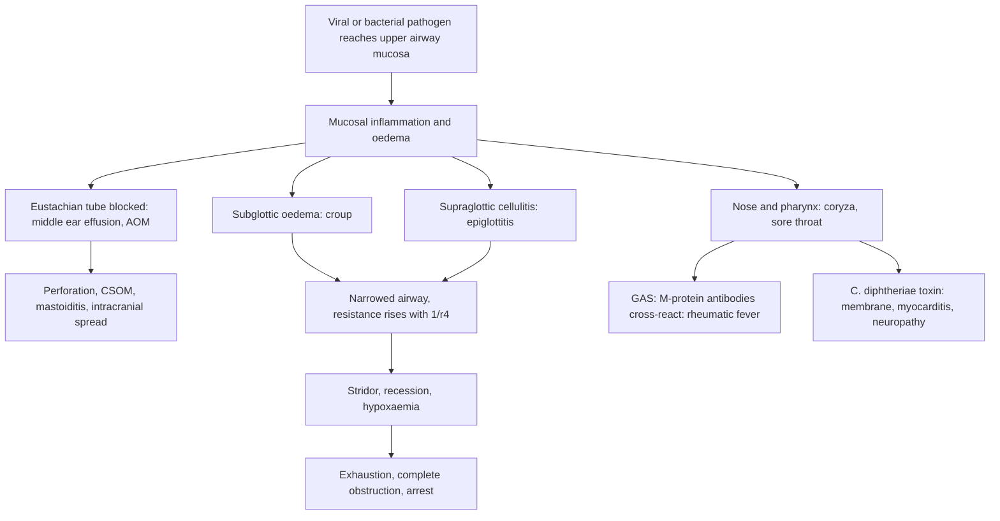

## 1. Definition

**Upper respiratory tract infections (URTIs)** are infections above the larynx (nose, sinuses, pharynx, tonsils, middle ear) plus the **laryngeal and tracheal** infections (croup, epiglottitis, bacterial tracheitis, diphtheria) that cause **stridor**. A Ugandan child has about **4–8 colds a year**, and URTIs are among the most common reasons for an outpatient visit, yet **almost all are viral**.

The clinician's job is to sort the child into one of four groups:

1. **Viral and self-limiting** (common cold, viral pharyngitis, most sore throats): reassure, symptom relief, safety-net advice, **no antibiotics**.
2. **Bacterial and treatable with a short oral course** (streptococcal tonsillitis, acute otitis media, bacterial sinusitis): amoxicillin or penicillin, given for the **right length of time**.
3. **Needs a procedure or specialist** (peritonsillar abscess, mastoiditis, chronic ear discharge, foreign body).
4. **Airway emergency** (severe croup, epiglottitis, diphtheria, bacterial tracheitis): keep the child calm, oxygen, steroid or adrenaline, and **the most skilled airway person**, now.

> [!PEARL]
> The one thing never to forget: **a child with stridor and drooling must not be upset.** No spatula in the mouth, no lying flat, no IM injection, no separating from the mother. Agitation can turn a narrow airway into a closed one.

**The syndromes**

| Syndrome | Site | Usual cause | Key feature |
|---|---|---|---|
| **Common cold (coryza, rhinitis, rhinopharyngitis)** | Nose and pharynx | Rhinovirus, RSV, adenovirus, coronavirus | Runny or blocked nose, sneezing, mild fever, 7–10 days |
| **Pharyngitis / tonsillitis** (pharyngotonsillitis) | Pharynx, tonsils | Viruses (most); **group A β-haemolytic streptococcus (GAS, *S. pyogenes*)** in 15–30% of school-age children | Sore throat, painful swallowing, ± exudate |
| **Peritonsillar abscess (quinsy)** | Between tonsil capsule and pharyngeal wall | GAS, anaerobes | Trismus, muffled "hot-potato" voice, uvula pushed to the opposite side |
| **Acute otitis media (AOM)** | Middle ear | *S. pneumoniae*, non-typeable *H. influenzae*, *M. catarrhalis*, viruses | Ear pain, fever, red **bulging** drum, or pus <14 days |
| **Otitis media with effusion (glue ear)** | Middle ear | After AOM, adenoids | Painless hearing loss, dull drum |
| **Chronic suppurative otitis media (CSOM)** | Middle ear with perforation | *Pseudomonas*, *S. aureus*, mixed | Ear discharge **≥14 days** (IMCI/UCG) |
| **Mastoiditis** | Mastoid air cells | Complication of AOM/CSOM | Tender swelling behind the ear, pinna pushed forward |
| **Acute sinusitis** | Paranasal sinuses | Viral; bacterial (pneumococcus, *H. influenzae*, *M. catarrhalis*) | Nasal discharge or cough **>10 days**, severe onset, or "double sickening" |
| **Croup (laryngotracheobronchitis)** | Larynx, trachea (subglottis) | **Parainfluenza**, RSV, influenza, **measles** | Barking cough, hoarseness, inspiratory stridor |
| **Epiglottitis (supraglottitis)** | Epiglottis, supraglottis | ***H. influenzae* type b** (now rare after Hib vaccine), *S. pyogenes*, pneumococcus, *S. aureus* | Toxic, drooling, tripod posture, soft stridor, little cough |
| **Bacterial tracheitis** | Trachea | *S. aureus*, GAS | Croup that suddenly worsens, toxic, thick tracheal pus |
| **Diphtheria** | Tonsils, pharynx, larynx, nose, skin | Toxin-producing *Corynebacterium diphtheriae* | Grey adherent membrane, bull neck, myocarditis, neuropathy |

**Key terms**

| Term | Meaning |
|---|---|
| **Stridor** | Harsh, mainly **inspiratory** sound from narrowing of the extrathoracic airway (larynx, upper trachea) |
| **Acute vs chronic ear discharge** | **<14 days** = acute (AOM with perforation); **≥14 days** = chronic (CSOM) |
| **Double sickening** | Worsening after initial improvement of a cold: a clue to bacterial sinusitis |
| **Pseudomembrane** | Grey, adherent layer of dead epithelium, fibrin and bacteria that bleeds when removed: diphtheria |

## 2. Epidemiology

- Children under five have **4–8 viral URTIs a year**; more in day care, crowded homes and households with smoke.
- **Antibiotic overuse**: in Ugandan outpatient surveys most children with a cough or cold leave with an antibiotic (often amoxicillin or cotrimoxazole) [VERIFY: primary survey source]. Over-prescription drives resistance and side effects without benefit. **Amoxicillin and penicillin V are WHO AWaRe "Access" antibiotics**: when an antibiotic is needed, these are usually the right ones.
- **Rheumatic heart disease (RHD)**: Uganda has one of the highest burdens in the world; echocardiographic screening studies in Ugandan schoolchildren have found RHD in roughly **2–3 per 100** [VERIFY: figure against the primary screening studies]. Each case began with a group A streptococcal throat infection that was not treated (see the rheumatic fever topic). Treating strep throat with a full course of penicillin is **primary prevention**.
- **Hib** vaccine has been in Uganda's pentavalent vaccine (DTP-HepB-Hib) since **2002**, and **PCV** since **2013**, given at **6, 10 and 14 weeks**: epiglottitis and pneumococcal ear disease have fallen sharply. An unvaccinated child with epiglottitis is a missed opportunity.
- **Diphtheria** still occurs in under-immunised communities (and in refugee settlements and border districts); DTP3 coverage in Uganda is high nationally but uneven by district.
- **Measles** causes croup, otitis media and pneumonia; Uganda gives **measles-rubella at 9 and 18 months** (UNEPI) and has ongoing outbreaks (MoH 2026).
- **CSOM** ("milk in the ear", as some families call it) is common, especially in HIV-positive and malnourished children; it is a leading cause of preventable hearing loss.

> [!UGANDA]
> Current UNEPI schedule highlights relevant to URTIs: **BCG, OPV0 and hepatitis B birth dose** (introduced 2025) at birth; **DTP-HepB-Hib, PCV, OPV** at **6, 10, 14 weeks** (plus rotavirus and IPV); **measles-rubella at 9 and 18 months**; yellow fever at 9 months; **malaria vaccine at 6, 7, 8 and 18 months** in high-burden districts (since April 2025). Always check the child's card.

**Services by level of care** [VERIFY: compiled from the source notes and local experience, not an MoH equipment list]

| Level | Usually available | Often missing |
|---|---|---|
| **HC III** | Torch, spatula, paracetamol, amoxicillin, penicillin V, benzathine penicillin, malaria RDT, HIV test | Otoscope, pulse oximeter, oxygen, dexamethasone, nebuliser |
| **HC IV / General Hospital** | Otoscope, pulse oximeter, oxygen concentrator, nebuliser, dexamethasone, adrenaline, ceftriaxone, FBC, X-ray at hospitals | Throat and ear culture, ENT surgeon, anaesthetist skilled in difficult paediatric airways |
| **Regional Referral Hospital (RRH)** | Culture, ENT clinic, theatre, anaesthesia | CT at many RRHs; diphtheria antitoxin |
| **National Referral Hospital (Mulago) and large PNFP hospitals (Mengo, Nsambya)** | ENT surgery, CT, audiometry and tympanometry, bronchoscopy; diphtheria toxin testing at UNHLS/CPHL | Diphtheria antitoxin is scarce everywhere (request via MoH) |

## 3. Aetiology and Risk Factors

**Causes** are listed by syndrome in section 1. In summary: the common cold, most sore throats and croup are **viral**; streptococcal tonsillitis, AOM, bacterial sinusitis, quinsy, mastoiditis, epiglottitis, bacterial tracheitis and diphtheria are **bacterial**.

**Age patterns that narrow the cause**

| Age | Think of |
|---|---|
| Under 3 years with exudative tonsillitis | Usually **viral** (adenovirus, EBV); GAS uncommon |
| 6 months–3 years with stridor | **Croup** |
| 2–7 years (any age if unvaccinated) with toxic stridor | **Epiglottitis** |
| Under 5 years, fever, neck stiffness, drooling | **Retropharyngeal abscess** |
| 3–15 years with exudative tonsillitis, no cough | **GAS** |
| Teenager with exudate, posterior nodes, splenomegaly | **Infectious mononucleosis (EBV)** |
| Toddler with unilateral foul nasal discharge | **Nasal foreign body** |

**Risk factors**

| Risk factor | Why it matters |
|---|---|
| Young age, immature immunity | More infections; short, horizontal Eustachian tube → AOM |
| Crowding, day care, sick siblings | More exposure |
| Indoor smoke (charcoal, firewood, tobacco) | Damages mucociliary clearance; more AOM |
| Bottle feeding lying flat | More AOM; **breastfeeding protects** |
| Large adenoids | Block the Eustachian tube → AOM, glue ear |
| Missed DTP-HepB-Hib, PCV or MR doses | **Diphtheria, epiglottitis, measles croup**, pneumococcal ear disease |
| **HIV infection** | Recurrent AOM, **CSOM**, oral candida |
| **Malnutrition** | CSOM, more severe infection |
| Previous rheumatic fever or RHD | Any GAS sore throat can cause recurrence: always treat |
| Traditional "uvulectomy" or tonsil cutting | Bleeding, infection |

## 4. Pathophysiology

**Why children get so many URTIs and ear infections**

- Immature immunity, crowding and smoke exposure.
- **The Eustachian tube** in infants is **shorter, wider and more horizontal**, so nasopharyngeal secretions and bacteria reach the middle ear easily after a cold; large adenoids block it. That is why **AOM follows a cold** in a toddler.
- Bottle feeding lying flat and exposure to smoke increase AOM; breastfeeding protects.

**Viral versus bacterial throat infections**

- Viruses inflame the whole upper airway: **cough, runny nose, hoarseness, conjunctivitis, ulcers**.
- **GAS** causes a localised exudative tonsillitis with **tender anterior cervical nodes, fever, and no cough**, in children **3–15 years** (rare under 3).
- **Molecular mimicry**: antibodies against streptococcal M protein cross-react with heart valves, joints and brain → **acute rheumatic fever** 2–4 weeks later. Treating within **9 days** of the sore throat prevents most ARF. Post-streptococcal **glomerulonephritis** is not prevented by antibiotics.

**Why croup and epiglottitis obstruct a child's airway**

- The **subglottis** (cricoid ring) is the narrowest part of a child's airway and is a complete ring of cartilage: mucosal swelling can only narrow the lumen.
- Resistance ∝ 1/radius⁴ (Poiseuille): **1 mm of oedema** in a 4 mm infant subglottis increases resistance about **16-fold**; in an adult, much less.
- Crying increases turbulent flow and negative pressure, which collapses the floppy extrathoracic airway further: **keep the child calm**.
- **Steroids** reduce mucosal oedema (onset 30 min–2 h, last 24–48 h). **Adrenaline** causes α-mediated vasoconstriction of the mucosa (onset 10 min, lasts about 2 h; symptoms can **rebound**).
- **Epiglottitis** is cellulitis of the supraglottis: the swollen epiglottis can fall back and **completely obstruct** the airway if the child lies down or gags.

**Diphtheria**

*C. diphtheriae* infected by a bacteriophage produces an **exotoxin** that kills epithelial cells (forming the **pseudomembrane** of dead cells, fibrin and bacteria) and enters the blood to damage the **heart (myocarditis, days 7–14)** and **nerves (palatal palsy, then cranial and peripheral neuropathy, weeks 2–8)**. **Antitoxin neutralises only unbound toxin**, so it must be given **early**, on clinical suspicion.

**Feature links**

- Mucosal inflammation of nose and pharynx → runny or blocked nose, sneezing, sore throat, cough.
- Inflammation of the whole upper airway (viral) → cough + coryza + hoarseness + conjunctivitis together.
- Localised GAS tonsillar infection → exudate, tender anterior cervical nodes, fever, no cough; palatal petechiae; toxin → scarlet fever (sandpaper rash).
- Cross-reacting anti-M-protein antibodies → acute rheumatic fever (carditis, arthritis, chorea) 2–4 weeks later.
- Blocked Eustachian tube → middle-ear pus under pressure → ear pain, fever, red bulging drum.
- Pressure → drum perforation → ear discharge; persistence ≥14 days → CSOM → conductive hearing loss, speech delay.
- Spread to mastoid air cells → post-auricular swelling pushing the pinna forward and down.
- Spread through bone or veins → meningitis, brain abscess, facial palsy, lateral sinus thrombosis.
- Sinus pus not draining → discharge or cough >10 days, facial pain; orbital spread → periorbital swelling, proptosis, painful eye movement.
- Subglottic oedema → narrowed lumen → inspiratory stridor; vocal cord inflammation → hoarse voice; tracheal inflammation → barking cough.
- Higher airway resistance → recession, tachypnoea, tachycardia; crying worsens collapse → stridor louder when upset.
- Supraglottic swelling → pain on swallowing → drooling, muffled "hot-potato" voice, tripod or sniffing posture; little cough because the larynx below is spared.
- Peritonsillar pus → trismus, uvula pushed to the opposite side.
- Diphtheria toxin killing epithelium → grey adherent pseudomembrane that bleeds when removed; neck oedema and nodes → bull neck.
- Circulating toxin → myocarditis (arrhythmia, heart block, heart failure, days 7–14) and neuropathy (palatal palsy with nasal regurgitation, then cranial, diaphragm and limb weakness, weeks 2–8).
- Severe obstruction → hypoxaemia → agitation, cyanosis; then exhaustion → softer stridor, falling consciousness.

## 5. Classification / Staging

**IMCI classification for cough or cold (child 2 months–5 years)**

| Classification | Signs | Action |
|---|---|---|
| **Severe pneumonia or very severe disease** | Any general danger sign, or stridor in a calm child, or SpO₂ <90% | Pre-referral antibiotic, refer urgently |
| **Pneumonia** | Fast breathing and/or chest indrawing | Amoxicillin (see LRTI topic) |
| **No pneumonia: cough or cold** | None of the above | Home care, soothe the throat, **no antibiotics**; return if worse; follow up in 5 days if not improving; cough **>14 days** or recurrent wheeze → assess for TB, asthma, pertussis |

**IMCI ear problem box**

| Classification | Signs | Action |
|---|---|---|
| **Mastoiditis** | Tender swelling behind the ear | Refer |
| **Acute ear infection** | Pus <14 days or ear pain | Amoxicillin 5 days, wick the ear |
| **Chronic ear infection** | Pus ≥14 days | Wick, topical quinolone drops 2 weeks |
| **No ear infection** | None | No treatment |

**Croup severity (clinical, with the Westley score)**

| Grade | Features | Westley score |
|---|---|---|
| **Mild** | Barking cough, **no stridor at rest**, little or no recession, playing and feeding | ≤2 |
| **Moderate** | **Stridor at rest**, visible recession, not agitated | 3–7 |
| **Severe** | Stridor at rest with **marked recession**, agitation or lethargy, tachycardia | 8–11 |
| **Impending respiratory failure** | Cyanosis, **decreased consciousness**, stridor becoming softer or biphasic, poor air entry, exhaustion | ≥12 |

Westley components: level of consciousness (0 or 5), cyanosis (0, 4 or 5), stridor (0–2), air entry (0–2), recession (0–3).

**Sore throat scores (who to treat with an antibiotic)**

| Score | Items | Decision |
|---|---|---|
| **McIsaac (modified Centor)** | Fever >38 °C (+1); tonsillar exudate or swelling (+1); tender or swollen anterior cervical nodes (+1); **absence of cough** (+1); age 3–14 y (+1); age ≥45 (−1) | 0–1: no antibiotic; 2–3: test if possible, otherwise clinical judgement; **4–5: treat** |
| **FeverPAIN** (NICE NG84) | **F**ever in past 24 h; **P**urulence; **A**ttend rapidly (≤3 days); **I**nflamed tonsils; **N**o cough or coryza | 0–1 no antibiotic; 2–3 consider delayed; **4–5 antibiotic** |

**Bacterial sinusitis** (AAP 2013; UCG): nasal discharge or daytime cough **>10 days** without improvement; **severe onset** (fever ≥39 °C with purulent discharge for ≥3 days); or **worsening after initial improvement** ("double sickening"). UCG: >1 week, unilateral facial pain, worsening.

**Diphtheria antitoxin severity bands** (WHO): pharyngeal or laryngeal disease <48 h; nasopharyngeal disease; extensive disease >3 days or bull neck (doses in section 9).

## 6. Clinical Features

### History

Each question has a reason.

- **Main symptom and duration** → runny nose, sore throat, ear pain or discharge, noisy breathing, barking cough, drooling, voice change. Cold <10 days = viral; nasal symptoms >10 days = possible bacterial sinusitis; ear pus **≥14 days = CSOM**; cough **>14 days** = TB, asthma, pertussis.
- **Cough present?** → yes favours viral (and croup); absent favours GAS and epiglottitis.
- **Fever pattern** → high fever and toxicity (epiglottitis, tracheitis, quinsy, mastoiditis); low-grade (croup, diphtheria).
- **Onset** → hours (epiglottitis, foreign body, anaphylaxis); 1–2 days after a cold (croup); sudden choking (foreign body).
- **Eating and drinking** → refusal to swallow saliva = drooling (epiglottitis, quinsy, retropharyngeal abscess).
- **Drooling, voice change, trismus** → epiglottitis, quinsy, retropharyngeal abscess.
- **Immunisation card** → DTP-HepB-Hib ×3, PCV ×3, MR ×2 (UNEPI). Missed doses change the differential: unvaccinated → think diphtheria, epiglottitis, measles.
- **Contacts** → sick siblings, school outbreaks, measles in the village, diphtheria contacts, epiglottitis (Hib household prophylaxis).
- **Previous sore throats, joint pains, heart murmur** (ARF/RHD) → any sore throat must be treated; check secondary prophylaxis. Previous ear discharge.
- **HIV status, nutrition and growth (Z-scores), feeding** → recurrent and chronic ear disease; need for cotrimoxazole and ART.
- **Smoke exposure, day care** → recurrence risk and prevention advice.
- **Drugs given** → antibiotics already taken (how long?): failure of amoxicillin after 48–72 h in AOM → amoxicillin-clavulanate; herbal treatments; "uvulectomy" or tonsil cutting by traditional healers (bleeding, infection).

### Examination

Follow the order of Hutchison's Clinical Methods (24th edition), adapted for children: observe first, count breathing and listen to the chest while the child is quiet, and leave **distressing parts (ears and throat) to last**. **If there is stridor or drooling, do not examine the throat at all** and do not separate the child from the mother.

#### Introduction, consent and preparation

- **Introduction and identity**: introduce yourself; confirm the child's name and age and the carer's relationship.
- **Explanation and consent**: explain what you will do; consent from the parent and assent from the child.
- **Hand hygiene** before touching the child.
- **Position and exposure**: on the parent's lap, sitting up; never lie a child with stridor flat; expose the neck and chest in a warm room.

#### General inspection (end of the bed)

| Sign | Mechanism | What it means |
|---|---|---|
| Well and playing vs toxic and still | Systemic bacterial infection | Toxic: epiglottitis, tracheitis, quinsy, mastoiditis |
| **Tripod or sniffing posture, drooling** | Supraglottic swelling, painful swallowing | **Epiglottitis**: leave the throat alone |
| Stridor at rest vs only when upset | Degree of subglottic narrowing | Stridor at rest = at least moderate croup |
| Recession (suprasternal, subcostal, intercostal) | High resistance on a compliant chest wall | Severity |
| Agitation, then drowsiness | Hypoxaemia, exhaustion | Severe; impending failure |
| Central cyanosis | Hypoxaemia | Impending respiratory failure |
| Voice: hoarse vs muffled | Vocal cords (croup) vs supraglottis (epiglottitis, quinsy) | Localises the lesion |
| Hydration, nutrition | Poor intake; chronic disease | Dehydration; malnutrition with CSOM |

**Vital signs and growth**: temperature, RR, HR, **SpO₂** (correct probe, calm child), weight; plot weight-for-age and height-for-age Z-scores.

#### Hands, face and neck

| Sign | Mechanism | What it means |
|---|---|---|
| Rash: sandpaper, flushed cheeks, circumoral pallor | GAS erythrogenic toxin | Scarlet fever |
| Rash, conjunctivitis, Koplik spots | Measles | Measles croup or otitis; vitamin A, isolate |
| Urticaria, lip or tongue swelling | Mast-cell degranulation | Anaphylaxis: IM adrenaline |
| Periorbital swelling, proptosis, painful eye movement | Spread from ethmoid sinus | Orbital cellulitis: admit |
| Unilateral foul nasal discharge | Retained object | Nasal foreign body |
| **Tender anterior cervical nodes** | Draining GAS tonsillitis | Supports GAS |
| Posterior and generalised nodes | Systemic EBV | Infectious mononucleosis |
| **Bull neck** (diffuse neck swelling) | Toxin-induced oedema and nodes | Diphtheria |
| Torticollis, neck stiffness | Retropharyngeal pus | Retropharyngeal abscess (or meningitis) |
| Facial palsy | Spread from the middle ear | Complicated otitis media |

#### Respiratory system and chest

- **Inspection**: RR for a full minute, recession, chest indrawing.
- **Palpation and percussion**: usually normal in URTI; dullness → pneumonia.
- **Auscultation**: stridor transmitted to the chest is not wheeze; listen for crackles and bronchial breathing to **exclude pneumonia** (fast breathing, indrawing, crackles: see LRTI topic).

#### Completing the examination

- **Heart**: murmurs (RHD), gallop or arrhythmia (diphtheritic myocarditis).
- **Abdomen**: splenomegaly (mononucleosis).
- **Sinuses**: tenderness, periorbital swelling.
- **Ears, last**: otoscopy (drum colour, light reflex, bulging or retraction, perforation, discharge); mastoid swelling or tenderness behind the ear.
- **Throat, last, and only if there is no airway concern**: torch and spatula; tonsil size, exudate, **membrane** (grey, adherent, bleeds when lifted: do not pull it off), uvula position, petechiae on the palate, trismus.
- **Thank** the parent and child, **wash hands**, **summarise** with the syndrome and severity.

**Document these**

| Positives | Negatives |
|---|---|
| Stridor at rest or not; recession; SpO₂ | "No drooling, no toxicity; drinking well" |
| Tonsils: size, exudate; nodes: tender anterior | "No membrane; uvula central; no trismus" |
| Ear drum: colour, bulging, perforation, discharge duration | "No mastoid swelling or tenderness; no facial palsy" |
| Immunisation status | "No fast breathing or chest indrawing" |

### Red flags

> [!REDFLAG]
> **Airway danger**: stridor at rest, drooling, tripod posture, toxic look, cyanosis or SpO₂ <92%, decreasing consciousness, a soft or disappearing stridor in a tiring child, a grey membrane in the throat, a bull neck. Call the most senior clinician and anaesthetist/ENT, keep the child with the mother, give oxygen without upsetting the child.

> [!REDFLAG]
> **Spread beyond the ear or sinus**: swelling behind the ear, headache, neck stiffness, drowsiness or convulsions (meningitis, brain abscess), facial palsy, eye swelling with painful or reduced eye movement or proptosis (orbital cellulitis). Admit, IV antibiotics, refer.

- **General danger signs** (IMCI): unable to drink or breastfeed, vomits everything, convulsions, lethargic or unconscious → severe disease, refer.
- **Stridor in a calm child** is classified as very severe disease in IMCI.

### Thinking like a clinician

- **"Cough + runny nose + sore throat = viral."** The more sites involved, the more likely viral.
- **"Barking cough = croup; drooling without cough = epiglottitis."** Croup children cough and want to drink; epiglottitis children sit still, drool and avoid swallowing.
- **"Croup that suddenly gets worse with high fever and toxicity"** = **bacterial tracheitis** (does not respond to adrenaline): needs airway and IV antibiotics.
- **Stridor in an unimmunised child with a grey membrane** = **diphtheria** until proven otherwise: give antitoxin on clinical suspicion; don't wait for culture.
- **Under 3 years with exudative tonsillitis** is usually viral (adenovirus, EBV); GAS is uncommon.
- **Exudative tonsillitis + generalised lymphadenopathy + splenomegaly** in a teenager = **infectious mononucleosis**; amoxicillin causes a rash.
- **Unilateral foul-smelling nasal discharge** in a toddler = **foreign body** in the nose.
- **Ear discharge ≥14 days** = CSOM: oral antibiotics don't help; drying and topical quinolone drops do. Test for HIV.
- **Fever in Uganda may be malaria, not the throat**: do an RDT in every febrile child.
- **"No antibiotics" is a treatment**, and it needs an explanation and a safety net: what to watch for and when to come back.
- **Common student mistakes**: reaching for the spatula in a drooling child; giving five days of penicillin for strep throat; giving oral antibiotics for chronic ear discharge; discharging 30 minutes after adrenaline; prescribing cough syrup to a toddler.

## 7. Differential Diagnoses

**Of acute stridor**

| Differential | Distinguishing clinical feature | Distinguishing investigation |
|---|---|---|
| **Croup** | 6 m–3 y, coryza 1–2 days, **barking cough**, hoarse, mild fever, not toxic, wants to drink | Clinical |
| **Epiglottitis** | 2–7 y (any age if unvaccinated), **sudden high fever, toxic, drooling, tripod**, muffled voice, **little or no cough** | Clinical; airway in theatre |
| **Bacterial tracheitis** | Starts like croup then **sudden deterioration**, high fever, toxic, copious secretions, no response to adrenaline | Bronchoscopy (pus, membrane) |
| **Diphtheria** | Unimmunised, low fever, **grey adherent membrane**, bull neck, hoarseness, myocarditis later | Throat swab culture; ECG |
| **Inhaled foreign body (laryngeal)** | Sudden choking, no fever, any age (toddlers) | X-ray (if radiopaque), laryngoscopy |
| **Retropharyngeal abscess** | <5 y, fever, neck stiffness or torticollis, drooling, muffled voice | Lateral neck X-ray (widened prevertebral space), CT |
| **Anaphylaxis / angioedema** | Trigger, urticaria, lip or tongue swelling, wheeze, hypotension | Clinical |
| **Measles croup** | Rash, conjunctivitis, Koplik spots, unvaccinated | Clinical |
| **Laryngomalacia** (chronic) | Stridor from early weeks, worse lying supine or feeding, thriving | Laryngoscopy (ENT) |

**Of sore throat**

| Differential | Distinguishing clinical feature | Distinguishing investigation |
|---|---|---|
| **Viral pharyngitis** | Cough, coryza, conjunctivitis, hoarseness, ulcers | Clinical |
| **GAS tonsillitis** | 3–15 y, fever, exudate, tender anterior nodes, no cough, palatal petechiae, scarlet rash | RADT or culture where available |
| **Infectious mononucleosis (EBV)** | Teenager, exudate, posterior nodes, **splenomegaly**, fatigue | FBC (atypical lymphocytes), monospot |
| **Diphtheria** | Grey membrane that bleeds when removed, bull neck, unimmunised | Culture |
| **Peritonsillar abscess** | Trismus, uvula deviated, hot-potato voice | Clinical; aspiration |
| **Oral candidiasis / herpes gingivostomatitis** | White plaques (HIV, antibiotics) / anterior mouth ulcers and gingivitis | Clinical; HIV test |

**Of ear pain or discharge**

| Differential | Distinguishing clinical feature | Distinguishing investigation |
|---|---|---|
| **Acute otitis media** | Pain, fever, red bulging drum; pus <14 days after perforation | Otoscopy |
| **Otitis externa** | Pain on moving the pinna, swollen canal, drum normal | Otoscopy |
| **CSOM** | Painless discharge ≥14 days, perforation | Otoscopy, swab |
| **Mastoiditis** | Post-auricular swelling, pinna pushed forward and down | Clinical; CT |
| **Foreign body** | Toddler, unilateral, visible object | Otoscopy |
| **Referred pain** | Tonsillitis, dental abscess, teething | Examine throat and teeth |

## 8. Clinical Workup

**Most URTIs need no laboratory test**: the diagnosis is made by examining the throat, ears and neck. Never delay airway care for a test. "Available at" is the lowest level that usually offers the test [VERIFY: availability compiled from the source notes, not an MoH list].

### Bedside

| Test | Why / how | Expected finding | How it changes management | Available at |
|---|---|---|---|---|
| **Pulse oximetry** | Severity in croup or epiglottitis; correct probe size, calm child | <92%: severe croup or airway compromise | Oxygen and senior review | HC IV and above; often missing at HC III |
| **Croup score (Westley)** | Consciousness, cyanosis, stridor, air entry, recession | Grades severity (section 5) | Steroid vs adrenaline vs airway team; repeat after treatment | All levels (clinical) |
| **Centor/McIsaac or FeverPAIN score** | Probability of GAS (section 5) | 4–5 = high probability | Whether to treat with penicillin | All levels (clinical) |
| **Otoscopy** | Every child with ear pain, discharge or unexplained fever (see the respiratory/ENT examination topic) | Bulging drum (AOM) vs dull retracted drum (effusion) vs perforation (CSOM) | Amoxicillin vs wicking + drops vs ENT | HC IV and above; variable at HC III |
| **Rapid antigen detection test (RADT) for GAS** | Throat swab, 10 minutes | Positive | Treat; not widely available in Uganda | Private hospitals |
| **Malaria RDT** | Every febrile child in Uganda | Positive or negative | Fever may be malaria, not the throat | All levels |
| **Random blood glucose** | Sick or not feeding | Low | Treat hypoglycaemia | HC IV and above; variable at HC III |

### Basic lab

| Test | When | Expected / abnormal finding | How it changes management | Available at |
|---|---|---|---|---|
| **Full blood count** | Toxic child, mastoiditis, quinsy | Neutrophilia; atypical lymphocytes (mononucleosis) | Supports bacterial cause; not needed for simple URTI | HC IV and above |
| **HIV test** | CSOM, recurrent AOM, oral thrush, poor growth | Positive | ART, cotrimoxazole | All levels |
| **ASOT** | Suspected ARF or post-streptococcal GN (**not** for sore throat) | Raised | Evidence of recent GAS infection | RRH, NRH [VERIFY] |

### Imaging

| Test | When | Expected finding | How it changes management | Available at |
|---|---|---|---|---|
| **Lateral neck X-ray** | **Only** if stable and diagnosis unclear; **never** in suspected epiglottitis with distress | "Thumb sign" (epiglottitis), "steeple sign" on AP (croup), widened prevertebral space (retropharyngeal abscess), radiopaque foreign body | Diagnostic clue; never delay airway care for a film; never send the child unaccompanied | Hospitals with X-ray |
| **CT head, mastoid or sinus** | Mastoiditis or sinusitis with intracranial or orbital complications | Abscess, sinus thrombosis | Surgery; neurosurgery | NRH and private hospitals |

### Specialised / referral-level

| Test | When | Expected finding | How it changes management | Available at |
|---|---|---|---|---|
| **Throat swab culture** | Suspected GAS where available; outbreaks; **suspected diphtheria** (tell the lab: needs tellurite medium) | GAS; *C. diphtheriae* (toxin testing at the national reference lab, UNHLS/CPHL) | Confirms and triggers public health action; but **treat clinically** first | RRH, NRH |
| **Ear swab culture** | CSOM not responding, mastoiditis | *Pseudomonas*, *S. aureus*, *Proteus* | Guides topical or systemic choice | RRH, NRH |
| **ECG** | **Diphtheria** (daily in the first 2 weeks) | ST-T changes, heart block, arrhythmia | Myocarditis: bed rest, cardiac monitoring; predicts death | Hospitals [VERIFY] |
| **Audiometry / tympanometry** | Glue ear, CSOM, after mastoiditis | Conductive hearing loss | ENT referral, school support | Mulago and Mengo ENT clinics |
| **Bronchoscopy / laryngoscopy** | Suspected tracheitis, foreign body, laryngomalacia | Pus, membrane, object, floppy larynx | Removal, airway care, diagnosis | NRH |

### Putting it together

**Model one-line summary**

> "A 2-year-old boy weighing 11 kg (WAZ −0.8), fully immunised, HIV-exposed but negative at 18 months, with 2 days of coryza followed by a barking cough, hoarse voice and stridor at rest since midnight, alert, SpO₂ 95%, moderate subcostal recession, no drooling and drinking well: **moderate croup**."

**Problem list**

1. Moderate viral croup (Westley 4).
2. Mild fever, drinking well.
3. Immunisations complete for age (check MR2 due at 18 months: given).

**Working diagnosis**: *acute laryngotracheobronchitis (croup), moderate severity.*

**Model case presentation (ward round)**

> "Sarah is a 6-year-old girl from Mukono weighing 19 kg (WAZ −0.6), fully immunised per UNEPI including pentavalent ×3, PCV ×3 and MR ×2, HIV-negative, on a family diet. She presents with 2 days of sore throat, painful swallowing and fever up to 39 °C, without cough or runny nose. No previous joint pains or known heart disease. On examination she is alert and drinking, T 38.8 °C, RR 22, HR 118, SpO₂ 98%, with enlarged red tonsils with white exudate, tender anterior cervical nodes, uvula central, no membrane, no trismus; ears and chest normal; no murmur. McIsaac score 5. Assessment: **acute streptococcal tonsillitis**. Plan: benzathine penicillin 600,000 IU deep IM once (observed 30 minutes), paracetamol 280 mg (15 mg/kg) 6-hourly, fluids, counsel mother on the link with rheumatic fever and to return with joint pains, breathlessness or dark urine."

> [!EXAM]
> **Worked example 1: scoring a sore throat.** A 9-year-old girl: fever 38.6 °C, exudate on both tonsils, tender anterior cervical nodes, **no cough**. McIsaac score: fever 1 + exudate 1 + nodes 1 + no cough 1 + age 3–14 y 1 = **5** → high probability of GAS (about 50%). In Uganda, with a high RHD burden and no rapid test, **treat**: benzathine penicillin 600,000 IU IM once (weight 26 kg) or penicillin V for 10 days. A 4-year-old with runny nose, cough, hoarse voice and red throat scores 0–1 → viral, no antibiotic.

> [!EXAM]
> **Worked example 2: the croup score after treatment.** A 14-month-old (9 kg): stridor at rest (2), moderate recession (2), decreased air entry (1), agitated but no cyanosis (0) → **Westley 5, moderate**. Given dexamethasone 0.6 mg/kg (5.4 mg) orally. At 30 minutes: stridor at rest louder, marked recession (3), SpO₂ 91% → score now 6–7 and worsening → **nebulised adrenaline 1:1000, 4.5 mL**, oxygen. At 20 minutes: no stridor at rest. **Must stay at least 2–4 hours** because adrenaline wears off; admit if stridor returns.

## 9. Management

### Immediate / emergency

**First 5 minutes**

1. **ETAT triage**: is there **obstructed breathing (stridor at rest), severe respiratory distress, central cyanosis**? These are **emergency signs**. Move to the resuscitation area.
2. **Do not upset the child**: examine on the mother's lap; leave the throat alone if there is stridor or drooling.
3. **Oxygen** (blow-by or mask held by the mother) if SpO₂ <92% or severe distress.
4. **Decide the airway pathway**:
   - Barking cough + stridor → **croup** → steroid now; **nebulised adrenaline** if severe.
   - Toxic + drooling + tripod → **epiglottitis** → call anaesthetist/ENT, theatre, no interventions until the airway is secure.
   - Grey membrane, unimmunised → **diphtheria** → isolate, antitoxin, antibiotics, airway team.
   - Sudden choking → **foreign body**: if the child can cough, encourage coughing; if not effective, back blows and chest thrusts (infant) or abdominal thrusts (child >1 y).
   - Urticaria, angioedema, hypotension → **anaphylaxis** → IM adrenaline 0.01 mg/kg.
5. **If no airway emergency**: check for **general danger signs** (unable to drink or breastfeed, vomits everything, convulsions, lethargic or unconscious) and fast breathing or chest indrawing (pneumonia: see the LRTI topic).

**ABCDE**

- **A**: stridor? drooling? Keep the child upright on the parent's lap. No spatula. If the child obstructs before help arrives, **bag-valve-mask ventilation usually works**.
- **B**: SpO₂, RR, recession; oxygen held near the face without a struggle; nebulised adrenaline for severe croup.
- **C**: HR, capillary refill; IV access only once the airway is safe (not in suspected epiglottitis before the airway is secured).
- **D**: AVPU, glucose. **Never sedate** a child with upper airway obstruction.
- **E**: temperature, rash (measles, scarlet fever, urticaria), membrane, bull neck, mastoid swelling.

### Definitive

#### A. Principles and antibiotic stewardship

1. **Most URTIs need no antibiotic.** Explain why (viral; antibiotics don't shorten it or prevent pneumonia; they cause diarrhoea, rash and resistance).
2. **Symptom relief**: paracetamol **15 mg/kg** 6-hourly (max 60 mg/kg/day) or ibuprofen 5–10 mg/kg 8-hourly (with food; avoid if dehydrated); fluids; saline nose drops; continue breastfeeding.
3. **Safety net**: return immediately if fast or difficult breathing, stridor at rest, unable to drink, very sleepy, convulsions, ear swelling, or not better in 5 days.
4. **When an antibiotic is needed, use the narrowest effective one** (penicillin V, amoxicillin) for the recommended time.

#### B. Common cold (UCG 2023 5.2.3)

| Do | Don't |
|---|---|
| Continue breastfeeding; extra fluids; warm drinks | Antibiotics |
| Clear the nose with **saline drops** and gentle suction (bulb or cloth wick) before feeds | **Cough syrups, antihistamines, decongestant mixtures in <6 y** (UCG 2023: avoid; risk of toxicity) |
| Paracetamol for 2–3 days for fever or pain | Honey in **<1 y** (infant botulism) |
| Steam or honey (>1 y) as home remedies | Xylometazoline drops in infants; if used in older children (0.05%) **max 5 days** (rebound congestion) |
| Advise when to return (danger signs, fast breathing, ear pain) | |

#### C. Pharyngitis and tonsillitis (UCG 2023 21.3.3–21.3.4)

- Decide using the McIsaac or FeverPAIN score (section 5).

> [!UGANDA]
> In Uganda, with a very high burden of rheumatic heart disease and few rapid strep tests, **treat clinically suspected streptococcal tonsillitis** in children aged 3–15 years (exudate, tender anterior nodes, fever, no cough), and **always treat** a child who has had rheumatic fever or has RHD. UCG 2023 recommends a **full 10-day course** (or a single benzathine injection). NICE's 5-day option is for symptom relief in a low-RHD country and is **not** appropriate here.

- **First line**: **phenoxymethylpenicillin (penicillin V) 10–20 mg/kg 6-hourly for 10 days** (max 500 mg). Adherence falls after symptoms settle: stress the full course.
- **When adherence is doubtful**: **benzathine benzylpenicillin deep IM once** (600,000 IU if <30 kg; 1.2 MU if ≥30 kg).
- **Alternative**: **amoxicillin 50 mg/kg once daily (max 1 g) for 10 days**: equally effective, tastes better; avoid if mononucleosis is possible (rash).
- **Penicillin allergy**: erythromycin 12.5 mg/kg 6-hourly for 10 days (UCG 2023), or azithromycin 12 mg/kg once daily for 5 days (GAS macrolide resistance exists).
- Doses, routes and cautions: drug table.

**Peritonsillar abscess (quinsy)**: admit; IV benzylpenicillin 50,000 IU/kg 6-hourly (or ceftriaxone) **plus metronidazole 7.5 mg/kg 8-hourly**; analgesia; IV fluids if unable to swallow; **needle aspiration or incision and drainage by ENT**; then oral antibiotics to 10–14 days. Tonsillectomy after recurrent quinsy.

**Recurrent tonsillitis**: tonsillectomy is considered for ≥7 episodes in 1 year, ≥5/year for 2 years or ≥3/year for 3 years (Paradise criteria), sleep-disordered breathing, or recurrent quinsy (ENT referral).

#### D. Ear infections

**Acute otitis media**

1. **Analgesia for everyone**: paracetamol or ibuprofen for 2–3 days.
2. **Antibiotic** (WHO Pocket Book/IMCI: all children with AOM in our setting): **amoxicillin**.
3. **Dry the ear by wicking** if there is pus: twist a clean absorbent cloth or tissue into a wick, insert, remove when wet, replace; repeat until dry; 3 times a day. No cotton buds, no oils, no herbal drops.
4. **Review after 5 days**: pain and fever settled? Pus persists → continue wicking; recurrent → check HIV, hearing.
5. **Failure after 48–72 h**: amoxicillin-clavulanate (amoxicillin component 45 mg/kg twice daily) or ceftriaxone 50 mg/kg IM daily for 3 days.

> [!UGANDA]
> Amoxicillin doses for AOM differ: **WHO Pocket Book/IMCI: 40 mg/kg twice daily for 5 days** (the same dispersible tablets as pneumonia); **UCG 2023: 15 mg/kg 8-hourly for 5 days** (≈45 mg/kg/day); **AAP 2013: high-dose 80–90 mg/kg/day** in 2 doses (10 days if <2 y) because of pneumococcal resistance. In Ugandan wards and OPDs, the **IMCI 40 mg/kg twice-daily dose** is what most clinicians use. Quote UCG in the exam and know that higher doses exist.

**Chronic suppurative otitis media (pus ≥14 days)**

- **Dry mopping (wicking) 3 times daily** until the ear is dry (may take weeks).
- **Topical quinolone drops** (ciprofloxacin ear drops) 2–4 drops after each wicking, for **2 weeks** (IMCI/WHO; UCG 2023).
- UCG 2023 also describes gentle aural irrigation with dilute hydrogen peroxide (1 spoon in half a glass of clean lukewarm water) before wicking.
- **Systemic antibiotics are not recommended** (UCG 2023) unless complications.
- **Keep water out** of the ear when bathing or swimming. **HIV test.** Hearing assessment and ENT referral if persistent, cholesteatoma (white debris, foul smell), or polyps.

**Mastoiditis (UCG 2023 21.1.6)**: admit urgently; **ceftriaxone 50–80 mg/kg IV/IM once daily for 10–14 days** (max 2–4 g) **plus metronidazole 7.5 mg/kg 8-hourly**; analgesia; urgent ENT for incision and drainage or mastoidectomy; watch for meningitis, brain abscess, facial palsy, sigmoid sinus thrombosis.

**Glue ear (otitis media with effusion)**: most resolves in 3 months; hearing check; ENT referral if persistent >3 months with hearing loss or speech delay (grommets ± adenoidectomy).

> [!UGANDA]
> UCG 2023 lists chlorphenamine and decongestant drops for glue ear; international guidelines do not recommend antihistamines or decongestants for glue ear.

#### E. Acute sinusitis (UCG 2023 21.2.4)

- **Diagnose bacterial sinusitis only if** the criteria in section 5 are met (>10 days, severe onset, or double sickening).
- **Treatment**: saline irrigation, analgesia; **amoxicillin** 15 mg/kg 8-hourly (UCG) or 40–45 mg/kg twice daily (high-dose), for **7–10 days**; amoxicillin-clavulanate if no improvement in 72 h. Look for a **dental focus** or **nasal foreign body**.
- **Orbital complications** (periorbital swelling, pain on eye movement, proptosis, reduced vision): admit; **IV ceftriaxone 50–80 mg/kg daily + cloxacillin 50 mg/kg 6-hourly** (or + metronidazole); urgent ophthalmology/ENT and CT.

#### F. Croup (UCG 2023 5.2.7)

1. **Keep the child calm on the parent's lap**; no throat examination; no unnecessary procedures.
2. **Steroid for every child with croup who has stridor** (and for barking cough in young infants or those far from care):
   - **Dexamethasone 0.15 mg/kg orally once** (UCG 2023 mild croup; RCH mild–moderate), or **0.6 mg/kg (max 12 mg) orally/IM/IV** for severe croup (RCH; Medscape: trials used 0.6 mg/kg; 0.15 mg/kg is effective).
   - Or **prednisolone 1–2 mg/kg orally once** (UCG 2023; may need repeating).
3. **Severe croup** (stridor at rest with marked recession, agitation, SpO₂ <92%):
   - **Nebulised adrenaline 1:1000: 0.4–0.5 mL/kg (max 5 mL)**, made up to 4 mL with saline if needed; repeat after 30 minutes if necessary (UCG 2023: 0.4 mg/kg, max 5 mg).
   - **Oxygen** (humidified, held near the face by the parent) if SpO₂ <92%.
   - IV/IM steroid if unable to take oral: dexamethasone 0.3–0.6 mg/kg IM (UCG: 300 µg/kg IM), or hydrocortisone (UCG 2023: <1 y 25 mg, 1–5 y 50 mg, 6–12 y 100 mg) slow IV/IM; repeat after 6 h if necessary.
   - **Observe for at least 2–4 hours after adrenaline** (rebound).
4. **Impending respiratory failure** (cyanosis, decreasing consciousness, exhaustion): 100% oxygen, repeated adrenaline, call the anaesthetist; **intubation in theatre with a tube 0.5–1 mm smaller than usual**; tracheostomy if intubation fails (UCG: nasotracheal intubation or tracheostomy).
5. **Admit** if: stridor at rest after treatment, needed adrenaline (observe ≥4 h, admit if stridor returns), age <6 months, SpO₂ <92%, poor drinking, lives far away or unreliable return.
6. **Discharge**: no stridor at rest, drinking, parents understand when to return (stridor at rest, recession, drooling, blue colour, drowsiness).
7. **No antibiotics** unless bacterial tracheitis suspected (then treat as epiglottitis). **No cough mixtures** (UCG). Humidified air ("steam") has **no proven benefit** and risks scalds: do not advise steam kettles.

> [!UGANDA]
> UCG 2023 advises IV hydration with **half-strength Darrow's in 2.5% glucose** for severe croup. Most Kampala wards now use **standard maintenance fluids** (e.g. Ringer's lactate or 0.9% saline with 5% glucose for younger children) only if the child cannot drink. Many children with croup in Uganda have **measles**: check for rash, Koplik spots and vaccination status, give vitamin A and isolate.

#### G. Epiglottitis (UCG 2023 5.2.4)

1. **Recognise it**: toxic, high fever, drooling, tripod or sniffing posture, muffled voice, soft stridor, anxious, **little or no cough**.
2. **Do NOT**: look in the throat, lie the child flat, take blood, give IM injections, or send the child to X-ray unaccompanied. Keep with the mother; oxygen held near the face.
3. **Call** the most experienced anaesthetist and ENT surgeon; **secure the airway in theatre** (gas induction, child sitting; tracheostomy set open). Bag-valve-mask ventilation usually works if the child obstructs before help arrives.
4. **After the airway is secure**: IV line, blood culture, **ceftriaxone 50–100 mg/kg IV once daily for 7–10 days** (UCG 2023: 50 mg/kg; many centres use 80–100 mg/kg, max 2 g) ± cloxacillin if *S. aureus* suspected.
5. **Hib prophylaxis**: rifampicin 20 mg/kg once daily (max 600 mg) for 4 days to household contacts if there is an unvaccinated or incompletely vaccinated child <4 years, or an immunocompromised child, in the home (CDC/AAP).
6. **Check and complete immunisation** (pentavalent).

**Bacterial tracheitis**: treat as epiglottitis (airway in theatre, IV ceftriaxone ± cloxacillin); bronchoscopy to clear pus and membrane.

#### H. Diphtheria (UCG 2023 2.1.3; WHO)

1. **Isolate** (droplet and contact precautions) until 2–3 negative cultures (UCG: 3 negative swabs) or 48 h of appropriate antibiotics.
2. **Diphtheria antitoxin (DAT)** as soon as diphtheria is suspected (don't wait for culture), after a test dose per the product leaflet (equine serum: anaphylaxis possible; adrenaline ready). Dose by severity (WHO): **20,000–40,000 IU** for pharyngeal or laryngeal disease <48 h; **40,000–60,000 IU** for nasopharyngeal disease; **80,000–100,000 IU** for extensive disease >3 days or bull neck; given IV in 0.9% saline over 1 h (or IM). WHO Pocket Book 2013: **40,000 units IM/IV**. DAT is scarce: request through MoH and national stores.
3. **Antibiotic** for 14 days:
   - UCG 2023: **procaine benzylpenicillin 50,000 IU/kg IM once daily** until able to swallow, then **penicillin V** (<1 y 12.5 mg/kg; 1–6 y 125 mg; >6 y 250 mg) 6-hourly to complete **14 days**.
   - Penicillin allergy: **erythromycin 12.5 mg/kg 6-hourly** (50 mg/kg/day) for 14 days. WHO's 2024 clinical guidance suggests a **macrolide (azithromycin or erythromycin)** as first choice where available.
4. **Airway**: watch for laryngeal extension and membrane aspiration; tracheostomy may be needed. Avoid pulling off the membrane.
5. **Heart**: strict bed rest, **ECG** daily for 2 weeks, monitor for arrhythmia and heart failure (myocarditis typically days 7–14).
6. **Nerves**: watch for palatal palsy (nasal regurgitation), then cranial, respiratory and limb weakness (weeks 2–8): NG feeding, ventilatory support.
7. **Contacts**: throat swabs; **single dose benzathine penicillin IM** (UCG: 600,000 IU if <10 y, 1.2 MU if ≥10 y) or erythromycin for 7–10 days; check and complete DTP vaccination, booster if last dose >1 year ago; monitor for 7 days.
8. **Notify** the district surveillance focal person immediately (epidemic-prone disease). **Vaccinate the patient** after recovery (disease does not reliably confer immunity).

### Drug table

| Drug | Dose (per kg + max for children; adult) | Route | Frequency | Duration | Key cautions |
|---|---|---|---|---|---|
| **Paracetamol** (pain, fever) | 15 mg/kg, max 60 mg/kg/day; adult 1 g | Oral | 6-hourly | 2–3 days | Overdose risk if given with combination syrups |
| **Ibuprofen** (pain) | 5–10 mg/kg; adult 400 mg [VERIFY] | Oral | 8-hourly with food | 2–3 days | Avoid if dehydrated or asthma with NSAID sensitivity |
| **Phenoxymethylpenicillin (penicillin V)** (GAS tonsillitis) | 10–20 mg/kg per dose (UCG 2023), max 500 mg; or by age: 1–5 y 125 mg, 6–11 y 250 mg (NICE NG84, 6-hourly); adult 500 mg | Oral | **6-hourly** (or 12-hourly at double dose) | **10 days** | Adherence falls once symptoms settle: stress the full course |
| **Benzathine benzylpenicillin** (GAS tonsillitis; diphtheria contacts) | GAS: **600,000 IU if <30 kg; 1,200,000 IU if ≥30 kg** (WHO/AHA; UCG 2023: 30,000 IU/kg if <30 kg, 1.2 MU adults). Diphtheria contacts (UCG): 600,000 IU <10 y, 1.2 MU ≥10 y | **Deep IM** | Once | Single dose | Best when adherence is doubtful; painful (can be mixed with lidocaine 1% per local protocol); have adrenaline ready; observe 30 min |
| **Amoxicillin** (AOM, sinusitis, GAS) | AOM: **40 mg/kg 12-hourly** (WHO/IMCI; 40–45 mg/kg), UCG 15 mg/kg 8-hourly, AAP 80–90 mg/kg/day; GAS: 50 mg/kg once daily or 25 mg/kg twice daily; max 1 g/dose; adult 500 mg–1 g [VERIFY] | Oral (dispersible) | 12-hourly (8-hourly UCG; once daily for GAS) | 5 days AOM (10 if <2 y on AAP); 7–10 days sinusitis; 10 days GAS | Rash if given in infectious mononucleosis |
| **Amoxicillin-clavulanate** (AOM or sinusitis failure) | 45 mg/kg (amoxicillin component) | Oral | 12-hourly | 7–10 days | Diarrhoea |
| **Erythromycin** (penicillin allergy; diphtheria) | 12.5 mg/kg, max 500 mg | Oral | 6-hourly | 10 days (GAS); 14 days (diphtheria); 7–10 days (contacts) | GI upset; UCG 2023 allergy alternative |
| **Azithromycin** (penicillin allergy) | 12 mg/kg, max 500 mg | Oral | Once daily | **5 days** | GAS macrolide resistance exists |
| **Benzylpenicillin** (quinsy) | 50,000 IU/kg | IV | 6-hourly | Until swallowing, then oral to 10–14 days | With metronidazole; drainage by ENT |
| **Procaine benzylpenicillin** (diphtheria) | 50,000 IU/kg, max 1.2 MU | IM | Once daily | Until can swallow (total 14 days with penicillin V) | Not IV |
| **Ceftriaxone** (epiglottitis, mastoiditis, orbital cellulitis, severe AOM failure) | 50–100 mg/kg (epiglottitis); 50–80 mg/kg (mastoiditis, orbital); 50 mg/kg IM (AOM failure); max 2 g (4 g in meningitis) | IV/IM | Once daily | 3 days (AOM failure); 7–10 days (epiglottitis); 10–14 days (mastoiditis) | In epiglottitis give only after the airway is secure |
| **Cloxacillin** (orbital cellulitis; suspected *S. aureus*) | 50 mg/kg [VERIFY: max] | IV | 6-hourly | With ceftriaxone | Phlebitis |
| **Metronidazole** (mastoiditis, quinsy) | 7.5 mg/kg, max 500 mg | IV/oral | 8-hourly | 10–14 days | Metallic taste, nausea |
| **Ciprofloxacin ear drops** (CSOM) | 2–4 drops | Topical | 3 times daily after wicking | 2 weeks | Topical quinolones are safe in children; dry the ear first |
| **Dexamethasone** (croup) | 0.15 mg/kg (UCG, mild–moderate) to 0.6 mg/kg (severe), max 12 mg (RCH; 16 mg in some guides); IM 0.3–0.6 mg/kg (UCG 300 µg/kg) | Oral/IM/IV | Once (repeat after 12–24 h if needed) | 1–2 doses | Oral as good as IM if swallowing |
| **Prednisolone** (croup) | 1–2 mg/kg | Oral | Once | 1 dose (repeat if needed) | – |
| **Hydrocortisone** (croup, cannot swallow) | UCG 2023: <1 y 25 mg, 1–5 y 50 mg, 6–12 y 100 mg | Slow IV/IM | Repeat after 6 h if needed | 1–2 doses | – |
| **Adrenaline 1:1000 (nebulised)** (severe croup) | 0.4–0.5 mL/kg, **max 5 mL** (UCG 2023: 0.4 mg/kg, max 5 mg) | Nebulised, made up to 4 mL with saline if needed | Repeat after 30 min if needed | – | Effect lasts about 2 h: **observe 2–4 h for rebound**; tachycardia |
| **Adrenaline 1:1000 (IM)** (anaphylaxis) | 0.01 mL/kg (0.01 mg/kg), max 0.5 mg; adult 0.5 mg | IM thigh | Every 5 min if needed | – | First-line in anaphylaxis |
| **Diphtheria antitoxin** | 20,000–100,000 IU by severity (WHO); WHO Pocket Book 40,000 units | IV over 1 h in 0.9% saline (or IM) | Once | – | Equine: test dose; adrenaline ready; scarce (MoH) |
| **Rifampicin** (Hib contacts) | 20 mg/kg, max 600 mg | Oral | Once daily | 4 days | Orange secretions; interactions |
| **Xylometazoline 0.05% nasal drops** | Older children only | Nasal | As per product | **Max 5 days** | Not in infants; rebound congestion |

Adult doses where marked [VERIFY: against UCG 2023 adult sections]; this topic is paediatric.

### Referral criteria

| Level | What to do | Refer up when |
|---|---|---|
| **Home / VHT** | Fluids, saline drops, paracetamol, safety-net advice | Fast or difficult breathing, stridor, unable to drink, ear swelling, not better in 5 days |
| **HC III** | Viral URTI care; penicillin V or benzathine for GAS; amoxicillin and wicking for AOM; wicking and quinolone drops for CSOM; pre-referral treatment | Any stridor at rest, drooling or toxicity, suspected diphtheria, mastoiditis, orbital swelling, quinsy, general danger sign → HC IV or hospital |
| **HC IV / General Hospital** | Dexamethasone, nebulised adrenaline, oxygen; admit croup; ceftriaxone + metronidazole for mastoiditis; IV antibiotics for quinsy | Epiglottitis, bacterial tracheitis or failing croup needing a skilled airway; mastoiditis or quinsy needing ENT drainage; diphtheria (antitoxin, isolation, ECG) → RRH |
| **RRH** | ENT, theatre, anaesthesia, culture, isolation | CT for intracranial or orbital complications; complex airway; tracheostomy care; audiology → NRH |
| **NRH (Mulago) and large PNFP hospitals** | ENT surgery, CT, bronchoscopy, audiometry, PICU | n/a |

Level split derived from the source notes and UCG levels of care [VERIFY].

**Referral checklist**: steroid given (croup); oxygen during transfer; a health worker who can manage the airway accompanies the child; keep the child upright on the parent's lap; first antibiotic dose given (except in epiglottitis before the airway is safe); referral note with times and doses; phone ahead.

### Monitoring and follow-up

- **Croup**: re-score (Westley) after steroid and 15–30 minutes after adrenaline; observe at least **2–4 hours** after adrenaline; SpO₂, RR, recession, conscious level.
- **Diphtheria**: **ECG daily for 2 weeks**; palatal and limb weakness for 8 weeks; airway.
- **AOM**: review at **5 days**; if pus persists, continue wicking; if recurrent, HIV test and hearing check.
- **CSOM**: review until dry; hearing assessment; ENT if not dry after 2 weeks of drops or cholesteatoma.
- **GAS tonsillitis**: counsel the parent to return with joint pains, breathlessness or dark urine (ARF, post-streptococcal GN).
- **Glue ear**: hearing check at 3 months.

## 10. Complications

**Disease-related**

| Infection | Complications |
|---|---|
| Common cold | AOM, sinusitis, pneumonia, asthma exacerbation, conjunctivitis |
| GAS tonsillitis | **Acute rheumatic fever → RHD**, post-streptococcal glomerulonephritis, quinsy, retropharyngeal abscess, scarlet fever, invasive GAS |
| AOM / CSOM | Perforation, **hearing loss**, speech delay, **mastoiditis**, **meningitis**, brain abscess, facial palsy, lateral sinus thrombosis, cholesteatoma |
| Sinusitis | Periorbital and orbital cellulitis, cavernous sinus thrombosis, frontal bone osteomyelitis (Pott's puffy tumour), brain abscess |
| Croup | Hypoxia, respiratory failure, bacterial tracheitis, pneumonia |
| Epiglottitis | Complete airway obstruction, death, Hib meningitis, pneumonia |
| Diphtheria | **Airway obstruction**, **myocarditis** (heart block, heart failure, sudden death), **neuropathy** (palatal palsy, diaphragm palsy), renal failure; case fatality about **30%** in unvaccinated people without treatment (WHO) |

**Treatment-related**

| Complication | Cause | Recognition and action |
|---|---|---|
| Anaphylaxis | Benzathine penicillin; equine diphtheria antitoxin | Adrenaline ready; observe 30 min; DAT test dose |
| Rebound stridor | Nebulised adrenaline wears off after about 2 h | Observe 2–4 h; admit if stridor returns |
| Rash | Amoxicillin in infectious mononucleosis | Avoid amoxicillin when EBV is possible |
| Diarrhoea | Amoxicillin-clavulanate, any antibiotic | Oral rehydration |
| Toxicity in young children | Cough syrups, antihistamines, decongestants | Avoid under 6 years (UCG 2023) |
| Rebound congestion | Xylometazoline >5 days | Limit to 5 days; not in infants |
| Infant botulism | Honey under 1 year | No honey under 1 year |
| Scalds | Steam kettles for croup | Do not advise steam |
| Complete obstruction | Throat examination, lying flat or upsetting a child with epiglottitis | Leave the throat alone; airway in theatre |
| Respiratory arrest | Sedation in upper airway obstruction | Never sedate |
| Antimicrobial resistance | Antibiotics for viral URTIs | Stewardship (section 9) |

## 11. Prognosis

- **Common cold**: self-limiting in **7–10 days**; the cough can last **2–3 weeks**.
- **Viral pharyngitis and croup**: most recover within days; croup severe enough to need intubation is uncommon [VERIFY: Ugandan data].
- **GAS tonsillitis**: symptoms settle in about 3 days; the full 10-day course (or benzathine) prevents most rheumatic fever if started within **9 days**.
- **Glue ear**: most resolves within **3 months**.
- **CSOM**: drying may take weeks; untreated, it causes permanent conductive hearing loss and can lead to mastoiditis and intracranial infection.
- **Epiglottitis**: good if the airway is secured in time; death from complete obstruction if not.
- **Diphtheria**: case fatality about **30%** in unvaccinated people without treatment (WHO); myocarditis predicts death; survivors of neuropathy usually recover fully [VERIFY].

## 12. Prevention

- **Vaccination (UNEPI)**: DTP-HepB-Hib and PCV at **6, 10, 14 weeks** (diphtheria, Hib epiglottitis, pneumococcal AOM and sinusitis); **measles-rubella at 9 and 18 months** (measles croup and otitis). Check every child's card and catch up.
- **Primary prevention of RHD**: treat streptococcal tonsillitis with a **full 10 days** of penicillin V or one benzathine injection.
- **Secondary prophylaxis** for children with previous ARF or RHD (see the rheumatic fever topic).
- **Breastfeeding**; avoid bottle feeding lying flat; reduce indoor smoke.
- **Contact prophylaxis**: rifampicin for Hib household contacts; benzathine or erythromycin, swabs and vaccination for diphtheria contacts; notify diphtheria.
- **Antibiotic stewardship**: no antibiotics for colds; amoxicillin and penicillin V (AWaRe Access) when one is needed.
- **Ear care**: keep water out of a perforated ear; no sticks, oils or herbal drops.

## 13. Special Populations

- **Infants**: no honey under 1 year; no cough syrups, antihistamines or decongestants under 6 years; no xylometazoline in infants; **croup under 6 months → admit**. Pull the pinna **down and back** for otoscopy.
- **Under 3 years with exudative tonsillitis**: usually viral; GAS uncommon.
- **Teenagers**: exudative tonsillitis with splenomegaly = mononucleosis; avoid amoxicillin.
- **HIV-positive children**: recurrent AOM, CSOM and oral candida; test every child with CSOM; continue cotrimoxazole and ART.
- **Malnourished children**: CSOM is common; more severe infection.
- **Previous ARF or RHD**: **always treat** a sore throat; check secondary prophylaxis.
- **Unimmunised children**: diphtheria, epiglottitis and measles move up the differential; vaccinate after recovery.
- **Measles**: croup and otitis; vitamin A, isolation.

## 14. Key Points

### High-yield points

- Almost all URTIs are viral: fluids, paracetamol, saline drops, safety net, **no antibiotics**.
- Sort every child into one of four groups: viral, short oral antibiotic, procedure or specialist, airway emergency.
- **A child with stridor and drooling must not be upset**: no spatula, no lying flat, no IM injection.
- Strep throat in Uganda: **10 days** of penicillin V or one benzathine injection, to prevent rheumatic fever.
- AOM: amoxicillin 40 mg/kg twice daily for 5 days (IMCI) and wicking; CSOM (≥14 days): wicking and quinolone drops for 2 weeks, HIV test.
- Mastoiditis: admit, ceftriaxone + metronidazole, ENT.
- Croup: steroid for every child with stridor; nebulised adrenaline for severe croup; observe **2–4 h** afterwards.
- Epiglottitis: airway in theatre first, then ceftriaxone.
- Diphtheria: antitoxin on clinical suspicion, 14 days of antibiotic, isolation, ECG, contacts, notify.
- Check the immunisation card in every child.

### Numbers & doses

| Item | Value |
|---|---|
| Colds per year (under 5) | **4–8** |
| Bacterial sinusitis | Symptoms **>10 days**, severe onset ≥3 days, or double sickening |
| Acute vs chronic ear discharge | **<14 days** vs **≥14 days** |
| GAS age range | **3–15 years** (rare <3 y) |
| Penicillin V | **10–20 mg/kg 6-hourly × 10 days** |
| Benzathine penicillin | **600,000 IU (<30 kg); 1.2 MU (≥30 kg)** IM once (UCG: 30,000 IU/kg if <30 kg) |
| Amoxicillin (AOM) | **40 mg/kg 12-hourly × 5 days** (WHO/IMCI); UCG 15 mg/kg 8-hourly |
| Topical quinolone (CSOM) | After wicking, 3 times daily × **2 weeks** |
| Mastoiditis | Ceftriaxone **50–80 mg/kg** daily + metronidazole **7.5 mg/kg** 8-hourly × 10–14 days |
| Dexamethasone (croup) | **0.15–0.6 mg/kg** once (max 12 mg) |
| Prednisolone (croup) | **1–2 mg/kg** once |
| Nebulised adrenaline 1:1000 | **0.4–0.5 mL/kg, max 5 mL**; observe **2–4 h** |
| Ceftriaxone (epiglottitis) | **50–100 mg/kg** IV daily × 7–10 days |
| Hib contact prophylaxis | Rifampicin **20 mg/kg** daily × **4 days** (max 600 mg) |
| DAT | **20,000–100,000 IU** by severity (WHO Pocket Book 40,000) |
| Diphtheria antibiotics | **14 days** |
| Diphtheria myocarditis | Days **7–14**; neuropathy weeks **2–8** |
| UNEPI | DTP-HepB-Hib + PCV at **6, 10, 14 weeks**; MR at **9 and 18 months** |
| Subglottic oedema | 1 mm in a 4 mm airway → resistance about **16-fold** |
| Prevents ARF | Treat within **9 days** of the sore throat |

### Exam traps

- **"Amoxicillin for a cold to prevent pneumonia."** No: no benefit, only harm.
- **"Look at the throat to confirm epiglottitis."** Never: it can cause complete obstruction.
- **"Five days of penicillin for strep throat."** In Uganda: **10 days** (or benzathine) to prevent rheumatic fever.
- **"Oral antibiotics for chronic ear discharge."** No: wick and use topical quinolone drops.
- **"Steam inhalation for croup."** No proven benefit, risk of scalds.
- **"Send home 30 minutes after adrenaline because the stridor has gone."** No: observe **2–4 hours** for rebound.
- **"Wait for the culture before giving diphtheria antitoxin."** No: give on clinical suspicion.
- **"Cough syrup for a 2-year-old."** UCG 2023: avoid cough mixtures under 6 years.
- **"Antibiotics prevent post-streptococcal glomerulonephritis."** No: they prevent rheumatic fever, not GN.

### Questions seniors ask

**Viva questions**

1. *How do you distinguish croup from epiglottitis?* Croup: 6 m–3 y, prodrome, barking cough, hoarse voice, mild fever, not toxic, drinking. Epiglottitis: sudden high fever, toxic, drooling, tripod, muffled voice, little cough, won't swallow.
2. *What is the dose of dexamethasone for croup?* 0.15–0.6 mg/kg orally once (UCG: 0.15 mg/kg; severe: 0.6 mg/kg, max 12 mg).
3. *Why must a child given nebulised adrenaline be observed for hours?* Its effect lasts about 2 hours, after which stridor can return (rebound) while the steroid is still taking effect.
4. *Why treat strep throat for 10 days?* To eradicate GAS from the pharynx and **prevent rheumatic fever**; symptoms settle in 3 days but eradication needs 10 days (or one benzathine injection).
5. *Define CSOM and give its treatment.* Ear discharge ≥14 days through a perforation; dry wicking 3 times daily + topical quinolone drops for 2 weeks; no systemic antibiotics; test HIV, assess hearing.
6. *What is the first drug in suspected diphtheria?* Diphtheria antitoxin, as early as possible on clinical suspicion, plus penicillin or erythromycin, isolation and contact prophylaxis.
7. *What vaccine prevents epiglottitis, and when is it given in Uganda?* Hib, in the pentavalent DTP-HepB-Hib at 6, 10 and 14 weeks.

**On the ward round**

- **This child has a red throat and a runny nose. Will you give an antibiotic?** No. Cough and coryza point to a viral pharyngitis; I'd give paracetamol, fluids and advice on when to return.
- **What features make you think of streptococcal tonsillitis?** Age 3–15, fever, tonsillar exudate, tender anterior cervical nodes, and no cough or coryza (McIsaac 4–5).
- **How do you treat moderate croup in an 18-month-old weighing 10 kg?** Keep calm on mum's lap; dexamethasone 1.5–6 mg (0.15–0.6 mg/kg) orally once; observe; nebulised adrenaline 4–5 mL of 1:1000 if it becomes severe; oxygen if SpO₂ <92%.
- **What would make you think this "croup" is something else?** Toxicity and high fever (epiglottitis, tracheitis), drooling (epiglottitis, retropharyngeal abscess), sudden onset without prodrome (foreign body), grey membrane (diphtheria), urticaria (anaphylaxis), or no response to adrenaline (tracheitis).
- **A 4-year-old has had ear discharge for a month. What do you do?** CSOM: teach wicking 3 times daily, ciprofloxacin ear drops for 2 weeks, keep water out, HIV test, check hearing, ENT referral if not dry or if cholesteatoma or complications.
- **What is the role of diphtheria antitoxin and why the hurry?** It neutralises circulating toxin before it binds to the heart and nerves; once bound it cannot be reversed, so give it on suspicion.
- **How does the pentavalent vaccine relate to this tutorial?** It contains diphtheria toxoid and Hib conjugate, preventing diphtheria and Hib epiglottitis (and Hib meningitis and pneumonia); PCV prevents much pneumococcal AOM, sinusitis and pneumonia.

### Mnemonics

- **Croup "3 Bs and an S"**: **B**arking cough, **B**ad voice (hoarse), **B**etween 6 months and 3 years, **S**tridor.
- **Epiglottitis "4 Ds"**: **D**rooling, **D**ysphagia, **D**ysphonia (muffled voice), **D**istress (tripod), with toxicity.
- **FeverPAIN**: **F**ever, **P**urulence, **A**ttend rapidly, **I**nflamed tonsils, **N**o cough or coryza.
- **Centor "CENT"**: no **C**ough, **E**xudate, **N**odes (tender anterior), **T**emperature >38 °C (+ age for McIsaac).
- **Diphtheria "ABCDE"**: **A**ntitoxin, **B**ed rest (heart), **C**ulture and contacts, **D**rug (penicillin or erythromycin), **E**CG and **E**xclude airway obstruction.
- **Ear "<14 = acute, ≥14 = chronic"**.

### OSCE tips

- **Otoscopy station**: choose the largest speculum that fits; **pull the pinna down and back in infants, up and back in older children**; hold the otoscope like a pen with your little finger resting on the child's head; describe the drum (colour, light reflex, bulging or retraction, perforation).
- **Throat station**: "I would not examine the throat in a child with stridor or drooling". Say it before you pick up the spatula.
- **Counselling station (viral URTI)**: explain viral cause, expected duration (cough up to 2–3 weeks), home care, why no antibiotic, and the danger signs to return for.
- **Ear-wicking demonstration**: twist a clean cloth or tissue into a wick, insert gently, remove when wet, replace with a clean wick, repeat until dry, 3 times daily; never leave a wick in or use sticks or oils.

## 15. References

1. Ministry of Health Uganda. Uganda Clinical Guidelines 2023 (5.2.3 Coryza; 5.2.4 Epiglottitis; 5.2.7 Croup; 21.1.4 Otitis media; 21.1.6 Mastoiditis; 21.2.4 Sinusitis; 21.3.3–21.3.5 Pharyngitis, tonsillitis, quinsy; 2.1.3 Diphtheria). Kampala: MoH; 2023. https://library.health.go.ug/uganda-clinical-guidelines-2023
2. World Health Organization. Pocket Book of Hospital Care for Children, 2nd edition. Geneva: WHO; 2013. https://www.who.int/publications/i/item/978-92-4-154837-3
3. National Institute for Health and Care Excellence. Sore throat (acute): antimicrobial prescribing (NG84). 2018. https://www.nice.org.uk/guidance/ng84
4. The Royal Children's Hospital Melbourne. Croup (laryngotracheobronchitis): Clinical Practice Guideline. https://www.rch.org.au/clinicalguide/guideline_index/Croup_laryngotracheobronchitis/
5. Medscape (eMedicine). Croup. https://emedicine.medscape.com/article/962972-overview
6. Medscape (eMedicine). Epiglottitis. https://emedicine.medscape.com/article/963773-overview
7. Medscape (eMedicine). Pediatric Pharyngitis. https://emedicine.medscape.com/article/967384-overview
8. Medscape (eMedicine). Otitis Media. https://emedicine.medscape.com/article/994656-overview
9. World Health Organization. Diphtheria: fact sheet. https://www.who.int/news-room/fact-sheets/detail/diphtheria
10. Glynn M, Drake WM, editors. Hutchison's Clinical Methods: An Integrated Approach to Clinical Practice. 24th edition. Edinburgh: Elsevier; 2018.
