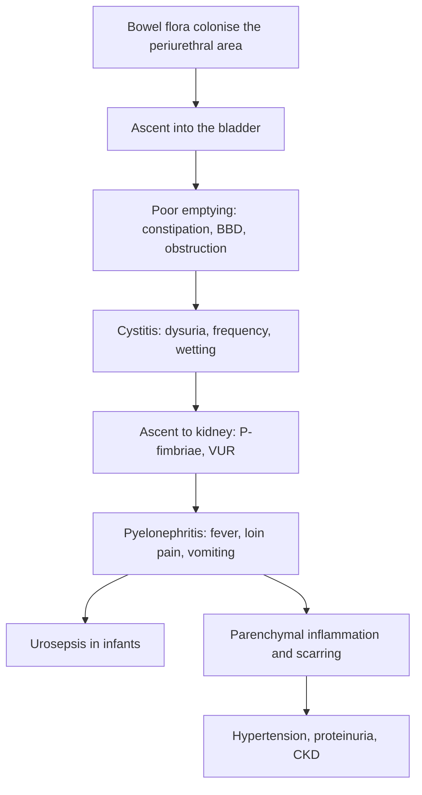

## 1. Definition

A **urinary tract infection (UTI)** is bacterial infection anywhere from the urethra (urethritis) and bladder (**cystitis**, lower UTI) to the kidney (**pyelonephritis**, upper UTI). In older children it looks like an adult UTI: dysuria, frequency and loin pain. In infants it hides as **fever without a focus**, vomiting, poor feeding, irritability or jaundice.

It matters because:

1. **It is common and missed.** In Uganda every fever is first a malaria question. A febrile child with a negative RDT and no focus needs a urine test.
2. **It can kill** young infants through **urosepsis**.
3. **It can scar the kidney.** Repeated pyelonephritis, especially with **vesicoureteric reflux (VUR)** or **obstruction** (posterior urethral valves), leads to scarring, hypertension and chronic kidney disease.

| Term | Definition |
|---|---|
| **UTI** | Symptoms or signs **plus** significant growth of a uropathogen from a properly collected urine sample (with pyuria in most) |
| **Upper UTI (acute pyelonephritis)** | Bacteriuria **and fever ≥38 °C**, or bacteriuria with fever <38 °C **and loin pain/tenderness** (NICE NG224) |
| **Lower UTI (cystitis)** | Bacteriuria without systemic features (dysuria, frequency, suprapubic pain) |
| **Asymptomatic bacteriuria** | Bacteriuria without symptoms; **do not treat** (except in specific settings such as pregnancy or before urological surgery) |
| **Vesicoureteric reflux (VUR)** | Retrograde flow of urine from the bladder into the ureter and kidney; **primary** (short intravesical ureter) or **secondary** (high bladder pressure: posterior urethral valves, neurogenic bladder, bladder–bowel dysfunction) |
| **Bladder and bowel dysfunction (BBD)** | Voiding dysfunction (holding, infrequent voiding, incomplete emptying, wetting) with **constipation**; a major cause of recurrent UTI in school-age children |

> [!PEARL]
> The one thing never to forget: **the diagnosis is only as good as the urine sample.** A contaminated bag sample leads to wrong antibiotics and unnecessary scans. Take a clean catch (or catheter/SPA in sick infants) **before** the first antibiotic dose whenever you can, but never let sample collection delay treatment of a septic infant.

## 2. Epidemiology

- **How common?** About **5–7% of febrile children aged 2–24 months** with no obvious source have a UTI (AAP). By age 7, roughly **8% of girls and 2% of boys** have had one.
- **Sex and age**: in the first **3–6 months**, **boys** (especially uncircumcised) are affected more often, and **posterior urethral valves** present here. After infancy, **girls** predominate (short urethra).
- **Organisms**: ***E. coli* (80–90%)**; *Klebsiella*, *Proteus* (boys, alkaline urine, stones), *Enterococcus* (infants, abnormal tracts), *Pseudomonas* (catheters, abnormal tracts), *Staphylococcus saprophyticus* (adolescent girls). **ESBL-producing *E. coli* and *Klebsiella*** are increasingly common.

> [!UGANDA]
> **The Ugandan reality.** Urine dipsticks are available at most HC IIIs and above; urine microscopy at HC IV level; **culture and sensitivity** mostly at **RRHs, Mulago, Mengo, Lacor** and private labs (results take 2–3 days). Ugandan hospital studies report **high *E. coli* resistance to amoxicillin/ampicillin and co-trimoxazole**, and a substantial share of **ESBL producers**, so **empirical amoxicillin or co-trimoxazole is a poor choice** for pyelonephritis. **Ultrasound** is available at most hospitals and many HC IVs; **MCUG** at Mulago and some private/mission hospitals; **DMSA** only at Mulago nuclear medicine (limited). Children with valves or high-grade VUR need **paediatric urology/surgery and nephrology** (Mulago and other national centres).

## 3. Aetiology and Risk Factors

**Organisms**: *E. coli* (80–90%); *Klebsiella*, *Proteus*, *Enterococcus*, *Pseudomonas*, *S. saprophyticus*; ESBL producers (section 2).

**Risk factors**

| Group | Risk factors |
|---|---|
| Host | **Infancy**, **female sex** (after infancy), **uncircumcised boys** (first year) |
| Functional | **Constipation**, **voiding dysfunction** (BBD), holding urine, school toilet avoidance |
| Structural | **VUR** (familial), **obstruction** (posterior urethral valves, pelviureteric junction obstruction, stones), duplex kidney, **neurogenic bladder** (spina bifida) |
| Iatrogenic | **Catheters** |
| Systemic | **Severe acute malnutrition**, **HIV**, sickle cell disease |
| Other | Sexual activity (adolescents), **sexual abuse**, **schistosomiasis** (bladder damage), poor hygiene, wiping back-to-front |

## 4. Pathophysiology

1. **Ascending infection** (the usual route after the newborn period): bowel flora colonise the **periurethral area** → ascend the urethra into the bladder. Girls' short urethra, uncircumcised boys' foreskin (a reservoir in infancy), poor hygiene and wiping back-to-front all help.
2. **Bladder defences**: regular **complete emptying** washes bacteria out. **Infrequent voiding, incomplete emptying and constipation** (a full rectum compresses the bladder neck and causes residual urine) undermine this, which is why **BBD** causes recurrent UTI.
3. **Ascent to the kidney**: *E. coli* with **P-fimbriae** bind to uroepithelium and reach the kidney, especially with **VUR**, which carries infected urine to the renal papillae ("intrarenal reflux" at the poles).
4. **Renal damage**: inflammation in the parenchyma → **scarring** (seen on DMSA) → loss of nephrons → **hypertension, proteinuria and CKD** (reflux nephropathy). The **younger the child**, the more vulnerable the kidney, and the **longer the delay** in treatment, the more scarring.
5. **Haematogenous spread** (neonates): bacteraemia seeds the kidney, so **neonatal UTI is often part of sepsis**, and meningitis may coexist.
6. **Obstruction** (PUV, PUJ obstruction, stones) creates stagnant, infected urine and high pressure → severe infection, hydronephrosis and renal impairment.

**Feature links**

- Bladder mucosal inflammation → dysuria, frequency, urgency, suprapubic pain, new wetting.
- Bacteria and white cells in urine → cloudy, offensive urine; leucocyte esterase positive; nitrite positive if urine has stayed about 4 h in the bladder.
- Renal parenchymal infection → fever ≥38 °C, loin pain and tenderness, vomiting, malaise.
- In infants, a systemic response without localising ability → fever without focus, irritability, poor feeding, lethargy, jaundice, failure to thrive.
- Bacteraemia (neonates) → sepsis, shock; meningitis may coexist.
- Bladder outflow obstruction (PUV) → poor or dribbling stream, straining, palpable bladder, bilateral hydronephrosis → raised creatinine, hyponatraemia and hyperkalaemia (pseudo-hypoaldosteronism).
- Repeated pyelonephritis with VUR → renal scars → hypertension, proteinuria, poor growth, CKD.
- Constipation → full rectum compresses the bladder neck → residual urine → recurrent cystitis.

## 5. Classification / Staging

**By site**: upper UTI (pyelonephritis) versus lower UTI (cystitis); definitions in section 1.

**By pattern (NICE)**

| Term | Definition |
|---|---|
| **Atypical UTI** | **Seriously ill**; **poor urine flow**; **abdominal or bladder mass**; **raised creatinine**; **septicaemia**; **failure to respond within 48 h**; **non-*E. coli* organism** |
| **Recurrent UTI** | **≥2 episodes of upper UTI**, or **1 upper + ≥1 lower**, or **≥3 lower UTIs** |

**Significant culture growth by collection method**

| Method | Significant growth | Comment |
|---|---|---|
| **Suprapubic aspiration (SPA)** | **Any growth** of a Gram-negative bacillus (or more than a few thousand CFU/mL of Gram-positive cocci) | Gold standard; ultrasound-guided |
| **Urethral catheter** | **≥10,000 CFU/mL** (AAP 2011 uses **≥50,000 CFU/mL** for febrile infants 2–24 months) | Low contamination if done aseptically |
| **Clean catch / midstream** | **≥100,000 CFU/mL** of a single organism | 10,000–100,000 in a symptomatic child = repeat the sample |
| **Urine bag** | Positive culture is **unreliable** (false-positive rate very high); **negative culture is useful** | Use only to screen; confirm a positive with a clean catch or catheter |
| **Mixed growth** (≥2 organisms) | Usually contamination | Repeat sample |

**VUR grading (International Reflux Study, on MCUG)**

| Grade | Findings | Natural history |
|---|---|---|
| **I** | Reflux into the **ureter only** | Most resolve |
| **II** | Into ureter, **pelvis and calyces, no dilatation** | Most resolve (about 80% of grades I–II) |
| **III** | **Mild–moderate dilatation** of ureter and pelvis, slight blunting of fornices | About half resolve |
| **IV** | **Moderate dilatation and tortuosity** of the ureter, obliteration of fornices, papillary impressions preserved | Less likely to resolve; scarring risk |
| **V** | **Gross dilatation and tortuosity**, loss of papillary impressions | Rarely resolve; highest risk of scarring and CKD; often surgical |

## 6. Clinical Features

### History

**Symptoms by age (NICE NG224)**

| Age | Most common | Less common |
|---|---|---|
| **Under 3 months** | **Fever**, vomiting, lethargy, irritability | Poor feeding, failure to thrive, abdominal pain, **jaundice**, haematuria, offensive urine |
| **3 months and over, preverbal** | **Fever** | Abdominal pain, loin tenderness, vomiting, poor feeding, lethargy, irritability, haematuria, offensive urine, failure to thrive |
| **Verbal child** | **Frequency, dysuria** | Dysfunctional voiding, **new wetting** (day or night), abdominal or loin pain, fever, malaise, vomiting, haematuria, offensive or cloudy urine |

| Question | Why it matters |
|---|---|
| Fever: duration, height; malaria test done? | Fever without a source → urine test |
| Vomiting, feeding, lethargy, jaundice (infant) | Sepsis risk; IV treatment |
| Dysuria, frequency, urgency, new wetting, smelly urine | Lower UTI |
| Loin or abdominal pain | Upper UTI |
| **Urine stream** in a boy (weak, dribbling, straining) | **Posterior urethral valves** |
| **Previous UTIs**, unexplained fevers | Recurrent UTI → imaging, prophylaxis |
| **Antenatal scan** abnormal (hydronephrosis) | Congenital anomaly |
| **Bowel habit**: constipation, hard stools, soiling | BBD |
| Voiding habits: holding, infrequent voiding, school toilet avoidance | BBD |
| Family history of VUR or kidney disease | VUR is familial (siblings); screening and imaging |
| Growth, BP history | Renal scarring, CKD |
| HIV, SAM, sickle cell disease, spina bifida, catheter | Higher risk, atypical organisms, severity |
| Immunisation, feeding | Overall child health |
| In girls: vaginal discharge, genital itch; in adolescents: sexual activity | Vulvovaginitis, STI, **sexual abuse** (ask sensitively and safeguard) |
| Water contact (lake/river), terminal haematuria | Schistosomiasis |

### Examination

Follow the order of Hutchison's Clinical Methods (24th edition), adapted for children: observe first, examine the abdomen while the child is calm, and leave distressing parts (genital examination, ears and throat) to the end, with a chaperone. In a sick infant, ETAT and ABCDE come first (section 9).

#### Introduction, consent and preparation

- Introduce yourself; consent from the parent and assent from the child; explain the need to look at the genitals and offer a **chaperone**.
- **Hand hygiene**; position supine on the couch or parent's lap; expose the abdomen, then the genitals and back as needed, preserving dignity.

#### General inspection (end of the bed)

- Well or unwell, irritable, lethargic, jaundiced (infant), hydration.
- **Vital signs for age**: **temperature**, HR, RR, CRT, **blood pressure** with the right cuff size (hypertension suggests scarring or renal disease); glucose in a sick infant.
- **Growth**: weight, length/height, Z-scores, MUAC (failure to thrive, SAM).

#### Hands, face and neck

- Cold hands, CRT > 3 s, weak fast pulse (sepsis, shock); pallor (CKD); puffy face (renal disease); neck stiffness and fontanelle (meningitis in infants).

#### Abdomen and genitourinary system

- **Inspection**: distension; suprapubic fullness.
- **Palpation**: **loin tenderness**, **palpable kidney** (hydronephrosis; ballot), **palpable bladder** (outflow obstruction), faecal masses (constipation), other masses (Wilms tumour).
- **Percussion**: suprapubic dullness (full bladder).
- **Auscultation**: renal bruit is rarely relevant; bowel sounds.
- **Genitalia**: phimosis, meatal stenosis, labial adhesions, vulvovaginitis, signs of abuse; **observe the urine stream in boys** if possible.
- **Spine and lower limbs**: sacral dimple, hair tuft, lipoma, neurological deficit (**neurogenic bladder**).

#### Completing the examination

- **Look for another source of fever**: chest, skin, meninges, then **ears and throat last**.
- **Thank** the parent and child, re-dress, **wash hands**, and **summarise** (upper or lower UTI, typical or atypical, and the plan).
- **Document negatives**: "no palpable bladder or kidneys, normal stream, spine normal, BP 92/58 (50th centile for age)".

### Red flags

> [!REDFLAG]
> - **Infant under 3 months** with fever (sepsis risk; refer and treat IV)
> - **Septic or shocked** child, vomiting everything, lethargy
> - **Poor urine stream, palpable bladder** or bilateral loin masses in a boy (posterior urethral valves)
> - **Raised creatinine**, oliguria, hypertension
> - **No response after 48 h** of appropriate antibiotics (abscess, obstruction, resistant organism)
> - **Recurrent UTI**, poor growth
> - In a girl with recurrent dysuria and genital signs: **possible sexual abuse** (follow child protection procedures)

### Thinking like a clinician

- **Fever with a negative RDT and no focus in a child under 2** → **urine**, before blaming "viral fever".
- **Infant boy with UTI** → look at the **stream**, feel for a **bladder**, scan the kidneys: **PUV** must be excluded.
- **School-age girl with recurrent cystitis and wetting** → ask about **constipation and holding**: treat **BBD**, not just the infection.
- **Dipstick positive for blood only**, no leucocytes or nitrites → consider **haematuria** causes (schistosomiasis, glomerulonephritis, stones, trauma), not UTI.
- **Positive bag culture with mixed growth** → **contamination**, not UTI; recollect properly.
- **"Recurrent UTI" on paper** → check how each diagnosis was made; many are contaminated samples.
- **Common student mistakes**: using a bag culture to diagnose; using CRP alone to decide upper vs lower UTI (NICE says don't); stopping antibiotics after 3 days for pyelonephritis; prescribing amoxicillin in a high-resistance setting; giving nitrofurantoin for pyelonephritis (it does not reach the kidney); forgetting the BP; ordering an MCUG for every first UTI; forgetting to treat constipation.

> [!EXAM]
> Viva favourite: **"How would you collect urine from a 9-month-old?"** Answer: **clean catch** first (sit with the nappy off, clean the genitalia with water, wait with a sterile pot; stimulation techniques help). If not possible, a **urine collection pad** (not cotton wool or gauze). If the child is very sick or non-invasive methods fail, **catheter sample or ultrasound-guided SPA**. A **bag** sample is acceptable only to **rule out** UTI when negative.

## 7. Differential Diagnoses

| Differential | Distinguishing clinical feature | Distinguishing investigation |
|---|---|---|
| **Malaria** | Fever, positive RDT; may coexist | RDT/slide; urine still tested if no focus |
| **Meningitis / sepsis** | Infant with fever, irritability, bulging fontanelle | LP, blood culture |
| **Pneumonia** | Cough, fast breathing, indrawing | Clinical, SpO₂ |
| **Gastroenteritis** | Diarrhoea with vomiting; pyuria can occur with dehydration | Urine culture if fever persists |
| **Appendicitis** | Migrating right iliac fossa pain, guarding; mild pyuria possible | Clinical, USS |
| **Vulvovaginitis** (girls) | Dysuria from vulval irritation, discharge, poor hygiene, pinworm | Inspection; urine culture usually negative |
| **Pinworm** | Night perianal itch, vulval irritation | Sticky-tape test |
| **Sexual abuse / STI** | Discharge, genital injury, behaviour change, recurrent symptoms | Sensitive history, examination by trained staff, safeguarding |
| ***S. haematobium*** | Terminal haematuria, water contact | Midday urine for eggs |
| **Acute glomerulonephritis** | Coca-Cola urine, oedema, hypertension, recent sore throat/skin infection | RBC casts, ASO, complement |
| **Urolithiasis** | Colicky loin pain, haematuria | USS |
| **Diabetes mellitus** | Polyuria, new wetting, thirst, weight loss | Urine glucose and ketones, blood glucose |
| **Kawasaki disease** | Sterile pyuria with fever ≥5 days, conjunctivitis, rash | Clinical |

## 8. Clinical Workup

Principles:

1. **Collect urine before antibiotics** whenever it does not delay treatment of a sick child.
2. **Send culture** for: under 3 months, suspected upper UTI, high/intermediate risk of serious illness, discordant dipstick and clinical picture, recurrent or atypical UTI, failure to respond.
3. **Process within 4 hours** or refrigerate (boric acid containers per manufacturer). UCG 2023: get the specimen to the lab within 2 hours, or refrigerate at 4 °C for no more than 24 hours.
4. **Don't use CRP alone** to decide upper vs lower UTI (NICE).
5. **Don't image every child**: follow the age-and-type schedule.

### Bedside

| Test | How | What it tells you | Available at |
|---|---|---|---|
| **Urine dipstick** (fresh sample) | Read at the times printed on the bottle | **Leucocyte esterase** (pyuria; sensitive ~80%, less specific) and **nitrite** (specific >90% but **sensitivity ~50%**; needs about 4 h in the bladder and nitrate-reducing organisms, so often negative in infants and with *Enterococcus*/*Pseudomonas*); blood and protein (non-specific) | HC III and above |
| **Blood glucose** | Sick infant | Hypoglycaemia | HC III and above |
| **Malaria RDT** | Finger prick | Co-existing malaria | All levels |
| **Blood pressure** | Correct cuff | Hypertension (scarring, renal disease) | All levels with a paediatric cuff |
| **Bladder scan / bedside ultrasound** (if skilled) | | Full bladder (for SPA), residual urine, hydronephrosis | Hospitals |

**Dipstick interpretation (NICE NG224)**

| Result | Children 3 months to 3 years | Children 3 years and over |
|---|---|---|
| **LE + and nitrite +** | Treat as UTI; **send culture** | Treat as UTI; send culture if high/intermediate risk of serious illness or previous UTI |
| **LE − and nitrite +** | Treat; send culture | **Treat** (if fresh sample); send culture |
| **LE + and nitrite −** | Treat; send culture | **Send culture**; treat only if there is good clinical evidence of UTI |
| **LE − and nitrite −** | UTI unlikely: no antibiotics, no culture (unless other criteria) | UTI unlikely: no antibiotics; look for another diagnosis |

**Under 3 months**: do **urgent microscopy and culture**; do not rely on a dipstick.

### Basic lab

| Test | When | Expected / abnormal finding | How it changes management | Available at |
|---|---|---|---|---|
| **Urine microscopy** (fresh, uncentrifuged) | All under 3 months; unclear dipstick | **Pyuria ≥10 WBC/mm³** (WHO Pocket Book: >5 WBC per high-power field) and **bacteriuria**; both positive = UTI | Treat | HC IV and above |
| **Gram stain of urine** | If lab available | Gram-negative rods (*E. coli*) vs Gram-positive cocci (*Enterococcus*, *Staph*) | Empirical choice | HC IV / hospital labs |
| **FBC, CRP** | Sick child | Leucocytosis; raised CRP (cannot alone separate upper from lower UTI) | Severity, response | HC IV and above (CRP at hospitals) |
| **Urea, creatinine, electrolytes** | Infants, upper UTI, atypical UTI, abnormal imaging | Raised creatinine (obstruction, dehydration, CKD); hyponatraemia/hyperkalaemia (obstructive uropathy) | Atypical UTI → imaging; gentamicin dosing; nephrology | RRH/NRH; some General Hospitals |
| **Urine for schistosome eggs** | Haematuria with water contact | Terminal-spine eggs | Praziquantel | HC III and above |
| **HIV test** | Unknown status, recurrent infections | Positive | ART, cotrimoxazole | All levels |

### Imaging

| Test | When | Expected finding | How it changes management | Available at |
|---|---|---|---|---|
| **Renal and bladder ultrasound (USS)** | Per NICE table below; any infant boy with UTI; atypical/recurrent UTI | **Hydronephrosis**, **dilated ureters**, **thick-walled bladder** (PUV, neurogenic), small or scarred kidney, abscess, stones, duplex kidney | Detects obstruction needing urgent drainage; guides MCUG | Most hospitals and many HC IVs |
| **MCUG / VCUG** (micturating cystourethrogram) | Atypical or recurrent UTI under 6 months; suspected PUV; dilatation on USS | **VUR grade**; **dilated posterior urethra with valves** | Prophylaxis, surgery. Give 3 days of prophylactic antibiotics with the MCUG on day 2 (NICE) | Mulago, some private/mission hospitals |
| **DMSA scan** | 4–6 months after atypical/recurrent UTI (per age, NICE) | **Renal scars**, differential function | Long-term follow-up (BP, proteinuria) | Mulago nuclear medicine only |

**NICE NG224 imaging schedule**

| Test | **Under 6 months** (good response / atypical / recurrent) | **6 months–3 years** | **3 years and over** |
|---|---|---|---|
| **USS during acute infection** | No / **Yes** / **Yes** | No / **Yes** / No | No / **Yes** / No |
| **USS within 6 weeks** | **Yes** (if abnormal consider MCUG) / No / No | No / No / **Yes** | No / No / **Yes** |
| **DMSA 4–6 months later** | No / **Yes** / **Yes** | No / **Yes** / **Yes** | No / No / **Yes** |
| **MCUG** | No / **Yes** / **Yes** | Not routinely (consider if dilatation on USS, poor urine flow, non-*E. coli* infection, family history of VUR) | No |

**AAP 2011 (febrile UTI, 2–24 months; reaffirmed)**: **renal and bladder ultrasound after the first febrile UTI**; **VCUG only if the ultrasound shows hydronephrosis, scarring or other findings suggesting high-grade VUR or obstruction**, or after a **second** febrile UTI.

### Specialised / referral-level

| Test | When | Expected / abnormal finding | How it changes management | Available at |
|---|---|---|---|---|
| **Urine culture and sensitivity** | Under 3 months; suspected upper UTI; high/intermediate risk of serious illness; dipstick and clinical picture disagree; recurrent UTI; no response | **Single organism** above the threshold for the collection method; sensitivities | Confirms diagnosis; adjusts antibiotics (ESBL); defines recurrence. Refrigerate if delayed | RRH/NRH, Mengo, Lacor, private labs (2–3 days) |
| **Blood culture** | Infants, septic children | Same organism (urosepsis) | Duration and route of antibiotics | RRH/NRH |
| **LP** | Febrile neonate; infant under 3 months who is unwell | Meningitis co-existing | Antibiotic choice and duration | HC IV and above (CSF analysis at hospitals) |

### Putting it together

**Model one-line summary**

> "A 4-month-old boy, 6.1 kg (weight-for-age Z −0.9), fully immunised for age, exclusively breastfed, HIV-unexposed, presenting with 2 days of fever 39.6 °C, vomiting and irritability, RDT negative, with a catheter urine showing leucocytes 3+, nitrite positive and >50 WBC/mm³ with Gram-negative rods, and a palpable bladder: febrile UTI (presumed pyelonephritis) in a young infant with possible bladder outflow obstruction."

**Problem list**

1. Febrile UTI under 6 months (IV antibiotics).
2. Palpable bladder in a boy → exclude **posterior urethral valves**.
3. Creatinine to check.
4. Imaging plan (USS now; MCUG).

**Model case presentation (ward round)**

> "Baby M, a 4-month-old boy from Mukono, **weight 6.1 kg (weight-for-age Z −0.9), length 62 cm (length-for-age Z −0.5)**, **exclusively breastfed**, **immunised for age** (BCG scar, OPV/pentavalent/PCV/rotavirus 1–3 at 6, 10, 14 weeks), mother **HIV-negative** in this pregnancy, admitted yesterday with 2 days of fever, vomiting and irritability. The mother says he 'dribbles' urine and strains. Antenatal scan at 32 weeks: 'kidneys swollen' (not followed up).
> On admission: temperature 39.6 °C, HR 172, RR 48, CRT 2 s, irritable, fontanelle flat, **palpable bladder 4 cm above the pubis**, both kidneys ballotable; normal genitalia, spine normal. RDT negative. **Catheter urine: leucocytes 3+, nitrite +, >50 WBC/mm³, Gram-negative rods**; creatinine **98 µmol/L** (raised for age), Na 131, K 5.8 mmol/L. Ultrasound: **bilateral hydroureteronephrosis, thick-walled trabeculated bladder, dilated posterior urethra**.
> **Assessment: febrile UTI with sepsis in an infant boy, with atypical features (poor stream, bladder mass, raised creatinine) strongly suggesting posterior urethral valves.**
> **Management so far:** urethral catheter (6 Fr feeding tube) left on free drainage, **ampicillin 300 mg IV 6-hourly + gentamicin** avoided because of the raised creatinine (switched to **ceftriaxone 450 mg IV daily**), IV fluids with monitoring for post-obstructive diuresis, paracetamol.
> **Plan:** culture results; daily creatinine and electrolytes; **MCUG** once infection is controlled; **paediatric urology referral** for valve ablation; nephrology follow-up for CKD; BP monitoring; continue breastfeeding."

> [!EXAM]
> **Worked example 1: interpreting a culture.**
> - **Bag urine** from a 10-month-old: "mixed growth of 3 organisms, 10⁵ CFU/mL" → **contamination**; recollect by clean catch or catheter.
> - **Catheter urine**: "*E. coli* 60,000 CFU/mL, pyuria present" → **UTI** (above the AAP threshold of 50,000 for catheter samples).
> - **Clean catch** in a 6-year-old with dysuria: "*E. coli* 20,000 CFU/mL" → borderline; repeat the sample; treat if symptomatic with pyuria.
> - **SPA**: "*Klebsiella* 2,000 CFU/mL" → **any growth from SPA is significant**; also a **non-*E. coli*** organism, so this is an **atypical UTI** (imaging needed).

> [!EXAM]
> **Worked example 2: dose calculation.**
> A 2-year-old girl, 12 kg, with pyelonephritis is vomiting: **ceftriaxone 50–80 mg/kg once daily** (UCG) → **600–960 mg IV**; most units give **75 mg/kg ≈ 900 mg**. After 48 h she is eating and afebrile: switch to **cefixime 8 mg/kg once daily = 96 mg (≈100 mg)** to complete **10 days** in total. If you use gentamicin instead: **7.5 mg/kg once daily = 90 mg IV/IM**, checking creatinine (avoid in renal impairment).

## 9. Management

### Immediate / emergency

1. **ETAT / ABCDE**: airway, breathing, **circulation** (cold hands, CRT >3 s, weak fast pulse = shock), coma, convulsions; **glucose** in a sick infant.
2. **Septic or under 3 months?** → IV/IO access, **blood culture**, glucose, FBC, creatinine; collect **urine by catheter or SPA** quickly; **first dose of IV antibiotics without waiting** for the sample if it will delay treatment; consider **LP** (especially neonates).
3. **Shock** → 10–20 mL/kg crystalloid and reassess (not in SAM; neonates 10 mL/kg).
4. **Palpable bladder or poor stream in a boy** → catheterise (feeding tube 6–8 Fr) to drain the bladder.
5. **Well child** → collect a clean urine sample **before** antibiotics and test it.

### Definitive

**Management algorithm**

1. **Sick or under 3 months?** → admit, resuscitate, blood culture (and LP if indicated), urine by catheter/SPA, **IV antibiotics** now (ampicillin plus gentamicin in neonates; cefotaxime or ceftriaxone plus ampicillin at 1–3 months), **10–14 days** in total, IV until afebrile 24–48 h and improving, then oral per culture; **ultrasound** before discharge or within 6 weeks.
2. **Over 3 months, well, upper UTI** → **oral antibiotics 7–10 days** (UCG: 10 days) if tolerating orally; IV for 24–72 h if vomiting, dehydrated or seriously ill, then oral.
3. **Over 3 months, lower UTI** → **oral antibiotics 3 days** (NICE) or per UCG (7 days).
4. **Supportive care**: fluids (oral or IV), **paracetamol 15 mg/kg** for fever and pain (avoid NSAIDs if dehydrated or renal impairment), encourage frequent voiding.
5. **Review at 48 h**: culture result; if **no improvement**, it is atypical UTI: **ultrasound now** (obstruction, abscess), check sensitivities, consider resistant organisms.
6. **Plan imaging** by age and UTI type (NICE table, section 8).
7. **Prevent recurrence**: treat constipation and BBD, fluids, hygiene; prophylaxis only for selected children.
8. **Follow up**: BP, growth, imaging results in writing, nephrology referral for scars, high-grade VUR or abnormal renal function.

### Drug table

| Drug (indication) | Dose (paediatric per kg, max) | Route | Frequency | Duration | Key cautions |
|---|---|---|---|---|---|
| **Ampicillin** (under 3 months) | **50 mg/kg** | IV/IM | **12-hourly in week 1**, 8-hourly in weeks 2–4, 6-hourly after 1 month | **10–14 days** in total (IV until afebrile 24–48 h, then oral per culture) | Covers *Enterococcus*, GBS |
| **Gentamicin** (under 3 months, with ampicillin) | **5 mg/kg** (term, week 1), **3 mg/kg** (LBW/preterm, week 1); **7.5 mg/kg** after week 1 (WHO PB) | IV/IM | **Once daily** | Usually 5–7 days | Check creatinine; avoid prolonged use. UCG neonatal regimen uses 2.5 mg/kg 12-hourly |
| **Cefotaxime** (1–3 months; or neonate) | **50 mg/kg** | IV | 8-hourly (neonate 12-hourly in week 1) | As above | Use with ampicillin to cover *Enterococcus* |
| **Ceftriaxone** (over 1 month not jaundiced; pyelonephritis if vomiting, dehydrated or seriously ill) | **50–80 mg/kg** (UCG; max 2 g) | IV/IM | **Once daily** | 2–4 days, then oral to complete **10 days** | First-choice parenteral in Uganda; not in jaundiced/preterm neonates or with calcium-containing fluids in neonates |
| **Gentamicin** (pyelonephritis, alternative) | **7.5 mg/kg** (UCG/WHO PB) | IV/IM | Once daily | 2–5 days, then oral | ± ampicillin 50 mg/kg 6-hourly (WHO PB; UCG 25 mg/kg) for *Enterococcus*; avoid with raised creatinine or dehydration; ototoxic, nephrotoxic |
| **Cefixime** (oral, pyelonephritis) | **8 mg/kg** (UCG: 16 mg/kg on day 1, then 8 mg/kg); max 400 mg | Oral | Once daily | To complete **7–10 days** (UCG 10) | Good oral step-down |
| **Cefalexin** (oral, pyelonephritis) | **25 mg/kg** (max 1 g) | Oral | 8–12-hourly | 7–10 days | NICE first-line oral (local resistance) |
| **Co-amoxiclav** (oral, pyelonephritis) | Amoxicillin component **about 10–15 mg/kg** | Oral | 8-hourly | 7–10 days | Only if culture shows susceptibility (NICE) |
| **Ciprofloxacin** (oral, second line/resistant) | **10–20 mg/kg** (max 750 mg) | Oral | 12-hourly | 7–10 days | For resistant organisms on culture; specialist advice |
| **Meropenem** (ESBL, severe) | **20 mg/kg** (max 1 g) | IV | 8-hourly | Per culture | Referral hospitals; antimicrobial stewardship |
| **Nitrofurantoin** (cystitis) | UCG 2023: **3 mg/kg/day** in **4 divided doses**; Medscape range 5–7 mg/kg/day | Oral, after food | 6-hourly | **UCG 7 days**; NICE **3 days** | **Cystitis only** (no kidney levels); avoid in G6PD deficiency, renal impairment, under 3 months |
| **Trimethoprim** (cystitis) | 4 mg/kg (max 200 mg) | Oral | 12-hourly | 3 days | High resistance in Uganda: use only if sensitive |
| **Cefalexin** (cystitis) | 12.5–25 mg/kg | Oral | 12-hourly (or 8-hourly) | 3 days | Alternative |
| **Amoxicillin** (cystitis, UCG second line) | UCG: 125–250 mg | Oral | 8-hourly | 7 days (UCG) | **Only if culture-sensitive**: high resistance |
| **Trimethoprim** (prophylaxis) | **2 mg/kg** (max 100 mg) | Oral | At night | Per specialist | Not routine after a first UTI |
| **Nitrofurantoin** (prophylaxis) | **1 mg/kg** (max 50 mg) | Oral | At night | Per specialist | Avoid under 6 weeks |
| **Cefalexin** (prophylaxis, infants under 6 weeks) | **10–12.5 mg/kg** | Oral | At night | Per specialist | Avoid nitrofurantoin and sulfonamides under 6 weeks |
| **Paracetamol** | **15 mg/kg** | Oral | 6-hourly | While febrile or in pain | Avoid NSAIDs if dehydrated or renal impairment |
| **Lactulose** (constipation, BBD) | About **0.5–1 mL/kg** | Oral | Twice daily | Until regular soft stools | Or PEG; with fluids, fibre, toilet routine |

> [!DRUG]
> **Do not** use **nitrofurantoin for pyelonephritis** (no renal tissue levels). **Gentamicin**: once-daily dosing, check creatinine, avoid with dehydration or renal impairment and limit duration (ototoxicity, nephrotoxicity). **Ceftriaxone** is avoided in jaundiced or preterm neonates and must not be given with calcium-containing fluids in neonates.

> [!UGANDA]
> **UCG 2023 vs NICE.** UCG lists **nitrofurantoin 3 mg/kg/day in 4 doses for 7 days** (second line amoxicillin) for cystitis and **ceftriaxone 50–80 mg/kg once daily then cefixime to complete 10 days** (alternative gentamicin ± ampicillin) for pyelonephritis, and refers children with recurrent infection for investigation. NICE uses **3 days** for cystitis and **7–10 days of oral treatment** (cefalexin or co-amoxiclav) for pyelonephritis in children over 3 months. On Ugandan wards you will see the UCG regimens; choose by **culture sensitivity** whenever it is available, because resistance to amoxicillin and co-trimoxazole is high.

### Referral criteria

| Level | Action | Refer up when |
|---|---|---|
| **HC II / HC III** | Urine dipstick for febrile children without a focus (and RDT); clean-catch technique; **oral antibiotics for well children over 3 months** (cefixime if stocked; nitrofurantoin for cystitis) | **Infants under 3 months, sick children, boys with poor stream or palpable bladder**: give pre-referral IM ceftriaxone or gentamicin and refer to HC IV / hospital |
| **HC IV / General Hospital** | Admission, IV ceftriaxone/gentamicin, urine microscopy, ultrasound where available, catheterisation | No response at 48 h, atypical or recurrent UTI needing culture and imaging, raised creatinine, suspected PUV or high-grade VUR → RRH |
| **RRH** | Culture and sensitivity, blood culture, LP, management of ESBL infections | MCUG, DMSA, paediatric urology or nephrology not available → NRH |
| **NRH (Mulago) and national centres** | MCUG, DMSA (Mulago), paediatric nephrology and urology, valve ablation, VUR surgery | n/a |

### Monitoring and follow-up

- **Review at 48 h** with the culture result; no response = atypical UTI (ultrasound now, sensitivities, resistant organism).
- **Infants and upper UTI**: temperature, feeding, urine output; creatinine and electrolytes if abnormal (daily in obstruction; watch for post-obstructive diuresis).
- **Do not routinely re-test urine** in a child who is well after treatment (NICE).
- **Give imaging results in writing** to the parents.
- **Children with renal scars** (DMSA): **height, weight, BP and urine protein** at follow-up; **bilateral abnormalities, raised BP, proteinuria or impaired function → paediatric nephrologist** (NICE).
- **Teach parents** to seek care early for fever or urinary symptoms and to ask for a **urine test**.

### Recurrent UTI and VUR: prevention of recurrence

| Measure | Details |
|---|---|
| **Treat constipation** | Lactulose (about 0.5–1 mL/kg twice daily) or PEG, fluids, fibre, toilet routine |
| **Voiding advice** | Regular timed voiding every 2–3 hours, double voiding, relaxed posture (feet supported), **don't hold urine**, access to clean school toilets (NICE) |
| **Fluids and hygiene** | Adequate water intake; front-to-back wiping; avoid bubble baths/irritants |
| **Circumcision** | Consider in **infant boys with recurrent UTI or high-grade VUR** (urology advice) |
| **Antibiotic prophylaxis** | **Not routine after a first UTI** (NICE). Consider for **recurrent UTI**, **high-grade VUR (III–V)**, infants with hydronephrosis or awaiting surgery (doses in the drug table) |
| **Evidence (RIVUR, NEJM 2014)** | In children 2–71 months with VUR grade I–IV after a febrile UTI, **TMP–SMX prophylaxis roughly halved recurrent UTIs** but **did not reduce renal scarring**, and increased resistant infections. So prophylaxis is a judgement for higher-risk children, not automatic |
| **VUR surgery** | Endoscopic subureteric injection (e.g. dextranomer/hyaluronic acid) or **ureteric reimplantation** for high-grade VUR with breakthrough infections or new scars (referral centres) |

### Posterior urethral valves

**Catheterise** (feeding tube 6–8 Fr) to drain the bladder, treat infection, monitor creatinine and electrolytes (post-obstructive diuresis), **urgent paediatric urology** for valve ablation; lifelong renal follow-up.

## 10. Complications

**Disease-related**

| Timing | Complications |
|---|---|
| **Acute** | **Urosepsis/septic shock** (infants), **meningitis** (neonates), dehydration, **acute kidney injury**, hyponatraemia/hyperkalaemia (pseudo-hypoaldosteronism in infants with obstruction), renal or perinephric **abscess**, **pyonephrosis** (infected obstructed kidney), febrile seizures |
| **Long-term** | **Renal scarring** (reflux nephropathy), **hypertension**, **proteinuria**, **chronic kidney disease**, poor growth, recurrent UTI; complications in later pregnancy (pre-eclampsia, pyelonephritis) for women with scarred kidneys |

**Treatment-related**

| Complication | Cause | Recognition and action |
|---|---|---|
| **Antibiotic resistance** | Prophylaxis, empirical amoxicillin/co-trimoxazole | Culture-guided therapy; prophylaxis only for selected children |
| **Nephro- and ototoxicity** | Gentamicin | Once daily, short course, check creatinine, avoid in dehydration or renal impairment |
| **Treatment failure** | Nitrofurantoin used for pyelonephritis | Never for upper UTI |
| **Ceftriaxone–calcium precipitation; kernicterus risk** | Ceftriaxone in jaundiced/preterm neonates or with calcium fluids | Use cefotaxime in neonates |
| ***C. difficile*, allergy** | Any antibiotic | Stop or change drug |
| **Post-obstructive diuresis** | Draining an obstructed bladder (PUV) | Monitor urine output, electrolytes; replace losses |

## 11. Prognosis

- Most children with a first typical UTI recover fully within days of correct treatment.
- The risk of **renal scarring** is highest in the **youngest children**, with **delayed treatment**, **recurrent pyelonephritis**, **high-grade (IV–V) or bilateral VUR** and **obstruction**.
- **Low-grade VUR (I–II)** usually resolves with growth (about 80%); grade III about half; grades IV–V rarely.
- Scarred kidneys carry long-term risks of **hypertension, proteinuria, CKD** and problems in later pregnancy, hence lifelong BP and urine checks.
- **Posterior urethral valves** need lifelong renal follow-up; many develop CKD.

## 12. Prevention

- **Prompt diagnosis and treatment** of febrile UTI (test the urine of every febrile infant without a focus) limits scarring.
- **Treat constipation and BBD**; regular timed voiding; do not hold urine; access to clean school toilets.
- **Hygiene**: front-to-back wiping; adequate water intake; avoid irritants.
- **Selective prophylaxis** and **circumcision** for higher-risk children (section 9).
- **Follow up abnormal antenatal scans** (hydronephrosis) after birth.
- **Schistosomiasis control** (praziquantel, avoiding lake water) protects the bladder.
- **Safeguarding**: recognise sexual abuse in children with recurrent genital symptoms.

## 13. Special Populations

- **Neonates and infants under 3 months**: haematogenous spread, sepsis and meningitis; always IV antibiotics, blood culture and a low threshold for LP; avoid ceftriaxone in jaundiced or preterm neonates; avoid nitrofurantoin under 3 months.
- **Infant boys**: exclude posterior urethral valves (stream, bladder, ultrasound).
- **Children with SAM**: shock fluids follow the SAM protocol (not 10–20 mL/kg boluses); higher risk of UTI and atypical organisms.
- **HIV, sickle cell disease**: higher risk and atypical organisms.
- **Neurogenic bladder (spina bifida), catheters**: *Pseudomonas*, *Enterococcus*; asymptomatic bacteriuria is common and not treated.
- **Adolescent girls**: *S. saprophyticus*; ask about sexual activity and STI.
- **G6PD deficiency**: avoid nitrofurantoin.
- **Renal impairment**: avoid gentamicin and nitrofurantoin.

## 14. Key Points

### High-yield points

- **Test the urine** of every febrile infant or young child with no focus, even after a negative RDT.
- **Clean catch first**; catheter or SPA if sick; **bag only to rule out**.
- **Under 3 months: IV antibiotics**, blood culture, consider LP.
- **Upper UTI = fever ≥38 °C or loin pain**; treat 7–10 days (UCG 10).
- **Never nitrofurantoin for pyelonephritis.**
- **Avoid empirical amoxicillin and co-trimoxazole** in Uganda: culture-guided therapy.
- **Infant boy + poor stream + palpable bladder = PUV** until proven otherwise.
- **Atypical UTI (SPARSE-N)** and **recurrent UTI** drive imaging.
- **Treat constipation and BBD** in recurrent UTI.
- **Check BP** and plan follow-up for scarred kidneys.

### Numbers & doses

| Item | Value |
|---|---|
| UTI in febrile 2–24 month olds without a source | **~5–7%** |
| *E. coli* share | **80–90%** |
| SPA threshold | **Any growth** |
| Catheter threshold | **≥10,000 CFU/mL** (AAP **≥50,000**) |
| Clean catch threshold | **≥100,000 CFU/mL** single organism |
| Pyuria | **≥10 WBC/mm³** (WHO PB **>5 WBC/hpf**) |
| Nitrite | Specific **>90%**; sensitivity **~50%** |
| Leucocyte esterase | Sensitivity **~80%** |
| Process urine | Within **4 h** (or refrigerate; UCG within 2 h or ≤24 h at 4 °C) |
| Upper UTI definition | Bacteriuria + **fever ≥38 °C** or loin pain |
| Under 3 months | **IV** ampicillin + gentamicin (neonate) / cefotaxime or ceftriaxone + ampicillin; 10–14 days |
| Ceftriaxone (UCG) | **50–80 mg/kg** IV/IM once daily (max 2 g) |
| Gentamicin | **7.5 mg/kg** once daily (child); **5 mg/kg** (term neonate week 1), **3 mg/kg** (LBW week 1) |
| Ampicillin | **50 mg/kg** 6-hourly (child) |
| Cefixime | **8 mg/kg** once daily (UCG 16 mg/kg day 1) |
| Cefalexin | **25 mg/kg** 8–12-hourly (upper); 12.5–25 mg/kg 12-hourly (lower) |
| Nitrofurantoin | UCG **3 mg/kg/day ÷ 4** × 7 days (cystitis only) |
| Upper UTI duration | **7–10 days** (UCG 10) |
| Lower UTI duration | **3 days** (NICE); 7 days (UCG) |
| Prophylaxis | Trimethoprim **2 mg/kg** nocte; nitrofurantoin **1 mg/kg** nocte |
| DMSA timing | **4–6 months** after infection |
| MCUG antibiotic cover | **3 days**, MCUG on day 2 |
| Recurrent UTI | ≥2 upper; 1 upper + ≥1 lower; ≥3 lower |

### Exam traps

- **"The bag urine grew 10⁵ mixed organisms: start antibiotics and order an MCUG."** Wrong: likely contamination; recollect properly.
- **"Negative nitrite rules out UTI in an infant."** Wrong: infants void too frequently for nitrite to form.
- **"CRP of 120 means pyelonephritis."** NICE: don't use CRP alone to localise.
- **"Nitrofurantoin for a febrile 2-year-old."** Wrong: no renal levels; use cefixime/cefalexin/ceftriaxone.
- **"Every child needs an MCUG after a first UTI."** Wrong: MCUG is for atypical/recurrent UTI under 6 months or specific features.
- **"Prophylaxis for every child after a first UTI."** Wrong (NICE); RIVUR showed no effect on scarring.
- **"Amoxicillin is a good empirical choice in Uganda."** Wrong: high resistance; use culture-guided therapy.
- **"Treat asymptomatic bacteriuria."** Wrong in children (NICE).

### Questions seniors ask

**Viva questions**

1. *How do you diagnose UTI in a 6-month-old?* Properly collected urine (clean catch/pad, or catheter/SPA if sick), dipstick or microscopy, and culture; fever with bacteriuria = upper UTI.
2. *Which dipstick result is most specific?* Nitrite (but insensitive in infants).
3. *Define atypical UTI.* Seriously ill, poor urine flow, abdominal or bladder mass, raised creatinine, septicaemia, no response within 48 h, non-*E. coli* organism.
4. *Imaging after a first typical UTI in a 2-year-old who responded in 48 h?* None (NICE); AAP would scan the kidneys after a first febrile UTI in 2–24 months.
5. *What is the commonest organism?* *E. coli* (80–90%).
6. *Grade V VUR?* Gross dilatation and tortuosity of the ureter and pelvicalyceal system with loss of papillary impressions.
7. *What did RIVUR show?* Prophylaxis halved recurrences in VUR I–IV but did not reduce scarring.

**On the ward round**

- **Why did you send this urine for culture when the dipstick was positive?** The child is under 3 years with suspected upper UTI (and/or high risk of serious illness); culture confirms the diagnosis, guides antibiotics in a high-resistance setting and defines future recurrences.
- **When would you give IV rather than oral antibiotics?** Infants under 3 months, children who are seriously ill or septic, vomiting or unable to take oral medicine, or dehydrated; switch to oral when improving (usually 24–72 h).
- **This 8-month-old boy has his second febrile UTI. What imaging will you request?** Recurrent UTI at 6 months–3 years (NICE): ultrasound within 6 weeks and DMSA at 4–6 months; consider MCUG if the ultrasound shows dilatation, poor flow, a non-*E. coli* organism or a family history of VUR. AAP: VCUG after a second febrile UTI.
- **Why does a palpable bladder in an infant boy worry you?** It suggests bladder outflow obstruction from **posterior urethral valves**; he needs catheter drainage, creatinine and electrolytes, urgent ultrasound and MCUG, and paediatric urology.
- **Should this girl with VUR grade II get prophylaxis?** Probably not after a single UTI: low-grade VUR usually resolves; focus on constipation and voiding habits; consider prophylaxis if UTIs recur (RIVUR: fewer recurrences, no less scarring).
- **How do you follow up a child with renal scarring on DMSA?** Regular height, weight, **BP** and **urine protein**; refer to nephrology if scarring is bilateral, BP is raised, there is proteinuria or renal function is impaired.

### Mnemonics

- **Atypical UTI "SPARSE-N"**: **S**eriously ill, **P**oor urine flow, **A**bdominal/bladder mass, **R**aised creatinine, **S**epticaemia, **E**ffect of antibiotics absent at 48 h, **N**on-*E. coli*.
- **Recurrent UTI "2-1+1-3"**: 2 upper; 1 upper + 1 lower; 3 lower.
- **Culture thresholds "SPA any, Cath 10, Clean 100"**: any growth / ≥10,000 / ≥100,000 CFU/mL (AAP catheter ≥50,000).
- **Nitrite = "Not Infant-friendly"**: specific but often negative in infants (frequent voiding).
- **Imaging "USS for the young and the atypical; DMSA for scars; MCUG for babies"**.
- **VUR grades "Ureter, Up to calyces, a bit Dilated, very Dilated and Tortuous, Gross"** (I–V).

### OSCE tips

- **Counselling station on clean-catch collection**: explain hand washing, cleaning the genitals with water (no antiseptic), catching the midstream in a sterile pot, closing it and bringing it within an hour (or refrigerating).
- **Urine dipstick station**: check the expiry date, dip briefly, tap off excess, hold horizontally, **read each pad at the right time**, and interpret leucocytes and nitrites (NICE table).
- **Abdominal and genitourinary examination station**: in Hutchison order, ballot the kidneys, feel and percuss for a bladder, inspect the genitalia with a chaperone, examine the spine, and **measure the BP** with the right cuff.

## 15. References

1. Ministry of Health Uganda. Uganda Clinical Guidelines 2023 (sections 7.2.1 Acute cystitis, 7.2.2 Acute pyelonephritis). Kampala: MoH; 2023. https://library.health.go.ug/uganda-clinical-guidelines-2023
2. NICE. Urinary tract infection in under 16s: diagnosis and management (NG224). 2022. https://www.nice.org.uk/guidance/ng224
3. World Health Organization. Pocket Book of Hospital Care for Children, 2nd edition (section 6.8 Urinary tract infection). Geneva: WHO; 2013. https://www.who.int/publications/i/item/978-92-4-154837-3
4. Subcommittee on Urinary Tract Infection. Urinary tract infection: clinical practice guideline for the diagnosis and management of the initial UTI in febrile infants and children 2 to 24 months. Pediatrics (American Academy of Pediatrics). 2011. https://pubmed.ncbi.nlm.nih.gov/21873693/
5. RIVUR Trial Investigators. Antimicrobial prophylaxis for children with vesicoureteral reflux. New England Journal of Medicine. 2014. https://pubmed.ncbi.nlm.nih.gov/24795142/
6. Medscape (eMedicine). Pediatric urinary tract infection (overview, workup, treatment). https://emedicine.medscape.com/article/969643-overview
7. Royal Children's Hospital Melbourne. Urinary tract infection (clinical practice guideline). 2025. https://www.rch.org.au/clinicalguide/guideline_index/Urinary_tract_infection/
8. Glynn M, Drake WM, editors. Hutchison's Clinical Methods: An Integrated Approach to Clinical Practice. 24th edition. Edinburgh: Elsevier; 2018.
