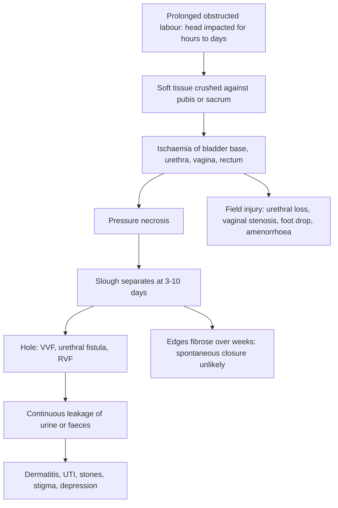

## 1. Definition

- **Obstetric fistula** is a hole between the vagina and the **bladder or urethra** (vesicovaginal fistula, **VVF**) or the **rectum** (rectovaginal fistula, **RVF**). It is usually caused by **days of obstructed labour** and, increasingly, by **surgical injury at caesarean section or hysterectomy**.
- The result is **continuous, uncontrollable leakage of urine and/or faeces**. That leads to wet, smelly clothes, **ammoniacal dermatitis**, and then **divorce, stigma, isolation, poverty and depression**. The baby has usually died in the labour that caused the fistula.
- **Each fistula is a failure of the health system**: a delay in deciding to seek care, in reaching care, or in receiving a CS.
- The **one thing never to forget**: after any prolonged or obstructed labour, **put in a catheter and leave it for 7–14 days**. For a fresh fistula, **continuous bladder drainage for up to 4–6 weeks** can close a small one without surgery.
- Most fistulae can be **repaired vaginally** by a trained surgeon, with closure rates of about 80–90%. Residual **stress incontinence** remains a common problem, especially when the urethra is involved.

**Types by anatomy**

| Type | Communication | Typical clue |
|---|---|---|
| **Urethrovaginal** | Urethra to vagina | Leakage may be positional; the closing mechanism is involved, so there is a high risk of post-repair stress incontinence |
| **Vesicovaginal (VVF)** | Bladder to vagina (mid-vaginal, juxtacervical, vault) | **Continuous leakage day and night**; little or no voiding |
| **Vesicocervical / vesicouterine** | Bladder to cervix or uterus, usually after CS | **Youssef syndrome**: cyclical haematuria (menouria), amenorrhoea, and often continence |
| **Ureterovaginal** | Ureter to vagina, usually after CS or hysterectomy | Continuous leakage **plus normal voiding** (the other ureter still fills the bladder). May have loin pain or hydronephrosis |
| **Rectovaginal (RVF)** | Rectum to vagina | Flatus or faeces per vaginam. It may follow obstructed labour, **third- or fourth-degree tears** (low RVF), or sexual violence |
| **Combined VVF + RVF** | Both | Severe obstructed-labour injury complex |

## 2. Epidemiology

- WHO estimates **50,000–100,000 new obstetric fistulae worldwide each year**. Recent estimates suggest about half a million women are living with fistula, down from about 2 million two decades ago, but still overwhelmingly in **sub-Saharan Africa and South Asia**.
- **Uganda**:
  - The **Uganda Demographic and Health Survey (UDHS)** shows the proportion of women reporting fistula symptoms falling from about 3% (2006) to about 1% (2016). The highest burden is in the **Tooro and Ankole** regions.
  - Ministry of Health estimates have ranged from **about 100,000 to 200,000 women living with fistula**, with **about 1,900 new cases a year**.
  - A multicentre Ugandan cohort of **510 repairs (2010–2021)** found **66% ischaemic** fistulae and nearly **one third iatrogenic or other**. Successful **closure with continence was about 81%**.
- **The rising iatrogenic share** reflects more CS being done, often late, on tired surgeons and oedematous tissue, by less experienced hands at district level. Every CS for obstructed labour is also a risk to the bladder.

> [!UGANDA]
> Uganda treats fistula through **regional fistula centres and outreach "fistula camps"**. About **29 centres across 24 districts** have been set up, including national and regional referral hospitals and mission hospitals.
> - **Kitovu Hospital (Masaka)** runs camps several times a year.
> - **TERREWODE** (Soroti) runs a dedicated **women's community fistula hospital** and a reintegration programme.
> - The **Fistula Foundation Treatment Network** was launched in Uganda with the Ministry of Health and partners.
>
> Surgery is usually **free** to the woman, funded by the MoH, UNFPA and NGOs. Your job on the ward is to **identify, catheterise, counsel and link her** to the nearest centre. Know when the next camp is and who the regional fistula surgeon is.

## 3. Aetiology and Risk Factors

**Causes**

| Cause | Mechanism | When leakage starts |
|---|---|---|
| **Ischaemic (obstetric)** | Prolonged obstructed labour, where the head compresses soft tissue against the bone, causing **pressure necrosis** | **3–10 days postpartum**, when the slough separates |
| **Iatrogenic (surgical)** | Bladder injury at **CS** (especially repeat, emergency or for obstructed labour), **caesarean hysterectomy**, abdominal or vaginal hysterectomy, **destructive operations**, forceps, symphysiotomy | Often **immediate or within 1–2 days** of surgery; ureteric injuries after 1–2 weeks |
| **Traumatic** | Sexual violence, penetrating injury, harmful traditional practices (e.g. gishiri cuts), foreign bodies | Variable |
| **Other** | Cervical cancer, **radiation**, schistosomiasis, LGV, TB (rare) | Gradual |

**Risk factors (why women still get fistula)**: child marriage and adolescent pregnancy, short stature and a small pelvis, home delivery, poverty, distance and transport problems, poor labour monitoring, delayed referral, and HC IIIs without theatres. For iatrogenic fistula: late CS for obstructed labour, repeat or emergency CS, oedematous tissue, tired or inexperienced surgeons, operating without an empty bladder or proper bladder flap.

## 4. Pathophysiology

**The obstructed labour injury**

1. The fetal head is **impacted in the pelvis for hours to days**.
2. Soft tissues trapped between the head and the **pubic symphysis** (anteriorly) or the **sacrum** (posteriorly) lose their blood supply. This is **ischaemia**.
3. The **bladder base, trigone, bladder neck, urethra** and anterior vaginal wall die (pressure necrosis). Posteriorly, the **rectum** can necrose.
4. Over **3–10 days** the dead tissue sloughs, leaving a **hole surrounded by oedema and infection**. The edges then **scar (fibrose)** over weeks.
5. Where the head was impacted predicts where the fistula forms:
   - At the **inlet**: high, juxtacervical or vesicouterine injury.
   - At the **mid-pelvis**: mid-vaginal VVF, the classic type.
   - At the **outlet**: urethral or bladder-neck injury, plus RVF.

**The "obstructed labour injury complex" (Arrowsmith): a field injury, not just a hole.** The same ischaemia damages much more than the bladder:

- **Urethral loss** (causes stress incontinence even after closure).
- **Vaginal scarring and stenosis** (painful sex, infertility).
- **Ureteric involvement**.
- **Foot drop** (lumbosacral trunk or common peroneal nerve injury).
- **Pubic bone osteitis**.
- **Secondary amenorrhoea** (stress, malnutrition, Sheehan's syndrome after PPH).
- **Chronic dermatitis**.
- **Bladder stones**.
- **Infertility**.
- **Stigma, depression and poverty.**

This explains why "the fistula is closed but she still leaks": the continence mechanism (urethra and bladder neck) was destroyed along with the bladder base.

**Why catheter drainage can heal a fresh fistula.** A **decompressed bladder** does not stretch the defect, and urine is diverted away from the wound. The raw, granulating edges can then **contract and epithelialise**. This works only while the fistula is **small and fresh**. Once the edges are fibrotic and epithelialised (after weeks), spontaneous closure is unlikely.

**Why surgery follows the principles it does**

- **Tension-free closure**: tension causes ischaemia, which breaks the suture line down.
- **Wide mobilisation** of the bladder from the vagina allows tension-free closure.
- **Separate, non-overlapping layers** (bladder, then vagina): reduce re-fistulation.
- **Well-vascularised tissue** (e.g. a **Martius fat-pad flap** in scarred cases): brings in blood supply.
- **Uninterrupted drainage**: a **blocked catheter** lets the bladder distend and blows the repair apart. That is why nurses check the catheter hourly.

**Feature links**

- Necrosis takes days to slough → leakage starts **3–10 days** after delivery (ischaemic).
- Direct surgical injury → leakage **immediately** or within 1–2 days of surgery.
- Ureteric injury with one healthy ureter → continuous leakage **plus normal voiding**; ureteric obstruction → loin pain, hydronephrosis, fever.
- Bladder–uterus communication with a continent bladder neck → menstrual blood into the bladder → **cyclical haematuria (menouria), amenorrhoea, continence** (Youssef).
- Urine on the skin → ammonia → **ammoniacal dermatitis**.
- Urethral/bladder-neck destruction → **stress incontinence** after closure.
- Lumbosacral trunk or common peroneal compression by the head → **foot drop**.
- Vaginal ischaemia and scarring → **stenosis**, dyspareunia, infertility.
- Women drink less to leak less → concentrated urine → **UTI, stones**, malnutrition.
- Rectal necrosis or missed third/fourth-degree tear → flatus/faeces per vaginam (**RVF**).
- Bladder injury leaking into the peritoneum → **urinary ascites**, peritonism, sepsis.

## 5. Classification / Staging

**Waaldijk classification (surgical)**

- **Type I**: does **not** involve the urethral closing mechanism.
- **Type II**: **involves the closing mechanism**.
  - **A**: without (sub)total urethral involvement. **B**: with (sub)total urethral involvement.
  - **a**: without a circumferential defect. **b**: with a circumferential defect.
- **Type III**: ureteric and other exceptional fistulae.

Surgical difficulty rises, and closure and continence rates fall, from **type I through type IIBb**.

**Goh classification (predicts outcome better)**

| Component | Grade | Definition |
|---|---|---|
| **Site** (distal edge from the external urinary meatus, EUM) | Type 1 | More than **3.5 cm** |
| | Type 2 | 2.5–3.5 cm |
| | Type 3 | 1.5 to under 2.5 cm |
| | Type 4 | **Under 1.5 cm** (involves the urethra) |
| **Size** (largest diameter) | a | Under 1.5 cm |
| | b | 1.5–3 cm |
| | c | Over 3 cm |
| **Scarring** | i | None or mild fibrosis; vaginal length over 6 cm, normal capacity |
| | ii | Moderate or severe fibrosis; reduced vaginal length or capacity |
| | iii | Special considerations: post-radiation, ureteric involvement, circumferential defect, previous repair |

For example, a "**Goh 2bi**" fistula has its distal edge 3 cm from the EUM, is 2 cm across, and has minimal scarring. It has a good prognosis. A **type 4** fistula (with the urethra involved) is the most likely to fail or leave stress incontinence.

> [!EXAM]
> **Simple vs complex fistula** (WHO/FIGO working definition). A **simple** fistula is single, small (under about 3–4 cm), not involving the urethral closing mechanism, not circumferential, with minimal scarring, no ureteric involvement, and a first repair. It can be repaired by a trained generalist. A **complex** fistula (large, urethral, circumferential, scarred, previous failed repair, combined VVF/RVF or ureteric) needs a **fistula specialist centre**.

## 6. Clinical Features

### History

Fistula is usually a **planned, dignified outpatient or ward workup**, not a resuscitation. The history answers: is it really a fistula, which organ is leaking, how fresh is it, and is she supported for repair?

| Ask | Why it changes the plan |
|---|---|
| **The index labour**: how long, where, how delivered (SVD, CS, destructive), baby alive? | Days of labour + stillbirth + CS or destructive delivery = **ischaemic** fistula; CS or hysterectomy = consider **iatrogenic** (bladder or ureter) |
| **When did the leaking start?** | **Immediately** after surgery = direct surgical injury (bladder or ureter); **3–10 days** after delivery = ischaemic slough; **1–3 weeks** after CS/hysterectomy = think **ureter** |
| **Continuous, or only on coughing or standing, or with urgency?** | Continuous = fistula; effort only = stress incontinence; urgency = overactive bladder or UTI |
| **Does she still void normally?** | **Continuous leakage + normal voiding = ureterovaginal** fistula (the other ureter fills the bladder) |
| **Faeces or flatus per vaginam?** Ask directly, because women may be ashamed | **RVF**, or combined VVF/RVF; changes the operation (bowel prep, possible colostomy) |
| **Periods; blood in the urine with periods** | Cyclical haematuria + amenorrhoea + continence = **vesicouterine** (Youssef); amenorrhoea is also common after obstructed labour (stress, malnutrition or Sheehan's) |
| **Weak leg, dragging the foot** | **Foot drop**: part of the injury complex; physiotherapy before surgery |
| **Previous repair: when, where, how many** | Scarring, lower success with each attempt: **specialist centre** |
| **Is she pregnant or breastfeeding? Contraceptive and pregnancy wishes** | Pregnancy test before surgery; plan contraception so she does not conceive before healing; timing of repair and future delivery planning |
| **Fluid intake** | Many women drink less to leak less: dehydration, concentrated urine, UTI, stones |
| **Social**: husband, family, income, livelihood, isolation, where she sleeps, transport | Counselling, reintegration and transport support; who will stay with her during the catheter period |
| **Mood, suicidal thoughts** | Depression is very common; suicidal thoughts are a red flag needing same-day support |
| **HIV status, TB, chronic illness, nutrition, anaemia** | Affect healing and fitness for anaesthesia |

### Examination

Follow the order of Hutchison's Clinical Methods (24th edition). If she is febrile, peritonitic or anuric after a CS or hysterectomy, this is a surgical emergency (section 9).

#### Introduction, consent and preparation

- **Greet her privately and with dignity.** Offer a pad and a seat she will not worry about wetting. Many women have been sent away or mocked; the first minute decides whether she tells you the whole story.
- Introduce yourself, explain, gain consent; a **chaperone**.
- **Hand hygiene**.
- **Position and exposure**: supine for the abdomen; **left lateral (Sims) or lithotomy** for the vaginal examination, with good light (a **head torch**).

#### General inspection and vital signs

- Nutrition (weight, MUAC), **pallor**, hydration, mood, and the **smell of urine**.
- **Gait**: look for **foot drop** (a high-stepping gait, weak ankle dorsiflexion).
- **Vitals**: temperature, pulse, BP, RR. **Fever, tachycardia or hypotension** in the first weeks after obstructed labour or CS: look for **puerperal sepsis, pelvic abscess, necrotic slough** or **urinary ascites**.

#### Hands, face and neck

- Conjunctival and palmar pallor; dry mucous membranes (women drink less to leak less).

#### Abdomen

- **Inspection**: CS scar, distension.
- **Palpation**: **palpable bladder** (retention with overflow, not a fistula), suprapubic tenderness, peritonism (urine or faeces leaking into the peritoneum), **renal angle tenderness** or a flank/**loin mass** (obstructed ureter or urinoma after CS or hysterectomy).

#### Vulva and perineum

- **Ammoniacal dermatitis** (red, excoriated, sometimes with papules or hyperkeratosis) of the vulva and thighs, wetness, pooling urine, perineal body present or absent, any scar from a tear or episiotomy, a gaping anus.

#### Speculum and digital examination

Use a **Sims speculum** in the left lateral position (or lithotomy). Document:

| Document | How | Why |
|---|---|---|
| **Site** | Juxtaurethral, mid-vaginal, juxtacervical, vault, cervical | Predicts route and difficulty |
| **Distance of the distal edge from the external urethral meatus (EUM)** | Measure in cm with a marked sound or finger | Goh type 1 (>3.5 cm) to type 4 (<1.5 cm) |
| **Size** | Largest diameter in cm (or fingertips) | Goh a (<1.5 cm), b (1.5–3 cm), c (>3 cm) |
| **Scarring and vaginal length/capacity** | Rigid, fixed edges; vagina >6 cm or shortened | Goh i–iii; need for a Martius flap |
| **Urethra** | Pass a **metal catheter or sound** up the urethra: is it intact and how long? Does the tip appear through the fistula? | Urethral involvement predicts **residual stress incontinence** |
| **Edges and mobility** | Slough, granulation, infection, or clean epithelialised edges; feel the rim and how mobile the tissues are | Fresh + small = catheter trial; clean = ready for repair |
| **Cervix** | Present, torn, ulcerated or a mass | A friable hard mass = **biopsy** (cancer) |
| **Ureteric orifices / bladder mucosa** | Seen through a large fistula; prolapsing bladder mucosa | Near the trigone = ureteric catheters at repair |

#### Rectal examination (never skip)

- An **RVF** (site, size, distance from the anal verge), **anal sphincter** tone and continuity (look for a cloaca, or a missing perineal body).

#### Neurological examination of the legs

- Ankle dorsiflexion power, sensation over the dorsum of the foot (common peroneal) and lateral leg.

#### Completing the examination

- Bedside **dye test** (section 8), thank her, hand hygiene, summarise with a Goh grade and a simple/complex triage.

**Always document** the distance from the EUM, the size, the scarring, the urethral length and the rectal findings, so the fistula can be Goh-graded and triaged as simple or complex.

### Red flags

> [!REDFLAG]
> - **Fever, loin pain or a flank mass after hysterectomy or CS**: ureteric injury with obstruction or urinoma.
> - **Sepsis or peritonitis** after a difficult CS: bladder or bowel injury with urine or faeces leaking into the peritoneum.
> - **Anuria**: bilateral ureteric injury or AKI. This is an urgent urology problem.
> - **Suicidal ideation**, or severe depression.
> - **Necrotic, foul slough** with systemic illness: needs debridement and antibiotics.
> - **A fistula with an ulcerated, friable, hard mass**: **cervical cancer** until proven otherwise. Biopsy it.

> [!REDFLAG]
> Fever, peritonism, loin pain or anuria after a CS or hysterectomy is a **surgical emergency** (bladder, bowel or ureteric injury). This is not a "fistula for the next camp": call the senior surgeon and urologist.

### Thinking like a clinician

1. **"She leaks since delivery." Is it really a fistula?** Separate **continuous** leakage (fistula), **stress** leakage (weak pelvic floor or urethral damage), **urgency** leakage (overactive bladder, UTI) and **overflow** (retention after delivery, epidural, pain). **Overflow incontinence** after a prolonged labour is common and treatable with a catheter. Always palpate for a **distended bladder** and do a **dye test** before labelling a fistula.
2. **"The dye test is negative but she leaks continuously"**: think **ureterovaginal fistula**. Do the three-swab or double-dye test and scan the kidneys.
3. **"She is continent but has blood in her urine with her periods"**: a **vesicouterine** fistula, usually after a CS.
4. **"The fistula is fresh"**: this is an **opportunity, not a disappointment**. Catheterise now. Don't send her home to wait 3 months without a catheter.
5. **Fistula is a symptom of the whole system**: document the delays (the three-delay model) and report the case for MPDSR-style review.
6. **Common student mistakes**:
   - forgetting the **rectal examination**
   - not asking about **faecal leakage**
   - not measuring the **distance from the EUM**
   - ignoring **foot drop** and **mood**
   - calling any post-delivery leakage a "VVF" without a dye test

> [!PEARL]
> **Always do a dye test before you call it a fistula.** Postpartum **overflow incontinence** from a distended, atonic bladder looks exactly like a small VVF and is cured by a catheter for a few days.

## 7. Differential Diagnoses

| Differential | Distinguishing clinical feature | Distinguishing investigation |
|---|---|---|
| **VVF** | Continuous leakage; blue dye seen in the vagina | Dye test; speculum |
| **Ureterovaginal fistula** | Continuous leakage **plus normal voiding**; after hysterectomy or CS; hydronephrosis | Three-swab test (swabs wet but not blue), double-dye (orange), renal US, IVU/CT urogram |
| **Vesicouterine fistula** | Cyclical haematuria, amenorrhoea, often continent; after CS | Cystoscopy, hysterography, dye appearing from the os |
| **Stress urinary incontinence** | Leakage only with cough, sneeze or effort; dry at rest | Cough stress test with a full bladder; negative dye test |
| **Overflow incontinence (postpartum retention)** | Distended bladder, dribbling, poor stream | Palpation or bladder scan; residual over 150 mL on catheter |
| **Overactive bladder / UTI** | Urgency, frequency, dysuria | Urinalysis, culture |
| **Vaginal discharge (vaginitis, lochia)** | Not urinous, no ammonia smell | Speculum, swab, dye test negative |
| **RVF vs anal incontinence** | Faeces per vaginam (RVF) vs per anus without control (sphincter tear) | Speculum, rectal exam, methylene blue enema or tampon test |
| **Malignant or radiation fistula** | Hard, friable, ulcerated, bleeding edges; radiation history | **Biopsy** |

## 8. Clinical Workup

The workup answers five questions: **Is it really a fistula (or overflow, stress or urge leakage)? Which organ is leaking (bladder, urethra, ureter, uterus, rectum)? Where is it and how big and scarred is it (Goh)? Is it fresh enough for catheter drainage? Is she fit and supported for repair?**

### Bedside

"Available at" is the lowest level that usually offers the test [VERIFY: availability compiled from the source notes, not an MoH list].

| Test | How | What it means | Available at |
|---|---|---|---|
| **Palpate / catheterise the bladder** | Catheter after she voids; residual volume | **Residual over 150 mL** = retention; dribbling may be **overflow**, not a fistula | All levels |
| **Dye test** | **Dilute methylene blue (about 100–200 mL)** into the bladder through a Foley; watch with a speculum, or place a gauze in the vagina | **Blue fluid in the vagina = VVF**; note exactly where it appears; separates fistula from other leakage | HC III and above |
| **Three-swab (tampon) test** | Worked example 1 below | Tells **VVF vs ureterovaginal vs urethrovaginal** | HC III and above |
| **Double-dye test** (where phenazopyridine is available) | Oral phenazopyridine (renal urine turns orange) + methylene blue in the bladder | Orange swab = ureteric; blue = bladder; both = combined | Where available |
| **Cough stress test** (full bladder, no fistula leak seen) | Ask her to cough while you watch the meatus | Leakage from the meatus with cough = **stress incontinence** | All levels |
| **Urine dipstick** | Nitrites, leucocytes, blood | UTI (treat before surgery); blood = stones, schistosomiasis or vesicouterine fistula | All levels |
| **Pregnancy test** | Urine hCG | Before surgery | All levels |
| **HemoCue / Hb, RBS** | Finger-prick | Anaemia and diabetes affect healing | HC III and above |
| **HIV and syphilis RDT** | If status unknown | Healing, counselling, ART | All levels |
| **Rectal methylene blue or tampon test** (suspected small RVF) | Tampon in the vagina, dilute blue (or air with the vagina under water) instilled per rectum | Blue on the tampon, or bubbles = RVF | HC IV and above |

### Basic lab

| Test | When | Expected / abnormal finding | How it changes management | Available at |
|---|---|---|---|---|
| **Urine microscopy and culture** | Everyone before repair; symptoms of UTI | Pyuria, organism; **schistosome ova** in endemic areas | Treat per culture before surgery; **praziquantel 40 mg/kg** if ova | Microscopy at HC IV; culture at regional/national referral hospitals |
| **FBC / Hb** | Everyone before repair | Anaemia (common: blood loss, poor diet) | Iron and folate; transfuse if very low | HC IV and above |
| **Stool for ova / blood** | Combined RVF, anaemia | Hookworm, schistosomiasis | Deworming (**albendazole 400 mg**) before surgery | HC IV and above |
| **Urea, creatinine, electrolytes** | Suspected ureteric injury, anuria, before repair at most centres | Raised creatinine | Suggests obstruction or bilateral injury: urgent imaging and urology | Regional/national referral |

### Imaging

| Test | When | Expected / abnormal finding | How it changes management | Available at |
|---|---|---|---|---|
| **Renal and pelvic ultrasound** | Suspected ureteric fistula, loin pain, recurrent UTI | **Hydronephrosis**, **urinoma**, **bladder stones** | Ureteric injury = urology (stent or reimplantation); stones removed at repair | Most HC IVs and hospitals |
| **IVU or CT urogram** | Suspected ureterovaginal fistula (wet-not-blue swab) | Contrast leak from a ureter; obstruction | Plans stenting or reimplantation | Regional/national referral (CT at national referral and some private centres) |
| **Hysterography / cystography** | Suspected vesicouterine fistula | Contrast from uterus to bladder or vice versa | Abdominal repair | Referral centres |

### Specialised / referral-level

| Test | When | Expected / abnormal finding | How it changes management | Available at |
|---|---|---|---|---|
| **Cystoscopy / examination under anaesthesia** | Complex, high or recurrent fistulae; vesicouterine; before or at repair | Relation to the **ureteric orifices** and trigone; stones; extent | Surgical route and ureteric catheters | Fistula centres and regional referral hospitals |
| **Biopsy** | Friable, ulcerated or hard mass; radiation history | Carcinoma | Changes everything: oncology, not fistula repair | General/referral hospitals; histology at referral labs |

### Putting it together

**Model one-line summary**: "A 22-year-old para 1+0 with no living child, 5 weeks after a 3-day labour ending in a CS and a fresh stillbirth, with **continuous urinary leakage since day 6**, **no normal voiding**, **right foot drop** and ammoniacal dermatitis; a **positive dye test** and a **2 cm mid-vaginal VVF 3 cm from the EUM with mild scarring (Goh 2bi)**: an ischaemic VVF after obstructed labour."

**Problem list**

1. Ischaemic VVF, Goh 2bi (still within the 4–6-week catheter window).
2. Ammoniacal dermatitis.
3. Right foot drop (common peroneal / lumbosacral injury).
4. Anaemia (Hb 9.2 g/dL).
5. Bereavement, low mood, rejection by her husband.

**Working diagnosis and plan**: ischaemic VVF → Foley on free drainage, fluids 4–5 L/day, sitz baths and barrier cream, iron and folate, physiotherapy, counselling; re-examine in 1–2 weeks; refer to the fistula centre if not closed by 4–6 weeks.

**Model case presentation (ward round)**

> "Mrs A is a 22-year-old para 1+0 from Kasese, with no living children, who presents 5 weeks after delivering a fresh stillbirth by emergency CS at a general hospital after 3 days of labour. Since day 6 postpartum she has had **continuous leakage of urine day and night** and does not void normally. She denies faecal leakage. She has **right foot drop** and has been sent away by her husband. On examination she is pale, with ammoniacal dermatitis. Sims speculum in the left lateral position shows a **2 cm mid-vaginal VVF, with its distal edge 3 cm from the EUM, a clean edge and mild scarring (Goh 2bi)**. The dye test is positive. Rectal exam is normal. **Summary: an ischaemic VVF after prolonged obstructed labour, with foot drop and social isolation.** Plan: Foley catheter on free drainage with fluids of 4–5 L a day, perineal care, a haematinic, physiotherapy, counselling, and referral to the fistula centre for repair once the tissues are clean."

**Worked example 1: the three-swab test (Moir)**

How to do it:

1. Empty the bladder with a Foley catheter.
2. Place **three swabs (or gauze rolls) in the vagina**, one above the other: **upper** (in the vault, near the cervix), **middle**, and **lower** (just inside the introitus).
3. Instil **about 100–200 mL of dilute methylene blue** into the bladder through the catheter and **clamp it** (or remove it).
4. Ask her to walk around for about **10–15 minutes**.
5. Remove the swabs **in order, from the lowest**, and lay them out.

| Finding | Meaning |
|---|---|
| **Upper swab wet but NOT blue** (lower swabs dry) | **Ureterovaginal fistula** (clear renal urine bypasses the bladder) |
| **Upper swab blue** | High VVF: **juxtacervical / vault or vesicocervical** |
| **Middle swab blue** | **Mid-vaginal VVF** |
| **Lowest swab blue only** | **Urethrovaginal** fistula, **or** dye leaking from the meatus and tracking back (a false positive): recheck with a speculum |
| **All swabs dry** after walking and coughing | No bladder fistula: think **stress, urge or overflow** incontinence (or a ureteric fistula that did not leak during the test; repeat if the story is convincing) |
| **Blue and clear urine both** | **Combined** VVF and ureteric fistula |

**Worked example 2: leaking after a CS, but she voids**

A 30-year-old P3 had a repeat emergency CS 2 weeks ago. She now leaks continuously **but also passes normal amounts of urine**. Mild right loin ache; temperature 37.4 °C.

- **Speculum**: urine pooling in the vault; no hole seen.
- **Three-swab test**: upper swab **wet, not blue**; middle and lower swabs dry.
- **Renal ultrasound**: **right hydronephrosis**.

**Interpretation**: **right ureterovaginal fistula** (surgical ureteric injury at CS). **Plan**: U&E, CT urogram or IVU where available, and **urology referral** for a ureteric stent (retrograde or antegrade) or reimplantation. A Foley catheter alone will not heal it.

> [!EXAM]
> "Wet but not blue" is the classic viva answer for a **ureterovaginal** fistula, and "continuous leakage with normal voiding" is the classic history.

## 9. Management

### Immediate / emergency

Most women are seen weeks or months later and need no resuscitation. The exceptions are the woman seen days after an obstructed labour or a difficult CS, who may be septic, dehydrated or have urine in her peritoneum. First 5 minutes:

1. **Greet her privately and with dignity** (section 6).
2. **A, B, C, vital signs**: temperature, pulse, BP, RR. Fever, tachycardia or hypotension → look for **puerperal sepsis, pelvic abscess, necrotic slough** or **urinary ascites**; IV access, fluids, cultures, antibiotics, senior surgeon.
3. **Abdomen in 30 seconds**: distension, peritonism (urine or faeces in the peritoneum), a **tender flank** or **loin mass** (obstructed ureter or urinoma), a **palpable bladder** (retention with overflow).
4. **Is she passing any urine at all?** **Anuria** after pelvic surgery = possible **bilateral ureteric injury** or AKI: urgent U&E, renal ultrasound and a urologist the same day.
5. **Put a Foley catheter in now** (16–18 F, free drainage, never clamped) if the fistula is fresh (within about 4–6 weeks of delivery), or if the bladder is distended. This is both a diagnostic and a therapeutic step.
6. **Screen mood and safety**: ask directly about hopelessness and thoughts of self-harm. Depression is common; suicidal thoughts are a red flag needing same-day support.
7. **Necrotic, foul slough with systemic illness**: debridement and antibiotics.

### Definitive

#### A. The fresh fistula (first 4–6 weeks): conservative management

1. **Insert a Foley catheter (size 16–18 F)** on **continuous free drainage**. Never clamp it. Secure it to the thigh.
2. **High oral fluid intake**: aim for **about 4–5 L a day** so the urine is pale and dilute. This reduces infection, encrustation and blockage.
3. Continue drainage for **up to 4–6 weeks**. Re-examine every 1–2 weeks. **Small fistulae may close**.
4. **Local care**:
   - Remove necrotic slough gently.
   - **Sitz baths** (warm salt water) twice daily.
   - **Barrier cream** (zinc oxide or petroleum jelly) for the vulval skin.
5. **Treat infection** according to culture.
6. **Nutrition**: protein and calories. Give **iron and folate** for anaemia.
7. **Physiotherapy**: for foot drop, and ambulation.
8. **Counselling** and hope: explain that fistula is **curable**, that it is **not a curse**, and that surgery is usually free.
9. If it has not closed by 4–6 weeks, **refer to a fistula centre** for repair once the tissues are healthy.

#### B. Timing of repair

- **Traditional**: wait **about 3 months** after delivery, so that oedema, infection and necrotic tissue settle and the edges are healthy.
- **Early repair**: many experienced fistula surgeons repair **as soon as the tissues are clean** (no slough, no infection). This is often during the catheter period, and closure rates are excellent. The key rule is **tissue quality, not the calendar**.
- **Iatrogenic injury recognised at operation**: **repair immediately** in layers, and catheterise for about 10–14 days.
- **Iatrogenic injury found after surgery**: a trial of catheterisation. If that fails, repair when the tissues are healthy (commonly after 6–12 weeks). A **ureteric injury** needs a urologist for a stent or reimplantation.

#### C. Pre-operative preparation

| Item | Detail |
|---|---|
| Nutrition and anaemia | Correct anaemia: ferrous sulphate plus folic acid, and transfuse if Hb is very low |
| UTI | Treat according to culture |
| Deworming / schistosomiasis (endemic areas) | Albendazole 400 mg single dose; praziquantel 40 mg/kg single dose if schistosomiasis is suspected |
| Physiotherapy | For foot drop and contractures |
| Bowel preparation (RVF or combined) | Low-residue diet or clear fluids, and an enema or bowel preparation per the surgeon |
| Consent and counselling | Chance of closure, residual incontinence, catheter duration, abstinence, future CS |
| Pregnancy test | Before surgery |
| Anaesthesia | **Spinal** for most vaginal repairs |
| Antibiotic prophylaxis | A single dose at induction (e.g. **ceftriaxone 1 g IV** or **cefazolin 2 g IV**, or gentamicin per the unit's protocol). Routine prolonged antibiotics are not needed |

#### D. Surgical repair principles (VVF)

1. **Route**: the **vaginal route** is used for most obstetric fistulae (well over 90%). The **abdominal route** is used for vesicouterine fistulae, high vault fistulae unreachable from below, ureteric reimplantation, and some complex cases.
2. **Position and exposure**: **exaggerated lithotomy** (or prone or knee–chest for some). Good light and suction. An episiotomy (relaxing incision) if the vagina is narrow.
3. **Identify the ureters** if the fistula is near the trigone. Catheterise the ureters if needed.
4. **Circumscribe** the fistula and **dissect widely** to separate the bladder from the vagina. Mobilise until the bladder edges come together **without tension**.
5. Excise scar sparingly. Do **not** make the hole bigger unnecessarily.
6. **Close the bladder**, usually in **one layer of interrupted absorbable sutures** (e.g. 2-0 or 3-0 polyglactin), transversely or longitudinally, whichever gives less tension.
7. **Test for water-tightness** by instilling dye through the urethral catheter. Re-suture any leak.
8. In scarred or large repairs, consider a **Martius (labial fat-pad) flap** between the bladder and vagina.
9. **Close the vagina** separately, and **do not overlap** its suture line with the bladder line.
10. **Urethral** fistulae may need **urethral reconstruction** and an anti-incontinence procedure (e.g. urethral plication, fascial sling).
11. Insert a **Foley catheter** (plus a suprapubic catheter in some centres) and a **vaginal pack** for 24–48 hours.

#### E. Post-operative care: "the catheter is the patient"

1. **Uninterrupted bladder drainage**:
   - **Simple fistula**: **7–10 days** (WHO 2018; seven days was as effective as 14).
   - **Complex or urethral repairs**: typically **14 days** or per the surgeon.
2. Nurses check **hourly** that urine is flowing. A **blocked catheter** causes a **ruptured repair**. If flow stops, **gently flush with sterile saline**; don't wait.
3. **Oral fluids of about 4–5 L a day** (or IV if vomiting). Keep a strict **input–output chart**. The urine should be clear.
4. Remove the vaginal pack at 24–48 hours. Keep the perineum clean and dry.
5. **Early ambulation.** Give analgesia. Prevent constipation (lactulose).
6. **After catheter removal**:
   - Timed voiding every 2–3 hours at first.
   - Check residual volume.
   - Start **pelvic floor muscle training**.
   - Observe for leakage (a dye test if in doubt).
7. **Discharge advice**:
   - **No sexual intercourse for about 3 months** (to let the vagina and bladder heal).
   - No heavy lifting.
   - Complete family planning counselling and **offer contraception**.
   - **Any future delivery should be by elective CS** at a hospital.
   - Attend follow-up at 3 months and at 6 months.
8. **Reintegration**: counselling, family mediation, skills training and income support (e.g. TERREWODE and camp programmes).

#### F. Rectovaginal fistula

1. **Low RVF** (often after a missed or broken-down **third- or fourth-degree tear**):
   - a **perineal repair** (convert to a fourth-degree tear and repair in layers, including the **sphincter**), or a transvaginal layered repair
   - done when the tissues are clean, usually **about 3 months** after injury
2. **High or large RVF, combined VVF/RVF, or radiation-related RVF**: consider a **diverting colostomy** first, then repair, then close the colostomy.
3. **Around surgery**: bowel preparation, a **low-residue diet**, stool softeners (**lactulose**), and **metronidazole** cover per protocol.
4. **After surgery**: avoid constipation, straining and enemas, and follow up for continence.

#### G. When closure fails or incontinence persists

| Problem | Approach |
|---|---|
| **Failed closure** | Re-examine at 3 months. Re-repair at a specialist centre (success falls with each attempt) |
| **Residual stress incontinence** (common with urethral involvement) | Pelvic floor muscle training; **urethral plication**, pubococcygeal sling or fascial sling at specialist centres |
| **Irreparable fistula** (e.g. total urethral loss, tiny fibrotic bladder) | **Urinary diversion** (e.g. ureterosigmoidostomy / Mainz II pouch) in selected women after careful counselling |
| **Vaginal stenosis** | Dilators, flaps |
| **Amenorrhoea / infertility** | Evaluate hypothalamic causes and Sheehan's syndrome; offer fertility counselling |

### Drug table

| Drug | Dose (adult) | Route | Frequency | Duration | Key cautions |
|---|---|---|---|---|---|
| **Ceftriaxone** (surgical prophylaxis) | 1 g | IV | Once at induction | Single dose | Or cefazolin 2 g IV, or gentamicin per the unit's protocol; routine prolonged antibiotics not needed |
| **Nitrofurantoin** (uncomplicated UTI, per culture) | 100 mg | PO | 12-hourly | 5 days | Avoid if eGFR is low; adjust to the culture result |
| **Metronidazole** (RVF / anaerobic cover) | 400–500 mg (or 500 mg IV) | PO / IV | 8-hourly | Per the surgeon's protocol around RVF repair | Avoid alcohol |
| **Ferrous sulphate + folic acid** | 200 mg (about 60 mg elemental iron) + 400 µg–5 mg | PO | Once or twice daily | Until anaemia corrected before repair | GI upset, dark stools |
| **Albendazole** | 400 mg | PO | Once | Single dose | Deworming; avoid in first trimester |
| **Praziquantel** (schistosomiasis, endemic areas) | 40 mg/kg | PO | Once | Single dose | Treat if haematuria or eggs are found |
| **Lactulose** | 15 mL | PO | 12-hourly | Post-operatively | Soft stools after RVF or perineal repair; avoid straining |
| **Paracetamol** | 1 g | PO / IV | 6-hourly | As needed | Max 4 g/day; add an NSAID if renal function is normal |
| **Zinc oxide cream** | Thin layer | Topical | After each wash | Until skin healed | Ammoniacal dermatitis |
| **Oxybutynin** (urgency after repair, if persistent) | 2.5–5 mg | PO | 2–3 times daily | Per specialist | Anticholinergic side effects; specialist advice |

### Referral criteria

Referral triggers compiled from the source notes and UCG levels of care [VERIFY: not an MoH referral list].

| Level | What to do | Refer up when |
|---|---|---|
| **HC II / III** | Recognise prolonged labour and **refer early**. Catheterise after any long labour. Identify women leaking urine in the community, reassure them, and **link to a fistula centre or camp** | Any woman with leakage → HC IV / fistula centre; prolonged labour → HC IV for CS |
| **HC IV / general hospital** | Timely CS with good surgical technique. **Catheterise for 7–14 days** after obstruction. Manage fresh fistulae with a catheter, local care and nutrition. Trained surgeons may repair **simple** fistulae | Not closed by 4–6 weeks; any **complex** fistula; suspected ureteric injury; sepsis/peritonism after CS → regional/national referral or fistula centre |
| **Regional / national referral hospital, fistula centre** | **Complex** repairs, urethral reconstruction, ureteric injuries (urology), RVF with colostomy, diversions, training, and reintegration programmes | Failed repairs, irreparable fistula needing diversion → national specialist centres |

**Refer to a specialist fistula centre**: a complex fistula: large, urethral (Goh 4), circumferential, scarred, previous failed repair, combined VVF/RVF, ureteric or vesicouterine.

### Monitoring and follow-up

- **Fresh fistula on catheter**: re-examine every 1–2 weeks; fluids 4–5 L/day; check the catheter drains.
- **After repair**: catheter checked **hourly**; strict input–output chart; remove pack at 24–48 h; catheter 7–10 days (simple) or about 14 days (complex/urethral); after removal, timed voiding, residual volume, dye test if leaking.
- **Follow-up at 3 months and 6 months**: closure, continence, stenosis, mood, contraception, reintegration.
- **Failed closure**: re-examine at 3 months and refer for re-repair.

## 10. Complications

**Disease-related (of the fistula itself)**

- Dermatitis.
- Recurrent UTI.
- **Bladder stones**.
- Vaginal stenosis and dyspareunia.
- Amenorrhoea and infertility.
- Foot drop.
- **Depression**, suicide risk, divorce and isolation.
- Malnutrition (women drink less to leak less).

**Treatment-related (of surgery)**

- Failed closure (about 10–20%).
- **Residual stress incontinence**.
- Haemorrhage.
- **Ureteric ligation**.
- UTI.
- **Catheter blockage** (repair breakdown).
- Vaginal stenosis.
- Urgency or overactive bladder.
- VTE.

**In future pregnancy**

- Breakdown of the repair if she labours, so she needs **elective CS**.
- A higher risk of obstructed labour recurring (the same pelvis).

## 11. Prognosis

- Most fistulae can be repaired vaginally, with closure rates of about **80–90%**; in the Ugandan multicentre cohort, closure with continence was about **81%**. Failed closure occurs in about 10–20%.
- Success falls with each repair attempt; **Goh type 4** (urethral involvement), large, circumferential and scarred fistulae have the worst outcomes.
- **Closed is not cured**: many women still have stress incontinence, foot drop, stenosis, infertility and social harm.
- Small fresh fistulae may close with catheter drainage alone.

## 12. Prevention

Prevention is the most important management.

1. **Primary**:
   - delay the first pregnancy and end child marriage
   - **family planning**
   - **four or more ANC contacts** (the WHO recommends 8) with **birth preparedness**
   - **skilled birth attendance** and facility delivery
   - **maternity waiting homes** for high-risk women
2. **Intrapartum**:
   - **partograph or LCG monitoring**
   - early referral from HC II/III
   - **timely CS** (the decision-to-delivery interval matters)
   - **no oxytocin in obstruction**
3. **At CS**: operate with an **empty bladder** (catheter), make a proper **bladder flap**, identify the ureters in difficult cases, and inspect the bladder before closing (instil dye if in doubt). Repair any recognised injury immediately.
4. **Postpartum**: after **prolonged or obstructed labour**, leave an **indwelling catheter for 7–14 days** with high oral fluids.
5. **After repair**: elective CS for every future delivery; contraception until healed.
6. **System**: document the three delays and review each case (MPDSR-style).

## 13. Special Populations

- **Adolescents and child brides**: small pelvis, highest risk of obstructed labour; counselling, family planning and reintegration are central.
- **Pregnancy after repair**: elective CS in hospital; labour risks breakdown of the repair and recurrent obstruction.
- **Women with HIV**: check status, start or continue ART; HIV and malnutrition affect healing.
- **Schistosomiasis-endemic areas**: urine for ova; praziquantel 40 mg/kg before surgery.
- **Radiation or cancer-related fistula**: biopsy; oncology and palliative care, often diversion or colostomy rather than standard repair.

## 14. Key Points

### High-yield points

- **Ischaemic fistula leaks 3–10 days** after delivery; **iatrogenic** leaks immediately; **ureteric** 1–3 weeks after CS/hysterectomy.
- **Continuous leakage + normal voiding = ureterovaginal**; **cyclical haematuria + amenorrhoea + continence = vesicouterine** (Youssef).
- **Dye test before calling it a fistula**: rule out overflow (residual >150 mL) and stress incontinence.
- **Three-swab test**: upper wet-not-blue = ureteric; middle blue = mid-vaginal; upper blue = vault; lowest only = urethral or spill.
- **Catheter after every long labour (7–14 days)**; fresh fistula: Foley 16–18 F, free drainage, up to 4–6 weeks, 4–5 L fluids.
- **Goh**: site (EUM distance), size, scarring; type 4 is worst.
- Repair: exposure, mobilisation, tension-free watertight separate layers, Martius flap if scarred, **uninterrupted drainage**.
- WHO 2018: catheter **7–10 days** after simple repair.
- After repair: no intercourse 3 months, contraception, **elective CS** for every future baby.
- Never skip the **rectal examination**; biopsy a hard friable "fistula".

### Numbers & doses

| Item | Value |
|---|---|
| Slough separates (ischaemic fistula leaks) | **3–10 days** after delivery |
| Catheter after prolonged or obstructed labour (prevention) | **7–14 days**, high fluids |
| Fresh fistula: continuous catheter drainage | **Up to 4–6 weeks**, Foley **16–18 F**, never clamped |
| Oral fluids with a catheter (fresh fistula and after repair) | About **4–5 L/day** |
| Dye test volume | About **100–200 mL** dilute methylene blue |
| Three-swab test walk | **10–15 minutes** |
| Goh site (distal edge to EUM) | Type 1 **>3.5 cm**; 2 **2.5–3.5 cm**; 3 **1.5–<2.5 cm**; 4 **<1.5 cm** |
| Goh size | a **<1.5 cm**; b **1.5–3 cm**; c **>3 cm** |
| Goh scarring i | Vaginal length **over 6 cm**, normal capacity |
| Simple fistula | Single, under about **3–4 cm**, no urethral closing mechanism, first repair |
| Catheter after simple repair | **7–10 days** (WHO 2018); complex or urethral about **14 days** |
| Catheter after iatrogenic injury repaired at operation | About **10–14 days** |
| Traditional timing of delayed repair | About **3 months** (but tissue quality, not the calendar, decides) |
| Closure rates | About **80–90%**; Ugandan cohort closure with continence about **81%**; failure **10–20%** |
| No intercourse after repair | About **3 months** |
| Post-void residual suggesting retention | **Over 150 mL** |
| Surgical prophylaxis | **Ceftriaxone 1 g IV** (or cefazolin 2 g IV) single dose at induction |
| Praziquantel (schistosomiasis) | **40 mg/kg** orally, single dose |
| Albendazole | **400 mg** single dose |
| New fistulae worldwide | **50,000–100,000** a year |
| Uganda | About **100,000–200,000** living with fistula; about **1,900** new cases a year; **66%** ischaemic |
| Future deliveries | **Elective CS** in hospital |

### Exam traps

- **"Leaking since delivery = VVF."** Not until a **dye test** is positive; overflow from retention and stress incontinence look similar.
- **A negative dye test excludes a fistula.** No: continuous leakage with a negative (clear) test is a **ureterovaginal** fistula until proven otherwise.
- **"Send her home and come back in 3 months."** Wrong for a fresh fistula: **catheterise now**; a small fresh fistula may close.
- **Clamping the catheter** or "bladder training" after repair. The catheter must drain **continuously**; a blocked catheter blows the repair.
- **Forgetting the rectal examination** and missing an RVF or sphincter injury.
- **Labelling a hard, friable, bleeding "fistula" as obstetric.** Biopsy: cervical cancer or radiation.
- **Closed = cured.** Many women still have **stress incontinence** (urethral involvement), foot drop, stenosis, infertility and social harm.
- **Future vaginal delivery after repair.** No: **elective CS**.

### Questions seniors ask

**Viva questions**

1. **Why does leakage start days after delivery in an ischaemic fistula?** The necrotic tissue takes 3–10 days to slough.
2. **How do you tell a ureterovaginal fistula from a VVF?** Normal voiding plus continuous leakage. On the three-swab test the swabs are wet but not blue.
3. **What is Youssef syndrome?** A vesicouterine fistula: cyclical haematuria (menouria), amenorrhoea, and continence.
4. **What are the principles of repair?** Exposure, wide mobilisation, tension-free watertight layered closure, non-overlapping suture lines, well-vascularised tissue (Martius), and **uninterrupted catheter drainage**.
5. **How long is the catheter after simple fistula repair?** 7–10 days (WHO 2018; 7 days was as good as 14).
6. **What advice about future pregnancy?** Elective CS at a hospital.
7. **What is the obstructed labour injury complex?** The ischaemic field injury: VVF/RVF, urethral loss, vaginal stenosis, foot drop, amenorrhoea, infertility, and social consequences.

**On the ward round**

- **How do you do and read a three-swab test?** Three vaginal swabs, methylene blue in the bladder, walk for 10–15 minutes, remove from below. Upper wet-not-blue = ureteric; middle blue = mid-vaginal VVF; upper blue = juxtacervical/vault; lowest only = urethral (or spill).
- **What do you measure on speculum examination?** Distance of the distal edge from the EUM, size, scarring and vaginal length, urethral length, edges (slough vs clean), plus a rectal exam: this gives the **Goh** grade.
- **Why does timing of onset matter?** Immediate = surgical injury; 3–10 days = ischaemic slough; 1–3 weeks after CS/hysterectomy = ureter.
- **What would make you refer to a specialist fistula centre?** A complex fistula: large, urethral (Goh 4), circumferential, scarred, previous failed repair, combined VVF/RVF, ureteric or vesicouterine.
- **What is Youssef syndrome?** Vesicouterine fistula after CS: cyclical haematuria (menouria), amenorrhoea, continence.
- **What is the most important nursing task after repair?** Keeping the catheter draining **every hour**, with 4–5 L fluids and a strict input–output chart.
- **What is the cheapest fistula prevention?** Timely CS, and a catheter for 7–14 days after every prolonged or obstructed labour.

### Mnemonics

- **Timing tells the cause: "Immediate = Iatrogenic, a week = Ischaemic, two weeks after hysterectomy = Ureter."**
- **Repair: "TEAR-proof".** **T**ension-free, **E**xposure, **A**dequate mobilisation, **R**eal watertight test, **P**roper (separate, non-overlapping) layers, **R**ich blood supply (Martius), **O**utflow uninterrupted (catheter), **O**ral fluids 4–5 L, **F**ollow-up and family planning.
- **Goh: "Site–Size–Scar"**: numbers 1–4 for site (4 = urethra, worst), letters a–c for size, Roman numerals i–iii for scarring.
- **"Catheter after every long labour"**: the cheapest fistula prevention in the world.

### OSCE tips

- In a counselling station, **start with empathy and dignity**. Use the words "it is not your fault" and "it can be treated". Explain the catheter, the surgery, abstinence, and future CS. **Ask about mood and support.**
- In a history station, always ask about **faecal leakage, voiding, foot weakness, periods, and social consequences**.
- In an examination or dye-test station: Sims speculum in left lateral, measure the distance from the EUM, size and scarring, pass a sound up the urethra, do a rectal examination, then perform and interpret the dye or three-swab test.

## 15. References

1. World Health Organization. WHO recommendation on duration of bladder catheterization after surgical repair of simple obstetric urinary fistula. 2018. https://www.who.int/publications/i/item/9789241550192
2. Improving care for women with obstetric fistula: new WHO recommendation on duration of bladder catheterisation after the surgical repair of a simple obstetric urinary fistula. BJOG. 2018. https://obgyn.onlinelibrary.wiley.com/doi/10.1111/1471-0528.15276
3. WHO Regional Office for Africa. Obstetric fistula: guiding principles for clinical management and programme development. 2006. https://www.afro.who.int/publications/obstetric-fistula-guiding-principles-clinical-management-and-programme-development
4. FIGO. Fistula Surgery Training Manual. 2022. https://www.figo.org/figo-resources/obstetric-fistula/training/manual
5. GLOWM. Manual of Obstetric Fistula Surgery, Chapter 1B: Uro-genital fistulas: causes, classification, early management. https://www.glowm.com/pdf/Manual%20of%20Obstetric%20Fistual%20Surgery%20chapter%201b.pdf
6. Comparison of two classification systems for vesicovaginal fistula (Goh vs Waaldijk). Int Urogynecol J. 2012. https://link.springer.com/article/10.1007/s00192-012-1671-9
7. Waaldijk K. Surgical classification of obstetric fistulas. Int J Gynecol Obstet. 1995. https://pubmed.ncbi.nlm.nih.gov/7649321/
8. StatPearls. Vesicovaginal Fistula. https://www.ncbi.nlm.nih.gov/books/NBK564389/
9. Twelve Years of Managing Female Urogenital Fistula in Uganda: Characteristics, Repair Outcomes, and Predictors for Success in a Multicentre Cohort Study. Int Urogynecol J. https://link.springer.com/article/10.1007/s00192-026-06798-y
10. Obstetric fistulas in Uganda: scoping review using a determinant of health approach. BMC Pregnancy Childbirth. 2020. https://link.springer.com/article/10.1186/s12884-020-02951-7
11. Post-effects of obstetric fistula in Uganda: a case study of fistula survivors in Kitovu Mission Hospital (Masaka). BMC Public Health. 2019. https://bmcpublichealth.biomedcentral.com/articles/10.1186/s12889-019-7023-7
12. Obstetric Fistula (Essential Surgery, Disease Control Priorities). NCBI Bookshelf. https://www.ncbi.nlm.nih.gov/books/NBK333495/
13. The Management of Iatrogenic Ureterovaginal Fistula in a Resource-Limited Setting: A 12-Year Experience at Four Fistula Surgery Centers in Uganda. https://www.ncbi.nlm.nih.gov/pmc/articles/PMC11747545/
14. World Health Organization. 10 facts on obstetric fistula. https://www.who.int/news-room/facts-in-pictures/detail/10-facts-on-obstetric-fistula
15. Fistula Foundation. Uganda country programme. https://fistulafoundation.org/country/uganda/
16. Glynn M, Drake WM, editors. Hutchison's Clinical Methods: An Integrated Approach to Clinical Practice. 24th edition. Edinburgh: Elsevier; 2018.
